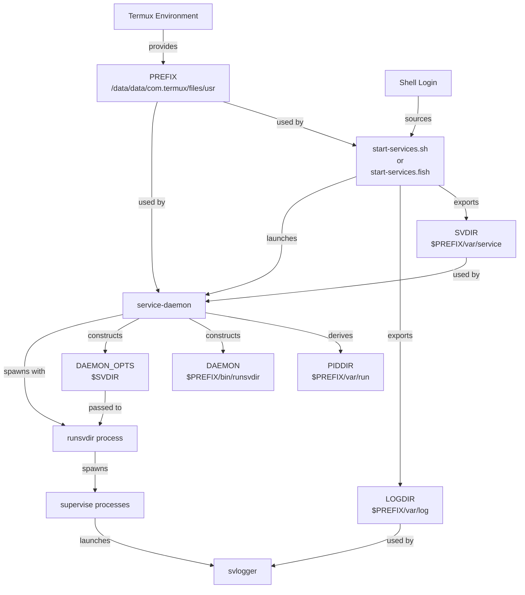
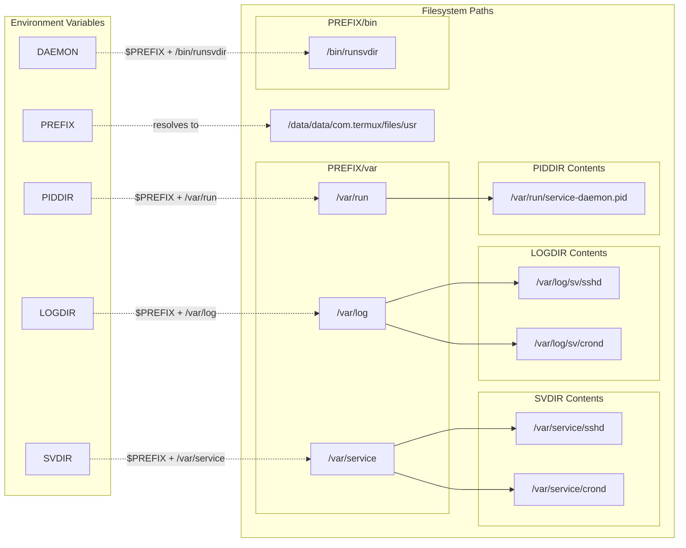

<!-- source: DeepWiki mcp.deepwiki.com · repo termux/termux-services · page 7 Environment Variables · fetched 2026-10-26 -->

# Environment Variables

<details>
<summary>Relevant source files</summary>

The following files were used as context for generating this wiki page:

- [Makefile](Makefile)
- [service-daemon](service-daemon)
- [start-services.fish](start-services.fish)
- [start-services.sh](start-services.sh)
- [svlogger](svlogger)

</details>


This document provides a complete reference for all environment variables used by termux-services. Environment variables control directory paths, daemon configuration, and build-time installation targets. Understanding these variables is essential for customizing service locations, diagnosing path-related issues, and integrating termux-services with custom configurations.

For information about the directory structure these variables reference, see [File System Layout](#5.5). For details on how these variables are initialized during shell login, see [Login Integration](#5.3).

## Overview

termux-services relies on environment variables to maintain portability across different Termux installations and to allow configuration without modifying scripts. The system uses two categories of variables:

1. **Runtime Variables**: Set during shell login and used throughout service operation (`SVDIR`, `LOGDIR`, `PREFIX`)
2. **Build-time Variables**: Used during installation to determine target directories (`DESTDIR`, `PREFIX`)

All runtime variables are exported globally, making them available to service-daemon, user commands, and service processes themselves.

## Core Runtime Variables

### SVDIR

**Purpose**: Specifies the directory where service definitions are stored and monitored.

**Set by**: [start-services.sh:1](), [start-services.fish:3]()

**Default Value**: `$PREFIX/var/service`

**Used by**:
- [service-daemon:22]() - Passed as argument to runsvdir
- [service-daemon:11]() - Used to locate supervise directories during cleanup
- User commands `sv-enable` and `sv-disable` (implicitly via runit's sv command)
- `runsvdir` process for service discovery

**Description**: `SVDIR` is the central configuration directory that `runsvdir` continuously monitors. Each subdirectory under `SVDIR` represents a service definition. The presence or absence of a `down` file in each service directory determines whether the service starts automatically. This variable must be set before service-daemon starts, as it is passed directly to the underlying `runsvdir` process.

**Example Usage**:
```bash
# Default configuration
export SVDIR=$PREFIX/var/service

# Custom location (set before starting service-daemon)
export SVDIR=/path/to/custom/services
```

### LOGDIR

**Purpose**: Specifies the root directory where service logs are stored.

**Set by**: [start-services.sh:2](), [start-services.fish:4]()

**Default Value**: `$PREFIX/var/log`

**Used by**:
- [svlogger:7]() - Creates and writes logs to `$LOGDIR/sv/$service`

**Description**: `LOGDIR` determines where the logging infrastructure stores service output. The svlogger script creates a subdirectory structure `$LOGDIR/sv/<service-name>` for each service. Logs are managed by `svlogd`, which automatically rotates and compresses log files within these directories. Changing `LOGDIR` allows centralized log management or redirection to alternative storage locations.

**Example Usage**:
```bash
# Default configuration
export LOGDIR=$PREFIX/var/log

# Custom location (set before starting services)
export LOGDIR=/sdcard/termux-logs
```

### PREFIX

**Purpose**: The Termux installation root directory containing all installed files.

**Set by**: Termux environment (globally available in all Termux sessions)

**Default Value**: `/data/data/com.termux/files/usr`

**Used by**:
- [start-services.sh:1-2]() - Constructs `SVDIR` and `LOGDIR` paths
- [start-services.fish:3-4]() - Constructs `SVDIR` and `LOGDIR` paths
- [service-daemon:6]() - Locates executables and constructs paths
- [service-daemon:18]() - Constructs `PIDDIR` path
- [service-daemon:21]() - Locates `runsvdir` executable
- [Makefile:4-12]() - Installation target paths

**Description**: `PREFIX` is the foundational variable that all other paths derive from. It points to the Termux installation root and is set automatically by the Termux environment. This variable should never be modified manually, as it is tightly coupled to the Termux application's data directory structure on Android.

## Environment Variable Flow

The following diagram shows how environment variables are established during system initialization and propagated through components:



**Sources**: [start-services.sh:1-4](), [start-services.fish:1-7](), [service-daemon:1-48](), [svlogger:1-10]()

## Internal Variables

The following variables are set internally by service-daemon and are not intended for user modification. They are documented here for diagnostic and troubleshooting purposes.

### NAME

**Set by**: [service-daemon:17]()

**Value**: `service-daemon`

**Used by**: [service-daemon:19,26,31,36]() - Naming PID file and status messages

**Description**: Internal constant identifying the service-daemon process name. Used for constructing the PID file name and in status output messages.

### PIDDIR

**Set by**: [service-daemon:18]()

**Value**: `$PREFIX/var/run`

**Used by**: [service-daemon:5]() - Directory creation for PID file storage

**Description**: Derived from `PREFIX`, this directory stores the service-daemon PID file. The directory is created automatically when service-daemon starts.

### PIDFILE

**Set by**: [service-daemon:19]()

**Value**: `$PIDDIR/$NAME.pid` (`$PREFIX/var/run/service-daemon.pid`)

**Used by**: 
- [service-daemon:6]() - PID file creation during start
- [service-daemon:9,10]() - PID file reading during stop

**Description**: Full path to the service-daemon PID file. This file contains the process ID of the running runsvdir instance managed by service-daemon. Used by start-stop-daemon for process management.

### DAEMON

**Set by**: [service-daemon:21]()

**Value**: `$PREFIX/bin/runsvdir`

**Used by**: [service-daemon:6]() - Executable path for start-stop-daemon

**Description**: Full path to the runsvdir executable. This is the actual supervision process that monitors `SVDIR` and manages service lifecycle.

### DAEMON_OPTS

**Set by**: [service-daemon:22]()

**Value**: `$SVDIR` (typically `$PREFIX/var/service`)

**Used by**: [service-daemon:6]() - Arguments passed to runsvdir

**Description**: Command-line arguments for the runsvdir process. Contains the directory path that runsvdir should monitor for service definitions.

## Variable Usage by Component

The following table summarizes which components read and write each environment variable:

| Variable | Set By | Read By | Modifiable |
|----------|--------|---------|------------|
| `PREFIX` | Termux environment | start-services scripts, service-daemon, Makefile | No (system-managed) |
| `SVDIR` | start-services scripts | service-daemon, sv commands, runsvdir | Yes (before daemon start) |
| `LOGDIR` | start-services scripts | svlogger | Yes (before daemon start) |
| `NAME` | service-daemon | service-daemon | No (internal constant) |
| `PIDDIR` | service-daemon | service-daemon | No (derived from PREFIX) |
| `PIDFILE` | service-daemon | service-daemon | No (derived from PIDDIR) |
| `DAEMON` | service-daemon | service-daemon | No (derived from PREFIX) |
| `DAEMON_OPTS` | service-daemon | service-daemon | No (derived from SVDIR) |
| `DESTDIR` | Build environment | Makefile | Yes (build-time only) |

**Sources**: [start-services.sh:1-4](), [start-services.fish:1-7](), [service-daemon:1-48](), [svlogger:1-10](), [Makefile:1-23]()

## Variable-to-Path Mapping

This diagram illustrates how environment variables map to actual filesystem paths in a standard Termux installation:



**Sources**: [start-services.sh:1-2](), [service-daemon:18-22]()

## Build-time Variables

### DESTDIR

**Purpose**: Optional installation prefix for staged installations.

**Used by**: [Makefile:4-12]() - All installation targets

**Default Value**: Empty (installs directly to PREFIX)

**Description**: `DESTDIR` is a standard build system variable that prepends an additional path prefix during installation. This is used for package building where files need to be installed to a temporary staging directory before being packaged. When `DESTDIR` is set, all files are installed to `$(DESTDIR)$(PREFIX)/...` instead of `$(PREFIX)/...`.

**Example Usage**:
```bash
# Standard installation
make install PREFIX=/data/data/com.termux/files/usr

# Staged installation for packaging
make install PREFIX=/data/data/com.termux/files/usr DESTDIR=/tmp/build-root
```

The Makefile references `DESTDIR` consistently across all installation targets to support both direct installation and package building workflows.

**Sources**: [Makefile:4-12]()

## Customizing Variables

While most variables use sensible defaults, `SVDIR` and `LOGDIR` can be customized for specialized configurations.

### Changing Service Directory Location

To use a custom service directory:

1. Create the directory structure:
   ```bash
   mkdir -p /path/to/custom/services
   ```

2. Modify the login script before it starts service-daemon. For bash/POSIX shells, edit `$PREFIX/etc/profile.d/start-services.sh`:
   ```bash
   export SVDIR=/path/to/custom/services
   export LOGDIR=$PREFIX/var/log
   (service-daemon start >/dev/null 2>&1 & )
   ```

3. For fish shell, edit `$PREFIX/etc/fish/conf.d/start-services.fish`:
   ```fish
   if status --is-login
       set -gx SVDIR /path/to/custom/services
       set -gx LOGDIR $PREFIX/var/log
       service-daemon start >/dev/null 2>&1 &
   end
   ```

4. Restart your shell session for changes to take effect.

**Warning**: Changing `SVDIR` after services are running requires restarting service-daemon. Use `service-daemon stop` followed by `service-daemon start` after modifying the variable.

### Changing Log Directory Location

Similar to `SVDIR`, modify the login scripts to set `LOGDIR` to a custom path. This is useful for redirecting logs to external storage or alternative filesystems:

```bash
# Redirect logs to SD card
export LOGDIR=/sdcard/termux-logs
```

Ensure the target directory is writable by the Termux process and has sufficient storage space for accumulated logs.

**Sources**: [start-services.sh:1-4](), [start-services.fish:1-7]()

## Variable Inspection

To verify current environment variable values in a running session:

```bash
# Display all termux-services variables
echo "PREFIX: $PREFIX"
echo "SVDIR: $SVDIR"
echo "LOGDIR: $LOGDIR"

# Verify service-daemon is using correct paths
ps aux | grep runsvdir
```

The `runsvdir` process should show the path matching your `SVDIR` value in its command line.

For debugging path-related issues, use these commands to trace variable values through the component chain:

```bash
# Check login script values
grep -E 'SVDIR|LOGDIR' $PREFIX/etc/profile.d/start-services.sh

# Check if service-daemon is running with correct SVDIR
cat $PREFIX/var/run/service-daemon.pid
ps -p $(cat $PREFIX/var/run/service-daemon.pid) -o args=
```

**Sources**: [start-services.sh:1-4](), [service-daemon:1-48]()

## Related Configuration

While environment variables control directory paths, other aspects of service configuration are managed through:

- **Service state**: Controlled via `down` files in each service directory (see [Enabling and Disabling Services](#4.1))
- **Service definitions**: The `run` scripts in `$SVDIR/<service>/` directories
- **Log configuration**: Managed by svlogd through the `log/run` script (see [Logging Infrastructure](#5.4))

Environment variables provide the foundational paths that these other configuration mechanisms build upon.

**Sources**: [svlogger:1-10](), [service-daemon:11-14]()

---

