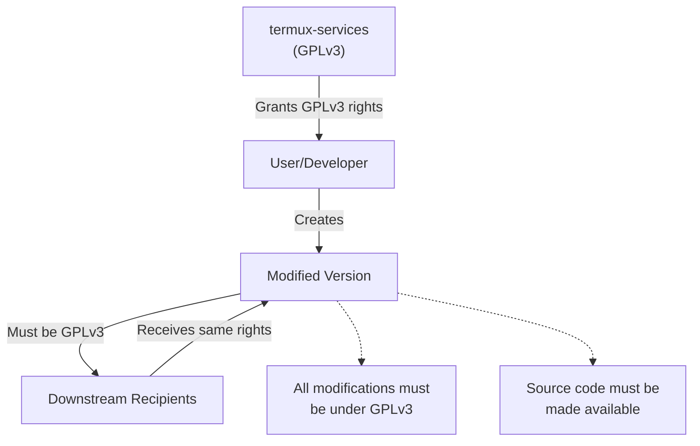
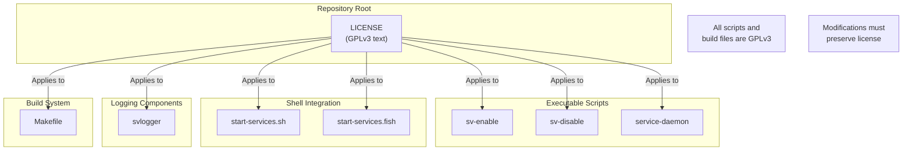

<!-- source: DeepWiki mcp.deepwiki.com · repo termux/termux-services · page 9 License · fetched 2026-10-26 -->

# License

Relevant source files

The following files were used as context for generating this wiki page:

- [LICENSE](LICENSE)

This page documents the software license under which termux-services is distributed, including the rights granted to users and the obligations for those who redistribute or modify the software.

---

## Overview

termux-services is licensed under the **GNU General Public License version 3 (GPLv3)**, a free and open-source copyleft license published by the Free Software Foundation. The complete license text is available in the repository at [LICENSE:1-675]().

**Sources:** [LICENSE:1-6]()

---

## License Summary

The GNU GPL version 3 is a copyleft license that ensures the software and its derivatives remain free and open-source. The license grants users four essential freedoms while requiring that these freedoms be preserved in any redistributed or modified versions.

### Key Rights Granted

Users and developers of termux-services have the following rights under GPLv3:

| Right | Description | License Reference |
|-------|-------------|-------------------|
| **Use** | Run the program for any purpose without restriction | [LICENSE:159-159]() |
| **Study** | Access and examine the source code | [LICENSE:114-116]() |
| **Modify** | Make changes to the software | [LICENSE:84-87]() |
| **Distribute** | Share copies of the original or modified versions | [LICENSE:164-174]() |

These rights are irrevocable as long as the license conditions are met ([LICENSE:156-157]()).

**Sources:** [LICENSE:10-27](), [LICENSE:154-178]()

---

## Copyleft Requirements

The GPLv3 is a copyleft license, meaning that derivative works must also be distributed under the same license terms. This ensures that the freedoms granted by the original authors are preserved throughout the distribution chain.

**Diagram: GPLv3 Copyleft Inheritance Model**

**Sources:** [LICENSE:210-228](), [LICENSE:446-451]()

---

## Distribution Obligations

When distributing termux-services or modified versions, the following obligations must be met:

### Source Code Availability

All distributed copies must include or provide access to the corresponding source code ([LICENSE:134-152]()):

- **Verbatim copies**: Must include appropriate copyright notices and a copy of the license ([LICENSE:197-203]())
- **Modified versions**: Must clearly mark modifications and include the modified source code ([LICENSE:208-233]())
- **Object code**: Must be accompanied by the complete corresponding source code ([LICENSE:246-295]())

### License and Copyright Notices

Redistributors must:

1. Retain all copyright notices from the original ([LICENSE:199-200]())
2. Include a copy of the GPLv3 license ([LICENSE:203]())
3. Display appropriate legal notices if the software has an interactive interface ([LICENSE:103-110]())
4. Mark modified versions with prominent notices indicating changes and dates ([LICENSE:214-215]())

**Sources:** [LICENSE:195-243]()

---

## Application to termux-services Components

All components of termux-services are covered under the GPLv3 license. The following diagram shows how the license applies to the repository structure:

**Diagram: License Coverage of Repository Components**

### Component-Specific Application

| Component | File(s) | License Coverage |
|-----------|---------|------------------|
| Service control commands | `sv-enable`, `sv-disable` | GPLv3 |
| Service daemon | `service-daemon` | GPLv3 |
| Shell integration | `start-services.sh`, `start-services.fish` | GPLv3 |
| Logging infrastructure | `svlogger` | GPLv3 |
| Build system | `Makefile` | GPLv3 |

**Sources:** [LICENSE:1-6]()

---

## Warranty Disclaimer

termux-services is provided "AS IS" without warranty of any kind, as explicitly stated in the license:

> **THERE IS NO WARRANTY FOR THE PROGRAM, TO THE EXTENT PERMITTED BY APPLICABLE LAW.** ([LICENSE:591]())

The license provides no warranties regarding:

- **Merchantability**: No guarantee the software is suitable for any particular purpose ([LICENSE:594-595]())
- **Performance**: No guarantee the software will meet quality or performance expectations ([LICENSE:596-597]())
- **Defects**: Users assume the cost of any necessary servicing or repairs ([LICENSE:597-598]())

**Sources:** [LICENSE:589-598]()

---

## Liability Limitation

Copyright holders and distributors are not liable for damages arising from the use or inability to use the program, including:

- Loss of data ([LICENSE:606-607]())
- Data being rendered inaccurate ([LICENSE:606-607]())
- Failure to operate with other programs ([LICENSE:608-609]())
- General, special, incidental, or consequential damages ([LICENSE:604-605]())

This limitation applies even if the copyright holder has been advised of the possibility of such damages ([LICENSE:609-610]()).

**Sources:** [LICENSE:600-610]()

---

## Patent Rights

The GPLv3 includes explicit provisions regarding patent rights:

### Patent License Grant

Each contributor grants a non-exclusive, worldwide, royalty-free patent license under their essential patent claims to:

- Make, use, sell, and offer for sale the software ([LICENSE:487-490]())
- Import, run, modify, and propagate the software ([LICENSE:487-490]())

### Patent Retaliation

The license includes anti-patent-trolling provisions:

- If you initiate patent litigation claiming the software infringes, your license terminates ([LICENSE:466-469]())
- Patent licenses must be non-discriminatory ([LICENSE:521-534]())
- You cannot use patents to make the software effectively proprietary ([LICENSE:64-66]())

**Sources:** [LICENSE:471-538]()

---

## Compatibility with Other Licenses

### GNU AGPL Compatibility

termux-services may be combined with works licensed under the GNU Affero General Public License version 3 ([LICENSE:554-561]()):

- The combined work can be conveyed as a single work
- GPLv3 terms continue to apply to the termux-services portion
- AGPL section 13 requirements apply to the combination

### Incompatible Licenses

The GPLv3 is incompatible with proprietary licenses ([LICENSE:669-674]()):

- termux-services cannot be incorporated into proprietary programs
- Linking with proprietary libraries would require the GNU Lesser General Public License (LGPL) instead

**Sources:** [LICENSE:552-561](), [LICENSE:669-674]()

---

## Accepting the License

Users are not required to accept the license merely to run the program ([LICENSE:437-444]()). However:

- **Modification or distribution** of the software indicates acceptance of the license ([LICENSE:442-444]())
- These actions are prohibited by copyright law without accepting the license terms ([LICENSE:440-444]())
- Running an unmodified copy does not require license acceptance ([LICENSE:159]())

**Sources:** [LICENSE:435-444]()

---

## License Termination

Your rights under the GPLv3 terminate automatically if you violate its terms ([LICENSE:409-413]()):

### Reinstatement Conditions

A terminated license may be reinstated:

1. **Provisionally**: If you cease all violations ([LICENSE:415-420]())
   - Becomes permanent if the copyright holder doesn't explicitly terminate within 60 days
   
2. **Permanently**: If this is your first violation from that copyright holder ([LICENSE:422-427]())
   - You must cure the violation within 30 days of notification

Parties who received the software from you retain their licenses even if yours is terminated ([LICENSE:429-431]()).

**Sources:** [LICENSE:407-433]()

---

## Future License Versions

The Free Software Foundation may publish revised versions of the GPL ([LICENSE:565-568]()):

- New versions will be similar in spirit but may address new concerns ([LICENSE:567-568]())
- If termux-services specifies "version 3 or any later version," you may choose to follow either version 3 or any later published version ([LICENSE:570-577]())
- Later versions may grant additional permissions but impose no additional obligations ([LICENSE:584-587]())

Currently, termux-services uses GPLv3 specifically ([LICENSE:1-2]()).

**Sources:** [LICENSE:563-587]()

---

## Full License Text

The complete text of the GNU General Public License version 3 is included in the repository at [LICENSE:1-675](). Users and developers should refer to this file for the authoritative and legally binding license terms.

Key sections of the full license include:

| Section | Content | Lines |
|---------|---------|-------|
| Preamble | Philosophy and intent | [LICENSE:8-69]() |
| Definitions | Legal terminology | [LICENSE:73-110]() |
| Source Code | Definition and requirements | [LICENSE:112-152]() |
| Basic Permissions | Core rights granted | [LICENSE:154-177]() |
| Conveying Copies | Distribution requirements | [LICENSE:195-341]() |
| Additional Terms | Supplementary provisions | [LICENSE:343-405]() |
| Termination | Loss and restoration of rights | [LICENSE:407-433]() |
| Patents | Patent-related provisions | [LICENSE:471-538]() |
| Warranty | Disclaimer of warranty | [LICENSE:589-598]() |
| Liability | Limitation of liability | [LICENSE:600-619]() |

**Sources:** [LICENSE:1-675]()

---

## Practical Implications

### For Users

- You may freely install, use, and run termux-services
- No payment or registration is required
- You may share copies with others
- You assume all risks related to software quality and performance

### For Developers and Distributors

- You must provide source code with any distributed copies
- Modified versions must be clearly marked as changed
- The GPLv3 license must accompany all distributions
- You cannot add additional restrictions beyond those in GPLv3
- You must preserve all copyright and license notices

### For Package Maintainers

When packaging termux-services (e.g., for the Termux package repository):

- Include the [LICENSE:1-675]() file in the package
- Ensure source code is available via the repository link
- Do not add proprietary components or additional restrictions
- Preserve all original copyright notices in the installed files

**Sources:** [LICENSE:1-675]()

---

## Additional Resources

For more information about the GNU General Public License:

- **Full license text**: [LICENSE:1-675]()
- **FSF license page**: Referenced at [LICENSE:4]() and [LICENSE:648]()
- **How to apply the GPL**: [LICENSE:623-674]()
- **Why not LGPL**: Discussed at [LICENSE:673-674]()

For questions about how the license applies to specific use cases, consult the Free Software Foundation's website or seek legal advice, as this documentation does not constitute legal counsel.

**Sources:** [LICENSE:623-674]()