# Page: Home

# Home

<details>
<summary>Relevant source files</summary>

The following files were used as context for generating this wiki page:

- [Makefile](Makefile)
- [README.md](README.md)
- [start-services.fish](start-services.fish)
- [svlogger](svlogger)

</details>


This document provides an overview of termux-services, a package that integrates the runit service supervision system into the Termux Android terminal environment. This page explains what termux-services is, the problem it solves, and how its components work together.

For step-by-step installation instructions, see [Installation](#2). For practical usage examples, see [Quick Start Guide](#3). For detailed technical architecture, see [Architecture](#5).

## What is termux-services?

termux-services is a Termux package that enables persistent background service management using runit, a lightweight UNIX init scheme with service supervision. It provides a way to run long-lived processes (daemons) that automatically restart on failure and survive across shell sessions.

The package wraps runit's supervision tools with Termux-specific components to handle:
- Service lifecycle management (enable, disable, start, stop)
- Automatic daemon initialization on shell login
- Centralized logging infrastructure
- Service state persistence across terminal sessions

**Sources:** [README.md:1-10]()

## Problem Statement

Termux lacks a native service management system. Users who want to run background processes face several challenges:

1. **Process persistence**: Background processes terminate when the shell session ends
2. **Automatic restart**: Crashed processes require manual intervention to restart
3. **Startup automation**: No built-in mechanism to start services on terminal launch
4. **Log management**: No standardized way to capture and rotate service logs

termux-services solves these problems by integrating runit's supervision capabilities into the Termux environment.

## Solution Architecture

termux-services creates a service supervision infrastructure by combining several components:

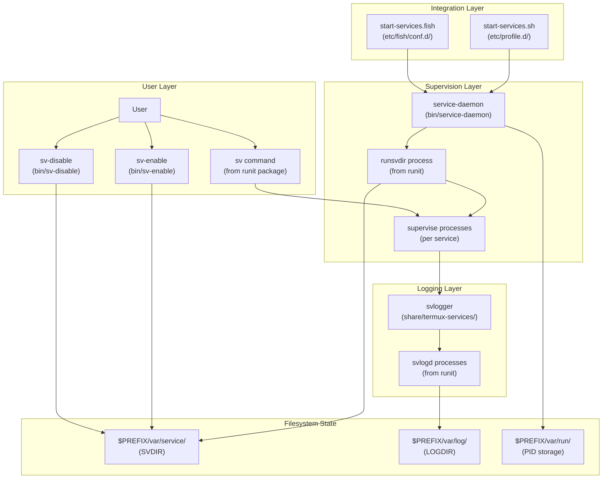

**Component Mapping to Code Entities**

This diagram shows how system components map to actual files and processes in the codebase. The supervision layer uses runit's `runsvdir` to monitor `$SVDIR`, while user commands manipulate filesystem state in that directory.

**Sources:** [Makefile:1-23](), [README.md:1-10](), [start-services.fish:1-6]()

## Core Components

### Installed Executables

| Component | Location | Purpose |
|-----------|----------|---------|
| `sv-enable` | `$PREFIX/bin/` | Removes `down` file to enable autostart |
| `sv-disable` | `$PREFIX/bin/` | Creates `down` file to disable autostart |
| `service-daemon` | `$PREFIX/bin/` | Manages `runsvdir` lifecycle and PID tracking |

### Shell Integration Scripts

| Script | Location | Purpose |
|--------|----------|---------|
| `start-services.sh` | `$PREFIX/etc/profile.d/` | Bash/POSIX shell initialization |
| `start-services.fish` | `$PREFIX/etc/fish/conf.d/` | Fish shell initialization |

Both scripts set environment variables and start `service-daemon` on login:
- `SVDIR=$PREFIX/var/service` - Service definition directory
- `LOGDIR=$PREFIX/var/log` - Log storage directory

### Logging Infrastructure

| Component | Location | Purpose |
|-----------|----------|---------|
| `svlogger` | `$PREFIX/share/termux-services/` | Wrapper that extracts service name and invokes `svlogd` |

The `svlogger` script [svlogger:1-10]() determines the service name from its working directory and configures `svlogd` to write logs to `$LOGDIR/sv/<service>/`.

**Sources:** [Makefile:4-12](), [svlogger:1-10](), [start-services.fish:1-6]()

## Service Lifecycle Flow

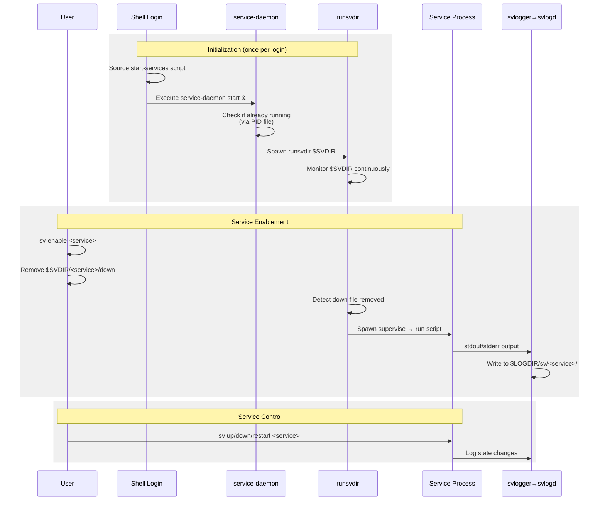

**Lifecycle Stages**

1. **Installation**: `pkg install termux-services` deploys scripts via [Makefile:3-12]()
2. **Initialization**: Shell login sources integration scripts [start-services.fish:1-6]() or `start-services.sh`
3. **Daemon Startup**: `service-daemon start` spawns `runsvdir` to monitor `$SVDIR`
4. **Service Management**: Users control services via `sv-enable`, `sv-disable`, and `sv` commands
5. **Logging**: Service output flows through [svlogger:1-10]() to `svlogd` for persistent storage

**Sources:** [README.md:1-10](), [start-services.fish:1-6](), [svlogger:1-10]()

## Filesystem State Model

termux-services uses filesystem state to control service behavior:

| State Element | Location | Meaning |
|---------------|----------|---------|
| Service directory exists | `$SVDIR/<service>/` | Service is known to `runsvdir` |
| `down` file exists | `$SVDIR/<service>/down` | Service disabled (won't autostart) |
| `down` file absent | `$SVDIR/<service>/down` | Service enabled (will autostart) |
| `run` script | `$SVDIR/<service>/run` | Executable that starts the service |
| `log/run` script | `$SVDIR/<service>/log/run` | Typically invokes [svlogger:9]() |
| PID file | `$PREFIX/var/run/service-daemon.pid` | Tracks `service-daemon` process |

The `sv-enable` and `sv-disable` commands manipulate the `down` file to control service autostart behavior [README.md:9]().

**Sources:** [README.md:9-10](), [svlogger:7-9]()

## Integration with runit

termux-services is a thin wrapper around runit's core tools:

| runit Component | termux-services Usage |
|-----------------|----------------------|
| `runsvdir` | Spawned by `service-daemon` to monitor `$SVDIR` |
| `supervise` | Spawned per-service by `runsvdir` to manage process lifecycle |
| `sv` | Used directly by users for service control (up, down, restart, status) |
| `svlogd` | Invoked by [svlogger:9]() to handle log rotation and storage |

For detailed information on using native runit commands with termux-services, see [Integration with runit](#8).

**Sources:** [README.md:3-8](), [svlogger:9]()

## Key Concepts

### Service Directory (`$SVDIR`)
The directory monitored by `runsvdir`, set to `$PREFIX/var/service` [start-services.fish:3](). Each subdirectory represents a service with its own `run` script and optional `log/run` script.

### Log Directory (`$LOGDIR`)
Centralized log storage location, set to `$PREFIX/var/log` [start-services.fish:4](). Logs are organized as `$LOGDIR/sv/<service>/current`.

### Enable vs. Start
- **Enable** (`sv-enable`): Removes the `down` file so the service autostarts on `runsvdir` restart
- **Start** (`sv up`): Immediately starts the service without modifying autostart behavior

### Disable vs. Stop
- **Disable** (`sv-disable`): Creates the `down` file and stops the service
- **Stop** (`sv down`): Immediately stops the service without modifying autostart behavior

**Sources:** [README.md:5-9](), [start-services.fish:3-4]()

## Quick Reference

### Basic Usage

```bash
# Enable and start a service
sv-enable sshd

# Start a service immediately
sv up sshd

# Check service status
sv status sshd

# View service logs
cat $PREFIX/var/log/sv/sshd/current

# Stop a service
sv down sshd

# Disable a service
sv-disable sshd
```

For comprehensive usage documentation, see [User Guide](#4) and [Command Reference](#6).

**Sources:** [README.md:3-8]()

## System Requirements

termux-services requires:
- Termux terminal environment
- The `runit` package (provides `runsvdir`, `supervise`, `sv`, `svlogd`)
- A POSIX-compatible or Fish shell for login integration

The package installs via `pkg install termux-services` [README.md:3](), which handles dependency resolution automatically.

**Sources:** [README.md:3](), [Makefile:1-23]()

## Documentation Structure

This wiki is organized as follows:

- **[Installation](#2)**: How to install and verify the package
- **[Quick Start Guide](#3)**: Get started with basic service management
- **[User Guide](#4)**: Comprehensive end-user documentation
- **[Architecture](#5)**: Technical design and implementation details
- **[Command Reference](#6)**: Complete command documentation
- **[Environment Variables](#7)**: Reference for `SVDIR`, `LOGDIR`, etc.
- **[Integration with runit](#8)**: How to use native runit commands
- **[License](#9)**: Software license information

---

# Page: Installation

# Installation

<details>
<summary>Relevant source files</summary>

The following files were used as context for generating this wiki page:

- [Makefile](Makefile)
- [README.md](README.md)
- [start-services.fish](start-services.fish)
- [svlogger](svlogger)

</details>


This page provides step-by-step instructions for installing termux-services, describes what components get installed and where they are placed in the filesystem, and explains the initial setup requirements. For information about actually using termux-services to manage services after installation, see [Quick Start Guide](#3). For architectural details about how these components work together, see [Architecture](#5).

## Prerequisites

termux-services requires:
- A functioning Termux environment
- The `pkg` package manager (standard in Termux)
- The `runit` package (automatically installed as a dependency)

No manual configuration is required before installation. The package manager handles all dependency resolution.

## Installation Command

Execute the following command to install termux-services:

```bash
pkg install termux-services
```

This command:
1. Resolves and installs the `runit` package if not already present
2. Downloads the termux-services package
3. Executes the installation process defined in [Makefile:3-12]()

**Sources:** [README.md:3]()

## Installation Process

The package manager invokes the Makefile's `install` target, which deploys all components to their designated locations within the `$PREFIX` directory (typically `/data/data/com.termux/files/usr`).

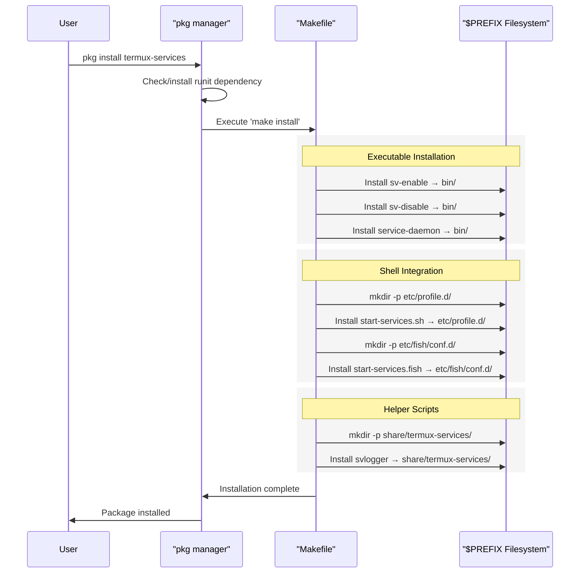

**Sources:** [Makefile:3-12]()

## Installed Components

The installation process deploys seven components across four directory categories:

### Executables (`$PREFIX/bin/`)

| File | Purpose | Reference |
|------|---------|-----------|
| `sv-enable` | Enable service autostart by removing `down` file | [Command Reference](#6.1) |
| `sv-disable` | Disable service autostart by creating `down` file | [Command Reference](#6.2) |
| `service-daemon` | Lifecycle manager for `runsvdir` supervision | [Architecture](#5.2) |

These executables are installed via [Makefile:4-6]() and become immediately available in the user's `$PATH`.

### Shell Integration Scripts

| File | Shell | Purpose |
|------|-------|---------|
| `$PREFIX/etc/profile.d/start-services.sh` | bash, zsh, POSIX shells | Auto-start service daemon on login |
| `$PREFIX/etc/fish/conf.d/start-services.fish` | fish shell | Auto-start service daemon on login |

These scripts are sourced automatically by their respective shells during login sessions. They set environment variables (`SVDIR`, `LOGDIR`) and start `service-daemon` in the background. See [start-services.fish:1-6]() for the fish implementation.

Installation occurs via [Makefile:7-10](), with the Makefile creating parent directories as needed.

**Sources:** [Makefile:4-10](), [start-services.fish:1-6]()

### Helper Scripts (`$PREFIX/share/termux-services/`)

| File | Purpose |
|------|---------|
| `svlogger` | Logging wrapper that configures `svlogd` for each service |

The `svlogger` script extracts the service name from its working directory and configures `svlogd` to write logs to `$LOGDIR/sv/<service>/`. See [Logging Infrastructure](#5.4) for details.

Installation occurs via [Makefile:11-12]().

**Sources:** [Makefile:11-12](), [svlogger:1-9]()

## Filesystem Layout After Installation

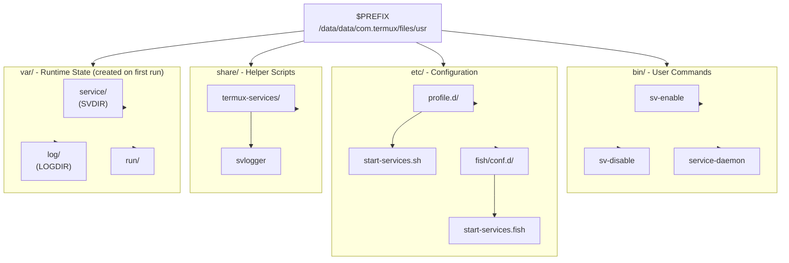

**Sources:** [Makefile:4-12]()

The `var/` directory structure is not created during package installation. These directories are created at runtime:
- `var/service/` - Created when `service-daemon` starts [service-daemon]()
- `var/log/` - Created when services first generate log output [svlogger:7]()
- `var/run/` - Created when `service-daemon` stores its PID file [service-daemon]()

## Post-Installation Setup

After installation completes, the service supervision system is not yet active. Activation requires a shell restart to trigger the login scripts.

### Shell Restart Requirement

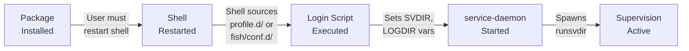

**Sources:** [README.md:4](), [start-services.fish:1-6]()

To activate termux-services after installation:

1. **Exit the current shell session:**
   ```bash
   exit
   ```

2. **Start a new shell session** by opening a new Termux terminal or reconnecting to your session

3. **Verify activation** by checking if `service-daemon` is running:
   ```bash
   pgrep -f service-daemon
   ```

If a PID is displayed, the service supervision system is active.

### What Happens During Shell Login

When a new login shell starts:

1. **For bash/zsh/POSIX shells:** The shell sources `$PREFIX/etc/profile.d/start-services.sh`
2. **For fish shell:** The shell sources `$PREFIX/etc/fish/conf.d/start-services.fish`
3. **Environment variables are set:**
   - `SVDIR=$PREFIX/var/service` - Service definition directory
   - `LOGDIR=$PREFIX/var/log` - Log output directory
4. **service-daemon starts in background:** `service-daemon start >/dev/null 2>&1 &`
5. **runsvdir begins monitoring:** The daemon spawns `runsvdir $SVDIR`

See [start-services.fish:1-6]() for the complete fish shell implementation.

**Sources:** [start-services.fish:1-6](), [README.md:4]()

## Verification

After restarting your shell, verify the installation:

### Check Service Daemon Status

```bash
service-daemon status
```

Expected output indicates that `runsvdir` is monitoring the service directory.

### Check Environment Variables

```bash
echo $SVDIR
echo $LOGDIR
```

Expected output:
```
/data/data/com.termux/files/usr/var/service
/data/data/com.termux/files/usr/var/log
```

### Check Process Tree

```bash
pstree -p $(pgrep -f service-daemon)
```

You should see `runsvdir` as a child process of `service-daemon`.

### List Available Commands

```bash
which sv-enable sv-disable service-daemon
```

All three commands should be found in `$PREFIX/bin/`.

## Uninstallation

To remove termux-services:

```bash
pkg uninstall termux-services
```

The package manager executes the Makefile's `uninstall` target [Makefile:14-20](), which removes:
- All executables from `bin/`
- Shell integration scripts from `etc/profile.d/` and `etc/fish/conf.d/`
- Helper scripts from `share/termux-services/`

The uninstall process does **not** remove:
- Service definitions in `$PREFIX/var/service/`
- Log files in `$PREFIX/var/log/`
- Runtime state in `$PREFIX/var/run/`

These directories contain user-created content and are intentionally preserved. To remove them manually after uninstallation:

```bash
rm -rf $PREFIX/var/service
rm -rf $PREFIX/var/log/sv
rm -rf $PREFIX/var/run/service-daemon.pid
```

**Sources:** [Makefile:14-20]()

## Next Steps

With termux-services installed and activated, you can:
- Follow the [Quick Start Guide](#3) to enable and manage your first service
- Read the [User Guide](#4) for comprehensive service management instructions
- Explore the [Architecture](#5) to understand how the components interact

---

# Page: Quick Start Guide

# Quick Start Guide

<details>
<summary>Relevant source files</summary>

The following files were used as context for generating this wiki page:

- [README.md](README.md)
- [sv-disable](sv-disable)
- [sv-enable](sv-enable)

</details>


This guide provides a practical introduction to managing services with termux-services. It assumes you have already completed installation (see [Installation](#2)) and focuses on the essential operations needed to run your first service. For comprehensive documentation on service management concepts, see [User Guide](#4). For detailed command reference, see [Command Reference](#6).

**Sources:** [README.md:1-10]()

---

## Prerequisites

Before following this guide, ensure:

1. **termux-services is installed**: You have run `pkg install termux-services`
2. **Shell has been restarted**: The `service-daemon` process starts automatically on shell login
3. **runit is installed**: The `runit` package provides the underlying supervision system

To verify `service-daemon` is running:

```bash
pgrep -f runsvdir
```

If this returns a process ID, the service supervision system is active. If not, restart your shell or manually run `service-daemon start`.

**Sources:** [README.md:1-4]()

---

## Basic Workflow Overview

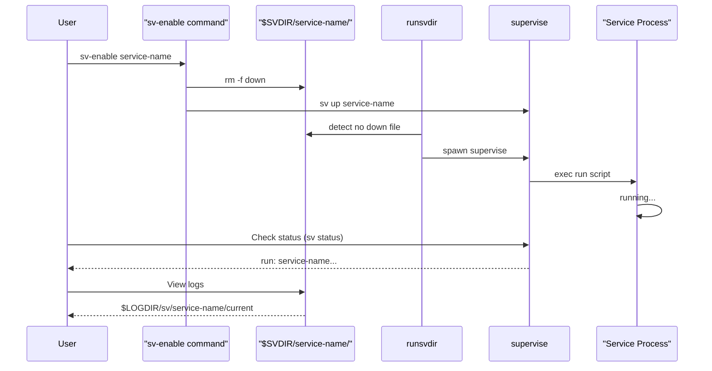

**Workflow Steps:**
1. **Enable service**: `sv-enable` removes the `down` file and signals service to start
2. **runsvdir detects**: The `runsvdir` process monitors `$SVDIR` and sees service is enabled
3. **supervise spawns**: A `supervise` process is created for the service
4. **Service runs**: The service's `run` script is executed
5. **Logs captured**: Output is written to `$LOGDIR/sv/service-name/current`

**Sources:** [README.md:3-9](), [sv-enable:1-21]()

---

## Working with Services

### Enable and Start a Service

To enable a service for autostart and start it immediately:

```bash
sv-enable <service-name>
```

**What this does:**
- Removes `$PREFIX/var/service/<service-name>/down` if it exists
- Sends the "up" signal to start the service immediately

Example:

```bash
sv-enable sshd
```

Alternatively, to start a service **without** enabling autostart:

```bash
sv up <service-name>
```

**Sources:** [README.md:5](), [sv-enable:1-21]()

---

### Check Service Status

Use the standard `sv` command to check service status:

```bash
sv status <service-name>
```

Example output:
```
run: sshd: (pid 12345) 30s
```

This shows:
- **run**: Service is currently running
- **pid 12345**: Process ID of the service
- **30s**: Service has been running for 30 seconds

**Sources:** [README.md:5-6]()

---

### View Service Logs

All service output (stdout and stderr) is captured in log files:

```bash
tail -f $PREFIX/var/log/sv/<service-name>/current
```

Or use environment variables set by the login scripts:

```bash
tail -f $LOGDIR/sv/<service-name>/current
```

The log file location pattern is `$PREFIX/var/log/sv/<service-name>/current`. The `svlogd` process automatically rotates logs when they reach a certain size.

**Sources:** [README.md:6]()

---

### Stop a Service

To stop a running service temporarily:

```bash
sv down <service-name>
```

This stops the service but does **not** disable autostart. The service will restart on next shell login if it was previously enabled.

**Sources:** [README.md:8]()

---

### Disable a Service

To disable autostart and stop the service:

```bash
sv-disable <service-name>
```

**What this does:**
- Creates the file `$PREFIX/var/service/<service-name>/down`
- Sends the "down" signal to stop the service immediately

The service will not automatically start on future shell logins until re-enabled with `sv-enable`.

**Sources:** [README.md:8-9](), [sv-disable:1-21]()

---

## Command-to-Filesystem Mapping

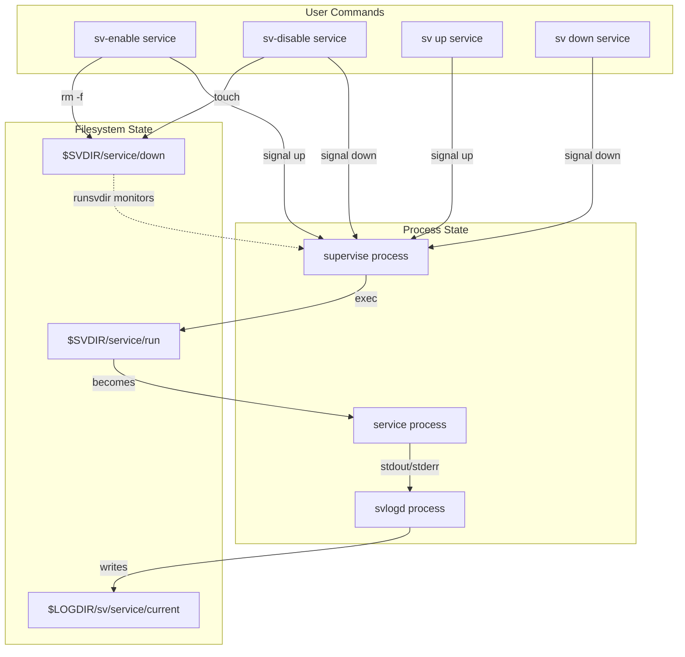

**Key Mappings:**

| User Command | Filesystem Effect | Process Effect |
|--------------|-------------------|----------------|
| `sv-enable` | Removes `$SVDIR/service/down` | Signals `supervise` to start service |
| `sv-disable` | Creates `$SVDIR/service/down` | Signals `supervise` to stop service |
| `sv up` | No filesystem change | Signals `supervise` to start service |
| `sv down` | No filesystem change | Signals `supervise` to stop service |

**Critical Distinction:**
- **Enable/Disable**: Persistent state stored in filesystem (`down` file)
- **Up/Down**: Transient runtime signals to running supervisor

**Sources:** [sv-enable:19-20](), [sv-disable:19-20](), [README.md:8-9]()

---

## Quick Reference

### Essential Commands

| Task | Command | Effect |
|------|---------|--------|
| Enable autostart + start now | `sv-enable <service>` | Persistent + immediate |
| Disable autostart + stop now | `sv-disable <service>` | Persistent + immediate |
| Start (no autostart) | `sv up <service>` | Transient only |
| Stop (keep autostart) | `sv down <service>` | Transient only |
| Check status | `sv status <service>` | Display process state |
| View live logs | `tail -f $LOGDIR/sv/<service>/current` | Stream log output |

**Sources:** [README.md:5-9](), [sv-enable:1-21](), [sv-disable:1-21]()

---

### Key Locations

| Purpose | Path | Environment Variable |
|---------|------|---------------------|
| Service definitions | `$PREFIX/var/service/` | `$SVDIR` |
| Service logs | `$PREFIX/var/log/sv/` | `$LOGDIR` |
| Disabled marker | `$SVDIR/<service>/down` | N/A |
| Service PID file | `$SVDIR/<service>/supervise/pid` | N/A |

**Sources:** [README.md:6,9](), [sv-enable:15-19](), [sv-disable:15-19]()

---

## Environment Variables in Use

The `service-daemon` and login scripts set these environment variables:

```bash
SVDIR=$PREFIX/var/service     # Service directory
LOGDIR=$PREFIX/var/log        # Log directory
```

These are automatically configured when your shell starts. The `sv-enable` and `sv-disable` commands depend on `$SVDIR` being set.

**Sources:** [sv-enable:15-18](), [sv-disable:15-18]()

---

## Verification Workflow

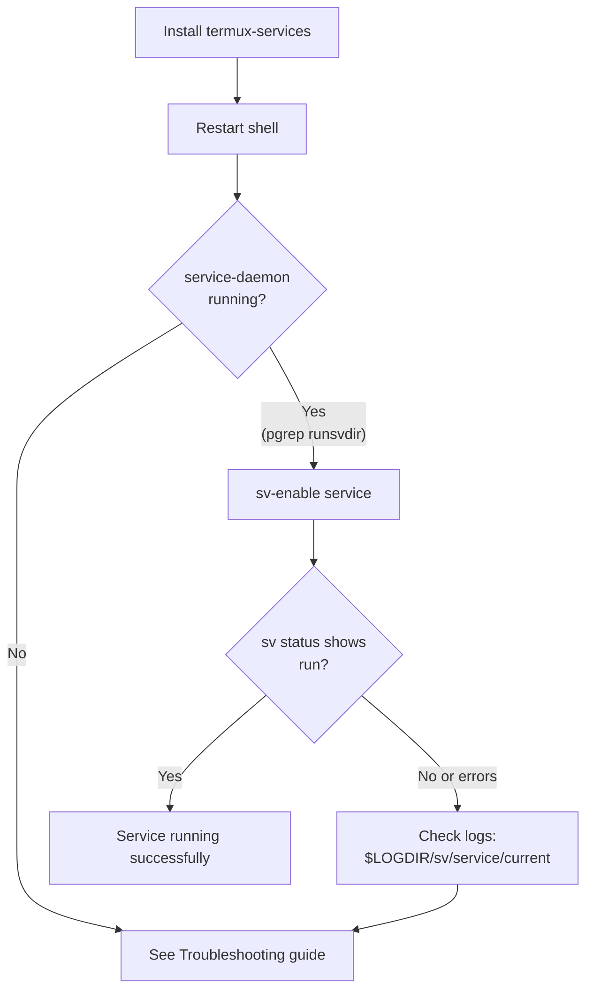

**Diagnostic Checklist:**

1. **Verify daemon**: `pgrep -f runsvdir` returns a PID
2. **Check service status**: `sv status <service>` shows "run"
3. **Inspect logs**: `tail $LOGDIR/sv/<service>/current` for errors
4. **Verify service directory**: `ls -la $SVDIR/<service>/` shows `run` script
5. **Check down file**: `test -e $SVDIR/<service>/down` should fail for enabled services

**Sources:** [README.md:1-9]()

---

## Next Steps

Now that you understand basic service management:

- **Learn comprehensive service operations**: See [User Guide](#4)
- **Enable/disable services in detail**: See [Enabling and Disabling Services](#4.1)
- **Start/stop services in detail**: See [Starting and Stopping Services](#4.2)
- **Master log management**: See [Viewing and Managing Logs](#4.3)
- **Understand the architecture**: See [Architecture](#5) and [System Overview](#5.1)
- **Full command reference**: See [Command Reference](#6)
- **Troubleshoot issues**: See [Troubleshooting](#4.4)

**Sources:** [README.md:1-10]()

---

# Page: User Guide

# User Guide

<details>
<summary>Relevant source files</summary>

The following files were used as context for generating this wiki page:

- [Makefile](Makefile)
- [README.md](README.md)
- [start-services.fish](start-services.fish)
- [svlogger](svlogger)

</details>


This guide covers day-to-day usage of termux-services for managing background services. It explains core concepts, common workflows, and practical examples for typical service management tasks.

For installation procedures, see [Installation](#2). For detailed command syntax, see [Command Reference](#6). For troubleshooting specific problems, see [Troubleshooting](#4.4). For architectural details about how the system works internally, see [Architecture](#5).

## Purpose and Scope

This user guide assumes termux-services is already installed and your shell has been restarted. It focuses on practical service management: enabling services to start automatically, starting and stopping services manually, and understanding service state. The guide covers the mental model needed to work effectively with the runit-based supervision system that termux-services provides.

Sources: [README.md:1-10]()

## Core Concepts

### Service Supervision Model

Termux-services uses runit's supervision model where a background process (`runsvdir`) continuously monitors service directories and ensures services are running according to their configuration. This differs from traditional init systems—services are actively supervised, not just started once.

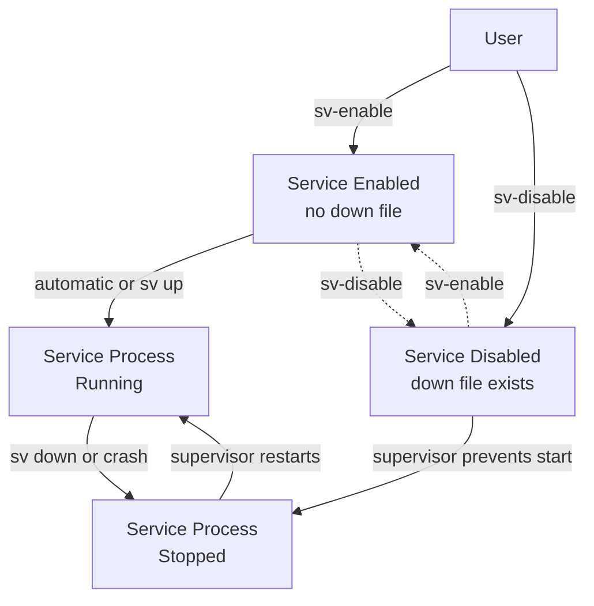

**Service Supervision State Machine**

The supervision system operates continuously in the background. When a service is enabled, the supervisor attempts to keep it running. When disabled, the supervisor prevents it from starting.

Sources: [README.md:9](), [start-services.fish:1-6]()

### Enabled vs. Disabled

A service's **enabled** state controls whether it starts automatically. This state persists across reboots and shell sessions.

- **Enabled**: No `down` file exists at `$PREFIX/var/service/<service>/down`
- **Disabled**: The `down` file exists at `$PREFIX/var/service/<service>/down`

The `sv-enable` and `sv-disable` commands manipulate this file:

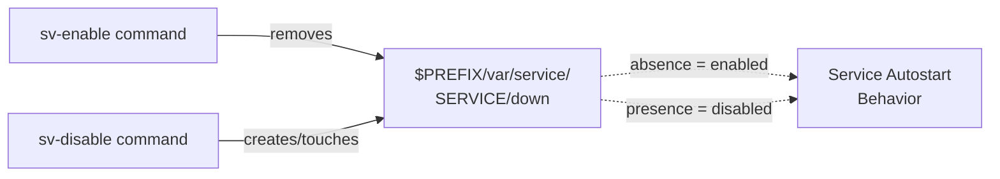

**Enable/Disable Filesystem Operations**

Sources: [README.md:9](), [Makefile:4-5]()

### Started vs. Stopped

A service's **running** state is separate from its enabled state. A service can be:

- Enabled and running (normal operation)
- Enabled and stopped (temporarily down, will restart)
- Disabled and stopped (will not start)
- Disabled and running (being shut down)

The `sv` command manipulates the running state without affecting the enabled state.

## Directory Structure Users Interact With

Users primarily work with two directory trees:

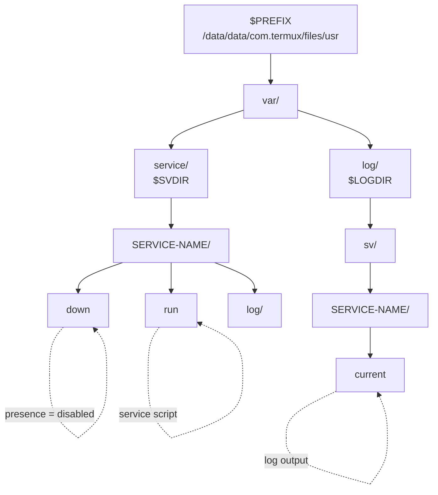

**User-Facing Directory Structure**

| Directory | Purpose | User Interaction |
|-----------|---------|------------------|
| `$PREFIX/var/service/` | Service definitions | Enable/disable services, check configuration |
| `$PREFIX/var/service/<service>/down` | Disable flag | Created by `sv-disable`, removed by `sv-enable` |
| `$PREFIX/var/service/<service>/run` | Service script | Read to understand what service does |
| `$PREFIX/var/log/sv/<service>/` | Service logs | Read logs, especially `current` file |
| `$PREFIX/var/log/sv/<service>/current` | Latest log output | Primary troubleshooting resource |

Sources: [README.md:6](), [README.md:9](), [svlogger:7-9](), [start-services.fish:3-4]()

## Common Workflows

### Enabling a Service for Autostart

```bash
# Enable service to start automatically
sv-enable sshd

# Verify it's enabled (down file should not exist)
ls $PREFIX/var/service/sshd/down
# Expected: ls: cannot access ... : No such file or directory
```

The service will start immediately if not already running. On subsequent shell logins, the service-daemon will ensure it starts automatically.

See [Enabling and Disabling Services](#4.1) for details.

Sources: [README.md:5](), [Makefile:4]()

### Starting a Service Temporarily

```bash
# Start service without enabling autostart
sv up postgresql

# Check service status
sv status postgresql
```

This starts the service for the current session but does not modify the `down` file. If the service is disabled, it will not start automatically after a restart.

See [Starting and Stopping Services](#4.2) for details.

Sources: [README.md:5]()

### Stopping a Service

```bash
# Stop service immediately
sv down nginx

# Service remains enabled; supervisor will restart unless disabled
```

To permanently stop a service and prevent it from restarting:

```bash
# Disable and stop
sv-disable nginx
```

Sources: [README.md:8]()

### Checking Service Logs

```bash
# View latest log output
cat $PREFIX/var/log/sv/sshd/current

# Follow logs in real-time
tail -f $PREFIX/var/log/sv/sshd/current

# Check if log directory exists (indicates service has run)
ls -la $PREFIX/var/log/sv/
```

Logs are managed by `svlogd` through the `svlogger` wrapper, which automatically creates service-specific log directories.

See [Viewing and Managing Logs](#4.3) for log management details.

Sources: [README.md:6](), [svlogger:7-9]()

## User Command Mapping

This diagram shows how user commands map to actual system operations:

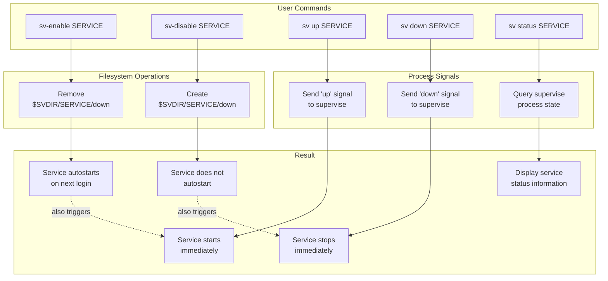

**User Command to System Operation Mapping**

Key points:
- `sv-enable` and `sv-disable` modify persistent filesystem state
- `sv up` and `sv down` send signals to the running supervision process
- Changes made by enable/disable persist; changes made by up/down are runtime only
- The `runsvdir` process detects filesystem changes and adjusts supervision accordingly

Sources: [README.md:5-9](), [Makefile:4-5]()

## Typical Usage Scenarios

### Scenario 1: Installing and Running a Database

```bash
# Install PostgreSQL
pkg install postgresql

# Initialize database (service-specific, not termux-services)
initdb $PREFIX/var/lib/postgresql

# Enable PostgreSQL to start on login
sv-enable postgresql

# Verify it's running
sv status postgresql
# Expected output: run: postgresql: (pid 12345) 5s

# Check logs if there are issues
tail -20 $PREFIX/var/log/sv/postgresql/current
```

### Scenario 2: Temporarily Stopping a Service

```bash
# Stop SSH server for maintenance
sv down sshd

# Perform maintenance...

# Restart SSH server
sv up sshd

# Service is still enabled for autostart
```

### Scenario 3: Disabling an Unwanted Service

```bash
# Stop and disable a service
sv-disable crond

# Verify down file was created
ls $PREFIX/var/service/crond/down
# Expected: $PREFIX/var/service/crond/down

# Service will not start on next login
```

Sources: [README.md:1-10]()

## Integration with Native sv Commands

Termux-services provides `sv-enable` and `sv-disable` as convenience wrappers. For runtime control, use the native `sv` command from the runit package directly. Common `sv` commands include:

| Command | Purpose |
|---------|---------|
| `sv status SERVICE` | Show service status |
| `sv up SERVICE` | Start service |
| `sv down SERVICE` | Stop service |
| `sv restart SERVICE` | Restart service |
| `sv reload SERVICE` | Send HUP signal |
| `sv check SERVICE` | Check if service is running |

The `sv` command communicates with the `supervise` process for each service. For more details on runit integration, see [Integration with runit](#8).

## Environment Variables in User Context

When working with termux-services, these environment variables are set by the login scripts:

| Variable | Value | Purpose |
|----------|-------|---------|
| `SVDIR` | `$PREFIX/var/service` | Service definition directory |
| `LOGDIR` | `$PREFIX/var/log` | Log storage directory |
| `PREFIX` | `/data/data/com.termux/files/usr` | Termux installation root |

These are set by [start-services.fish:3-4]() (and the bash equivalent). You can reference them in commands:

```bash
# List all service directories
ls $SVDIR

# List all service logs
ls $LOGDIR/sv/

# Check if a specific service is enabled
test -f $SVDIR/sshd/down && echo "disabled" || echo "enabled"
```

Sources: [start-services.fish:3-4]()

## Next Steps

For detailed information on specific tasks:

- **Enabling and Disabling Services**: See [Enabling and Disabling Services](#4.1) for complete details on `sv-enable` and `sv-disable` behavior
- **Starting and Stopping Services**: See [Starting and Stopping Services](#4.2) for comprehensive `sv` command usage
- **Log Management**: See [Viewing and Managing Logs](#4.3) for log rotation, retention, and advanced log filtering
- **Problems**: See [Troubleshooting](#4.4) for diagnostic procedures and common issues
- **Command Syntax**: See [Command Reference](#6) for complete command reference documentation

For understanding how the system works internally, see [Architecture](#5).

Sources: [README.md:1-10]()

---

# Page: Enabling and Disabling Services

# Enabling and Disabling Services

<details>
<summary>Relevant source files</summary>

The following files were used as context for generating this wiki page:

- [README.md](README.md)
- [sv-disable](sv-disable)
- [sv-enable](sv-enable)

</details>


## Purpose and Scope

This page explains how to enable and disable services in termux-services, which controls whether services automatically start when the service daemon initializes. This covers the `sv-enable` and `sv-disable` commands, the `down` file mechanism, and how these commands interact with the supervision system.

For information about immediately starting and stopping services without changing autostart behavior, see [Starting and Stopping Services](#4.2). For complete command reference documentation, see [sv-enable](#6.1) and [sv-disable](#6.2).

## Overview: Autostart Control

Enabling and disabling services controls **autostart behavior**. When a service is enabled, it will automatically start when `runsvdir` begins monitoring the service directory. When a service is disabled, it will not autostart, though it can still be manually started.

The enable/disable state is persistent across shell restarts and system reboots. This state is stored in the filesystem using a marker file called `down`.

| State | down file exists? | Autostart behavior | Can be manually started? |
|-------|-------------------|-------------------|-------------------------|
| Enabled | No | Service autostarts | Yes |
| Disabled | Yes | Service does not autostart | Yes (using `sv up`) |

Sources: [README.md:9-9]()

## The down File Mechanism

The enable/disable mechanism relies on a filesystem-based state indicator: the `down` file located at `$SVDIR/<service-name>/down`.

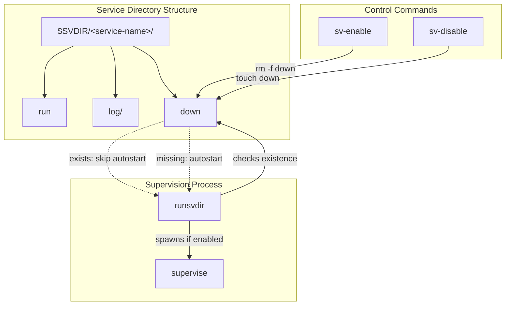

**Diagram: The down file as a filesystem-based state flag**

The `down` file serves as a semaphore:
- **Presence** of `$SVDIR/<service-name>/down` → service is disabled (do not autostart)
- **Absence** of `$SVDIR/<service-name>/down` → service is enabled (autostart)

The `runsvdir` process continuously monitors service directories and checks for the `down` file to determine whether to supervise each service.

Sources: [README.md:9-9](), [sv-enable:19-19](), [sv-disable:19-19]()

## Using sv-enable

The `sv-enable` command enables a service for autostart and immediately starts it if it is not already running.

### Syntax

```
sv-enable <service-name>
```

### Behavior

When `sv-enable` is executed, it performs two operations:

1. **Removes the down file**: `rm -f "$SVDIR/$1/down"` [sv-enable:19]()
2. **Starts the service**: `sv up $1` [sv-enable:20]()

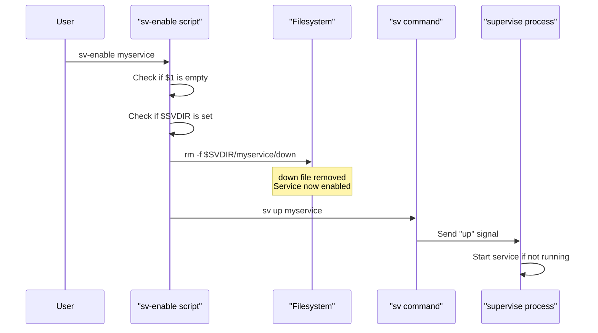

**Diagram: sv-enable command execution flow**

### Validation

The `sv-enable` script performs validation before proceeding:

1. **Service name required**: If no service name is provided, displays usage help and exits [sv-enable:11-13]()
2. **SVDIR must be set**: If the `$SVDIR` environment variable is not set, prints an error and exits [sv-enable:15-17]()

### Result

After successful execution:
- The `down` file is removed from the service directory
- The service is started (if not already running)
- On next shell login, the service will autostart when `runsvdir` initializes

Sources: [sv-enable:1-21](), [README.md:5-5]()

## Using sv-disable

The `sv-disable` command disables a service from autostarting and immediately stops it if it is currently running.

### Syntax

```
sv-disable <service-name>
```

### Behavior

When `sv-disable` is executed, it performs two operations:

1. **Creates the down file**: `touch "$SVDIR/$1/down"` [sv-disable:19]()
2. **Stops the service**: `sv down $1` [sv-disable:20]()

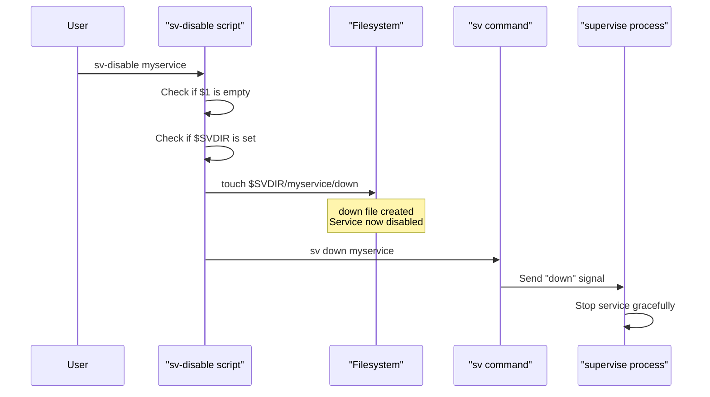

**Diagram: sv-disable command execution flow**

### Validation

The `sv-disable` script performs the same validation as `sv-enable`:

1. **Service name required**: If no service name is provided, displays usage help and exits [sv-disable:11-13]()
2. **SVDIR must be set**: If the `$SVDIR` environment variable is not set, prints an error and exits [sv-disable:15-17]()

### Result

After successful execution:
- The `down` file exists in the service directory
- The service is stopped (if it was running)
- On next shell login, the service will not autostart when `runsvdir` initializes

Sources: [sv-disable:1-21](), [README.md:8-8]()

## Enable vs. Start: Understanding the Difference

It is important to distinguish between **enabling/disabling** (autostart control) and **starting/stopping** (runtime control):

| Operation | Command | Effect | Persistence | Modifies |
|-----------|---------|--------|-------------|----------|
| Enable | `sv-enable` | Makes service autostart + starts it now | Persistent (survives restart) | `down` file (removes it) |
| Disable | `sv-disable` | Prevents autostart + stops it now | Persistent (survives restart) | `down` file (creates it) |
| Start | `sv up` | Starts service immediately | Temporary (until crash/manual stop) | Runtime state only |
| Stop | `sv down` | Stops service immediately | Temporary (can be restarted) | Runtime state only |

### Practical Examples

```bash
# Scenario 1: Enable and start a service
$ sv-enable sshd
# - Removes $SVDIR/sshd/down
# - Starts sshd immediately
# - sshd will autostart on next login

# Scenario 2: Temporarily stop an enabled service
$ sv down sshd
# - sshd stops immediately
# - $SVDIR/sshd/down still does NOT exist
# - sshd will still autostart on next login

# Scenario 3: Disable a service but keep it running (not possible with sv-disable)
# The sv-disable command always stops the service
# To disable without stopping, manually create the down file:
$ touch "$SVDIR/sshd/down"
# - sshd continues running
# - sshd will not autostart on next login

# Scenario 4: Start a disabled service temporarily
$ sv up sshd
# - sshd starts immediately
# - $SVDIR/sshd/down still exists
# - sshd will NOT autostart on next login
```

Sources: [README.md:5-9](), [sv-enable:19-20](), [sv-disable:19-20]()

## How runsvdir Responds to State Changes

The `runsvdir` process continuously monitors `$SVDIR` and detects changes to service directories, including the creation or removal of `down` files.

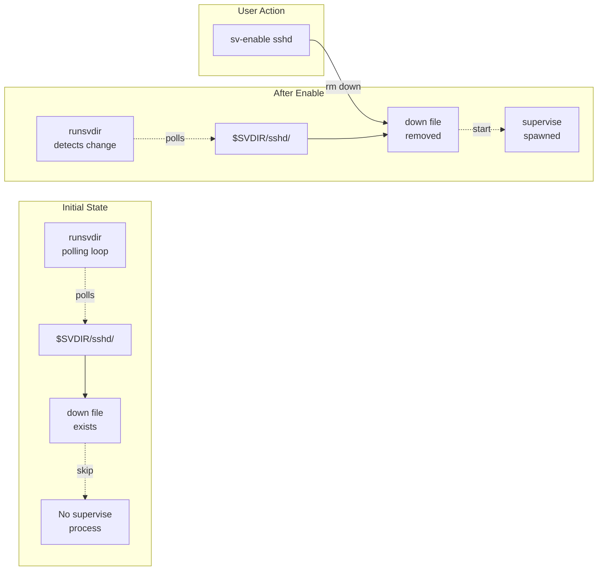

**Diagram: runsvdir detecting down file state changes**

### Detection Timing

The `runsvdir` process checks service directories periodically (typically every 5 seconds by default). This means:

- When you run `sv-enable`, the service starts immediately via the `sv up` command [sv-enable:20]()
- `runsvdir` will detect the removed `down` file on its next poll cycle
- When you run `sv-disable`, the service stops immediately via the `sv down` command [sv-disable:20]()
- `runsvdir` will detect the created `down` file on its next poll cycle

The immediate `sv up` or `sv down` commands ensure the state change takes effect without waiting for `runsvdir` to poll.

Sources: [sv-enable:19-20](), [sv-disable:19-20]()

## Environment Variables

Both `sv-enable` and `sv-disable` require the `$SVDIR` environment variable to be set. This variable is typically set by the login integration scripts.

| Variable | Purpose | Typical Value | Set By |
|----------|---------|---------------|--------|
| `$SVDIR` | Service directory location | `$PREFIX/var/service` | `start-services.sh` or `start-services.fish` |

If `$SVDIR` is not set, both commands will exit with an error:
```
Error: SVDIR not set
```

For more information about environment variables, see [Environment Variables](#7).

Sources: [sv-enable:15-17](), [sv-disable:15-17]()

## Summary

| Aspect | sv-enable | sv-disable |
|--------|-----------|------------|
| **Purpose** | Enable autostart and start service | Disable autostart and stop service |
| **File Operation** | `rm -f "$SVDIR/$1/down"` | `touch "$SVDIR/$1/down"` |
| **Runtime Operation** | `sv up $1` | `sv down $1` |
| **Result** | Service autostarts on next login | Service does not autostart on next login |
| **Immediate Effect** | Service starts (if not running) | Service stops (if running) |

The enable/disable mechanism provides persistent autostart control through a simple filesystem-based state indicator, making service configuration survive across shell restarts and system reboots.

Sources: [README.md:1-10](), [sv-enable:1-21](), [sv-disable:1-21]()

---

# Page: Starting and Stopping Services

# Starting and Stopping Services

<details>
<summary>Relevant source files</summary>

The following files were used as context for generating this wiki page:

- [README.md](README.md)
- [service-daemon](service-daemon)

</details>


## Purpose and Scope

This document covers immediate runtime control of services using the `sv` command. These operations start and stop service processes in real-time without changing their persistent configuration state.

For persistent service configuration (autostart behavior), see [Enabling and Disabling Services](#4.1). For viewing service output, see [Viewing and Managing Logs](#4.3).

**Sources:** [README.md:1-10]()

## Overview

The `sv` command is the primary tool for immediate service control. It is provided by the runit package and sends control signals to `supervise` processes that manage individual services. When you start or stop a service with `sv`, you are sending instructions to the supervision layer to change the service's runtime state immediately.

The `sv` command operates on services located in `$SVDIR` (typically `$PREFIX/var/service/`). Each service in this directory has an associated `supervise` process that receives and acts on `sv` commands.

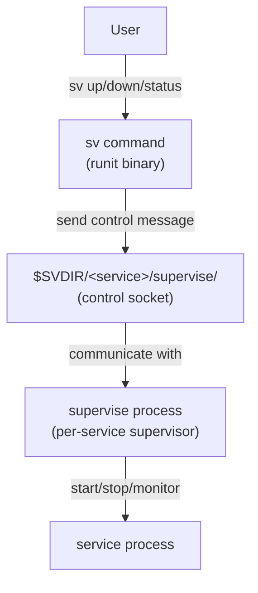

**Sources:** [README.md:5-8](), Diagram 2 from high-level overview, Diagram 4 from high-level overview

## Starting Services

### Using sv up

To start a service immediately, use:

```bash
sv up <service>
```

This command instructs the `supervise` process to start the service if it is not already running. The service's `run` script (located at `$SVDIR/<service>/run`) is executed, and the resulting process is monitored.

**Example:**

```bash
sv up sshd
```

### Behavior

| Condition | Result |
|-----------|--------|
| Service is already running | No action taken; service continues running |
| Service is stopped | Service `run` script is executed; process starts |
| Service has `down` file | Service starts but will not autostart on next supervision restart |
| Service has no `down` file | Service starts and will autostart on supervision restart |

The presence of the `down` file (located at `$SVDIR/<service>/down`) does not prevent `sv up` from starting the service. However, if the service-daemon restarts, services with `down` files will not automatically start.

### When to Use sv up

- **Immediate need**: Start a service right now without enabling autostart
- **Testing**: Start a service temporarily to test configuration
- **Manual control**: Start a disabled service for a one-time operation
- **After sv down**: Restart a service that was manually stopped

**Sources:** [README.md:5](), Diagram 4 from high-level overview

## Stopping Services

### Using sv down

To stop a service immediately, use:

```bash
sv down <service>
```

This command instructs the `supervise` process to stop the service by sending a termination signal to the service process. The service will not be automatically restarted by the supervision system.

**Example:**

```bash
sv down sshd
```

### Behavior

| Condition | Result |
|-----------|--------|
| Service is running | Service receives TERM signal; process stops |
| Service is already stopped | No action taken |
| Service has `down` file | Service stops and remains stopped |
| Service has no `down` file | Service stops but will autostart if supervision restarts |

The `down` file state is not modified by `sv down`. If the service is enabled (no `down` file), it will automatically restart when the service-daemon restarts or when the shell is reopened.

### When to Use sv down

- **Temporary maintenance**: Stop a service briefly without disabling autostart
- **Resource management**: Stop a service to free resources temporarily
- **Configuration changes**: Stop a service before modifying its configuration
- **Troubleshooting**: Stop a misbehaving service for investigation

**Sources:** [README.md:8](), Diagram 4 from high-level overview

## Other Service Control Commands

The `sv` command provides additional operations for service management:

### Status Checking

```bash
sv status <service>
```

Displays the current state of the service, including:
- Whether the service is running or stopped
- Process ID (PID) if running
- How long the service has been in its current state
- Number of seconds the service has been running

**Example output:**
```
run: sshd: (pid 12345) 3600s
```

### Restarting Services

```bash
sv restart <service>
```

Stops and then starts the service. Equivalent to running `sv down <service>` followed by `sv up <service>`, but performed atomically.

### Running Once

```bash
sv once <service>
```

Starts the service to run once. If the service exits, it will not be restarted automatically, even if it is enabled. This is useful for one-shot tasks.

### Forced Termination

```bash
sv kill <service>
```

Sends SIGKILL to the service process, forcefully terminating it. Use this only when a service does not respond to normal termination.

### Process Information

```bash
sv check <service>
```

Checks if the service is running. Exits with status 0 if running, non-zero if stopped. Useful in scripts.

### Additional Commands

| Command | Purpose |
|---------|---------|
| `sv term <service>` | Send SIGTERM to service |
| `sv hup <service>` | Send SIGHUP to service (reload configuration) |
| `sv alarm <service>` | Send SIGALRM to service |
| `sv interrupt <service>` | Send SIGINT to service |
| `sv quit <service>` | Send SIGQUIT to service |
| `sv usr1 <service>` | Send SIGUSR1 to service |
| `sv usr2 <service>` | Send SIGUSR2 to service |

**Sources:** Integration with runit (page 8 reference)

## Difference from Enable/Disable

Understanding the distinction between start/stop and enable/disable is critical for effective service management:

| Aspect | Start/Stop (`sv up`/`sv down`) | Enable/Disable (`sv-enable`/`sv-disable`) |
|--------|-------------------------------|------------------------------------------|
| **Operation** | Immediate runtime control | Persistent configuration |
| **Command** | `sv up/down <service>` | `sv-enable/sv-disable <service>` |
| **Mechanism** | Sends signals to `supervise` process | Creates/removes `down` file |
| **Effect on current state** | Changes immediately | May require service restart to take effect |
| **Effect on autostart** | No change | Controls autostart behavior |
| **Persistence** | Temporary (until supervision restart) | Permanent (survives shell restart) |
| **Use case** | Temporary control, testing, maintenance | Configure which services run automatically |

### Example Scenarios

**Scenario 1: Temporarily stop an enabled service**
```bash
sv down sshd  # Service stops but remains enabled
# After shell restart, service will start automatically
```

**Scenario 2: Permanently disable a service**
```bash
sv-disable sshd  # Creates down file and stops service
# After shell restart, service will NOT start automatically
```

**Scenario 3: Test a disabled service**
```bash
sv up sshd  # Service starts but remains disabled
# After shell restart, service will NOT start automatically
```

**Sources:** [README.md:5-9](), Diagram 4 from high-level overview

## How Service Control Works

The `sv` command communicates with `supervise` processes through a control socket located in the `supervise/` directory of each service.

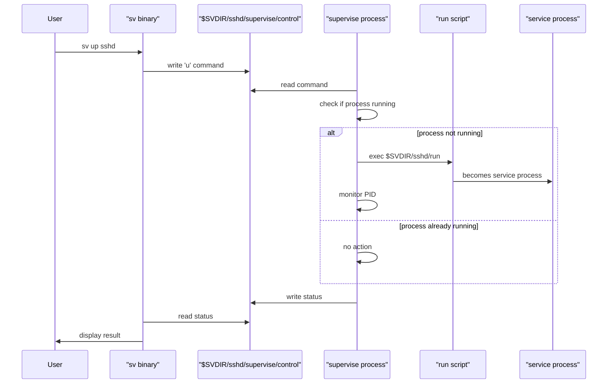

### Control Socket Protocol

The `supervise` process creates a control socket at `$SVDIR/<service>/supervise/control`. The `sv` command writes single-character commands to this socket:

| Character | Command | Action |
|-----------|---------|--------|
| `u` | up | Start the service |
| `d` | down | Stop the service |
| `o` | once | Start service once (no restart) |
| `p` | pause | Send SIGSTOP to service |
| `c` | cont | Send SIGCONT to service |
| `h` | hup | Send SIGHUP to service |
| `a` | alarm | Send SIGALRM to service |
| `i` | interrupt | Send SIGINT to service |
| `q` | quit | Send SIGQUIT to service |
| `k` | kill | Send SIGKILL to service |
| `t` | term | Send SIGTERM to service |

### Supervision Directory Structure

Each service has a `supervise/` directory created by the `supervise` process:

```
$SVDIR/sshd/
├── run              # Service execution script
├── down             # (optional) Disables autostart
├── log/
│   └── run          # Logging script
└── supervise/       # Runtime state (created by supervise)
    ├── control      # Control socket
    ├── ok           # Service readiness indicator
    ├── pid          # Current process ID
    ├── stat         # Current status
    └── status       # Extended status information
```

The `service-daemon` stop operation aggressively cleans up these directories:

[service-daemon:11-14]()

This cleanup ensures that stale supervision state does not persist when the service-daemon is restarted.

**Sources:** [service-daemon:11-14](), Diagram 2 from high-level overview, Diagram 4 from high-level overview

## Best Practices

### When to Start/Stop vs Enable/Disable

**Use `sv up`/`sv down` when:**
- Performing temporary maintenance
- Testing service configurations
- Troubleshooting issues
- Managing resources dynamically
- The service autostart configuration should not change

**Use `sv-enable`/`sv-disable` when:**
- Configuring which services should start automatically
- Permanently adding or removing services
- Setting up a new system
- The change should persist across shell restarts

### Working with Service States

To check if a service is enabled (will autostart):
```bash
test -f $SVDIR/sshd/down && echo "disabled" || echo "enabled"
```

To check if a service is currently running:
```bash
sv status sshd
```

To enable and start a service in one operation:
```bash
sv-enable sshd
sv up sshd
```

To disable and stop a service in one operation:
```bash
sv-disable sshd  # This also stops the service
```

**Note:** The `sv-disable` command both creates the `down` file and stops the service, while `sv-enable` only removes the `down` file without starting the service.

**Sources:** [README.md:9]()

## Service Startup After Login

When a new shell session starts, the login scripts ([start-services.sh]() for bash/POSIX shells, [start-services.fish]() for fish shell) launch the `service-daemon`, which in turn starts `runsvdir`. The `runsvdir` process scans `$SVDIR` and starts `supervise` processes for all services without a `down` file.

This means:
- **Enabled services** (no `down` file): Automatically started
- **Disabled services** (has `down` file): Not started, but can be started manually with `sv up`

**Sources:** Diagram 3 from high-level overview, [service-daemon:1-48]()

---

# Page: Viewing and Managing Logs

# Viewing and Managing Logs

<details>
<summary>Relevant source files</summary>

The following files were used as context for generating this wiki page:

- [Makefile](Makefile)
- [README.md](README.md)
- [start-services.fish](start-services.fish)
- [svlogger](svlogger)

</details>


This page explains how to access and manage service logs in termux-services. All service output (both stdout and stderr) is automatically captured and stored in structured log directories. This guide covers log locations, viewing methods, understanding log formats, and managing log storage.

For technical details about the logging infrastructure implementation, see [5.4 Logging Infrastructure](#5.4). For using logs to diagnose service problems, see [4.4 Troubleshooting](#4.4).

---

## Log Location and Structure

All service logs are stored under `$LOGDIR/sv/`, which defaults to `$PREFIX/var/log/sv/`. Each service has its own subdirectory named after the service.

### Directory Layout

```
$PREFIX/var/log/sv/
├── sshd/
│   ├── current      # Current active log file
│   ├── @*.s         # Rotated logs (timestamped)
│   └── lock         # svlogd lock file
├── crond/
│   ├── current
│   └── @*.s
└── <service-name>/
    └── current
```

The directory structure follows runit's `svlogd` conventions:
- **`current`**: The active log file being written to
- **`@timestamp.s`**: Rotated log files (when current reaches size limit)
- **`lock`**: Lock file used by svlogd for atomic operations

Sources: [README.md:6](), [svlogger:7-9]()

### Service Name Resolution

The `svlogger` script automatically determines the service name based on the directory structure. When a service's `log/run` script executes, the current working directory is `$SVDIR/<service>/log`, and svlogger extracts the service name:

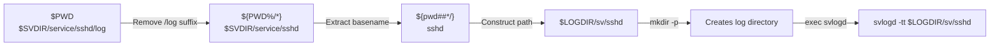

Sources: [svlogger:2-5]()

---

## Viewing Logs

### Basic Log Viewing

Use standard Unix text tools to view service logs. The `current` file contains the most recent log entries:

```bash
# View entire log
cat $PREFIX/var/log/sv/sshd/current

# View last 50 lines
tail -n 50 $PREFIX/var/log/sv/sshd/current

# View with pagination
less $PREFIX/var/log/sv/sshd/current
```

### Real-Time Log Monitoring

Monitor logs in real-time as they are written:

```bash
# Follow log output
tail -f $PREFIX/var/log/sv/sshd/current

# Follow with last 20 lines of context
tail -n 20 -f $PREFIX/var/log/sv/sshd/current

# Follow multiple services
tail -f $PREFIX/var/log/sv/sshd/current $PREFIX/var/log/sv/crond/current
```

### Searching and Filtering

Use `grep` and other text processing tools to filter log content:

```bash
# Search for specific text
grep "error" $PREFIX/var/log/sv/sshd/current

# Search with context (3 lines before/after)
grep -C 3 "failed" $PREFIX/var/log/sv/sshd/current

# Search across all services
grep -r "connection" $PREFIX/var/log/sv/*/current

# Search rotated logs too
grep "error" $PREFIX/var/log/sv/sshd/@*
```

Sources: [README.md:6]()

---

## Understanding Log Format

### Timestamp Format

The `svlogger` script invokes `svlogd` with the `-tt` flag, which adds precise timestamps to each log line:

```
2024-01-15 14:32:45.123456 Server started on port 8080
2024-01-15 14:32:47.891234 Connection accepted from 192.168.1.100
2024-01-15 14:33:12.456789 Request processed successfully
```

The timestamp format is: `YYYY-MM-DD HH:MM:SS.microseconds`

### Log Entry Structure

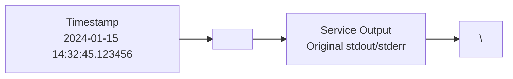

Each log line consists of:
1. **Timestamp**: Added by `svlogd -tt`
2. **Space**: Single space separator
3. **Message**: Original output from the service (stdout or stderr)
4. **Newline**: Line terminator

Sources: [svlogger:9]()

### Distinguishing stdout vs stderr

The `svlogger` infrastructure merges stdout and stderr into a single log stream. Both output streams are captured identically by `svlogd`, and there is no built-in marker to distinguish them in the log file. If separation is needed, the service's `run` script must add explicit prefixes to stderr before it reaches svlogger.

---

## Log Rotation and Retention

### Automatic Rotation

The `svlogd` process automatically rotates log files based on size. When `current` reaches the size limit (default: 1MB), svlogd:

1. Renames `current` to `@<timestamp>.s` (e.g., `@4000000065a5c3d412ab2c3c.s`)
2. Creates a new empty `current` file
3. Continues writing to the new `current`

```mermaid
stateDiagram-v2
    [*] --> Writing: svlogd starts
    Writing --> CheckSize: After each write
    CheckSize --> Writing: Size < 1MB
    CheckSize --> Rotate: Size >= 1MB
    
    Rotate --> Rename: Rename current to @timestamp.s
    Rename --> CreateNew: Create new current file
    CreateNew --> Writing: Continue logging
    
    note right of Rotate
        Rotation is atomic
        No log entries lost
    end note
```

### Rotated Log Filenames

Rotated logs use TAI64N timestamps in their filenames:
- Format: `@<tai64n_timestamp>.s`
- Example: `@4000000065a5c3d412ab2c3c.s`
- The `.s` suffix indicates successful processing
- Timestamps are in TAI64N format (base-16 representation of seconds since epoch)

### Retention Policy

By default, `svlogd` keeps a limited number of rotated logs:
- **Default**: 10 rotated files
- **Oldest files**: Automatically deleted when limit is exceeded
- **Total storage**: Approximately 11MB per service (10 rotated + 1 current)

Sources: [svlogger:9]()

---

## Managing Log Storage

### Checking Log Disk Usage

Monitor total space used by service logs:

```bash
# Total size of all service logs
du -sh $PREFIX/var/log/sv/

# Size per service
du -sh $PREFIX/var/log/sv/*/

# Detailed breakdown
du -h $PREFIX/var/log/sv/* | sort -h

# Count log files per service
for dir in $PREFIX/var/log/sv/*/; do
  echo "$(basename $dir): $(ls -1 $dir/@* 2>/dev/null | wc -l) rotated files"
done
```

### Manual Log Cleanup

Remove old logs to free disk space:

```bash
# Remove all rotated logs for a service (keep current)
rm $PREFIX/var/log/sv/sshd/@*

# Remove specific old rotated logs
rm $PREFIX/var/log/sv/sshd/@4000000065a5c3d412ab2c3c.s

# Clear current log (truncate to zero)
: > $PREFIX/var/log/sv/sshd/current

# Remove entire log directory for disabled service
rm -rf $PREFIX/var/log/sv/old-service/
```

**Warning**: Do not delete the `current` file while the service is running. Either truncate it (`> file`) or let `svlogd` handle rotation naturally.

### Service Log Directory Creation

Log directories are created automatically by the `svlogger` script when a service starts. The script executes `mkdir -p "$LOGDIR/sv/$service"` before launching `svlogd`.

```mermaid
sequenceDiagram
    participant S as supervise
    participant L as log/run
    participant SL as svlogger
    participant FS as File System
    participant SVL as svlogd
    
    S->>L: Execute log/run script
    L->>SL: exec svlogger
    SL->>SL: Extract service name from PWD
    SL->>FS: mkdir -p $LOGDIR/sv/service
    SL->>SVL: exec svlogd -tt $LOGDIR/sv/service
    SVL->>FS: Write to current file
    
    Note over SL,FS: Log directory created<br/>if it doesn't exist
```

Sources: [svlogger:7-9]()

---

## Log Access Patterns

### Common Workflows

| Task | Command | Description |
|------|---------|-------------|
| Quick check | `tail $PREFIX/var/log/sv/<service>/current` | View recent log entries |
| Follow logs | `tail -f $PREFIX/var/log/sv/<service>/current` | Monitor in real-time |
| Search errors | `grep -i error $PREFIX/var/log/sv/<service>/*` | Find error messages |
| View rotated | `less $PREFIX/var/log/sv/<service>/@*` | Read old rotated logs |
| Check size | `du -sh $PREFIX/var/log/sv/<service>/` | Disk usage per service |
| Clear logs | `rm $PREFIX/var/log/sv/<service>/@*` | Remove rotated logs |

### Environment Variables

The log location is determined by the `LOGDIR` environment variable, which is set by the login scripts:

```bash
# Bash/POSIX shells (start-services.sh)
export LOGDIR=$PREFIX/var/log

# Fish shell (start-services.fish)
set -gx LOGDIR $PREFIX/var/log
```

To verify your log directory:
```bash
echo $LOGDIR
ls -la $LOGDIR/sv/
```

Sources: [start-services.fish:4](), [svlogger:7]()

---

## Integration with runit svlogd

The logging system uses runit's `svlogd` tool directly. All `svlogd` features are available, including:

- **Automatic rotation**: Based on file size
- **Pattern matching**: Filter log entries (requires custom config)
- **Network logging**: Forward logs to remote hosts (requires custom config)
- **Processor scripts**: Transform log entries (requires custom config)

For advanced `svlogd` configuration, create a `config` file in the service log directory (`$LOGDIR/sv/<service>/config`). See the runit documentation for `svlogd` configuration syntax.

### Default svlogd Configuration

The `svlogger` wrapper uses these default settings:
- **Timestamps**: Enabled (`-tt` flag)
- **Log directory**: `$LOGDIR/sv/$service`
- **Rotation size**: 1MB (svlogd default)
- **Retention**: 10 files (svlogd default)
- **Pattern matching**: None (accepts all log lines)

Sources: [svlogger:9]()

---

## Troubleshooting Log Issues

### Log Directory Not Created

If logs are missing, verify the log directory exists:
```bash
ls -la $PREFIX/var/log/sv/<service>/
```

If the directory is missing, check that:
1. The service has a `log/run` script that calls `svlogger`
2. The `LOGDIR` environment variable is set correctly
3. The service has been started at least once

### No Log Output

If the `current` file is empty or doesn't update:
1. Verify the service is actually running: `sv status <service>`
2. Check that the service produces output on stdout/stderr
3. Ensure the `log/run` script is executable
4. Verify `svlogd` is running: `ps aux | grep svlogd`

### Permission Errors

Log directories and files should be owned by the Termux user. If permission errors occur:
```bash
# Fix ownership
chmod -R u+w $PREFIX/var/log/sv/<service>/

# Check current permissions
ls -la $PREFIX/var/log/sv/<service>/
```

For more diagnostic procedures, see [4.4 Troubleshooting](#4.4).

Sources: [svlogger:7-9](), [README.md:6]()

---

# Page: Troubleshooting

# Troubleshooting

<details>
<summary>Relevant source files</summary>

The following files were used as context for generating this wiki page:

- [Makefile](Makefile)
- [README.md](README.md)
- [service-daemon](service-daemon)
- [start-services.fish](start-services.fish)
- [svlogger](svlogger)

</details>


This page provides diagnostic procedures and solutions for common issues encountered when managing services with termux-services. It covers problems related to the service daemon, individual service failures, logging issues, and recovery procedures.

For basic usage instructions, see the [User Guide](#4). For details on the system architecture that may help understand these issues, see [Architecture](#5).

## Diagnostic Checklist

Before troubleshooting specific issues, verify the basic state of the system using this checklist:

```mermaid
graph TD
    Start["Start Diagnostics"]
    CheckDaemon["Check: Is service-daemon running?<br/>pgrep -f runsvdir"]
    DaemonRunning{Process found?}
    CheckSVDIR["Check: SVDIR environment variable<br/>echo $SVDIR"]
    SVDIRSet{Variable set?}
    CheckService["Check: Service directory exists?<br/>ls $SVDIR/service-name"]
    ServiceExists{Directory found?}
    CheckDown["Check: down file present?<br/>test -f $SVDIR/service-name/down"]
    HasDown{File exists?}
    CheckLogs["Check: Log file exists?<br/>ls $LOGDIR/sv/service-name/current"]
    
    Start --> CheckDaemon
    CheckDaemon --> DaemonRunning
    DaemonRunning -->|No| IssueA["Issue: Daemon not running<br/>See 'Service Daemon Not Starting'"]
    DaemonRunning -->|Yes| CheckSVDIR
    CheckSVDIR --> SVDIRSet
    SVDIRSet -->|No| IssueB["Issue: Environment not initialized<br/>See 'Login Integration Issues'"]
    SVDIRSet -->|Yes| CheckService
    CheckService --> ServiceExists
    ServiceExists -->|No| IssueC["Issue: Service not installed<br/>Install service package"]
    ServiceExists -->|Yes| CheckDown
    CheckDown --> HasDown
    HasDown -->|Yes| IssueD["Service is disabled<br/>Run sv-enable service-name"]
    HasDown -->|No| CheckLogs
    CheckLogs --> IssueE["Check logs for errors<br/>See 'Service Runtime Failures'"]
```

**Sources:** [service-daemon:1-48](), [start-services.fish:1-7](), [README.md:1-10]()

### Quick Status Commands

| Check | Command | Expected Output |
|-------|---------|-----------------|
| Service daemon running | `pgrep -f runsvdir` | PID number |
| Environment variables set | `echo $SVDIR $LOGDIR` | Two paths |
| Service enabled | `test -f $SVDIR/<service>/down && echo disabled \|\| echo enabled` | `enabled` |
| Service running | `sv status <service>` | `run:` with PID |
| PID file exists | `cat $PREFIX/var/run/service-daemon.pid` | PID number |
| Supervise process active | `ps -p $(cat $SVDIR/<service>/supervise/pid)` | Process info |

**Sources:** [service-daemon:18-19](), [README.md:9]()

## Common Issues and Solutions

### Service Daemon Not Starting

**Symptom:** Services do not run automatically after login, `pgrep -f runsvdir` returns no results.

**Diagnostic Steps:**

```mermaid
graph TD
    Problem["service-daemon not running"]
    CheckShell["Which shell?<br/>echo $SHELL"]
    ShellType{Shell type}
    CheckBash["Check if start-services.sh sourced<br/>ls $PREFIX/etc/profile.d/"]
    CheckFish["Check if start-services.fish sourced<br/>ls $PREFIX/etc/fish/conf.d/"]
    CheckPID["Check PID file<br/>cat $PREFIX/var/run/service-daemon.pid"]
    PIDExists{File exists?}
    CheckProcess["Check if PID is running<br/>ps -p <pid>"]
    ProcessAlive{Process alive?}
    
    Problem --> CheckShell
    CheckShell --> ShellType
    ShellType -->|bash/sh| CheckBash
    ShellType -->|fish| CheckFish
    CheckBash --> CheckPID
    CheckFish --> CheckPID
    CheckPID --> PIDExists
    PIDExists -->|No| Solution1["Restart shell or run:<br/>service-daemon start"]
    PIDExists -->|Yes| CheckProcess
    CheckProcess --> ProcessAlive
    ProcessAlive -->|No| Solution2["Stale PID file<br/>rm $PREFIX/var/run/service-daemon.pid<br/>service-daemon start"]
    ProcessAlive -->|Yes| Solution3["Daemon is running<br/>Check $SVDIR variable"]
```

**Sources:** [service-daemon:18-19](), [start-services.fish:1-7]()

**Solutions:**

1. **Login script not sourced:** Restart your shell. The login scripts at `$PREFIX/etc/profile.d/start-services.sh` (bash/sh) or `$PREFIX/etc/fish/conf.d/start-services.fish` (fish) are only executed during login.

2. **Manual start required:** Run `service-daemon start` manually. Check if `runsvdir` process starts:
   ```
   service-daemon start
   pgrep -f runsvdir
   ```

3. **PIDDIR missing:** The directory `$PREFIX/var/run` must exist. This is created by [service-daemon:5](), but if deleted:
   ```
   mkdir -p $PREFIX/var/run
   service-daemon start
   ```

4. **Stale PID file:** If `$PREFIX/var/run/service-daemon.pid` exists but the process is dead:
   ```
   rm $PREFIX/var/run/service-daemon.pid
   service-daemon start
   ```

5. **start-stop-daemon failure:** Check if `start-stop-daemon` is available:
   ```
   which start-stop-daemon
   ```
   If missing, reinstall `termux-tools`.

**Sources:** [service-daemon:4-7](), [service-daemon:18-19](), [start-services.fish:5]()

### Login Integration Issues

**Symptom:** `$SVDIR` or `$LOGDIR` environment variables are not set, even after restarting shell.

**Root Cause Analysis:**

The environment variables are set by login scripts [start-services.fish:3-4]() which only execute on interactive login shells.

**Verification:**

```bash
# Check if login scripts are installed
ls $PREFIX/etc/profile.d/start-services.sh      # For bash/sh
ls $PREFIX/etc/fish/conf.d/start-services.fish  # For fish

# Check if script is being sourced (fish)
status --is-login && echo "Login shell" || echo "Not login shell"

# Manually set variables (temporary fix)
export SVDIR=$PREFIX/var/service
export LOGDIR=$PREFIX/var/log
```

**Solutions:**

1. **Ensure login shell:** Some terminal emulators don't start login shells. Start a new Termux session completely.

2. **Reinstall termux-services:**
   ```
   pkg reinstall termux-services
   ```
   This will restore [start-services.sh]() and [start-services.fish]() via [Makefile:7-10]().

3. **Manual initialization:** Add to `~/.bashrc` or `~/.profile`:
   ```bash
   export SVDIR=$PREFIX/var/service
   export LOGDIR=$PREFIX/var/log
   [ -z "$(pgrep -f runsvdir)" ] && service-daemon start
   ```

**Sources:** [start-services.fish:1-6](), [Makefile:7-10]()

### Service Not Enabling or Disabling

**Symptom:** Running `sv-enable <service>` or `sv-disable <service>` has no effect, or service state doesn't change.

**Diagnostic Flow:**

```mermaid
graph LR
    Command["sv-enable/sv-disable command"]
    DownFile["$SVDIR/service/down file"]
    Runsvdir["runsvdir polling loop"]
    Supervise["supervise process"]
    
    Command -->|"sv-disable: touch"| DownFile
    Command -->|"sv-enable: rm"| DownFile
    DownFile -->|"Polls every 5 sec"| Runsvdir
    Runsvdir -->|"Reads down file"| DownFile
    Runsvdir -->|"Stops if down exists"| Supervise
    Runsvdir -->|"Starts if no down"| Supervise
```

**Sources:** [README.md:9]()

**Common Issues:**

1. **Permission denied:** The `down` file at `$SVDIR/<service>/down` cannot be created or removed.
   ```bash
   # Check permissions
   ls -ld $SVDIR/<service>
   
   # Fix if needed
   chmod 755 $SVDIR/<service>
   ```

2. **Wrong service name:** Verify service directory exists:
   ```bash
   ls $SVDIR/
   ```

3. **runsvdir not polling:** The `runsvdir` process polls `$SVDIR` periodically. Wait 5 seconds after enable/disable, then check:
   ```bash
   sv status <service>
   ```

4. **Service explicitly stopped:** Even if enabled (no `down` file), service may be explicitly stopped. Start it:
   ```bash
   sv up <service>
   ```

**Sources:** [README.md:9]()

### Service Runtime Failures

**Symptom:** Service starts but immediately exits, or crashes repeatedly.

**Log Inspection:**

Service logs are the primary diagnostic tool. They are located at `$LOGDIR/sv/<service>/current` [README.md:6]().

```bash
# View current log
cat $LOGDIR/sv/<service>/current

# Follow log in real-time
tail -f $LOGDIR/sv/<service>/current

# View with timestamps (svlogd adds them automatically)
less $LOGDIR/sv/<service>/current
```

**Common Failure Patterns:**

| Log Pattern | Likely Cause | Solution |
|-------------|--------------|----------|
| `exec: <command>: not found` | Missing dependency | Install required package |
| `Permission denied` | Execute permission on `run` script | `chmod +x $SVDIR/<service>/run` |
| `Address already in use` | Port conflict | Stop conflicting service or change port |
| Immediate exit, no error | Script exits without blocking | Modify `run` script to use `exec` |
| `Cannot create directory` | Missing directory | Create parent directories |
| No log file created | svlogger not working | Check `$SVDIR/<service>/log/run` |

**Service Lifecycle with Failure Points:**

```mermaid
graph TD
    Runsvdir["runsvdir monitors $SVDIR"]
    CheckDown["Check for down file"]
    HasDown{down exists?}
    SkipService["Skip service"]
    SpawnSupervise["Spawn supervise process"]
    ExecRun["Execute $SVDIR/service/run"]
    RunScript["run script execution"]
    ServiceProcess["Service process"]
    LogRun["Execute $SVDIR/service/log/run"]
    Svlogger["svlogger script"]
    Svlogd["svlogd process"]
    
    Runsvdir --> CheckDown
    CheckDown --> HasDown
    HasDown -->|Yes| SkipService
    HasDown -->|No| SpawnSupervise
    SpawnSupervise -->|"FAIL: supervise binary missing"| Error1["Error: Reinstall runit"]
    SpawnSupervise --> ExecRun
    ExecRun -->|"FAIL: run not found"| Error2["Error: Service not configured"]
    ExecRun -->|"FAIL: permission denied"| Error3["Error: chmod +x run"]
    ExecRun --> RunScript
    RunScript -->|"FAIL: missing deps"| Error4["Error: Check logs, install deps"]
    RunScript --> ServiceProcess
    ServiceProcess -->|"Crash"| Restart["supervise auto-restarts"]
    Restart --> ExecRun
    
    SpawnSupervise --> LogRun
    LogRun -->|"FAIL: log/run missing"| NoLogs["No logging"]
    LogRun --> Svlogger
    Svlogger -->|"FAIL: $LOGDIR unset"| Error5["Error: Set LOGDIR"]
    Svlogger --> Svlogd
    
    ServiceProcess -->|stdout/stderr| Svlogd
```

**Sources:** [service-daemon:21-22](), [svlogger:1-10](), [README.md:6]()

**Detailed Diagnostics:**

1. **Check supervise status:**
   ```bash
   sv status <service>
   ```
   Output interpretation:
   - `run: <service>: (pid <n>)` - Running normally
   - `down: <service>:` - Service stopped
   - `fail: <service>:` - Service failing to start
   - `timeout:` - Service not responding to signals

2. **Check supervise directory:**
   ```bash
   ls -la $SVDIR/<service>/supervise/
   cat $SVDIR/<service>/supervise/status
   cat $SVDIR/<service>/supervise/stat
   ```

3. **Test run script manually:**
   ```bash
   cd $SVDIR/<service>
   ./run
   ```
   This executes the service directly to see errors.

**Sources:** [service-daemon:11-14]()

### Logging Issues

**Symptom:** No logs appear in `$LOGDIR/sv/<service>/current`, or logs stop updating.

**Logging Infrastructure Check:**

```mermaid
graph TD
    Service["Service process stdout/stderr"]
    LogRun["$SVDIR/service/log/run"]
    Svlogger["$PREFIX/share/termux-services/svlogger"]
    PWD["Get service name from PWD"]
    LogDir["Create $LOGDIR/sv/service/"]
    Svlogd["exec svlogd -tt $LOGDIR/sv/service/"]
    LogFile["$LOGDIR/sv/service/current"]
    
    Service --> LogRun
    LogRun -->|"exec"| Svlogger
    Svlogger --> PWD
    PWD -->|"Extract service name"| LogDir
    LogDir -->|"mkdir -p"| Svlogd
    Svlogd --> LogFile
    
    LogRun -->|"ISSUE: Missing"| Issue1["No log/run script<br/>Create with svlogger"]
    Svlogger -->|"ISSUE: LOGDIR unset"| Issue2["Environment variable missing<br/>Check login integration"]
    LogDir -->|"ISSUE: Permission denied"| Issue3["Cannot create directory<br/>Check permissions"]
    Svlogd -->|"ISSUE: svlogd missing"| Issue4["runit not installed<br/>pkg install runit"]
```

**Sources:** [svlogger:1-10]()

**Common Solutions:**

1. **Missing log/run script:** Most services need a `log/run` script to enable logging:
   ```bash
   mkdir -p $SVDIR/<service>/log
   cat > $SVDIR/<service>/log/run << 'EOF'
   #!/data/data/com.termux/files/usr/bin/sh
   exec $PREFIX/share/termux-services/svlogger
   EOF
   chmod +x $SVDIR/<service>/log/run
   ```

2. **LOGDIR not set:** The [svlogger:7]() script requires `$LOGDIR`:
   ```bash
   echo $LOGDIR
   # If empty, restart shell or manually export
   export LOGDIR=$PREFIX/var/log
   ```

3. **Log directory doesn't exist:** The [svlogger:7]() script creates it, but parent must exist:
   ```bash
   mkdir -p $PREFIX/var/log
   ```

4. **svlogd not running:** Check if the log supervise process is active:
   ```bash
   ls $SVDIR/<service>/log/supervise/
   cat $SVDIR/<service>/log/supervise/pid
   ps -p $(cat $SVDIR/<service>/log/supervise/pid)
   ```

5. **Log rotation issues:** `svlogd` automatically rotates logs. If disk full:
   ```bash
   # Check log directory size
   du -sh $LOGDIR/sv/<service>/
   
   # Remove old logs
   rm $LOGDIR/sv/<service>/@*
   ```

**Sources:** [svlogger:1-10](), [Makefile:11-12]()

### Zombie Supervise Processes

**Symptom:** `supervise` processes remain after stopping service-daemon, consuming resources.

**Identification:**

```bash
# Find supervise processes
ps aux | grep supervise

# Check supervise directories
ls $SVDIR/*/supervise/pid
ls $SVDIR/*/log/supervise/pid
```

**Root Cause:**

When [service-daemon:8-14]() stop function executes, it kills `runsvdir` and then attempts to kill all `supervise` processes. However, if PIDs are invalid or processes are hung, they may persist.

**Cleanup Procedure:**

The stop function in [service-daemon:8-15]() implements aggressive cleanup:

```bash
# Manual cleanup if service-daemon stop fails
for f in $SVDIR/*/supervise $SVDIR/*/log/supervise; do
    if [ -f "$f/pid" ]; then
        kill -9 $(cat "$f/pid") 2>/dev/null || true
        rm -rf "$f"
    fi
done

# Remove PID file
rm -f $PREFIX/var/run/service-daemon.pid

# Restart cleanly
service-daemon start
```

**Sources:** [service-daemon:8-15]()

### Service Stuck in "Want Down" State

**Symptom:** `sv status <service>` shows `want down` but service continues running.

**Cause:** The service process is not responding to SIGTERM. The `supervise` process sends SIGTERM, waits, then sends SIGKILL.

**Solution:**

```bash
# Force immediate termination
sv force-stop <service>

# Or kill directly
kill -9 $(cat $SVDIR/<service>/supervise/pid)

# If that fails, kill the supervised process
kill -9 $(sv status <service> | grep -oP 'pid \K[0-9]+')
```

## Advanced Diagnostics

### Tracing Service Startup

To debug service startup issues, manually step through the process:

```bash
# 1. Verify environment
echo "SVDIR=$SVDIR"
echo "LOGDIR=$LOGDIR"
echo "PREFIX=$PREFIX"

# 2. Check service definition
ls -la $SVDIR/<service>/
cat $SVDIR/<service>/run
cat $SVDIR/<service>/log/run

# 3. Manually start supervise (debugging only)
cd $SVDIR/<service>
supervise . &

# 4. Check what happened
sv status <service>
cat $LOGDIR/sv/<service>/current

# 5. Kill the supervise process when done
kill $(cat supervise/pid)
rm -rf supervise
```

### Monitoring runsvdir

The `runsvdir` process is spawned by [service-daemon:6]() and should continuously run:

```bash
# Check if runsvdir is alive
ps aux | grep runsvdir

# See which directory it's monitoring
ps -p $(cat $PREFIX/var/run/service-daemon.pid) -o args=

# Manually run runsvdir (debugging only)
runsvdir $SVDIR
```

### Inspecting File System State

Key state locations and their purposes:

| Location | Purpose | Contents |
|----------|---------|----------|
| `$PREFIX/var/run/service-daemon.pid` | Daemon PID tracking | PID of runsvdir [service-daemon:19]() |
| `$SVDIR/<service>/down` | Enable/disable state | Empty file, presence = disabled [README.md:9]() |
| `$SVDIR/<service>/supervise/` | Runtime state | `pid`, `status`, `stat`, `lock`, etc. |
| `$SVDIR/<service>/supervise/control` | Command pipe | Write commands (u, d, t, k, etc.) |
| `$LOGDIR/sv/<service>/current` | Current log | Recent log entries [README.md:6]() |
| `$LOGDIR/sv/<service>/@*` | Rotated logs | Old log files with timestamps |

**Sources:** [service-daemon:18-19](), [README.md:6-9](), [svlogger:7]()

## Recovery Procedures

### Complete Service Reset

If services are in an inconsistent state:

```bash
# 1. Stop all supervision
service-daemon stop

# 2. Clean supervision state
rm -rf $SVDIR/*/supervise
rm -rf $SVDIR/*/log/supervise

# 3. Remove PID file
rm -f $PREFIX/var/run/service-daemon.pid

# 4. Restart daemon
service-daemon start

# 5. Re-enable services as needed
sv-enable <service>
sv up <service>
```

**Warning:** This clears all runtime state. Services will start from scratch.

**Sources:** [service-daemon:8-15]()

### Rebuilding Service Directory Structure

If `$SVDIR` is corrupted or missing:

```bash
# 1. Create base directory
mkdir -p $PREFIX/var/service

# 2. For each service package installed, symlink its service definition
# Example for service 'foo':
ln -s $PREFIX/share/foo/sv $PREFIX/var/service/foo

# 3. Create log directories
mkdir -p $PREFIX/var/log

# 4. Restart service-daemon
service-daemon restart
```

### Emergency Stop All Services

If services are consuming excessive resources:

```bash
# Nuclear option: kill all supervision
killall -9 runsvdir supervise svlogd 2>/dev/null

# Clean up state
rm -f $PREFIX/var/run/service-daemon.pid
rm -rf $SVDIR/*/supervise $SVDIR/*/log/supervise

# Optionally disable all services
for service in $SVDIR/*; do
    touch "$service/down"
done
```

**Sources:** [service-daemon:11-14]()

## Debugging Service-Daemon Script

The [service-daemon]() script is a POSIX shell script. To debug it:

```bash
# Run with tracing
sh -x $(which service-daemon) start

# Check key variables
sh -c 'PREFIX=/data/data/com.termux/files/usr; SVDIR=$PREFIX/var/service; echo "DAEMON=$PREFIX/bin/runsvdir"; echo "DAEMON_OPTS=$SVDIR"'
```

Common script failures:

1. **PREFIX not set:** The script assumes `$PREFIX` is set by Termux environment. If running outside Termux:
   ```bash
   PREFIX=/data/data/com.termux/files/usr service-daemon start
   ```

2. **start-stop-daemon missing:** The script depends on `start-stop-daemon` [service-daemon:6]():
   ```bash
   pkg install termux-tools
   ```

3. **runsvdir not found:** Requires `runit` package [service-daemon:21]():
   ```bash
   pkg install runit
   ```

**Sources:** [service-daemon:1-48]()

## When to Reinstall

If multiple issues persist, consider reinstalling:

```bash
# Reinstall termux-services
pkg reinstall termux-services

# Reinstall runit
pkg reinstall runit

# Verify installation
which service-daemon sv-enable sv-disable runsvdir svlogd
ls $PREFIX/etc/profile.d/start-services.sh
ls $PREFIX/share/termux-services/svlogger
```

This re-runs [Makefile:3-12](), ensuring all components are correctly installed.

**Sources:** [Makefile:1-23]()

---

# Page: Architecture

# Architecture

<details>
<summary>Relevant source files</summary>

The following files were used as context for generating this wiki page:

- [Makefile](Makefile)
- [README.md](README.md)
- [service-daemon](service-daemon)
- [start-services.fish](start-services.fish)
- [svlogger](svlogger)

</details>


This document provides a technical overview of the termux-services architecture, describing how components interact to provide runit-based service supervision in Termux. It covers the core design principles, component relationships, and system lifecycle phases.

For detailed information on specific subsystems, see:
- System layering and runit integration: [System Overview](#5.1)
- Service daemon implementation: [Service Daemon](#5.2)
- Shell startup integration: [Login Integration](#5.3)
- Log capture mechanism: [Logging Infrastructure](#5.4)
- Directory organization: [File System Layout](#5.5)

## Design Principles

termux-services is built on three core architectural principles:

1. **Minimal Wrapper Layer**: The system provides a thin integration layer over runit's existing supervision tools (`runsvdir`, `supervise`, `svlogd`) rather than reimplementing service management.

2. **Filesystem-Based State**: Service configuration and state are stored in the filesystem (`$SVDIR`, `$LOGDIR`) following runit conventions, enabling transparent interaction with native runit commands.

3. **Shell-Integrated Lifecycle**: Service supervision starts automatically via shell login scripts, ensuring the daemon runs whenever a Termux session is active.

## Component Architecture

The system consists of three executable scripts, two shell integration files, and one logging helper:

| Component | Type | Location | Purpose |
|-----------|------|----------|---------|
| `sv-enable` | Shell script | `$PREFIX/bin/` | Removes `down` file to enable service autostart |
| `sv-disable` | Shell script | `$PREFIX/bin/` | Creates `down` file to disable service autostart |
| `service-daemon` | Shell script | `$PREFIX/bin/` | Manages `runsvdir` process lifecycle |
| `start-services.sh` | Shell script | `$PREFIX/etc/profile.d/` | Bash/POSIX shell login integration |
| `start-services.fish` | Fish script | `$PREFIX/etc/fish/conf.d/` | Fish shell login integration |
| `svlogger` | Shell script | `$PREFIX/share/termux-services/` | Logging configuration wrapper |

Sources: [Makefile:4-12]()

### Component Interaction Diagram

```mermaid
graph TB
    subgraph "User Commands"
        sv-enable["sv-enable<br/>(bin/)"]
        sv-disable["sv-disable<br/>(bin/)"]
        sv["sv<br/>(from runit)"]
    end
    
    subgraph "Login Scripts"
        start-services.sh["start-services.sh<br/>(etc/profile.d/)"]
        start-services.fish["start-services.fish<br/>(etc/fish/conf.d/)"]
    end
    
    subgraph "Core Daemons"
        service-daemon["service-daemon<br/>(bin/)"]
        runsvdir["runsvdir<br/>(from runit)"]
        supervise["supervise processes<br/>(from runit)"]
    end
    
    subgraph "Logging"
        svlogger["svlogger<br/>(share/termux-services/)"]
        svlogd["svlogd<br/>(from runit)"]
    end
    
    subgraph "Filesystem State"
        SVDIR["$SVDIR<br/>var/service/"]
        LOGDIR["$LOGDIR<br/>var/log/"]
        PIDFILE["var/run/service-daemon.pid"]
        down["down files"]
    end
    
    start-services.sh -->|"spawns background"| service-daemon
    start-services.fish -->|"spawns background"| service-daemon
    
    service-daemon -->|"executes via start-stop-daemon"| runsvdir
    service-daemon -->|"writes"| PIDFILE
    
    runsvdir -->|"monitors"| SVDIR
    runsvdir -->|"spawns per-service"| supervise
    
    supervise -->|"executes log/run"| svlogger
    svlogger -->|"exec"| svlogd
    svlogd -->|"writes to"| LOGDIR
    
    sv-enable -.->|"rm down"| down
    sv-disable -.->|"touch down"| down
    sv -->|"signals"| supervise
    
    down -.->|"read by"| runsvdir
    SVDIR -.->|"contains"| down
```

Sources: [Makefile:4-12](), [service-daemon:1-48](), [start-services.fish:1-6](), [svlogger:1-10]()

## Process Hierarchy

At runtime, termux-services establishes the following process hierarchy:

```mermaid
graph TD
    shell["User Shell<br/>(bash/fish/etc)"]
    service-daemon["service-daemon<br/>(wrapper script)"]
    start-stop-daemon["start-stop-daemon<br/>(manages daemon)"]
    runsvdir["runsvdir $SVDIR<br/>(runit supervisor)"]
    supervise1["supervise<br/>(service foo)"]
    supervise2["supervise<br/>(service bar)"]
    supervise-log1["supervise<br/>(foo log)"]
    supervise-log2["supervise<br/>(bar log)"]
    service1["foo process<br/>(run script)"]
    service2["bar process<br/>(run script)"]
    logger1["svlogd<br/>(foo logs)"]
    logger2["svlogd<br/>(bar logs)"]
    
    shell -->|"sources profile.d/<br/>spawns background"| service-daemon
    service-daemon -->|"invokes"| start-stop-daemon
    start-stop-daemon -->|"daemonizes"| runsvdir
    runsvdir -->|"spawns"| supervise1
    runsvdir -->|"spawns"| supervise2
    supervise1 -->|"supervises"| service1
    supervise2 -->|"supervises"| service2
    supervise1 -->|"spawns"| supervise-log1
    supervise2 -->|"spawns"| supervise-log2
    supervise-log1 -->|"executes svlogger"| logger1
    supervise-log2 -->|"executes svlogger"| logger2
```

Sources: [service-daemon:6](), [start-services.fish:5]()

### Process Management Details

The `service-daemon` script uses `start-stop-daemon` to manage the `runsvdir` process:

- **Start**: `start-stop-daemon -S -b -m -p $PIDFILE -x $DAEMON -d $PREFIX -- $DAEMON_OPTS` [service-daemon:6]()
  - `-S`: Start mode
  - `-b`: Background (daemonize)
  - `-m`: Create PID file
  - `-p $PIDFILE`: PID file location at `$PREFIX/var/run/service-daemon.pid`
  - `-x $DAEMON`: Execute `$PREFIX/bin/runsvdir`
  - `$DAEMON_OPTS`: Passes `$SVDIR` as argument

- **Stop**: Sends SIGHUP (signal 1) to the daemon, waits for termination, then aggressively cleans up supervision directories [service-daemon:9-14]()

## System Lifecycle Phases

### Phase 1: Installation

The Makefile deploys components to their designated locations:

| Source File | Destination | Install Line |
|-------------|-------------|--------------|
| `sv-enable` | `$PREFIX/bin/sv-enable` | [Makefile:4]() |
| `sv-disable` | `$PREFIX/bin/sv-disable` | [Makefile:5]() |
| `service-daemon` | `$PREFIX/bin/service-daemon` | [Makefile:6]() |
| `start-services.sh` | `$PREFIX/etc/profile.d/start-services.sh` | [Makefile:8]() |
| `start-services.fish` | `$PREFIX/etc/fish/conf.d/start-services.fish` | [Makefile:10]() |
| `svlogger` | `$PREFIX/share/termux-services/svlogger` | [Makefile:12]() |

Sources: [Makefile:3-12]()

### Phase 2: Initialization (Login)

When a user starts a new shell session:

1. Shell sources appropriate login script based on shell type
2. Login script sets environment variables:
   - `SVDIR=$PREFIX/var/service` [start-services.fish:3]()
   - `LOGDIR=$PREFIX/var/log` [start-services.fish:4]()
3. Login script spawns `service-daemon start` in background [start-services.fish:5]()
4. `service-daemon` creates `$PREFIX/var/run/` directory [service-daemon:5]()
5. `service-daemon` starts `runsvdir $SVDIR` as a daemon [service-daemon:6]()

Sources: [start-services.fish:1-6](), [service-daemon:4-7]()

### Phase 3: Operation

During normal operation:

1. `runsvdir` continuously scans `$SVDIR` for service directories
2. For each service without a `down` file, `runsvdir` spawns a `supervise` process
3. Each `supervise` process executes the service's `run` script
4. If a service has a `log/run` script, `supervise` spawns a logging `supervise` process
5. The logging process executes `svlogger`, which determines service name and invokes `svlogd` [svlogger:4-9]()

Sources: [service-daemon:21-22](), [svlogger:1-10]()

## State Management Model

termux-services uses filesystem-based state management following runit conventions:

### Service Enable/Disable State

| State | Filesystem Indicator | Created By | Detected By |
|-------|---------------------|------------|-------------|
| Enabled | `$SVDIR/<service>/down` does **not** exist | `sv-enable` removes file | `runsvdir` starts service |
| Disabled | `$SVDIR/<service>/down` exists | `sv-disable` creates file | `runsvdir` skips service |

Source: [README.md:9]()

### Runtime State

| State Type | Storage Location | Managed By |
|------------|------------------|------------|
| Service PID | `$SVDIR/<service>/supervise/pid` | `supervise` process |
| Service status | `$SVDIR/<service>/supervise/status` | `supervise` process |
| Daemon PID | `$PREFIX/var/run/service-daemon.pid` | `service-daemon` [service-daemon:19]() |
| Service logs | `$LOGDIR/sv/<service>/current` | `svlogd` [svlogger:7-9]() |

Sources: [service-daemon:19](), [svlogger:7-9]()

## Control Flow: Enable/Disable vs Start/Stop

termux-services distinguishes between persistent configuration (enable/disable) and runtime control (start/stop):

```mermaid
sequenceDiagram
    participant User
    participant sv-disable
    participant Filesystem
    participant runsvdir
    participant supervise
    
    Note over User,supervise: Disabling a service (persistent)
    User->>sv-disable: sv-disable myservice
    sv-disable->>Filesystem: touch $SVDIR/myservice/down
    runsvdir->>Filesystem: Periodic scan detects down file
    runsvdir->>supervise: Sends termination signal
    supervise->>supervise: Stops service process
    
    Note over User,supervise: Stopping a service (runtime only)
    User->>supervise: sv down myservice
    supervise->>supervise: Stops service process
    Note over Filesystem: down file not created
    Note over runsvdir: Will restart on next scan if enabled
```

Sources: [README.md:8-9]()

### Command Comparison

| Operation | Command | Effect on Filesystem | Effect on Running Service | Persistence |
|-----------|---------|---------------------|--------------------------|-------------|
| Enable | `sv-enable <service>` | Removes `down` file | None (use `sv up` to start) | Yes - survives restart |
| Disable | `sv-disable <service>` | Creates `down` file | Stops if running | Yes - survives restart |
| Start | `sv up <service>` | None | Starts process | No - disabled services won't restart |
| Stop | `sv down <service>` | None | Stops process | No - enabled services may restart |

Sources: [README.md:5-9]()

## Logging Architecture

The logging infrastructure uses a three-component chain:

1. **Service `run` script** outputs to stdout/stderr
2. **`svlogger` wrapper** [svlogger:1-10]()
   - Determines service name from working directory [svlogger:4-5]()
   - Creates log directory at `$LOGDIR/sv/$service` [svlogger:7]()
   - Executes `svlogd` with appropriate arguments [svlogger:9]()
3. **`svlogd` daemon** captures output and writes to log files

This design allows service authors to write simple `run` scripts that output to stdout, while termux-services handles log capture and rotation transparently.

For detailed logging infrastructure information, see [Logging Infrastructure](#5.4).

Sources: [svlogger:1-10]()

## Daemon Lifecycle Management

The `service-daemon` script provides three operations:

### Start Operation

Creates PID directory, then uses `start-stop-daemon` to daemonize `runsvdir`:

```
mkdir -p $PIDDIR
start-stop-daemon -S -b -m -p $PIDFILE -x $DAEMON -d $PREFIX -- $DAEMON_OPTS
```

Sources: [service-daemon:4-7]()

### Stop Operation

Performs graceful shutdown with aggressive cleanup:

1. Send SIGHUP to daemon process [service-daemon:9]()
2. Wait for daemon termination using `tail -f --pid` [service-daemon:10]()
3. Kill all supervise processes [service-daemon:11-12]()
4. Remove supervise directories [service-daemon:13]()

This aggressive cleanup (kill -9) ensures clean shutdown even if services don't respond to normal termination signals.

Sources: [service-daemon:8-15]()

### Restart Operation

Sequentially executes stop then start [service-daemon:35-39]()

Sources: [service-daemon:35-39]()

## Integration with runit

termux-services delegates core supervision functionality to runit:

| Functionality | Provided By | termux-services Role |
|--------------|-------------|---------------------|
| Process supervision | `runsvdir`, `supervise` (runit) | Starts `runsvdir` via `service-daemon` |
| Service control | `sv` command (runit) | None - users invoke `sv` directly |
| Log rotation | `svlogd` (runit) | `svlogger` wrapper configures paths |
| Service enable/disable | N/A (not in runit) | `sv-enable`/`sv-disable` manage `down` files |
| Automatic startup | N/A (not in runit) | Login scripts start `service-daemon` |

This architecture allows users to use native runit commands (`sv status`, `sv restart`, etc.) directly, while termux-services handles Termux-specific concerns like automatic daemon startup and log path configuration.

For more details on runit integration, see [Integration with runit](#8).

Sources: [service-daemon:21](), [README.md:5-8](), [svlogger:9]()

## Environment Variables

The system relies on two primary environment variables set by login scripts:

- `SVDIR`: Service directory location, set to `$PREFIX/var/service` [start-services.fish:3]()
- `LOGDIR`: Log directory location, set to `$PREFIX/var/log` [start-services.fish:4]()

Additionally, `PREFIX` is assumed to be set by Termux's environment (typically `/data/data/com.termux/files/usr`).

For complete environment variable reference, see [Environment Variables](#7).

Sources: [start-services.fish:3-4](), [service-daemon:18-22]()

## Summary

termux-services provides a minimal integration layer that:

1. Automatically starts runit's `runsvdir` via shell login scripts
2. Manages the supervision daemon lifecycle via `service-daemon`
3. Provides convenience commands (`sv-enable`, `sv-disable`) for persistent service configuration
4. Configures logging infrastructure via the `svlogger` wrapper

The architecture emphasizes simplicity and transparency, allowing users to interact directly with runit's native commands while benefiting from Termux-specific integration.

---

# Page: System Overview

# System Overview

<details>
<summary>Relevant source files</summary>

The following files were used as context for generating this wiki page:

- [Makefile](Makefile)
- [README.md](README.md)
- [service-daemon](service-daemon)
- [start-services.fish](start-services.fish)
- [svlogger](svlogger)

</details>


## Purpose and Scope

This document describes the high-level architecture of termux-services, explaining how the system layers on top of runit to provide service supervision in the Termux environment. It covers the major components, their relationships, and the data flow during installation, initialization, and runtime operation.

For detailed information about specific components, see:
- Service daemon lifecycle management: [Service Daemon](#5.2)
- Shell integration mechanics: [Login Integration](#5.3)
- Log capture infrastructure: [Logging Infrastructure](#5.4)
- Complete directory reference: [File System Layout](#5.5)

## Architectural Overview

Termux-services is a lightweight adapter that integrates runit's service supervision tools into the Termux Android environment. The system consists of three primary layers:

1. **Deployment Layer**: `Makefile` that installs all components
2. **Integration Layer**: Shell scripts that initialize the supervision daemon on login
3. **Runtime Layer**: `service-daemon` that manages `runsvdir` and service processes

The system operates on a filesystem-based state model where service configuration is stored in `$SVDIR` (`$PREFIX/var/service`) and logs are written to `$LOGDIR` (`$PREFIX/var/log`). User commands manipulate filesystem state, and the supervision layer continuously monitors these changes.

Sources: [README.md:1-10](), [Makefile:1-23]()

## Component Architecture

The following diagram maps the major system components to their code entities:

```mermaid
graph TB
    subgraph Installation["Installation (Makefile)"]
        MakeInstall["make install target<br/>(Makefile:3-12)"]
    end
    
    subgraph UserCommands["User Commands ($PREFIX/bin/)"]
        SvEnable["sv-enable<br/>Script"]
        SvDisable["sv-disable<br/>Script"]
        SvCommand["sv<br/>(from runit package)"]
    end
    
    subgraph ShellIntegration["Shell Integration ($PREFIX/etc/)"]
        StartSh["start-services.sh<br/>(profile.d/)"]
        StartFish["start-services.fish<br/>(fish/conf.d/)"]
    end
    
    subgraph RuntimeCore["Runtime Core"]
        ServiceDaemon["service-daemon<br/>Shell script<br/>(service-daemon:1-48)"]
        RunSvDir["runsvdir<br/>(from runit package)<br/>DAEMON variable"]
        Supervise["supervise processes<br/>(spawned by runsvdir)"]
    end
    
    subgraph LoggingLayer["Logging Layer"]
        SvLogger["svlogger<br/>Shell script<br/>(svlogger:1-10)"]
        SvLogD["svlogd<br/>(from runit package)"]
    end
    
    subgraph FileSystem["File System State"]
        SVDIR["$SVDIR<br/>$PREFIX/var/service/<br/>Service definitions"]
        LOGDIR["$LOGDIR<br/>$PREFIX/var/log/<br/>Log storage"]
        PIDFILE["$PIDFILE<br/>$PREFIX/var/run/<br/>service-daemon.pid"]
    end
    
    MakeInstall -->|"installs"| SvEnable
    MakeInstall -->|"installs"| SvDisable
    MakeInstall -->|"installs"| ServiceDaemon
    MakeInstall -->|"installs"| StartSh
    MakeInstall -->|"installs"| StartFish
    MakeInstall -->|"installs"| SvLogger
    
    StartSh -->|"executes on login"| ServiceDaemon
    StartFish -->|"executes on login"| ServiceDaemon
    
    ServiceDaemon -->|"start-stop-daemon spawns"| RunSvDir
    RunSvDir -->|"monitors and spawns"| Supervise
    
    SvEnable -->|"rm down file"| SVDIR
    SvDisable -->|"touch down file"| SVDIR
    SvCommand -->|"signals"| Supervise
    
    Supervise -->|"stdout/stderr"| SvLogger
    SvLogger -->|"exec svlogd"| SvLogD
    SvLogD -->|"writes"| LOGDIR
    
    ServiceDaemon -->|"writes PID"| PIDFILE
    RunSvDir -->|"reads service dirs"| SVDIR
```

**Key Components:**

| Component | File Path | Purpose |
|-----------|-----------|---------|
| `sv-enable` | `$PREFIX/bin/sv-enable` | Removes `down` file to enable service autostart |
| `sv-disable` | `$PREFIX/bin/sv-disable` | Creates `down` file to disable service autostart |
| `service-daemon` | `$PREFIX/bin/service-daemon` | Manages `runsvdir` lifecycle using `start-stop-daemon` |
| `start-services.sh` | `$PREFIX/etc/profile.d/start-services.sh` | Bash/POSIX shell initialization script |
| `start-services.fish` | `$PREFIX/etc/fish/conf.d/start-services.fish` | Fish shell initialization script |
| `svlogger` | `$PREFIX/share/termux-services/svlogger` | Wrapper that configures `svlogd` per-service |
| `runsvdir` | `$PREFIX/bin/runsvdir` | Runit's directory supervisor (from runit package) |
| `svlogd` | `$PREFIX/bin/svlogd` | Runit's logging daemon (from runit package) |

Sources: [Makefile:4-12](), [service-daemon:17-22](), [svlogger:1-10](), [start-services.fish:1-6]()

## System Initialization Flow

The following sequence diagram illustrates how termux-services transitions from installation to active supervision:

```mermaid
sequenceDiagram
    participant User
    participant PkgMgr as "pkg manager"
    participant Makefile
    participant FileSystem as "$PREFIX file system"
    participant Shell as "User's shell"
    participant StartScript as "start-services.sh/fish"
    participant ServiceDaemon as "service-daemon script"
    participant RunSvDir as "runsvdir process"
    
    User->>PkgMgr: "pkg install termux-services"
    PkgMgr->>Makefile: "Execute install target"
    
    rect rgb(245, 245, 245)
        note over Makefile,FileSystem: Installation Phase (Makefile:3-12)
        Makefile->>FileSystem: "Install sv-enable to bin/"
        Makefile->>FileSystem: "Install sv-disable to bin/"
        Makefile->>FileSystem: "Install service-daemon to bin/"
        Makefile->>FileSystem: "Install start-services.sh to etc/profile.d/"
        Makefile->>FileSystem: "Install start-services.fish to etc/fish/conf.d/"
        Makefile->>FileSystem: "Install svlogger to share/termux-services/"
    end
    
    User->>Shell: "Restart shell (new login)"
    
    rect rgb(245, 245, 245)
        note over Shell,RunSvDir: Runtime Initialization
        Shell->>StartScript: "Source on login"
        StartScript->>StartScript: "Set SVDIR=$PREFIX/var/service"
        StartScript->>StartScript: "Set LOGDIR=$PREFIX/var/log"
        StartScript->>ServiceDaemon: "service-daemon start & (background)"
        ServiceDaemon->>FileSystem: "mkdir -p $PIDDIR (service-daemon:5)"
        ServiceDaemon->>FileSystem: "Write $PIDFILE (service-daemon:6)"
        ServiceDaemon->>RunSvDir: "start-stop-daemon spawns runsvdir $SVDIR (service-daemon:6)"
        RunSvDir->>RunSvDir: "Monitor $SVDIR continuously"
    end
    
    rect rgb(245, 245, 245)
        note over User,RunSvDir: Active Supervision
        User->>User: "Use sv-enable, sv-disable, sv commands"
        RunSvDir->>RunSvDir: "Supervise services based on $SVDIR state"
    end
```

**Critical Initialization Steps:**

1. **Installation** ([Makefile:3-12]()): The `install` target copies all scripts and binaries to their respective locations in `$PREFIX`
2. **Shell Integration** ([start-services.fish:1-6]()): On login, shell sources the appropriate script which sets `SVDIR` and `LOGDIR` environment variables
3. **Daemon Spawn** ([service-daemon:4-7]()): The `start()` function uses `start-stop-daemon` to launch `runsvdir` as a background daemon
4. **Directory Monitoring** ([service-daemon:22]()): `runsvdir` receives `$SVDIR` as argument (`DAEMON_OPTS`) and begins continuous monitoring

The background execution (`&` in shell scripts) ensures non-blocking login, allowing the user to interact with the shell while supervision initializes.

Sources: [Makefile:3-12](), [service-daemon:4-22](), [start-services.fish:1-6]()

## State Management Model

Termux-services uses a **filesystem-based state model** where service state is persistent and observable through standard file operations:

```mermaid
graph LR
    subgraph ControlPlane["Control Plane (User Commands)"]
        SvEnable["sv-enable<br/>rm down"]
        SvDisable["sv-disable<br/>touch down"]
        SvUp["sv up<br/>signal TERM"]
        SvDown["sv down<br/>signal TERM"]
    end
    
    subgraph StatePersistence["State Persistence ($SVDIR)"]
        ServiceDir["service-name/<br/>directory"]
        DownFile["down file<br/>(disables autostart)"]
        RunScript["run script<br/>(service launcher)"]
        LogRun["log/run script<br/>(calls svlogger)"]
    end
    
    subgraph SupervisionPlane["Supervision Plane"]
        RunSvDir2["runsvdir<br/>(DAEMON)"]
        SuperviseProc["supervise process<br/>(per service)"]
        SuperviseState["supervise/status<br/>supervise/pid<br/>(runtime state)"]
    end
    
    SvEnable -.->|"removes"| DownFile
    SvDisable -.->|"creates"| DownFile
    SvUp -->|"sends signal to"| SuperviseProc
    SvDown -->|"sends signal to"| SuperviseProc
    
    ServiceDir --> DownFile
    ServiceDir --> RunScript
    ServiceDir --> LogRun
    
    RunSvDir2 -->|"scans every 5s"| ServiceDir
    RunSvDir2 -->|"checks existence"| DownFile
    RunSvDir2 -->|"spawns if enabled"| SuperviseProc
    SuperviseProc -->|"maintains"| SuperviseState
    SuperviseProc -->|"executes"| RunScript
```

**State Transitions:**

| Operation | Command | Filesystem Action | Effect |
|-----------|---------|-------------------|--------|
| Enable service | `sv-enable <service>` | Removes `$SVDIR/<service>/down` | Service starts on next `runsvdir` scan |
| Disable service | `sv-disable <service>` | Creates `$SVDIR/<service>/down` | Service stops and won't autostart |
| Start service | `sv up <service>` | Sends signal to `supervise` | Service starts immediately (if not disabled) |
| Stop service | `sv down <service>` | Sends signal to `supervise` | Service stops immediately (remains enabled) |

The `down` file serves as a persistent enable/disable flag. Its presence tells `runsvdir` not to start the service. The `sv-enable` and `sv-disable` scripts are simple wrappers that manipulate this file.

Sources: [README.md:8-9](), [service-daemon:11-14]()

## Daemon Lifecycle Management

The `service-daemon` script provides lifecycle control for the `runsvdir` process:

```mermaid
graph TD
    Start["service-daemon start"]
    Stop["service-daemon stop"]
    Restart["service-daemon restart"]
    
    StartFunc["start() function<br/>(service-daemon:4-7)"]
    StopFunc["stop() function<br/>(service-daemon:8-15)"]
    
    CreatePidDir["mkdir -p $PIDDIR<br/>(service-daemon:5)"]
    StartStopDaemon["start-stop-daemon -S<br/>-b (background)<br/>-m (make pidfile)<br/>-p $PIDFILE<br/>-x runsvdir<br/>(service-daemon:6)"]
    
    KillDaemon["start-stop-daemon -K<br/>-s 1 (SIGHUP)<br/>-p $PIDFILE<br/>(service-daemon:9)"]
    WaitExit["tail -f --pid=<br/>Wait for clean exit<br/>(service-daemon:10)"]
    CleanupSupervise["Kill supervise PIDs<br/>rm supervise dirs<br/>(service-daemon:11-14)"]
    
    Start --> StartFunc
    Stop --> StopFunc
    Restart --> StopFunc
    Restart --> StartFunc
    
    StartFunc --> CreatePidDir
    CreatePidDir --> StartStopDaemon
    
    StopFunc --> KillDaemon
    KillDaemon --> WaitExit
    WaitExit --> CleanupSupervise
```

**Key Implementation Details:**

- **PID Management** ([service-daemon:18-19]()): The daemon stores its PID in `$PREFIX/var/run/service-daemon.pid`
- **Background Execution** ([service-daemon:6]()): The `-b` flag to `start-stop-daemon` daemonizes the process
- **Graceful Shutdown** ([service-daemon:9-10]()): Sends `SIGHUP` (signal 1) and waits for process exit
- **Aggressive Cleanup** ([service-daemon:11-14]()): After shutdown, forcibly kills all `supervise` processes and removes their state directories

The cleanup phase is necessary because runit's `supervise` processes may not exit cleanly when their parent `runsvdir` terminates.

Sources: [service-daemon:4-15](), [service-daemon:17-22]()

## Integration with Runit

Termux-services is a thin wrapper around runit's supervision tools. The relationship is:

| Termux-services Component | Runit Component | Relationship |
|---------------------------|-----------------|--------------|
| `service-daemon` | `runsvdir` | Manages lifecycle, wraps with `start-stop-daemon` |
| `sv-enable` / `sv-disable` | `runsvdir` conventions | Manipulates `down` files that `runsvdir` checks |
| `svlogger` | `svlogd` | Extracts service name and invokes `svlogd` with correct paths |
| N/A (users invoke directly) | `sv` | Users call `sv` command directly for service control |

**Data Flow:**

1. `runsvdir $SVDIR` scans `$SVDIR` every 5 seconds
2. For each subdirectory without a `down` file, it spawns a `supervise` process
3. Each `supervise` process executes the service's `run` script
4. Service output is piped to `log/run` (which invokes `svlogger`)
5. `svlogger` ([svlogger:2-9]()) extracts the service name from `$PWD` and spawns `svlogd` with the appropriate log directory

Sources: [service-daemon:21-22](), [svlogger:1-10](), [README.md:1-10]()

## Environment Variables

The system relies on three critical environment variables set during shell initialization:

| Variable | Set By | Value | Purpose |
|----------|--------|-------|---------|
| `SVDIR` | `start-services.sh/fish` | `$PREFIX/var/service` | Directory where service definitions reside |
| `LOGDIR` | `start-services.sh/fish` | `$PREFIX/var/log` | Base directory for service logs |
| `PREFIX` | Termux environment | `/data/data/com.termux/files/usr` | Termux installation root |

These variables are exported in the shell initialization scripts ([start-services.fish:3-4]()) and consumed by:
- `service-daemon` ([service-daemon:22]()): Passes `$SVDIR` to `runsvdir`
- `svlogger` ([svlogger:7-9]()): Uses `$LOGDIR` to construct log paths

Sources: [start-services.fish:3-4](), [service-daemon:22](), [svlogger:7-9]()

## Component Dependencies

```mermaid
graph TD
    Termux["Termux Environment<br/>(provides PREFIX)"]
    RunitPkg["runit package<br/>(provides runsvdir, sv, svlogd)"]
    StartStopPkg["start-stop-daemon package"]
    
    ServiceDaemon["service-daemon script"]
    SvLogger["svlogger script"]
    StartScripts["start-services.sh/fish"]
    
    Termux -->|"provides PREFIX"| ServiceDaemon
    Termux -->|"provides PREFIX"| SvLogger
    Termux -->|"provides PREFIX"| StartScripts
    
    RunitPkg -->|"provides runsvdir"| ServiceDaemon
    RunitPkg -->|"provides svlogd"| SvLogger
    StartStopPkg -->|"provides start-stop-daemon"| ServiceDaemon
    
    StartScripts -->|"launches"| ServiceDaemon
    ServiceDaemon -->|"spawns"| RunitPkg
```

**External Dependencies:**

- **runit package**: Provides `runsvdir`, `sv`, `svlogd`, and `supervise` binaries
- **start-stop-daemon**: Used by `service-daemon` to daemonize `runsvdir`
- **Termux environment**: Provides `$PREFIX` and shell integration hooks (`profile.d`, `fish/conf.d`)

Sources: [service-daemon:6](), [service-daemon:21](), [svlogger:9]()

---

# Page: Service Daemon

# Service Daemon

<details>
<summary>Relevant source files</summary>

The following files were used as context for generating this wiki page:

- [Makefile](Makefile)
- [service-daemon](service-daemon)
- [start-services.fish](start-services.fish)
- [start-services.sh](start-services.sh)
- [svlogger](svlogger)

</details>


## Purpose and Scope

This document provides a technical deep dive into the `service-daemon` component, which serves as the lifecycle manager for the runit supervision system within Termux. It covers the daemon's architecture, how it manages the `runsvdir` process, PID file handling, and cleanup operations.

For high-level system architecture context, see [System Overview](#5.1). For information about how `service-daemon` is automatically started during shell login, see [Login Integration](#5.3). For user-facing command documentation, see [service-daemon command reference](#6.3).

## Overview

The `service-daemon` is a shell script that manages the lifecycle of the `runsvdir` process, which is the core supervisor from the runit package. It acts as a thin wrapper that:

- Daemonizes `runsvdir` using `start-stop-daemon`
- Manages a PID file for tracking the daemon process
- Provides start/stop/restart commands
- Performs aggressive cleanup of supervision state on shutdown

The daemon is automatically started by shell login scripts ([start-services.sh:3]() and [start-services.fish:5]()) and remains running for the duration of the user's session.

**Key Technical Characteristics:**

| Characteristic | Value |
|---------------|-------|
| Language | POSIX shell script |
| Installation Path | `$PREFIX/bin/service-daemon` |
| PID File Location | `$PREFIX/var/run/service-daemon.pid` |
| Managed Process | `runsvdir` |
| Daemonization Tool | `start-stop-daemon` |

Sources: [service-daemon:1-48](), [Makefile:6]()

## Architecture

The `service-daemon` operates as a process lifecycle manager, sitting between the user/shell environment and the runit `runsvdir` supervisor.

### Component Relationships

```mermaid
graph TB
    User["User/Shell"]
    SD["service-daemon script"]
    SSD["start-stop-daemon utility"]
    PIDFILE["$PREFIX/var/run/service-daemon.pid"]
    RSD["runsvdir process"]
    SVDIR["$SVDIR directory tree"]
    SUPERVISE["supervise processes<br/>(per-service)"]
    
    User -->|"start|stop|restart"| SD
    SD -->|"delegates to"| SSD
    SSD -->|"manages lifecycle"| RSD
    SSD -->|"writes"| PIDFILE
    SD -->|"reads on stop"| PIDFILE
    RSD -->|"monitors"| SVDIR
    RSD -->|"spawns"| SUPERVISE
    SD -->|"kills on stop"| SUPERVISE
    
    SUPERVISE -->|"creates state in"| SVDIR
```

Sources: [service-daemon:4-14](), [service-daemon:21-22]()

### Process Hierarchy

When running, the process tree appears as:

```mermaid
graph TD
    SHELL["shell process"]
    SD_PROC["service-daemon<br/>(ephemeral)"]
    SSD_PROC["start-stop-daemon<br/>(ephemeral)"]
    RSD_PROC["runsvdir $SVDIR<br/>(daemon)"]
    SUP1["supervise service1"]
    SUP2["supervise service1/log"]
    SUP3["supervise service2"]
    SUP4["supervise service2/log"]
    
    SHELL -->|"executes"| SD_PROC
    SD_PROC -->|"executes"| SSD_PROC
    SSD_PROC -->|"daemonizes and exits"| RSD_PROC
    RSD_PROC -->|"spawns"| SUP1
    RSD_PROC -->|"spawns"| SUP2
    RSD_PROC -->|"spawns"| SUP3
    RSD_PROC -->|"spawns"| SUP4
    
    style RSD_PROC fill:#f9f9f9,stroke:#333,stroke-width:2px
```

The `service-daemon` script itself is ephemeral—it executes and exits immediately after invoking `start-stop-daemon`. The `start-stop-daemon` utility then daemonizes `runsvdir`, which remains running until explicitly stopped.

Sources: [service-daemon:4-7](), [start-services.sh:3]()

## Lifecycle Management

The daemon supports three operations: `start`, `stop`, and `restart`.

### Start Operation

The `start` function performs the following operations:

```mermaid
sequenceDiagram
    participant User
    participant SD as service-daemon
    participant FS as Filesystem
    participant SSD as start-stop-daemon
    participant RSD as runsvdir
    
    User->>SD: service-daemon start
    SD->>FS: mkdir -p $PIDDIR
    SD->>SSD: start-stop-daemon -S -b -m -p $PIDFILE
    SSD->>FS: Create $PIDFILE
    SSD->>SSD: Fork and daemonize
    SSD->>RSD: exec runsvdir $SVDIR
    SSD-->>SD: Exit (daemon running)
    SD-->>User: Return success
    RSD->>RSD: Monitor $SVDIR continuously
```

Implementation details from [service-daemon:4-7]():

| Line | Operation | Purpose |
|------|-----------|---------|
| 5 | `mkdir -p $PIDDIR` | Ensure PID directory exists |
| 6 | `start-stop-daemon -S` | Start daemon (`-S` flag) |
| 6 | `-b` | Run in background (daemonize) |
| 6 | `-m -p $PIDFILE` | Manage PID file |
| 6 | `-x $DAEMON` | Execute `$PREFIX/bin/runsvdir` |
| 6 | `-d $PREFIX` | Set working directory |
| 6 | `-- $DAEMON_OPTS` | Pass `$SVDIR` as argument to runsvdir |

**Critical Environment Variables:**

- `PIDDIR`: Set to `$PREFIX/var/run` ([service-daemon:18]())
- `PIDFILE`: Set to `$PIDDIR/$NAME.pid` ([service-daemon:19]())
- `DAEMON`: Set to `$PREFIX/bin/runsvdir` ([service-daemon:21]())
- `DAEMON_OPTS`: Set to `$SVDIR` ([service-daemon:22]())

Sources: [service-daemon:4-7](), [service-daemon:16-22]()

### Stop Operation

The `stop` function performs a multi-stage shutdown with aggressive cleanup:

```mermaid
sequenceDiagram
    participant User
    participant SD as service-daemon
    participant SSD as start-stop-daemon
    participant RSD as runsvdir
    participant SUP as supervise processes
    participant FS as Filesystem
    
    User->>SD: service-daemon stop
    SD->>SSD: start-stop-daemon -K -s 1
    SSD->>RSD: Send SIGHUP (signal 1)
    RSD->>SUP: Terminate supervised processes
    RSD->>RSD: Exit
    SD->>SD: tail -f --pid=$(cat $PIDFILE)
    Note over SD: Wait for runsvdir exit
    loop For each supervise dir
        SD->>FS: Read supervise/pid
        SD->>SUP: kill -9 $(cat supervise/pid)
        SD->>FS: rm -rf supervise/
    end
    SD-->>User: Return success
```

Implementation details from [service-daemon:8-15]():

**Phase 1: Graceful Shutdown**
- Line 9: Send `SIGHUP` (signal 1) to `runsvdir` via `start-stop-daemon -K`
- Line 10: Wait for process to exit using `tail -f --pid=`

**Phase 2: Aggressive Cleanup**
- Line 11: Iterate over all `supervise` directories: `$SVDIR/*/supervise` and `$SVDIR/*/log/supervise`
- Line 12: Force-kill any remaining `supervise` processes with `kill -9`
- Line 13: Remove the entire `supervise/` directory to clear stale state

**Rationale for Aggressive Cleanup:**

The aggressive cleanup (lines 11-14) is necessary because:

1. `supervise` processes may not immediately exit when `runsvdir` terminates
2. Stale `supervise/` directories contain state files (PID, control pipes, status) that can cause issues on restart
3. The `-o` flag (line 9) allows operation even if the PID file is stale

Sources: [service-daemon:8-15]()

### Restart Operation

The `restart` operation is implemented as a simple stop-then-start sequence ([service-daemon:35-39]()):

```mermaid
stateDiagram-v2
    [*] --> Running: Initial state
    Running --> Stopping: service-daemon restart
    Stopping --> Stopped: stop() completes
    Stopped --> Starting: Immediately invoke start()
    Starting --> Running: start() completes
    Running --> [*]
```

This ensures complete cleanup before reinitialization.

Sources: [service-daemon:35-40]()

## Implementation Details

### start-stop-daemon Integration

The `service-daemon` script delegates all process management to the `start-stop-daemon` utility, which is part of the dpkg package. This utility provides:

**Start Mode (`-S`)** - [service-daemon:6]()
- `-b`: Daemonize (background) the process
- `-m`: Create and manage PID file
- `-p $PIDFILE`: Specify PID file location
- `-x $DAEMON`: Executable to run
- `-d $PREFIX`: Working directory for the daemon

**Stop Mode (`-K`)** - [service-daemon:9]()
- `-s 1`: Send signal 1 (SIGHUP) to process
- `-o`: Ignore stale PID files (don't fail if PID doesn't match)
- `-p $PIDFILE`: Read PID from file

### PID File Management

The PID file serves as the primary mechanism for tracking the daemon state:

| Variable | Value | Purpose |
|----------|-------|---------|
| `PIDDIR` | `$PREFIX/var/run` | Standard location for runtime state |
| `PIDFILE` | `$PREFIX/var/run/service-daemon.pid` | Contains PID of `runsvdir` |
| `NAME` | `service-daemon` | Daemon identifier |

The PID file is:
- Created by `start-stop-daemon` on startup ([service-daemon:6]())
- Read during stop to wait for process exit ([service-daemon:10]())
- Automatically removed by `start-stop-daemon` when process exits

Sources: [service-daemon:16-19]()

### Supervise Directory Cleanup

The cleanup loop ([service-daemon:11-14]()) targets two types of supervise directories:

```
$SVDIR/
├── service1/
│   ├── supervise/          # Cleaned up
│   │   ├── pid
│   │   ├── stat
│   │   ├── control
│   │   └── ok
│   └── log/
│       └── supervise/      # Cleaned up
│           ├── pid
│           └── ...
└── service2/
    ├── supervise/          # Cleaned up
    └── log/
        └── supervise/      # Cleaned up
```

The glob pattern `$SVDIR/*/supervise $SVDIR/*/log/supervise` matches all supervise directories for both main services and their log processes.

**Cleanup Operations:**
1. Extract PID from `supervise/pid` file
2. Send `SIGKILL` (signal 9) to the process
3. Remove entire `supervise/` directory tree
4. Ignore errors (`||:`) for already-terminated processes

Sources: [service-daemon:11-14]()

## Environment Dependencies

The `service-daemon` script depends on several environment variables that must be set before invocation:

| Variable | Set By | Expected Value | Usage |
|----------|--------|----------------|-------|
| `PREFIX` | Termux environment | `/data/data/com.termux/files/usr` | Base path for all operations |
| `SVDIR` | Login scripts | `$PREFIX/var/service` | Service directory passed to runsvdir |
| `LOGDIR` | Login scripts | `$PREFIX/var/log` | Not used by service-daemon directly |

The login integration scripts ensure these are set before invoking `service-daemon start`:

**Bash/POSIX shells** ([start-services.sh:1-2]()):
```bash
export SVDIR=$PREFIX/var/service
export LOGDIR=$PREFIX/var/log
```

**Fish shell** ([start-services.fish:3-4]()):
```fish
set -gx SVDIR $PREFIX/var/service
set -gx LOGDIR $PREFIX/var/log
```

Sources: [service-daemon:18-22](), [start-services.sh:1-2](), [start-services.fish:3-4]()

## Command Interface

The daemon accepts three commands via the first positional argument:

```mermaid
stateDiagram-v2
    [*] --> ParseArgs: service-daemon $1
    
    ParseArgs --> Start: $1 == "start"
    ParseArgs --> Stop: $1 == "stop"
    ParseArgs --> Restart: $1 == "restart"
    ParseArgs --> Error: Other value
    
    Start --> StartFunc: Call start()
    Stop --> StopFunc: Call stop()
    Restart --> RestartFunc: Call stop() then start()
    
    StartFunc --> Success
    StopFunc --> Success
    RestartFunc --> Success
    
    Error --> Usage: Print usage message
    Usage --> Exit1: exit 1
    
    Success --> Exit0: exit 0
```

**Command Syntax:**
```bash
service-daemon {start|stop|restart}
```

**Implementation** ([service-daemon:24-47]()):
- Lines 24-28: `start` command
- Lines 30-33: `stop` command  
- Lines 35-39: `restart` command
- Lines 42-44: Invalid command handling

The script uses basic `echo` for user feedback:
- "Starting daemon: service-daemon" (line 26)
- "Stopping daemon: service-daemon" (line 31)
- "Restarting daemon: service-daemon" (line 36)

For comprehensive command reference documentation, see [service-daemon command reference](#6.3).

Sources: [service-daemon:24-47]()

## Error Handling

The script employs defensive error handling:

**Set -e** ([service-daemon:3]()): Exit immediately on any command failure

**Conditional Cleanup** ([service-daemon:12]()): Use `||:` to ignore errors during cleanup operations, preventing failures when:
- A supervise process has already terminated
- A PID file is missing or invalid
- Permission issues occur (though unlikely in Termux)

**start-stop-daemon Flags:**
- `-o` flag on stop ([service-daemon:9]()): Override stale PID file checks

This ensures robustness even when the system is in an inconsistent state.

Sources: [service-daemon:3](), [service-daemon:9](), [service-daemon:12]()

## Integration Points

The `service-daemon` integrates with other termux-services components:

```mermaid
graph LR
    subgraph "Shell Login"
        BASH["start-services.sh"]
        FISH["start-services.fish"]
    end
    
    subgraph "service-daemon"
        SD["service-daemon script"]
        START["start function"]
        STOP["stop function"]
    end
    
    subgraph "Process Layer"
        SSD["start-stop-daemon"]
        RSD["runsvdir"]
    end
    
    subgraph "Service Layer"
        SVDIR_DIR["$SVDIR/"]
        SERVICES["service definitions"]
    end
    
    BASH -->|"executes in background"| SD
    FISH -->|"executes in background"| SD
    SD --> START
    SD --> STOP
    START --> SSD
    STOP --> SSD
    SSD --> RSD
    RSD -->|"monitors"| SVDIR_DIR
    SVDIR_DIR --> SERVICES
```

**Upstream Integration:**
- Invoked by [start-services.sh:3]() for Bash/POSIX shells
- Invoked by [start-services.fish:5]() for Fish shell
- Both invoke as background process: `service-daemon start >/dev/null 2>&1 &`

**Downstream Integration:**
- Manages `runsvdir` which monitors `$SVDIR` (see [System Overview](#5.1))
- Cleanup operations affect service supervision state (see [File System Layout](#5.5))

Sources: [service-daemon:1-48](), [start-services.sh:3](), [start-services.fish:5]()

---

# Page: Login Integration

# Login Integration

<details>
<summary>Relevant source files</summary>

The following files were used as context for generating this wiki page:

- [Makefile](Makefile)
- [start-services.fish](start-services.fish)
- [start-services.sh](start-services.sh)
- [svlogger](svlogger)

</details>


## Purpose and Scope

This document describes how termux-services integrates with shell login mechanisms to automatically start service supervision when a user opens a new shell session. The login integration scripts set required environment variables and launch the service-daemon in the background.

For details on what service-daemon does after being launched, see [Service Daemon](#5.2). For information on the directory structure and environment variables used, see [File System Layout](#5.5) and [Environment Variables](#7).

## Overview

Login integration is implemented through shell-specific startup scripts that execute during the shell initialization phase. These scripts perform two critical functions:

1. Set environment variables (`SVDIR` and `LOGDIR`) required by the service supervision system
2. Launch `service-daemon` in the background to begin service supervision

The system provides separate implementations for POSIX-compatible shells (bash, sh, zsh) and Fish shell, accommodating their different configuration mechanisms.

```mermaid
graph TB
    UserLogin["User opens new shell"]
    ShellType{"Shell type?"}
    BashInit["Shell sources /etc/profile.d/*.sh"]
    FishInit["Fish executes ~/.config/fish/conf.d/*.fish<br/>and $PREFIX/etc/fish/conf.d/*.fish"]
    StartScript["start-services.sh<br/>executed"]
    FishScript["start-services.fish<br/>executed"]
    EnvVars["SVDIR and LOGDIR<br/>environment variables set"]
    DaemonLaunch["service-daemon start<br/>launched in background"]
    Supervision["runsvdir supervising<br/>services in $SVDIR"]
    
    UserLogin --> ShellType
    ShellType -->|"bash/sh/zsh"| BashInit
    ShellType -->|"fish"| FishInit
    BashInit --> StartScript
    FishInit --> FishScript
    StartScript --> EnvVars
    FishScript --> EnvVars
    EnvVars --> DaemonLaunch
    DaemonLaunch --> Supervision
```

**Diagram: Shell Login to Service Supervision Flow**

Sources: [start-services.sh:1-3](), [start-services.fish:1-6](), [Makefile:7-10]()

## Installation and File Locations

The Makefile installs login integration scripts to shell-specific configuration directories:

| Shell Type | Script File | Installation Path | Auto-sourced By |
|------------|-------------|-------------------|-----------------|
| POSIX (bash/sh/zsh) | `start-services.sh` | `$PREFIX/etc/profile.d/` | Shell profile system |
| Fish | `start-services.fish` | `$PREFIX/etc/fish/conf.d/` | Fish configuration system |

The installation process creates the necessary directories if they don't exist:

[Makefile:7-10]() shows the installation commands:
- Line 7: Creates `$(PREFIX)/etc/profile.d/` directory
- Line 8: Installs `start-services.sh` to the profile.d directory
- Line 9: Creates `$(PREFIX)/etc/fish/conf.d/` directory  
- Line 10: Installs `start-services.fish` to the fish conf.d directory

```mermaid
graph LR
    subgraph "Makefile Installation"
        MakeInstall["make install"]
    end
    
    subgraph "File System"
        ProfileD["$PREFIX/etc/profile.d/<br/>start-services.sh"]
        FishConfD["$PREFIX/etc/fish/conf.d/<br/>start-services.fish"]
    end
    
    subgraph "Shell Execution"
        BashShell["bash/sh/zsh<br/>sources profile.d scripts"]
        FishShell["fish<br/>executes conf.d scripts"]
    end
    
    MakeInstall -->|"install"| ProfileD
    MakeInstall -->|"install"| FishConfD
    ProfileD -.->|"sourced by"| BashShell
    FishConfD -.->|"executed by"| FishShell
```

**Diagram: Installation to Execution Mapping**

Sources: [Makefile:7-10]()

## POSIX Shell Integration (start-services.sh)

The `start-services.sh` script provides login integration for POSIX-compatible shells including bash, sh, and zsh. These shells automatically source all files in `$PREFIX/etc/profile.d/` during login shell initialization.

### Script Implementation

[start-services.sh:1-3]() contains the complete implementation:

```
Line 1: export SVDIR=$PREFIX/var/service
Line 2: export LOGDIR=$PREFIX/var/log
Line 3: (service-daemon start >/dev/null 2>&1 & )
```

### Component Breakdown

| Line | Component | Purpose |
|------|-----------|---------|
| 1 | `export SVDIR=$PREFIX/var/service` | Sets the runit service directory path where `runsvdir` monitors for service definitions |
| 2 | `export LOGDIR=$PREFIX/var/log` | Sets the base directory where `svlogd` writes service logs |
| 3 | `(service-daemon start >/dev/null 2>&1 & )` | Launches service-daemon in background subshell with output suppression |

### Background Execution Details

Line 3 uses a subshell construct `(command &)` to launch service-daemon. This design ensures:

1. **Non-blocking login**: The `&` backgrounds the process so shell initialization completes immediately
2. **Output suppression**: `>/dev/null 2>&1` redirects both stdout and stderr to prevent terminal clutter
3. **Process isolation**: The subshell `( )` prevents job control messages from appearing in the parent shell

Without the subshell wrapper, users would see job control messages like `[1] 12345` when the background job starts.

Sources: [start-services.sh:1-3]()

## Fish Shell Integration (start-services.fish)

The `start-services.fish` script provides login integration specifically for Fish shell, which has its own configuration syntax and mechanisms.

### Script Implementation

[start-services.fish:1-6]() contains the complete implementation:

```
Line 1: if status --is-login
Line 2:     # For more details, see set(1)
Line 3:     set -gx SVDIR $PREFIX/var/service
Line 4:     set -gx LOGDIR $PREFIX/var/log
Line 5:     service-daemon start >/dev/null 2>&1 &
Line 6: end
```

### Component Breakdown

| Line | Component | Purpose |
|------|-----------|---------|
| 1 | `if status --is-login` | Guards execution to only run in login shells (not every subshell) |
| 3 | `set -gx SVDIR ...` | Sets global exported variable (`-gx` flags) for service directory |
| 4 | `set -gx LOGDIR ...` | Sets global exported variable for log directory |
| 5 | `service-daemon start ... &` | Launches service-daemon in background with output suppression |
| 6 | `end` | Closes the if statement |

### Fish-Specific Considerations

**Login Shell Guard**: The `status --is-login` check [start-services.fish:1]() is critical because Fish executes all scripts in `conf.d/` for every shell, including non-login shells and subshells. Without this guard:
- service-daemon would be started repeatedly in subshells
- Multiple instances would conflict over the same PID file
- Resource exhaustion could occur

**Variable Export Syntax**: Fish uses `set -gx` [start-services.fish:3-4]() instead of `export`:
- `-g`: Makes the variable global (accessible to all functions)
- `-x`: Exports the variable to child processes

**Background Job Handling**: Fish handles background jobs differently than POSIX shells, so the simpler `command &` syntax [start-services.fish:5]() is sufficient without needing a subshell wrapper.

Sources: [start-services.fish:1-6]()

## Environment Variables Set During Login

Both startup scripts establish the same environment variables required by the service supervision infrastructure:

### SVDIR

- **Value**: `$PREFIX/var/service`
- **Purpose**: Specifies the directory where `runsvdir` monitors for service definitions
- **Used By**: `runsvdir`, `sv-enable`, `sv-disable`, and all `sv` commands
- **Typical Expansion**: `/data/data/com.termux/files/usr/var/service`

### LOGDIR

- **Value**: `$PREFIX/var/log`
- **Purpose**: Specifies the base directory for service logs
- **Used By**: `svlogger` script when configuring `svlogd`
- **Typical Expansion**: `/data/data/com.termux/files/usr/var/log`

These variables must be set in the environment before service-daemon starts because:
1. service-daemon passes `$SVDIR` to `runsvdir` as its monitoring directory
2. `svlogger` reads `$LOGDIR` to determine where to write logs for each service

```mermaid
graph LR
    subgraph "Login Script"
        SetSVDIR["export SVDIR=<br/>$PREFIX/var/service"]
        SetLOGDIR["export LOGDIR=<br/>$PREFIX/var/log"]
    end
    
    subgraph "service-daemon"
        ReadSVDIR["Reads $SVDIR"]
        SpawnRunsvdir["Spawns:<br/>runsvdir $SVDIR"]
    end
    
    subgraph "svlogger"
        ReadLOGDIR["Reads $LOGDIR"]
        ExecSvlogd["Executes:<br/>svlogd -tt $LOGDIR/sv/SERVICE"]
    end
    
    SetSVDIR --> ReadSVDIR
    ReadSVDIR --> SpawnRunsvdir
    SetLOGDIR --> ReadLOGDIR
    ReadLOGDIR --> ExecSvlogd
```

**Diagram: Environment Variable Flow from Login Scripts to Components**

Sources: [start-services.sh:1-2](), [start-services.fish:3-4]()

## service-daemon Launch Mechanism

Both startup scripts launch service-daemon using a background execution pattern to ensure non-blocking shell initialization.

### Execution Pattern

The command structure is:
```
service-daemon start >/dev/null 2>&1 &
```

Breaking down each component:

| Component | Purpose |
|-----------|---------|
| `service-daemon start` | The actual command to start the supervision daemon |
| `>/dev/null` | Redirects stdout to null device (suppresses normal output) |
| `2>&1` | Redirects stderr to stdout (which goes to null device) |
| `&` | Backgrounds the process so shell initialization continues |

### Why Output Suppression is Necessary

Without output redirection, service-daemon's startup messages would appear in the user's terminal:
- Creating directories messages
- PID file creation messages
- `runsvdir` startup notifications

This would clutter the login experience and confuse users who expect a clean prompt.

### Background Execution Guarantees

The background execution (`&`) ensures:

1. **Fast login**: Shell returns control immediately, doesn't wait for daemon initialization
2. **Independent process**: service-daemon continues running after shell initialization completes
3. **No blocking**: Even if daemon encounters issues, login completes successfully

```mermaid
sequenceDiagram
    participant Shell
    participant LoginScript as "start-services.sh<br/>or<br/>start-services.fish"
    participant ServiceDaemon as "service-daemon"
    participant Runsvdir
    
    Shell->>LoginScript: Source/execute during login
    LoginScript->>LoginScript: export SVDIR=...
    LoginScript->>LoginScript: export LOGDIR=...
    LoginScript->>ServiceDaemon: Launch in background<br/>(service-daemon start &)
    Note over LoginScript,ServiceDaemon: Output redirected to /dev/null
    LoginScript-->>Shell: Return immediately (non-blocking)
    Shell->>Shell: Continue login initialization
    Shell->>Shell: Display prompt
    
    par Background Service Daemon Initialization
        ServiceDaemon->>ServiceDaemon: Check if already running
        ServiceDaemon->>ServiceDaemon: Create PID file
        ServiceDaemon->>Runsvdir: Spawn runsvdir $SVDIR
        Runsvdir->>Runsvdir: Begin monitoring services
    end
```

**Diagram: Non-blocking Service Daemon Launch During Login**

Sources: [start-services.sh:3](), [start-services.fish:5]()

## Execution Timing and Lifecycle

### When Login Scripts Execute

| Shell Type | Execution Trigger | Frequency |
|------------|------------------|-----------|
| bash (login) | Shell reads `/etc/profile`, which sources `profile.d/*.sh` | Once per login shell |
| sh (login) | Shell reads `/etc/profile`, which sources `profile.d/*.sh` | Once per login shell |
| zsh (login) | Shell reads `/etc/zprofile`, which sources `profile.d/*.sh` | Once per login shell |
| fish | Executes `conf.d/*.fish` if `status --is-login` returns true | Once per login shell |

### What Constitutes a Login Shell

A login shell is created when:
- Starting a new Termux session
- Running `bash --login` or `bash -l`
- SSH into a Termux installation
- Running `su -` to become another user

A login shell is NOT created when:
- Opening a subshell with `bash` (no flags)
- Running scripts
- Command substitution `$(command)`
- Pipelines

This distinction is important because service-daemon should only be started once per user session, not in every subshell.

```mermaid
graph TB
    UserAction["User Action"]
    
    subgraph "Login Shell Triggers"
        NewSession["Open new Termux app"]
        BashLogin["bash --login"]
        SSH["SSH connection"]
    end
    
    subgraph "Non-Login Shell Triggers"
        Subshell["bash (no flags)"]
        Script["./script.sh"]
        CmdSub["$(command)"]
    end
    
    LoginExec["Login scripts execute<br/>service-daemon starts"]
    NoExec["Login scripts skip<br/>or don't execute"]
    
    UserAction --> NewSession
    UserAction --> BashLogin
    UserAction --> SSH
    UserAction --> Subshell
    UserAction --> Script
    UserAction --> CmdSub
    
    NewSession --> LoginExec
    BashLogin --> LoginExec
    SSH --> LoginExec
    
    Subshell --> NoExec
    Script --> NoExec
    CmdSub --> NoExec
```

**Diagram: Login Shell Detection and Script Execution**

Sources: [start-services.fish:1]()

## Shell Compatibility Matrix

The following table summarizes which shells are supported and how they integrate with termux-services:

| Shell | Supported | Integration File | Configuration Mechanism | Notes |
|-------|-----------|------------------|-------------------------|-------|
| bash | ✓ Yes | start-services.sh | profile.d sourcing | Most common Termux shell |
| sh | ✓ Yes | start-services.sh | profile.d sourcing | Minimal POSIX shell |
| zsh | ✓ Yes | start-services.sh | profile.d sourcing | Via zprofile |
| fish | ✓ Yes | start-services.fish | conf.d execution | Requires login shell guard |
| dash | ✓ Yes | start-services.sh | profile.d sourcing | Fast POSIX shell |
| ksh | ✓ Yes | start-services.sh | profile.d sourcing | Korn shell |
| tcsh | ✗ No | N/A | Different mechanism | Uses .login file, not profile.d |
| csh | ✗ No | N/A | Different mechanism | Uses .login file, not profile.d |

For shells that don't support the profile.d mechanism, users must manually add the equivalent commands to their shell's RC file.

Sources: [Makefile:7-10](), [start-services.sh:1-3](), [start-services.fish:1-6]()

## Multiple Shell Sessions

When multiple login shells are opened, each attempts to execute the startup script. However, service-daemon includes protection against multiple instances:

1. **First shell session**: service-daemon starts successfully, creates PID file
2. **Subsequent shell sessions**: service-daemon detects existing PID file, skips startup
3. **All sessions**: Share the same `$SVDIR` and `$LOGDIR` environment variables

This design ensures:
- Only one service-daemon/runsvdir process runs regardless of how many shells are open
- All shells can use `sv` commands to interact with the same service supervision tree
- No resource conflicts or duplicate supervision

```mermaid
sequenceDiagram
    participant Shell1 as "Shell Session 1"
    participant Shell2 as "Shell Session 2"
    participant Shell3 as "Shell Session 3"
    participant SD as "service-daemon"
    participant PIDFile as "PID File"
    participant Runsvdir
    
    Shell1->>SD: service-daemon start
    SD->>PIDFile: Check existence
    PIDFile-->>SD: Does not exist
    SD->>PIDFile: Create with daemon PID
    SD->>Runsvdir: Spawn runsvdir
    SD-->>Shell1: Started successfully (silent)
    
    Shell2->>SD: service-daemon start
    SD->>PIDFile: Check existence
    PIDFile-->>SD: Exists, read PID
    SD->>SD: Verify process is alive
    SD-->>Shell2: Already running (silent)
    
    Shell3->>SD: service-daemon start
    SD->>PIDFile: Check existence
    PIDFile-->>SD: Exists, read PID
    SD->>SD: Verify process is alive
    SD-->>Shell3: Already running (silent)
    
    Note over Shell1,Runsvdir: All shells share same runsvdir instance
```

**Diagram: Multiple Shell Session Handling**

Sources: [start-services.sh:3](), [start-services.fish:5]()

## Manual Execution

While the login scripts automatically start service-daemon, users can also manually control it:

**Starting manually** (if not already running):
```bash
service-daemon start
```

**Stopping** (affects all shell sessions):
```bash
service-daemon stop
```

**Restarting**:
```bash
service-daemon restart
```

Manual execution is useful for:
- Troubleshooting service-daemon issues
- Stopping supervision temporarily without closing shells
- Restarting supervision after configuration changes

See [Service Daemon](#5.2) for complete details on service-daemon commands and behavior.

Sources: [start-services.sh:3](), [start-services.fish:5]()

## Relationship to Other Components

The login integration layer serves as the initialization bridge in the termux-services architecture:

```mermaid
graph TB
    subgraph "Installation Layer"
        Makefile["Makefile<br/>installs startup scripts"]
    end
    
    subgraph "Login Layer THIS PAGE"
        StartSh["start-services.sh"]
        StartFish["start-services.fish"]
    end
    
    subgraph "Service Management Layer"
        SD["service-daemon"]
        Runsvdir["runsvdir"]
    end
    
    subgraph "Runtime State"
        SVDIR["$SVDIR<br/>(service definitions)"]
        LOGDIR["$LOGDIR<br/>(log storage)"]
    end
    
    Makefile -->|"install"| StartSh
    Makefile -->|"install"| StartFish
    
    StartSh -->|"export SVDIR, LOGDIR"| SD
    StartFish -->|"export SVDIR, LOGDIR"| SD
    StartSh -->|"launch"| SD
    StartFish -->|"launch"| SD
    
    SD -->|"spawn with $SVDIR"| Runsvdir
    Runsvdir -->|"monitor"| SVDIR
    Runsvdir -->|"logs to"| LOGDIR
```

**Diagram: Login Integration Position in Architecture**

**Upstream dependencies:**
- Requires Makefile to install scripts to correct locations
- Requires `$PREFIX` environment variable to be set by Termux

**Downstream effects:**
- Sets `SVDIR` and `LOGDIR` environment variables for all components
- Launches service-daemon which spawns runsvdir
- Enables all `sv` commands to function by establishing `$SVDIR`

Sources: [Makefile:7-10](), [start-services.sh:1-3](), [start-services.fish:1-6]()

---

# Page: Logging Infrastructure

# Logging Infrastructure

<details>
<summary>Relevant source files</summary>

The following files were used as context for generating this wiki page:

- [Makefile](Makefile)
- [service-daemon](service-daemon)
- [start-services.fish](start-services.fish)
- [svlogger](svlogger)

</details>


## Purpose and Scope

This document describes the technical implementation of service logging in termux-services. It covers the `svlogger` wrapper script, its integration with runit's `svlogd` process supervisor logger, and the directory structure used for log storage. For information about viewing and managing logs as an end user, see [Viewing and Managing Logs](#4.3). For the broader service supervision architecture, see [System Overview](#5.1).

## Overview

The termux-services logging infrastructure provides automatic log capture for all supervised services. When a service runs under runit's supervision, its stdout and stderr streams are piped to a logging process. The logging infrastructure consists of:

- **svlogger**: A shell script wrapper that extracts service identity and configures svlogd
- **svlogd**: The runit-provided log daemon that performs actual log rotation and storage
- **$LOGDIR**: A centralized log directory structure at `$PREFIX/var/log`

The key design principle is that services do not need to implement their own logging logic. They simply write to stdout/stderr, and the supervision infrastructure automatically captures, timestamps, and persists their output.

Sources: [svlogger:1-10](), [Makefile:11-12]()

## Component Architecture

```mermaid
graph TB
    subgraph "Service Process"
        SVC["Service run script<br/>$SVDIR/service-name/run"]
        STDOUT["stdout/stderr output"]
    end
    
    subgraph "Log Service Process"
        LOGRUN["Log run script<br/>$SVDIR/service-name/log/run"]
        SVLOGGER["svlogger<br/>$PREFIX/share/termux-services/svlogger"]
        SVLOGD["svlogd process<br/>exec'd by svlogger"]
    end
    
    subgraph "File System"
        LOGDIR["$LOGDIR/sv/service-name/<br/>$PREFIX/var/log/sv/service-name/"]
        CURRENT["current<br/>most recent logs"]
        LOCK["lock<br/>svlogd lock file"]
        ROTATED["@*.s<br/>rotated log files"]
    end
    
    subgraph "Environment"
        ENV_LOGDIR["$LOGDIR variable<br/>set by start-services"]
        ENV_PWD["$PWD variable<br/>set by supervise"]
    end
    
    SVC -->|"stdout/stderr pipe"| STDOUT
    STDOUT -->|"read by supervise"| LOGRUN
    LOGRUN -->|"executes"| SVLOGGER
    ENV_PWD -->|"used by"| SVLOGGER
    ENV_LOGDIR -->|"used by"| SVLOGGER
    SVLOGGER -->|"mkdir -p"| LOGDIR
    SVLOGGER -->|"exec svlogd -tt"| SVLOGD
    SVLOGD -->|"writes"| CURRENT
    SVLOGD -->|"maintains"| LOCK
    SVLOGD -->|"rotates to"| ROTATED
```

Sources: [svlogger:1-10](), [start-services.fish:4]()

## The svlogger Wrapper

The `svlogger` script serves as an adapter between runit's generic log supervision and termux-services' centralized logging structure. It is installed to `$PREFIX/share/termux-services/svlogger` and is typically invoked by a service's `log/run` script.

### Service Name Extraction

The script extracts the service name from the current working directory:

```
pwd=${PWD%/*}      # Removes /log suffix: $SVDIR/service-name/log -> $SVDIR/service-name
service=${pwd##*/} # Extracts final component: $SVDIR/service-name -> service-name
```

This logic assumes the standard runit directory structure where the log service runs in `$SVDIR/service-name/log/` and needs to determine that it's logging for `service-name`.

**PWD Variable Context**: When runit's `supervise` process executes the `log/run` script, it sets the working directory to the log service directory (`$SVDIR/service-name/log/`). The svlogger script relies on this behavior to extract service identity without requiring explicit configuration.

Sources: [svlogger:2-5]()

### Log Directory Creation

After extracting the service name, svlogger creates the service-specific log directory:

```sh
mkdir -p "$LOGDIR/sv/$service"
```

This creates a directory structure like `$PREFIX/var/log/sv/service-name/`. The `-p` flag ensures parent directories are created if they don't exist and prevents errors if the directory already exists.

Sources: [svlogger:7]()

### svlogd Execution

The script terminates by executing `svlogd`:

```sh
exec svlogd -tt "$LOGDIR/sv/$service"
```

Key aspects of this invocation:

| Element | Purpose |
|---------|---------|
| `exec` | Replaces the shell process with svlogd, eliminating wrapper overhead |
| `svlogd` | The runit log daemon that handles actual logging |
| `-tt` | Timestamp prefix option (human-readable format) |
| `"$LOGDIR/sv/$service"` | Target directory for log files |

The `exec` keyword is critical for proper process supervision. Without it, the shell process would remain as a parent, and signals sent by runit would reach the shell instead of svlogd.

Sources: [svlogger:9]()

## Integration with runit Supervision

```mermaid
sequenceDiagram
    participant runsvdir
    participant supervise_main as "supervise<br/>(main service)"
    participant supervise_log as "supervise<br/>(log service)"
    participant run as "service run script"
    participant log_run as "log/run script"
    participant svlogger
    participant svlogd
    participant filesystem as "File System"
    
    runsvdir->>supervise_main: Monitor $SVDIR/service-name/
    runsvdir->>supervise_log: Monitor $SVDIR/service-name/log/
    
    supervise_main->>run: Execute run script
    supervise_log->>log_run: Execute log/run script
    
    log_run->>svlogger: Execute $PREFIX/share/termux-services/svlogger
    
    rect rgb(240, 240, 240)
        note over svlogger: Service name extraction
        svlogger->>svlogger: pwd=${PWD%/*}
        svlogger->>svlogger: service=${pwd##*/}
        svlogger->>filesystem: mkdir -p $LOGDIR/sv/$service
    end
    
    svlogger->>svlogd: exec svlogd -tt $LOGDIR/sv/$service
    
    loop Continuous logging
        run->>supervise_main: Write to stdout/stderr
        supervise_main->>supervise_log: Pipe output
        supervise_log->>svlogd: Forward to stdin
        svlogd->>filesystem: Append to $LOGDIR/sv/$service/current
    end
    
    note over svlogd,filesystem: svlogd automatically rotates logs<br/>when size limits are reached
```

Sources: [svlogger:1-10](), [service-daemon:11-14]()

## Directory Structure and File Layout

The logging infrastructure creates a hierarchical directory structure under `$LOGDIR`:

```
$PREFIX/var/log/                    # $LOGDIR set by start-services scripts
└── sv/                             # Service logs directory
    ├── service-one/                # Per-service directory (created by svlogger)
    │   ├── current                 # Current log file (svlogd maintains)
    │   ├── lock                    # svlogd lock file
    │   ├── @4000000064a8c9d61234abcd.s  # Rotated log (timestamped)
    │   └── @4000000064a8c9d61234abce.s  # Older rotated log
    ├── service-two/
    │   ├── current
    │   ├── lock
    │   └── ...
    └── service-three/
        └── ...
```

### File Descriptions

| File/Directory | Created By | Purpose |
|----------------|------------|---------|
| `$LOGDIR/sv/` | First svlogger invocation | Parent directory for all service logs |
| `$LOGDIR/sv/$service/` | svlogger (`mkdir -p`) | Service-specific log directory |
| `current` | svlogd | Active log file, continuously appended |
| `lock` | svlogd | Prevents multiple svlogd instances for same service |
| `@*.s` | svlogd | Rotated log files with TAI64N timestamp in filename |

Sources: [svlogger:7-9]()

## svlogd Configuration and Behavior

### Default Configuration

The svlogger invocation uses minimal configuration, relying on svlogd defaults:

```sh
exec svlogd -tt "$LOGDIR/sv/$service"
```

| Option | Effect |
|--------|--------|
| `-tt` | Prepend human-readable timestamps to each log line |
| No `-s` | Default log file size limit (1MB) |
| No `-n` | Default number of rotated logs (10) |
| No `-N` | Default maximum number of log files (follows `-n`) |

### Timestamp Format

The `-tt` option produces timestamps in human-readable format:

```
2024-01-15 14:23:45.123456789  Service started
2024-01-15 14:23:45.987654321  Processing request
```

This contrasts with the default TAI64N format, which would produce timestamps like:

```
@400000000000000000000000 Service started
```

### Log Rotation

svlogd automatically rotates logs when the `current` file reaches the size limit (default 1MB). Rotation behavior:

1. Rename `current` to `@[TAI64N-timestamp].s`
2. Create new empty `current` file
3. Continue appending to new `current`
4. Delete oldest rotated file if count exceeds limit (default 10)

The TAI64N timestamp in rotated filenames represents the time of rotation, not the log content timestamp.

Sources: [svlogger:9]()

## Environment Variable Dependencies

```mermaid
graph LR
    subgraph "Shell Login Scripts"
        START_SH["start-services.sh<br/>$PREFIX/etc/profile.d/"]
        START_FISH["start-services.fish<br/>$PREFIX/etc/fish/conf.d/"]
    end
    
    subgraph "Environment Variables"
        LOGDIR["$LOGDIR<br/>$PREFIX/var/log"]
        PWD["$PWD<br/>set by supervise<br/>to log service directory"]
    end
    
    subgraph "svlogger Execution"
        EXTRACT["Service name extraction<br/>pwd=${PWD%/*}<br/>service=${pwd##*/}"]
        MKDIR["mkdir -p $LOGDIR/sv/$service"]
        EXEC["exec svlogd -tt $LOGDIR/sv/$service"]
    end
    
    START_SH -->|"set -gx LOGDIR"| LOGDIR
    START_FISH -->|"set -gx LOGDIR"| LOGDIR
    PWD -->|"string manipulation"| EXTRACT
    LOGDIR -->|"directory path"| MKDIR
    EXTRACT -->|"service name"| MKDIR
    MKDIR --> EXEC
    LOGDIR -->|"directory path"| EXEC
    EXTRACT -->|"service name"| EXEC
```

### $LOGDIR

Set by login integration scripts ([start-services.fish:4]()) to `$PREFIX/var/log`. This variable must be exported and available in the environment when svlogger executes. If undefined, svlogger will create directories under `/sv/$service`, which is likely incorrect.

### $PWD

Set by runit's `supervise` process to the log service's directory (`$SVDIR/service-name/log/`). This is a standard POSIX variable set by the shell or process launcher. The svlogger script depends on this specific directory structure to extract the service name.

Sources: [svlogger:2-9](), [start-services.fish:4]()

## Installation and Deployment

The svlogger script is installed during package installation by the Makefile:

```makefile
install svlogger $(DESTDIR)$(PREFIX)/share/termux-services
```

Installation location: `$PREFIX/share/termux-services/svlogger`

This location places svlogger in the `share/` directory rather than `bin/` because:
1. It is not intended for direct user invocation
2. It is a helper script used by service definitions
3. It follows FHS conventions for application-specific files

**Typical Usage**: Service package maintainers create a `log/run` script that invokes svlogger:

```sh
#!/data/data/com.termux/files/usr/bin/sh
exec $PREFIX/share/termux-services/svlogger
```

Sources: [Makefile:11-12]()

## Service Log Access Patterns

```mermaid
graph TB
    subgraph "User Actions"
        TAIL["tail -f $LOGDIR/sv/service/current"]
        CAT["cat $LOGDIR/sv/service/current"]
        LESS["less $LOGDIR/sv/service/current"]
        SVSTAT["sv status service"]
    end
    
    subgraph "Log Files"
        CURRENT["$LOGDIR/sv/service/current<br/>active log file"]
        ROTATED["$LOGDIR/sv/service/@*.s<br/>rotated log files"]
    end
    
    subgraph "Log Writing"
        SVC_PROCESS["Service process<br/>writes to stdout/stderr"]
        SVLOGD_PROC["svlogd process<br/>reads from stdin"]
    end
    
    TAIL -->|"read continuously"| CURRENT
    CAT -->|"read all"| CURRENT
    LESS -->|"paginated read"| CURRENT
    LESS -->|"read historical"| ROTATED
    
    SVC_PROCESS -->|"pipe"| SVLOGD_PROC
    SVLOGD_PROC -->|"append"| CURRENT
    SVLOGD_PROC -->|"rotate when full"| ROTATED
    
    SVSTAT -.->|"shows if log service running"| SVLOGD_PROC
```

### Common Access Commands

| Command | Purpose | Example |
|---------|---------|---------|
| `tail -f` | Follow log in real-time | `tail -f $PREFIX/var/log/sv/sshd/current` |
| `cat` | View entire current log | `cat $PREFIX/var/log/sv/sshd/current` |
| `less` | Paginated viewing | `less $PREFIX/var/log/sv/sshd/current` |
| `grep` | Search log content | `grep ERROR $PREFIX/var/log/sv/sshd/current` |
| `ls -lt` | List rotated logs by time | `ls -lt $PREFIX/var/log/sv/sshd/` |

Sources: [svlogger:7-9]()

## Error Handling and Edge Cases

### Missing $LOGDIR Variable

If `$LOGDIR` is not set, svlogger will execute:

```sh
mkdir -p "/sv/$service"
exec svlogd -tt "/sv/$service"
```

This creates logs in the root filesystem at `/sv/$service`, which is incorrect. However, this scenario should not occur in normal operation because the login integration scripts ([start-services.fish:4]()) always export `$LOGDIR` before starting service-daemon.

### Invalid Service Directory Structure

If svlogger is executed from a directory that doesn't match the expected structure (`$SVDIR/service-name/log/`), the service name extraction may produce incorrect results:

- Executed from `/foo/bar/`: Service name becomes `bar`
- Executed from `/`: Service name becomes empty string
- Executed from `$HOME`: Service name becomes the home directory name

This is not validated by svlogger. The script assumes correct invocation context established by runit's supervise process.

### Concurrent mkdir Operations

Multiple services starting simultaneously may attempt to create `$LOGDIR/sv/` concurrently. The `mkdir -p` command handles this safely:
- First invocation creates the directory
- Subsequent invocations succeed (exit code 0) even if directory exists
- No race conditions or errors occur

Sources: [svlogger:7]()

## Relationship to runit's svlogd

termux-services does not implement its own logging daemon. It wraps runit's `svlogd` process, which provides:

| Feature | Implementation |
|---------|----------------|
| Log rotation | Built into svlogd |
| Timestamp formatting | `-tt` option |
| Size-based rotation | Default 1MB limit |
| Automatic old log deletion | Default 10 rotated files |
| Lock file management | Prevents multiple instances |
| Crash recovery | Resumes logging on restart |

The svlogger wrapper's sole responsibility is to bridge the gap between runit's generic logging and termux-services' opinionated directory structure. It provides:

1. Service name extraction from execution context
2. Centralized log directory under `$LOGDIR/sv/`
3. Automatic directory creation
4. Standardized svlogd invocation with timestamps

Without svlogger, each service would need to implement its own `log/run` script with custom logic for directory creation and service identification.

Sources: [svlogger:1-10]()

## Cleanup and Maintenance

### Log Rotation Configuration

To customize log rotation for a specific service, create a configuration file at `$LOGDIR/sv/$service/config`. For example, to limit logs to 500KB and keep only 5 rotated files:

```
s500000
n5
```

This file is read by svlogd automatically. Note that svlogger does not create this file; it must be created manually or by a service's post-installation script.

### Manual Log Deletion

To clear logs for a service:

```sh
rm -f $PREFIX/var/log/sv/service-name/current
rm -f $PREFIX/var/log/sv/service-name/@*.s
```

svlogd will automatically recreate the `current` file on next write. The lock file should not be deleted while svlogd is running.

### Log Directory Removal

During service removal or system cleanup, log directories can be removed:

```sh
rm -rf $PREFIX/var/log/sv/service-name/
```

This is safe to perform while the service is disabled or stopped. If performed while svlogd is running, it will fail with permission errors due to the lock file.

Sources: [svlogger:7]()

## Integration Points Summary

```mermaid
graph TB
    subgraph "Installation Phase"
        MAKEFILE["Makefile install target"]
    end
    
    subgraph "Login Phase"
        LOGIN["start-services.sh/.fish"]
        SETLOGDIR["set -gx LOGDIR"]
    end
    
    subgraph "Service Definition"
        LOGRUN["$SVDIR/service/log/run"]
    end
    
    subgraph "Runtime Execution"
        SVLOGGER["svlogger script"]
        EXTRACT["Extract service name"]
        MKDIR["Create log directory"]
        EXEC["exec svlogd"]
    end
    
    subgraph "File System"
        INSTALL_LOC["$PREFIX/share/termux-services/svlogger"]
        LOGDIR_VAR["$LOGDIR variable"]
        LOG_FILES["$LOGDIR/sv/$service/*"]
    end
    
    MAKEFILE -->|"install"| INSTALL_LOC
    LOGIN -->|"export"| SETLOGDIR
    SETLOGDIR --> LOGDIR_VAR
    LOGRUN -->|"exec"| INSTALL_LOC
    INSTALL_LOC -->|"runs as"| SVLOGGER
    SVLOGGER --> EXTRACT
    EXTRACT --> MKDIR
    LOGDIR_VAR -->|"used by"| MKDIR
    MKDIR --> EXEC
    EXEC -->|"writes to"| LOG_FILES
```

The logging infrastructure integrates with:

1. **Installation System**: Makefile deploys svlogger to its installation location
2. **Login Integration**: Shell scripts set the `$LOGDIR` environment variable
3. **Service Definitions**: Services create `log/run` scripts that invoke svlogger
4. **runit Supervision**: The supervise process executes log/run and pipes service output
5. **File System**: Log files accumulate in the centralized `$LOGDIR/sv/` hierarchy

Sources: [Makefile:11-12](), [start-services.fish:4](), [svlogger:1-10]()

---

# Page: File System Layout

# File System Layout

<details>
<summary>Relevant source files</summary>

The following files were used as context for generating this wiki page:

- [Makefile](Makefile)
- [service-daemon](service-daemon)
- [start-services.fish](start-services.fish)
- [sv-disable](sv-disable)
- [sv-enable](sv-enable)
- [svlogger](svlogger)

</details>


This page documents the complete directory structure used by termux-services, including installation locations for executables and configuration files, runtime state directories, and the organization of service definitions and logs.

For information about how these directories are used during system operation, see [System Overview](#5.1). For details on the logging system that populates the log directories, see [Logging Infrastructure](#5.4).

## Directory Hierarchy Overview

termux-services organizes its files according to a standard FHS-like structure rooted at `$PREFIX`, which defaults to `/data/data/com.termux/files/usr` in Termux. The layout separates static installation files from dynamic runtime state.

```mermaid
graph TB
    PREFIX["$PREFIX<br/>/data/data/com.termux/files/usr"]
    
    BIN["bin/<br/>User executables"]
    ETC["etc/<br/>Configuration"]
    SHARE["share/<br/>Shared resources"]
    VAR["var/<br/>Runtime state"]
    
    SVE["sv-enable"]
    SVD["sv-disable"]
    SD["service-daemon"]
    
    PROFILED["profile.d/"]
    FISHCONF["fish/conf.d/"]
    STARTSH["start-services.sh"]
    STARTFISH["start-services.fish"]
    
    TSVC["termux-services/"]
    SVLOGGER["svlogger"]
    
    SERVICE["service/<br/>SVDIR"]
    LOG["log/<br/>LOGDIR"]
    RUN["run/"]
    PIDFILE["service-daemon.pid"]
    
    PREFIX --> BIN
    PREFIX --> ETC
    PREFIX --> SHARE
    PREFIX --> VAR
    
    BIN --> SVE
    BIN --> SVD
    BIN --> SD
    
    ETC --> PROFILED
    ETC --> FISHCONF
    PROFILED --> STARTSH
    FISHCONF --> STARTFISH
    
    SHARE --> TSVC
    TSVC --> SVLOGGER
    
    VAR --> SERVICE
    VAR --> LOG
    VAR --> RUN
    RUN --> PIDFILE
```

**Sources**: [Makefile:1-23](), [service-daemon:18-22](), [start-services.fish:3-4]()

## Installation Directories

The Makefile installs static files to three primary locations during `make install`.

### bin/ - User Executables

User-facing commands are installed to `$PREFIX/bin/`:

| File | Purpose | Source |
|------|---------|--------|
| `sv-enable` | Enable services for autostart | [Makefile:4]() |
| `sv-disable` | Disable services from autostart | [Makefile:5]() |
| `service-daemon` | Service supervision daemon manager | [Makefile:6]() |

These executables are placed in the user's PATH and provide the primary interface for service management.

**Sources**: [Makefile:4-6]()

### etc/ - Shell Integration

Configuration files for automatic daemon startup are installed to `$PREFIX/etc/`:

```
etc/
├── profile.d/
│   └── start-services.sh      # Bash/POSIX shell integration
└── fish/
    └── conf.d/
        └── start-services.fish # Fish shell integration
```

The `profile.d/` directory contains [start-services.sh:1-6]() which is sourced by bash and POSIX-compatible shells during login. The `fish/conf.d/` directory contains [start-services.fish:1-6]() which is sourced by fish shells during login.

Both files set the `SVDIR` and `LOGDIR` environment variables and start `service-daemon` in the background.

**Sources**: [Makefile:7-10]()

### share/termux-services/ - Helper Scripts

Helper scripts that are not directly executed by users are installed to `$PREFIX/share/termux-services/`:

| File | Purpose | Invocation |
|------|---------|------------|
| `svlogger` | Log wrapper for service output | Executed by `log/run` scripts in service directories |

The `svlogger` script is not in the user's PATH. It is invoked by service log run scripts, as documented in [Logging Infrastructure](#5.4).

**Sources**: [Makefile:11-12](), [svlogger:1-10]()

## Runtime State Directories

Runtime state is stored under `$PREFIX/var/` and is created and managed by the system during operation.

### var/service/ - Service Directory (SVDIR)

The `$SVDIR` environment variable points to `$PREFIX/var/service/` and contains all service definitions. Each service has its own subdirectory:

```mermaid
graph TB
    SVDIR["$SVDIR<br/>$PREFIX/var/service"]
    
    SVC1["service-name/"]
    DOWN1["down"]
    RUN1["run"]
    LOGDIR1["log/"]
    LOGRUN1["run"]
    SUPER1["supervise/"]
    LOGSUPER1["supervise/"]
    
    SVC2["another-service/"]
    
    SVDIR --> SVC1
    SVDIR --> SVC2
    
    SVC1 --> DOWN1
    SVC1 --> RUN1
    SVC1 --> LOGDIR1
    SVC1 --> SUPER1
    
    LOGDIR1 --> LOGRUN1
    LOGDIR1 --> LOGSUPER1
```

Each service directory contains:

| Path | Type | Purpose | Created By |
|------|------|---------|------------|
| `run` | executable script | Main service process | Package maintainer |
| `down` | empty file | Prevents autostart when present | `sv-disable` |
| `log/` | directory | Logging configuration | Package maintainer |
| `log/run` | executable script | Log process (typically invokes `svlogger`) | Package maintainer |
| `supervise/` | directory | Runtime state for main process | `runsvdir` |
| `log/supervise/` | directory | Runtime state for log process | `runsvdir` |

The `supervise/` directories contain process state maintained by runit's `supervise` processes, including:
- `pid` - Process ID of the supervised service
- `status` - Current service status
- `control` - FIFO for control commands
- `ok` - FIFO for readiness notification
- `lock` - Lock file

**Sources**: [service-daemon:11-14](), [sv-enable:19](), [sv-disable:19](), [svlogger:4-5]()

### var/log/ - Log Directory (LOGDIR)

The `$LOGDIR` environment variable points to `$PREFIX/var/log/` and contains service logs organized by service name:

```
var/log/
└── sv/
    ├── service-name/
    │   ├── current          # Current log file
    │   ├── lock            # svlogd lock file
    │   └── config          # svlogd configuration (if present)
    └── another-service/
        └── current
```

The `svlogger` script creates `$LOGDIR/sv/$service` and invokes `svlogd -tt` to manage log rotation and timestamping. Log files are named `current` by default, with rotated logs receiving timestamps.

**Sources**: [start-services.fish:4](), [svlogger:7-9]()

### var/run/ - PID Files

The `$PREFIX/var/run/` directory stores process ID files for daemon management:

| File | Contents | Purpose |
|------|----------|---------|
| `service-daemon.pid` | PID of the `runsvdir` process | Used by `service-daemon` for lifecycle management |

The `service-daemon` script creates this directory via [service-daemon:5]() and uses the PID file for start/stop operations via `start-stop-daemon`.

**Sources**: [service-daemon:5,18-19]()

## Environment Variables

Two critical environment variables control directory locations:

| Variable | Default Value | Set By | Purpose |
|----------|---------------|--------|---------|
| `SVDIR` | `$PREFIX/var/service` | Login scripts | Service definition directory monitored by `runsvdir` |
| `LOGDIR` | `$PREFIX/var/log` | Login scripts | Root directory for service logs |
| `PREFIX` | `/data/data/com.termux/files/usr` | Termux environment | Installation root for all paths |

These variables are set by [start-services.fish:3-4]() (and the equivalent bash script) during shell login and are used by:
- `service-daemon` to pass `$SVDIR` to `runsvdir` [service-daemon:22]()
- `sv-enable`/`sv-disable` to locate service directories [sv-enable:19](), [sv-disable:19]()
- `svlogger` to determine log storage location [svlogger:7]()

**Sources**: [start-services.fish:3-4](), [service-daemon:22](), [sv-enable:15-19](), [sv-disable:15-19]()

## Service Directory Structure Detail

```mermaid
graph LR
    subgraph "Service Definition"
        RUN["run<br/>executable"]
        DOWN["down<br/>optional marker"]
        LOGDIR["log/<br/>directory"]
    end
    
    subgraph "Log Configuration"
        LOGRUN["log/run<br/>executable"]
    end
    
    subgraph "Runtime State"
        SUPER["supervise/<br/>directory"]
        PID["supervise/pid"]
        STATUS["supervise/status"]
        CONTROL["supervise/control"]
        
        LOGSUPER["log/supervise/<br/>directory"]
        LOGPID["log/supervise/pid"]
    end
    
    RUN -.->|"executed by"| SUPER
    DOWN -.->|"read by"| SUPER
    LOGDIR --> LOGRUN
    LOGRUN -.->|"executed by"| LOGSUPER
    SUPER --> PID
    SUPER --> STATUS
    SUPER --> CONTROL
    LOGSUPER --> LOGPID
```

**Service Directory Lifecycle**:

1. Package maintainer creates `$SVDIR/service-name/run` and `$SVDIR/service-name/log/run`
2. `runsvdir` detects the new service directory
3. `runsvdir` spawns `supervise` processes which create `supervise/` directories
4. User controls autostart via presence/absence of `down` file using `sv-enable`/`sv-disable`
5. `supervise` processes maintain runtime state in `supervise/pid`, `supervise/status`, etc.

**Sources**: [service-daemon:11-14](), [svlogger:4-5]()

## Path Construction Examples

The following table shows how various paths are constructed from the base `$PREFIX`:

| Logical Name | Environment Variable | Full Path Example | Created By |
|--------------|---------------------|-------------------|------------|
| Service definition root | `$SVDIR` | `/data/data/com.termux/files/usr/var/service` | Login scripts |
| Specific service | `$SVDIR/$service` | `/data/data/com.termux/files/usr/var/service/sshd` | Package maintainer |
| Service run script | `$SVDIR/$service/run` | `/data/data/com.termux/files/usr/var/service/sshd/run` | Package maintainer |
| Service down marker | `$SVDIR/$service/down` | `/data/data/com.termux/files/usr/var/service/sshd/down` | `sv-disable` |
| Service supervise state | `$SVDIR/$service/supervise` | `/data/data/com.termux/files/usr/var/service/sshd/supervise` | `runsvdir` |
| Log directory root | `$LOGDIR` | `/data/data/com.termux/files/usr/var/log` | Login scripts |
| Service log directory | `$LOGDIR/sv/$service` | `/data/data/com.termux/files/usr/var/log/sv/sshd` | `svlogger` |
| Service current log | `$LOGDIR/sv/$service/current` | `/data/data/com.termux/files/usr/var/log/sv/sshd/current` | `svlogd` |
| Daemon PID file | `$PREFIX/var/run/service-daemon.pid` | `/data/data/com.termux/files/usr/var/run/service-daemon.pid` | `service-daemon` |

**Sources**: [start-services.fish:3-4](), [svlogger:7](), [service-daemon:18-19]()

## Filesystem-Based State Management

termux-services uses filesystem state as its primary API for control plane operations:

```mermaid
graph TD
    subgraph "Control Plane"
        SVENABLE["sv-enable"]
        SVDISABLE["sv-disable"]
    end
    
    subgraph "Filesystem State"
        DOWNFILE["$SVDIR/service/down"]
    end
    
    subgraph "Supervision Plane"
        RUNSVDIR["runsvdir"]
        SUPERVISE["supervise"]
    end
    
    SVENABLE -->|"rm -f"| DOWNFILE
    SVDISABLE -->|"touch"| DOWNFILE
    RUNSVDIR -->|"polls directory"| DOWNFILE
    DOWNFILE -->|"presence/absence"| SUPERVISE
```

The `down` file serves as a persistent boolean flag:
- **Present**: Service will not autostart (disabled state) [sv-disable:19]()
- **Absent**: Service will autostart (enabled state) [sv-enable:19]()

The `runsvdir` process continuously monitors `$SVDIR` and detects changes to directory contents, including the creation or removal of `down` files, adjusting service supervision accordingly.

**Sources**: [sv-enable:19](), [sv-disable:19]()

## Installation and Cleanup

During installation, the Makefile creates only the installation directories:
- `$PREFIX/bin/` (usually already exists)
- `$PREFIX/etc/profile.d/` [Makefile:7]()
- `$PREFIX/etc/fish/conf.d/` [Makefile:9]()
- `$PREFIX/share/termux-services/` [Makefile:11]()

Runtime directories are created on-demand:
- `$PREFIX/var/run/` by `service-daemon start` [service-daemon:5]()
- `$PREFIX/var/service/` by package maintainers or users
- `$PREFIX/var/log/sv/$service/` by `svlogger` [svlogger:7]()

During uninstallation, the Makefile removes installation files but preserves runtime state:
- Removes `bin/` executables [Makefile:15-17]()
- Removes `etc/` configuration [Makefile:18-19]()
- Removes `share/termux-services/` [Makefile:20]()
- **Does not remove** `var/service/` or `var/log/` to preserve user data

The `service-daemon stop` command performs aggressive cleanup of supervision state by killing and removing `supervise/` directories [service-daemon:11-14]().

**Sources**: [Makefile:7-20](), [service-daemon:5,11-14](), [svlogger:7]()

---

# Page: Command Reference

# Command Reference

<details>
<summary>Relevant source files</summary>

The following files were used as context for generating this wiki page:

- [service-daemon](service-daemon)
- [sv-disable](sv-disable)
- [sv-enable](sv-enable)

</details>


This page provides comprehensive reference documentation for all user-facing commands provided by termux-services. These commands enable users to manage the lifecycle of services, control the supervision daemon, and configure service autostart behavior.

For detailed information about individual commands, see:
- [sv-enable](#6.1) - Enable services for autostart
- [sv-disable](#6.2) - Disable services from autostart
- [service-daemon](#6.3) - Control the supervision daemon lifecycle

For information about native runit commands (`sv`, `runsvdir`, `svlogd`) that termux-services wraps, see [Integration with runit](#8).

## Command Overview

termux-services provides three primary user-facing commands:

| Command | Purpose | Persistence | Immediate Effect |
|---------|---------|-------------|------------------|
| `sv-enable` | Enable service autostart | Persistent (removes `down` file) | Starts service immediately |
| `sv-disable` | Disable service autostart | Persistent (creates `down` file) | Stops service immediately |
| `service-daemon` | Control supervision daemon | Session-based | Starts/stops all supervision |

All commands are installed to `$PREFIX/bin/` during package installation and operate on the service directory at `$SVDIR` (typically `$PREFIX/var/service/`).

Sources: [sv-enable:1-21](), [sv-disable:1-21](), [service-daemon:1-48]()

## Command Architecture

```mermaid
graph TB
    subgraph "User Commands"
        SVE["sv-enable<br/>(bin/sv-enable)"]
        SVD["sv-disable<br/>(bin/sv-disable)"]
        SD["service-daemon<br/>(bin/service-daemon)"]
    end
    
    subgraph "Filesystem State"
        DOWNFILE["down file<br/>($SVDIR/service/down)"]
        PIDFILE["PID file<br/>($PREFIX/var/run/service-daemon.pid)"]
    end
    
    subgraph "Runit Commands"
        SV["sv command<br/>(from runit package)"]
        RUNSVDIR["runsvdir process<br/>(from runit package)"]
        SUPERVISE["supervise processes<br/>(per-service supervision)"]
    end
    
    SVE -->|"rm -f"| DOWNFILE
    SVE -->|"sv up"| SV
    
    SVD -->|"touch"| DOWNFILE
    SVD -->|"sv down"| SV
    
    SD -->|"start: start-stop-daemon -S"| RUNSVDIR
    SD -->|"stop: start-stop-daemon -K"| PIDFILE
    SD -->|"stop: kill -9"| SUPERVISE
    
    SV -->|"sends signals to"| SUPERVISE
    RUNSVDIR -->|"monitors"| DOWNFILE
    RUNSVDIR -->|"spawns"| SUPERVISE
```

**Command Architecture Overview**

This diagram shows the relationship between user commands and the underlying supervision infrastructure. The commands fall into two categories: service-level control (`sv-enable`, `sv-disable`) and daemon-level control (`service-daemon`).

Sources: [sv-enable:19-20](), [sv-disable:19-20](), [service-daemon:4-14]()

## Command Categories

### Service Control Commands

Service control commands manipulate individual services within the supervision system. These commands require the `$SVDIR` environment variable to be set.

**sv-enable**
- **File**: `bin/sv-enable`
- **Function**: Removes the `down` file and starts the service
- **Persistence**: Service will autostart on next supervision daemon restart
- **Validation**: Checks if `$SVDIR` is set [sv-enable:15-18]()
- **Actions**: 
  1. Removes `$SVDIR/$1/down` [sv-enable:19]()
  2. Executes `sv up $1` [sv-enable:20]()

**sv-disable**
- **File**: `bin/sv-disable`
- **Function**: Creates the `down` file and stops the service
- **Persistence**: Service will not autostart on next supervision daemon restart
- **Validation**: Checks if `$SVDIR` is set [sv-disable:15-18]()
- **Actions**:
  1. Creates `$SVDIR/$1/down` [sv-disable:19]()
  2. Executes `sv down $1` [sv-disable:20]()

Sources: [sv-enable:1-21](), [sv-disable:1-21]()

### Daemon Control Commands

Daemon control commands manage the lifecycle of the entire supervision system.

**service-daemon**
- **File**: `bin/service-daemon`
- **Function**: Starts, stops, or restarts the `runsvdir` supervision daemon
- **Subcommands**: `start`, `stop`, `restart`
- **Daemon Binary**: `$PREFIX/bin/runsvdir` [service-daemon:21]()
- **PID File**: `$PREFIX/var/run/service-daemon.pid` [service-daemon:18-19]()

Sources: [service-daemon:1-48]()

## Command Invocation Flow

```mermaid
sequenceDiagram
    participant User
    participant SVE as "sv-enable script"
    participant SVD as "sv-disable script"
    participant FS as "Filesystem<br/>($SVDIR)"
    participant SV as "sv command<br/>(runit)"
    participant SUPERVISE as "supervise process"
    
    rect rgb(245, 245, 245)
        note over User,SVE: Enable Service Flow
        User->>SVE: sv-enable myservice
        SVE->>SVE: Check $SVDIR is set
        SVE->>FS: rm -f $SVDIR/myservice/down
        SVE->>SV: sv up myservice
        SV->>SUPERVISE: Send start signal
        SUPERVISE->>SUPERVISE: Start service process
    end
    
    rect rgb(245, 245, 245)
        note over User,SUPERVISE: Disable Service Flow
        User->>SVD: sv-disable myservice
        SVD->>SVD: Check $SVDIR is set
        SVD->>FS: touch $SVDIR/myservice/down
        SVD->>SV: sv down myservice
        SV->>SUPERVISE: Send stop signal
        SUPERVISE->>SUPERVISE: Stop service process
    end
```

**Service Control Flow**

This diagram illustrates the execution flow when users invoke service control commands. Both commands follow a two-step pattern: first manipulate the persistent `down` file, then send an immediate signal via the `sv` command.

Sources: [sv-enable:15-20](), [sv-disable:15-20]()

## Environment Variable Dependencies

All commands depend on environment variables set by the login integration scripts:

| Variable | Set By | Purpose | Used By |
|----------|--------|---------|---------|
| `$SVDIR` | `start-services.sh` / `start-services.fish` | Service directory path | `sv-enable`, `sv-disable`, `service-daemon` |
| `$LOGDIR` | `start-services.sh` / `start-services.fish` | Log directory path | `svlogger` (indirect) |
| `$PREFIX` | Termux environment | Installation prefix | `service-daemon` |
| `$PIDDIR` | `service-daemon` (computed) | PID file directory | `service-daemon` |

For complete environment variable reference, see [Environment Variables](#7).

Sources: [sv-enable:15-18](), [sv-disable:15-18](), [service-daemon:18-22]()

## service-daemon Implementation Details

```mermaid
graph TB
    subgraph "service-daemon Script Flow"
        ENTRY["Entry point<br/>(case statement)"]
        START["start() function"]
        STOP["stop() function"]
        RESTART["restart = stop + start"]
    end
    
    subgraph "start() Implementation"
        MKDIR["mkdir -p $PIDDIR"]
        SSD_START["start-stop-daemon -S<br/>-b (background)<br/>-m (make pidfile)<br/>-p $PIDFILE<br/>-x $DAEMON"]
        RUNSVDIR_PROC["runsvdir process<br/>spawned in background"]
    end
    
    subgraph "stop() Implementation"
        SSD_STOP["start-stop-daemon -K<br/>-s 1 (SIGHUP)<br/>-o (if running)<br/>-p $PIDFILE"]
        WAIT["tail -f --pid=PID /dev/null<br/>(wait for termination)"]
        CLEANUP["Loop: kill -9 supervise PIDs<br/>rm -rf supervise dirs"]
    end
    
    ENTRY -->|"start"| START
    ENTRY -->|"stop"| STOP
    ENTRY -->|"restart"| RESTART
    
    START --> MKDIR
    MKDIR --> SSD_START
    SSD_START --> RUNSVDIR_PROC
    
    STOP --> SSD_STOP
    SSD_STOP --> WAIT
    WAIT --> CLEANUP
    
    RESTART --> STOP
    RESTART --> START
```

**service-daemon Execution Flow**

This diagram shows the internal implementation of `service-daemon`. The `start()` function uses `start-stop-daemon` to spawn `runsvdir` as a background daemon [service-daemon:4-7](). The `stop()` function performs aggressive cleanup, first signaling the main daemon, then forcibly terminating all `supervise` processes and removing their state directories [service-daemon:8-15]().

Sources: [service-daemon:1-48]()

## Command Output and Exit Codes

### sv-enable and sv-disable

Both commands produce minimal output and exit with standard Unix exit codes:

| Exit Code | Condition | Description |
|-----------|-----------|-------------|
| 0 | Success | Command completed successfully |
| 1 | Error | Missing service name argument or `$SVDIR` not set |

Error messages are written to stderr:
- `"Error: SVDIR not set"` - The `$SVDIR` environment variable is not configured [sv-enable:16-17](), [sv-disable:16-17]()

### service-daemon

The command prints status messages to stdout:

| Operation | Output Pattern |
|-----------|----------------|
| `start` | `"Starting daemon: service-daemon\n.\n"` [service-daemon:26-28]() |
| `stop` | `"Stopping daemon: service-daemon\n.\n"` [service-daemon:31-33]() |
| `restart` | `"Restarting daemon: service-daemon\n.\n"` [service-daemon:36-39]() |
| Invalid argument | `"Usage: {start\|stop\|restart}"` and exit 1 [service-daemon:43-44]() |

Sources: [sv-enable:11-18](), [sv-disable:11-18](), [service-daemon:24-44]()

## Command-to-Filesystem Mapping

```mermaid
graph LR
    subgraph "Commands"
        SVE["sv-enable"]
        SVD["sv-disable"]
        SD["service-daemon"]
    end
    
    subgraph "Filesystem Locations"
        DOWN["$SVDIR/&lt;service&gt;/down<br/>(presence indicates disabled)"]
        SUPDIR["$SVDIR/&lt;service&gt;/supervise/<br/>(runtime supervision state)"]
        PID["$PREFIX/var/run/service-daemon.pid<br/>(daemon process ID)"]
    end
    
    subgraph "Effect"
        PERSISTENT["Persistent configuration<br/>(survives restart)"]
        RUNTIME["Runtime state<br/>(cleared on daemon stop)"]
    end
    
    SVE -.->|"removes"| DOWN
    SVD -.->|"creates"| DOWN
    SD -.->|"manages"| PID
    SD -.->|"cleanup: rm -rf"| SUPDIR
    
    DOWN --> PERSISTENT
    PID --> RUNTIME
    SUPDIR --> RUNTIME
```

**Command Filesystem Operations**

This diagram shows the filesystem operations performed by each command. Service control commands manipulate the `down` file for persistence [sv-enable:19](), [sv-disable:19](). The daemon control command manages its own PID file [service-daemon:19]() and performs aggressive cleanup of supervision state directories during shutdown [service-daemon:11-14]().

Sources: [sv-enable:19](), [sv-disable:19](), [service-daemon:11-19]()

## Common Usage Patterns

### Check Service Status Before Operations

Since the commands don't validate service existence, check status first:

```bash
# Check if service exists
ls "$SVDIR/myservice" 2>/dev/null

# Check current service status
sv status myservice
```

### Enable and Verify

```bash
# Enable service
sv-enable myservice

# Verify it's running
sv status myservice

# Check logs
tail "$LOGDIR/sv/myservice/current"
```

### Disable Without Immediate Stop

To mark a service as disabled but keep it running in the current session:

```bash
# Create down file manually (don't use sv down)
touch "$SVDIR/myservice/down"
```

### Restart Supervision Daemon

```bash
# Restart all services and supervision
service-daemon restart
```

Sources: [sv-enable:19-20](), [sv-disable:19-20](), [service-daemon:35-39]()

## Integration with Runit Commands

termux-services commands wrap and extend runit's native `sv` command:

| termux-services Command | Equivalent runit Commands | Persistence |
|-------------------------|---------------------------|-------------|
| `sv-enable myservice` | `rm $SVDIR/myservice/down && sv up myservice` | Yes |
| `sv-disable myservice` | `touch $SVDIR/myservice/down && sv down myservice` | Yes |
| (none - use `sv` directly) | `sv up/down/restart/status myservice` | No |

Users can directly invoke `sv` for immediate, non-persistent operations. For example:
- `sv restart myservice` - Restart without changing autostart configuration
- `sv status myservice` - Check service status
- `sv once myservice` - Run service once, do not restart

For complete runit command reference, see [Integration with runit](#8).

Sources: [sv-enable:19-20](), [sv-disable:19-20]()

## Error Conditions

### Missing SVDIR Environment Variable

All service control commands require `$SVDIR` to be set. If not set:

```bash
$ sv-enable myservice
Error: SVDIR not set
```

**Resolution**: Restart your shell to source the login integration scripts, or manually set `SVDIR`:
```bash
export SVDIR=$PREFIX/var/service
```

**Code Reference**: [sv-enable:15-18](), [sv-disable:15-18]()

### Service Does Not Exist

Commands do not validate service existence. If you specify a non-existent service:

```bash
$ sv-enable nonexistent
# Creates down file at nonexistent path, sv command may error
```

**Resolution**: Verify service directory exists before enabling/disabling:
```bash
ls "$SVDIR/myservice" || echo "Service not found"
```

### service-daemon Already Running

Starting the daemon when already running is handled by `start-stop-daemon`:

```bash
$ service-daemon start
Starting daemon: service-daemon
.
$ service-daemon start
Starting daemon: service-daemon
.  # No error, but daemon not restarted
```

**Code Reference**: [service-daemon:6]() - The `-o` flag to `start-stop-daemon` on stop prevents errors if not running, but start does not include this flag.

Sources: [sv-enable:15-18](), [sv-disable:15-18](), [service-daemon:4-9]()

## Command Synopsis

### sv-enable

```
sv-enable <service-name>
```

**Arguments**:
- `<service-name>` (required) - Name of service directory in `$SVDIR`

**Exit Codes**:
- `0` - Success
- `1` - Missing argument or `$SVDIR` not set

**Side Effects**:
- Removes `$SVDIR/<service-name>/down` file
- Starts the service immediately via `sv up`

**Dependencies**: Requires `$SVDIR` environment variable

Sources: [sv-enable:3-21]()

### sv-disable

```
sv-disable <service-name>
```

**Arguments**:
- `<service-name>` (required) - Name of service directory in `$SVDIR`

**Exit Codes**:
- `0` - Success
- `1` - Missing argument or `$SVDIR` not set

**Side Effects**:
- Creates `$SVDIR/<service-name>/down` file
- Stops the service immediately via `sv down`

**Dependencies**: Requires `$SVDIR` environment variable

Sources: [sv-disable:3-21]()

### service-daemon

```
service-daemon {start|stop|restart}
```

**Subcommands**:
- `start` - Start the supervision daemon if not running
- `stop` - Stop the supervision daemon and cleanup all supervise processes
- `restart` - Stop then start the supervision daemon

**Exit Codes**:
- `0` - Success
- `1` - Invalid subcommand

**Side Effects**:
- `start`: Creates `$PREFIX/var/run/service-daemon.pid`, spawns `runsvdir` background process
- `stop`: Sends SIGHUP to daemon, waits for termination, kills all supervise processes with SIGKILL, removes supervise directories
- `restart`: Performs stop then start operations

**Dependencies**: 
- Requires `$PREFIX` environment variable
- Requires `runsvdir` binary in `$PREFIX/bin/`
- Requires `start-stop-daemon` utility

Sources: [service-daemon:1-48]()

## Implementation Notes

### Shell Compatibility

All commands are implemented as POSIX-compliant shell scripts:
- Shebang: `#!/data/data/com.termux/files/usr/bin/sh` [service-daemon:1]()
- `sv-enable` and `sv-disable` use `#!/bin/sh` for portability [sv-enable:1](), [sv-disable:1]()

### Aggressive Cleanup in service-daemon stop

The `stop()` function performs aggressive cleanup to ensure all supervision state is removed:

1. Send SIGHUP (signal 1) to main daemon [service-daemon:9]()
2. Wait for daemon termination using `tail -f --pid=...` [service-daemon:10]()
3. Loop through all `supervise` directories in `$SVDIR/*/supervise` and `$SVDIR/*/log/supervise` [service-daemon:11]()
4. Send SIGKILL (signal 9) to each supervise process [service-daemon:12]()
5. Remove supervise directories [service-daemon:13]()

This ensures that even if supervise processes don't respond to normal signals, they are forcibly terminated and their state is cleaned up.

### Error Handling

The commands use different error handling approaches:

- **sv-enable / sv-disable**: Basic validation of required arguments and environment variables, but no validation that the service exists
- **service-daemon**: Uses `set -e` to exit on any command failure [service-daemon:3](), with selective error suppression using `||:` for cleanup operations [service-daemon:12]()

Sources: [service-daemon:3-14](), [sv-enable:11-18](), [sv-disable:11-18]()

---

# Page: sv-enable

# sv-enable

<details>
<summary>Relevant source files</summary>

The following files were used as context for generating this wiki page:

- [README.md](README.md)
- [sv-enable](sv-enable)

</details>


## Purpose and Scope

This page provides complete reference documentation for the `sv-enable` command, which enables services for autostart in the termux-services system. When a service is enabled, it will automatically start when the service daemon initializes and will be supervised continuously.

For user-oriented guidance on enabling services, see [Enabling and Disabling Services](#4.1). For disabling services, see [sv-disable](#6.2). For information about the `sv` command used to control services at runtime, see [Integration with runit](#8).

**Sources:** [README.md:1-10](), [sv-enable:1-21]()

## Synopsis

```
sv-enable <service-name>
```

**Sources:** [sv-enable:5-6]()

## Description

The `sv-enable` command enables a service for autostart by removing the `down` file from the service directory and immediately starting the service. Once enabled, the service will:

1. Start automatically when `runsvdir` detects the absence of the `down` file
2. Remain supervised continuously until explicitly stopped or disabled
3. Restart automatically if it crashes (subject to the service's `run` script behavior)

The command performs two operations atomically:
1. **Removes** the disable marker: `$SVDIR/<service-name>/down`
2. **Starts** the service immediately: executes `sv up <service-name>`

**Sources:** [sv-enable:19-20](), [README.md:9]()

## Implementation

The `sv-enable` script is a shell script located at `$PREFIX/bin/sv-enable`. Its implementation follows this flow:

```mermaid
flowchart TD
    Start["sv-enable invoked"] --> CheckArgs{"Argument provided?"}
    CheckArgs -->|No| ShowHelp["show_help()"]
    ShowHelp --> Exit1["exit 1"]
    
    CheckArgs -->|Yes| CheckSVDIR{"SVDIR variable check<br/>[line 15]"}
    CheckSVDIR -->|Check fails| Error["Print 'SVDIR not set'<br/>to stderr"]
    Error --> Exit2["exit 1"]
    
    CheckSVDIR -->|Check passes| RemoveDown["rm -f $SVDIR/$1/down<br/>[line 19]"]
    RemoveDown --> StartService["sv up $1<br/>[line 20]"]
    StartService --> Exit0["exit 0 (implicit)"]
    
    style RemoveDown fill:#f9f9f9
    style StartService fill:#f9f9f9
```

**Diagram: sv-enable execution flow**

**Sources:** [sv-enable:3-21]()

### Argument Validation

The script first validates that a service name was provided [sv-enable:11-14]():

```bash
if [ -z "$1" ];then
    show_help
    exit 1
fi
```

If no argument is provided, it displays usage information via `show_help()` [sv-enable:3-10]() and exits with status code 1.

**Sources:** [sv-enable:11-14](), [sv-enable:3-10]()

### Environment Validation

The script attempts to verify that the `SVDIR` environment variable is set [sv-enable:15-18]():

```bash
if [ -u "$SVDIR" ];then
    >&2 echo "Error: SVDIR not set"
    exit 1
fi
```

**Note:** The implementation uses the `-u` test operator, which checks for the setuid bit on a file, not whether a variable is empty. This check may not function as intended in all scenarios. The `SVDIR` variable is normally set by the login scripts to `$PREFIX/var/service`.

**Sources:** [sv-enable:15-18]()

### File System Operation

The core enabling operation removes the `down` file [sv-enable:19]():

```bash
rm -f "$SVDIR/$1/down"
```

The `-f` flag ensures the command succeeds even if the file doesn't exist (service already enabled).

**Sources:** [sv-enable:19]()

### Service Activation

After removing the disable marker, the script immediately starts the service [sv-enable:20]():

```bash
sv up $1
```

This delegates to the `sv` command from runit, which sends the "up" signal to the supervise process. The `runsvdir` process will detect the absence of the `down` file and ensure the service remains running.

**Sources:** [sv-enable:20]()

## State Transitions

```mermaid
stateDiagram-v2
    [*] --> ServiceExists: Service defined in $SVDIR
    
    ServiceExists --> Disabled: down file exists
    ServiceExists --> Enabled: down file absent
    
    Disabled --> Enabled: sv-enable removes down file
    Enabled --> Disabled: sv-disable creates down file
    
    Enabled --> Running: runsvdir starts supervise
    Running --> Enabled: sv down (temporarily stops)
    
    note right of Disabled
        $SVDIR/service/down exists
        runsvdir will not start
        supervise not running
    end note
    
    note right of Enabled
        $SVDIR/service/down absent
        runsvdir ensures running
        supervise active
    end note
```

**Diagram: Service state transitions affected by sv-enable**

**Sources:** [README.md:9](), [sv-enable:19-20]()

## File System Impact

```mermaid
graph TB
    subgraph "Before sv-enable"
        Before_SVDIR["$SVDIR/service-name/"]
        Before_Down["down<br/>(marker file exists)"]
        Before_Run["run<br/>(executable script)"]
        Before_SVDIR --> Before_Down
        Before_SVDIR --> Before_Run
    end
    
    subgraph "sv-enable Operation"
        Op_Remove["rm -f $SVDIR/service-name/down"]
        Op_Signal["sv up service-name"]
    end
    
    subgraph "After sv-enable"
        After_SVDIR["$SVDIR/service-name/"]
        After_Run["run<br/>(executable script)"]
        After_Supervise["supervise/<br/>(runtime state)"]
        After_SVDIR --> After_Run
        After_SVDIR --> After_Supervise
    end
    
    Before_Down -.->|"removed by"| Op_Remove
    Op_Remove --> Op_Signal
    Op_Signal -.->|"creates/signals"| After_Supervise
```

**Diagram: Filesystem changes during sv-enable**

**Sources:** [sv-enable:19-20](), [README.md:9]()

## Exit Status

| Exit Code | Meaning |
|-----------|---------|
| 0 | Service enabled successfully |
| 1 | Missing service name argument OR SVDIR validation failed |
| Other | Exit code from `sv up` command (propagated) |

The script does not explicitly check if the service directory exists before attempting to remove the `down` file. If the service doesn't exist, the `rm -f` will succeed silently, but the subsequent `sv up` will fail.

**Sources:** [sv-enable:12-18]()

## Environment Variables

| Variable | Purpose | Typical Value |
|----------|---------|---------------|
| `SVDIR` | Service directory location | `$PREFIX/var/service` |

The `SVDIR` variable must be set for the command to function. This is normally configured by the login integration scripts [start-services.sh]() or [start-services.fish]().

**Sources:** [sv-enable:15-19]()

## Examples

### Enable a service

```bash
$ sv-enable sshd
```

This removes `$PREFIX/var/service/sshd/down` and executes `sv up sshd`.

### Enable multiple services

```bash
$ sv-enable crond
$ sv-enable nginx
$ sv-enable postgres
```

Each service must be enabled individually; the command does not accept multiple arguments.

### Check if a service is enabled

```bash
$ test -f "$SVDIR/sshd/down" && echo "disabled" || echo "enabled"
```

The presence of the `down` file indicates the service is disabled.

**Sources:** [sv-enable:5-6](), [README.md:5]()

## Files Modified

| Path | Operation | Purpose |
|------|-----------|---------|
| `$SVDIR/<service>/down` | Removed | Disable marker that prevents autostart |

The script does not modify any other files. The `sv up` command may trigger changes in the `$SVDIR/<service>/supervise/` directory as runit manages the service process.

**Sources:** [sv-enable:19](), [README.md:9]()

## Integration with Service Supervision

```mermaid
sequenceDiagram
    participant User
    participant sv_enable as sv-enable script
    participant FileSystem as $SVDIR
    participant sv as sv command
    participant runsvdir
    participant supervise
    
    User->>sv_enable: sv-enable service-name
    
    rect rgb(240, 240, 240)
        note over sv_enable,FileSystem: File System Operation
        sv_enable->>FileSystem: rm -f $SVDIR/service-name/down
        FileSystem-->>sv_enable: Success
    end
    
    rect rgb(240, 240, 240)
        note over sv_enable,supervise: Service Activation
        sv_enable->>sv: sv up service-name
        sv->>supervise: Send "up" signal
        supervise->>supervise: Start service process
        supervise-->>sv: Signal acknowledged
        sv-->>sv_enable: Success
    end
    
    sv_enable-->>User: Exit 0
    
    rect rgb(240, 240, 240)
        note over runsvdir,supervise: Continuous Supervision
        runsvdir->>FileSystem: Check for down file
        FileSystem-->>runsvdir: Not found (enabled)
        runsvdir->>supervise: Ensure running
    end
```

**Diagram: sv-enable interaction with service supervision components**

**Sources:** [sv-enable:19-20](), [README.md:9]()

## Related Commands

- **[sv-disable](#6.2)**: Disables a service by creating the `down` file
- **[service-daemon](#6.3)**: Manages the runsvdir process that supervises services
- **`sv up`**: Starts a service without changing its enabled/disabled state (see [Integration with runit](#8))
- **`sv down`**: Stops a service temporarily without disabling it
- **`sv status`**: Checks current service status

**Sources:** [README.md:5-8](), [sv-enable:20]()

## Technical Notes

### Idempotency

The command is idempotent. Running `sv-enable` on an already-enabled service will:
1. Attempt to remove a non-existent `down` file (succeeds due to `-f` flag)
2. Send an "up" signal to an already-running service (harmless)

### Race Conditions

There is a small window between removing the `down` file and executing `sv up` where `runsvdir` might detect the file change and start the service independently. This is harmless as the `sv up` command will simply ensure the service is running.

### Permissions

The script requires:
- Write access to `$SVDIR/<service>/` to remove the `down` file
- Ability to communicate with the supervise process via the `sv` command

**Sources:** [sv-enable:19-20]()

## Service Directory Requirements

For `sv-enable` to succeed, the service directory must exist at `$SVDIR/<service-name>/` with at least a `run` script. The typical structure is:

```
$SVDIR/<service-name>/
├── run              # Required: service executable
├── down             # Optional: disable marker (removed by sv-enable)
├── log/             # Optional: logging configuration
│   └── run          # Log process executable
└── supervise/       # Created by runit at runtime
```

**Sources:** [README.md:9]()

---

# Page: sv-disable

# sv-disable

<details>
<summary>Relevant source files</summary>

The following files were used as context for generating this wiki page:

- [README.md](README.md)
- [sv-disable](sv-disable)

</details>


## Purpose and Scope

This document provides complete reference documentation for the `sv-disable` command. The command disables a service from autostart by creating a `down` file in the service directory and stopping the service immediately if it is running.

For information about enabling services for autostart, see [sv-enable](#6.1). For information about immediately stopping a service without disabling autostart, see [Starting and Stopping Services](#4.2). For general information about enabling and disabling services, see [Enabling and Disabling Services](#4.1).

## Overview

The `sv-disable` command performs two operations:

1. Creates a `down` file at `$SVDIR/<service>/down` to prevent the service from autostarting
2. Stops the service immediately by executing `sv down <service>`

The `down` file serves as a persistent configuration flag that `runsvdir` monitors. When `runsvdir` detects a `down` file in a service directory, it will not automatically start that service, even after system restart.

**Sources:** [sv-disable:1-21](), [README.md:8-9]()

## Command Syntax

```
sv-disable <service-name>
```

### Parameters

| Parameter | Required | Description |
|-----------|----------|-------------|
| `<service-name>` | Yes | Name of the service to disable. Must correspond to a directory in `$SVDIR`. |

**Sources:** [sv-disable:5-6]()

## State Transitions

```mermaid
stateDiagram-v2
    [*] --> CheckArgs: "sv-disable invoked"
    CheckArgs --> ShowHelp: "No service name provided"
    ShowHelp --> [*]: "Exit 1"
    
    CheckArgs --> CheckSVDIR: "Service name provided"
    CheckSVDIR --> ErrorExit: "SVDIR not set"
    ErrorExit --> [*]: "Exit 1"
    
    CheckSVDIR --> TouchDown: "SVDIR is set"
    TouchDown --> StopService: "Create $SVDIR/<service>/down"
    StopService --> [*]: "Execute 'sv down <service>'"
    
    note right of TouchDown
        Creates persistent
        configuration flag
    end note
    
    note right of StopService
        Immediately stops
        running service
    end note
```

**Diagram: sv-disable Execution Flow**

**Sources:** [sv-disable:11-21]()

## Behavior Details

### Argument Validation

The command first validates that a service name argument was provided. If no argument is supplied, it displays help text and exits with code 1.

**Sources:** [sv-disable:11-14]()

### Environment Validation

After argument validation, `sv-disable` checks whether the `SVDIR` environment variable is set using the `-u` test. If `SVDIR` is not set, the command prints an error message to stderr and exits with code 1.

**Note:** There is a bug in the environment check at [sv-disable:15](). The condition `[ -u "$SVDIR" ]` tests if the variable is unset, but the `-u` flag is actually for checking setuid bit on files. The correct test should be `[ -z "$SVDIR" ]` to check if the variable is empty.

**Sources:** [sv-disable:15-18]()

### Creating the Down File

The command uses `touch` to create an empty file at `$SVDIR/<service-name>/down`. If the file already exists, `touch` updates its timestamp. The presence of this file signals to `runsvdir` that the service should not autostart.

**Sources:** [sv-disable:19]()

### Stopping the Service

After creating the `down` file, `sv-disable` executes `sv down <service-name>` to immediately stop the service if it is currently running. This is a native runit command that sends signals to the `supervise` process.

**Sources:** [sv-disable:20]()

## Component Interaction

```mermaid
graph TB
    User["User executes<br/>sv-disable"]
    Script["sv-disable script"]
    FS["File System<br/>$SVDIR/<service>/down"]
    SV["sv command<br/>(runit)"]
    Supervise["supervise process"]
    Runsvdir["runsvdir<br/>(monitors $SVDIR)"]
    
    User --> Script
    Script --> |"1. touch"| FS
    Script --> |"2. sv down"| SV
    SV --> |"send signal"| Supervise
    Supervise --> |"stop service"| Service["Service Process"]
    Runsvdir --> |"reads periodically"| FS
    FS -.-> |"prevents autostart"| Runsvdir
    
    linkStyle 5 stroke-dasharray: 5 5
```

**Diagram: sv-disable Component Interactions**

This diagram shows how `sv-disable` interacts with both the filesystem state layer and the runtime supervision layer. The `touch` operation creates persistent state, while the `sv down` operation affects the currently running process.

**Sources:** [sv-disable:19-20](), [README.md:8-9]()

## Exit Codes

| Exit Code | Condition |
|-----------|-----------|
| 0 | Success - down file created and service stop command issued |
| 1 | Failure - no service name provided or SVDIR not set |

The command does not check whether the service directory exists before attempting to create the down file. If the service directory does not exist, `touch` will fail with an error message, but the script will continue to execute `sv down`.

**Sources:** [sv-disable:13-14](), [sv-disable:17-18]()

## File System Operations

### Down File Location

The down file is created at the following path:

```
$SVDIR/<service-name>/down
```

Where:
- `$SVDIR` typically resolves to `$PREFIX/var/service`
- `<service-name>` is the directory name for the service
- `down` is the filename (no extension)

### File Contents

The down file created by `touch` is empty. Only the presence of the file matters; its contents are not used by `runsvdir`.

**Sources:** [sv-disable:19](), [README.md:9]()

## Command Execution Timeline

```mermaid
sequenceDiagram
    participant User
    participant sv_disable as "sv-disable"
    participant FileSystem as "$SVDIR"
    participant sv_cmd as "sv command"
    participant supervise
    participant runsvdir
    
    User->>sv_disable: "sv-disable myservice"
    
    rect rgb(240, 240, 240)
        note over sv_disable: Validation Phase
        sv_disable->>sv_disable: Check args
        sv_disable->>sv_disable: Check SVDIR
    end
    
    rect rgb(240, 240, 240)
        note over sv_disable,runsvdir: Execution Phase
        sv_disable->>FileSystem: "touch $SVDIR/myservice/down"
        sv_disable->>sv_cmd: "sv down myservice"
        sv_cmd->>supervise: Send TERM signal
        supervise->>supervise: Stop service process
    end
    
    rect rgb(240, 240, 240)
        note over runsvdir: Ongoing Monitoring
        runsvdir->>FileSystem: Periodic scan
        FileSystem-->>runsvdir: "down file exists"
        runsvdir->>runsvdir: "Skip autostart for myservice"
    end
```

**Diagram: sv-disable Execution Timeline**

**Sources:** [sv-disable:11-21]()

## Usage Examples

### Basic Usage

Disable a service named `sshd`:

```
$ sv-disable sshd
```

This creates `$SVDIR/sshd/down` and executes `sv down sshd`.

### Error Cases

Attempting to disable without specifying a service:

```
$ sv-disable
Usage:
    sv-disable <service-name>

    Disabling a service will make it not autostart
```

Attempting to disable when SVDIR is not set:

```
$ unset SVDIR
$ sv-disable sshd
Error: SVDIR not set
```

**Sources:** [sv-disable:3-9](), [sv-disable:16]()

## Relationship to Other Commands

| Command | Purpose | Persistent | Immediate Effect |
|---------|---------|------------|------------------|
| `sv-disable` | Disable autostart and stop service | Yes (creates down file) | Yes (stops service) |
| `sv-enable` | Enable autostart (remove down file) | Yes (removes down file) | No (does not start) |
| `sv down` | Stop service temporarily | No | Yes (stops service) |
| `sv up` | Start service temporarily | No | Yes (starts service) |

The key distinction is that `sv-disable` combines persistent configuration (the down file) with immediate action (stopping the service).

**Sources:** [sv-disable:19-20](), [README.md:5-9]()

## Implementation Details

### Script Type

The `sv-disable` command is implemented as a POSIX shell script using `#!/bin/sh`. It relies on standard shell builtins and external commands.

**Sources:** [sv-disable:1]()

### Dependencies

The script depends on the following:

1. **Environment Variables:**
   - `SVDIR` - must be set to the service directory path

2. **External Commands:**
   - `touch` - for creating the down file
   - `sv` - the runit service control command

3. **File System:**
   - Service directory must exist at `$SVDIR/<service-name>/`

**Sources:** [sv-disable:15-20]()

### Help Function

The script defines a `show_help()` function that displays usage information. This function is invoked when no arguments are provided.

**Sources:** [sv-disable:3-10]()

## Common Usage Patterns

### Disabling at Boot

To prevent a service from starting automatically after the next shell restart:

```
$ sv-disable myservice
```

The service will remain disabled until explicitly re-enabled with `sv-enable`.

### Temporary vs Permanent Disable

- **Temporary stop:** Use `sv down myservice` to stop the service but allow it to restart on next boot
- **Permanent disable:** Use `sv-disable myservice` to stop the service and prevent autostart

### Verification

To verify a service is disabled, check for the down file:

```
$ test -f "$SVDIR/myservice/down" && echo "disabled" || echo "enabled"
```

**Sources:** [README.md:8-9]()

## Integration with Service Supervision

The down file mechanism integrates with `runsvdir`'s monitoring behavior. The `runsvdir` process periodically scans `$SVDIR` and checks for the presence of down files. When detected, `runsvdir` will not spawn a `supervise` process for that service, effectively preventing autostart.

For more information on how the supervision system works, see [Service Daemon](#5.2) and [Integration with runit](#8).

**Sources:** [README.md:9]()

---

# Page: service-daemon

# service-daemon

<details>
<summary>Relevant source files</summary>

The following files were used as context for generating this wiki page:

- [README.md](README.md)
- [service-daemon](service-daemon)

</details>


## Purpose and Scope

This page provides a complete command reference for `service-daemon`, the lifecycle management script that controls the `runsvdir` supervision daemon. This covers command syntax, behavior, and implementation details.

For architectural information about how `service-daemon` fits into the overall system design, see [Architecture > Service Daemon](#5.2). For information about how `service-daemon` is automatically started during shell login, see [Architecture > Login Integration](#5.3).

Sources: [service-daemon:1-48]()

## Synopsis

```bash
service-daemon start
service-daemon stop
service-daemon restart
```

Sources: [service-daemon:24-45]()

## Description

`service-daemon` is a shell script that manages the lifecycle of the `runsvdir` process, which is the core supervision daemon for termux-services. The script provides standard daemon management operations (start, stop, restart) and uses the `start-stop-daemon` utility for robust process control.

When started, `service-daemon` spawns `runsvdir` as a background daemon that continuously monitors the `$SVDIR` directory for service definitions. When stopped, it performs aggressive cleanup of all supervision state to ensure a clean shutdown.

The script is typically invoked automatically by shell login scripts ([start-services.sh]() and [start-services.fish]()) rather than manually by users.

Sources: [service-daemon:1-48](), [README.md:4]()

## Commands

### start

Starts the `runsvdir` daemon in the background.

**Behavior:**
1. Creates the PID directory (`$PREFIX/var/run`) if it does not exist
2. Launches `runsvdir $SVDIR` as a background daemon using `start-stop-daemon`
3. Records the daemon's PID in `$PREFIX/var/run/service-daemon.pid`
4. Changes working directory to `$PREFIX` before execution

**Implementation:**
```
start-stop-daemon -S -b -m -p $PIDFILE -x $DAEMON -d $PREFIX -- $DAEMON_OPTS
```

| Flag | Description |
|------|-------------|
| `-S` | Start mode |
| `-b` | Background (daemonize) |
| `-m` | Make PID file |
| `-p $PIDFILE` | PID file path: `$PREFIX/var/run/service-daemon.pid` |
| `-x $DAEMON` | Executable: `$PREFIX/bin/runsvdir` |
| `-d $PREFIX` | Change directory to `$PREFIX` |
| `-- $DAEMON_OPTS` | Arguments: `$SVDIR` |

Sources: [service-daemon:4-7](), [service-daemon:16-22]()

### stop

Stops the `runsvdir` daemon and performs aggressive cleanup of all supervision state.

**Behavior:**
1. Sends SIGHUP (signal 1) to the `runsvdir` process identified by the PID file
2. Waits for the process to exit completely using `tail -f --pid=...`
3. For each service in `$SVDIR/*/supervise` and `$SVDIR/*/log/supervise`:
   - Sends SIGKILL (signal 9) to the supervise process
   - Removes the supervise directory entirely
4. Suppresses errors if supervise processes do not exist

**Implementation:**
```
start-stop-daemon -K -s 1 -o -p $PIDFILE
tail -f --pid=`cat $PIDFILE` /dev/null
for f in $SVDIR/*/supervise $SVDIR/*/log/supervise;do
    kill -9 `cat $f/pid` 2>/dev/null ||:
    rm -rf $f
done
```

| Flag | Description |
|------|-------------|
| `-K` | Kill mode |
| `-s 1` | Send signal 1 (SIGHUP) |
| `-o` | Override (succeed even if process not running) |
| `-p $PIDFILE` | PID file path |

**Cleanup rationale:** The aggressive SIGKILL and directory removal ensures that no stale supervision state persists after shutdown. This prevents issues when restarting the daemon.

Sources: [service-daemon:8-15]()

### restart

Stops the daemon, then starts it again. This is equivalent to running `stop` followed by `start`.

**Behavior:**
1. Executes the `stop` command (including all cleanup)
2. Executes the `start` command
3. Reports status messages for both operations

Sources: [service-daemon:35-40]()

## Command Flow

```mermaid
flowchart TD
    CLI["service-daemon CLI"]
    START["start command"]
    STOP["stop command"]
    RESTART["restart command"]
    ERROR["Error: Invalid command"]
    
    MKDIR["mkdir -p $PIDDIR"]
    SSD_START["start-stop-daemon -S -b -m\n-p $PIDFILE\n-x $PREFIX/bin/runsvdir\n-d $PREFIX -- $SVDIR"]
    RUNSVDIR["runsvdir daemon running"]
    
    SSD_STOP["start-stop-daemon -K -s 1\n-o -p $PIDFILE"]
    WAIT["tail -f --pid=(cat $PIDFILE)\n/dev/null"]
    LOOP["for f in $SVDIR/*/supervise\n$SVDIR/*/log/supervise"]
    KILL["kill -9 (cat $f/pid)"]
    RM["rm -rf $f"]
    STOPPED["Daemon stopped,\nstate cleaned"]
    
    CLI -->|"arg: start"| START
    CLI -->|"arg: stop"| STOP
    CLI -->|"arg: restart"| RESTART
    CLI -->|"invalid arg"| ERROR
    
    START --> MKDIR
    MKDIR --> SSD_START
    SSD_START --> RUNSVDIR
    
    STOP --> SSD_STOP
    SSD_STOP --> WAIT
    WAIT --> LOOP
    LOOP --> KILL
    KILL --> RM
    RM --> STOPPED
    
    RESTART --> STOP
    RESTART --> START
```

Sources: [service-daemon:4-40]()

## Process Lifecycle and State

```mermaid
stateDiagram-v2
    [*] --> NotRunning: Initial state
    NotRunning --> Starting: service-daemon start
    
    state Starting {
        [*] --> CreatePIDDir: mkdir -p $PIDDIR
        CreatePIDDir --> SpawnDaemon: start-stop-daemon -S
        SpawnDaemon --> WritePID: Write PID file
        WritePID --> [*]
    }
    
    Starting --> Running: runsvdir monitoring $SVDIR
    
    state Running {
        [*] --> Supervising: runsvdir active
        Supervising --> Supervising: Continuous monitoring
    }
    
    Running --> Stopping: service-daemon stop
    
    state Stopping {
        [*] --> SendSIGHUP: start-stop-daemon -K -s 1
        SendSIGHUP --> WaitExit: tail -f --pid=PID
        WaitExit --> KillSupervise: kill -9 supervise PIDs
        KillSupervise --> CleanupDirs: rm -rf supervise dirs
        CleanupDirs --> [*]
    }
    
    Stopping --> NotRunning: Cleanup complete
    
    Running --> Restarting: service-daemon restart
    Restarting --> Stopping
    Restarting --> Starting
    
    NotRunning --> [*]: Exit
```

Sources: [service-daemon:4-15](), [service-daemon:35-40]()

## File System Interaction

```mermaid
flowchart TB
    SD["service-daemon script"]
    
    subgraph vars["Environment Variables"]
        PREFIX["$PREFIX"]
        SVDIR["$SVDIR"]
    end
    
    subgraph start_files["Files Created by start"]
        PIDDIR["$PREFIX/var/run/\n(directory)"]
        PIDFILE["$PREFIX/var/run/service-daemon.pid\n(runsvdir PID)"]
    end
    
    subgraph running["Files Created by runsvdir"]
        SUPV1["$SVDIR/service1/supervise/\n(runtime state)"]
        SUPV1PID["$SVDIR/service1/supervise/pid"]
        SUPV2["$SVDIR/service2/log/supervise/\n(log runtime state)"]
        SUPV2PID["$SVDIR/service2/log/supervise/pid"]
    end
    
    subgraph stop_cleanup["Files Removed by stop"]
        SUPV_ALL["All $SVDIR/*/supervise/\ndirectories"]
        SUPV_LOG["All $SVDIR/*/log/supervise/\ndirectories"]
    end
    
    SD -->|"reads"| PREFIX
    SD -->|"reads"| SVDIR
    SD -->|"mkdir -p"| PIDDIR
    SD -->|"start-stop-daemon -m"| PIDFILE
    
    PIDFILE -.->|"spawns"| SUPV1
    PIDFILE -.->|"spawns"| SUPV2
    SUPV1 --> SUPV1PID
    SUPV2 --> SUPV2PID
    
    SD -->|"kill -9"| SUPV1PID
    SD -->|"kill -9"| SUPV2PID
    SD -->|"rm -rf"| SUPV_ALL
    SD -->|"rm -rf"| SUPV_LOG
```

Sources: [service-daemon:5-6](), [service-daemon:11-14](), [service-daemon:18-22]()

## Environment Variables

`service-daemon` depends on the following environment variables, which are typically set by shell login scripts:

| Variable | Description | Typical Value |
|----------|-------------|---------------|
| `$PREFIX` | Termux installation prefix | `/data/data/com.termux/files/usr` |
| `$SVDIR` | Service directory monitored by runsvdir | `$PREFIX/var/service` |

The script also uses internally-defined variables:

| Variable | Definition | Purpose |
|----------|------------|---------|
| `NAME` | `service-daemon` | Daemon name for logging |
| `PIDDIR` | `$PREFIX/var/run` | Directory for PID files |
| `PIDFILE` | `$PIDDIR/$NAME.pid` | Full path to PID file |
| `DAEMON` | `$PREFIX/bin/runsvdir` | Path to runsvdir executable |
| `DAEMON_OPTS` | `$SVDIR` | Arguments passed to runsvdir |

Sources: [service-daemon:16-22]()

## Files

### Created Files

| Path | Created By | Purpose | Removed By |
|------|------------|---------|------------|
| `$PREFIX/var/run/` | `start` command | PID file directory | Manual deletion only |
| `$PREFIX/var/run/service-daemon.pid` | `start` command | Stores runsvdir PID | `stop` command (indirectly) |

### Accessed Files

| Path Pattern | Operation | Command |
|--------------|-----------|---------|
| `$SVDIR/*/supervise/pid` | Read and SIGKILL | `stop` |
| `$SVDIR/*/log/supervise/pid` | Read and SIGKILL | `stop` |
| `$SVDIR/*/supervise/` | Remove directory | `stop` |
| `$SVDIR/*/log/supervise/` | Remove directory | `stop` |

Sources: [service-daemon:5-6](), [service-daemon:11-14]()

## Exit Status

The script exits with the following status codes:

| Exit Code | Condition |
|-----------|-----------|
| 0 | Successful execution of start, stop, or restart |
| 1 | Invalid command argument (not start, stop, or restart) |

The script uses `set -e`, so it will exit immediately with non-zero status if any command in the `start` or `stop` functions fails.

Sources: [service-daemon:3](), [service-daemon:43-47]()

## Examples

### Starting the daemon manually

```bash
$ service-daemon start
Starting daemon: service-daemon.
```

This creates the PID file and spawns `runsvdir` in the background.

### Stopping the daemon

```bash
$ service-daemon stop
Stopping daemon: service-daemon.
```

This sends SIGHUP to runsvdir, waits for it to exit, then aggressively cleans up all supervise directories.

### Restarting the daemon

```bash
$ service-daemon restart
Restarting daemon: service-daemon.
```

This performs a full stop (with cleanup) followed by a fresh start.

### Checking if the daemon is running

```bash
$ test -f $PREFIX/var/run/service-daemon.pid && echo "Running" || echo "Not running"
```

The presence of the PID file indicates the daemon was started. To verify it's actually running:

```bash
$ kill -0 $(cat $PREFIX/var/run/service-daemon.pid) 2>/dev/null && echo "Running" || echo "Not running"
```

Sources: [service-daemon:25-40]()

## Implementation Details

### Use of start-stop-daemon

The script uses the `start-stop-daemon` utility, which provides robust daemon management:

- **Process tracking:** Uses PID files to track the daemon process
- **Idempotency:** Safe to call start/stop multiple times
- **Signal handling:** Properly sends signals and handles non-existent processes
- **Background execution:** Daemonizes the process automatically

Sources: [service-daemon:6](), [service-daemon:9]()

### Cleanup Strategy

The `stop` command implements a two-phase shutdown:

**Phase 1: Graceful shutdown**
- Sends SIGHUP to `runsvdir` [service-daemon:9]()
- Waits for the process to exit cleanly [service-daemon:10]()

**Phase 2: Aggressive cleanup**
- Sends SIGKILL to all supervise processes [service-daemon:12]()
- Removes all supervise directories [service-daemon:13]()
- Suppresses errors with `||:` to handle missing processes [service-daemon:12]()

This aggressive approach ensures no stale state remains, which could cause issues on restart. The `supervise` directories contain runtime state (PID files, lock files, control sockets) that should not persist across daemon restarts.

Sources: [service-daemon:8-15]()

### Working Directory

The daemon is started with `$PREFIX` as the working directory (`-d $PREFIX`). This ensures that relative paths in service run scripts are resolved correctly relative to the Termux prefix.

Sources: [service-daemon:6]()

## Integration with Shell Login

`service-daemon` is not typically invoked manually. Instead, it is automatically started by shell login scripts:

- **Bash/POSIX shells:** [etc/profile.d/start-services.sh]()
- **Fish shell:** [etc/fish/conf.d/start-services.fish]()

These scripts invoke `service-daemon start &` in the background during shell initialization, ensuring the supervision daemon is running whenever a new Termux session begins.

For details on this integration, see [Architecture > Login Integration](#5.3).

Sources: [README.md:4]()

---

# Page: Environment Variables

# Environment Variables

<details>
<summary>Relevant source files</summary>

The following files were used as context for generating this wiki page:

- [Makefile](Makefile)
- [service-daemon](service-daemon)
- [start-services.fish](start-services.fish)
- [start-services.sh](start-services.sh)
- [svlogger](svlogger)

</details>


This document provides a complete reference for all environment variables used by termux-services. Environment variables control directory paths, daemon configuration, and build-time installation targets. Understanding these variables is essential for customizing service locations, diagnosing path-related issues, and integrating termux-services with custom configurations.

For information about the directory structure these variables reference, see [File System Layout](#5.5). For details on how these variables are initialized during shell login, see [Login Integration](#5.3).

## Overview

termux-services relies on environment variables to maintain portability across different Termux installations and to allow configuration without modifying scripts. The system uses two categories of variables:

1. **Runtime Variables**: Set during shell login and used throughout service operation (`SVDIR`, `LOGDIR`, `PREFIX`)
2. **Build-time Variables**: Used during installation to determine target directories (`DESTDIR`, `PREFIX`)

All runtime variables are exported globally, making them available to service-daemon, user commands, and service processes themselves.

## Core Runtime Variables

### SVDIR

**Purpose**: Specifies the directory where service definitions are stored and monitored.

**Set by**: [start-services.sh:1](), [start-services.fish:3]()

**Default Value**: `$PREFIX/var/service`

**Used by**:
- [service-daemon:22]() - Passed as argument to runsvdir
- [service-daemon:11]() - Used to locate supervise directories during cleanup
- User commands `sv-enable` and `sv-disable` (implicitly via runit's sv command)
- `runsvdir` process for service discovery

**Description**: `SVDIR` is the central configuration directory that `runsvdir` continuously monitors. Each subdirectory under `SVDIR` represents a service definition. The presence or absence of a `down` file in each service directory determines whether the service starts automatically. This variable must be set before service-daemon starts, as it is passed directly to the underlying `runsvdir` process.

**Example Usage**:
```bash
# Default configuration
export SVDIR=$PREFIX/var/service

# Custom location (set before starting service-daemon)
export SVDIR=/path/to/custom/services
```

### LOGDIR

**Purpose**: Specifies the root directory where service logs are stored.

**Set by**: [start-services.sh:2](), [start-services.fish:4]()

**Default Value**: `$PREFIX/var/log`

**Used by**:
- [svlogger:7]() - Creates and writes logs to `$LOGDIR/sv/$service`

**Description**: `LOGDIR` determines where the logging infrastructure stores service output. The svlogger script creates a subdirectory structure `$LOGDIR/sv/<service-name>` for each service. Logs are managed by `svlogd`, which automatically rotates and compresses log files within these directories. Changing `LOGDIR` allows centralized log management or redirection to alternative storage locations.

**Example Usage**:
```bash
# Default configuration
export LOGDIR=$PREFIX/var/log

# Custom location (set before starting services)
export LOGDIR=/sdcard/termux-logs
```

### PREFIX

**Purpose**: The Termux installation root directory containing all installed files.

**Set by**: Termux environment (globally available in all Termux sessions)

**Default Value**: `/data/data/com.termux/files/usr`

**Used by**:
- [start-services.sh:1-2]() - Constructs `SVDIR` and `LOGDIR` paths
- [start-services.fish:3-4]() - Constructs `SVDIR` and `LOGDIR` paths
- [service-daemon:6]() - Locates executables and constructs paths
- [service-daemon:18]() - Constructs `PIDDIR` path
- [service-daemon:21]() - Locates `runsvdir` executable
- [Makefile:4-12]() - Installation target paths

**Description**: `PREFIX` is the foundational variable that all other paths derive from. It points to the Termux installation root and is set automatically by the Termux environment. This variable should never be modified manually, as it is tightly coupled to the Termux application's data directory structure on Android.

## Environment Variable Flow

The following diagram shows how environment variables are established during system initialization and propagated through components:

```mermaid
flowchart TD
    TermuxEnv["Termux Environment"]
    PREFIX["PREFIX<br/>/data/data/com.termux/files/usr"]
    
    ShellLogin["Shell Login"]
    StartScript["start-services.sh<br/>or<br/>start-services.fish"]
    
    SVDIR["SVDIR<br/>$PREFIX/var/service"]
    LOGDIR["LOGDIR<br/>$PREFIX/var/log"]
    
    ServiceDaemon["service-daemon"]
    PIDDIR["PIDDIR<br/>$PREFIX/var/run"]
    DAEMON["DAEMON<br/>$PREFIX/bin/runsvdir"]
    DAEMON_OPTS["DAEMON_OPTS<br/>$SVDIR"]
    
    Runsvdir["runsvdir process"]
    SuperviseProcs["supervise processes"]
    Svlogger["svlogger"]
    
    TermuxEnv -->|provides| PREFIX
    ShellLogin -->|sources| StartScript
    PREFIX -->|used by| StartScript
    
    StartScript -->|exports| SVDIR
    StartScript -->|exports| LOGDIR
    StartScript -->|launches| ServiceDaemon
    
    PREFIX -->|used by| ServiceDaemon
    SVDIR -->|used by| ServiceDaemon
    
    ServiceDaemon -->|derives| PIDDIR
    ServiceDaemon -->|constructs| DAEMON
    ServiceDaemon -->|constructs| DAEMON_OPTS
    
    ServiceDaemon -->|spawns with| Runsvdir
    DAEMON_OPTS -->|passed to| Runsvdir
    
    Runsvdir -->|spawns| SuperviseProcs
    SuperviseProcs -->|launches| Svlogger
    
    LOGDIR -->|used by| Svlogger
```

**Sources**: [start-services.sh:1-4](), [start-services.fish:1-7](), [service-daemon:1-48](), [svlogger:1-10]()

## Internal Variables

The following variables are set internally by service-daemon and are not intended for user modification. They are documented here for diagnostic and troubleshooting purposes.

### NAME

**Set by**: [service-daemon:17]()

**Value**: `service-daemon`

**Used by**: [service-daemon:19,26,31,36]() - Naming PID file and status messages

**Description**: Internal constant identifying the service-daemon process name. Used for constructing the PID file name and in status output messages.

### PIDDIR

**Set by**: [service-daemon:18]()

**Value**: `$PREFIX/var/run`

**Used by**: [service-daemon:5]() - Directory creation for PID file storage

**Description**: Derived from `PREFIX`, this directory stores the service-daemon PID file. The directory is created automatically when service-daemon starts.

### PIDFILE

**Set by**: [service-daemon:19]()

**Value**: `$PIDDIR/$NAME.pid` (`$PREFIX/var/run/service-daemon.pid`)

**Used by**: 
- [service-daemon:6]() - PID file creation during start
- [service-daemon:9,10]() - PID file reading during stop

**Description**: Full path to the service-daemon PID file. This file contains the process ID of the running runsvdir instance managed by service-daemon. Used by start-stop-daemon for process management.

### DAEMON

**Set by**: [service-daemon:21]()

**Value**: `$PREFIX/bin/runsvdir`

**Used by**: [service-daemon:6]() - Executable path for start-stop-daemon

**Description**: Full path to the runsvdir executable. This is the actual supervision process that monitors `SVDIR` and manages service lifecycle.

### DAEMON_OPTS

**Set by**: [service-daemon:22]()

**Value**: `$SVDIR` (typically `$PREFIX/var/service`)

**Used by**: [service-daemon:6]() - Arguments passed to runsvdir

**Description**: Command-line arguments for the runsvdir process. Contains the directory path that runsvdir should monitor for service definitions.

## Variable Usage by Component

The following table summarizes which components read and write each environment variable:

| Variable | Set By | Read By | Modifiable |
|----------|--------|---------|------------|
| `PREFIX` | Termux environment | start-services scripts, service-daemon, Makefile | No (system-managed) |
| `SVDIR` | start-services scripts | service-daemon, sv commands, runsvdir | Yes (before daemon start) |
| `LOGDIR` | start-services scripts | svlogger | Yes (before daemon start) |
| `NAME` | service-daemon | service-daemon | No (internal constant) |
| `PIDDIR` | service-daemon | service-daemon | No (derived from PREFIX) |
| `PIDFILE` | service-daemon | service-daemon | No (derived from PIDDIR) |
| `DAEMON` | service-daemon | service-daemon | No (derived from PREFIX) |
| `DAEMON_OPTS` | service-daemon | service-daemon | No (derived from SVDIR) |
| `DESTDIR` | Build environment | Makefile | Yes (build-time only) |

**Sources**: [start-services.sh:1-4](), [start-services.fish:1-7](), [service-daemon:1-48](), [svlogger:1-10](), [Makefile:1-23]()

## Variable-to-Path Mapping

This diagram illustrates how environment variables map to actual filesystem paths in a standard Termux installation:

```mermaid
flowchart LR
    subgraph "Environment Variables"
        PREFIX_VAR["PREFIX"]
        SVDIR_VAR["SVDIR"]
        LOGDIR_VAR["LOGDIR"]
        PIDDIR_VAR["PIDDIR"]
        DAEMON_VAR["DAEMON"]
    end
    
    subgraph "Filesystem Paths"
        PREFIX_PATH["/data/data/com.termux/files/usr"]
        
        subgraph "PREFIX/var"
            SVDIR_PATH["/var/service"]
            LOGDIR_PATH["/var/log"]
            PIDDIR_PATH["/var/run"]
        end
        
        subgraph "PREFIX/bin"
            DAEMON_PATH["/bin/runsvdir"]
        end
        
        subgraph "SVDIR Contents"
            SERVICE1["/var/service/sshd"]
            SERVICE2["/var/service/crond"]
        end
        
        subgraph "LOGDIR Contents"
            LOG1["/var/log/sv/sshd"]
            LOG2["/var/log/sv/crond"]
        end
        
        subgraph "PIDDIR Contents"
            PIDFILE_PATH["/var/run/service-daemon.pid"]
        end
    end
    
    PREFIX_VAR -.->|resolves to| PREFIX_PATH
    SVDIR_VAR -.->|"$PREFIX + /var/service"| SVDIR_PATH
    LOGDIR_VAR -.->|"$PREFIX + /var/log"| LOGDIR_PATH
    PIDDIR_VAR -.->|"$PREFIX + /var/run"| PIDDIR_PATH
    DAEMON_VAR -.->|"$PREFIX + /bin/runsvdir"| DAEMON_PATH
    
    SVDIR_PATH --> SERVICE1
    SVDIR_PATH --> SERVICE2
    LOGDIR_PATH --> LOG1
    LOGDIR_PATH --> LOG2
    PIDDIR_PATH --> PIDFILE_PATH
```

**Sources**: [start-services.sh:1-2](), [service-daemon:18-22]()

## Build-time Variables

### DESTDIR

**Purpose**: Optional installation prefix for staged installations.

**Used by**: [Makefile:4-12]() - All installation targets

**Default Value**: Empty (installs directly to PREFIX)

**Description**: `DESTDIR` is a standard build system variable that prepends an additional path prefix during installation. This is used for package building where files need to be installed to a temporary staging directory before being packaged. When `DESTDIR` is set, all files are installed to `$(DESTDIR)$(PREFIX)/...` instead of `$(PREFIX)/...`.

**Example Usage**:
```bash
# Standard installation
make install PREFIX=/data/data/com.termux/files/usr

# Staged installation for packaging
make install PREFIX=/data/data/com.termux/files/usr DESTDIR=/tmp/build-root
```

The Makefile references `DESTDIR` consistently across all installation targets to support both direct installation and package building workflows.

**Sources**: [Makefile:4-12]()

## Customizing Variables

While most variables use sensible defaults, `SVDIR` and `LOGDIR` can be customized for specialized configurations.

### Changing Service Directory Location

To use a custom service directory:

1. Create the directory structure:
   ```bash
   mkdir -p /path/to/custom/services
   ```

2. Modify the login script before it starts service-daemon. For bash/POSIX shells, edit `$PREFIX/etc/profile.d/start-services.sh`:
   ```bash
   export SVDIR=/path/to/custom/services
   export LOGDIR=$PREFIX/var/log
   (service-daemon start >/dev/null 2>&1 & )
   ```

3. For fish shell, edit `$PREFIX/etc/fish/conf.d/start-services.fish`:
   ```fish
   if status --is-login
       set -gx SVDIR /path/to/custom/services
       set -gx LOGDIR $PREFIX/var/log
       service-daemon start >/dev/null 2>&1 &
   end
   ```

4. Restart your shell session for changes to take effect.

**Warning**: Changing `SVDIR` after services are running requires restarting service-daemon. Use `service-daemon stop` followed by `service-daemon start` after modifying the variable.

### Changing Log Directory Location

Similar to `SVDIR`, modify the login scripts to set `LOGDIR` to a custom path. This is useful for redirecting logs to external storage or alternative filesystems:

```bash
# Redirect logs to SD card
export LOGDIR=/sdcard/termux-logs
```

Ensure the target directory is writable by the Termux process and has sufficient storage space for accumulated logs.

**Sources**: [start-services.sh:1-4](), [start-services.fish:1-7]()

## Variable Inspection

To verify current environment variable values in a running session:

```bash
# Display all termux-services variables
echo "PREFIX: $PREFIX"
echo "SVDIR: $SVDIR"
echo "LOGDIR: $LOGDIR"

# Verify service-daemon is using correct paths
ps aux | grep runsvdir
```

The `runsvdir` process should show the path matching your `SVDIR` value in its command line.

For debugging path-related issues, use these commands to trace variable values through the component chain:

```bash
# Check login script values
grep -E 'SVDIR|LOGDIR' $PREFIX/etc/profile.d/start-services.sh

# Check if service-daemon is running with correct SVDIR
cat $PREFIX/var/run/service-daemon.pid
ps -p $(cat $PREFIX/var/run/service-daemon.pid) -o args=
```

**Sources**: [start-services.sh:1-4](), [service-daemon:1-48]()

## Related Configuration

While environment variables control directory paths, other aspects of service configuration are managed through:

- **Service state**: Controlled via `down` files in each service directory (see [Enabling and Disabling Services](#4.1))
- **Service definitions**: The `run` scripts in `$SVDIR/<service>/` directories
- **Log configuration**: Managed by svlogd through the `log/run` script (see [Logging Infrastructure](#5.4))

Environment variables provide the foundational paths that these other configuration mechanisms build upon.

**Sources**: [svlogger:1-10](), [service-daemon:11-14]()

---

# Page: Integration with runit

# Integration with runit

<details>
<summary>Relevant source files</summary>

The following files were used as context for generating this wiki page:

- [Makefile](Makefile)
- [README.md](README.md)
- [service-daemon](service-daemon)
- [start-services.fish](start-services.fish)
- [svlogger](svlogger)

</details>


## Purpose and Scope

This page explains how termux-services wraps and extends [runit](http://smarden.org/runit/), a cross-platform UNIX init scheme with service supervision. It covers which runit components are used, how they are wrapped by termux-services, and how to use native runit commands directly for advanced service control.

For basic service management tasks, see the [User Guide](#4). For architectural details of termux-services components, see [Architecture](#5).

## What is runit?

runit is a lightweight init and service supervision suite consisting of several core utilities:

| Component | Purpose |
|-----------|---------|
| `runsvdir` | Monitors a directory and starts a `supervise` process for each subdirectory |
| `supervise` | Monitors and controls a single service process, restarting it if it fails |
| `sv` | Control utility to send commands to supervised services |
| `svlogd` | Logs service output with automatic rotation |

termux-services does not replace these components—it provides a Termux-specific wrapper layer that integrates them into the Termux environment and adds convenience features.

**Sources:** [README.md:1-10]()

## Core Integration Architecture

```mermaid
graph TB
    subgraph "termux-services Layer"
        SD["service-daemon<br/>(shell script)"]
        SVE["sv-enable<br/>(shell script)"]
        SVD["sv-disable<br/>(shell script)"]
        SVL["svlogger<br/>(shell script)"]
    end
    
    subgraph "runit Layer"
        RSD["runsvdir<br/>(runit binary)"]
        SUP["supervise processes<br/>(runit binary)"]
        SV["sv command<br/>(runit binary)"]
        SVLOGD["svlogd<br/>(runit binary)"]
    end
    
    subgraph "File System State"
        SVDIR["$SVDIR<br/>$PREFIX/var/service/"]
        DOWN["down files"]
        RUN["run scripts"]
        LOGDIR["$LOGDIR<br/>$PREFIX/var/log/"]
    end
    
    SD -->|"spawns via<br/>start-stop-daemon"| RSD
    SVE -->|"removes"| DOWN
    SVD -->|"creates"| DOWN
    SVL -->|"exec"| SVLOGD
    
    RSD -->|"monitors"| SVDIR
    RSD -->|"spawns per service"| SUP
    SUP -->|"executes"| RUN
    SUP -->|"checks"| DOWN
    
    SV -->|"sends signals to"| SUP
    
    RUN -->|"stdout/stderr"| SVL
    SVLOGD -->|"writes"| LOGDIR
```

**Diagram: termux-services wraps runit components with shell scripts that configure paths and behavior for Termux**

The integration follows a layering principle: termux-services scripts configure and invoke runit binaries but do not modify them. All runit binaries are used as-is from the Termux package repository.

**Sources:** [service-daemon:1-48](), [svlogger:1-10]()

## service-daemon: Wrapping runsvdir

The `service-daemon` script ([service-daemon:1-48]()) is the primary integration point between termux-services and runit. It manages the lifecycle of `runsvdir`, the top-level runit supervision process.

### Startup Process

When `service-daemon start` is invoked (typically from login scripts):

```mermaid
sequenceDiagram
    participant Login as Login Script
    participant SD as service-daemon
    participant SSD as start-stop-daemon
    participant RSD as runsvdir
    participant FS as File System
    
    Login->>SD: service-daemon start
    SD->>FS: mkdir -p $PREFIX/var/run
    SD->>SSD: start-stop-daemon -S -b -m -p $PIDFILE
    SSD->>RSD: spawn runsvdir $SVDIR
    SSD->>FS: write PID to $PIDFILE
    RSD->>RSD: monitor $SVDIR continuously
    SD->>Login: return (daemon running in background)
```

**Diagram: service-daemon uses start-stop-daemon to spawn runsvdir in the background**

Key implementation details from [service-daemon:4-7]():

- **Line 5:** Creates PID directory at `$PREFIX/var/run`
- **Line 6:** Uses `start-stop-daemon -S -b -m` to:
  - `-S`: Start the daemon
  - `-b`: Run in background
  - `-m`: Create PID file
  - `-p $PIDFILE`: Location of PID file
  - `-x $DAEMON`: Execute `$PREFIX/bin/runsvdir`
  - `-d $PREFIX`: Set working directory
- **Lines 21-22:** Configures `runsvdir` to monitor `$SVDIR`

### Shutdown and Cleanup

The `service-daemon stop` command ([service-daemon:8-15]()) performs aggressive cleanup:

1. **Line 9:** Sends SIGHUP (signal 1) to `runsvdir` via PID file
2. **Line 10:** Waits for `runsvdir` process to terminate
3. **Lines 11-14:** Forcefully terminates all `supervise` processes and removes their state directories

The cleanup loop at [service-daemon:11-14]() is necessary because `supervise` processes may not immediately terminate when `runsvdir` exits. This ensures a clean slate for restart.

**Sources:** [service-daemon:1-48](), [start-services.fish:1-6]()

## svlogger: Wrapping svlogd

The `svlogger` script ([svlogger:1-10]()) is a thin wrapper around `svlogd` that automatically configures per-service log directories.

### Context-Aware Configuration

```mermaid
graph LR
    subgraph "Service Directory"
        RUN["$SVDIR/myservice/run<br/>(service script)"]
        LOGRUN["$SVDIR/myservice/log/run<br/>(invokes svlogger)"]
    end
    
    subgraph "svlogger Execution"
        SVL["svlogger script"]
        PWD["PWD=/data/.../var/service/myservice/log"]
        EXTRACT["Extract 'myservice'<br/>from PWD"]
        MKDIR["mkdir -p $LOGDIR/sv/myservice"]
        EXEC["exec svlogd -tt $LOGDIR/sv/myservice"]
    end
    
    subgraph "Log Output"
        LOGFILE["$LOGDIR/sv/myservice/current"]
    end
    
    LOGRUN -->|"executes"| SVL
    SVL --> PWD
    PWD --> EXTRACT
    EXTRACT --> MKDIR
    MKDIR --> EXEC
    EXEC -->|"writes"| LOGFILE
```

**Diagram: svlogger extracts service name from its execution context (PWD) to configure svlogd**

Implementation from [svlogger:2-9]():

- **Lines 4-5:** Extracts service name using shell parameter expansion:
  - `${PWD%/*}` removes `/log` suffix
  - `${pwd##*/}` extracts the service name
- **Line 7:** Creates log directory at `$LOGDIR/sv/<service>`
- **Line 9:** Executes `svlogd -tt` with:
  - `-tt`: Prefix each line with timestamp
  - Target directory: `$LOGDIR/sv/<service>`

The `exec` at line 9 replaces the `svlogger` process with `svlogd`, maintaining the process tree structure expected by `supervise`.

**Sources:** [svlogger:1-10]()

## Command Integration: Wrapped vs Native

termux-services provides wrapper commands for common operations, but all native runit commands remain available:

| Task | termux-services Command | Native runit Command | Persistence |
|------|------------------------|---------------------|-------------|
| Enable service for autostart | `sv-enable <service>` | `rm $SVDIR/<service>/down` | Persistent |
| Disable service from autostart | `sv-disable <service>` | `touch $SVDIR/<service>/down` | Persistent |
| Start service immediately | `sv up <service>` | `sv up <service>` | Runtime only |
| Stop service immediately | `sv down <service>` | `sv down <service>` | Runtime only |
| Restart service | `sv restart <service>` | `sv restart <service>` | Runtime only |
| Check service status | `sv status <service>` | `sv status <service>` | N/A |
| Send custom signal | N/A | `sv <signal> <service>` | Runtime only |

### The down File Mechanism

The distinction between enable/disable and start/stop is based on runit's `down` file mechanism ([README.md:9]()):

```mermaid
stateDiagram-v2
    [*] --> Disabled: down file exists
    [*] --> Enabled: down file absent
    
    Disabled --> Enabled: sv-enable<br/>(rm down)
    Enabled --> Disabled: sv-disable<br/>(touch down)
    
    state Enabled {
        [*] --> Stopped: sv down
        Stopped --> Running: sv up / auto-restart
        Running --> Stopped: sv down / crash
    }
    
    state Disabled {
        [*] --> NotRunning
        NotRunning --> NotRunning: runsvdir does not start
    }
```

**Diagram: The down file controls whether runsvdir will supervise a service directory**

- If `$SVDIR/<service>/down` exists: `runsvdir` does not start `supervise` for that service
- If `down` is absent: `runsvdir` starts `supervise`, which executes the `run` script

**Sources:** [README.md:5-9]()

## Using Native sv Commands

All `sv` subcommands from runit are available for direct use. These provide more granular control than the wrapper scripts:

### Status and Information

```bash
# Detailed service status
sv status <service>

# Check if service is running
sv check <service>
```

### Process Control

```bash
# Graceful shutdown
sv down <service>

# Start service
sv up <service>

# Restart service (down then up)
sv restart <service>

# Send TERM signal and wait
sv term <service>

# Send KILL signal
sv kill <service>

# Send HUP signal (reload configuration)
sv hup <service>
```

### Advanced Controls

```bash
# Temporarily disable service (once)
sv once <service>

# Exit when service is down
sv exit <service>

# Pause service
sv pause <service>

# Continue paused service
sv cont <service>

# Send custom signal
sv -<signal> <service>
```

All `sv` commands operate on services in `$SVDIR`. The service name corresponds to the directory name under `$SVDIR`.

**Sources:** [README.md:5-8]()

## File System Interface

runit's supervision model is entirely file system-based. Understanding this interface allows direct manipulation when needed:

### Service Directory Structure

```
$SVDIR/<service>/
├── run                 # Required: executable script to start service
├── finish              # Optional: cleanup script run after service exits
├── down                # Optional: if present, service is disabled
├── supervise/          # Created by supervise: runtime state
│   ├── control         # FIFO for sv commands
│   ├── ok              # FIFO for sv commands
│   ├── status          # Binary status information
│   ├── pid             # Process ID of supervised service
│   └── stat            # Human-readable status
└── log/                # Optional: logging service
    ├── run             # Executable script for logger (typically invokes svlogger)
    └── supervise/      # Logger's supervision state
```

### Runtime State Locations

| Location | Purpose | Managed By |
|----------|---------|------------|
| `$SVDIR/<service>/supervise/` | Service supervision state | `supervise` process |
| `$SVDIR/<service>/log/supervise/` | Logger supervision state | `supervise` process |
| `$PREFIX/var/run/service-daemon.pid` | `runsvdir` PID | `service-daemon` |
| `$LOGDIR/sv/<service>/current` | Current log file | `svlogd` |
| `$LOGDIR/sv/<service>/@*.s` | Rotated log files | `svlogd` |

### Direct Manipulation Example

You can manually enable/disable services by manipulating the `down` file:

```bash
# Disable service (equivalent to sv-disable)
touch "$SVDIR/myservice/down"

# Enable service (equivalent to sv-enable)
rm "$SVDIR/myservice/down"

# Note: runsvdir polls $SVDIR every 5 seconds to detect changes
```

**Sources:** [service-daemon:11-14](), [README.md:9]()

## Environment Variables Used by runit

termux-services configures these environment variables before invoking runit components:

| Variable | Set By | Used By | Purpose |
|----------|--------|---------|---------|
| `SVDIR` | Login scripts | `runsvdir`, user commands | Service definition directory |
| `LOGDIR` | Login scripts | `svlogger` | Log storage directory |
| `PREFIX` | Termux environment | All scripts | Termux installation prefix |

runit binaries (`runsvdir`, `supervise`, `sv`, `svlogd`) do not inherently know about these variables—they are used by termux-services scripts to configure paths when invoking runit components.

**Sources:** [start-services.fish:3-4](), [service-daemon:21-22]()

## Advanced Integration Patterns

### Custom Service Scripts with runit Features

When writing `run` scripts for services, you can use runit-specific features:

```bash
#!/data/data/com.termux/files/usr/bin/sh
# Example run script using runit features

# Use chpst to run as different user or set limits
exec chpst -u myuser /path/to/service

# Or set environment variables
exec chpst -e ./env /path/to/service

# Or apply resource limits
exec chpst -m 100000000 /path/to/service  # 100MB memory limit
```

### Custom Logging Configuration

Instead of using `svlogger`, you can invoke `svlogd` directly with custom options:

```bash
#!/data/data/com.termux/files/usr/bin/sh
# Custom log/run script

exec svlogd -tt -s1000000 -n10 "$LOGDIR/sv/myservice"
# -s1000000: rotate at 1MB
# -n10: keep 10 rotated logs
```

### Supervision Without termux-services

You can use runit directly without termux-services wrappers:

```bash
# Start runsvdir manually
runsvdir /path/to/service/dir &

# Use sv directly without $SVDIR
sv -w 7 status /path/to/service/dir/myservice
```

However, this bypasses the initialization provided by `service-daemon` and the path configuration from login scripts.

**Sources:** [svlogger:9](), [service-daemon:6]()

## Relationship to Upstream runit

termux-services uses unmodified runit binaries from the Termux package repository. The runit package provides:

- `/data/data/com.termux/files/usr/bin/runsvdir`
- `/data/data/com.termux/files/usr/bin/supervise`
- `/data/data/com.termux/files/usr/bin/sv`
- `/data/data/com.termux/files/usr/bin/svlogd`
- `/data/data/com.termux/files/usr/bin/chpst`

termux-services adds:

- Wrapper scripts for Termux-specific initialization
- Path configuration through environment variables
- Convenience commands (`sv-enable`, `sv-disable`)
- Automatic logging setup via `svlogger`

This design means:

1. Updates to runit in Termux automatically benefit termux-services
2. All runit documentation applies to termux-services
3. Users can gradually adopt native runit commands as they become more familiar with the system

**Sources:** [Makefile:1-22](), [service-daemon:21]()

---

# Page: License

# License

<details>
<summary>Relevant source files</summary>

The following files were used as context for generating this wiki page:

- [LICENSE](LICENSE)

</details>


This page documents the software license under which termux-services is distributed, including the rights granted to users and the obligations for those who redistribute or modify the software.

---

## Overview

termux-services is licensed under the **GNU General Public License version 3 (GPLv3)**, a free and open-source copyleft license published by the Free Software Foundation. The complete license text is available in the repository at [LICENSE:1-675]().

**Sources:** [LICENSE:1-6]()

---

## License Summary

The GNU GPL version 3 is a copyleft license that ensures the software and its derivatives remain free and open-source. The license grants users four essential freedoms while requiring that these freedoms be preserved in any redistributed or modified versions.

### Key Rights Granted

Users and developers of termux-services have the following rights under GPLv3:

| Right | Description | License Reference |
|-------|-------------|-------------------|
| **Use** | Run the program for any purpose without restriction | [LICENSE:159-159]() |
| **Study** | Access and examine the source code | [LICENSE:114-116]() |
| **Modify** | Make changes to the software | [LICENSE:84-87]() |
| **Distribute** | Share copies of the original or modified versions | [LICENSE:164-174]() |

These rights are irrevocable as long as the license conditions are met ([LICENSE:156-157]()).

**Sources:** [LICENSE:10-27](), [LICENSE:154-178]()

---

## Copyleft Requirements

The GPLv3 is a copyleft license, meaning that derivative works must also be distributed under the same license terms. This ensures that the freedoms granted by the original authors are preserved throughout the distribution chain.

```mermaid
graph TD
    Original["termux-services<br/>(GPLv3)"]
    User1["User/Developer"]
    Modified["Modified Version"]
    User2["Downstream Recipients"]
    
    Original -->|"Grants GPLv3 rights"| User1
    User1 -->|"Creates"| Modified
    Modified -->|"Must be GPLv3"| User2
    User2 -->|"Receives same rights"| Modified
    
    note1["All modifications must<br/>be under GPLv3"]
    note2["Source code must be<br/>made available"]
    
    Modified -.-> note1
    Modified -.-> note2
```

**Diagram: GPLv3 Copyleft Inheritance Model**

**Sources:** [LICENSE:210-228](), [LICENSE:446-451]()

---

## Distribution Obligations

When distributing termux-services or modified versions, the following obligations must be met:

### Source Code Availability

All distributed copies must include or provide access to the corresponding source code ([LICENSE:134-152]()):

- **Verbatim copies**: Must include appropriate copyright notices and a copy of the license ([LICENSE:197-203]())
- **Modified versions**: Must clearly mark modifications and include the modified source code ([LICENSE:208-233]())
- **Object code**: Must be accompanied by the complete corresponding source code ([LICENSE:246-295]())

### License and Copyright Notices

Redistributors must:

1. Retain all copyright notices from the original ([LICENSE:199-200]())
2. Include a copy of the GPLv3 license ([LICENSE:203]())
3. Display appropriate legal notices if the software has an interactive interface ([LICENSE:103-110]())
4. Mark modified versions with prominent notices indicating changes and dates ([LICENSE:214-215]())

**Sources:** [LICENSE:195-243]()

---

## Application to termux-services Components

All components of termux-services are covered under the GPLv3 license. The following diagram shows how the license applies to the repository structure:

```mermaid
graph TB
    subgraph "Repository Root"
        LIC["LICENSE<br/>(GPLv3 text)"]
    end
    
    subgraph "Executable Scripts"
        SVE["sv-enable"]
        SVD["sv-disable"]
        SD["service-daemon"]
    end
    
    subgraph "Shell Integration"
        BASH["start-services.sh"]
        FISH["start-services.fish"]
    end
    
    subgraph "Logging Components"
        SVL["svlogger"]
    end
    
    subgraph "Build System"
        MK["Makefile"]
    end
    
    LIC -->|"Applies to"| SVE
    LIC -->|"Applies to"| SVD
    LIC -->|"Applies to"| SD
    LIC -->|"Applies to"| BASH
    LIC -->|"Applies to"| FISH
    LIC -->|"Applies to"| SVL
    LIC -->|"Applies to"| MK
    
    note1["All scripts and<br/>build files are GPLv3"]
    note2["Modifications must<br/>preserve license"]
```

**Diagram: License Coverage of Repository Components**

### Component-Specific Application

| Component | File(s) | License Coverage |
|-----------|---------|------------------|
| Service control commands | `sv-enable`, `sv-disable` | GPLv3 |
| Service daemon | `service-daemon` | GPLv3 |
| Shell integration | `start-services.sh`, `start-services.fish` | GPLv3 |
| Logging infrastructure | `svlogger` | GPLv3 |
| Build system | `Makefile` | GPLv3 |

**Sources:** [LICENSE:1-6]()

---

## Warranty Disclaimer

termux-services is provided "AS IS" without warranty of any kind, as explicitly stated in the license:

> **THERE IS NO WARRANTY FOR THE PROGRAM, TO THE EXTENT PERMITTED BY APPLICABLE LAW.** ([LICENSE:591]())

The license provides no warranties regarding:

- **Merchantability**: No guarantee the software is suitable for any particular purpose ([LICENSE:594-595]())
- **Performance**: No guarantee the software will meet quality or performance expectations ([LICENSE:596-597]())
- **Defects**: Users assume the cost of any necessary servicing or repairs ([LICENSE:597-598]())

**Sources:** [LICENSE:589-598]()

---

## Liability Limitation

Copyright holders and distributors are not liable for damages arising from the use or inability to use the program, including:

- Loss of data ([LICENSE:606-607]())
- Data being rendered inaccurate ([LICENSE:606-607]())
- Failure to operate with other programs ([LICENSE:608-609]())
- General, special, incidental, or consequential damages ([LICENSE:604-605]())

This limitation applies even if the copyright holder has been advised of the possibility of such damages ([LICENSE:609-610]()).

**Sources:** [LICENSE:600-610]()

---

## Patent Rights

The GPLv3 includes explicit provisions regarding patent rights:

### Patent License Grant

Each contributor grants a non-exclusive, worldwide, royalty-free patent license under their essential patent claims to:

- Make, use, sell, and offer for sale the software ([LICENSE:487-490]())
- Import, run, modify, and propagate the software ([LICENSE:487-490]())

### Patent Retaliation

The license includes anti-patent-trolling provisions:

- If you initiate patent litigation claiming the software infringes, your license terminates ([LICENSE:466-469]())
- Patent licenses must be non-discriminatory ([LICENSE:521-534]())
- You cannot use patents to make the software effectively proprietary ([LICENSE:64-66]())

**Sources:** [LICENSE:471-538]()

---

## Compatibility with Other Licenses

### GNU AGPL Compatibility

termux-services may be combined with works licensed under the GNU Affero General Public License version 3 ([LICENSE:554-561]()):

- The combined work can be conveyed as a single work
- GPLv3 terms continue to apply to the termux-services portion
- AGPL section 13 requirements apply to the combination

### Incompatible Licenses

The GPLv3 is incompatible with proprietary licenses ([LICENSE:669-674]()):

- termux-services cannot be incorporated into proprietary programs
- Linking with proprietary libraries would require the GNU Lesser General Public License (LGPL) instead

**Sources:** [LICENSE:552-561](), [LICENSE:669-674]()

---

## Accepting the License

Users are not required to accept the license merely to run the program ([LICENSE:437-444]()). However:

- **Modification or distribution** of the software indicates acceptance of the license ([LICENSE:442-444]())
- These actions are prohibited by copyright law without accepting the license terms ([LICENSE:440-444]())
- Running an unmodified copy does not require license acceptance ([LICENSE:159]())

**Sources:** [LICENSE:435-444]()

---

## License Termination

Your rights under the GPLv3 terminate automatically if you violate its terms ([LICENSE:409-413]()):

### Reinstatement Conditions

A terminated license may be reinstated:

1. **Provisionally**: If you cease all violations ([LICENSE:415-420]())
   - Becomes permanent if the copyright holder doesn't explicitly terminate within 60 days
   
2. **Permanently**: If this is your first violation from that copyright holder ([LICENSE:422-427]())
   - You must cure the violation within 30 days of notification

Parties who received the software from you retain their licenses even if yours is terminated ([LICENSE:429-431]()).

**Sources:** [LICENSE:407-433]()

---

## Future License Versions

The Free Software Foundation may publish revised versions of the GPL ([LICENSE:565-568]()):

- New versions will be similar in spirit but may address new concerns ([LICENSE:567-568]())
- If termux-services specifies "version 3 or any later version," you may choose to follow either version 3 or any later published version ([LICENSE:570-577]())
- Later versions may grant additional permissions but impose no additional obligations ([LICENSE:584-587]())

Currently, termux-services uses GPLv3 specifically ([LICENSE:1-2]()).

**Sources:** [LICENSE:563-587]()

---

## Full License Text

The complete text of the GNU General Public License version 3 is included in the repository at [LICENSE:1-675](). Users and developers should refer to this file for the authoritative and legally binding license terms.

Key sections of the full license include:

| Section | Content | Lines |
|---------|---------|-------|
| Preamble | Philosophy and intent | [LICENSE:8-69]() |
| Definitions | Legal terminology | [LICENSE:73-110]() |
| Source Code | Definition and requirements | [LICENSE:112-152]() |
| Basic Permissions | Core rights granted | [LICENSE:154-177]() |
| Conveying Copies | Distribution requirements | [LICENSE:195-341]() |
| Additional Terms | Supplementary provisions | [LICENSE:343-405]() |
| Termination | Loss and restoration of rights | [LICENSE:407-433]() |
| Patents | Patent-related provisions | [LICENSE:471-538]() |
| Warranty | Disclaimer of warranty | [LICENSE:589-598]() |
| Liability | Limitation of liability | [LICENSE:600-619]() |

**Sources:** [LICENSE:1-675]()

---

## Practical Implications

### For Users

- You may freely install, use, and run termux-services
- No payment or registration is required
- You may share copies with others
- You assume all risks related to software quality and performance

### For Developers and Distributors

- You must provide source code with any distributed copies
- Modified versions must be clearly marked as changed
- The GPLv3 license must accompany all distributions
- You cannot add additional restrictions beyond those in GPLv3
- You must preserve all copyright and license notices

### For Package Maintainers

When packaging termux-services (e.g., for the Termux package repository):

- Include the [LICENSE:1-675]() file in the package
- Ensure source code is available via the repository link
- Do not add proprietary components or additional restrictions
- Preserve all original copyright notices in the installed files

**Sources:** [LICENSE:1-675]()

---

## Additional Resources

For more information about the GNU General Public License:

- **Full license text**: [LICENSE:1-675]()
- **FSF license page**: Referenced at [LICENSE:4]() and [LICENSE:648]()
- **How to apply the GPL**: [LICENSE:623-674]()
- **Why not LGPL**: Discussed at [LICENSE:673-674]()

For questions about how the license applies to specific use cases, consult the Free Software Foundation's website or seek legal advice, as this documentation does not constitute legal counsel.

**Sources:** [LICENSE:623-674]()