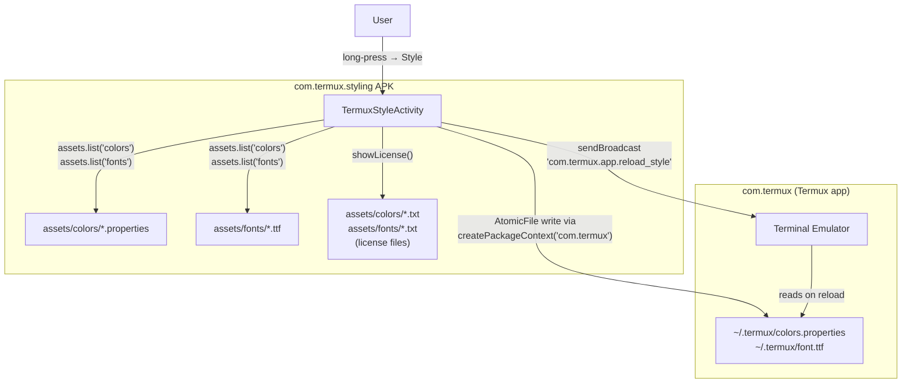
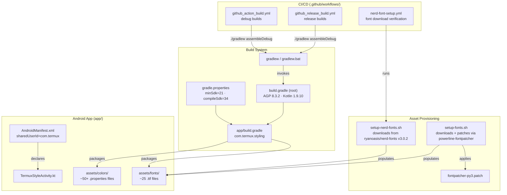

<!-- source: DeepWiki mcp.deepwiki.com · repo termux/termux-styling · page 1 Overview · fetched 2026-10-26 -->

# Overview

Relevant source files

The following files were used as context for generating this wiki page:

- [.github/workflows/github_action_build.yml](.github/workflows/github_action_build.yml)
- [.github/workflows/github_release_build.yml](.github/workflows/github_release_build.yml)
- [LICENSE.md](LICENSE.md)
- [README.md](README.md)
- [app/src/main/AndroidManifest.xml](app/src/main/AndroidManifest.xml)
- [app/src/main/java/com/termux/styling/TermuxStyleActivity.kt](app/src/main/java/com/termux/styling/TermuxStyleActivity.kt)
- [settings.gradle](settings.gradle)

This page introduces Termux:Styling — what it is, what problem it solves, and how the repository is organized. For details on specific subsystems, see the linked pages throughout.

---

## What Termux:Styling Is

Termux:Styling is an Android add-on application for the [Termux](https://termux.org) terminal emulator. Its sole purpose is to let users apply a custom font or color scheme to the Termux terminal without restarting or reconfiguring the terminal manually.

The app is distributed primarily via [F-Droid](https://f-droid.org/en/packages/com.termux.styling/). Per-commit debug builds are also available via GitHub Actions.

**Application ID:** `com.termux.styling`  
**License:** GPLv3 only  
**Minimum SDK:** 21 (Android 5.0)  
**Compile SDK:** 34

---

## User Interaction Flow

Users access Termux:Styling from within Termux itself via a long-press context menu. The interaction sequence is:

1. Long-press anywhere in the Termux terminal.
2. Select **More...** from the resulting dialog.
3. Select **Style**.
4. Tap **CHOOSE COLOR** or **CHOOSE FONT**.

At that point, `TermuxStyleActivity` opens an `AlertDialog` listing the available assets. Tapping an item writes the selected asset to `~/.termux/` in the main Termux app's file storage and sends a broadcast to reload it. Long-pressing an item shows its license text.

Sources: [README.md:28-32](), [app/src/main/java/com/termux/styling/TermuxStyleActivity.kt:58-116]()

---

## Critical Requirement: Shared Signing Key

Termux:Styling communicates with the main Termux app by writing directly into Termux's private file system directory and sending a `com.termux.app.reload_style` broadcast. This cross-package file access is enabled by the `android:sharedUserId="com.termux"` declaration in `AndroidManifest.xml`.

> **The `sharedUserId` mechanism requires that both `com.termux` and `com.termux.styling` are signed with the same key.** If signing keys differ — for example, when mixing an F-Droid build of Termux with a GitHub Actions debug build of Termux:Styling — the add-on will not have permission to write to Termux's files.

When switching installation sources, both Termux and all plugins must be uninstalled before reinstalling.

Sources: [README.md:9-11](), [app/src/main/AndroidManifest.xml:3]()

---

## Runtime Architecture

The following diagram maps the runtime components and their relationships using the actual class and broadcast names from the codebase.

**Diagram: Runtime Component Relationships**

Sources: [app/src/main/java/com/termux/styling/TermuxStyleActivity.kt:144-188]()

---

## Repository Organization

The repository has four primary areas of concern:

| Area | Location | Purpose |
|---|---|---|
| Android application | `app/` | The single `Activity`, assets, layout, manifest |
| Styling assets | `app/src/main/assets/` | Bundled `.ttf` font files and `.properties` color schemes |
| Build system | `build.gradle`, `app/build.gradle`, `gradle.properties` | Gradle multi-project build configuration |
| CI/CD | `.github/workflows/` | Automated debug and release APK builds |
| Asset provisioning | `setup-nerd-fonts.sh`, `setup-fonts.sh` | Developer scripts to populate `assets/fonts/` |

**Diagram: Repository Component Map**

Sources: [app/src/main/AndroidManifest.xml:1-19](), [README.md:1-32](), [.github/workflows/github_action_build.yml:1-81](), [.github/workflows/github_release_build.yml:1-70]()

---

## Key Data Files Written at Runtime

When a user selects a style, `TermuxStyleActivity` writes one of two files into the Termux app's home directory. These are the only persistent outputs the add-on produces.

| User action | Destination file | Content written |
|---|---|---|
| Select color scheme | `~/.termux/colors.properties` | Full `.properties` asset content |
| Select **Default** color | `~/.termux/colors.properties` | Comment sentinel: `# Using default color theme.` |
| Select font | `~/.termux/font.ttf` | Full `.ttf` asset content |
| Select **Default** font | `~/.termux/font.ttf` | Empty file (marker) |

After writing, the broadcast action `com.termux.app.reload_style` is sent with an extra key of the same name, set to either `"colors"` or `"font"`, so the terminal emulator knows which resource to reload.

Sources: [app/src/main/java/com/termux/styling/TermuxStyleActivity.kt:144-188]()

---

## Related Pages

- For the `TermuxStyleActivity` class in detail, see [TermuxStyleActivity](#2.1).
- For the `AndroidManifest.xml` and `sharedUserId` behavior, see [Manifest and Permissions](#2.2).
- For the bundled font and color assets, see [Styling Assets](#3).
- For the Gradle build configuration, see [Build System](#4).
- For CI/CD workflows, see [CI/CD Workflows](#5).
- For the font provisioning shell scripts, see [Asset Provisioning](#6).
- For contributing guidelines and signing key notes, see [Contributing](#7).

---

