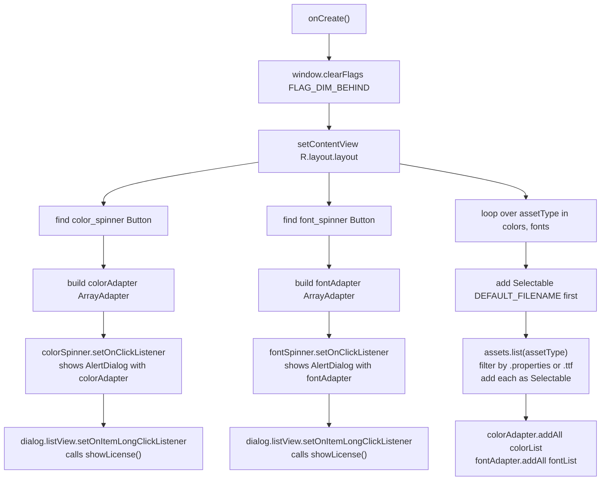
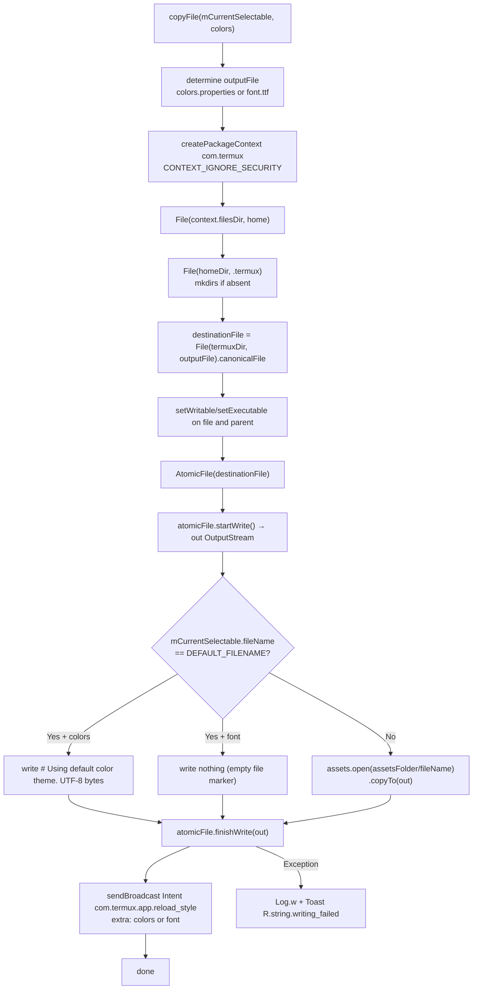
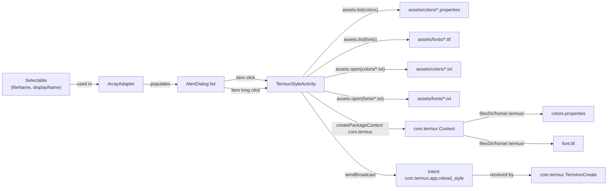

<!-- source: DeepWiki mcp.deepwiki.com · repo termux/termux-styling · page 2.1 TermuxStyleActivity · fetched 2026-10-26 -->

# TermuxStyleActivity

<details>
<summary>Relevant source files</summary>

The following files were used as context for generating this wiki page:

- [app/src/main/assets/colors/nord.txt](app/src/main/assets/colors/nord.txt)
- [app/src/main/assets/fonts/Monofur.txt](app/src/main/assets/fonts/Monofur.txt)
- [app/src/main/java/com/termux/styling/TermuxStyleActivity.kt](app/src/main/java/com/termux/styling/TermuxStyleActivity.kt)
- [app/src/main/res/values/strings.xml](app/src/main/res/values/strings.xml)
- [settings.gradle](settings.gradle)

</details>


This page documents `TermuxStyleActivity`, the single Activity that constitutes the entire runtime of the Termux:Styling application. It covers asset enumeration, the `Selectable` data class, the `copyFile` write pipeline (including `AtomicFile` usage and the "Default" sentinel), the `showLicense` method, and the `com.termux.app.reload_style` broadcast mechanism.

For the manifest flags that control how this Activity is launched, see [Manifest and Permissions](#2.2). For the contents of the asset files this Activity reads, see [Font Assets](#3.1) and [Color Scheme Assets](#3.2).

---

## Overview

`TermuxStyleActivity` [app/src/main/java/com/termux/styling/TermuxStyleActivity.kt:40-192]() is a plain `android.app.Activity` subclass with no navigation, no fragments, and no ViewModel. Its single screen presents two buttons — "CHOOSE COLOR" and "CHOOSE FONT" — each of which opens an `AlertDialog` list populated by scanning the APK's bundled assets.

When a user selects an item, the Activity:

1. Writes the asset file to the Termux app's private storage using `createPackageContext`.
2. Sends a broadcast to trigger a live reload inside the running Termux terminal.

The Activity finishes or is dismissed after performing the action; it is not designed to retain state across sessions.

Sources: [app/src/main/java/com/termux/styling/TermuxStyleActivity.kt:1-192]()

---

## Top-Level Declarations

The file defines two top-level members outside the class body:

| Symbol | Type | Value / Purpose |
|---|---|---|
| `DEFAULT_FILENAME` | `const val String` | `"Default"` — sentinel name used to identify the "reset to default" list entry |
| `capitalize(str: String): String` | function | Capitalizes the first letter of each whitespace-separated word in a string; used to derive human-readable display names from file names |

The `capitalize` function [app/src/main/java/com/termux/styling/TermuxStyleActivity.kt:26-38]() iterates over the character array, uppercasing the first letter after any whitespace, and is called exclusively from `Selectable.init`.

Sources: [app/src/main/java/com/termux/styling/TermuxStyleActivity.kt:24-38]()

---

## The `Selectable` Inner Class

`Selectable` [app/src/main/java/com/termux/styling/TermuxStyleActivity.kt:42-56]() is an internal data-holder that wraps a raw asset filename and computes a display name from it. It is used as the item type for both `ArrayAdapter` instances.

**Transformation rules applied in `init`:**

1. Replace all `-` characters with spaces.
2. Strip the file extension (everything from the last `.` onward).
3. Apply `capitalize()` to the result.

**Example transformations:**

| `fileName` (raw asset) | `displayName` |
|---|---|
| `solarized-dark.properties` | `Solarized Dark` |
| `FiraCode-Regular.ttf` | `Firacode Regular` |
| `Default` | `Default` |

`toString()` delegates to `displayName`, so `ArrayAdapter` renders it correctly without a custom view.

Sources: [app/src/main/java/com/termux/styling/TermuxStyleActivity.kt:42-56]()

---

## `onCreate`: Activity Setup and Asset Enumeration

**onCreate flow diagram**



Sources: [app/src/main/java/com/termux/styling/TermuxStyleActivity.kt:58-116]()

### Asset Enumeration

[app/src/main/java/com/termux/styling/TermuxStyleActivity.kt:95-112]()

The loop iterates over two asset folder names: `"colors"` and `"fonts"`. For each:

- The file extension filter is `.properties` (colors) or `.ttf` (fonts).
- `assets.list(assetType)` returns all file names in the folder; the result is filtered to the relevant extension.
- The "Default" entry is prepended to the list before the asset scan, so it always appears first.
- An `IOException` from `assets.list` is re-thrown as `RuntimeException` (a fatal condition).

### Dialog Behavior

Each button's `OnClickListener` constructs a new `AlertDialog.Builder` with `setAdapter`, wiring item-click to `copyFile` and item-long-click to `showLicense`. The `setOnShowListener` hook is needed because `dialog.listView` is only accessible after the dialog is shown.

---

## `copyFile`: Writing Styles to Termux

`copyFile` [app/src/main/java/com/termux/styling/TermuxStyleActivity.kt:144-190]() is the central write operation. It accepts a `Selectable?` and a Boolean `colors` flag.

**copyFile pipeline diagram**



Sources: [app/src/main/java/com/termux/styling/TermuxStyleActivity.kt:144-190]()

### Cross-Package Context

[app/src/main/java/com/termux/styling/TermuxStyleActivity.kt:149-153]()

`createPackageContext("com.termux", Context.CONTEXT_IGNORE_SECURITY)` returns a `Context` scoped to the Termux app's data directory. This call only succeeds because both apps share `sharedUserId="com.termux"` (declared in `AndroidManifest.xml`) and are signed with the same key. The `filesDir` of that context resolves to the Termux app's internal storage root; the target directory is `<filesDir>/home/.termux/`.

### AtomicFile Write

`android.util.AtomicFile` provides crash-safe writes by writing to a temporary file first, then atomically renaming it on `finishWrite`. If an exception occurs before `finishWrite`, the destination is not corrupted.

### Default Sentinel Handling

| Condition | Action |
|---|---|
| `colors = true`, `fileName == "Default"` | Write the UTF-8 string `# Using default color theme.` to `colors.properties` |
| `colors = false`, `fileName == "Default"` | Write nothing; leaves `font.ttf` as an empty file |
| Any other selection | Stream the matching asset directly to the output file |

The Termux app interprets a comment-only `colors.properties` as "no custom color scheme" and an empty `font.ttf` as "use the built-in font."

### File Permission Fixup

Before writing, `copyFile` calls `setWritable(true)` on the destination file and `setWritable(true)` / `setExecutable(true)` on its parent directory. This guards against permission states that might have been set by the user manually.

Sources: [app/src/main/java/com/termux/styling/TermuxStyleActivity.kt:157-159]()

---

## `showLicense`: Displaying License Text

`showLicense` [app/src/main/java/com/termux/styling/TermuxStyleActivity.kt:118-142]() is triggered on long-press of any list item.

**Lookup logic:**

1. Take the `fileName` from the `Selectable`.
2. Strip the file extension.
3. Append `.txt` — e.g., `nord.properties` → `nord.txt`, `FiraCode-Regular.ttf` → `FiraCode-Regular.txt`.
4. Open `assets/<folder>/<name>.txt`.

The content is read into a `SpannableString` and `Linkify.addLinks(license, Linkify.ALL)` is applied so that URLs in the license text become clickable. The `AlertDialog`'s message `TextView` receives `LinkMovementMethod.getInstance()` to enable tap navigation.

If no `.txt` file exists (e.g., for the "Default" entry), the `IOException` is silently ignored and no dialog appears.

Sources: [app/src/main/java/com/termux/styling/TermuxStyleActivity.kt:118-142]()

---

## The `com.termux.app.reload_style` Broadcast

After every successful write, `copyFile` sends:

```
Intent("com.termux.app.reload_style")
    .putExtra("com.termux.app.reload_style", "colors" | "font")
```

[app/src/main/java/com/termux/styling/TermuxStyleActivity.kt:180-183]()

The intent action and the extra key are the same string `"com.termux.app.reload_style"`. The extra value distinguishes which resource was updated. The Termux terminal emulator listens for this broadcast and reloads the relevant style without restarting the terminal session.

The comment in the source [app/src/main/java/com/termux/styling/TermuxStyleActivity.kt:179]() notes: *"Must match constant in Term#onCreate()"*, indicating this string is a shared contract with the main Termux app's `Term` class.

---

## Error Handling

If any exception is thrown during `copyFile` (file permission errors, `PackageManager.NameNotFoundException`, I/O failures), the catch block at [app/src/main/java/com/termux/styling/TermuxStyleActivity.kt:184-188]() logs a warning via `Log.w("termux", ...)` and shows a `Toast` using the string resource `R.string.writing_failed` concatenated with the exception message.

| String resource | Value |
|---|---|
| `R.string.writing_failed` | `"Failed to install file:\n\n"` |

Sources: [app/src/main/res/values/strings.xml:6](), [app/src/main/java/com/termux/styling/TermuxStyleActivity.kt:184-188]()

---

## Component Relationship Summary

**TermuxStyleActivity component map**



Sources: [app/src/main/java/com/termux/styling/TermuxStyleActivity.kt:1-192]()

---

