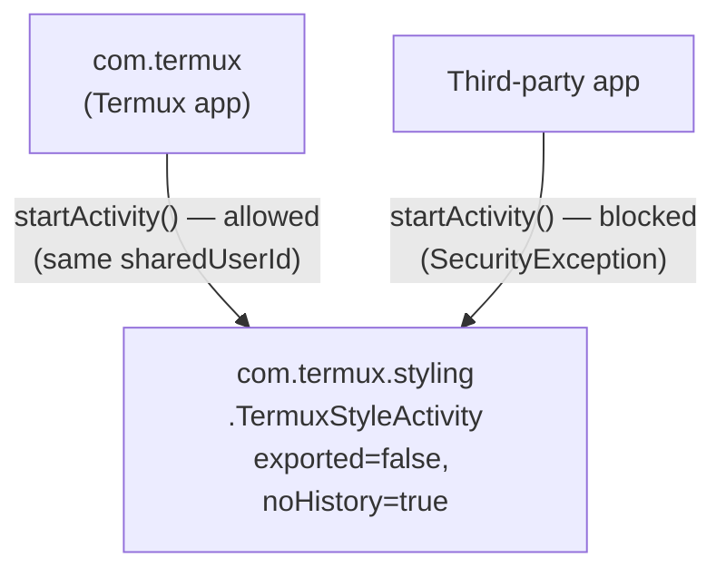

<!-- source: DeepWiki mcp.deepwiki.com · repo termux/termux-styling · page 2.2 Manifest and Permissions · fetched 2026-10-26 -->

# Manifest and Permissions

<details>
<summary>Relevant source files</summary>

The following files were used as context for generating this wiki page:

- [.github/workflows/github_action_build.yml](.github/workflows/github_action_build.yml)
- [.github/workflows/github_release_build.yml](.github/workflows/github_release_build.yml)
- [LICENSE.md](LICENSE.md)
- [README.md](README.md)
- [app/src/main/AndroidManifest.xml](app/src/main/AndroidManifest.xml)

</details>


This page covers the complete configuration declared in `app/src/main/AndroidManifest.xml`, including the `sharedUserId` mechanism, Activity flags, and hardware feature declaration. For the runtime behavior of the Activity itself (asset enumeration, file writes, broadcasts), see [TermuxStyleActivity](#2.1). For build-time configuration including the `applicationId` and `namespace`, see [App Build Configuration](#4.1).

---

## File Overview

The manifest is located at [app/src/main/AndroidManifest.xml:1-19]() and is minimal by design. The application declares no explicit `<uses-permission>` elements. Its cross-process capability is instead derived entirely from the `sharedUserId` mechanism described below.

---

## `sharedUserId` and the Signing Key Requirement

[app/src/main/AndroidManifest.xml:3]()

```xml
android:sharedUserId="com.termux"
```

This is the most security-critical declaration in the manifest. When two APKs share the same `sharedUserId`, Android grants them access to each other's private file storage at the OS level — but **only if both APKs are signed with the same certificate**.

The consequence for Termux:Styling is direct: the app must write files into the Termux app's private data directory (`~/.termux/font.ttf` and `~/.termux/colors.properties`). Rather than requesting a `READ_EXTERNAL_STORAGE` or custom permission, it uses `Context.createPackageContext("com.termux", ...)` to obtain a cross-package context — which Android only permits when the two packages share a `sharedUserId` backed by a matching signing key.

If the signing keys do not match, `createPackageContext` throws a `SecurityException` at runtime, and no file writes can occur.

**Signing Key Diagram: What Must Match**

```mermaid
flowchart LR
    subgraph apk1 ["termux-styling APK"]
        M1["AndroidManifest.xml\nsharedUserId=\"com.termux\""]
        K1["signing certificate"]
    end
    subgraph apk2 ["termux APK"]
        M2["AndroidManifest.xml\nsharedUserId=\"com.termux\""]
        K2["signing certificate"]
    end
    K1 -->|"must equal"| K2
    M1 -->|"declares same sharedUserId"| M2
    apk1 -->|"createPackageContext(\"com.termux\")\ngrants write access"| apk2
```

> **Note:** `android:sharedUserId` was deprecated in API level 29. However, it remains functional for existing packages and is still the mechanism in use here. Removing it would require a migration path that does not currently exist.

Sources: [app/src/main/AndroidManifest.xml:1-19](), [README.md:9-11]()

---

## Activity Declaration

[app/src/main/AndroidManifest.xml:12-16]()

The application contains exactly one Activity: `TermuxStyleActivity`. Its declaration includes two flags:

| Attribute | Value | Effect |
|---|---|---|
| `android:name` | `.TermuxStyleActivity` | Resolves to `com.termux.styling.TermuxStyleActivity` |
| `android:noHistory` | `true` | Activity is not retained in the back stack after the user leaves it |
| `android:exported` | `false` | Activity cannot be started by external applications via an implicit or explicit Intent |

**`android:noHistory="true"`** means that once the user navigates away from the styling picker (e.g., by pressing Back or Home), the Activity is immediately finished and removed from the task history. This is intentional: the screen is a transient configuration utility, not a destination the user should return to via the Recents list.

**`android:exported="false"`** means the Activity can only be launched by components within the same application (or, due to `sharedUserId`, from within the Termux shared-UID group). The main Termux app launches it via the `Style` menu option in the terminal long-press dialog. Because `exported` is `false`, no third-party app can directly invoke the Activity.

**Activity Launch Context Diagram**



Sources: [app/src/main/AndroidManifest.xml:12-16]()

---

## Application-Level Attributes

[app/src/main/AndroidManifest.xml:7-11]()

| Attribute | Value | Notes |
|---|---|---|
| `android:allowBackup` | `true` | Enables Android Auto Backup; the app has no user data to back up |
| `android:icon` | `@drawable/ic_launcher` | Launcher icon resource |
| `android:label` | `@string/app_name` | Display name from `res/values/strings.xml` |
| `android:theme` | `@style/AppTheme` | Application-wide theme |

Sources: [app/src/main/AndroidManifest.xml:7-11]()

---

## Hardware Feature Declaration

[app/src/main/AndroidManifest.xml:5]()

```xml
<uses-feature android:name="android.hardware.touchscreen" android:required="false" />
```

By default, any app that uses touch events is implicitly assumed to require a touchscreen. This declaration **overrides** that implicit requirement, setting `required="false"`.

The practical effect is that the app remains installable on devices without a touchscreen (e.g., Android TV hardware or Chromebooks in some configurations). Since `TermuxStyleActivity` presents `AlertDialog` lists that can also be navigated with directional input, the app is not fundamentally dependent on touch.

> Without this declaration, Google Play and F-Droid would filter the app out of device catalogs that lack a touchscreen.

Sources: [app/src/main/AndroidManifest.xml:5]()

---

## Permissions Summary

The manifest declares **no `<uses-permission>` elements**. The table below explains how each cross-process capability is achieved without explicit permissions:

| Capability | Mechanism | Why No Permission Needed |
|---|---|---|
| Write to `com.termux` file storage | `Context.createPackageContext("com.termux", ...)` | Granted by matching `sharedUserId` + signing key |
| Send `com.termux.app.reload_style` broadcast | `Context.sendBroadcast(Intent)` | Broadcast is not protected by a `protectionLevel` permission |
| Read own bundled assets | `AssetManager.open(...)` | Same-package access; no permission required |

Sources: [app/src/main/AndroidManifest.xml:1-19](), [README.md:9-11]()

---

## Full Manifest Reference

For completeness, the entire manifest is reproduced here:

[app/src/main/AndroidManifest.xml:1-19]()

```xml
<?xml version="1.0" encoding="utf-8"?>
<manifest xmlns:android="http://schemas.android.com/apk/res/android"
    android:sharedUserId="com.termux" >

    <uses-feature android:name="android.hardware.touchscreen" android:required="false" />

    <application
        android:allowBackup="true"
        android:icon="@drawable/ic_launcher"
        android:label="@string/app_name"
        android:theme="@style/AppTheme" >
        <activity
            android:name=".TermuxStyleActivity"
            android:noHistory="true"
            android:exported="false" >
        </activity>
    </application>

</manifest>
```

Sources: [app/src/main/AndroidManifest.xml:1-19]()

---

