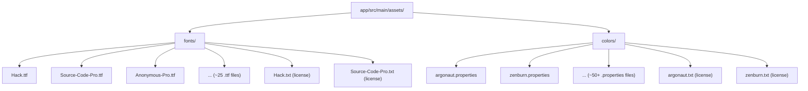
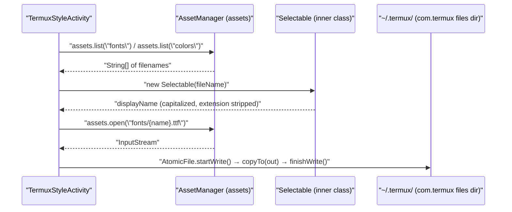
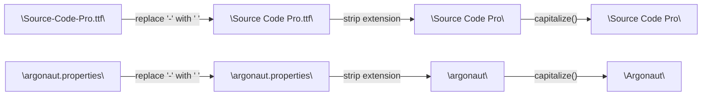

<!-- source: DeepWiki mcp.deepwiki.com · repo termux/termux-styling · page 3 Styling Assets · fetched 2026-10-26 -->

# Styling Assets

<details>
<summary>Relevant source files</summary>

The following files were used as context for generating this wiki page:

- [app/src/main/assets/colors/argonaut.properties](app/src/main/assets/colors/argonaut.properties)
- [app/src/main/assets/colors/zenburn.properties](app/src/main/assets/colors/zenburn.properties)
- [app/src/main/assets/fonts/Anonymous-Pro.ttf](app/src/main/assets/fonts/Anonymous-Pro.ttf)
- [app/src/main/assets/fonts/Hack.ttf](app/src/main/assets/fonts/Hack.ttf)
- [app/src/main/assets/fonts/Source-Code-Pro.ttf](app/src/main/assets/fonts/Source-Code-Pro.ttf)
- [app/src/main/java/com/termux/styling/TermuxStyleActivity.kt](app/src/main/java/com/termux/styling/TermuxStyleActivity.kt)
- [settings.gradle](settings.gradle)

</details>


This page describes the two categories of bundled assets shipped with Termux:Styling and explains how they are packaged into the APK and accessed at runtime. For a detailed listing of individual font files and their patching status, see [Font Assets](#3.1). For a detailed listing of color schemes and their `.properties` format, see [Color Scheme Assets](#3.2).

---

## Overview

The app ships two directories of bundled assets under `app/src/main/assets/`:

| Directory | File Extension | Written to |
|---|---|---|
| `assets/fonts/` | `.ttf` | `~/.termux/font.ttf` |
| `assets/colors/` | `.properties` | `~/.termux/colors.properties` |

Each asset file has an optional companion `.txt` file in the same directory, used to display license information when the user long-presses an entry in the selection dialog.

The Gradle build system packages the entire `assets/` tree into the APK. At runtime, `TermuxStyleActivity` enumerates both directories using `AssetManager` and presents them to the user as selectable lists.

Sources: [app/src/main/assets/colors/argonaut.properties:1-22](), [app/src/main/assets/colors/zenburn.properties:1-22](), [app/src/main/java/com/termux/styling/TermuxStyleActivity.kt:95-116]()

---

## Directory Structure

**Asset directory layout** — how the two asset categories are organized inside the APK:



Sources: [app/src/main/java/com/termux/styling/TermuxStyleActivity.kt:97-112]()

---

## Packaging into the APK

The `app/src/main/assets/` directory is the standard Android assets source set. The Android Gradle Plugin automatically bundles everything under this path into the APK without further configuration. No `assets {}` DSL block is required in `app/build.gradle`.

At install time, the entire compressed `assets/` tree is available to the running app via Android's `AssetManager` API. Assets are read-only at runtime; they are never extracted to the filesystem by default — `TermuxStyleActivity` reads them directly as streams and writes the selected file to the Termux home directory.

Sources: [app/src/main/java/com/termux/styling/TermuxStyleActivity.kt:104-110]()

---

## Runtime Access via AssetManager

The following diagram traces how `TermuxStyleActivity` moves from an asset file to a written output file.

**Asset access and write flow** — code entities involved in reading and applying a styling asset:



The `assets.list()` call at [app/src/main/java/com/termux/styling/TermuxStyleActivity.kt:105]() returns all filenames in the given asset subfolder. The result is then filtered by extension (`.properties` for colors, `.ttf` for fonts) at [app/src/main/java/com/termux/styling/TermuxStyleActivity.kt:106]().

Sources: [app/src/main/java/com/termux/styling/TermuxStyleActivity.kt:95-116](), [app/src/main/java/com/termux/styling/TermuxStyleActivity.kt:144-189]()

---

## Display Name Derivation

Every asset filename is wrapped in a `Selectable` instance. The `Selectable` inner class at [app/src/main/java/com/termux/styling/TermuxStyleActivity.kt:42-56]() derives a human-readable display name from the raw filename according to these rules:

1. Replace every `-` character with a space.
2. Strip the file extension (remove everything from the last `.` onward).
3. Apply title-case capitalization via the top-level `capitalize()` function at [app/src/main/java/com/termux/styling/TermuxStyleActivity.kt:26-38]().

**Display name derivation** — mapping filename to `displayName` in `Selectable`:



The `fileName` field retains the original filename (including extension) and is used when opening the asset stream. The `displayName` field is what is shown in the `AlertDialog` list via `ArrayAdapter`.

Sources: [app/src/main/java/com/termux/styling/TermuxStyleActivity.kt:42-56](), [app/src/main/java/com/termux/styling/TermuxStyleActivity.kt:26-38]()

---

## The Default Sentinel

Both the fonts and colors lists include a special "Default" entry that does not correspond to any asset file. It is added at [app/src/main/java/com/termux/styling/TermuxStyleActivity.kt:102]() before the asset enumeration loop.

When the user selects "Default", `copyFile()` at [app/src/main/java/com/termux/styling/TermuxStyleActivity.kt:162-176]() writes a sentinel value instead of streaming an asset:

| Type | Default sentinel written to `~/.termux/` |
|---|---|
| Colors | `colors.properties` containing the comment `# Using default color theme.` |
| Fonts | `font.ttf` as an empty file (zero bytes) |

Termux interprets these sentinel values to revert to its built-in defaults. The `DEFAULT_FILENAME` constant at [app/src/main/java/com/termux/styling/TermuxStyleActivity.kt:24]() holds the string `"Default"`.

Sources: [app/src/main/java/com/termux/styling/TermuxStyleActivity.kt:24](), [app/src/main/java/com/termux/styling/TermuxStyleActivity.kt:102](), [app/src/main/java/com/termux/styling/TermuxStyleActivity.kt:162-176]()

---

## License Files

Each asset (font or color scheme) may have an accompanying `.txt` file stored at the same path in the same asset folder. When a user long-presses an entry in the dialog, `showLicense()` at [app/src/main/java/com/termux/styling/TermuxStyleActivity.kt:118-142]() constructs the license filename by:

1. Taking the `fileName` from `Selectable`.
2. Stripping the extension.
3. Appending `.txt`.

For example, `Hack.ttf` → `Hack.txt`, and `argonaut.properties` → `argonaut.txt`.

If the `.txt` file does not exist, the `IOException` is silently caught and nothing is shown ([app/src/main/java/com/termux/styling/TermuxStyleActivity.kt:138-140]()). This means license files are optional — assets without one simply show nothing on long-press.

The license text is rendered in an `AlertDialog` with `Linkify.addLinks()` applied, so URLs in the license text become tappable.

Sources: [app/src/main/java/com/termux/styling/TermuxStyleActivity.kt:118-142]()

---

## Color Scheme File Format

Color scheme assets use the Java `.properties` format — simple `key=value` pairs, one per line. Lines beginning with `#` are comments.

**Required and optional keys:**

| Key | Description | Example |
|---|---|---|
| `background` | Terminal background color | `#0e1019` |
| `foreground` | Default text color | `#fffaf4` |
| `cursor` | Cursor color | `#fffaf4` |
| `color0`–`color7` | Normal 8-color palette | `#ff000f` |
| `color8`–`color15` | Bright 8-color palette | `#ff2740` |

All color values are hex strings in `#RRGGBB` format. A complete example from `assets/colors/argonaut.properties`:

```
background=#0e1019
foreground=#fffaf4
cursor=#fffaf4
color0=#232323
color1=#ff000f
...
color15=#ffffff
```

For a full listing of all bundled color schemes, see [Color Scheme Assets](#3.2).

Sources: [app/src/main/assets/colors/argonaut.properties:1-22](), [app/src/main/assets/colors/zenburn.properties:1-22]()

---

## Font File Format

Font assets are standard TrueType Font (`.ttf`) binary files. Some are patched versions that include additional Unicode codepoints (Powerline symbols, Nerd Font icons); others are unmodified originals. The distinction is not encoded in the filename itself — the accompanying `.txt` license file typically identifies the source and any modifications.

For a full listing of bundled fonts and their patching status, see [Font Assets](#3.1). For documentation of the shell scripts used to produce the patched font files before they are committed to the repository, see [Asset Provisioning](#6).

Sources: [app/src/main/assets/fonts/Hack.ttf:1-1](), [app/src/main/assets/fonts/Source-Code-Pro.ttf:1-1](), [app/src/main/assets/fonts/Anonymous-Pro.ttf:1-1]()

---

