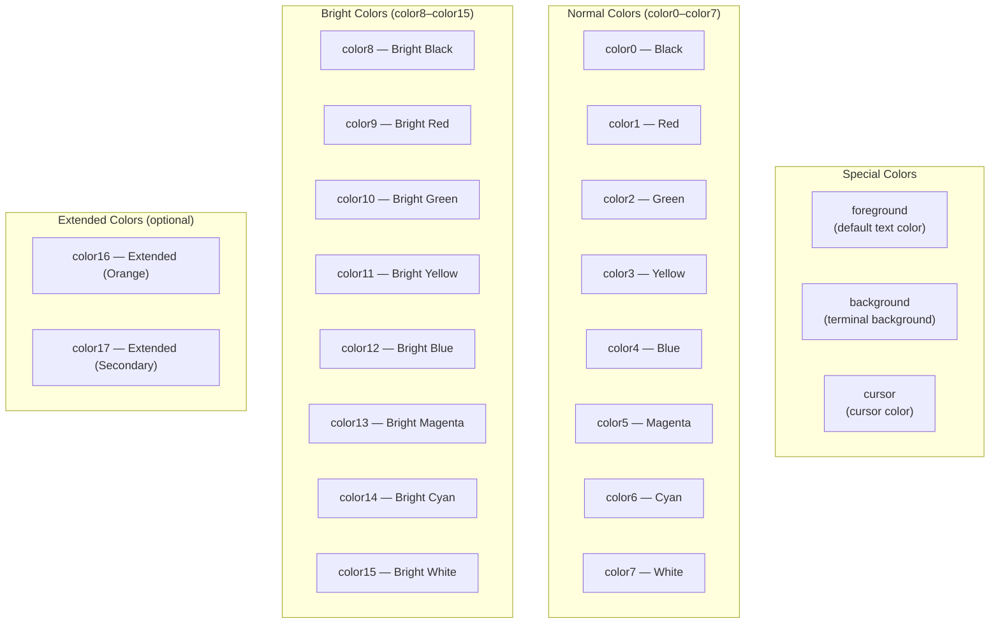
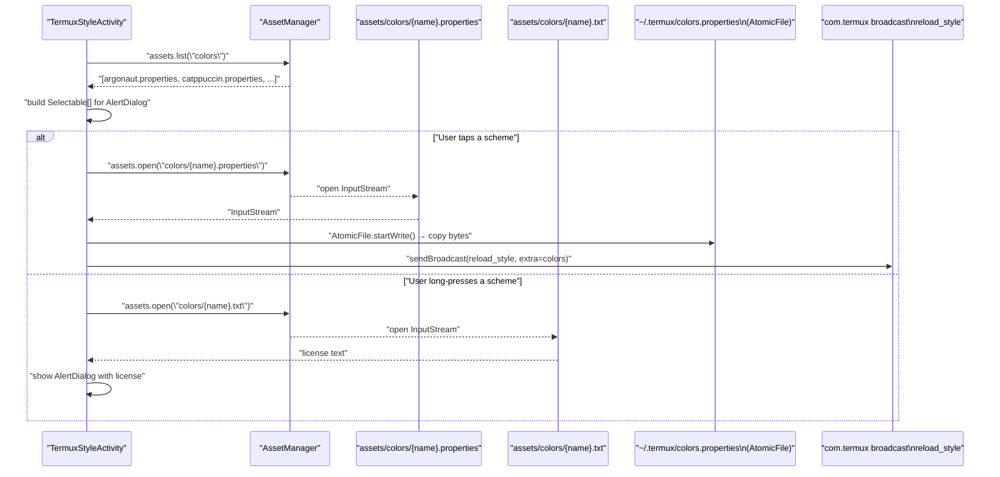

<!-- source: DeepWiki mcp.deepwiki.com · repo termux/termux-styling · page 3.2 Color Scheme Assets · fetched 2026-10-26 -->

# Color Scheme Assets

<details>
<summary>Relevant source files</summary>

The following files were used as context for generating this wiki page:

- [app/src/main/assets/colors/argonaut.properties](app/src/main/assets/colors/argonaut.properties)
- [app/src/main/assets/colors/catppuccin-frappe.properties](app/src/main/assets/colors/catppuccin-frappe.properties)
- [app/src/main/assets/colors/catppuccin-frappe.txt](app/src/main/assets/colors/catppuccin-frappe.txt)
- [app/src/main/assets/colors/catppuccin-latte.properties](app/src/main/assets/colors/catppuccin-latte.properties)
- [app/src/main/assets/colors/catppuccin-latte.txt](app/src/main/assets/colors/catppuccin-latte.txt)
- [app/src/main/assets/colors/catppuccin-macchiato.properties](app/src/main/assets/colors/catppuccin-macchiato.properties)
- [app/src/main/assets/colors/catppuccin-macchiato.txt](app/src/main/assets/colors/catppuccin-macchiato.txt)
- [app/src/main/assets/colors/catppuccin-mocha.properties](app/src/main/assets/colors/catppuccin-mocha.properties)
- [app/src/main/assets/colors/catppuccin-mocha.txt](app/src/main/assets/colors/catppuccin-mocha.txt)
- [app/src/main/assets/colors/catppuccin.txt](app/src/main/assets/colors/catppuccin.txt)
- [app/src/main/assets/colors/gruvbox-material-dark-hard.properties](app/src/main/assets/colors/gruvbox-material-dark-hard.properties)
- [app/src/main/assets/colors/gruvbox-material-dark-medium.properties](app/src/main/assets/colors/gruvbox-material-dark-medium.properties)
- [app/src/main/assets/colors/gruvbox-material-dark-soft.properties](app/src/main/assets/colors/gruvbox-material-dark-soft.properties)
- [app/src/main/assets/colors/gruvbox-material-light-hard.properties](app/src/main/assets/colors/gruvbox-material-light-hard.properties)
- [app/src/main/assets/colors/gruvbox-material-light-medium.properties](app/src/main/assets/colors/gruvbox-material-light-medium.properties)
- [app/src/main/assets/colors/gruvbox-material-light-soft.properties](app/src/main/assets/colors/gruvbox-material-light-soft.properties)
- [app/src/main/assets/colors/tokyonight-dark.properties](app/src/main/assets/colors/tokyonight-dark.properties)
- [app/src/main/assets/colors/tokyonight-day.properties](app/src/main/assets/colors/tokyonight-day.properties)
- [app/src/main/assets/colors/zenburn.properties](app/src/main/assets/colors/zenburn.properties)

</details>


This page describes the color scheme asset files bundled in `app/src/main/assets/colors/`, their file format, the full set of recognized property keys, and how they are loaded at runtime. For how the activity enumerates and applies these files, see [TermuxStyleActivity](#2.1). For font assets stored alongside color schemes, see [Font Assets](#3.1).

---

## Location and Packaging

All color scheme assets reside in:

```
app/src/main/assets/colors/
```

Each color scheme consists of a pair of files:

| File | Role |
|------|------|
| `{name}.properties` | Color definitions applied to the terminal |
| `{name}.txt` | License text, shown on long-press in the UI |

The entire `assets/colors/` directory is packaged into the APK by the Gradle build. At runtime, `TermuxStyleActivity` uses Android's `AssetManager` to call `assets.list("colors")` and enumerate all entries. Only `.properties` files appear in the selection dialog; `.txt` files are accessed separately when the user long-presses a scheme name.

Sources: [app/src/main/assets/colors/tokyonight-dark.properties:1-33](), [app/src/main/assets/colors/argonaut.properties:1-21](), [app/src/main/assets/colors/catppuccin-mocha.txt:1-23]()

---

## File Format

Color scheme files follow the Java `.properties` convention. Both `=` and `:` are accepted as key-value separators, and whitespace around the separator is permitted.

**Example** — excerpt from [app/src/main/assets/colors/tokyonight-dark.properties:1-16]():

```
## Name: Tokyo Night Dark

# Special
foreground = #c0caf5
cursor     = #c0caf5
background = #1a1b26

# Black
color0 = #15161E
color8 = #414868
```

**Example** — colon separator style from [app/src/main/assets/colors/gruvbox-material-dark-hard.properties:1-8]():

```
background: #1D2021
foreground: #D4BE98

color0:  #665C54
color8:  #928374
```

### Rules

- Lines beginning with `#` (or `##`) are comments and are ignored.
- All hex values use the `#RRGGBB` format (six hex digits, uppercase or lowercase).
- Whitespace before and after the separator is trimmed.
- Keys not present in the file retain their default values in the Termux terminal.

---

## Property Key Reference

The following diagram maps each recognized key to its semantic role in the terminal color palette.

**Diagram: Property Keys to Terminal Color Roles**



Sources: [app/src/main/assets/colors/catppuccin-mocha.properties:1-25](), [app/src/main/assets/colors/tokyonight-dark.properties:1-33](), [app/src/main/assets/colors/gruvbox-material-dark-hard.properties:1-26]()

### Key Summary Table

| Key | Required | Typical Role |
|-----|----------|-------------|
| `foreground` | Recommended | Default text color |
| `background` | Recommended | Terminal background |
| `cursor` | Optional | Cursor block/bar color |
| `color0` – `color7` | Recommended | Normal 8-color palette |
| `color8` – `color15` | Recommended | Bright 8-color palette |
| `color16` | Optional | Extended color (often orange) |
| `color17` | Optional | Extended color (often dark red or pink) |

`color16` and `color17` are omitted from some schemes (e.g., `argonaut`, `zenburn`, `gruvbox-material-*`). When absent, the Termux terminal falls back to its built-in defaults for those slots.

---

## Asset Pair Structure

**Diagram: `.properties` and `.txt` file pairs in the asset pipeline**

```mermaid
flowchart LR
    subgraph "assets/colors/ (APK bundle)"
        P[""{name}.properties"\n(color definitions)"]
        T[""{name}.txt"\n(license text)"]
    end

    subgraph "TermuxStyleActivity"
        LIST["assets.list(\"colors\")"]
        OPEN_P["assets.open(\"colors/{name}.properties\")"]
        OPEN_T["assets.open(\"colors/{name}.txt\")"]
        WRITE["AtomicFile write →\n~/.termux/colors.properties"]
        DIALOG["AlertDialog\n(license text)"]
    end

    LIST -->|"populates selection list"| OPEN_P
    LIST -->|"populates selection list"| OPEN_T
    OPEN_P --> WRITE
    OPEN_T --> DIALOG
```

Sources: [app/src/main/assets/colors/catppuccin-mocha.txt:1-23](), [app/src/main/assets/colors/catppuccin-latte.properties:1-25]()

---

## Bundled Color Schemes

The table below lists all color schemes confirmed from the repository's `assets/colors/` directory. The repository ships 50+ schemes in total; the subset documented here reflects files present in the codebase.

| Scheme File (`*.properties`) | Style | License File | Origin / Source |
|-------------------------------|-------|-------------|-----------------|
| `argonaut` | Dark | — | [Gogh / Mayccoll](https://github.com/Mayccoll/Gogh) |
| `catppuccin` | Dark | `catppuccin.txt` | [catppuccin/catppuccin](https://github.com/catppuccin/catppuccin), MIT |
| `catppuccin-frappe` | Dark | `catppuccin-frappe.txt` | Catppuccin Frappé variant, MIT |
| `catppuccin-latte` | Light | `catppuccin-latte.txt` | Catppuccin Latte variant, MIT |
| `catppuccin-macchiato` | Dark | `catppuccin-macchiato.txt` | Catppuccin Macchiato variant, MIT |
| `catppuccin-mocha` | Dark | `catppuccin-mocha.txt` | Catppuccin Mocha variant, MIT |
| `gruvbox-material-dark-hard` | Dark | — | Gruvbox Material, hard contrast |
| `gruvbox-material-dark-medium` | Dark | — | Gruvbox Material, medium contrast |
| `gruvbox-material-dark-soft` | Dark | — | Gruvbox Material, soft contrast |
| `gruvbox-material-light-hard` | Light | — | Gruvbox Material, light hard contrast |
| `gruvbox-material-light-medium` | Light | — | Gruvbox Material, light medium contrast |
| `gruvbox-material-light-soft` | Light | — | Gruvbox Material, light soft contrast |
| `tokyonight-dark` | Dark | — | Tokyo Night Dark variant |
| `tokyonight-day` | Light | — | Tokyo Night Day variant |
| `zenburn` | Dark | — | [dotfiles.org](http://dotfiles.org/~jbromley/.Xresources) |

Sources: [app/src/main/assets/colors/argonaut.properties:1-21](), [app/src/main/assets/colors/catppuccin-latte.properties:1-25](), [app/src/main/assets/colors/catppuccin-frappe.properties:1-25](), [app/src/main/assets/colors/catppuccin-macchiato.properties:1-25](), [app/src/main/assets/colors/catppuccin-mocha.properties:1-25](), [app/src/main/assets/colors/gruvbox-material-dark-hard.properties:1-26](), [app/src/main/assets/colors/gruvbox-material-dark-medium.properties:1-26](), [app/src/main/assets/colors/gruvbox-material-dark-soft.properties:1-26](), [app/src/main/assets/colors/gruvbox-material-light-hard.properties:1-26](), [app/src/main/assets/colors/gruvbox-material-light-medium.properties:1-26](), [app/src/main/assets/colors/gruvbox-material-light-soft.properties:1-26](), [app/src/main/assets/colors/tokyonight-dark.properties:1-33](), [app/src/main/assets/colors/tokyonight-day.properties:1-32](), [app/src/main/assets/colors/zenburn.properties:1-21]()

---

## License Files (`.txt`)

Each `.txt` file paired with a `.properties` file contains the full license text for that color scheme. When a user long-presses a scheme in the `TermuxStyleActivity` dialog, the app reads the corresponding `.txt` file via `assets.open("colors/{name}.txt")` and displays its contents in an `AlertDialog`.

Not all schemes include a `.txt` file. When no `.txt` file is present for a given scheme name, the long-press action has no license to display. Schemes from the Catppuccin family all carry MIT license files with the same copyright header referencing `https://github.com/catppuccin/catppuccin`.

Sources: [app/src/main/assets/colors/catppuccin-mocha.txt:1-23](), [app/src/main/assets/colors/catppuccin-frappe.txt:1-23](), [app/src/main/assets/colors/catppuccin-latte.txt:1-23](), [app/src/main/assets/colors/catppuccin-macchiato.txt:1-23](), [app/src/main/assets/colors/catppuccin.txt:1-23]()

---

## The "Default" Sentinel

When the user selects the built-in "Default" color option, `TermuxStyleActivity` does not copy an asset file. Instead, it writes a sentinel value — a comment-only string — to `~/.termux/colors.properties`. The Termux terminal interprets this as "no custom scheme" and reverts to its built-in defaults. This behavior is distinct from copying any file from `assets/colors/` and is handled entirely within the activity's `copyFile` method. See [TermuxStyleActivity](#2.1) for implementation details.

---

## Runtime Flow Summary

**Diagram: Color scheme selection runtime path (file-level)**



Sources: [app/src/main/assets/colors/tokyonight-dark.properties:1-33](), [app/src/main/assets/colors/catppuccin-mocha.properties:1-25]()

---

