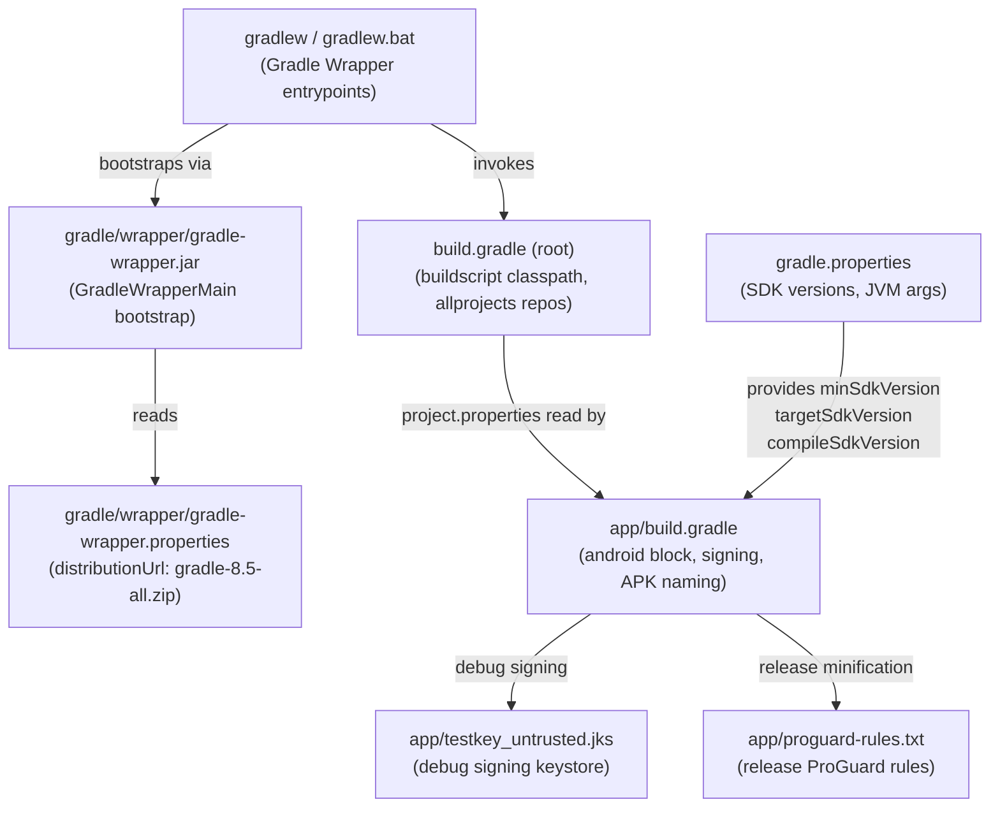
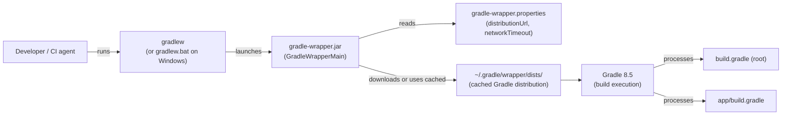
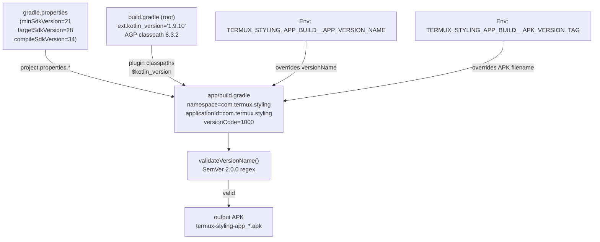

<!-- source: DeepWiki mcp.deepwiki.com · repo termux/termux-styling · page 4 Build System · fetched 2026-10-26 -->

# Build System

<details>
<summary>Relevant source files</summary>

The following files were used as context for generating this wiki page:

- [app/build.gradle](app/build.gradle)
- [build.gradle](build.gradle)
- [gradle.properties](gradle.properties)
- [gradle/wrapper/gradle-wrapper.jar](gradle/wrapper/gradle-wrapper.jar)
- [gradle/wrapper/gradle-wrapper.properties](gradle/wrapper/gradle-wrapper.properties)

</details>


This page describes the overall structure of the Gradle build system used to compile and package the Termux:Styling APK. It covers how the three configuration files (`build.gradle`, `app/build.gradle`, and `gradle.properties`) relate to each other, the role of the Gradle wrapper, and the version name pipeline. For CI/CD details that invoke this build system, see [CI/CD Workflows](#5). For detailed treatment of each component, see the sub-pages [App Build Configuration](#4.1), [Root Build Configuration](#4.2), and [Gradle Wrapper](#4.3).

---

## Structure Overview

The build system follows a two-tier Gradle project layout: a root project that declares plugin classpaths and repositories, and a single `app` submodule that applies those plugins and defines the Android application.

**Build system file map**



Sources: [build.gradle:1-20](), [app/build.gradle:1-79](), [gradle.properties:1-24](), [gradle/wrapper/gradle-wrapper.properties:1-7]()

---

## Root Build File

[build.gradle:1-20]() is the root project file. Its responsibilities are:

- Declaring the `buildscript` block, which makes the Android Gradle Plugin (AGP) and Kotlin Gradle Plugin available to submodules.
- Setting the `ext.kotlin_version` extra property to `'1.9.10'`, which is referenced by `app/build.gradle` in the `dependencies` block as `$kotlin_version`.
- Declaring `google()` and `mavenCentral()` under both `buildscript.repositories` and `allprojects.repositories`.

| Plugin | Version | Reference in `build.gradle` |
|---|---|---|
| Android Gradle Plugin | 8.3.2 | `com.android.tools.build:gradle:8.3.2` |
| Kotlin Gradle Plugin | 1.9.10 | `org.jetbrains.kotlin:kotlin-gradle-plugin:$kotlin_version` |

Sources: [build.gradle:1-20]()

---

## `gradle.properties` — SDK Versions and JVM Settings

[gradle.properties:1-24]() provides three Android SDK version properties consumed by `app/build.gradle` via `project.properties.*`:

| Property | Value | Consumed as |
|---|---|---|
| `minSdkVersion` | `21` | `minSdk project.properties.minSdkVersion.toInteger()` |
| `targetSdkVersion` | `28` | `targetSdk project.properties.targetSdkVersion.toInteger()` |
| `compileSdkVersion` | `34` | `compileSdk project.properties.compileSdkVersion.toInteger()` |

It also sets:
- `org.gradle.jvmargs=-Xmx1536m` — Gradle daemon heap limit.
- `android.useAndroidX=true` — enables AndroidX.

Sources: [gradle.properties:10-24](), [app/build.gradle:9-17]()

---

## App Build File (`app/build.gradle`)

[app/build.gradle:1-79]() is the sole Android application module configuration. It applies the `com.android.application` and `kotlin-android` plugins declared in the root build file.

### Version Name Resolution

The `versionName` is resolved at configuration time through a two-step pipeline:

**Version name resolution pipeline**

```mermaid
flowchart TD
    ENV["System.getenv\n(TERMUX_STYLING_APP_BUILD__APP_VERSION_NAME)"]
    CHECK{"env var\nnon-empty?"}
    USE_ENV["versionName = appVersionName\n(from env var)"]
    USE_HC["versionName = \"0.32.1\"\n(hardcoded default in defaultConfig)"]
    VALIDATE["validateVersionName(versionName)\n(SemVer 2.0.0 regex check)"]
    FAIL["throw GradleException"]
    OK["Build continues"]

    ENV --> CHECK
    CHECK -->|"Yes"| USE_ENV
    CHECK -->|"No"| USE_HC
    USE_ENV --> VALIDATE
    USE_HC --> VALIDATE
    VALIDATE -->|"no match"| FAIL
    VALIDATE -->|"match"| OK
```

The `validateVersionName` function at [app/build.gradle:73-78]() enforces SemVer 2.0.0 using a full regex match. Any version string that does not match (e.g., missing patch component) causes the build to fail immediately with a `GradleException`.

Sources: [app/build.gradle:11-22](), [app/build.gradle:73-78]()

### APK Output Filename

The `applicationVariants.all` block at [app/build.gradle:55-60]() constructs the output APK filename from a second environment variable:

| Condition | Resulting filename |
|---|---|
| `TERMUX_STYLING_APP_BUILD__APK_VERSION_TAG` is set | `termux-styling-app_{tag}.apk` |
| env var is empty | `termux-styling-app_v{versionName}+{buildType}.apk` |

Examples: `termux-styling-app_v0.32.1+debug.apk` or `termux-styling-app_v0.32.1+release.apk`.

Sources: [app/build.gradle:55-61]()

### Build Types

| Build Type | Signing | Minification | ProGuard |
|---|---|---|---|
| `debug` | `testkey_untrusted.jks` (alias `alias`) | disabled | none |
| `release` | not configured (requires external signing) | enabled (`minifyEnabled true`, `shrinkResources true`) | `proguard-android.txt` + `proguard-rules.txt` |

The debug keystore credentials are hardcoded in [app/build.gradle:26-31]() and are intentionally untrusted — they cannot be used to install alongside a production Termux build.

Sources: [app/build.gradle:25-44]()

### Compile Options

Both Java and Kotlin targets are set to JVM 11:

- `compileOptions.sourceCompatibility` / `targetCompatibility`: `JavaVersion.VERSION_11` ([app/build.gradle:46-49]())
- `kotlinOptions.jvmTarget`: `'11'` ([app/build.gradle:51-53]())

### `versionName` Task

A Gradle task named `versionName` is defined at [app/build.gradle:67-71](). When invoked (`./gradlew versionName`), it prints the resolved `android.defaultConfig.versionName` to stdout. The CI workflows use this to extract the version string for artifact naming. See [Debug and Action Builds](#5.1) for how it is called.

Sources: [app/build.gradle:67-71]()

---

## Gradle Wrapper

The Gradle wrapper ensures all developers and CI agents use the same Gradle version without a system-level installation.

**Wrapper component relationships**



[gradle/wrapper/gradle-wrapper.properties:1-7]() specifies:

| Property | Value |
|---|---|
| `distributionUrl` | `https://services.gradle.org/distributions/gradle-8.5-all.zip` |
| `networkTimeout` | `10000` ms |
| `validateDistributionUrl` | `true` |
| `distributionBase` | `GRADLE_USER_HOME` |
| `distributionPath` | `wrapper/dists` |
| `zipStorePath` | `wrapper/dists` |

The `-all` distribution variant includes Gradle sources, which is useful for IDE integration.

`gradlew` and `gradlew.bat` are the shell-script entrypoints for Unix and Windows respectively. They locate a JVM, set JVM options, and invoke `GradleWrapperMain` from `gradle-wrapper.jar`. For a full description of the wrapper's JVM discovery logic and path handling, see [Gradle Wrapper](#4.3).

Sources: [gradle/wrapper/gradle-wrapper.properties:1-7]()

---

## Configuration Flow Summary

**End-to-end configuration dependency flow**



Sources: [build.gradle:1-20](), [app/build.gradle:1-79](), [gradle.properties:1-24]()

---

