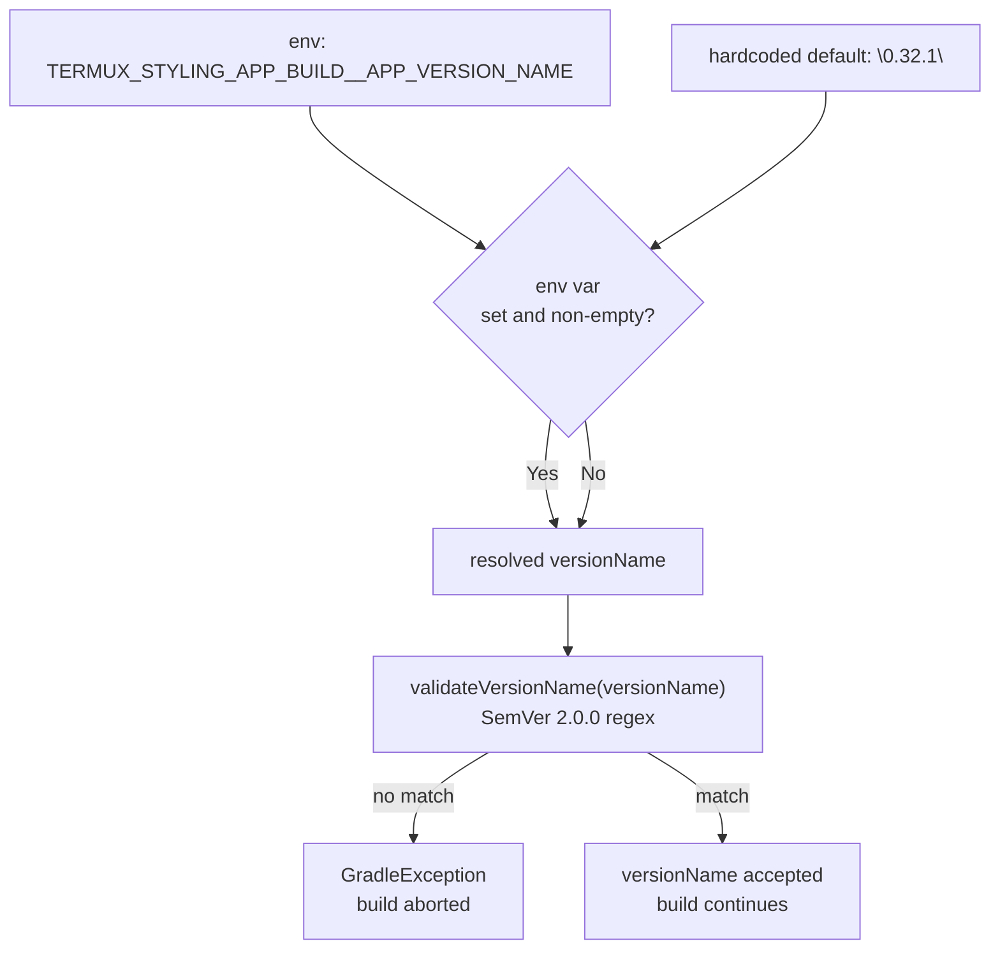
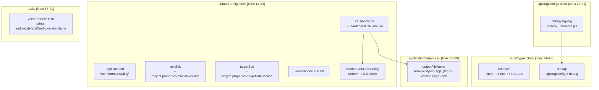

<!-- source: DeepWiki mcp.deepwiki.com · repo termux/termux-styling · page 4.1 App Build Configuration · fetched 2026-10-26 -->

# App Build Configuration

<details>
<summary>Relevant source files</summary>

The following files were used as context for generating this wiki page:

- [app/build.gradle](app/build.gradle)

</details>


This page documents `app/build.gradle` in detail: the application identity, SDK version resolution, version name pipeline, signing configuration, build type settings, APK filename construction, and the `versionName` Gradle task. For an overview of the root-level Gradle configuration and the `gradle.properties` values consumed here, see [Root Build Configuration](#4.2). For how the CI/CD workflows inject environment variables into this pipeline, see [Debug and Action Builds](#5.1) and [Release Builds](#5.2).

---

## Application Identity

[app/build.gradle:6-8]()

| Property | Value |
|---|---|
| `namespace` | `com.termux.styling` |
| `applicationId` | `com.termux.styling` |
| `versionCode` | `1000` (static, not incremented per release) |

The `namespace` and `applicationId` are both set to `com.termux.styling`. The namespace controls the generated `R` class and manifest package resolution. The `applicationId` is the unique identifier used on the Android device and in the Play Store / F-Droid.

> **Note:** The `applicationId` must match what the main Termux app expects when resolving the cross-package context. See [Manifest and Permissions](#2.2) for how `sharedUserId` ties these together.

Sources: [app/build.gradle:6-19]()

---

## SDK Version Resolution

[app/build.gradle:9,16-17]()

SDK version values are not hardcoded in `app/build.gradle`. They are read from the `project.properties` map, which is populated by `gradle.properties` in the root of the repository.

```
compileSdk  ← project.properties.compileSdkVersion.toInteger()
minSdk      ← project.properties.minSdkVersion.toInteger()
targetSdk   ← project.properties.targetSdkVersion.toInteger()
```

This means that `gradle.properties` is the single source of truth for SDK versions. See [Root Build Configuration](#4.2) for the actual values defined there.

Sources: [app/build.gradle:9,16-17]()

---

## Version Name Resolution Pipeline

The `versionName` goes through two stages before the build proceeds:

**Stage 1 — Value Selection**

[app/build.gradle:11,19-21]()

A hardcoded default is declared inside `defaultConfig`. An environment variable can override it at build time.

| Source | Mechanism | Value |
|---|---|---|
| Hardcoded default | `versionName "0.32.1"` in `defaultConfig` | `0.32.1` |
| Environment override | `TERMUX_STYLING_APP_BUILD__APP_VERSION_NAME` | Any SemVer 2.0.0 string |

The override logic is:

```
appVersionName = env("TERMUX_STYLING_APP_BUILD__APP_VERSION_NAME") ?: ""
if (appVersionName) versionName = appVersionName
```

If the environment variable is absent or empty, `versionName` stays as `"0.32.1"`.

**Stage 2 — Validation**

[app/build.gradle:22,73-78]()

`validateVersionName(versionName)` is called unconditionally after the value is resolved. It applies the canonical SemVer 2.0.0 regex from [semver.org](semver.org):

```
^(0|[1-9]\d*)\.(0|[1-9]\d*)\.(0|[1-9]\d*)
  (?:-(...))?
  (?:\+(...))?$
```

If the value does not match, a `GradleException` is thrown and the build fails immediately with a descriptive message.

**Version Name Flow Diagram**



Sources: [app/build.gradle:11,19-22,73-78]()

---

## Signing Configuration

[app/build.gradle:25-32,41-43]()

Only a `debug` signing config is declared in `app/build.gradle`. The keystore is checked into the repository and carries an **untrusted test key** — it is explicitly not the signing key used for official Termux releases.

| Property | Value |
|---|---|
| `storeFile` | `testkey_untrusted.jks` |
| `keyAlias` | `alias` |
| `storePassword` | `xrj45yWGLbsO7W0v` |
| `keyPassword` | `xrj45yWGLbsO7W0v` |

The `debug` build type is explicitly bound to this signing config via `signingConfig signingConfigs.debug`. This means CI-produced debug APKs are signed with this key, not the Android SDK's default debug keystore.

> **Important:** APKs signed with `testkey_untrusted.jks` will **not** work with an official Termux installation, because `sharedUserId` requires both APKs to be signed with the same key. See [Manifest and Permissions](#2.2) and [Contributing](#7).

Sources: [app/build.gradle:25-43]()

---

## Build Types

[app/build.gradle:34-44]()

Two build types are configured:

| Build Type | `minifyEnabled` | `shrinkResources` | ProGuard | Signing |
|---|---|---|---|---|
| `release` | `true` | `true` | `proguard-android.txt` + `proguard-rules.txt` | (default — not set in this file) |
| `debug` | `false` (default) | `false` (default) | None | `signingConfigs.debug` |

The `release` build type references two ProGuard files:
- `getDefaultProguardFile('proguard-android.txt')` — the AGP-supplied default rules
- `'proguard-rules.txt'` — project-local custom rules

Sources: [app/build.gradle:34-44]()

---

## APK Output Filename Construction

[app/build.gradle:55-60]()

The output APK filename is controlled by a second environment variable: `TERMUX_STYLING_APP_BUILD__APK_VERSION_TAG`.

The `applicationVariants.all` block iterates over all build variants and sets `outputFileName` using this logic:

```
apkVersionTag = env("TERMUX_STYLING_APP_BUILD__APK_VERSION_TAG") ?: ""

outputFileName = "termux-styling-app_" +
    (apkVersionTag ? apkVersionTag : "v" + versionName + "+" + buildType.name) + ".apk"
```

| Scenario | `APK_VERSION_TAG` set? | Example filename |
|---|---|---|
| Local / CI debug build | No | `termux-styling-app_v0.32.1+debug.apk` |
| Release workflow | Yes (e.g. `v0.32.1`) | `termux-styling-app_v0.32.1.apk` |

**APK Filename Construction Diagram**

```mermaid
flowchart LR
    TAG["env: TERMUX_STYLING_APP_BUILD__APK_VERSION_TAG"]
    VER["resolved versionName"]
    BT["variant.buildType.name\n(debug or release)"]
    CHECK{"APK_VERSION_TAG\nset?"}
    TAG_PATH["\"termux-styling-app_\" + apkVersionTag + \".apk\""]
    DEFAULT_PATH["\"termux-styling-app_v\" + versionName + \"+\" + buildType + \".apk\""]

    TAG --> CHECK
    VER --> CHECK
    BT --> CHECK
    CHECK -->|"Yes"| TAG_PATH
    CHECK -->|"No"| DEFAULT_PATH
```

Sources: [app/build.gradle:55-60]()

---

## Java and Kotlin Compatibility

[app/build.gradle:46-53]()

Both the Java and Kotlin compilers target JVM 11:

| Setting | Value |
|---|---|
| `sourceCompatibility` | `JavaVersion.VERSION_11` |
| `targetCompatibility` | `JavaVersion.VERSION_11` |
| `kotlinOptions.jvmTarget` | `'11'` |

The Kotlin standard library version is sourced from `$kotlin_version`, a property declared in the root `build.gradle`. See [Root Build Configuration](#4.2).

Sources: [app/build.gradle:46-53,63-65]()

---

## The `versionName` Gradle Task

[app/build.gradle:67-71]()

A utility task named `versionName` is registered. It prints the resolved `versionName` to standard output (without a newline, via `print`) when executed:

```
./gradlew versionName
```

This task is used by CI workflows to read the current version into a shell variable for constructing artifact names and validating against git tags. See [Debug and Action Builds](#5.1).

Sources: [app/build.gradle:67-71]()

---

## Full Configuration Summary

The diagram below maps all major configuration elements to their code locations in `app/build.gradle`.



Sources: [app/build.gradle:1-79]()

---

