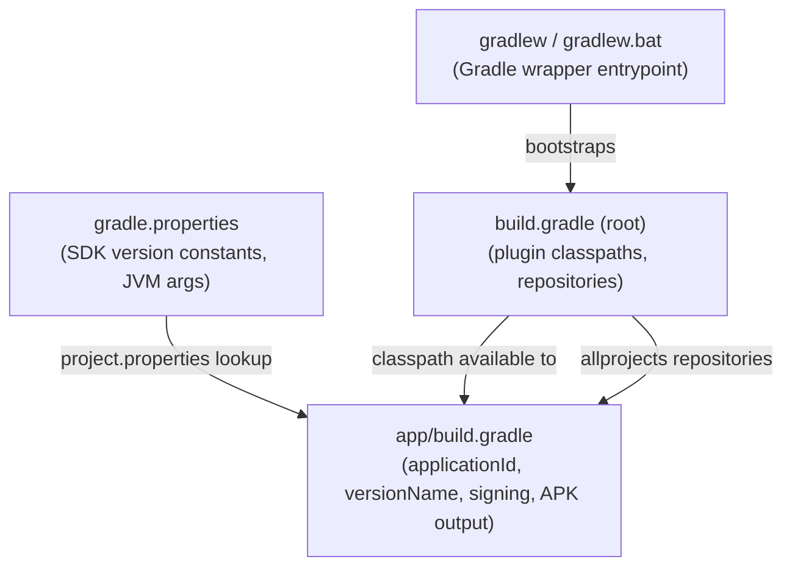
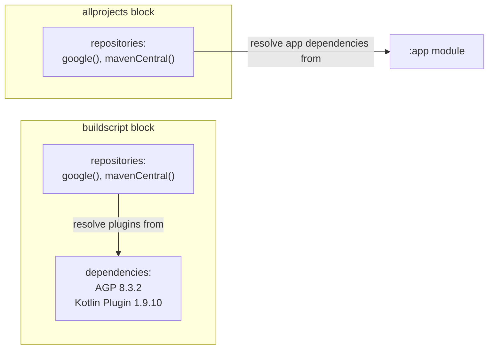
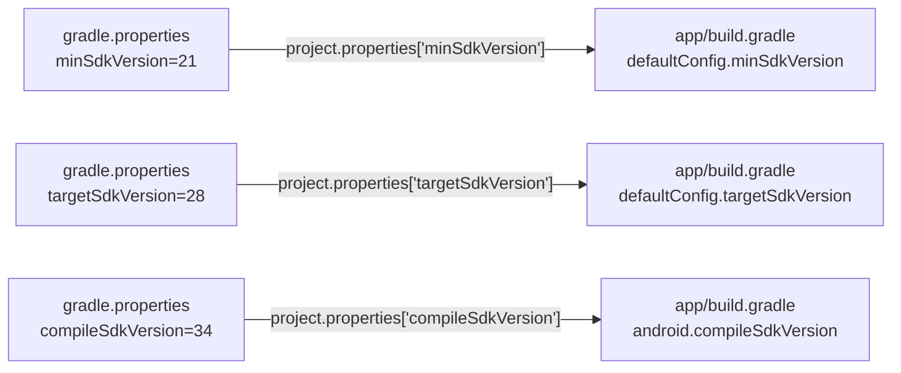

<!-- source: DeepWiki mcp.deepwiki.com · repo termux/termux-styling · page 4.2 Root Build Configuration · fetched 2026-10-26 -->

# Root Build Configuration

Relevant source files

The following files were used as context for generating this wiki page:

- [build.gradle](build.gradle)
- [gradle.properties](gradle.properties)

This page covers the two root-level configuration files that establish the shared build environment for all modules in the repository: `build.gradle` and `gradle.properties`. These files define plugin versions, repository sources, JVM settings, and SDK version constants that are consumed by the app module's own build script.

For details on how the app module uses these values (e.g., `minSdkVersion`, `compileSdkVersion`, version name resolution, signing config), see [App Build Configuration](#4.1). For the Gradle wrapper that invokes the build, see [Gradle Wrapper](#4.3).

---

## Role in the Two-Tier Build Structure

The Gradle build system in this repository is split across two tiers:

**Two-tier Gradle build structure**

Sources: `build.gradle`, `gradle.properties`

The root `build.gradle` is responsible for making plugins available to sub-projects via the `buildscript` block. It does not apply any plugins itself. The `gradle.properties` file provides key-value constants that are read by `app/build.gradle` at configuration time using `project.properties`.

---

## `build.gradle` — Root Build Script

[build.gradle:1-20]()

The file has two top-level blocks:

### `buildscript` Block

[build.gradle:1-13]()

The `buildscript` block configures the classpath used when Gradle itself evaluates build scripts. It is not the classpath of the compiled application.

| Declaration | Value | Purpose |
|---|---|---|
| `ext.kotlin_version` | `'1.9.10'` | Shared version property for Kotlin plugin |
| Android Gradle Plugin | `com.android.tools.build:gradle:8.3.2` | Enables `com.android.application` plugin in app module |
| Kotlin Gradle Plugin | `org.jetbrains.kotlin:kotlin-gradle-plugin:$kotlin_version` | Enables Kotlin compilation in app module |

The `ext.kotlin_version` property is declared at [build.gradle:2]() and referenced in the plugin classpath at [build.gradle:11](). This pattern keeps the version string in a single place; changing `ext.kotlin_version` automatically updates the classpath dependency.

Repositories for plugin resolution are declared at [build.gradle:4-7]():
- `google()` — Android Gradle Plugin and related artifacts
- `mavenCentral()` — Kotlin plugin and other JVM artifacts

### `allprojects` Block

[build.gradle:15-20]()

The `allprojects` block declares repositories that are available to all modules (including `:app`) when resolving their own compile-time and runtime dependencies — not just build script plugins.

Sources: `build.gradle`

Both blocks declare identical repository lists (`google()` and `mavenCentral()`), but they serve different resolution scopes. The `buildscript` repositories resolve Gradle plugins; the `allprojects` repositories resolve library dependencies declared in `app/build.gradle`.

---

## `gradle.properties` — Project-Wide Properties

[gradle.properties:1-23]()

This file sets project-wide Gradle and Android configuration as key-value pairs. Values here can be overridden by IDE settings (e.g., Android Studio).

### JVM Configuration

| Property | Value | Effect |
|---|---|---|
| `org.gradle.jvmargs` | `-Xmx1536m` | Maximum heap for the Gradle daemon process |

[gradle.properties:12]()

### AndroidX Migration Flag

| Property | Value | Effect |
|---|---|---|
| `android.useAndroidX` | `true` | Activates AndroidX artifact mappings; required for modern Android development |

[gradle.properties:19]()

### SDK Version Constants

[gradle.properties:21-23]()

These three properties are the primary shared constants consumed by `app/build.gradle`. They are not applied automatically by Gradle; `app/build.gradle` reads them explicitly via `project.properties`.

| Property | Value | Corresponding `app/build.gradle` field |
|---|---|---|
| `minSdkVersion` | `21` | `defaultConfig.minSdkVersion` |
| `targetSdkVersion` | `28` | `defaultConfig.targetSdkVersion` |
| `compileSdkVersion` | `34` | `android.compileSdkVersion` |

**SDK version constant flow**

Sources: `gradle.properties`

Setting `minSdkVersion=21` means the application supports Android 5.0 (Lollipop) and later. Setting `targetSdkVersion=28` (Android 9 / Pie) affects runtime behavior flags without restricting the build tools used (governed by `compileSdkVersion=34`).

---

## Summary of All Root-Level Properties

| File | Key | Value |
|---|---|---|
| `build.gradle` | `ext.kotlin_version` | `1.9.10` |
| `build.gradle` | AGP classpath | `com.android.tools.build:gradle:8.3.2` |
| `build.gradle` | Kotlin plugin classpath | `org.jetbrains.kotlin:kotlin-gradle-plugin:1.9.10` |
| `gradle.properties` | `org.gradle.jvmargs` | `-Xmx1536m` |
| `gradle.properties` | `android.useAndroidX` | `true` |
| `gradle.properties` | `minSdkVersion` | `21` |
| `gradle.properties` | `targetSdkVersion` | `28` |
| `gradle.properties` | `compileSdkVersion` | `34` |

Sources: `build.gradle`, `gradle.properties`

---

