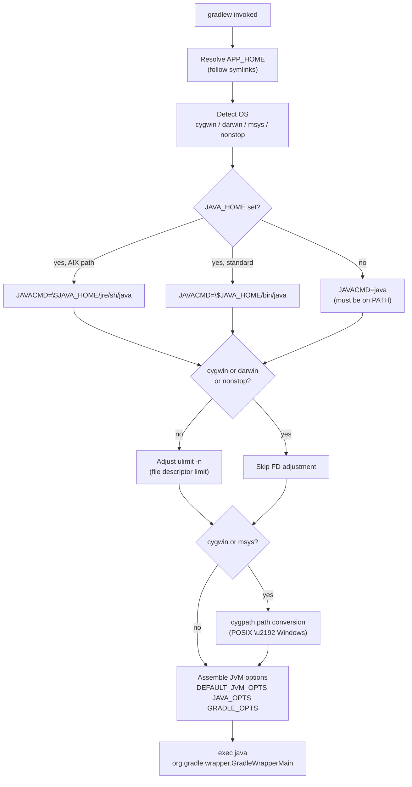
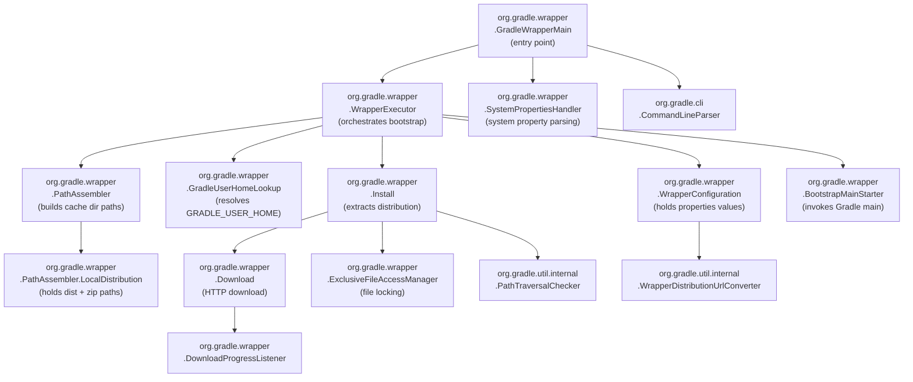
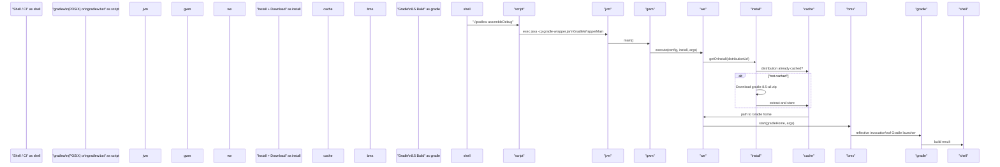

<!-- source: DeepWiki mcp.deepwiki.com · repo termux/termux-styling · page 4.3 Gradle Wrapper · fetched 2026-10-26 -->

# Gradle Wrapper

<details>
<summary>Relevant source files</summary>

The following files were used as context for generating this wiki page:

- [gradle/wrapper/gradle-wrapper.jar](gradle/wrapper/gradle-wrapper.jar)
- [gradle/wrapper/gradle-wrapper.properties](gradle/wrapper/gradle-wrapper.properties)
- [gradlew](gradlew)
- [gradlew.bat](gradlew.bat)

</details>


This page documents the Gradle Wrapper system in the termux-styling repository: the shell scripts (`gradlew`, `gradlew.bat`), the bootstrap JAR (`gradle-wrapper.jar`), and the configuration file (`gradle-wrapper.properties`). The wrapper ensures that every developer and CI/CD job uses the same Gradle version without requiring a pre-installed Gradle distribution.

For how the wrapper is invoked in CI/CD pipelines, see [Debug and Action Builds](#5.1) and [Release Builds](#5.2). For the Gradle build files that the wrapper drives, see [Root Build Configuration](#4.2) and [App Build Configuration](#4.1).

---

## Overview of Files

| File | Role |
|---|---|
| `gradlew` | POSIX shell entrypoint for Linux/macOS |
| `gradlew.bat` | Windows batch entrypoint |
| `gradle/wrapper/gradle-wrapper.jar` | Bootstrap JAR; downloads and caches the Gradle distribution |
| `gradle/wrapper/gradle-wrapper.properties` | Specifies the Gradle distribution URL and local cache paths |

All four files are committed to the repository. Developers and CI runners execute `./gradlew <task>` rather than invoking Gradle directly.

Sources: [gradlew:1-63](), [gradlew.bat:1-22](), [gradle/wrapper/gradle-wrapper.properties:1-7]()

---

## gradle-wrapper.properties

This file is read by `GradleWrapperMain` at startup to determine which Gradle distribution to use and where to cache it.

[gradle/wrapper/gradle-wrapper.properties:1-7]()

| Property | Value | Effect |
|---|---|---|
| `distributionUrl` | `https://services.gradle.org/distributions/gradle-8.5-all.zip` | Pins Gradle 8.5 (`-all` variant includes sources and docs) |
| `distributionBase` | `GRADLE_USER_HOME` | Root for the cached distribution (resolves to `~/.gradle` by default) |
| `distributionPath` | `wrapper/dists` | Subdirectory under `distributionBase` where the ZIP is extracted |
| `zipStoreBase` | `GRADLE_USER_HOME` | Root for the downloaded ZIP archive |
| `zipStorePath` | `wrapper/dists` | Subdirectory under `zipStoreBase` where the ZIP is stored |
| `networkTimeout` | `10000` | Milliseconds to wait per network operation during download |
| `validateDistributionUrl` | `true` | Enables URL checksum validation before use |

The effective local cache path for the Gradle distribution is `$GRADLE_USER_HOME/wrapper/dists/gradle-8.5-all/`.

Sources: [gradle/wrapper/gradle-wrapper.properties:1-7]()

---

## gradlew — POSIX Shell Entrypoint

`gradlew` is a POSIX-compliant `sh` script. It performs several preparation steps before delegating to `GradleWrapperMain` via `java`.

**Bootstrap flow diagram:**



Sources: [gradlew:65-249]()

### APP_HOME Resolution

[gradlew:65-87]()

The script uses a `while` loop to follow chains of symlinks before setting `APP_HOME`. This correctly handles the case where `gradlew` itself is a symlink.

### OS Detection

[gradlew:103-113]()

Four boolean variables are set based on `uname` output:

| Variable | Condition |
|---|---|
| `cygwin` | `uname` starts with `CYGWIN` |
| `darwin` | `uname` starts with `Darwin` |
| `msys` | `uname` starts with `MSYS` or `MINGW` |
| `nonstop` | `uname` starts with `NONSTOP` |

These flags gate OS-specific logic later in the script.

### Java Executable Discovery

[gradlew:118-141]()

```
if JAVA_HOME is set:
    if $JAVA_HOME/jre/sh/java exists:       # IBM JDK on AIX
        JAVACMD = $JAVA_HOME/jre/sh/java
    else:
        JAVACMD = $JAVA_HOME/bin/java
    validate JAVACMD is executable
else:
    JAVACMD = java
    validate java is on PATH
```

The AIX-specific path `$JAVA_HOME/jre/sh/java` is handled because IBM's JDK on AIX places the executable in an unusual location.

### File Descriptor Limit Adjustment

[gradlew:143-160]()

On non-Cygwin, non-Darwin, non-NonStop systems, the script attempts to raise the file descriptor limit to the hard maximum using `ulimit -H -n`, then applies that value with `ulimit -n`. Failures produce a warning but do not abort execution. This prevents Gradle daemon failures on systems with low default `ulimit` values.

### Cygwin/MSYS Path Conversion

[gradlew:170-199]()

When running under Cygwin or MSYS, `cygpath` is used to convert `APP_HOME` and `CLASSPATH` from POSIX to Windows-style paths. Individual arguments that look like POSIX file paths (starting with `/`) are also converted.

### JVM Options Assembly

[gradlew:202-249]()

The default JVM heap is bounded by:

```
DEFAULT_JVM_OPTS='"-Xmx64m" "-Xms64m"'
```

The full option set passed to `java` is assembled from `DEFAULT_JVM_OPTS`, `JAVA_OPTS`, and `GRADLE_OPTS` using `xargs -n1` and `sed` to handle quoting safely in POSIX `sh` (which has no arrays). The final `exec` call invokes:

```
java [JVM opts] \
  -Dorg.gradle.appname=$APP_BASE_NAME \
  -classpath $APP_HOME/gradle/wrapper/gradle-wrapper.jar \
  org.gradle.wrapper.GradleWrapperMain \
  [task args]
```

Sources: [gradlew:202-249]()

---

## gradlew.bat — Windows Entrypoint

`gradlew.bat` performs the same role as `gradlew` but using Windows batch scripting conventions. It does not handle Cygwin or AIX — those are POSIX concerns.

**Key steps:**

| Step | Detail |
|---|---|
| Directory resolution | `%~dp0` gives the script's directory; `%%~fi` canonicalises it [gradlew.bat:27-34]() |
| Default JVM opts | `"-Xmx64m" "-Xms64m"` [gradlew.bat:37]() |
| Java discovery | Checks `JAVA_HOME` → `%JAVA_HOME%/bin/java.exe`; falls back to `java.exe` on `PATH` [gradlew.bat:40-66]() |
| CLASSPATH | `%APP_HOME%\gradle\wrapper\gradle-wrapper.jar` [gradlew.bat:71]() |
| Invocation | `%JAVA_EXE% ... org.gradle.wrapper.GradleWrapperMain %*` [gradlew.bat:75]() |
| Exit handling | Propagates `ERRORLEVEL`; respects `GRADLE_EXIT_CONSOLE` for `cmd.exe /c` callers [gradlew.bat:79-92]() |

Both `gradlew` and `gradlew.bat` pass the same main class and CLASSPATH to the JVM; only the path manipulation and shell syntax differ.

Sources: [gradlew.bat:1-92]()

---

## gradle-wrapper.jar — Bootstrap Classes

`gradle-wrapper.jar` contains the compiled classes that are loaded by the JVM when either script launches. The entry point is `org.gradle.wrapper.GradleWrapperMain`.

**Class responsibility diagram:**



Sources: [gradle/wrapper/gradle-wrapper.jar:1-5]()

### Key Classes

| Class | Role |
|---|---|
| `GradleWrapperMain` | Parses CLI args via `CommandLineParser`; reads `gradle-wrapper.properties`; delegates to `WrapperExecutor` |
| `WrapperExecutor` | Reads `WrapperConfiguration`; calls `Install` to ensure the distribution exists; invokes `BootstrapMainStarter` |
| `WrapperConfiguration` | Data class holding `distributionUrl`, `distributionBase`, `distributionPath`, `networkTimeout`, etc. |
| `Install` | Downloads (via `Download`) and extracts the Gradle ZIP if not already cached; uses `ExclusiveFileAccessManager` to prevent concurrent installs |
| `Download` | Performs the HTTP GET of the distribution ZIP; supports proxy authentication via `Download.ProxyAuthenticator`; reports progress via `Download.DefaultDownloadProgressListener` |
| `PathAssembler` | Combines `distributionBase`, `distributionPath`, and a hash of the distribution URL to produce a unique, reproducible local path |
| `BootstrapMainStarter` | Locates the Gradle launcher class inside the extracted distribution and invokes it reflectively |
| `ExclusiveFileAccessManager` | Uses a lock file to serialise concurrent wrapper installations |
| `GradleUserHomeLookup` | Resolves `GRADLE_USER_HOME` from the environment or falls back to `~/.gradle` |
| `PathTraversalChecker` | Validates that extracted ZIP entries do not traverse outside the target directory |
| `WrapperDistributionUrlConverter` | Converts legacy short-form distribution URLs to full URLs |

---

## End-to-End Flow

The diagram below traces the full execution path from the shell command to the Gradle build running.



Sources: [gradlew:210-249](), [gradlew.bat:68-75](), [gradle/wrapper/gradle-wrapper.properties:1-7]()

---

## Relation to CI/CD

The GitHub Actions workflows invoke the wrapper directly:

```
./gradlew assembleDebug
```

Because the wrapper caches the distribution under `$GRADLE_USER_HOME`, CI runners that do not persist the Gradle cache will download `gradle-8.5-all.zip` on each run. The `networkTimeout` of 10,000 ms limits how long each network operation may block.

For the exact environment variables and tasks passed to `gradlew` in each workflow, see [Debug and Action Builds](#5.1) and [Release Builds](#5.2).

Sources: [gradle/wrapper/gradle-wrapper.properties:4](), [gradlew:1-249]()

---

