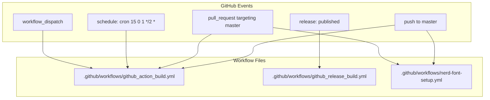
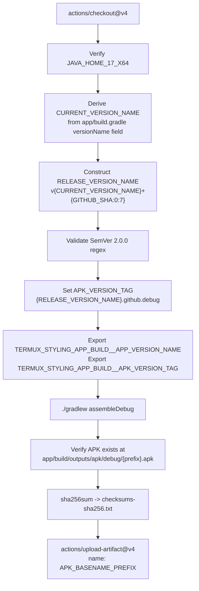
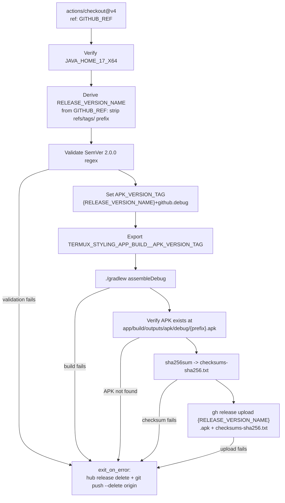
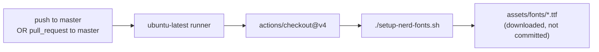

<!-- source: DeepWiki mcp.deepwiki.com · repo termux/termux-styling · page 5 CI/CD Workflows · fetched 2026-10-26 -->

# CI/CD Workflows

<details>
<summary>Relevant source files</summary>

The following files were used as context for generating this wiki page:

- [.github/workflows/github_action_build.yml](.github/workflows/github_action_build.yml)
- [.github/workflows/github_release_build.yml](.github/workflows/github_release_build.yml)
- [.github/workflows/nerd-font-setup.yml](.github/workflows/nerd-font-setup.yml)
- [LICENSE.md](LICENSE.md)
- [README.md](README.md)

</details>


This page covers all GitHub Actions workflows defined in the Termux:Styling repository — their triggers, steps, outputs, and how they interact with the Gradle build system. For details on how the Gradle build itself works (version name resolution, APK naming, signing), see the Build System pages ([4](#4), [4.1](#4.1)). For how the font provisioning script is verified by CI, see [5.3](#5.3).

---

## Workflow Overview

There are three workflows in `.github/workflows/`:

| Workflow File | Display Name | Purpose | Trigger |
|---|---|---|---|
| `github_action_build.yml` | GitHub Action Build | Produces debug APKs for testers | push, PR, schedule, manual |
| `github_release_build.yml` | GitHub Release Build | Publishes APK to GitHub Releases | release published |
| `nerd-font-setup.yml` | Check Nerd Fonts | Verifies font download scripts work | push, PR |

Sources: [.github/workflows/github_action_build.yml:1-13](), [.github/workflows/github_release_build.yml:1-7](), [.github/workflows/nerd-font-setup.yml:1-8]()

---

## Trigger Map

**Workflow trigger diagram**



Sources: [.github/workflows/github_action_build.yml:3-13](), [.github/workflows/github_release_build.yml:3-7](), [.github/workflows/nerd-font-setup.yml:3-8]()

The `schedule` trigger for `github_action_build.yml` fires at `15 0 1 */2 *` — the first day of every other month at 00:15 UTC. This catches dependency or environment regressions even without code changes.

---

## Shared Build Environment

Both `github_action_build.yml` and `github_release_build.yml` run on `ubuntu-latest` and require JDK 17. Both workflows locate the JDK using the runner-provided `JAVA_HOME_17_X64` environment variable and pass it to Gradle via:

```
GRADLE_OPTS="-Dorg.gradle.java.home=$JAVA_HOME_17_X64"
```

If `JAVA_HOME_17_X64` is absent or its `bin/javac` is not executable, both workflows abort immediately with an error message via the `exit_on_error` shell function defined at the start of each run block.

Sources: [.github/workflows/github_action_build.yml:26-29](), [.github/workflows/github_release_build.yml:30-32]()

---

## Debug Build Workflow (`github_action_build.yml`)

This workflow produces a debug APK on every push and PR, making pre-release builds available to testers without requiring a formal GitHub Release.

**Step-by-step flow diagram**



Sources: [.github/workflows/github_action_build.yml:17-80]()

### Version Name Derivation

The version string is assembled from two pieces:

1. **`CURRENT_VERSION_NAME`** — extracted from `app/build.gradle` by grepping for `versionName` with the regex `\s+versionName "([^"]+)"$`. [.github/workflows/github_action_build.yml:37-38]()
2. **`GITHUB_SHA`** — the commit SHA. For pull requests, `GITHUB_SHA` is overridden with `github.event.pull_request.head.sha` to avoid using the auto-generated merge commit. [.github/workflows/github_action_build.yml:32-34]()

The resulting `RELEASE_VERSION_NAME` is `v{CURRENT_VERSION_NAME}+{first 7 chars of SHA}`. The `+` separator is intentional — it places the git SHA in the SemVer build metadata position, which does not affect version precedence.

[.github/workflows/github_action_build.yml:39]()

### APK Naming

| Variable | Value Pattern | Example |
|---|---|---|
| `APK_VERSION_TAG` | `{RELEASE_VERSION_NAME}.github.debug` | `v0.32.1+abc1234.github.debug` |
| `APK_BASENAME_PREFIX` | `termux-styling-app_{APK_VERSION_TAG}` | `termux-styling-app_v0.32.1+abc1234.github.debug` |

The `.github.debug` suffix uses a `.` (dot) rather than `+` because `GITHUB_SHA` already introduced a `+`. The SemVer build metadata section is everything after `+`, so the `.github.debug` part becomes additional dot-separated metadata identifiers.

[.github/workflows/github_action_build.yml:45-46]()

### Artifact Upload

The `actions/upload-artifact@v4` step bundles three files under the artifact name `APK_BASENAME_PREFIX`:

- `{APK_BASENAME_PREFIX}.apk`
- `checksums-sha256.txt`
- `output-metadata.json`

[.github/workflows/github_action_build.yml:73-80]()

---

## Release Build Workflow (`github_release_build.yml`)

This workflow fires when a GitHub Release is published. Its output is uploaded directly to the release's asset list rather than as a workflow artifact.

**Step-by-step flow diagram**



Sources: [.github/workflows/github_release_build.yml:1-70]()

### Key Differences from the Debug Workflow

| Aspect | `github_action_build.yml` | `github_release_build.yml` |
|---|---|---|
| Version source | `app/build.gradle` `versionName` + git SHA | `GITHUB_REF` tag (e.g. `refs/tags/v0.32.1`) |
| `APP_VERSION_NAME` env var | Set explicitly | Not set; Gradle falls back to `app/build.gradle` default |
| APK_VERSION_TAG format | `{ver}.github.debug` | `{ver}+github.debug` |
| On failure | Exits with error | Deletes the release and tag via `hub release delete` + `git push --delete origin` |
| Output destination | `actions/upload-artifact@v4` | `gh release upload` |
| Auth | None needed | `GITHUB_TOKEN` secret |

Sources: [.github/workflows/github_release_build.yml:11-12](), [.github/workflows/github_release_build.yml:35-36](), [.github/workflows/github_release_build.yml:41](), [.github/workflows/github_action_build.yml:38-39](), [.github/workflows/github_action_build.yml:45]()

The release workflow does **not** export `TERMUX_STYLING_APP_BUILD__APP_VERSION_NAME` [.github/workflows/github_release_build.yml:44-48](), so `app/build.gradle` reads the version name directly from `GITHUB_REF`. The version embedded in the APK is therefore determined entirely by the git tag name, not a separate environment variable.

### Rollback on Error

If any step fails, `exit_on_error` deletes both the GitHub Release and the git tag to avoid leaving a broken release visible:

```
hub release delete "$RELEASE_VERSION_NAME"
git push --delete origin "$GITHUB_REF"
```

[.github/workflows/github_release_build.yml:23-26]()

---

## Nerd Font Verification Workflow (`nerd-font-setup.yml`)

This is a lightweight verification workflow. It has a single job with two steps: check out the repository, then run `./setup-nerd-fonts.sh`. Its sole purpose is to confirm that the Nerd Fonts download URLs remain functional and that the script executes without error on the current runner environment.



Sources: [.github/workflows/nerd-font-setup.yml:1-17]()

This workflow does **not** upload its downloaded fonts as artifacts. The downloaded files exist only within the job's temporary workspace. The script being tested here is `setup-nerd-fonts.sh`; for full documentation of that script see [6.1](#6.1).

---

## Environment Variable Interface Between CI and Gradle

The two build workflows communicate version information to `app/build.gradle` through environment variables. This table summarizes which variables each workflow sets:

| Env Variable | `github_action_build.yml` | `github_release_build.yml` | Effect in `app/build.gradle` |
|---|---|---|---|
| `TERMUX_STYLING_APP_BUILD__APP_VERSION_NAME` | Set to `v{ver}+{sha}` (without leading `v`) | **Not set** | Overrides hardcoded `versionName` |
| `TERMUX_STYLING_APP_BUILD__APK_VERSION_TAG` | Set to `{ver}.github.debug` | Set to `{ver}+github.debug` | Controls output APK filename |
| `GRADLE_OPTS` | Set to point at JDK 17 | Set to point at JDK 17 | Selects JDK for Gradle |

Sources: [.github/workflows/github_action_build.yml:54-56](), [.github/workflows/github_release_build.yml:45-46]()

For how `app/build.gradle` reads and validates these variables, see [4.1](#4.1).

---

