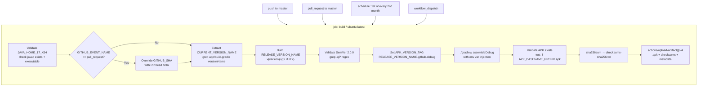
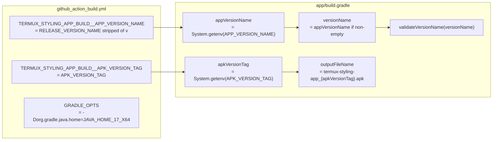

<!-- source: DeepWiki mcp.deepwiki.com · repo termux/termux-styling · page 5.1 Debug and Action Builds · fetched 2026-10-26 -->

# Debug and Action Builds

<details>
<summary>Relevant source files</summary>

The following files were used as context for generating this wiki page:

- [.github/workflows/github_action_build.yml](.github/workflows/github_action_build.yml)
- [.github/workflows/github_release_build.yml](.github/workflows/github_release_build.yml)
- [LICENSE.md](LICENSE.md)
- [README.md](README.md)
- [app/build.gradle](app/build.gradle)

</details>


This page documents the `github_action_build.yml` workflow — the continuous integration workflow that produces debug APK artifacts on every push, pull request, and scheduled run. It covers the trigger configuration, version name construction, Gradle invocation, APK validation, and artifact upload steps.

For the workflow that produces release artifacts attached to GitHub Releases, see [Release Builds](#5.2). For background on how `app/build.gradle` consumes the environment variables set by this workflow, see [App Build Configuration](#4.1).

---

## Overview

The GitHub Action Build workflow runs `./gradlew assembleDebug` and uploads the resulting APK as a GitHub Actions artifact. It is the primary source of per-commit debug builds for testers and contributors.

The debug APK produced here is signed with the repository's `testkey_untrusted.jks` key, which is **not** the same key used by F-Droid or the main Termux app. Switching installation sources requires uninstalling and reinstalling the app.

Sources: [.github/workflows/github_action_build.yml:1-81](), [README.md:17-24]()

---

## Trigger Configuration

[.github/workflows/github_action_build.yml:1-13]()

| Trigger | Condition |
|---|---|
| `push` | Any push to the `master` branch |
| `pull_request` | Any PR targeting the `master` branch |
| `schedule` | Cron: `15 0 1 */2 *` — first day of every other month at 00:15 UTC |
| `workflow_dispatch` | Manual trigger from the GitHub Actions UI |

The scheduled run serves as a periodic health check to detect breakage from dependency or toolchain drift without waiting for a code change.

Sources: [.github/workflows/github_action_build.yml:3-13]()

---

## Step-by-Step Execution

**Workflow job: `build` — runs on `ubuntu-latest`**

The entire logic runs within a single `Build` step using `shell: bash {0}`. The `{0}` flag disables automatic `set -e`, so each command's exit code is checked explicitly via `exit_on_error`.

### Step 1 — JDK 17 Validation

Before any build logic, the script verifies that JDK 17 is available at the path pointed to by `JAVA_HOME_17_X64`:

```
if [ -z "$JAVA_HOME_17_X64" ] || [ ! -f "$JAVA_HOME_17_X64/bin/javac" ] || ...
```

This relies on the `JAVA_HOME_17_X64` environment variable pre-set by GitHub-hosted `ubuntu-latest` runners, which bundle multiple JDK versions.

Sources: [.github/workflows/github_action_build.yml:26-28]()

---

### Step 2 — Git SHA Resolution

For `pull_request` events, `GITHUB_SHA` is the SHA of the auto-generated merge commit, not the PR branch tip. The workflow overrides it:

[.github/workflows/github_action_build.yml:32-34]()

```bash
if [ "$GITHUB_EVENT_NAME" == "pull_request" ]; then
    GITHUB_SHA="${{ github.event.pull_request.head.sha }}"
fi
```

This ensures the version string embeds the actual PR commit, not the ephemeral merge commit.

Sources: [.github/workflows/github_action_build.yml:32-34]()

---

### Step 3 — Version Name Derivation

[.github/workflows/github_action_build.yml:36-42]()

The `RELEASE_VERSION_NAME` is assembled from two parts:

1. **`CURRENT_VERSION_NAME`** — extracted from `app/build.gradle` by grepping for the `versionName` field using the regex `\s+versionName "([^"]+)"$`.
2. **Truncated git SHA** — the first 7 characters of `GITHUB_SHA`.

```
RELEASE_VERSION_NAME = "v" + CURRENT_VERSION_NAME + "+" + GITHUB_SHA[0:7]
```

Example: if `versionName` in `build.gradle` is `0.32.1` and the SHA prefix is `abc1234`, then:

```
RELEASE_VERSION_NAME = v0.32.1+abc1234
```

The `+` separator between the base version and the SHA is required by SemVer 2.0.0 to mark it as build metadata, ensuring it does not affect version precedence ordering.

Sources: [.github/workflows/github_action_build.yml:36-39](), [app/build.gradle:19]()

---

### Step 4 — SemVer Validation

[.github/workflows/github_action_build.yml:40-42]()

The derived version name (with the `v` prefix stripped) is validated against the full SemVer 2.0.0 regex using `grep -qP`. If it does not match, the workflow fails immediately.

This mirrors the `validateVersionName()` function in `app/build.gradle` [app/build.gradle:73-78](), providing an early shell-level check before Gradle is even invoked.

Sources: [.github/workflows/github_action_build.yml:40-42](), [app/build.gradle:73-78]()

---

### Step 5 — APK Tag and Filename Construction

[.github/workflows/github_action_build.yml:44-51]()

| Variable | Value | Example |
|---|---|---|
| `APK_DIR_PATH` | `./app/build/outputs/apk/debug` | — |
| `APK_VERSION_TAG` | `$RELEASE_VERSION_NAME.github.debug` | `v0.32.1+abc1234.github.debug` |
| `APK_BASENAME_PREFIX` | `termux-styling-app_$APK_VERSION_TAG` | `termux-styling-app_v0.32.1+abc1234.github.debug` |

Note the `.` (dot) separator between the SHA portion and `github.debug`. This is intentional: `RELEASE_VERSION_NAME` already uses `+` before the SHA, and `APK_VERSION_TAG` appends `.github.debug` as an additional build metadata segment.

All three variables are written to `$GITHUB_ENV` so the upload step can reference them.

Sources: [.github/workflows/github_action_build.yml:44-51]()

---

### Step 6 — Gradle Invocation

[.github/workflows/github_action_build.yml:53-59]()

Three environment variables are set before calling `./gradlew assembleDebug`:

| Environment Variable | Value | Consumer in `app/build.gradle` |
|---|---|---|
| `TERMUX_STYLING_APP_BUILD__APP_VERSION_NAME` | `${RELEASE_VERSION_NAME/v/}` (v-prefix stripped) | [app/build.gradle:11](), [app/build.gradle:21]() |
| `TERMUX_STYLING_APP_BUILD__APK_VERSION_TAG` | `$APK_VERSION_TAG` | [app/build.gradle:12](), [app/build.gradle:57-58]() |
| `GRADLE_OPTS` | `-Dorg.gradle.java.home=$JAVA_HOME_17_X64` | Forces Gradle to use JDK 17 |

The `v` prefix is stripped from the version name before passing it to Gradle because `versionName` in Android manifests does not conventionally include the `v`.

Sources: [.github/workflows/github_action_build.yml:53-59](), [app/build.gradle:11-12](), [app/build.gradle:21](), [app/build.gradle:57-58]()

---

### Step 7 — APK Existence Validation

[.github/workflows/github_action_build.yml:61-65]()

After the Gradle build, the script checks that the expected APK file exists at:

```
$APK_DIR_PATH/${APK_BASENAME_PREFIX}.apk
```

If not found, it lists the actual files in `$APK_DIR_PATH` and calls `exit_on_error`. This catches mismatches between the expected filename and what Gradle actually wrote.

Sources: [.github/workflows/github_action_build.yml:61-65]()

---

### Step 8 — SHA256 Checksum Generation

[.github/workflows/github_action_build.yml:67-71]()

```bash
sha256sum "${APK_BASENAME_PREFIX}.apk" > checksums-sha256.txt
```

The checksum file is written alongside the APK in `$APK_DIR_PATH`. Its contents are also echoed to the workflow log for inline inspection.

Sources: [.github/workflows/github_action_build.yml:67-71]()

---

### Step 9 — Artifact Upload

[.github/workflows/github_action_build.yml:73-81]()

Uses `actions/upload-artifact@v4`. Three files are uploaded under a single artifact named after `APK_BASENAME_PREFIX`:

| File | Description |
|---|---|
| `${APK_BASENAME_PREFIX}.apk` | The debug APK |
| `checksums-sha256.txt` | SHA256 checksum of the APK |
| `output-metadata.json` | Gradle-generated build metadata |

The artifact name (e.g., `termux-styling-app_v0.32.1+abc1234.github.debug`) is also used as the download bundle name in the GitHub Actions UI.

Sources: [.github/workflows/github_action_build.yml:73-81]()

---

## Full Workflow Diagram

**`github_action_build.yml` — Execution Flow**



Sources: [.github/workflows/github_action_build.yml:1-81]()

---

## Environment Variable to Gradle Mapping

**How CI variables flow into `app/build.gradle`**



Sources: [.github/workflows/github_action_build.yml:54-55](), [app/build.gradle:11-12](), [app/build.gradle:21-22](), [app/build.gradle:55-59]()

---

## Version Name Format Reference

| Event | `CURRENT_VERSION_NAME` | `RELEASE_VERSION_NAME` | `APK_VERSION_TAG` | Final APK filename |
|---|---|---|---|---|
| push / schedule / dispatch | from `build.gradle` `versionName` | `v{ver}+{sha7}` | `v{ver}+{sha7}.github.debug` | `termux-styling-app_v{ver}+{sha7}.github.debug.apk` |
| pull_request | from `build.gradle` `versionName` | `v{ver}+{pr-head-sha7}` | `v{ver}+{pr-head-sha7}.github.debug` | `termux-styling-app_v{ver}+{pr-head-sha7}.github.debug.apk` |

The hardcoded fallback in `app/build.gradle` (`versionName "0.32.1"` at [app/build.gradle:19]()) is only used in local builds where the `TERMUX_STYLING_APP_BUILD__APP_VERSION_NAME` environment variable is not set.

Sources: [.github/workflows/github_action_build.yml:36-51](), [app/build.gradle:11](), [app/build.gradle:19-21]()

---

