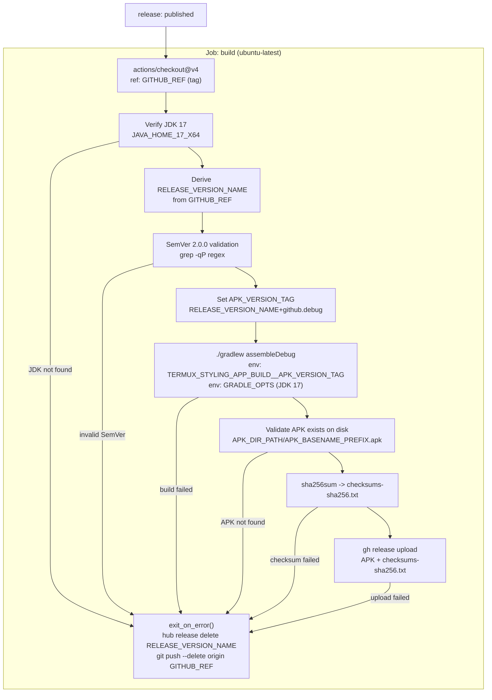

<!-- source: DeepWiki mcp.deepwiki.com · repo termux/termux-styling · page 5.2 Release Builds · fetched 2026-10-26 -->

# Release Builds

<details>
<summary>Relevant source files</summary>

The following files were used as context for generating this wiki page:

- [.github/workflows/github_action_build.yml](.github/workflows/github_action_build.yml)
- [.github/workflows/github_release_build.yml](.github/workflows/github_release_build.yml)
- [LICENSE.md](LICENSE.md)
- [README.md](README.md)
- [app/build.gradle](app/build.gradle)

</details>


This page documents the `github_release_build.yml` workflow, which produces the official APK artifacts attached to GitHub Releases. It covers the trigger, version name derivation, build invocation, checksum generation, and asset upload sequence.

For debug and continuous integration builds triggered by pushes and pull requests, see [Debug and Action Builds](#5.1). For the Nerd Font verification workflow, see [Nerd Font Verification Workflow](#5.3). For the Gradle build configuration that the workflow invokes, see [App Build Configuration](#4.1).

---

## Trigger

The workflow fires on a single event: a GitHub Release being **published**.

[.github/workflows/github_release_build.yml:1-7]()

```yaml
on:
  release:
    types:
      - published
```

This means the workflow does not run on pushes, pull requests, or scheduled events. It is exclusively activated when a maintainer publishes a release through the GitHub web UI or API.

---

## Job Structure

The entire workflow runs in a single job (`build`) on `ubuntu-latest`. The `GITHUB_TOKEN` secret is exposed as an environment variable at the job level so that the `gh` CLI can authenticate upload calls.

[.github/workflows/github_release_build.yml:8-13]()

| Property | Value |
|---|---|
| Runner | `ubuntu-latest` |
| JDK requirement | JDK 17 at `$JAVA_HOME_17_X64` |
| Authentication | `GITHUB_TOKEN` (from `secrets.GITHUB_TOKEN`) |
| Checkout ref | `${{ env.GITHUB_REF }}` (the tag ref) |

---

## Build and Upload Pipeline

**Workflow step diagram — `github_release_build.yml`**



Sources: [.github/workflows/github_release_build.yml:1-70]()

---

## Version Name Derivation

Unlike the debug workflow (which appends a git SHA to the version from `build.gradle`), the release workflow derives the version name **directly from the git tag**.

[.github/workflows/github_release_build.yml:35]()

```bash
RELEASE_VERSION_NAME="${GITHUB_REF/refs\/tags\//}"
```

The `refs/tags/` prefix is stripped via Bash parameter substitution, leaving the raw tag name (e.g., `v0.32.1`).

**Critically**, the release workflow does **not** export `TERMUX_STYLING_APP_BUILD__APP_VERSION_NAME`. This means the `versionName` embedded in the APK's `defaultConfig` block will be the hardcoded value in `app/build.gradle` (currently `"0.32.1"` at [app/build.gradle:19]()). Only the APK *filename* is controlled by the tag.

Compare this to the debug workflow, which exports `TERMUX_STYLING_APP_BUILD__APP_VERSION_NAME` to override the in-APK version string.

| Variable | Debug Build | Release Build |
|---|---|---|
| `TERMUX_STYLING_APP_BUILD__APP_VERSION_NAME` | Set (version + git SHA) | **Not set** |
| `TERMUX_STYLING_APP_BUILD__APK_VERSION_TAG` | Set | Set |
| Version source | `build.gradle` value + git SHA | Hardcoded `build.gradle` value |
| Filename source | Git tag + SHA | Git tag |

---

## SemVer Validation

The tag-derived version string is validated against the SemVer 2.0.0 regex before the build proceeds.

[.github/workflows/github_release_build.yml:36-38]()

The `v` prefix is stripped for the regex check (`${RELEASE_VERSION_NAME/v/}`). If validation fails, `exit_on_error` is called, which deletes the GitHub Release and the associated tag before exiting — preventing a broken release from remaining visible.

---

## APK Filename Construction

[.github/workflows/github_release_build.yml:41-42]()

```bash
APK_VERSION_TAG="$RELEASE_VERSION_NAME+github.debug"
APK_BASENAME_PREFIX="termux-styling-app_$APK_VERSION_TAG"
```

For a tag of `v0.32.1`, this yields:

```
termux-styling-app_v0.32.1+github.debug.apk
```

This tag value is passed to Gradle via `TERMUX_STYLING_APP_BUILD__APK_VERSION_TAG`. Inside `app/build.gradle`, the `applicationVariants.all` block reads this environment variable to set `outputFileName` [app/build.gradle:55-60]().

---

## Gradle Invocation

[.github/workflows/github_release_build.yml:44-49]()

```bash
export TERMUX_STYLING_APP_BUILD__APK_VERSION_TAG="$APK_VERSION_TAG"
export GRADLE_OPTS="-Dorg.gradle.java.home=$JAVA_HOME_17_X64"
./gradlew assembleDebug
```

Note that `assembleDebug` is called, not `assembleRelease`. The APK is signed with the debug key defined in `signingConfigs.debug` in [app/build.gradle:25-32](). The `+github.debug` suffix in the filename communicates this fact to users.

---

## Artifact Validation and Checksum

After the build completes, the workflow verifies the APK exists at the expected path and then generates a SHA-256 checksum.

[.github/workflows/github_release_build.yml:51-61]()

```bash
# Validation
test -f "$APK_DIR_PATH/${APK_BASENAME_PREFIX}.apk"

# Checksum
cd "$APK_DIR_PATH"
sha256sum "${APK_BASENAME_PREFIX}.apk" > checksums-sha256.txt
```

The checksum file is named `checksums-sha256.txt` and lives alongside the APK in `./app/build/outputs/apk/debug/`.

---

## Upload to GitHub Release

[.github/workflows/github_release_build.yml:63-69]()

```bash
gh release upload "$RELEASE_VERSION_NAME" \
  "$APK_DIR_PATH/${APK_BASENAME_PREFIX}.apk" \
  "$APK_DIR_PATH/checksums-sha256.txt"
```

The `gh` CLI uses the `GITHUB_TOKEN` environment variable for authentication. Both the APK and the checksum file are uploaded as assets attached to the release identified by `RELEASE_VERSION_NAME` (the tag name).

---

## Error Recovery

The `exit_on_error` function in this workflow does more than print and exit — it also cleans up the release.

[.github/workflows/github_release_build.yml:22-28]()

```bash
exit_on_error() {
    echo "$1"
    echo "Deleting '$RELEASE_VERSION_NAME' release and '$GITHUB_REF' tag"
    hub release delete "$RELEASE_VERSION_NAME"
    git push --delete origin "$GITHUB_REF"
    exit 1
}
```

This ensures that a failed build does not leave a partially-populated GitHub Release. The release and its associated tag are deleted, allowing the maintainer to recreate them after fixing the problem.

This is a significant behavioral difference from the debug workflow, which simply fails the action run without any cleanup.

---

## Environment Variable Reference

The following table summarises every shell and Gradle-facing variable used in the workflow.

| Variable | Scope | Set by | Consumed by |
|---|---|---|---|
| `GITHUB_TOKEN` | Job env | GitHub Actions | `gh release upload` |
| `GITHUB_REF` | GitHub context | GitHub Actions | Tag name extraction |
| `JAVA_HOME_17_X64` | Runner env | GitHub-hosted runner | `GRADLE_OPTS` |
| `RELEASE_VERSION_NAME` | Shell local | Workflow script | Validation, filenames, upload |
| `APK_VERSION_TAG` | Shell local | Workflow script | Filename, `TERMUX_STYLING_APP_BUILD__APK_VERSION_TAG` |
| `APK_BASENAME_PREFIX` | Shell local | Workflow script | Validation, checksum, upload |
| `APK_DIR_PATH` | Shell local | Workflow script | Validation, checksum, upload |
| `TERMUX_STYLING_APP_BUILD__APK_VERSION_TAG` | Exported | Workflow script | `app/build.gradle` `outputFileName` |
| `GRADLE_OPTS` | Exported | Workflow script | Gradle JVM home |

Sources: [.github/workflows/github_release_build.yml:1-70](), [app/build.gradle:11-12](), [app/build.gradle:55-60]()

---

