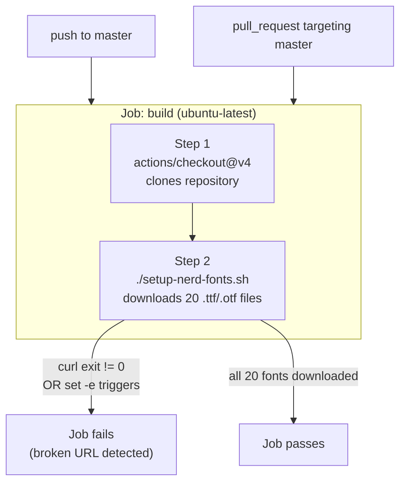
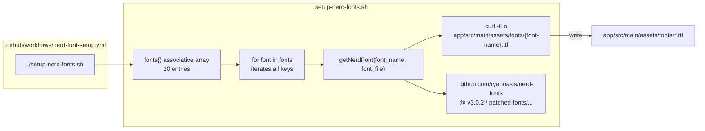

<!-- source: DeepWiki mcp.deepwiki.com · repo termux/termux-styling · page 5.3 Nerd Font Verification Workflow · fetched 2026-10-26 -->

# Nerd Font Verification Workflow

<details>
<summary>Relevant source files</summary>

The following files were used as context for generating this wiki page:

- [.github/workflows/nerd-font-setup.yml](.github/workflows/nerd-font-setup.yml)
- [app/src/main/assets/fonts/Inconsolata.ttf](app/src/main/assets/fonts/Inconsolata.ttf)
- [app/src/main/assets/fonts/Terminus.ttf](app/src/main/assets/fonts/Terminus.ttf)
- [setup-nerd-fonts.sh](setup-nerd-fonts.sh)

</details>


This page documents the `nerd-font-setup.yml` GitHub Actions workflow — its triggers, job structure, and role in the CI system. Its sole purpose is to verify that the `setup-nerd-fonts.sh` provisioning script can successfully download all 20 Nerd Font files from the upstream `ryanoasis/nerd-fonts` repository.

For a full description of what `setup-nerd-fonts.sh` does internally, see [Nerd Fonts Setup](#6.1). For the debug and release build workflows that produce APK artifacts, see [Debug and Action Builds](#5.1) and [Release Builds](#5.2).

---

## Purpose

The fonts stored in `assets/fonts/` are downloaded from an external GitHub release (`ryanoasis/nerd-fonts` at tag `v3.0.2`) before they are committed to the repository. The URLs for those downloads are embedded in `setup-nerd-fonts.sh`. This workflow runs that script in CI on every push and pull request to `master`, providing a canary check that:

- The remote URLs are still reachable.
- The file paths within the `ryanoasis/nerd-fonts` release have not changed.
- The script itself (`setup-nerd-fonts.sh`) runs without error under `set -e -u`.

It does **not** build the Android app or publish any artifact.

Sources: [.github/workflows/nerd-font-setup.yml:1-18]()

---

## Triggers

| Event | Branch Filter |
|---|---|
| `push` | `master` |
| `pull_request` | `master` |

There is no `workflow_dispatch`, `schedule`, or tag filter. The workflow runs exclusively when code lands on, or targets, the `master` branch.

Sources: [.github/workflows/nerd-font-setup.yml:3-7]()

---

## Job Structure

The workflow defines a single job named `build` running on `ubuntu-latest`. It contains two steps:

| Step | Action / Command | Description |
|---|---|---|
| Checkout | `actions/checkout@v4` | Clones the repository so `setup-nerd-fonts.sh` is available |
| Downloads nerd fonts | `./setup-nerd-fonts.sh` | Runs the provisioning script; fails the job if any download fails |

Sources: [.github/workflows/nerd-font-setup.yml:9-17]()

---

## Workflow File Overview

**Workflow structure: `nerd-font-setup.yml`**



Sources: [.github/workflows/nerd-font-setup.yml:1-18]()

---

## Script Execution Detail

When `./setup-nerd-fonts.sh` runs, it iterates over the `fonts` associative array [setup-nerd-fonts.sh:22-43]() and calls `getNerdFont` [setup-nerd-fonts.sh:4-20]() for each entry. Each call constructs a URL of the form:

```
https://github.com/ryanoasis/nerd-fonts/raw/v3.0.2/patched-fonts/{RemoteName}/{path/to/file.ttf}
```

and issues `curl -fLo` to write the file to `app/src/main/assets/fonts/{font-name}.ttf`. The `-f` flag causes `curl` to return a non-zero exit code on HTTP errors. Combined with `set -e` at the top of the script [setup-nerd-fonts.sh:2](), any single failed download immediately aborts the script and fails the CI job.

**Mapping: workflow step → script internals**



Sources: [setup-nerd-fonts.sh:1-57](), [.github/workflows/nerd-font-setup.yml:13-17]()

---

## Relationship to Other Workflows

This workflow is entirely independent from the build and release pipelines:

| Workflow | File | Produces |
|---|---|---|
| `Check Nerd Fonts` | `nerd-font-setup.yml` | No artifact — verification only |
| `Github Action Build` | `github_action_build.yml` | Debug APK artifact |
| `Github Release Build` | `github_release_build.yml` | Release APK attached to GitHub Release |

The font files downloaded by this workflow are **not retained** between workflow runs (GitHub Actions runners are ephemeral). The workflow's only output is a pass/fail signal. The actual font files committed to the repository are populated separately by running `setup-nerd-fonts.sh` locally during development.

Sources: [.github/workflows/nerd-font-setup.yml:1-18]()

---

