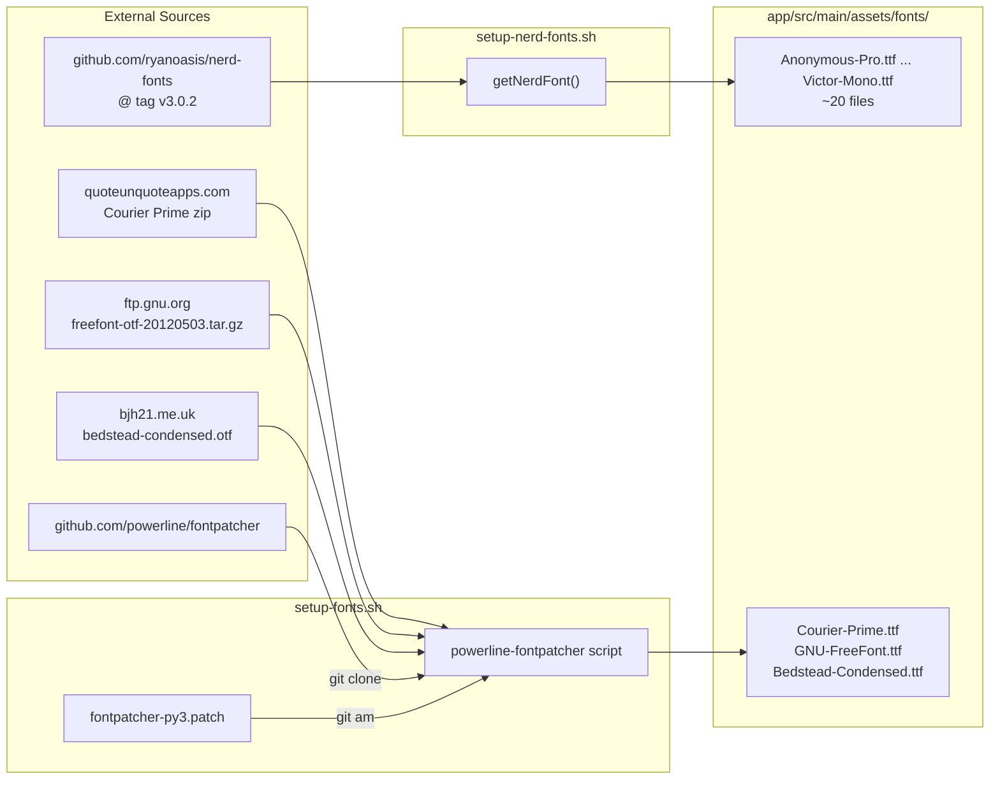
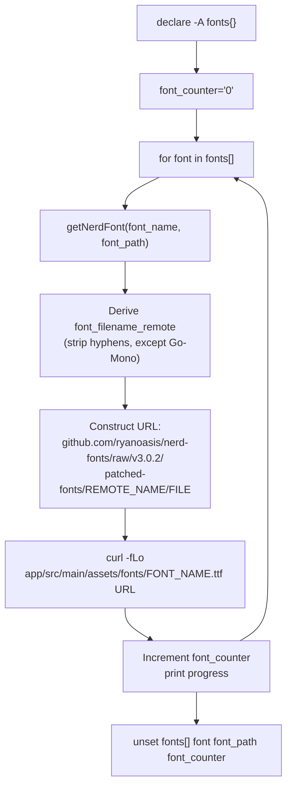
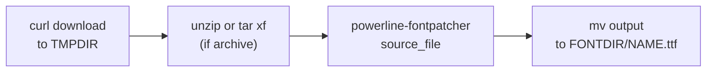

<!-- source: DeepWiki mcp.deepwiki.com · repo termux/termux-styling · page 6 Asset Provisioning · fetched 2026-10-26 -->

# Asset Provisioning

<details>
<summary>Relevant source files</summary>

The following files were used as context for generating this wiki page:

- [app/src/main/assets/fonts/Bedstead-Condensed.ttf](app/src/main/assets/fonts/Bedstead-Condensed.ttf)
- [app/src/main/assets/fonts/Bedstead-Condensed.txt](app/src/main/assets/fonts/Bedstead-Condensed.txt)
- [app/src/main/assets/fonts/Inconsolata.ttf](app/src/main/assets/fonts/Inconsolata.ttf)
- [app/src/main/assets/fonts/Terminus.ttf](app/src/main/assets/fonts/Terminus.ttf)
- [fontpatcher-py3.patch](fontpatcher-py3.patch)
- [setup-fonts.sh](setup-fonts.sh)
- [setup-nerd-fonts.sh](setup-nerd-fonts.sh)

</details>


This page explains how the font asset files in `app/src/main/assets/fonts/` are populated before being committed to the repository. It covers the two shell scripts and one patch file used to download and process fonts at developer time — prior to any Gradle build.

For details on how the bundled font files are consumed at runtime, see [Font Assets](#3.1). For how the build system packages these files into the APK, see [App Build Configuration](#4.1). For the CI workflow that verifies the Nerd Fonts download script still works, see [Nerd Font Verification Workflow](#5.3).

---

## Overview

Font files are not generated by the Gradle build. They must exist in `app/src/main/assets/fonts/` **before** `./gradlew assembleDebug` runs. Two scripts are responsible for creating these files:

| Script | Technique | Fonts produced |
|---|---|---|
| `setup-nerd-fonts.sh` | Downloads pre-patched `.ttf`/`.otf` directly from `ryanoasis/nerd-fonts` | ~20 Nerd Font variants |
| `setup-fonts.sh` | Downloads source fonts, then patches with `powerline-fontpatcher` | 3 Powerline-patched fonts |

Both scripts write their output to `app/src/main/assets/fonts/` and are intended to be run by developers or maintainers when the font set needs to be updated. Neither script is invoked by Gradle or by any CI/CD workflow except for `nerd-font-setup.yml`, which runs `setup-nerd-fonts.sh` as a functional check (see [Nerd Font Verification Workflow](#5.3)).

**Diagram: Asset provisioning data flow**



Sources: `setup-nerd-fonts.sh`, `setup-fonts.sh`, `fontpatcher-py3.patch`

---

## `setup-nerd-fonts.sh`

This script downloads Nerd Font-patched files from the upstream `ryanoasis/nerd-fonts` GitHub repository. It is a plain Bash script with no system-level dependencies beyond `curl`.

### Structure

The script defines one function and one associative array:

- **`getNerdFont(font_name, font_file)`** — [setup-nerd-fonts.sh:4-20]() — accepts a simplified local name and a remote path fragment, constructs the full download URL, and writes to `app/src/main/assets/fonts/{font_name}.ttf`.
- **`fonts[]`** — [setup-nerd-fonts.sh:22-43]() — a Bash associative array mapping simplified local font names to their remote path suffixes under the `patched-fonts/` directory.

### Version pin

The release tag `v3.0.2` is hardcoded inside `getNerdFont` [setup-nerd-fonts.sh:8]():

```
local tag="v3.0.2"
```

The base URL constructed is:

```
https://github.com/ryanoasis/nerd-fonts/raw/${tag}/patched-fonts/${font_filename_remote}/${font_file}
```

### Hyphen-stripping logic

Remote directory names in `ryanoasis/nerd-fonts` omit hyphens (e.g., `Anonymous-Pro` → `AnonymousPro`). The script strips hyphens from all font names **except `Go-Mono`**, which uses hyphens in its upstream path [setup-nerd-fonts.sh:10-13]():

```bash
if [ "$font_filename_remote" != "Go-Mono" ]; then
  font_filename_remote="${font_filename_remote//-/}"
fi
```

### Font mapping table

The `fonts[]` array maps each local key (which becomes the output filename) to the remote sub-path:

| Local key (output filename) | Remote path under `patched-fonts/` |
|---|---|
| `Anonymous-Pro` | `AnonymousPro/Regular/AnonymiceProNerdFontMono-Regular.ttf` |
| `DejaVu-Sans-Mono` | `DejaVuSansMono/Regular/DejaVuSansMNerdFontMono-Regular.ttf` |
| `Fira-Code` | `FiraCode/Regular/FiraCodeNerdFontMono-Regular.ttf` |
| `Go-Mono` | `Go-Mono/Regular/GoMonoNerdFontMono-Regular.ttf` |
| `Hack` | `Hack/Regular/HackNerdFontMono-Regular.ttf` |
| `Inconsolata` | `Inconsolata/InconsolataNerdFontMono-Regular.ttf` |
| `Liberation-Mono` | `LiberationMono/LiterationMonoNerdFontMono-Regular.ttf` |
| `Meslo` | `Meslo/L/Regular/MesloLGLNerdFontMono-Regular.ttf` |
| `Source-Code-Pro` | `SourceCodePro/Regular/SauceCodeProNerdFontMono-Regular.ttf` |
| `Terminus` | `Terminus/Regular/TerminessNerdFontMono-Regular.ttf` |
| `Victor-Mono` | `VictorMono/Regular/VictorMonoNerdFontMono-Regular.ttf` |
| *(+ 9 more)* | *(see `fonts[]` array)* |

Sources: [setup-nerd-fonts.sh:4-57]()

### Execution flow

**Diagram: `setup-nerd-fonts.sh` execution**



Sources: [setup-nerd-fonts.sh:4-57]()

---

## `setup-fonts.sh`

This script downloads three fonts from their original sources and patches them with the Powerline symbol glyphs using `powerline-fontpatcher`. It requires `python3-fontforge` (installed via `apt`) and `git`.

### Variable setup

[setup-fonts.sh:6-8]() establishes three path variables:

| Variable | Value |
|---|---|
| `TOPDIR` | Absolute path to the repository root |
| `TMPDIR` | `$TOPDIR/tmp` — scratch space for downloads/extraction |
| `FONTDIR` | `$TOPDIR/app/src/main/assets/fonts/` — final output |

### Dependency: `python3-fontforge`

[setup-fonts.sh:14-16]() checks for the `python3-fontforge` apt package and installs it if absent. This is a hard runtime dependency of `powerline-fontpatcher`.

### Fontpatcher setup

[setup-fonts.sh:18-28]() clones `https://github.com/powerline/fontpatcher.git` into `$HOME/src/fontpatcher` on first run, or runs `git pull --rebase` on subsequent runs.

After cloning, `fontpatcher-py3.patch` is applied via `git am` [setup-fonts.sh:25](). The patch changes the shebang of `scripts/powerline-fontpatcher` from `python2` to `python3` [fontpatcher-py3.patch:14-16]():

```diff
-#!/usr/bin/env python2
+#!/usr/bin/env python3
```

The `FONTPATCHER` variable is set to the patched script path: `$FONTPATCHER_DIR/scripts/powerline-fontpatcher`.

### Fonts processed

Each font follows a download → extract → patch → move sequence:

**Diagram: `setup-fonts.sh` per-font pipeline**



| Font | Source URL | Input to patcher | Output filename |
|---|---|---|---|
| Courier Prime | `quoteunquoteapps.com/.../courier-prime.zip` | `Courier Prime/Courier Prime.ttf` | `Courier-Prime.ttf` |
| GNU FreeFont | `ftp.gnu.org/.../freefont-otf-20120503.tar.gz` | `freefont-20120503/FreeMono.otf` | `GNU-FreeFont.ttf` |
| Bedstead Condensed | `bjh21.me.uk/bedstead/bedstead-condensed.otf` | `bedstead-condensed.otf` | `Bedstead-Condensed.ttf` |

Note that all three output files use the `.ttf` extension regardless of whether the input was `.ttf` or `.otf`. This matches the naming convention expected by `TermuxStyleActivity` (see [TermuxStyleActivity](#2.1)).

Sources: [setup-fonts.sh:1-48](), [fontpatcher-py3.patch:1-22]()

---

## `fontpatcher-py3.patch`

This is a single-line patch file shipped with the repository to fix a Python compatibility issue in the upstream `powerline/fontpatcher` project [fontpatcher-py3.patch:1-22]().

| Field | Value |
|---|---|
| Applied to | `scripts/powerline-fontpatcher` inside the `powerline/fontpatcher` clone |
| Method | `git am` from within the `$FONTPATCHER_DIR` |
| Change | Replaces `python2` shebang with `python3` |
| Author | Henrik Grimler (Termux contributor) |
| Date | 2022-05-16 |

Without this patch, `setup-fonts.sh` fails on any modern Ubuntu system where `python2` is not present.

Sources: [fontpatcher-py3.patch:1-22]()

---

## Output Summary

After both scripts run successfully, `app/src/main/assets/fonts/` contains approximately 23 `.ttf` files. These files are then committed to the repository and packaged into the APK by the Gradle build. Each font file has a corresponding `.txt` license file that must be added separately (see [Font Assets](#3.1)).

**Diagram: Script-to-output file mapping**

```mermaid
flowchart TD
    SH1["setup-nerd-fonts.sh\ngetNerdFont()"]
    SH2["setup-fonts.sh\n+ fontpatcher-py3.patch"]

    SH1 --> F1["Anonymous-Pro.ttf"]
    SH1 --> F2["DejaVu-Sans-Mono.ttf"]
    SH1 --> F3["Fantasque-Sans-Mono.ttf"]
    SH1 --> F4["Fira-Code.ttf"]
    SH1 --> F5["Fira-Mono.ttf"]
    SH1 --> F6["Go-Mono.ttf"]
    SH1 --> F7["Hack.ttf"]
    SH1 --> F8["Hermit.ttf"]
    SH1 --> F9["Inconsolata.ttf"]
    SH1 --> F10["Iosevka.ttf"]
    SH1 --> F11["Liberation-Mono.ttf"]
    SH1 --> F12["Meslo.ttf"]
    SH1 --> F13["Monofur.ttf"]
    SH1 --> F14["Monoid.ttf"]
    SH1 --> F15["OpenDyslexic.ttf"]
    SH1 --> F16["Roboto-Mono.ttf"]
    SH1 --> F17["Source-Code-Pro.ttf"]
    SH1 --> F18["Terminus.ttf"]
    SH1 --> F19["Ubuntu-Mono.ttf"]
    SH1 --> F20["Victor-Mono.ttf"]

    SH2 --> F21["Courier-Prime.ttf"]
    SH2 --> F22["GNU-FreeFont.ttf"]
    SH2 --> F23["Bedstead-Condensed.ttf"]
```



Sources: [setup-nerd-fonts.sh:22-43](), [setup-fonts.sh:31-48]()

---

