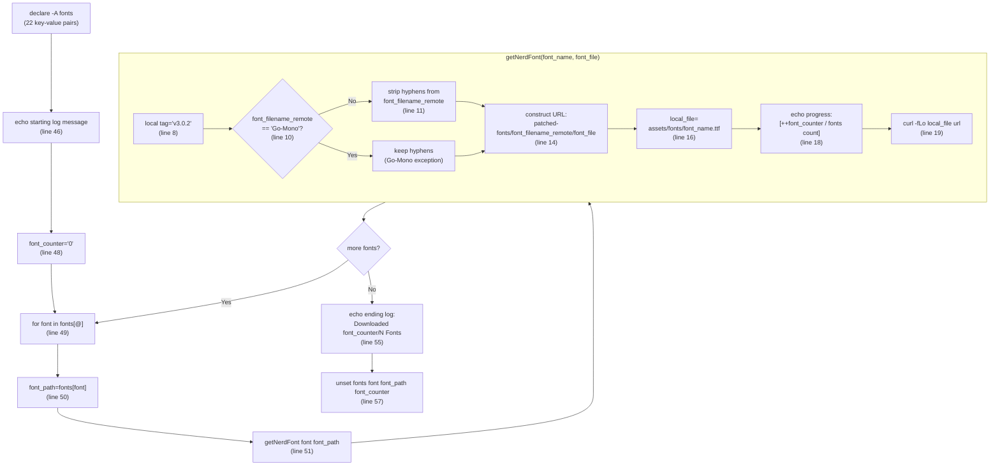
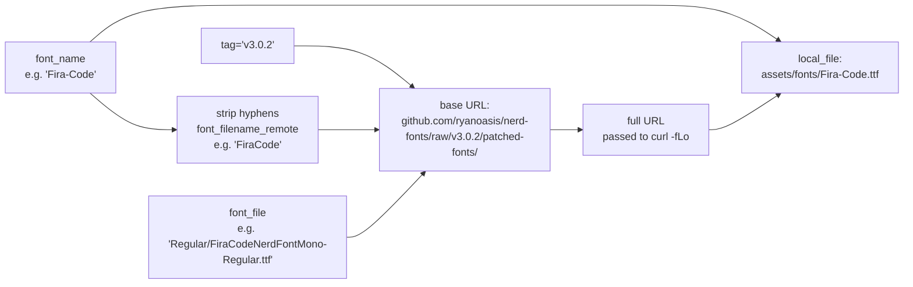

<!-- source: DeepWiki mcp.deepwiki.com · repo termux/termux-styling · page 6.1 Nerd Fonts Setup · fetched 2026-10-26 -->

# Nerd Fonts Setup

<details>
<summary>Relevant source files</summary>

The following files were used as context for generating this wiki page:

- [.github/workflows/nerd-font-setup.yml](.github/workflows/nerd-font-setup.yml)
- [app/src/main/assets/fonts/Inconsolata.ttf](app/src/main/assets/fonts/Inconsolata.ttf)
- [app/src/main/assets/fonts/Terminus.ttf](app/src/main/assets/fonts/Terminus.ttf)
- [setup-nerd-fonts.sh](setup-nerd-fonts.sh)

</details>


This page documents `setup-nerd-fonts.sh`, the developer-time shell script responsible for downloading Nerd Font–patched TTF files from the upstream `ryanoasis/nerd-fonts` repository and placing them into `app/src/main/assets/fonts/`. This script is run manually by contributors when updating font assets, and is also executed by the CI verification workflow described in [Nerd Font Verification Workflow](#5.3). For the parallel script that handles Powerline-patched fonts, see [Powerline Font Setup](#6.2). For a description of how the resulting font files are consumed at runtime, see [Font Assets](#3.1).

---

## Overview

`setup-nerd-fonts.sh` performs one job: download a specific Regular variant of each Nerd Font from the upstream GitHub release at a pinned version, and write each file to a deterministic local path under `assets/fonts/`. No compilation, patching, or post-processing occurs. The script exits immediately on any error (`set -e -u`).

**Script entry point:** [setup-nerd-fonts.sh:1-2]()

---

## Font Catalog

The script declares an associative array named `fonts` that maps each locally-used font name to its path within the upstream `patched-fonts/` directory tree.

[setup-nerd-fonts.sh:22-43]()

| Local Name (key) | Remote Sub-path (value) |
|---|---|
| `Anonymous-Pro` | `Regular/AnonymiceProNerdFontMono-Regular.ttf` |
| `DejaVu-Sans-Mono` | `Regular/DejaVuSansMNerdFontMono-Regular.ttf` |
| `Fantasque-Sans-Mono` | `Regular/FantasqueSansMNerdFontMono-Regular.ttf` |
| `Fira-Code` | `Regular/FiraCodeNerdFontMono-Regular.ttf` |
| `Fira-Mono` | `Regular/FiraMonoNerdFontMono-Regular.otf` |
| `Go-Mono` | `Regular/GoMonoNerdFontMono-Regular.ttf` |
| `Hack` | `Regular/HackNerdFontMono-Regular.ttf` |
| `Hermit` | `Regular/HurmitNerdFontMono-Regular.otf` |
| `Inconsolata` | `InconsolataNerdFontMono-Regular.ttf` |
| `Iosevka` | `Regular/IosevkaNerdFontMono-Regular.ttf` |
| `Liberation-Mono` | `LiterationMonoNerdFontMono-Regular.ttf` |
| `Meslo` | `L/Regular/MesloLGLNerdFontMono-Regular.ttf` |
| `Monofur` | `Regular/MonofurNerdFontMono-Regular.ttf` |
| `Monoid` | `Regular/MonoidNerdFontMono-Regular.ttf` |
| `OpenDyslexic` | `Mono-Regular/OpenDyslexicMNerdFontMono-Regular.otf` |
| `Roboto-Mono` | `Regular/RobotoMonoNerdFontMono-Regular.ttf` |
| `Source-Code-Pro` | `Regular/SauceCodeProNerdFontMono-Regular.ttf` |
| `Terminus` | `Regular/TerminessNerdFontMono-Regular.ttf` |
| `Ubuntu-Mono` | `Regular/UbuntuMonoNerdFontMono-Regular.ttf` |
| `Victor-Mono` | `Regular/VictorMonoNerdFontMono-Regular.ttf` |

**Note:** Even though some remote files have an `.otf` extension (e.g., `Fira-Mono`, `Hermit`, `OpenDyslexic`), all files are saved locally with a `.ttf` extension. This is handled unconditionally in the `getNerdFont` function.

Sources: [setup-nerd-fonts.sh:22-43]()

---

## `getNerdFont` Function

`getNerdFont` is the sole function in the script. It takes two positional arguments and performs one `curl` download.

**Signature:** [setup-nerd-fonts.sh:4-20]()

| Parameter | Variable | Description |
|---|---|---|
| `$1` | `font_name` | The local name key from the `fonts[]` array (e.g., `Fira-Code`) |
| `$2` | `font_file` | The relative remote sub-path (e.g., `Regular/FiraCodeNerdFontMono-Regular.ttf`) |

### URL Construction

The function constructs a raw GitHub URL with the following structure:

```
https://github.com/ryanoasis/nerd-fonts/raw/{tag}/patched-fonts/{font_filename_remote}/{font_file}
```

- `tag` is hardcoded to `v3.0.2` [setup-nerd-fonts.sh:8]()
- `font_filename_remote` is derived from `font_name` by stripping all hyphens, **unless** the font name is exactly `Go-Mono` [setup-nerd-fonts.sh:10-13]()

### Hyphen-Stripping Logic

The upstream `patched-fonts/` directory uses names without hyphens for most fonts (e.g., the local key `Fira-Code` maps to the directory `FiraCode`). The script strips hyphens using Bash string substitution: `${font_filename_remote//-/}`.

`Go-Mono` is the single exception. Its upstream directory name retains the hyphen (`Go-Mono`), so stripping is skipped for that entry.

[setup-nerd-fonts.sh:9-13]()

### Local File Placement

Regardless of the remote file extension, the local output path is always:

```
app/src/main/assets/fonts/{font_name}.ttf
```

[setup-nerd-fonts.sh:16]()

### `curl` Invocation

```
curl -fLo "${local_file}" "${url}"
```

| Flag | Effect |
|---|---|
| `-f` | Fail silently on HTTP errors (non-2xx returns a non-zero exit code, triggering `set -e`) |
| `-L` | Follow redirects |
| `-o` | Write output to the specified local file path |

[setup-nerd-fonts.sh:19]()

Sources: [setup-nerd-fonts.sh:4-20]()

---

## Execution Flow

The following diagram maps the full execution flow from the `fonts[]` array declaration through to cleanup, associating each step with its code location.

**Diagram: `setup-nerd-fonts.sh` Execution Flow**



Sources: [setup-nerd-fonts.sh:1-57]()

---

## Progress Reporting

The script maintains a global integer `font_counter` initialized to `0` before the loop [setup-nerd-fonts.sh:48](). Inside `getNerdFont`, the counter is pre-incremented with `$(( ++font_counter ))` and printed alongside the total count `${#fonts[@]}` [setup-nerd-fonts.sh:18]().

Example output line:

```
Fetching https://github.com/ryanoasis/nerd-fonts/raw/v3.0.2/patched-fonts/FiraCode/Regular/FiraCodeNerdFontMono-Regular.ttf ... [1/20]
```

A summary line is emitted after the loop completes [setup-nerd-fonts.sh:55]().

Sources: [setup-nerd-fonts.sh:46-55]()

---

## URL Structure Diagram

This diagram shows precisely how each component of the download URL is assembled for a representative font entry.

**Diagram: URL construction for a single font**



Sources: [setup-nerd-fonts.sh:8-19]()

---

## Cleanup

After the loop, the script unsets all variables it introduced into the shell environment [setup-nerd-fonts.sh:57]():

```
unset 'fonts[@]' 'font' 'font_path' 'font_counter'
```

This prevents the associative array and loop variables from leaking into a parent shell if the script is sourced rather than executed.

Sources: [setup-nerd-fonts.sh:57]()

---

## Version Pin

All fonts are fetched from the `v3.0.2` tag of `ryanoasis/nerd-fonts`. This pin is defined as a local variable inside `getNerdFont` [setup-nerd-fonts.sh:8]() and applies uniformly to every font. Updating fonts to a newer upstream release requires changing this value and verifying that every entry in the `fonts[]` array still maps to a valid path under the new tag.

Sources: [setup-nerd-fonts.sh:8]()

---

## CI Verification

The workflow defined in `.github/workflows/nerd-font-setup.yml` runs `setup-nerd-fonts.sh` on every push and pull request to `master` [.github/workflows/nerd-font-setup.yml:1-18](). Its sole purpose is to verify that each `curl` URL still resolves and that the script exits cleanly. Because the script uses `set -e`, any HTTP failure (caught by `curl -f`) will cause a non-zero exit and fail the CI job.

For full workflow documentation, see [Nerd Font Verification Workflow](#5.3).

Sources: [.github/workflows/nerd-font-setup.yml:1-18]()

---

