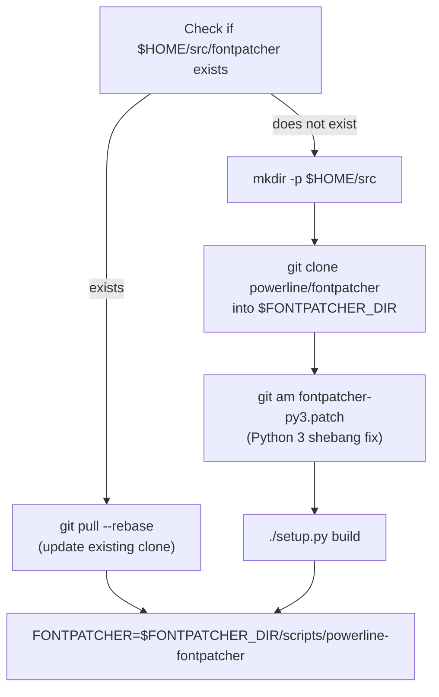
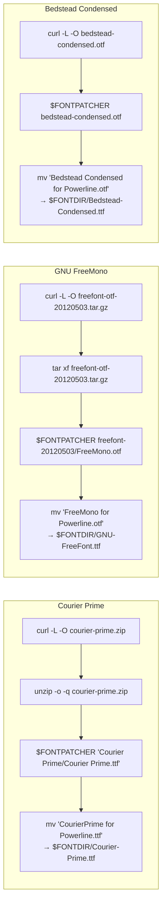
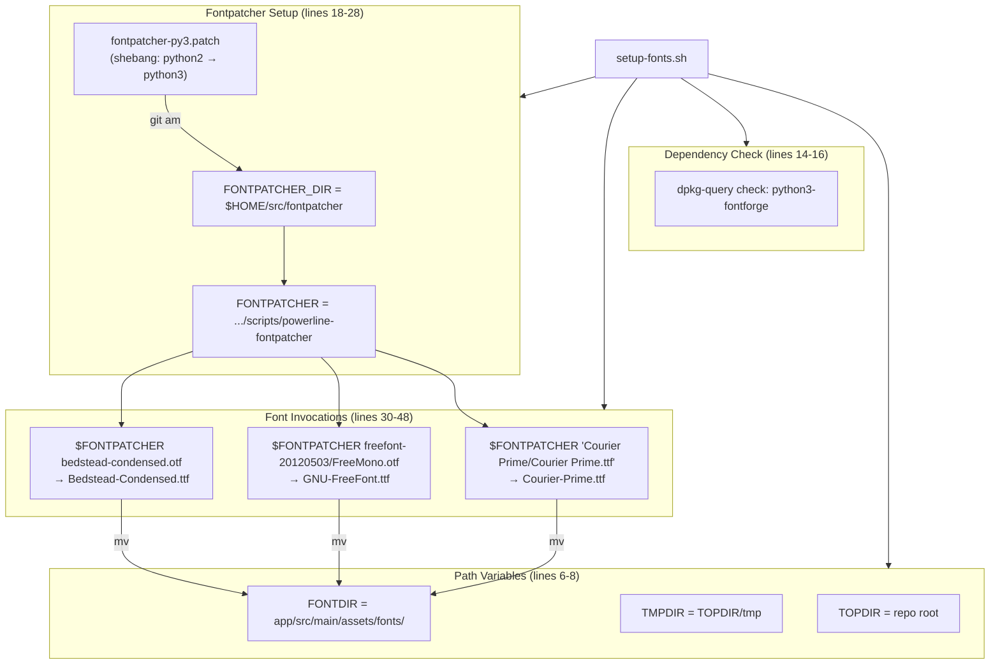

<!-- source: DeepWiki mcp.deepwiki.com · repo termux/termux-styling · page 6.2 Powerline Font Setup · fetched 2026-10-26 -->

# Powerline Font Setup

<details>
<summary>Relevant source files</summary>

The following files were used as context for generating this wiki page:

- [app/src/main/assets/fonts/Bedstead-Condensed.ttf](app/src/main/assets/fonts/Bedstead-Condensed.ttf)
- [app/src/main/assets/fonts/Bedstead-Condensed.txt](app/src/main/assets/fonts/Bedstead-Condensed.txt)
- [fontpatcher-py3.patch](fontpatcher-py3.patch)
- [setup-fonts.sh](setup-fonts.sh)

</details>


This page documents `setup-fonts.sh`, the developer-facing shell script that downloads, patches, and installs three Powerline-patched fonts into `assets/fonts/`. This script is run manually by contributors to update font assets before committing them to the repository — it is not invoked as part of the CI/CD build pipeline.

For fonts sourced from the Nerd Fonts project instead, see [Nerd Fonts Setup](#6.1). For a general overview of what gets bundled and how the APK packages these files, see [Font Assets](#3.1).

---

## Overview

`setup-fonts.sh` uses the [powerline/fontpatcher](https://github.com/powerline/fontpatcher) tool to embed Powerline symbols into three fonts that are not available through the Nerd Fonts distribution. It downloads each font from its upstream source, runs `powerline-fontpatcher` on it, and copies the result into `app/src/main/assets/fonts/`.

The script assumes an **Ubuntu** host environment (it uses `dpkg-query` and `apt`).

**Produced outputs:**

| Output filename | Source font | Upstream URL |
|---|---|---|
| `Courier-Prime.ttf` | Courier Prime (TTF) | `quoteunquoteapps.com/courierprime` |
| `GNU-FreeFont.ttf` | GNU FreeMono (OTF) | `ftp.gnu.org/gnu/freefont/` |
| `Bedstead-Condensed.ttf` | Bedstead Condensed (OTF) | `bjh21.me.uk/bedstead/` |

Note that despite the `.ttf` extension, `GNU-FreeFont.ttf` and `Bedstead-Condensed.ttf` are originally OTF files renamed on copy.

---

## Directory Variables

[setup-fonts.sh:6-8]()

Three path variables are established at the top of the script:

| Variable | Value | Purpose |
|---|---|---|
| `TOPDIR` | Absolute path to the repo root | Base for all other paths |
| `TMPDIR` | `$TOPDIR/tmp` | Scratch area for downloads and extraction |
| `FONTDIR` | `$TOPDIR/app/src/main/assets/fonts/` | Destination for patched font files |

`TMPDIR` is deleted and recreated fresh on every run ([setup-fonts.sh:10-11]()).

---

## Dependency: `python3-fontforge`

[setup-fonts.sh:13-16]()

The fontpatcher tool requires the `python3-fontforge` package. The script checks for it using `dpkg-query` and runs `sudo apt install python3-fontforge` if it is not found:

```
dpkg-query -W -f='${Status}' python3-fontforge 2>/dev/null | grep -c "ok installed"
```

If the count is `0`, the package is installed. This is an Ubuntu-specific check; the script will not function correctly on other distributions without manual intervention.

---

## Fontpatcher Setup

[setup-fonts.sh:18-28]()

The script manages the `powerline/fontpatcher` repository at `$HOME/src/fontpatcher`. Its behaviour depends on whether the directory already exists:

**Script: `setup-fonts.sh` — fontpatcher acquisition logic**



Sources: [setup-fonts.sh:18-28]()

The `FONTPATCHER` variable is set to the `scripts/powerline-fontpatcher` executable inside the cloned directory, which is used for all subsequent patching operations.

---

## The Python 3 Compatibility Patch

[fontpatcher-py3.patch:1-21]()

The upstream `powerline/fontpatcher` repository uses a `python2` shebang. `fontpatcher-py3.patch` is a single-line patch committed to this repository that corrects this for modern Ubuntu environments:

| Change | Value |
|---|---|
| File patched | `scripts/powerline-fontpatcher` |
| Original shebang | `#!/usr/bin/env python2` |
| Replacement shebang | `#!/usr/bin/env python3` |

The patch is applied via `git am` only on a fresh clone. If `$FONTPATCHER_DIR` already exists, the script skips the `git am` step and only runs `git pull --rebase`, assuming the patch was already applied.

Sources: [fontpatcher-py3.patch:1-21](), [setup-fonts.sh:25]()

---

## Font Processing Pipeline

Each font follows the same three-step pattern: download, patch, move. All operations occur inside `$TMPDIR`.

**Diagram: Font processing flow through `setup-fonts.sh`**



Sources: [setup-fonts.sh:30-48]()

---

### Courier Prime

[setup-fonts.sh:30-35]()

| Step | Detail |
|---|---|
| Archive format | ZIP (`courier-prime.zip`) |
| Extracted input | `Courier Prime/Courier Prime.ttf` |
| Patcher output | `CourierPrime for Powerline.ttf` |
| Destination | `$FONTDIR/Courier-Prime.ttf` |

### GNU FreeFont (FreeMono)

[setup-fonts.sh:37-42]()

| Step | Detail |
|---|---|
| Archive format | `.tar.gz` (`freefont-otf-20120503.tar.gz`) |
| Extracted input | `freefont-20120503/FreeMono.otf` |
| Patcher output | `FreeMono for Powerline.otf` |
| Destination | `$FONTDIR/GNU-FreeFont.ttf` *(OTF renamed to `.ttf`)* |

### Bedstead Condensed

[setup-fonts.sh:44-48]()

| Step | Detail |
|---|---|
| Archive format | Direct OTF download (no archive) |
| Input file | `bedstead-condensed.otf` |
| Patcher output | `Bedstead Condensed for Powerline.otf` |
| Destination | `$FONTDIR/Bedstead-Condensed.ttf` *(OTF renamed to `.ttf`)* |
| License | CC0 |

Sources: [app/src/main/assets/fonts/Bedstead-Condensed.txt:1-8]()

---

## Code Entity Map

The diagram below maps the logical steps of the script to the specific code constructs and file paths involved.

**Diagram: `setup-fonts.sh` — code entity map**



Sources: [setup-fonts.sh:1-48](), [fontpatcher-py3.patch:1-21]()

---

## Error Handling

The script begins with `set -e -u` ([setup-fonts.sh:4]()), meaning:

- `-e`: exit immediately on any non-zero command return code.
- `-u`: treat references to unset variables as errors.

There is no explicit cleanup on failure; a failed run may leave partial downloads in `$TMPDIR`. Re-running the script clears `$TMPDIR` at startup, so a retry is safe.

---

## Relationship to CI/CD

Unlike `setup-nerd-fonts.sh`, which is executed by the `nerd-font-setup.yml` GitHub Actions workflow (see [Nerd Font Verification Workflow](#5.3)), `setup-fonts.sh` has **no associated CI/CD workflow**. It is run manually by maintainers, and its outputs (the three `.ttf` files in `assets/fonts/`) are committed directly to the repository. The build system then packages those committed files into the APK as described in [App Build Configuration](#4.1).

---

