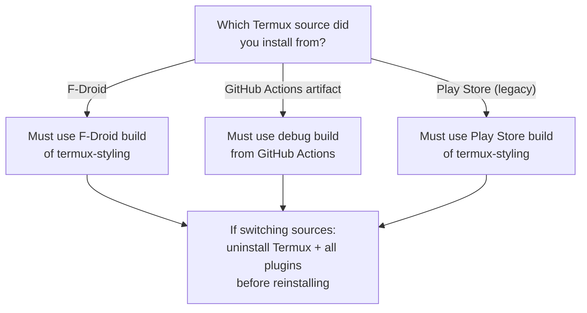
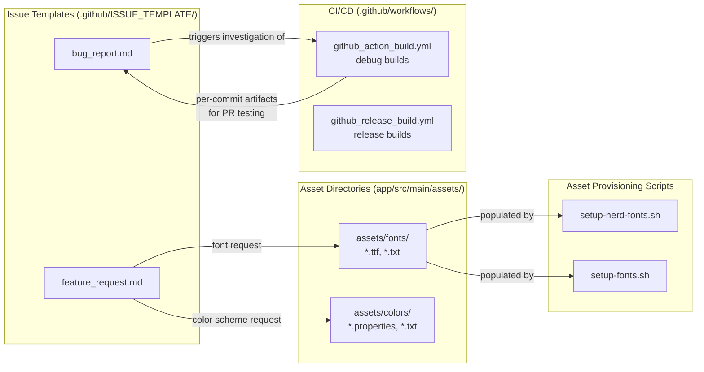

<!-- source: DeepWiki mcp.deepwiki.com · repo termux/termux-styling · page 7 Contributing · fetched 2026-10-26 -->

# Contributing

<details>
<summary>Relevant source files</summary>

The following files were used as context for generating this wiki page:

- [.github/ISSUE_TEMPLATE/bug_report.md](.github/ISSUE_TEMPLATE/bug_report.md)
- [.github/ISSUE_TEMPLATE/feature_request.md](.github/ISSUE_TEMPLATE/feature_request.md)
- [.github/workflows/github_action_build.yml](.github/workflows/github_action_build.yml)
- [.github/workflows/github_release_build.yml](.github/workflows/github_release_build.yml)
- [LICENSE.md](LICENSE.md)
- [README.md](README.md)

</details>


This page covers how to contribute to the Termux:Styling repository: filing bug reports, requesting new fonts or color schemes, and the signing-key constraints that affect development builds. For information about how the build pipeline works, see [Build System](#4) and [CI/CD Workflows](#5). For details on how assets are structured and added, see [Styling Assets](#3) and [Asset Provisioning](#6).

---

## Issue Templates

The repository provides two GitHub issue templates under [.github/ISSUE_TEMPLATE/](.github/ISSUE_TEMPLATE/). Each template enforces a minimum set of fields required for the issue to be actionable.

### Bug Reports

Template file: [.github/ISSUE_TEMPLATE/bug_report.md](.github/ISSUE_TEMPLATE/bug_report.md)

| Field | Purpose |
|---|---|
| **Problem description** | Clear description of the unexpected behavior; screenshots are acceptable |
| **Steps to reproduce** | Ordered steps including all commands needed to reproduce the issue |
| **Expected behavior** | What you expected to happen |
| **Termux application version** | Version of the main Termux app installed |
| **Android OS version** | e.g. Android 13 |
| **Device model** | e.g. Pixel 7 |

> **Note:** Termux:Styling does not perform color or font rendering. If rendering looks wrong in the terminal, the bug may be in the main Termux app, not in this plugin. File the report in the appropriate repository.

### Feature Requests — New Fonts and Color Schemes

Template file: [.github/ISSUE_TEMPLATE/feature_request.md](.github/ISSUE_TEMPLATE/feature_request.md)

| Field | Purpose |
|---|---|
| **Feature description** | Description of the feature and motivation for including it |
| **Reference implementation** | For fonts: a direct link to a `.ttf` or `.otf` file. For color schemes: a link to the reference implementation. |

The reference implementation field is mandatory for font and color scheme requests so that maintainers can evaluate the asset and verify its license before bundling it.

---

## Unsupported Android Versions

Support for **Android 5.x and 6.x** (API levels 21–23) is finished. Both issue templates include this notice in their header comments:

[.github/ISSUE_TEMPLATE/bug_report.md:10]()
[.github/ISSUE_TEMPLATE/feature_request.md:10]()

Do not open issues that are specific to these Android versions.

---

## Signing Key Requirements for Development Builds

Termux:Styling communicates with the main Termux app by writing files into its data directory via `createPackageContext` and by sending the `com.termux.app.reload_style` broadcast. Both operations require that both apps share the same `sharedUserId` (`com.termux`), which in turn requires that both APKs are signed with the **same key**.

[README.md:9-11]()

This has a direct impact on how you install development builds:

**Signing key decision diagram:**



Sources: [README.md:9-24]()

The debug signing key used by CI is the `testkey_untrusted.jks` keystore declared in `app/build.gradle`. It is not trusted for interaction with a production-signed Termux install. See [App Build Configuration](#4.1) for details on the signing configuration.

---

## Contribution Workflow

The following diagram maps the contribution types to the relevant code and template entities:



Sources: [.github/ISSUE_TEMPLATE/bug_report.md](), [.github/ISSUE_TEMPLATE/feature_request.md](), [README.md:17-19]()

---

## Testing Pull Requests

Per-commit debug builds are produced automatically by [`.github/workflows/github_action_build.yml`](.github/workflows/github_action_build.yml) on every push to `master` and on every pull request targeting `master`. These artifacts are available on the [GitHub Actions](https://github.com/termux/termux-styling/actions/workflows/github_action_build.yml?query=branch%3Amaster+event%3Apush) page.

The artifact is named using the pattern:

```
termux-styling-app_v{versionName}+{gitSHA}.github.debug
```

where `{versionName}` comes from `app/build.gradle` and `{gitSHA}` is the first 7 characters of the commit hash. See [Debug and Action Builds](#5.1) for the full version derivation logic.

> Because these builds use `testkey_untrusted.jks`, they are only compatible with a Termux installation signed with the same key. They cannot communicate with a Termux app installed from F-Droid or the Play Store.

---

## License

The repository is released under **GPLv3 only**.

[LICENSE.md:1]()

Any contributed code, fonts, or color schemes must be compatible with this license. When submitting a feature request for a new font or color scheme, include the license information in the request so it can be verified before the asset is bundled.