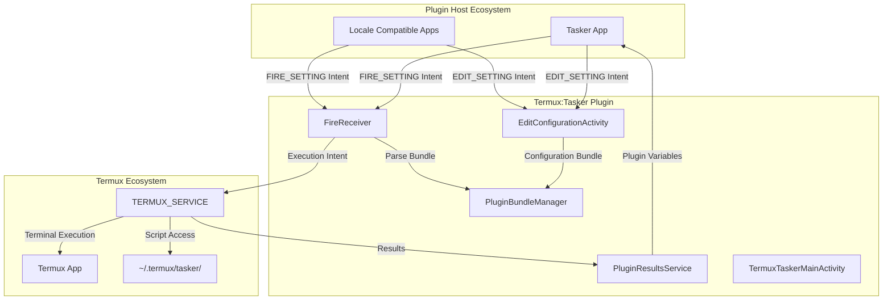
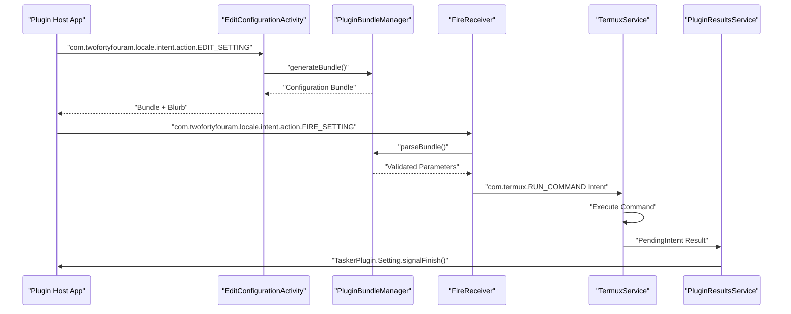
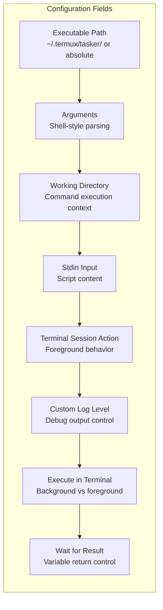
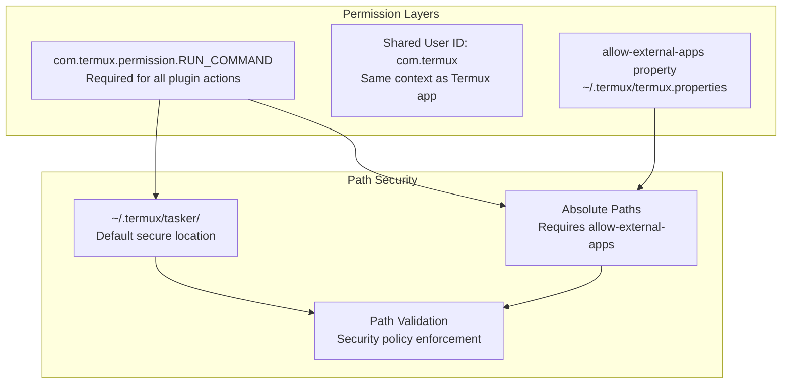

<!-- source: DeepWiki mcp.deepwiki.com · repo termux/termux-tasker · page 1 Overview · fetched 2026-10-26 -->

# Overview

Relevant source files

The following files were used as context for generating this wiki page:

- [LICENSE.md](LICENSE.md)
- [README.md](README.md)
- [app/src/main/res/values/strings.xml](app/src/main/res/values/strings.xml)
- [fastlane/metadata/android/en-US/changelogs/6.txt](fastlane/metadata/android/en-US/changelogs/6.txt)
- [fastlane/metadata/android/en-US/changelogs/7.txt](fastlane/metadata/android/en-US/changelogs/7.txt)

This document provides a comprehensive overview of the Termux:Tasker plugin system, which enables Tasker and other automation apps to execute commands within the Termux environment. The plugin acts as a bridge between external automation applications and the Termux terminal emulator, providing a secure and configurable interface for command execution.

The scope of this document covers the plugin's architecture, core components, integration mechanisms, and security model. For detailed implementation specifics of individual components, see [Implementation Details](#5). For build system and deployment information, see [Development Guide](#4).

## System Purpose and Architecture

Termux:Tasker is an Android plugin application that implements the Locale Plugin API to allow external automation apps like Tasker to execute commands in the Termux environment. The plugin provides both foreground terminal session execution and background command execution capabilities.

### High-Level System Architecture

**Sources:** [README.md:1-394](), [app/src/main/res/values/strings.xml:1-76]()

### Plugin Execution Lifecycle

**Sources:** [README.md:120-128](), [app/src/main/res/values/strings.xml:36-45]()

## Core Components

The plugin implements the standard Android plugin architecture with several key components that handle configuration, execution, and result processing.

### Application Components

| Component | Type | Purpose |
|-----------|------|---------|
| `EditConfigurationActivity` | Activity | User interface for configuring plugin actions |
| `TermuxTaskerMainActivity` | Activity | Main launcher activity for the plugin app |
| `FireReceiver` | BroadcastReceiver | Entry point for executing configured commands |
| `PluginResultsService` | Service | Handles command execution results and variable setting |
| `TermuxTaskerApplication` | Application | Application context and initialization |

### Configuration Parameters

The plugin supports the following configuration options through `EditConfigurationActivity`:

**Sources:** [app/src/main/res/values/strings.xml:38-45](), [README.md:132-217]()

### Data Serialization and Validation

The `PluginBundleManager` handles serialization of configuration data and validation of parameters:

- **Bundle Generation**: Converts UI configuration to Android Bundle format
- **Bundle Parsing**: Extracts and validates parameters from stored bundles  
- **Parameter Validation**: Ensures executable paths, permissions, and arguments are valid
- **Blurb Generation**: Creates human-readable summaries for plugin host apps

**Sources:** [README.md:132-217](), [app/src/main/res/values/strings.xml:63-69]()

## Security Model

The plugin implements multiple layers of security to prevent unauthorized command execution:

### Permission Requirements

**Sources:** [README.md:66-111](), [app/src/main/res/values/strings.xml:58-59]()

### File System Security

- Scripts in `~/.termux/tasker/` directory execute with automatic permissions
- Absolute paths require `allow-external-apps=true` in `termux.properties`
- Path validation prevents directory traversal and unauthorized access
- Execute permissions are automatically set for scripts in the tasker directory

**Sources:** [README.md:75-111](), [app/src/main/res/values/strings.xml:8-9]()

## Plugin Variables and Results

The plugin returns execution results through standardized variables:

| Variable | Content | Conditions |
|----------|---------|------------|
| `%stdout` | Command standard output | Background execution or terminal transcript |
| `%stderr` | Command standard error | Background execution only |
| `%result` | Command exit code | When waiting for results |
| `%err` | Plugin error code | Plugin execution failures |
| `%errmsg` | Plugin error message | Plugin execution failures |
| `%stdout_original_length` | Original stdout length | When output is truncated |
| `%stderr_original_length` | Original stderr length | When output is truncated |

**Sources:** [README.md:222-255](), [app/src/main/res/values/strings.xml:63-69]()

## Integration Points

### Termux Ecosystem Integration

The plugin integrates with the Termux ecosystem through:

- **Command Execution**: Uses `com.termux.RUN_COMMAND` intent for execution
- **File System Access**: Leverages Termux home directory and prefix paths
- **Terminal Sessions**: Supports both background and foreground terminal execution
- **Environment Variables**: Accesses Termux `$PREFIX` and `$HOME` variables

### Plugin Host Integration

The plugin implements the Locale Plugin API standard:

- **Configuration Intent**: `com.twofortyfouram.locale.intent.action.EDIT_SETTING`
- **Execution Intent**: `com.twofortyfouram.locale.intent.action.FIRE_SETTING`
- **Result Callbacks**: `TaskerPlugin.Setting.signalFinish()` for result delivery
- **Variable Setting**: Plugin host variable population through result bundles

**Sources:** [README.md:6-7](), [README.md:120-128](), [app/src/main/res/values/strings.xml:17-19]()

---

