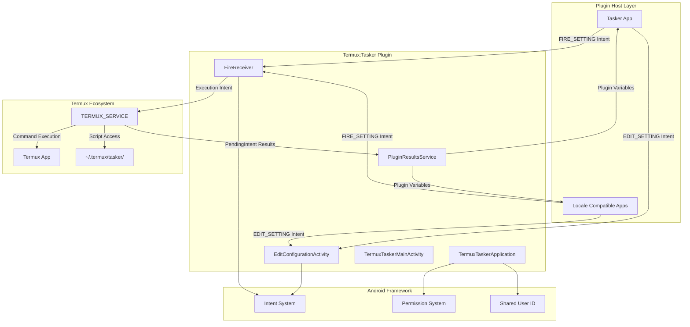
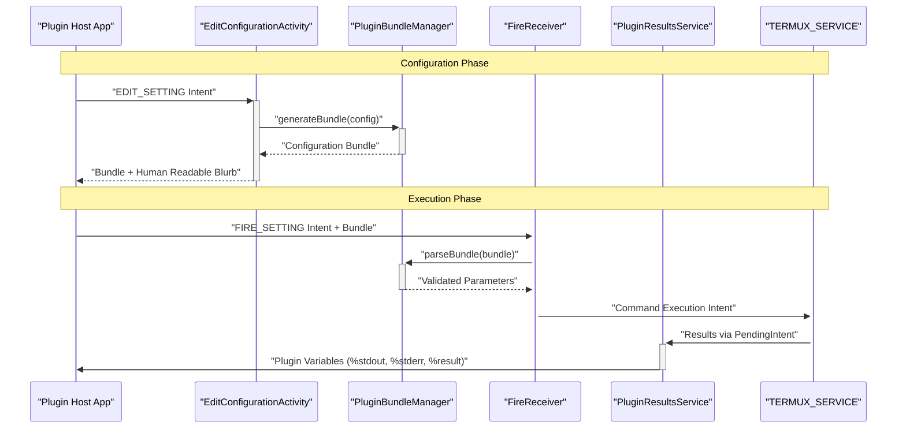
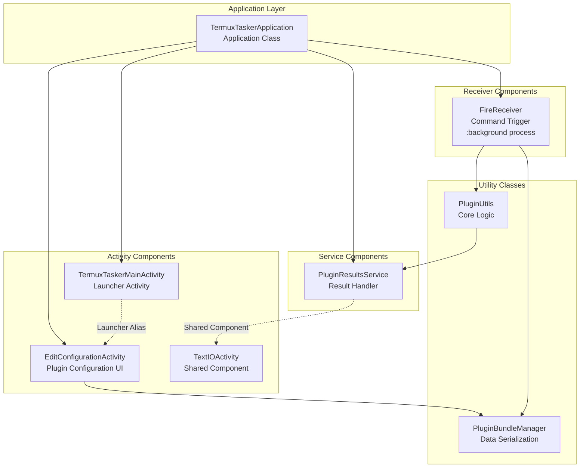
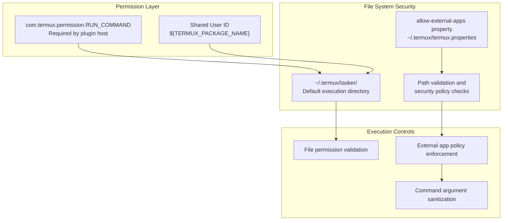

<!-- source: DeepWiki mcp.deepwiki.com · repo termux/termux-tasker · page 2 Architecture · fetched 2026-10-26 -->

# Architecture

Relevant source files

The following files were used as context for generating this wiki page:

- [LICENSE.md](LICENSE.md)
- [README.md](README.md)
- [app/src/main/AndroidManifest.xml](app/src/main/AndroidManifest.xml)
- [fastlane/metadata/android/en-US/changelogs/6.txt](fastlane/metadata/android/en-US/changelogs/6.txt)
- [fastlane/metadata/android/en-US/changelogs/7.txt](fastlane/metadata/android/en-US/changelogs/7.txt)

This document describes the high-level system architecture of the Termux:Tasker plugin, including how it integrates with plugin host applications (Tasker, Locale) and the Termux ecosystem to enable command execution capabilities. For details on specific user interface components, see [User Interface](#3). For implementation details of security mechanisms, see [Security Model](#5.2).

## System Overview

Termux:Tasker is an Android plugin application that acts as a bridge between automation apps (plugin hosts) and the Termux terminal environment. The architecture follows the standard Android plugin model using intent-based communication while implementing additional security layers and command execution orchestration.

**Architecture Overview**
Sources: [app/src/main/AndroidManifest.xml:1-85](), [README.md:1-394]()

## Plugin Integration Model

The plugin implements the standard Locale/Tasker plugin API using two primary intent actions for configuration and execution phases.

**Plugin Integration Sequence**
Sources: [app/src/main/AndroidManifest.xml:39-51](), [app/src/main/AndroidManifest.xml:69-78]()

### Intent Actions and Permissions

The plugin registers for two standard intent actions defined by the Locale plugin specification:

- **EDIT_SETTING**: `com.twofortyfouram.locale.intent.action.EDIT_SETTING` handled by `EditConfigurationActivity`
- **FIRE_SETTING**: `com.twofortyfouram.locale.intent.action.FIRE_SETTING` handled by `FireReceiver`

The `FireReceiver` requires the `com.termux.permission.RUN_COMMAND` permission to prevent unauthorized command execution.

Sources: [app/src/main/AndroidManifest.xml:49](), [app/src/main/AndroidManifest.xml:76](), [app/src/main/AndroidManifest.xml:73]()

## Core Application Components

The plugin application consists of standard Android components organized around the plugin lifecycle and command execution flow.

**Core Component Architecture**
Sources: [app/src/main/AndroidManifest.xml:8](), [app/src/main/AndroidManifest.xml:40](), [app/src/main/AndroidManifest.xml:16](), [app/src/main/AndroidManifest.xml:70](), [app/src/main/AndroidManifest.xml:82]()

### Component Responsibilities

| Component | Process | Exported | Purpose |
|-----------|---------|----------|---------|
| `TermuxTaskerApplication` | Main | N/A | Application lifecycle management |
| `EditConfigurationActivity` | Main | Yes | Plugin configuration interface |
| `TermuxTaskerMainActivity` | Main | Yes | Main launcher activity |
| `FireReceiver` | `:background` | Yes | Command execution trigger |
| `PluginResultsService` | Main | No | Result processing and delivery |

The `FireReceiver` runs in a separate `:background` process to handle command execution without blocking the main UI thread.

Sources: [app/src/main/AndroidManifest.xml:72](), [app/src/main/AndroidManifest.xml:41](), [app/src/main/AndroidManifest.xml:17](), [app/src/main/AndroidManifest.xml:83]()

## Security and Permission Model

The plugin implements a multi-layered security model to control command execution and file system access.

**Security Architecture**
Sources: [app/src/main/AndroidManifest.xml:4](), [app/src/main/AndroidManifest.xml:73](), [README.md:66-87]()

### Permission Requirements

1. **RUN_COMMAND Permission**: Plugin host apps must be granted `com.termux.permission.RUN_COMMAND` to execute any commands
2. **Shared User ID**: Both Termux and Termux:Tasker share the same user ID (`${TERMUX_PACKAGE_NAME}`) for file system access
3. **External Apps Policy**: Commands outside `~/.termux/tasker/` require `allow-external-apps=true` in termux properties

Sources: [README.md:67-72](), [README.md:84-87]()

## Data Flow and Bundle Management

Plugin configuration and execution data flows through a centralized bundle management system that handles serialization, validation, and security policy enforcement.

```mermaid
graph LR
    subgraph "Configuration Input"
        UserInput["User Configuration<br/>EditConfigurationActivity"]
        ConfigFields["Executable, Arguments<br/>Working Directory, Stdin<br/>Session Action, Log Level"]
    end
    
    subgraph "Bundle Processing"
        BundleGen["generateBundle()<br/>PluginBundleManager"]
        BundleValidation["parseBundle()<br/>Validation & Security"]
        BlurbGen["generateBlurb()<br/>Human-readable summary"]
    end
    
    subgraph "Command Execution"
        ArgTokenizer["ArgumentTokenizer<br/>Argument parsing"]
        PathResolver["Path resolution<br/>$PREFIX, ~/ expansion"]
        SecurityCheck["Security policy<br/>validation"]
    end
    
    subgraph "Result Processing"
        PluginVars["Plugin Variables<br/>%stdout, %stderr, %result<br/>%err, %errmsg"]
        HostResponse["Host app response<br/>TaskerPlugin API"]
    end
    
    UserInput --> ConfigFields
    ConfigFields --> BundleGen
    BundleGen --> BundleValidation
    BundleGen --> BlurbGen
    BundleValidation --> ArgTokenizer
    ArgTokenizer --> PathResolver
    PathResolver --> SecurityCheck
    SecurityCheck --> PluginVars
    PluginVars --> HostResponse
```

**Data Flow Architecture**
Sources: [README.md:132-217](), [README.md:222-255]()

### Bundle Structure and Variables

The plugin uses Android Bundle objects to serialize configuration data between the host app and plugin components. Key configuration parameters include:

- **Executable**: Script path or command (supports `$PREFIX/`, `~/` prefixes)
- **Arguments**: Command arguments processed by `ArgumentTokenizer`
- **Working Directory**: Command execution directory
- **Stdin**: Script content for dynamic execution
- **Session Action**: Terminal session behavior control
- **Log Level**: Custom logging configuration

Result data is returned to the host app through plugin variables with automatic truncation handling for large outputs.

Sources: [README.md:138-217](), [README.md:226-255]()

---

