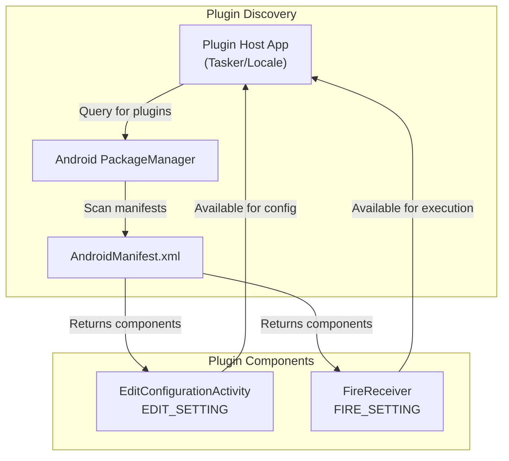
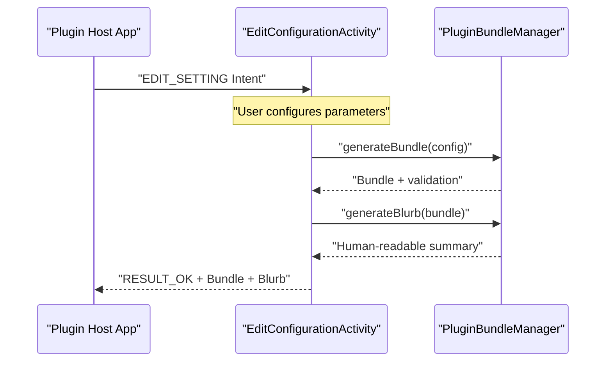
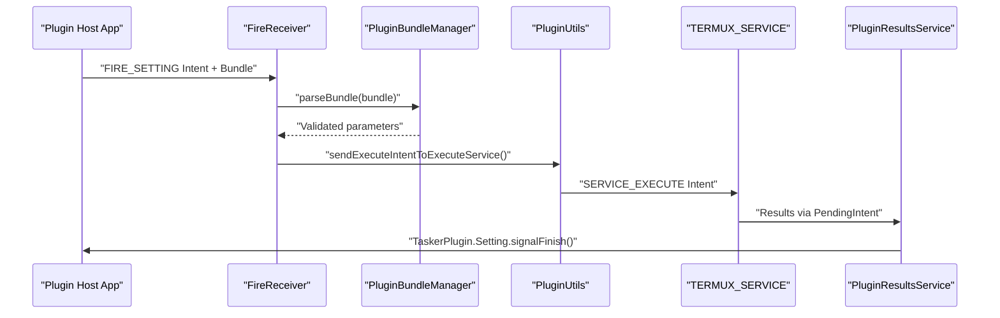
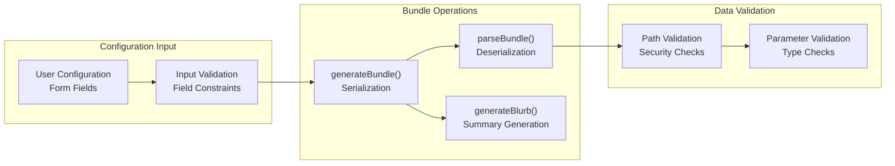
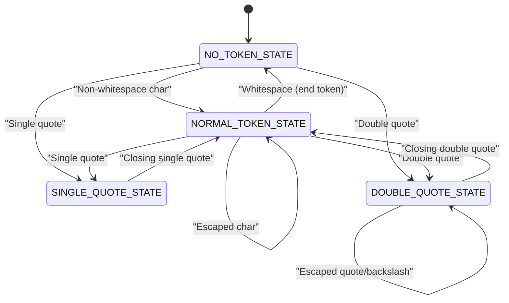
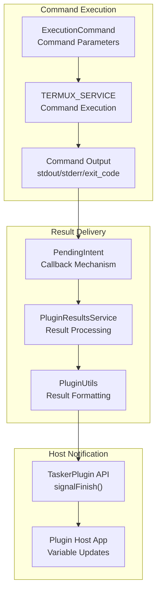
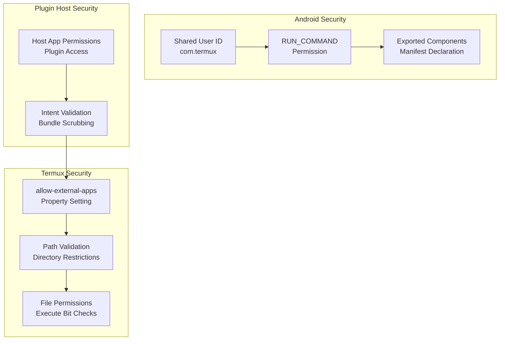

<!-- source: DeepWiki mcp.deepwiki.com · repo termux/termux-tasker · page 2.1 Plugin Integration Model · fetched 2026-10-26 -->

# Plugin Integration Model

Relevant source files

The following files were used as context for generating this wiki page:

- [app/src/main/AndroidManifest.xml](app/src/main/AndroidManifest.xml)
- [app/src/main/java/com/termux/tasker/ArgumentTokenizer.java](app/src/main/java/com/termux/tasker/ArgumentTokenizer.java)
- [app/src/main/java/com/termux/tasker/FireReceiver.java](app/src/main/java/com/termux/tasker/FireReceiver.java)
- [app/src/main/res/values/strings.xml](app/src/main/res/values/strings.xml)

This document explains how the Termux:Tasker plugin integrates with plugin host applications such as Tasker and other Locale-compatible automation apps. It covers the standard plugin API implementation, intent-based communication flow, data serialization mechanisms, and result handling patterns.

For detailed information about the plugin's core components and their specific responsibilities, see [Core Components](#2.2). For security aspects of the integration model, see [Security Model](#5.2).

## Plugin API Overview

The Termux:Tasker plugin implements the standard Locale plugin API, which defines a two-phase integration model for automation apps. This API uses Android's intent system to facilitate communication between plugin host applications and plugin implementations.

The integration is built around two primary intent actions that define the plugin lifecycle:

| Intent Action | Purpose | Handled By |
|---------------|---------|------------|
| `com.twofortyfouram.locale.intent.action.EDIT_SETTING` | Configuration phase | `EditConfigurationActivity` |
| `com.twofortyfouram.locale.intent.action.FIRE_SETTING` | Execution phase | `FireReceiver` |

### Plugin Discovery and Registration

Plugin host applications discover available plugins by querying the Android system for activities and broadcast receivers that declare intent filters for the Locale API actions. The plugin registers itself through manifest declarations that make it discoverable by automation apps.

Sources: [app/src/main/AndroidManifest.xml:39-51](), [app/src/main/AndroidManifest.xml:69-78]()

## Intent-Based Communication Flow

The plugin integration follows a structured communication pattern using Android intents to exchange data and trigger actions between the plugin host and the Termux:Tasker plugin.

### Configuration Phase Flow

During configuration, the plugin host application launches the `EditConfigurationActivity` to allow users to configure plugin parameters. The activity returns a serialized configuration bundle and a human-readable description.

### Execution Phase Flow

When the plugin host determines that a configured action should execute, it sends a `FIRE_SETTING` intent to the `FireReceiver` with the previously configured bundle data.

Sources: [app/src/main/java/com/termux/tasker/FireReceiver.java:35-198]()

## Data Serialization and Bundle Management

The plugin uses Android's `Bundle` mechanism to serialize configuration data for transmission between the plugin host and the plugin implementation. The `PluginBundleManager` class handles all aspects of bundle creation, validation, and parsing.

### Bundle Structure

The plugin defines specific bundle keys for different configuration parameters:

| Bundle Key | Purpose | Data Type |
|------------|---------|-----------|
| `EXTRA_EXECUTABLE` | Path to executable file | String |
| `EXTRA_ARGUMENTS` | Command line arguments | String |
| `EXTRA_WORKDIR` | Working directory path | String |
| `EXTRA_STDIN` | Standard input data | String |
| `EXTRA_TERMINAL` | Execute in terminal flag | Boolean |
| `EXTRA_WAIT_FOR_RESULT` | Wait for completion flag | Boolean |
| `EXTRA_SESSION_ACTION` | Terminal session action | String |
| `EXTRA_BACKGROUND_CUSTOM_LOG_LEVEL` | Custom log level | Integer |

### Bundle Processing Pipeline

Sources: [app/src/main/java/com/termux/tasker/FireReceiver.java:63-68](), [app/src/main/java/com/termux/tasker/FireReceiver.java:72-84]()

## Argument Processing and Tokenization

The plugin implements sophisticated argument parsing to handle command-line style arguments with proper quoting and escaping support. The `ArgumentTokenizer` class provides shell-like argument parsing capabilities.

### Tokenization Features

The argument tokenizer supports:
- Single and double quote handling
- Backslash escaping within double quotes
- Whitespace separation with quote preservation
- State machine-based parsing for robust handling

Sources: [app/src/main/java/com/termux/tasker/ArgumentTokenizer.java:61-187](), [app/src/main/java/com/termux/tasker/FireReceiver.java:170-177]()

## Result Handling and Callbacks

The plugin implements asynchronous result handling to support long-running commands and provide feedback to plugin host applications. Results are delivered through a `PendingIntent` mechanism that allows the Termux service to callback to the plugin.

### Result Processing Flow

### Plugin Variables

The plugin exposes command execution results through standardized variable names that plugin host applications can access:

| Variable Name | Content | Description |
|---------------|---------|-------------|
| `%stdout` | Command standard output | Text written to stdout |
| `%stderr` | Command standard error | Text written to stderr |
| `%result` | Exit code | Numeric exit status |
| `%err` | Error flag | Boolean success/failure |
| `%errmsg` | Error message | Human-readable error description |

Sources: [app/src/main/java/com/termux/tasker/FireReceiver.java:183-197]()

## Security and Permission Integration

The plugin integration model incorporates multiple security layers to ensure safe execution of commands and proper permission handling.

### Permission Model

The plugin implements the `BundleScrubber` pattern to sanitize incoming intent data and prevent malicious bundle manipulation. Additionally, path validation ensures that executables are either in the designated Termux tasker directory or explicitly allowed through the `allow-external-apps` property.

Sources: [app/src/main/AndroidManifest.xml:73](), [app/src/main/java/com/termux/tasker/FireReceiver.java:58-60](), [app/src/main/java/com/termux/tasker/FireReceiver.java:111-118]()

---

