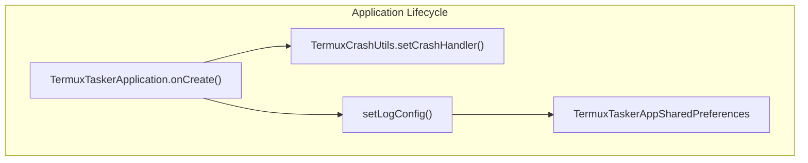
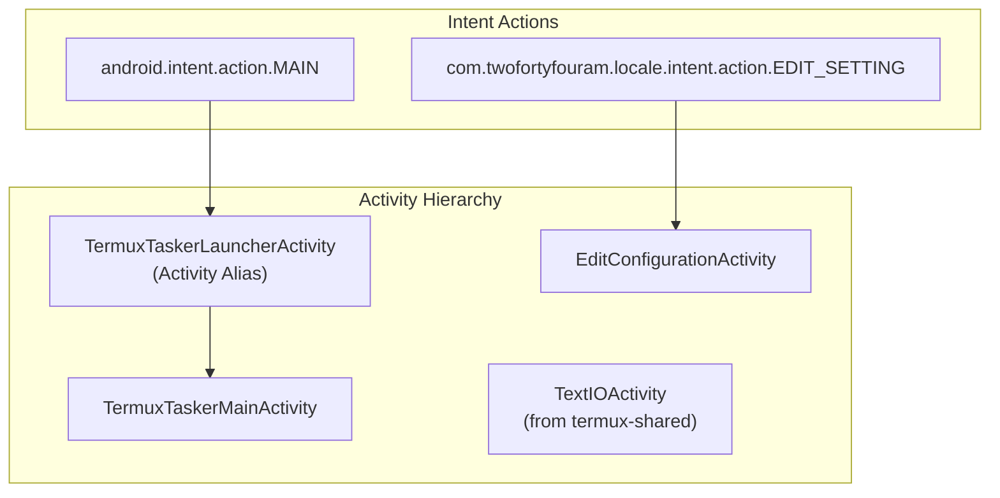
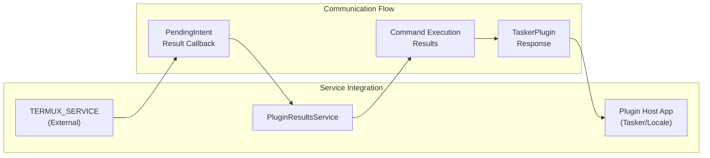
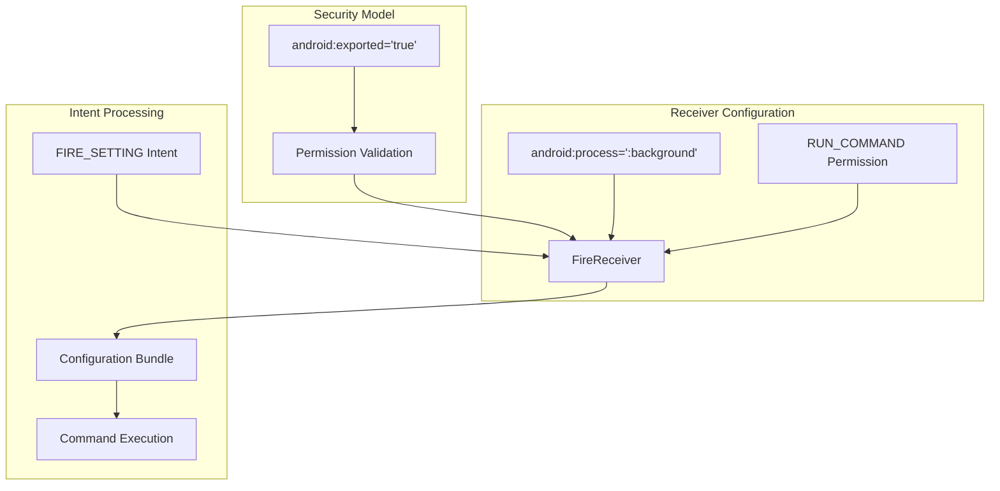
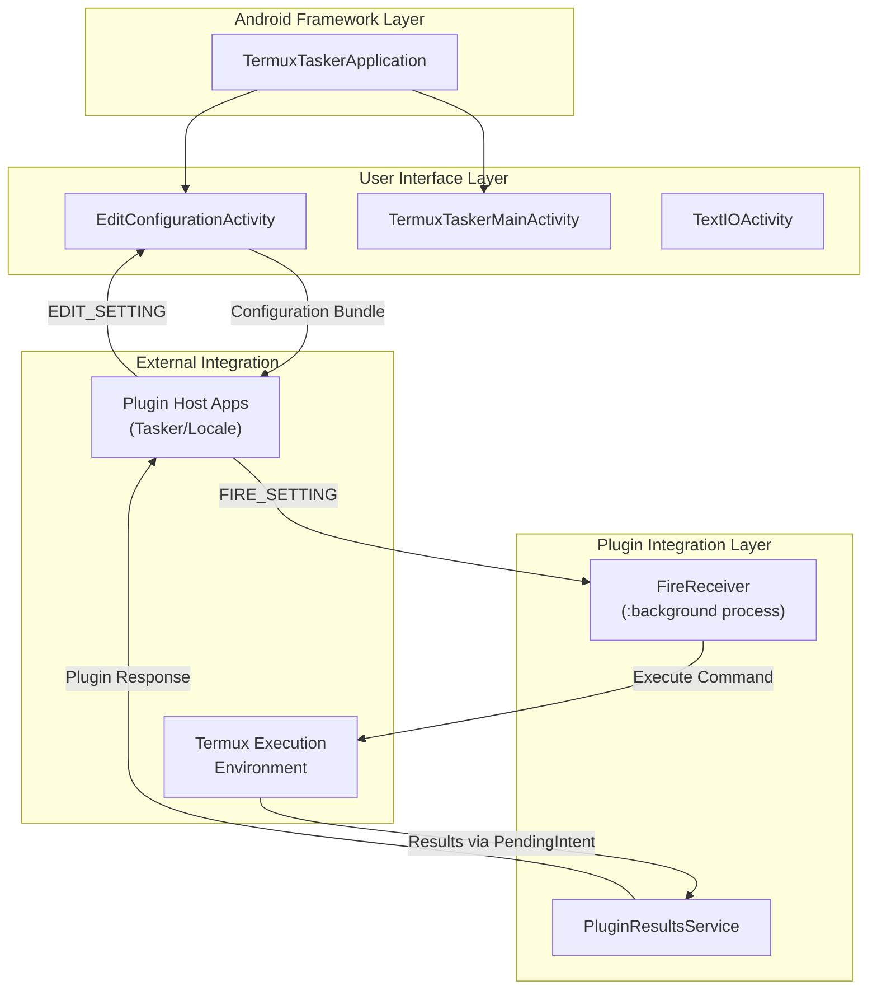
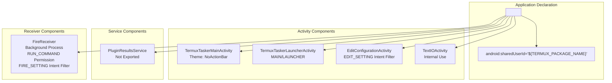

<!-- source: DeepWiki mcp.deepwiki.com · repo termux/termux-tasker · page 2.2 Core Components · fetched 2026-10-26 -->

# Core Components

Relevant source files

The following files were used as context for generating this wiki page:

- [app/src/main/AndroidManifest.xml](app/src/main/AndroidManifest.xml)
- [app/src/main/java/com/termux/tasker/TermuxTaskerApplication.java](app/src/main/java/com/termux/tasker/TermuxTaskerApplication.java)
- [app/src/main/java/com/termux/tasker/activities/TermuxTaskerMainActivity.java](app/src/main/java/com/termux/tasker/activities/TermuxTaskerMainActivity.java)
- [app/src/main/res/layout/activity_termux_tasker_main.xml](app/src/main/res/layout/activity_termux_tasker_main.xml)

This document provides an overview of the main Android application components that comprise the Termux:Tasker plugin architecture. It covers the fundamental Activities, Services, Broadcast Receivers, and Application class that enable the plugin's functionality. For detailed information about the plugin's integration with external apps, see [Plugin Integration Model](#2.1). For the complete command execution lifecycle, see [Command Execution Flow](#2.3).

## Application Class

The `TermuxTaskerApplication` class serves as the central application entry point and handles global initialization tasks for the plugin.

**Application Initialization**

The application class performs several critical initialization tasks:

- **Crash Handling**: Sets up crash reporting via `TermuxCrashUtils.setCrashHandler()` to capture and log application crashes
- **Logging Configuration**: Configures the global logging system with appropriate log levels and tags based on user preferences
- **Shared Preferences**: Initializes access to application-wide settings and preferences

**Sources:** [app/src/main/java/com/termux/tasker/TermuxTaskerApplication.java:12-39](), [app/src/main/AndroidManifest.xml:7-13]()

## Activities

The plugin contains several Activity components that handle different aspects of the user interface and plugin integration.

### Main Activity Components

**TermuxTaskerMainActivity**

The primary user interface activity that provides:

- Application information display with links to GitHub repositories
- Launcher icon management functionality (enable/disable launcher visibility)
- Theme configuration and night mode support
- Integration with the termux-shared toolbar and styling system

**EditConfigurationActivity**

The plugin configuration interface that integrates with Tasker/Locale apps:

- Receives `EDIT_SETTING` intents from plugin host applications
- Provides user interface for configuring plugin execution parameters
- Exports plugin configuration data back to host applications
- Must meet specific Locale plugin requirements (exported, labeled, icon)

**Activity Aliases and Launcher Integration**

The `TermuxTaskerLauncherActivity` is an activity-alias that allows users to hide/show the application launcher icon while maintaining the same target activity.

**Sources:** [app/src/main/AndroidManifest.xml:15-59](), [app/src/main/java/com/termux/tasker/activities/TermuxTaskerMainActivity.java:19-100]()

## Services

### PluginResultsService

The `PluginResultsService` handles asynchronous communication between the Termux execution environment and the plugin host applications.

**Key Characteristics:**

- **Non-exported Service**: Configured with `android:exported="false"` for internal use only
- **Result Processing**: Receives execution results from Termux services via PendingIntent callbacks
- **Host Communication**: Formats and delivers results back to plugin host applications
- **Asynchronous Operation**: Enables non-blocking command execution with result delivery

**Sources:** [app/src/main/AndroidManifest.xml:80-83]()

## Broadcast Receivers

### FireReceiver

The `FireReceiver` is the primary execution trigger component that receives and processes plugin activation requests from host applications.

**Process Isolation**

The receiver runs in a separate background process (`:background`) to isolate plugin execution from the main application process.

**Permission Model**

- **Required Permission**: `${TERMUX_PACKAGE_NAME}.permission.RUN_COMMAND` 
- **Exported Component**: Must be publicly accessible to plugin host applications
- **Security Validation**: Ensures only authorized applications can trigger plugin execution

**Intent Handling**

Processes `FIRE_SETTING` intents containing:
- Plugin configuration bundles
- Execution parameters
- Host application context information

**Sources:** [app/src/main/AndroidManifest.xml:69-78]()

## Component Integration Architecture

**Process Architecture**

The plugin utilizes multiple processes for isolation and security:

- **Main Process**: Hosts the Application class and user interface activities
- **Background Process**: Runs the FireReceiver for command execution isolation
- **Service Process**: Handles result processing and communication with host apps

**Component Communication**

- **Inter-Process Communication**: Uses Android's Intent system and PendingIntent callbacks
- **Data Serialization**: Configuration data flows through Bundle objects between components
- **Permission Boundaries**: Each component enforces appropriate permission requirements

**Sources:** [app/src/main/AndroidManifest.xml:1-86]()

## Manifest Structure and Component Declaration

**Shared User Configuration**

The application runs under the same user ID as the main Termux application (`${TERMUX_PACKAGE_NAME}`) enabling:
- Shared file system access
- Inter-process communication with Termux services
- Consistent permission model across the Termux ecosystem

**Component Export Rules**

- **Exported Activities**: `TermuxTaskerMainActivity`, `EditConfigurationActivity`, and launcher alias for external access
- **Exported Receiver**: `FireReceiver` for plugin host integration
- **Non-exported Service**: `PluginResultsService` for internal result processing only
- **Non-exported Activity**: `TextIOActivity` for internal text I/O operations

**Sources:** [app/src/main/AndroidManifest.xml:1-86]()

---

