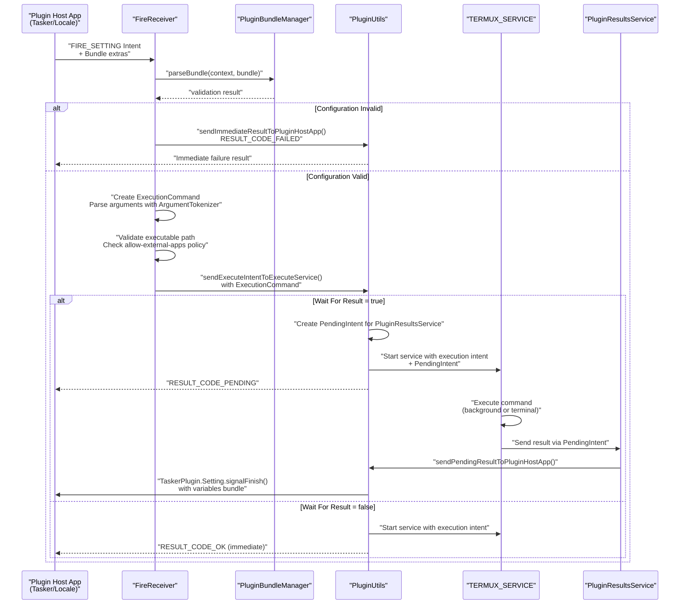
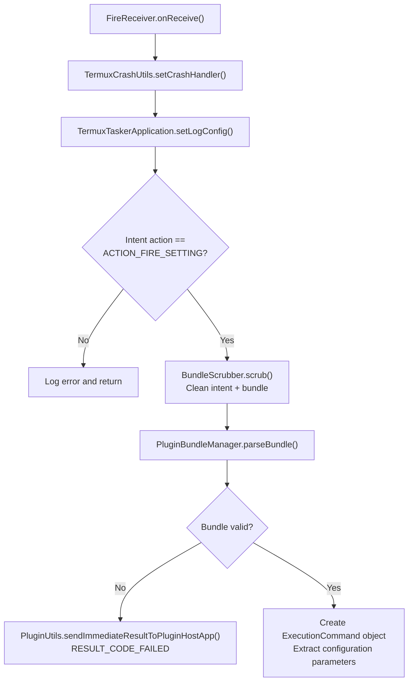
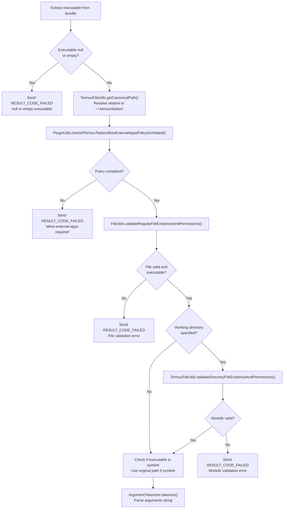
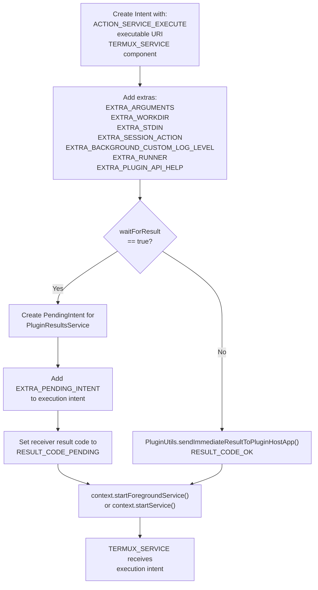
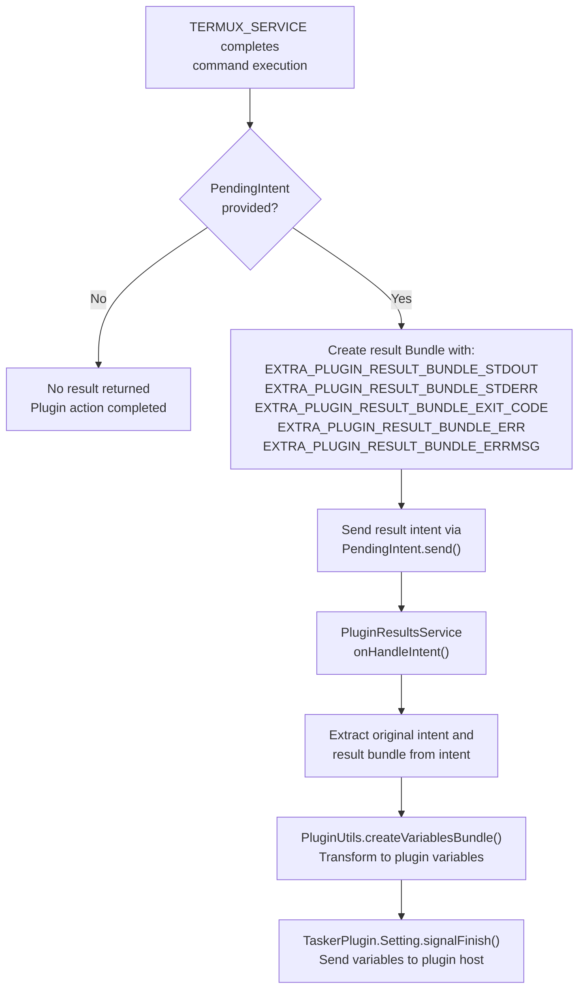
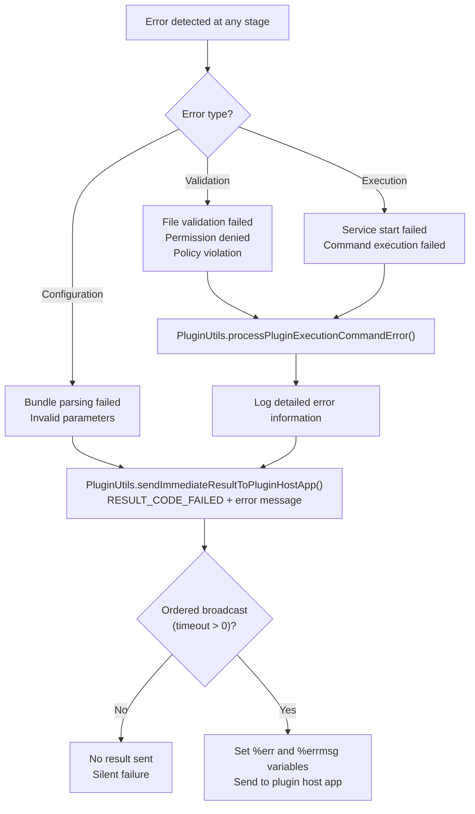

<!-- source: DeepWiki mcp.deepwiki.com · repo termux/termux-tasker · page 2.3 Command Execution Flow · fetched 2026-10-26 -->

# Command Execution Flow

Relevant source files

The following files were used as context for generating this wiki page:

- [LICENSE.md](LICENSE.md)
- [README.md](README.md)
- [app/src/main/java/com/termux/tasker/ArgumentTokenizer.java](app/src/main/java/com/termux/tasker/ArgumentTokenizer.java)
- [app/src/main/java/com/termux/tasker/FireReceiver.java](app/src/main/java/com/termux/tasker/FireReceiver.java)
- [app/src/main/java/com/termux/tasker/utils/PluginUtils.java](app/src/main/java/com/termux/tasker/utils/PluginUtils.java)
- [fastlane/metadata/android/en-US/changelogs/6.txt](fastlane/metadata/android/en-US/changelogs/6.txt)
- [fastlane/metadata/android/en-US/changelogs/7.txt](fastlane/metadata/android/en-US/changelogs/7.txt)

This document describes the complete lifecycle of command execution in the Termux:Tasker plugin, from the initial trigger by a plugin host app through to the delivery of execution results. This covers the technical flow through the plugin's core components and their interactions with the Termux execution service.

For information about the plugin's integration model with host apps, see [Plugin Integration Model](#2.1). For details about the individual components mentioned here, see [Core Components](#2.2).

## Overview

The command execution flow follows a multi-stage process involving intent-based communication between the plugin components and the Termux execution service. The flow varies depending on whether results are expected to be returned synchronously and whether commands execute in background or terminal session mode.

## Execution Flow Sequence

The complete execution sequence involves several key phases: intent reception, configuration parsing, command preparation, execution service interaction, and result delivery.

Sources: [app/src/main/java/com/termux/tasker/FireReceiver.java:35-199](), [app/src/main/java/com/termux/tasker/utils/PluginUtils.java:153-208]()

## Intent Reception and Processing

The `FireReceiver` class serves as the entry point for all plugin execution requests. It receives `ACTION_FIRE_SETTING` intents from plugin host apps and performs initial processing.

### Initial Validation and Setup

The receiver performs several critical setup and validation steps:

Sources: [app/src/main/java/com/termux/tasker/FireReceiver.java:35-68]()

### ExecutionCommand Creation

The receiver extracts configuration parameters from the intent bundle and populates an `ExecutionCommand` object:

| Parameter | Bundle Key | ExecutionCommand Field | Notes |
|-----------|------------|----------------------|-------|
| Executable path | `EXTRA_EXECUTABLE` | `executable` | Required field |
| Arguments string | `EXTRA_ARGUMENTS` | Arguments processed via `ArgumentTokenizer` | Optional |
| Working directory | `EXTRA_WORKDIR` | `workingDirectory` | Optional |
| Terminal mode | `EXTRA_TERMINAL` | `runner` | Boolean: APP_SHELL vs TERMINAL_SESSION |
| Wait for result | `EXTRA_WAIT_FOR_RESULT` | Used by `PluginUtils` | Controls result handling |
| Stdin data | `EXTRA_STDIN` | `stdin` | Background mode only |
| Custom log level | `EXTRA_BACKGROUND_CUSTOM_LOG_LEVEL` | `backgroundCustomLogLevel` | Background mode only |
| Session action | `EXTRA_SESSION_ACTION` | `sessionAction` | Terminal mode only |

Sources: [app/src/main/java/com/termux/tasker/FireReceiver.java:70-84]()

## Command Preparation and Validation

### Path Resolution and Security Validation

Before execution, the plugin performs comprehensive validation of the executable path and enforces security policies:

Sources: [app/src/main/java/com/termux/tasker/FireReceiver.java:97-177](), [app/src/main/java/com/termux/tasker/utils/PluginUtils.java:507-520]()

### Argument Tokenization

The `ArgumentTokenizer` class processes the arguments string using shell-like parsing rules:

- Arguments split on whitespace unless quoted
- Single quotes preserve literal strings
- Double quotes allow escaping with backslashes
- Backslashes escape special characters in double-quoted strings

Sources: [app/src/main/java/com/termux/tasker/ArgumentTokenizer.java:61-187](), [app/src/main/java/com/termux/tasker/FireReceiver.java:174-177]()

## Execution Service Integration

### Intent Construction and Dispatch

Once validation completes, the plugin constructs an execution intent for the `TERMUX_SERVICE`:

Sources: [app/src/main/java/com/termux/tasker/FireReceiver.java:183-198](), [app/src/main/java/com/termux/tasker/utils/PluginUtils.java:153-208]()

### Execution Modes

The `TERMUX_SERVICE` executes commands in one of two modes based on the `runner` field:

| Mode | Runner Value | Execution Context | Result Handling |
|------|-------------|------------------|----------------|
| Background | `APP_SHELL` | Background shell process | Full stdout/stderr capture |
| Terminal | `TERMINAL_SESSION` | Foreground terminal session | Terminal transcript only |

## Result Processing and Delivery

### Result Flow Architecture

The plugin implements two distinct paths for handling execution results:

Sources: [app/src/main/java/com/termux/tasker/utils/PluginUtils.java:267-307]()

### Variable Bundle Creation

The plugin transforms execution results into standardized variables for the plugin host app:

| Plugin Variable | Source | Description |
|----------------|--------|-------------|
| `%stdout` | `EXTRA_PLUGIN_RESULT_BUNDLE_STDOUT` | Command standard output |
| `%stdout_original_length` | `EXTRA_PLUGIN_RESULT_BUNDLE_STDOUT_ORIGINAL_LENGTH` | Original stdout length before truncation |
| `%stderr` | `EXTRA_PLUGIN_RESULT_BUNDLE_STDERR` | Command standard error |
| `%stderr_original_length` | `EXTRA_PLUGIN_RESULT_BUNDLE_STDERR_ORIGINAL_LENGTH` | Original stderr length before truncation |
| `%result` | `EXTRA_PLUGIN_RESULT_BUNDLE_EXIT_CODE` | Command exit code |
| `%err` | Sanitized error code | Plugin execution status |
| `%errmsg` | `EXTRA_PLUGIN_RESULT_BUNDLE_ERRMSG` | Error message (if %err != OK) |

Sources: [app/src/main/java/com/termux/tasker/utils/PluginUtils.java:360-405](), [app/src/main/java/com/termux/tasker/utils/PluginUtils.java:115-128]()

## Error Handling Flow

The plugin implements comprehensive error handling at multiple stages:

Sources: [app/src/main/java/com/termux/tasker/utils/PluginUtils.java:324-342](), [app/src/main/java/com/termux/tasker/utils/PluginUtils.java:218-259]()

### Error Code Sanitization

The plugin sanitizes error codes to ensure compatibility with plugin host apps:

- Codes >= `RESULT_CODE_OK` (-1) are passed through unchanged
- Invalid codes are forced to `RESULT_CODE_OK` with warning logs
- Custom plugin error codes start from `RESULT_CODE_FAILED_PLUGIN_FIRST`

Sources: [app/src/main/java/com/termux/tasker/utils/PluginUtils.java:417-427]()

---

