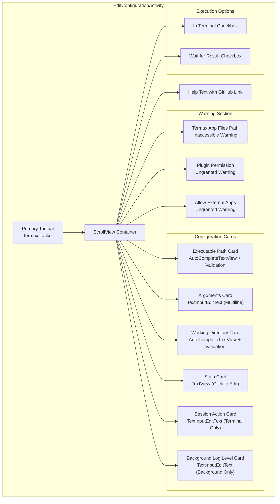
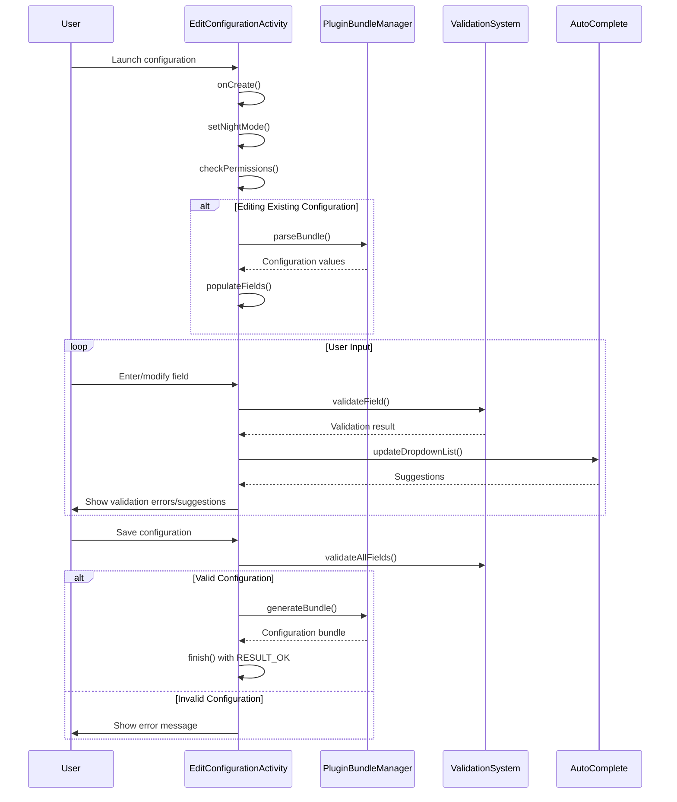
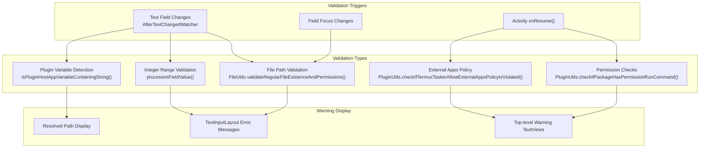

<!-- source: DeepWiki mcp.deepwiki.com · repo termux/termux-tasker · page 3 User Interface · fetched 2026-10-26 -->

# User Interface

Relevant source files

The following files were used as context for generating this wiki page:

- [app/src/main/java/com/termux/tasker/EditConfigurationActivity.java](app/src/main/java/com/termux/tasker/EditConfigurationActivity.java)
- [app/src/main/res/layout/activity_edit_configuration.xml](app/src/main/res/layout/activity_edit_configuration.xml)
- [app/src/main/res/menu/activity_edit_configuration.xml](app/src/main/res/menu/activity_edit_configuration.xml)
- [app/src/main/res/values/styles.xml](app/src/main/res/values/styles.xml)

## Purpose and Scope

The user interface system provides the configuration interface for Termux:Tasker plugin actions. This document covers the user-facing components that allow users to set up and configure plugin actions within Tasker or other Locale-compatible apps. For details about the underlying plugin architecture, see [Architecture](#2). For specific implementation details of the configuration activity, see [Configuration Activity](#3.1).

## Overview

The UI system is centered around a single main activity - `EditConfigurationActivity` - which presents a comprehensive configuration form. This activity handles both creating new plugin configurations and editing existing ones, providing real-time validation, auto-completion, and contextual warnings to guide users through the configuration process.

The interface follows Material Design principles and integrates with the Termux theming system to provide a consistent user experience across different Android versions and night mode settings.

## Configuration Interface Structure

The main configuration interface consists of several input sections organized in card views within a scrollable layout:

Sources: [app/src/main/res/layout/activity_edit_configuration.xml:1-376](), [app/src/main/java/com/termux/tasker/EditConfigurationActivity.java:59-135]()

## Configuration Workflow

The configuration workflow follows a standard plugin lifecycle with real-time validation and dynamic UI updates:

Sources: [app/src/main/java/com/termux/tasker/EditConfigurationActivity.java:92-195](), [app/src/main/java/com/termux/tasker/EditConfigurationActivity.java:657-750]()

## Input Field Types and Behaviors

### Path Input Fields

The executable path and working directory fields use `AutoCompleteTextView` with dynamic file system completion:

- **Executable Path**: Required field with dropdown showing available scripts from `~/.termux/tasker/` or current directory
- **Working Directory**: Optional field with directory-only completion
- **Real-time validation**: Path existence, permissions, and security policy checks
- **Absolute path display**: Shows resolved canonical path below input field

### Text Input Fields

- **Arguments**: Multi-line `TextInputEditText` supporting command line arguments
- **Session Action**: Integer input for terminal session actions (visible only in terminal mode)
- **Background Log Level**: Integer input for logging level (visible only in background mode)

### Special Input Fields

- **Stdin**: Read-only `TextView` that launches `TextIOActivity` for multi-line text editing with character count limits
- **Checkboxes**: Control execution mode and result handling behavior

Sources: [app/src/main/java/com/termux/tasker/EditConfigurationActivity.java:230-253](), [app/src/main/java/com/termux/tasker/EditConfigurationActivity.java:256-291]()

## Validation and Warning System

The UI implements a comprehensive validation system with real-time feedback:

Sources: [app/src/main/java/com/termux/tasker/EditConfigurationActivity.java:372-424](), [app/src/main/java/com/termux/tasker/EditConfigurationActivity.java:337-370](), [app/src/main/java/com/termux/tasker/EditConfigurationActivity.java:632-651]()

## Dynamic UI Behavior

The interface adapts based on user selections and system state:

### Execution Mode Dependencies

The "In Terminal" checkbox controls visibility of execution-specific options:

- **Terminal Mode** (`inTerminal = true`):
  - Stdin input field becomes hidden
  - Session Action field becomes visible
  - Background Log Level field becomes hidden

- **Background Mode** (`inTerminal = false`):
  - Stdin input field becomes visible
  - Session Action field becomes hidden
  - Background Log Level field becomes visible

### Auto-completion System

Both path input fields implement intelligent auto-completion:

- **Context-aware suggestions**: Based on current input and directory structure
- **Path expansion**: Supports `$PREFIX/` and `~/` shortcuts with proper expansion
- **Filtering**: Shows only relevant files (executables) or directories based on field type

Sources: [app/src/main/java/com/termux/tasker/EditConfigurationActivity.java:324-333](), [app/src/main/java/com/termux/tasker/EditConfigurationActivity.java:426-500]()

## Integration with Plugin System

The UI integrates tightly with the plugin bundle management system:

### Configuration Persistence

- **Bundle Generation**: User input is serialized into plugin bundle format via `PluginBundleManager.generateBundle()`
- **Bundle Parsing**: Existing configurations are loaded via `PluginBundleManager.parseBundle()`
- **Variable Support**: Fields marked for variable replacement by host apps are handled transparently

### Result Configuration

For actions configured to wait for results, the UI automatically configures Tasker variables:

- `%stdout` - Command standard output
- `%stderr` - Command standard error (background mode only)
- `%result` - Command exit code
- Additional metadata variables for output lengths

Sources: [app/src/main/java/com/termux/tasker/EditConfigurationActivity.java:687-713](), [app/src/main/java/com/termux/tasker/EditConfigurationActivity.java:719-738]()

---

