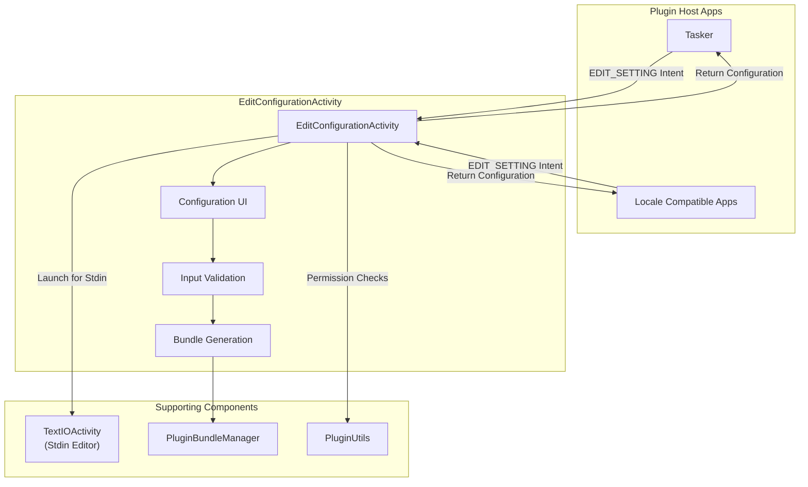
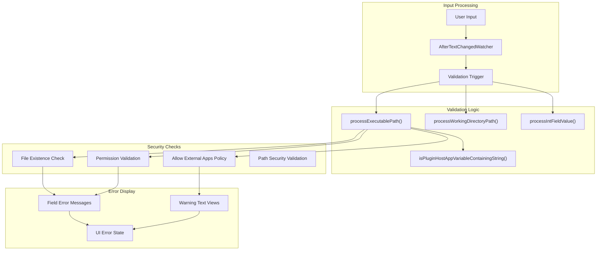
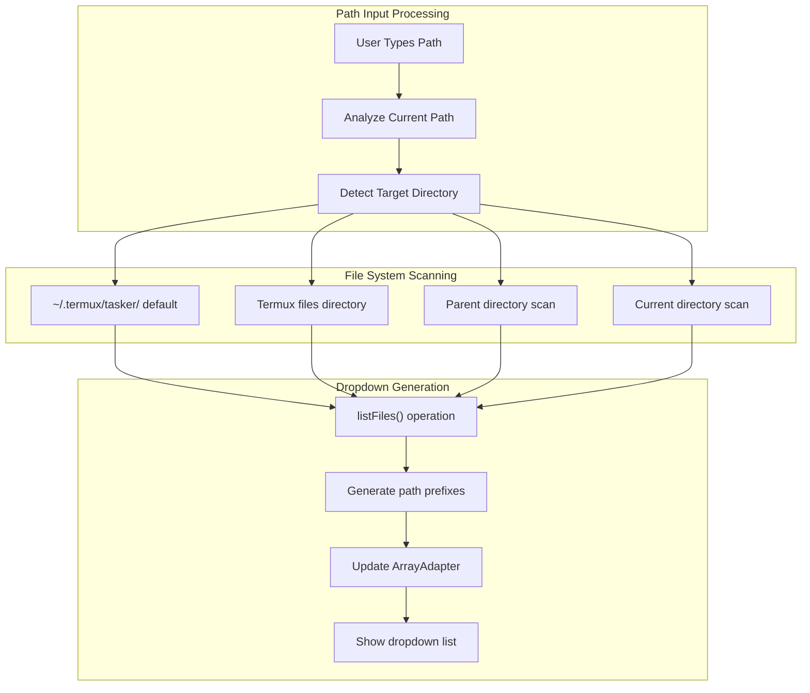
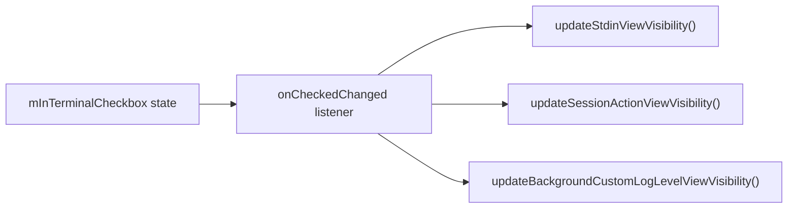
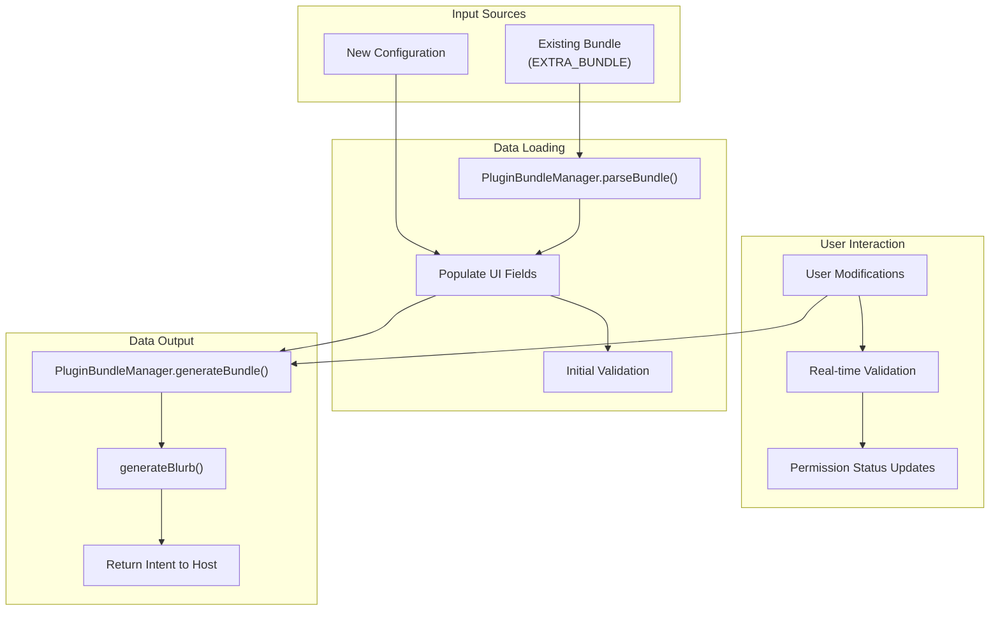

<!-- source: DeepWiki mcp.deepwiki.com · repo termux/termux-tasker · page 3.1 Configuration Activity · fetched 2026-10-26 -->

# Configuration Activity

Relevant source files

The following files were used as context for generating this wiki page:

- [LICENSE.md](LICENSE.md)
- [README.md](README.md)
- [app/src/main/java/com/termux/tasker/EditConfigurationActivity.java](app/src/main/java/com/termux/tasker/EditConfigurationActivity.java)
- [app/src/main/res/layout/activity_edit_configuration.xml](app/src/main/res/layout/activity_edit_configuration.xml)
- [app/src/main/res/menu/activity_edit_configuration.xml](app/src/main/res/menu/activity_edit_configuration.xml)
- [app/src/main/res/values/styles.xml](app/src/main/res/values/styles.xml)
- [fastlane/metadata/android/en-US/changelogs/6.txt](fastlane/metadata/android/en-US/changelogs/6.txt)
- [fastlane/metadata/android/en-US/changelogs/7.txt](fastlane/metadata/android/en-US/changelogs/7.txt)

## Purpose and Scope

This document covers the `EditConfigurationActivity` class and its associated UI components, which provide the primary user interface for configuring Termux:Tasker plugin actions. This activity allows users to specify executable paths, arguments, working directories, and other execution parameters when setting up plugin actions in host applications like Tasker or Locale.

For information about how the configured data is processed and executed, see [Command Execution Flow](#2.3). For details about the underlying data serialization mechanisms, see [Data Management and Serialization](#5.1).

## Activity Overview

The `EditConfigurationActivity` serves as the configuration interface between plugin host applications and the Termux:Tasker plugin. When users create or edit a Termux:Tasker action in Tasker, this activity is launched to gather the necessary configuration parameters.

Sources: [app/src/main/java/com/termux/tasker/EditConfigurationActivity.java:49-58](), [app/src/main/java/com/termux/tasker/EditConfigurationActivity.java:92-96]()

## UI Components and Configuration Fields

The configuration interface is organized into several card-based sections, each handling specific aspects of command execution configuration.

### Core UI Component Structure

```mermaid
graph TB
    subgraph "EditConfigurationActivity UI Components"
        ExecutableCard["Executable Path Card"]
        ArgumentsCard["Arguments Card"] 
        WorkingDirCard["Working Directory Card"]
        StdinCard["Stdin Card"]
        SessionCard["Session Action Card"]
        LogLevelCard["Log Level Card"]
        Checkboxes["Execution Options"]
        Warnings["Warning Messages"]
    end
    
    subgraph "UI Component Mappings"
        ExecutableCard --> mExecutablePathText["mExecutablePathText<br/>AutoCompleteTextView"]
        ExecutableCard --> mExecutablePathTextLayout["mExecutablePathTextLayout<br/>TextInputLayout"]
        ArgumentsCard --> mArgumentsText["mArgumentsText<br/>TextInputEditText"]
        WorkingDirCard --> mWorkingDirectoryPathText["mWorkingDirectoryPathText<br/>AutoCompleteTextView"]
        StdinCard --> mStdinView["mStdinView<br/>TextView (clickable)"]
        SessionCard --> mSessionAction["mSessionAction<br/>TextInputEditText"]
        LogLevelCard --> mBackgroundCustomLogLevel["mBackgroundCustomLogLevel<br/>TextInputEditText"]
        Checkboxes --> mInTerminalCheckbox["mInTerminalCheckbox<br/>CheckBox"]
        Checkboxes --> mWaitForResult["mWaitForResult<br/>CheckBox"]
    end
    
    subgraph "Warning Components"
        Warnings --> mTermuxAppFilesPathInaccessibleWarning["mTermuxAppFilesPathInaccessibleWarning"]
        Warnings --> mPluginPermissionUngrantedWarning["mPluginPermissionUngrantedWarning"] 
        Warnings --> mAllowExternalAppsUngrantedWarning["mAllowExternalAppsUngrantedWarning"]
    end
```

Sources: [app/src/main/java/com/termux/tasker/EditConfigurationActivity.java:61-77](), [app/src/main/res/layout/activity_edit_configuration.xml:60-370]()

### Configuration Fields

| Field | Component | Purpose | Validation |
|-------|-----------|---------|------------|
| **Executable Path** | `mExecutablePathText` | Specifies the command/script to execute | File existence, permissions, security policy |
| **Arguments** | `mArgumentsText` | Command line arguments | No validation (handled at execution) |
| **Working Directory** | `mWorkingDirectoryPathText` | Working directory for command execution | Directory existence and permissions |
| **Stdin** | `mStdinView` | Script content passed via stdin | Length limits (45K characters) |
| **Session Action** | `mSessionAction` | Terminal session behavior (0-3) | Integer range validation |
| **Log Level** | `mBackgroundCustomLogLevel` | Custom logging level (0-3) | Integer range validation |
| **Execute in Terminal** | `mInTerminalCheckbox` | Foreground vs background execution | Controls field visibility |
| **Wait for Result** | `mWaitForResult` | Whether to wait for command completion | Affects variable return behavior |

Sources: [app/src/main/java/com/termux/tasker/EditConfigurationActivity.java:118-134](), [app/src/main/res/layout/activity_edit_configuration.xml:74-357]()

## Input Validation and Error Handling

The activity implements comprehensive validation for user inputs, with different validation rules applied based on execution context and security policies.

### Validation Flow

Sources: [app/src/main/java/com/termux/tasker/EditConfigurationActivity.java:231-236](), [app/src/main/java/com/termux/tasker/EditConfigurationActivity.java:372-424](), [app/src/main/java/com/termux/tasker/EditConfigurationActivity.java:632-651]()

### Key Validation Methods

#### Executable Path Validation
The `processExecutablePath()` method performs multiple validation steps:

1. **Variable Detection**: Checks if input contains plugin host variables using `PluginUtils.isPluginHostAppVariableContainingString()`
2. **Path Canonicalization**: Converts relative paths to absolute paths using `TermuxFileUtils.getCanonicalPath()`
3. **File Validation**: Uses `FileUtils.validateRegularFileExistenceAndPermissions()` to check file properties
4. **Security Policy**: Validates external app access policy via `PluginUtils.checkIfTermuxTaskerAllowExternalAppsPolicyIsViolated()`

Sources: [app/src/main/java/com/termux/tasker/EditConfigurationActivity.java:372-424]()

#### Working Directory Validation
The `processWorkingDirectoryPath()` method validates directory paths:

1. **Path Processing**: Similar variable detection and canonicalization as executable paths
2. **Directory Validation**: Uses `TermuxFileUtils.validateDirectoryFileExistenceAndPermissions()`
3. **Permission Checks**: Validates read/write access to directories

Sources: [app/src/main/java/com/termux/tasker/EditConfigurationActivity.java:502-545]()

## Auto-Complete and Dropdown Functionality

The activity provides intelligent auto-complete functionality for file and directory paths through dynamic dropdown lists.

### Dropdown List Generation

Sources: [app/src/main/java/com/termux/tasker/EditConfigurationActivity.java:426-500](), [app/src/main/java/com/termux/tasker/EditConfigurationActivity.java:547-620]()

## Stdin Integration

The activity integrates with `TextIOActivity` to provide a dedicated interface for editing stdin content, particularly useful for defining scripts inline rather than as separate files.

### Stdin Configuration Process

The stdin functionality allows users to define scripts directly within the plugin configuration:

1. **Click Handler**: `mStdinView.setOnClickListener()` launches the text editor
2. **TextIOInfo Configuration**: Sets up editor parameters including character limits and styling
3. **Activity Result**: Handles returned text content via `ActivityResultLauncher`
4. **Bundle Limits**: Enforces Tasker's 100KB bundle size limit with 45K character stdin limit

Sources: [app/src/main/java/com/termux/tasker/EditConfigurationActivity.java:256-281](), [app/src/main/java/com/termux/tasker/EditConfigurationActivity.java:88-89]()

## Dynamic UI Visibility

The interface adapts based on execution mode selection, showing or hiding relevant configuration options.

### Visibility Control Logic

| Execution Mode | Stdin | Session Action | Background Log Level |
|----------------|-------|----------------|---------------------|
| **Background** (`!inTerminal`) | Visible | Hidden | Visible |
| **Terminal** (`inTerminal`) | Hidden | Visible | Hidden |

The `setInTerminalView()` method establishes a listener that dynamically updates field visibility:

Sources: [app/src/main/java/com/termux/tasker/EditConfigurationActivity.java:324-333](), [app/src/main/java/com/termux/tasker/EditConfigurationActivity.java:288-321]()

## Configuration Data Flow

The activity manages the complete lifecycle of configuration data from initial load to final bundle generation.

### Data Processing Pipeline

Sources: [app/src/main/java/com/termux/tasker/EditConfigurationActivity.java:145-195](), [app/src/main/java/com/termux/tasker/EditConfigurationActivity.java:657-701]()

## Permission and System Status Monitoring

The activity continuously monitors system state and permission requirements, displaying appropriate warnings to users.

### System Status Checks

The `onResume()` method triggers comprehensive system validation:

1. **Termux App Accessibility**: `checkIfPluginCanAccessTermuxApp()` verifies Termux installation and file system access
2. **Plugin Permissions**: `checkIfPluginHostHasPermissionRunCommand()` validates `RUN_COMMAND` permission
3. **Path Re-validation**: Re-processes executable and working directory paths for current system state

These checks ensure users receive immediate feedback about configuration issues that might prevent successful execution.

Sources: [app/src/main/java/com/termux/tasker/EditConfigurationActivity.java:197-205](), [app/src/main/java/com/termux/tasker/EditConfigurationActivity.java:337-370]()

---

