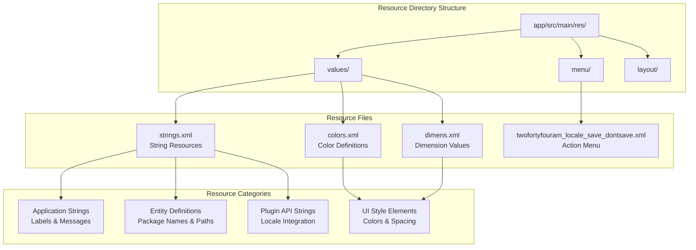
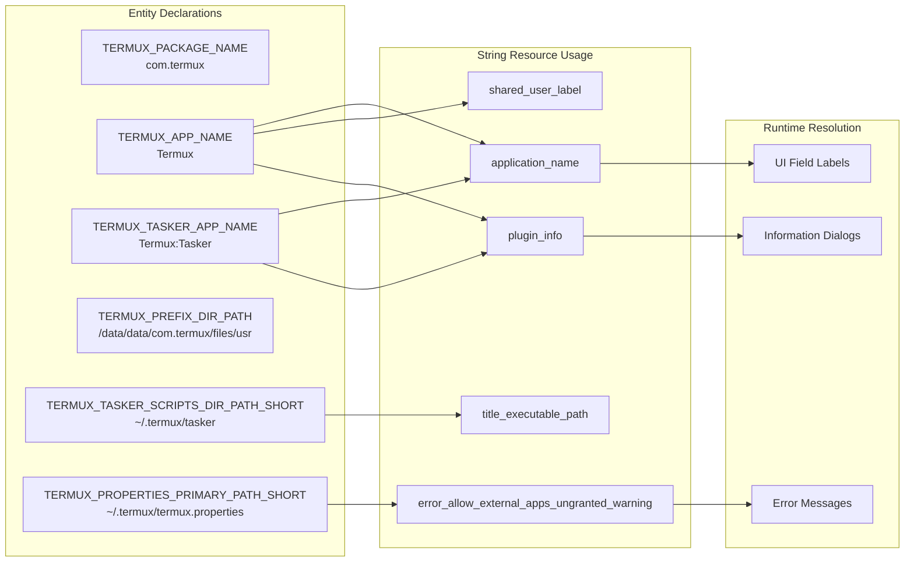
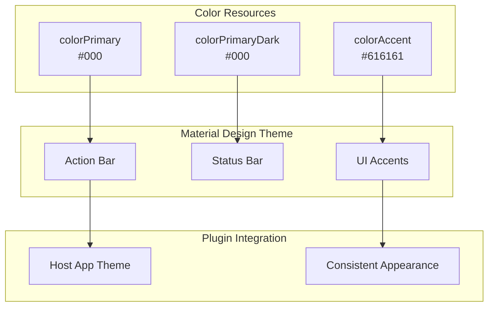
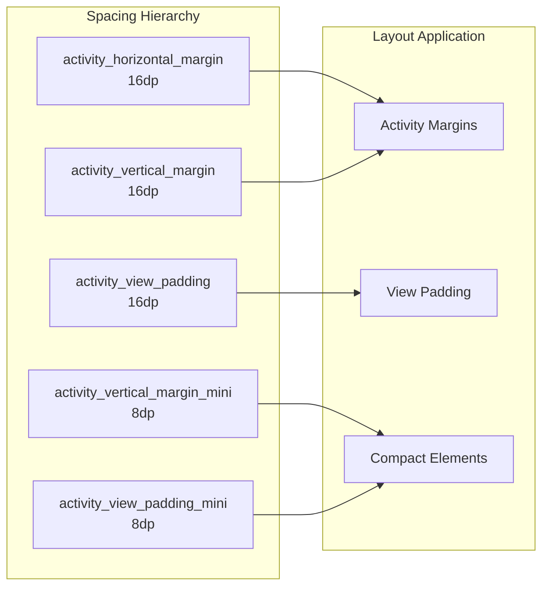
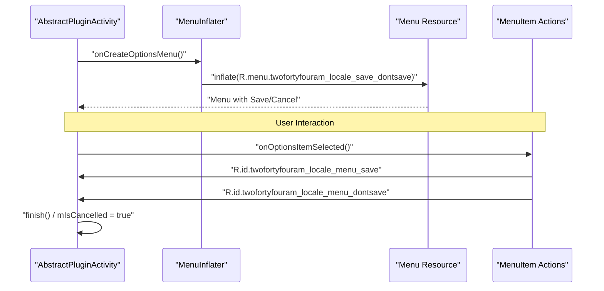
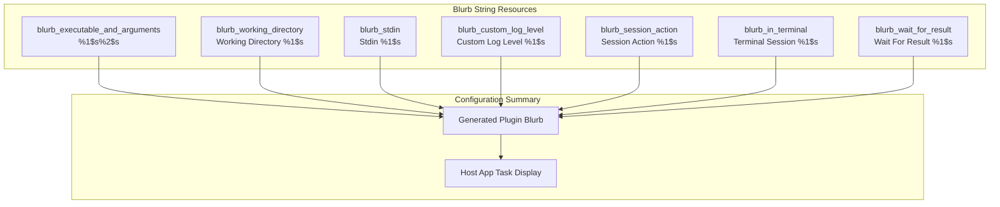

<!-- source: DeepWiki mcp.deepwiki.com · repo termux/termux-tasker · page 3.2 Resources and Styling · fetched 2026-10-26 -->

# Resources and Styling

Relevant source files

The following files were used as context for generating this wiki page:

- [app/src/main/java/com/termux/tasker/AbstractPluginActivity.java](app/src/main/java/com/termux/tasker/AbstractPluginActivity.java)
- [app/src/main/res/values/colors.xml](app/src/main/res/values/colors.xml)
- [app/src/main/res/values/dimens.xml](app/src/main/res/values/dimens.xml)
- [app/src/main/res/values/strings.xml](app/src/main/res/values/strings.xml)

This document covers the UI resources, styling elements, and visual design components that support the Termux:Tasker plugin's user interface. It details the resource file organization, string management, visual styling, and how these elements integrate with the application's activities and components.

For information about the UI components themselves and their behavior, see [Configuration Activity](#3.1). For details about the overall application architecture, see [Architecture](#2).

## Resource File Organization

The plugin's resources are organized following Android's standard resource directory structure, with specialized files for different types of UI elements and configuration data.

Sources: [app/src/main/res/values/strings.xml:1-76](), [app/src/main/res/values/colors.xml:1-6](), [app/src/main/res/values/dimens.xml:1-10]()

## String Resources and Entity Management

The string resources system uses XML entity definitions to centralize key values and maintain consistency across the application. This approach enables efficient management of package names, paths, and application identifiers.

### Entity Definition System

The entity system centralizes critical identifiers at [app/src/main/res/values/strings.xml:3-10](), allowing consistent reference throughout the application without hardcoded strings.

### String Resource Categories

| Category | Purpose | Key Resources |
|----------|---------|---------------|
| Application Identity | App names and labels | `application_name`, `shared_user_label`, `plugin_name` |
| Configuration Fields | UI field labels and hints | `title_executable_path`, `title_arguments`, `title_working_directory_path` |
| Error Messages | Validation and runtime errors | `error_executable_required`, `error_allow_external_apps_ungranted_warning` |
| Plugin Integration | Locale API compatibility | `twofortyfouram_locale_breadcrumb_format`, `twofortyfouram_locale_menu_save` |
| User Guidance | Help text and descriptions | `plugin_info`, `msg_change_launcher_activity_state_info` |

Sources: [app/src/main/res/values/strings.xml:15-19](), [app/src/main/res/values/strings.xml:38-45](), [app/src/main/res/values/strings.xml:50-61](), [app/src/main/res/values/strings.xml:71-75]()

## Visual Styling Resources

The application uses a minimal color scheme and consistent spacing to maintain visual coherence while integrating with the host application's UI.

### Color Definitions

The color scheme at [app/src/main/res/values/colors.xml:3-5]() uses black primary colors with a gray accent to maintain a neutral appearance that integrates well with plugin host applications.

### Dimension Standards

Sources: [app/src/main/res/values/dimens.xml:4-8]()

## Menu Resource Integration

The plugin integrates with the Locale plugin API's standard menu structure, providing consistent save/cancel functionality across plugin host applications.

### Menu Resource Usage

The menu integration occurs in [app/src/main/java/com/termux/tasker/AbstractPluginActivity.java:25]() where the `twofortyfouram_locale_save_dontsave` menu resource is inflated, providing the standard "Done" and "Cancel" options expected by plugin host applications.

### Locale API String Integration

The plugin includes specific string resources for Locale API compatibility:

| Resource ID | Purpose | Value |
|-------------|---------|--------|
| `twofortyfouram_locale_breadcrumb_format` | Navigation breadcrumb formatting | `%1$s%2$s%3$s` |
| `twofortyfouram_locale_breadcrumb_separator` | Breadcrumb separator character | `\u0020>\u0020` |
| `twofortyfouram_locale_menu_dontsave` | Cancel action label | "Cancel" |
| `twofortyfouram_locale_menu_save` | Save action label | "Done" |

Sources: [app/src/main/res/values/strings.xml:72-75](), [app/src/main/java/com/termux/tasker/AbstractPluginActivity.java:36-42]()

## Blurb Generation Resources

The plugin provides specialized string resources for generating human-readable summaries of plugin configurations, displayed in the host application's task list.

These blurb resources at [app/src/main/res/values/strings.xml:63-69]() are used by the `PluginBundleManager` to create concise, readable descriptions of plugin configurations that appear in the host application's interface.

Sources: [app/src/main/res/values/strings.xml:63-69]()

## Resource Localization Support

The string resource structure supports Android's localization framework, allowing for future internationalization while maintaining the entity-based architecture for consistent identifiers across locales.

The current implementation provides a foundation for localization through:
- Externalized string resources in `strings.xml`
- Entity-based system for locale-independent identifiers
- Locale API compatibility strings for international plugin hosts
- Separation of user-visible text from code logic

Sources: [app/src/main/res/values/strings.xml:1-76]()

---

