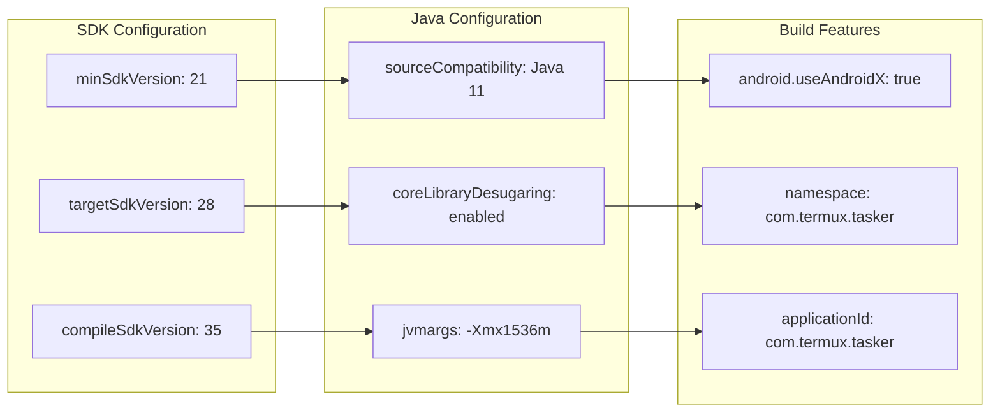
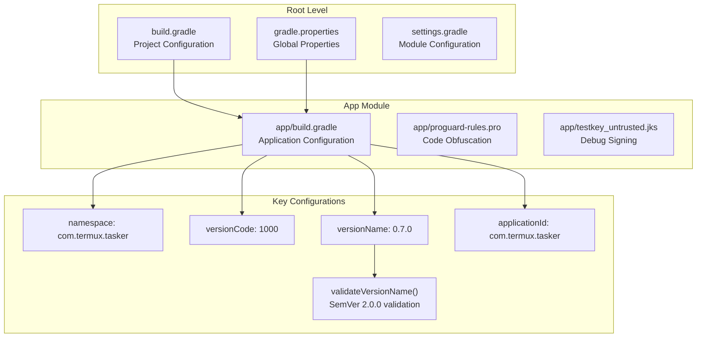
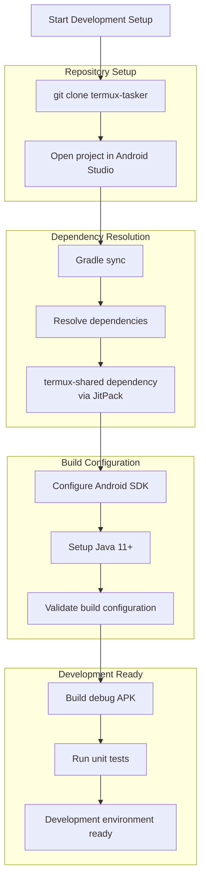
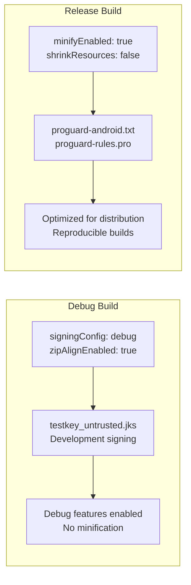

<!-- source: DeepWiki mcp.deepwiki.com · repo termux/termux-tasker · page 4 Development Guide · fetched 2026-10-26 -->

# Development Guide

<details>
<summary>Relevant source files</summary>

The following files were used as context for generating this wiki page:

- [app/build.gradle](app/build.gradle)
- [build.gradle](build.gradle)
- [gradle.properties](gradle.properties)

</details>


This guide provides essential information for developers working on the Termux:Tasker project, including development environment setup, build system overview, and development workflow. It covers the foundational aspects needed to contribute to the project effectively.

For detailed build system configuration, see [Build System](#4.1). For information about automated builds and releases, see [CI/CD Pipeline](#4.2). For testing procedures and quality assurance, see [Testing and Quality Assurance](#4.3).

## Prerequisites

### Development Environment

The project requires specific tools and configurations for Android development:

| Component | Requirement | Notes |
|-----------|-------------|-------|
| **Android Studio** | Latest stable version | Recommended IDE with full Android support |
| **JDK** | Java 11 or higher | Required for compilation and core library desugaring |
| **Android SDK** | API 21+ (minimum), API 35 (compile) | Configured via SDK Manager |
| **Git** | Any recent version | Version control and repository management |

### System Requirements

The build system is configured with the following specifications:



Sources: [gradle.properties:20-22](), [app/build.gradle:47-53](), [app/build.gradle:4](), [app/build.gradle:11]()

## Project Structure

### Build Configuration Hierarchy

The project uses a standard Android Gradle build structure with custom configurations:



Sources: [build.gradle:1-24](), [app/build.gradle:3-23](), [app/build.gradle:106-111]()

## Development Workflow

### Environment Setup Process

Setting up the development environment involves several interconnected steps:



Sources: [app/build.gradle:82](), [app/build.gradle:69-98](), [gradle.properties:20-22]()

### Version Management

The project implements strict semantic versioning with automated validation:

| Configuration | Value | Purpose |
|---------------|-------|---------|
| `versionCode` | 1000 | Internal Android version identifier |
| `versionName` | "0.7.0" | Public-facing semantic version |
| Environment Override | `TERMUX_TASKER_APP__BUILD__APP_VERSION_NAME` | CI/CD version injection |
| Validation | SemVer 2.0.0 regex | Ensures proper version format |

The version validation function at [app/build.gradle:106-111]() enforces strict SemVer compliance using the official regex pattern from semver.org.

## Key Development Dependencies

### Core Libraries

The project depends on several key libraries that developers should understand:

| Library | Purpose | Version/Source |
|---------|---------|----------------|
| **termux-shared** | Core Termux functionality and utilities | `da3a0ac4e2` via JitPack |
| **AndroidX AppCompat** | Android compatibility support | 1.7.0 |
| **Material Components** | Material Design UI components | 1.12.0 |
| **Google Guava** | Utility library for Java | 24.1-jre |
| **Core Library Desugaring** | Java 8+ API support on older Android | 1.1.5 |

### Testing Dependencies

| Library | Purpose | Scope |
|---------|---------|-------|
| **JUnit** | Unit testing framework | Test implementation |
| **AndroidX Test Ext** | Android testing extensions | Android test |
| **AndroidX Test Runner** | Test execution framework | Android test |

Sources: [app/build.gradle:69-98]()

## Build Variants and Signing

### Build Types

The project supports two build types with distinct configurations:



Sources: [app/build.gradle:25-45]()

### APK Naming Convention

APK files follow a standardized naming pattern: `termux-tasker-app_[version-tag].apk`, where version-tag is either:
- Environment variable `TERMUX_TASKER_APP__BUILD__APK_VERSION_TAG` (for CI builds)
- Fallback format: `v[versionName]+[buildType]` (for local builds)

This is configured at [app/build.gradle:55-60]().

## Common Development Tasks

### Building the Project

```bash
# Build debug APK
./gradlew assembleDebug

# Build release APK  
./gradlew assembleRelease

# Clean and rebuild
./gradlew clean build

# Get version name
./gradlew versionName
```

### Running Tests

```bash
# Run unit tests
./gradlew test

# Run Android instrumentation tests
./gradlew connectedAndroidTest

# Run all tests
./gradlew check
```

## Next Steps

This overview provides the foundation for Termux:Tasker development. For detailed information about specific aspects of the development process:

- **Build System Configuration**: See [Build System](#4.1) for comprehensive Gradle configuration details
- **Automated Builds and Releases**: See [CI/CD Pipeline](#4.2) for GitHub Actions workflows and artifact distribution  
- **Testing and Quality Assurance**: See [Testing and Quality Assurance](#4.3) for testing strategies and quality processes

Sources: [app/build.gradle:100-104](), [app/build.gradle:1-112](), [build.gradle:1-24](), [gradle.properties:1-23]()

---

