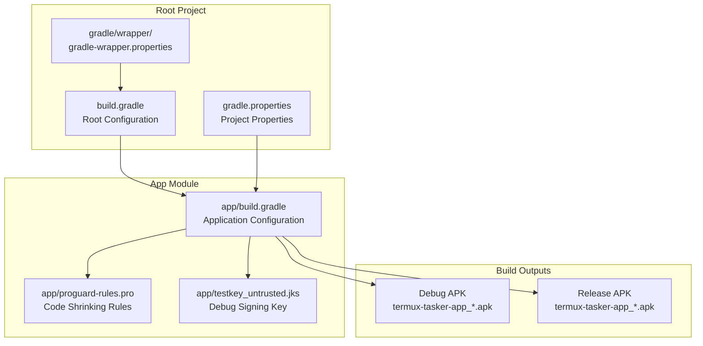
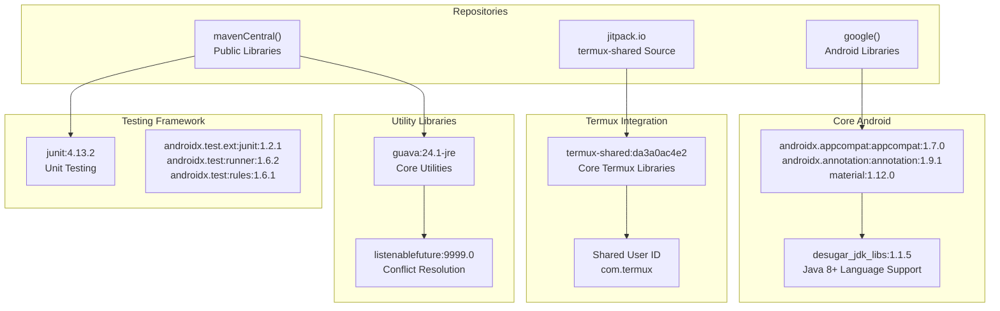
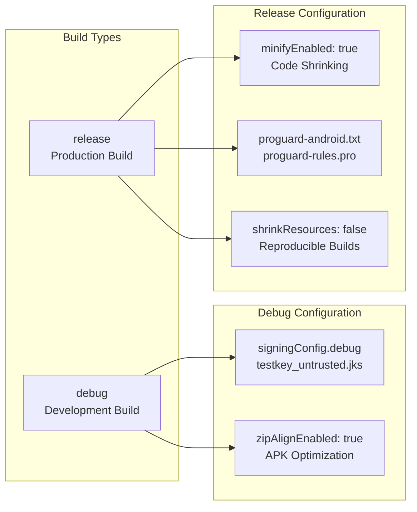
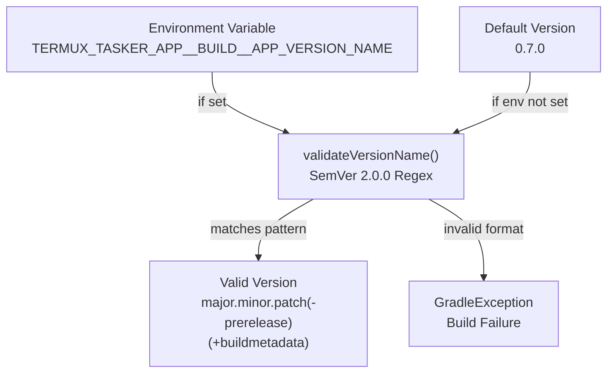
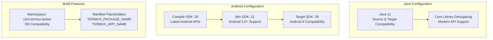
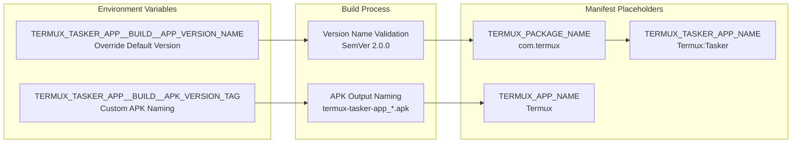

<!-- source: DeepWiki mcp.deepwiki.com · repo termux/termux-tasker · page 4.1 Build System · fetched 2026-10-26 -->

# Build System

<details>
<summary>Relevant source files</summary>

The following files were used as context for generating this wiki page:

- [app/build.gradle](app/build.gradle)
- [build.gradle](build.gradle)
- [gradle.properties](gradle.properties)
- [gradle/wrapper/gradle-wrapper.properties](gradle/wrapper/gradle-wrapper.properties)

</details>


This document covers the Gradle build system configuration for the Termux:Tasker plugin, including dependency management, build variants, version control, and customization options. For information about automated builds and releases, see [CI/CD Pipeline](#4.2). For details about packaging and distribution, see [Deployment and Distribution](#6).

## Build Configuration Overview

The Termux:Tasker plugin uses a standard Android Gradle build system with custom configurations for integration with the Termux ecosystem. The build is structured as a single-module Android application with specific requirements for plugin compatibility and security.

### Project Structure



Sources: [build.gradle:1-24](), [app/build.gradle:1-112](), [gradle.properties:1-23](), [gradle/wrapper/gradle-wrapper.properties:1-6]()

### Core Build Configuration

The application uses Android Gradle Plugin with the following key configurations:

| Configuration | Value | Source |
|---------------|-------|---------|
| Namespace | `com.termux.tasker` | [app/build.gradle:4]() |
| Application ID | `com.termux.tasker` | [app/build.gradle:11]() |
| Minimum SDK | 21 | [gradle.properties:20]() |
| Target SDK | 28 | [gradle.properties:21]() |
| Compile SDK | 35 | [gradle.properties:22]() |
| Version Code | 1000 | [app/build.gradle:14]() |
| Version Name | 0.7.0 (default) | [app/build.gradle:15]() |

Sources: [app/build.gradle:3-23](), [gradle.properties:20-22]()

## Dependencies and Libraries

### Dependency Management



Sources: [app/build.gradle:69-98](), [build.gradle:12-19]()

### Key Dependencies

**Termux Integration**
- `termux-shared:da3a0ac4e2`: Core shared library providing file utilities, logging, and constants from the main Termux application [app/build.gradle:82]()

**Android Support**
- AndroidX AppCompat and Material Design libraries for modern Android UI components [app/build.gradle:77-79]()
- Core library desugaring for Java 8+ language feature support on older Android versions [app/build.gradle:70]()

**Utilities**
- Google Guava for enhanced collections and utilities [app/build.gradle:80]()
- Conflict resolution for ListenableFuture to prevent dependency conflicts [app/build.gradle:88]()

Sources: [app/build.gradle:69-88]()

## Build Variants and Signing

### Build Types Configuration



Sources: [app/build.gradle:25-45]()

### Signing Configuration

The debug build uses a test signing key for development purposes:

| Property | Value |
|----------|-------|
| Store File | `testkey_untrusted.jks` |
| Key Alias | `alias` |
| Store Password | `xrj45yWGLbsO7W0v` |
| Key Password | `xrj45yWGLbsO7W0v` |

**Security Note**: This is an untrusted test key for development only. Production releases require proper signing configuration.

Sources: [app/build.gradle:25-32]()

### Build Output Customization

APK files are generated with custom naming using the pattern:
```
termux-tasker-app_<version_tag>.apk
```

The version tag is determined by environment variables or defaults to `v<versionName>+<buildType>`.

Sources: [app/build.gradle:55-60]()

## Version Management

### Semantic Versioning

The build system enforces Semantic Version 2.0.0 specification through the `validateVersionName` function:



Sources: [app/build.gradle:7](), [app/build.gradle:15-18](), [app/build.gradle:106-111]()

### Version Configuration

| Component | Source | Default Value |
|-----------|--------|---------------|
| Version Name | Environment or default | `0.7.0` |
| Version Code | Static | `1000` |
| APK Version Tag | `TERMUX_TASKER_APP__BUILD__APK_VERSION_TAG` | Generated from version name |

Sources: [app/build.gradle:7-8](), [app/build.gradle:14-18]()

## Build Process and Tasks

### Compilation Configuration



Sources: [app/build.gradle:47-53](), [app/build.gradle:3-6](), [app/build.gradle:20-22]()

### Custom Tasks

**Version Name Task**: Utility task to output the current version name for scripts and CI/CD systems.

```gradle
task versionName {
    doLast {
        print android.defaultConfig.versionName
    }
}
```

Sources: [app/build.gradle:100-104]()

### Packaging Configuration

The build excludes specific native libraries from the termux-shared dependency to prevent conflicts:

| Excluded Library | Reason |
|------------------|--------|
| `lib/*/libtermux.so` | Terminal emulator native library |
| `lib/*/liblocal-socket.so` | Local socket communication library |

Sources: [app/build.gradle:62-66]()

## Environment Variables and Customization

### Build Customization Variables



Sources: [app/build.gradle:7-8](), [app/build.gradle:20-22](), [app/build.gradle:55-60]()

### Repository Configuration

The build system uses multiple Maven repositories for dependency resolution:

1. **Google**: Android SDK and AndroidX libraries
2. **Maven Central**: Standard Java libraries  
3. **JitPack**: Source-based dependencies (termux-shared)
4. **Maven Local**: Optional local development dependencies (commented out)

Sources: [build.gradle:12-19]()

---

