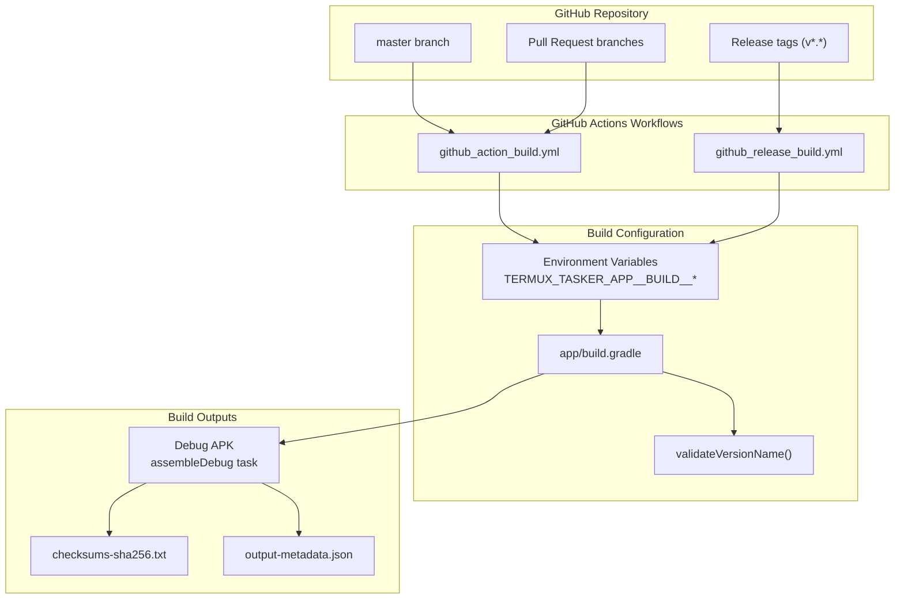
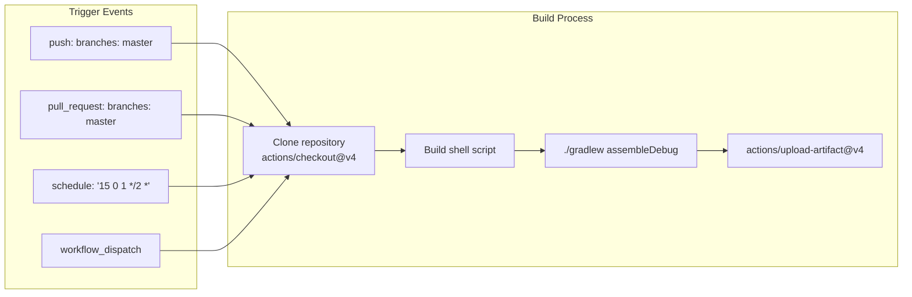
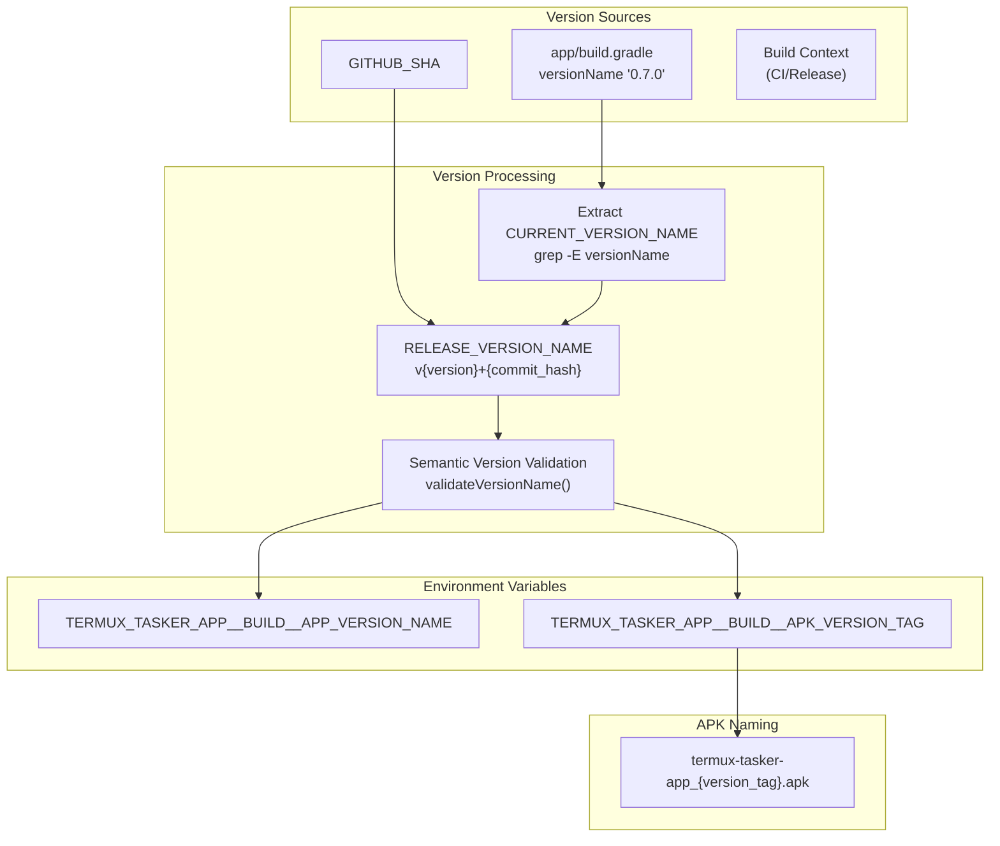
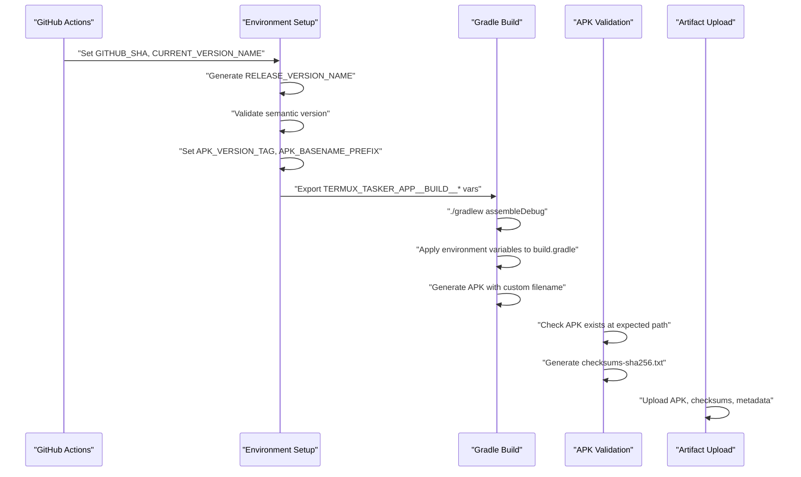
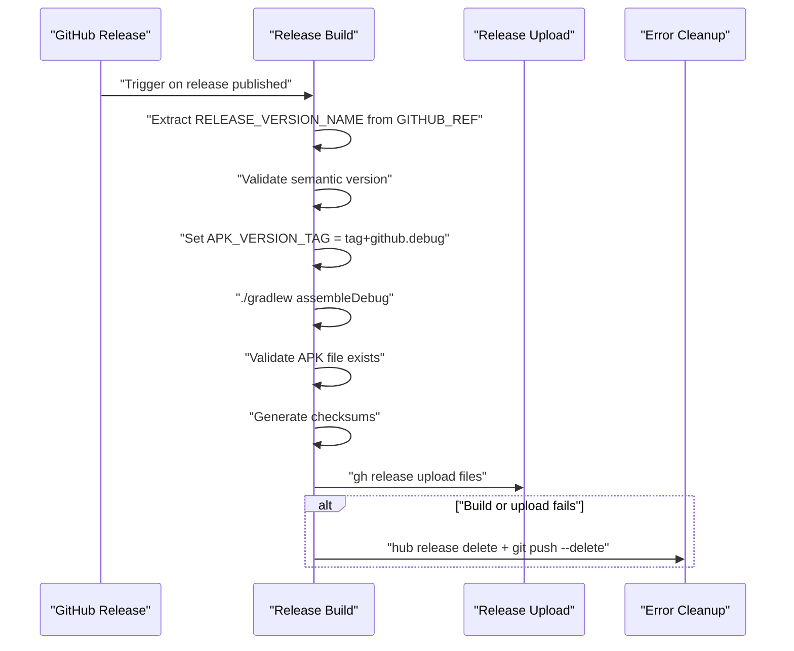
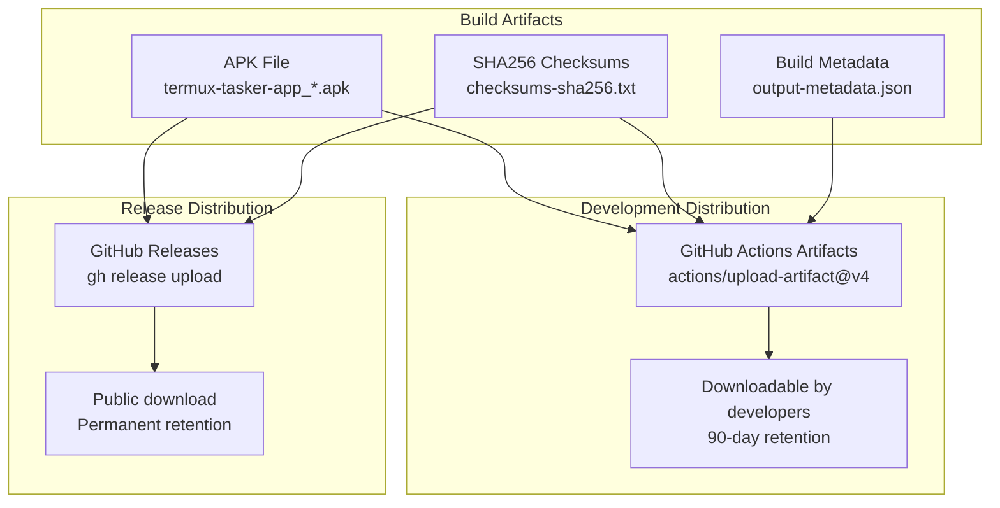
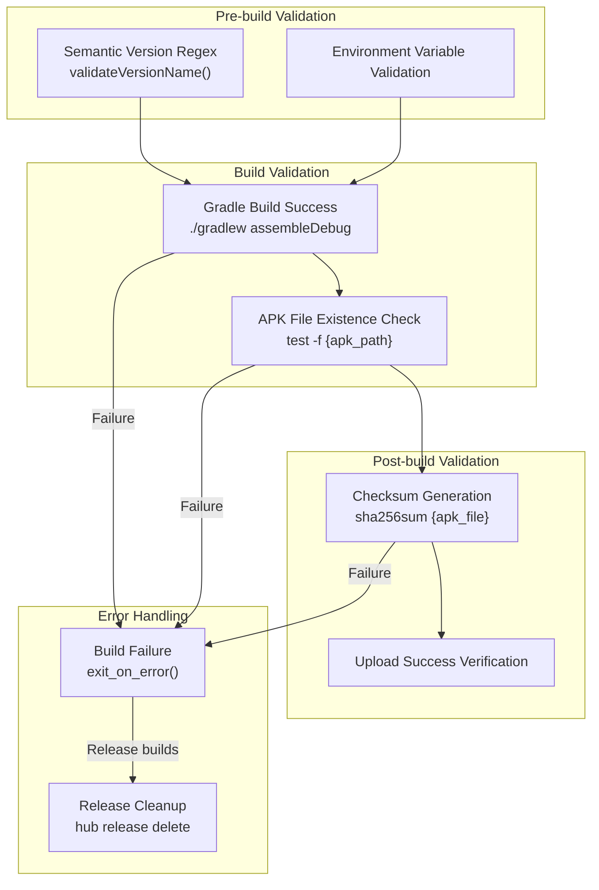

<!-- source: DeepWiki mcp.deepwiki.com · repo termux/termux-tasker · page 4.2 CI/CD Pipeline · fetched 2026-10-26 -->

# CI/CD Pipeline

<details>
<summary>Relevant source files</summary>

The following files were used as context for generating this wiki page:

- [.github/workflows/github_action_build.yml](.github/workflows/github_action_build.yml)
- [.github/workflows/github_release_build.yml](.github/workflows/github_release_build.yml)
- [app/build.gradle](app/build.gradle)

</details>


This document covers the automated build and release processes for the Termux:Tasker plugin, including GitHub Actions workflows, version management, and artifact distribution. The CI/CD pipeline handles both development builds and official releases through automated processes.

For information about the Gradle build configuration details, see [Build System](#4.1). For deployment and distribution mechanisms, see [Deployment and Distribution](#6).

## Build System Integration

The CI/CD pipeline integrates with the Gradle build system through environment variables and automated triggers. The pipeline supports both debug and release builds with different configurations and distribution channels.



**Sources:** [app/build.gradle:1-112](), [.github/workflows/github_action_build.yml:1-76](), [.github/workflows/github_release_build.yml:1-65]()

## Workflow Triggers

The CI/CD system uses two primary GitHub Actions workflows with different trigger conditions and purposes.

| Workflow | File | Triggers | Purpose |
|----------|------|----------|---------|
| GitHub Action Build | `github_action_build.yml` | Push to master, Pull requests, Schedule (bi-monthly), Manual dispatch | Development builds and testing |
| GitHub Release Build | `github_release_build.yml` | Published releases | Official release builds |

### Development Workflow Triggers



**Sources:** [.github/workflows/github_action_build.yml:3-13](), [.github/workflows/github_action_build.yml:17-76]()

## Version Management

The CI/CD pipeline implements semantic versioning with automatic version generation based on commit information and build context.

### Version Generation Logic



The version validation follows semantic versioning 2.0.0 specification with regex pattern matching:

```
^(0|[1-9]\d*)\.(0|[1-9]\d*)\.(0|[1-9]\d*)(?:-((?:0|[1-9]\d*|\d*[a-zA-Z-][0-9a-zA-Z-]*)(?:\.(?:0|[1-9]\d*|\d*[a-zA-Z-][0-9a-zA-Z-]*))*))?(?:\+([0-9a-zA-Z-]+(?:\.[0-9a-zA-Z-]+)*))?$
```

**Sources:** [app/build.gradle:7-8](), [app/build.gradle:106-111](), [.github/workflows/github_action_build.yml:32-38](), [.github/workflows/github_release_build.yml:31-34]()

## Build Process

The build process executes through coordinated steps involving environment variable setup, Gradle execution, and artifact validation.

### Development Build Process



### Release Build Process

The release build process differs by using the release tag directly instead of generating a version name:



**Sources:** [.github/workflows/github_action_build.yml:21-67](), [.github/workflows/github_release_build.yml:19-64]()

## Artifact Generation and Distribution

The CI/CD pipeline generates multiple types of artifacts for different distribution channels.

### Artifact Types

| Artifact Type | Development Builds | Release Builds | Location |
|---------------|-------------------|----------------|----------|
| APK File | `termux-tasker-app_v{version}+{hash}.github.debug.apk` | `termux-tasker-app_v{version}+github.debug.apk` | `app/build/outputs/apk/debug/` |
| Checksums | `checksums-sha256.txt` | `checksums-sha256.txt` | Same directory as APK |
| Metadata | `output-metadata.json` | Not uploaded | Same directory as APK |

### Distribution Channels



### APK Naming Convention

The APK naming follows a structured pattern defined in the Gradle build configuration:

```
termux-tasker-app_{APK_VERSION_TAG}.apk
```

Where `APK_VERSION_TAG` varies by build type:
- Development: `v{version}+{commit_hash}.github.debug`
- Release: `v{version}+github.debug`

**Sources:** [app/build.gradle:55-60](), [.github/workflows/github_action_build.yml:40-47](), [.github/workflows/github_release_build.yml:36-38]()

## Quality Assurance

The CI/CD pipeline incorporates several quality assurance mechanisms to ensure build integrity and proper versioning.

### Validation Steps



### Error Recovery Mechanisms

The release build workflow implements automatic cleanup on failure to maintain repository integrity:

1. **Release Deletion**: Failed releases are automatically deleted using `hub release delete`
2. **Tag Cleanup**: Associated Git tags are removed with `git push --delete origin`
3. **Error Propagation**: Build failures exit with non-zero status codes

**Sources:** [app/build.gradle:106-111](), [.github/workflows/github_action_build.yml:56-66](), [.github/workflows/github_release_build.yml:22-28]()

---

