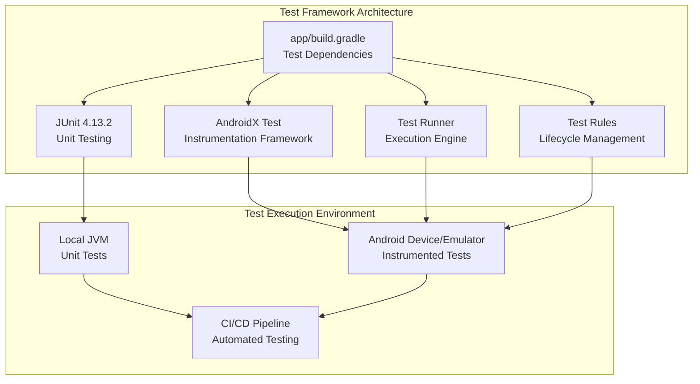
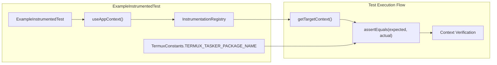
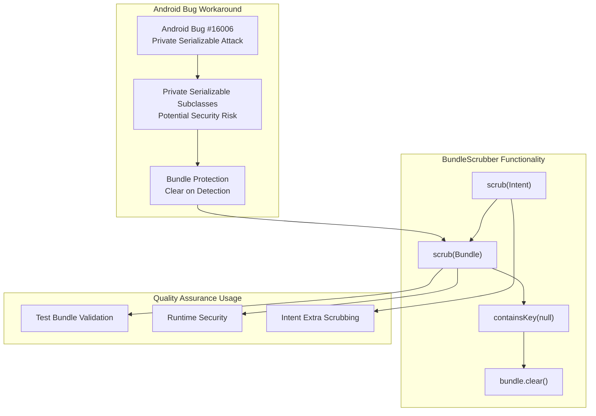
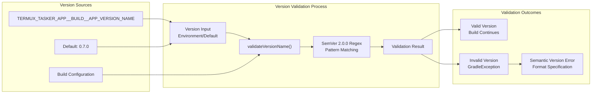
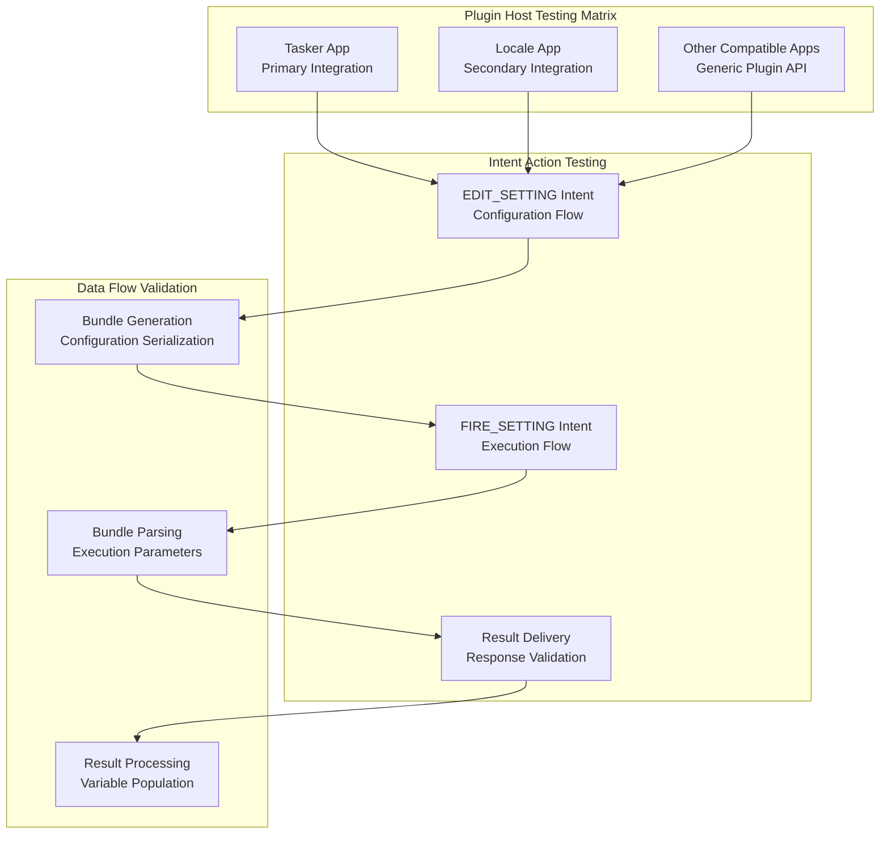
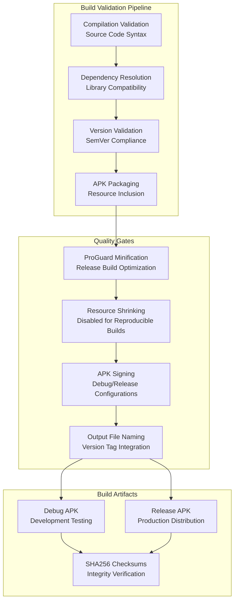

<!-- source: DeepWiki mcp.deepwiki.com · repo termux/termux-tasker · page 4.3 Testing and Quality Assurance · fetched 2026-10-26 -->

# Testing and Quality Assurance

Relevant source files

The following files were used as context for generating this wiki page:

- [app/build.gradle](app/build.gradle)
- [app/src/androidTest/java/com/termux/tasker/ExampleInstrumentedTest.java](app/src/androidTest/java/com/termux/tasker/ExampleInstrumentedTest.java)
- [app/src/main/java/com/termux/tasker/BundleScrubber.java](app/src/main/java/com/termux/tasker/BundleScrubber.java)

This document covers the testing approaches, test utilities, and quality assurance processes for the Termux:Tasker plugin. It provides technical guidance for developers on how to write, run, and maintain tests, as well as the quality assurance procedures that ensure the plugin's reliability and compatibility across different Android versions and plugin host applications.

For information about the build system configuration that supports testing, see [Build System](#4.1). For details about the CI/CD pipeline that runs automated tests, see [CI/CD Pipeline](#4.2).

## Testing Framework Setup

The project uses a multi-tiered testing approach with both unit tests and Android instrumented tests. The testing framework is configured in the Gradle build system with specific dependencies for different testing scenarios.

### Test Dependencies Configuration

The testing framework includes several key components configured in the build system:

| Test Type | Framework | Version | Purpose |
|-----------|-----------|---------|----------|
| Unit Tests | JUnit | 4.13.2 | Local JVM tests |
| Android Tests | AndroidX Test | 1.2.1+ | On-device integration tests |
| Test Runner | AndroidX Test Runner | 1.6.2 | Test execution framework |
| Test Rules | AndroidX Test Rules | 1.6.1 | Test lifecycle management |

**Sources:** [app/build.gradle:72-75]()

## Test Categories and Types

The testing strategy encompasses multiple categories of tests designed to validate different aspects of the plugin's functionality and integration points.

### Instrumented Tests

The primary instrumented test validates the application context and package configuration:

The `ExampleInstrumentedTest` class demonstrates the basic instrumented testing pattern:
- Uses `AndroidJUnit4ClassRunner` for test execution
- Validates application context through `InstrumentationRegistry`
- Verifies package name matches `TermuxConstants.TERMUX_TASKER_PACKAGE_NAME`

**Sources:** [app/src/androidTest/java/com/termux/tasker/ExampleInstrumentedTest.java:1-29]()

### Test Categories by Functionality

| Category | Focus Area | Test Types | Key Validations |
|----------|------------|------------|-----------------|
| Context Tests | Application Setup | Instrumented | Package name, permissions |
| Bundle Tests | Data Serialization | Unit/Instrumented | Bundle scrubbing, validation |
| Integration Tests | Plugin Host Communication | Instrumented | Intent handling, result delivery |
| Security Tests | Permission Model | Unit/Integration | Policy enforcement, path validation |
| UI Tests | Configuration Activity | Instrumented | User input, form validation |

## Test Utilities and Helpers

The project includes specialized utility classes that support both testing and quality assurance during runtime execution.

### BundleScrubber Utility

The `BundleScrubber` class provides critical functionality for handling Android Bundle security issues and serves as both a runtime protection mechanism and a testing utility:

The `BundleScrubber` implements a security workaround that:
- Detects private serializable subclasses in Bundle extras
- Clears potentially malicious bundles automatically
- Returns boolean indicators for test validation
- Protects against Android framework vulnerability #16006

**Sources:** [app/src/main/java/com/termux/tasker/BundleScrubber.java:1-50]()

## Quality Assurance Processes

### Version Validation

The build system includes automated version validation to ensure compliance with semantic versioning standards:

The validation process enforces semantic versioning 2.0.0 specification with:
- Regex pattern validation for version format
- Environment variable override capability
- Build failure on invalid version strings
- Clear error messaging with specification reference

**Sources:** [app/build.gradle:106-111]()

## Integration Testing Strategy

### Plugin Host Integration Testing

The plugin must be tested against multiple plugin host applications to ensure compatibility:

### Termux Ecosystem Integration

Integration testing must validate communication with the Termux ecosystem:

| Integration Point | Test Requirements | Validation Methods |
|-------------------|-------------------|-------------------|
| TERMUX_SERVICE | Command execution, result handling | Intent delivery, response verification |
| File System | Script access, permission validation | Path resolution, security policy checks |
| Shared User ID | Cross-application communication | Permission verification, IPC testing |
| External Apps Policy | Security policy enforcement | Policy violation detection, error handling |

**Sources:** [app/src/androidTest/java/com/termux/tasker/ExampleInstrumentedTest.java:7]()

## Build and Release Validation

### Automated Build Testing

The build system includes validation mechanisms that run during compilation:

### Reproducible Build Quality Assurance

The build configuration emphasizes reproducible builds through:
- Disabled resource shrinking to ensure consistent output
- Deterministic APK naming with version tags
- Controlled dependency versions with constraint management
- Consistent signing configurations across build types

**Sources:** [app/build.gradle:34-67]()

---

