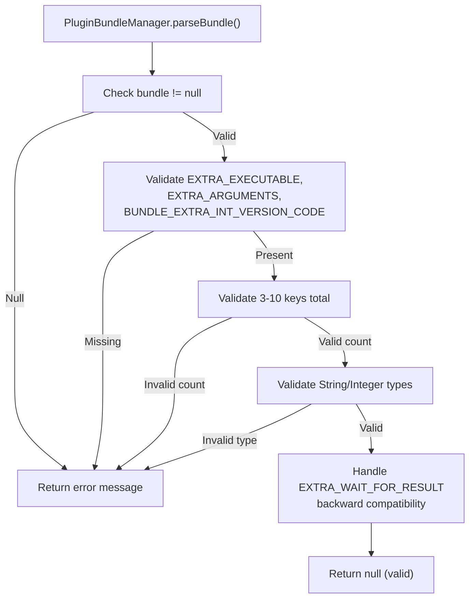
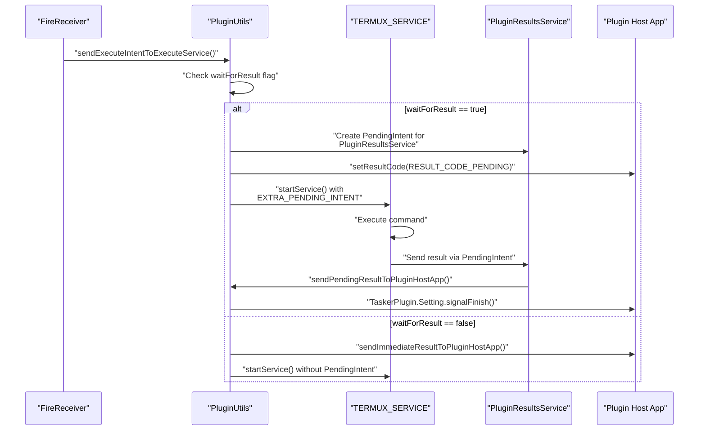
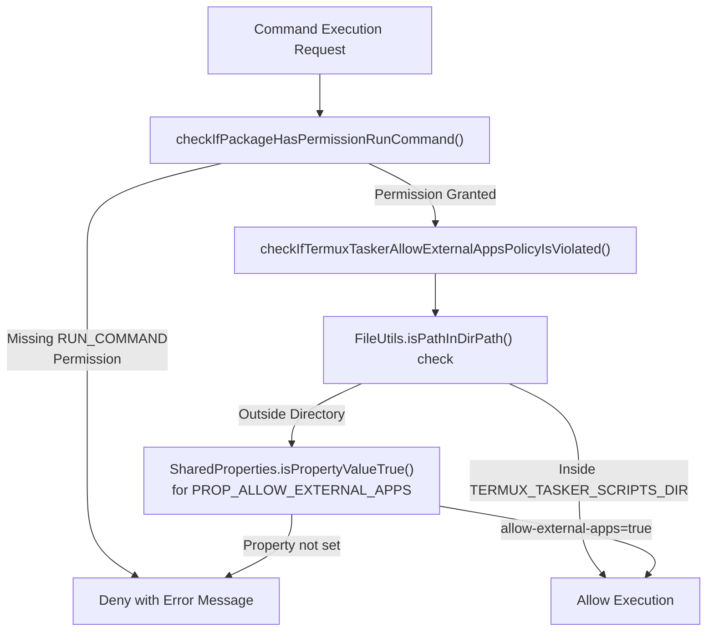
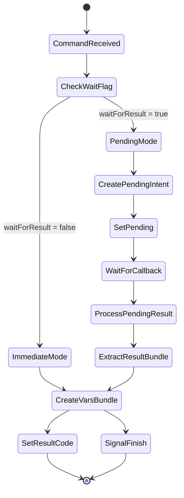

<!-- source: DeepWiki mcp.deepwiki.com · repo termux/termux-tasker · page 5 Implementation Details · fetched 2026-10-26 -->

# Implementation Details

<details>
<summary>Relevant source files</summary>

The following files were used as context for generating this wiki page:

- [app/src/main/java/com/termux/tasker/PluginBundleManager.java](app/src/main/java/com/termux/tasker/PluginBundleManager.java)
- [app/src/main/java/com/termux/tasker/utils/PluginUtils.java](app/src/main/java/com/termux/tasker/utils/PluginUtils.java)

</details>


This document provides deep technical documentation of the Termux:Tasker plugin's internal implementation, focusing on core algorithms, data structures, and execution flows. This material is intended for advanced users and contributors who need to understand the plugin's internals for debugging, extending, or maintaining the codebase.

For higher-level architectural concepts, see [Architecture](#2). For security-specific implementation details, see [Security Model](#5.2). For information about utility classes, see [Utility Classes and Helpers](#5.3).

## Core Data Structures and Bundle Management

The plugin's configuration system centers around Android `Bundle` objects that are serialized and passed between the plugin host (Tasker/Locale) and the Termux execution environment. The `PluginBundleManager` class handles all bundle operations with strict validation and versioning.

### Bundle Structure and Validation

The plugin uses a well-defined bundle format with required and optional keys:

| Bundle Key | Type | Required | Purpose |
|------------|------|----------|---------|
| `EXTRA_EXECUTABLE` | String | Yes | Path to executable to run |
| `EXTRA_ARGUMENTS` | String | Yes | Command arguments |
| `BUNDLE_EXTRA_INT_VERSION_CODE` | Integer | Yes | Plugin version for compatibility |
| `EXTRA_WORKDIR` | String | No | Working directory |
| `EXTRA_STDIN` | String | No | Input for background commands |
| `EXTRA_SESSION_ACTION` | String | No | Terminal session behavior |
| `EXTRA_BACKGROUND_CUSTOM_LOG_LEVEL` | String | No | Logging level |
| `EXTRA_TERMINAL` | Boolean | No | Terminal vs background execution |
| `EXTRA_WAIT_FOR_RESULT` | Boolean | No | Result handling behavior |

The validation logic in `parseBundle()` enforces bundle size limits (3-10 keys) and type safety:



**Bundle Generation and Blurb Creation**

The `generateBundle()` method creates validated bundles with version tracking, while `generateBlurb()` produces human-readable summaries for the plugin host UI using Unicode check marks (✓/✗) for visual feedback.

Sources: [app/src/main/java/com/termux/tasker/PluginBundleManager.java:76-135](), [app/src/main/java/com/termux/tasker/PluginBundleManager.java:138-162](), [app/src/main/java/com/termux/tasker/PluginBundleManager.java:169-193]()

## Command Execution Orchestration

The `PluginUtils` class implements the core execution flow, managing the complete lifecycle from command receipt to result delivery. The system supports both synchronous (immediate) and asynchronous (pending) result handling.

### Execution Flow Architecture



**PendingIntent Management**

The system uses a sophisticated PendingIntent mechanism for asynchronous result handling. Each execution request gets a unique request code via `getLastPendingIntentRequestCode()`, which implements atomic counter management to prevent PendingIntent collisions.

Sources: [app/src/main/java/com/termux/tasker/utils/PluginUtils.java:153-208](), [app/src/main/java/com/termux/tasker/utils/PluginUtils.java:530-546]()

## Plugin Variable System

The plugin returns execution results to the host app through a standardized variable system. The `createVariablesBundle()` method constructs result bundles with predefined variable names.

### Result Variables

| Variable Name | Purpose | Data Source |
|---------------|---------|-------------|
| `%stdout` | Command standard output | `EXTRA_PLUGIN_RESULT_BUNDLE_STDOUT` |
| `%stdout_original_length` | Original stdout length | `EXTRA_PLUGIN_RESULT_BUNDLE_STDOUT_ORIGINAL_LENGTH` |  
| `%stderr` | Command standard error | `EXTRA_PLUGIN_RESULT_BUNDLE_STDERR` |
| `%stderr_original_length` | Original stderr length | `EXTRA_PLUGIN_RESULT_BUNDLE_STDERR_ORIGINAL_LENGTH` |
| `%result` | Command exit code | `EXTRA_PLUGIN_RESULT_BUNDLE_EXIT_CODE` |
| `%err` | Plugin error code | `EXTRA_PLUGIN_RESULT_BUNDLE_ERR` |
| `%errmsg` | Error message | `EXTRA_PLUGIN_RESULT_BUNDLE_ERRMSG` |

The variable validation system uses regex pattern matching to ensure variable names conform to plugin host requirements:

```
PLUGIN_HOST_VARIABLE_NAME_MATCH_EXPRESSION = "%[a-zA-Z0-9][a-zA-Z0-9_]{2,}(?<!_)"
```

**Error Code Sanitization**

The `sanitizeErrCode()` method ensures error codes are compatible with plugin host expectations, converting invalid codes to `RESULT_CODE_OK` and logging warnings for debugging.

Sources: [app/src/main/java/com/termux/tasker/utils/PluginUtils.java:360-405](), [app/src/main/java/com/termux/tasker/utils/PluginUtils.java:417-427](), [app/src/main/java/com/termux/tasker/utils/PluginUtils.java:437-455]()

## Security Implementation

The plugin implements a multi-layered security model with permission validation and policy enforcement.

### Permission and Policy Validation Flow



**Permission Validation**

The `checkIfPackageHasPermissionRunCommand()` method verifies that the requesting package has the `PERMISSION_RUN_COMMAND` permission, providing detailed error messages including app names for better user experience.

**Path Policy Enforcement**

The `checkIfTermuxTaskerAllowExternalAppsPolicyIsViolated()` method implements the core security policy:
- Scripts under `~/.termux/tasker/` are always allowed
- Scripts outside this directory require `allow-external-apps=true` in termux.properties
- Empty or null executables are rejected immediately

Sources: [app/src/main/java/com/termux/tasker/utils/PluginUtils.java:478-497](), [app/src/main/java/com/termux/tasker/utils/PluginUtils.java:507-520]()

## Result Processing Implementation

The plugin supports both immediate and pending result delivery mechanisms, with sophisticated error handling and variable bundle construction.

### Result Processing States



**Immediate Result Processing**

The `sendImmediateResultToPluginHostApp()` method handles synchronous result delivery, supporting both simple error reporting and full result variable bundles.

**Pending Result Processing**

The `sendPendingResultToPluginHostApp()` method processes asynchronous results received via PendingIntent callbacks, extracting result bundles and constructing variable bundles for the host app.

The system handles missing or invalid result bundle keys gracefully, using default values and logging warnings for debugging purposes.

Sources: [app/src/main/java/com/termux/tasker/utils/PluginUtils.java:218-259](), [app/src/main/java/com/termux/tasker/utils/PluginUtils.java:267-307](), [app/src/main/java/com/termux/tasker/utils/PluginUtils.java:324-342]()

## Bundle Size Management

The plugin implements bundle size monitoring to prevent Android IPC limitations from causing failures. The `getBundleSize()` method uses `Parcel` serialization to measure actual bundle sizes in bytes.


This measurement is crucial for debugging bundle-related failures and ensuring compatibility across different Android versions and plugin host implementations.

Sources: [app/src/main/java/com/termux/tasker/PluginBundleManager.java:195-202]()

---

