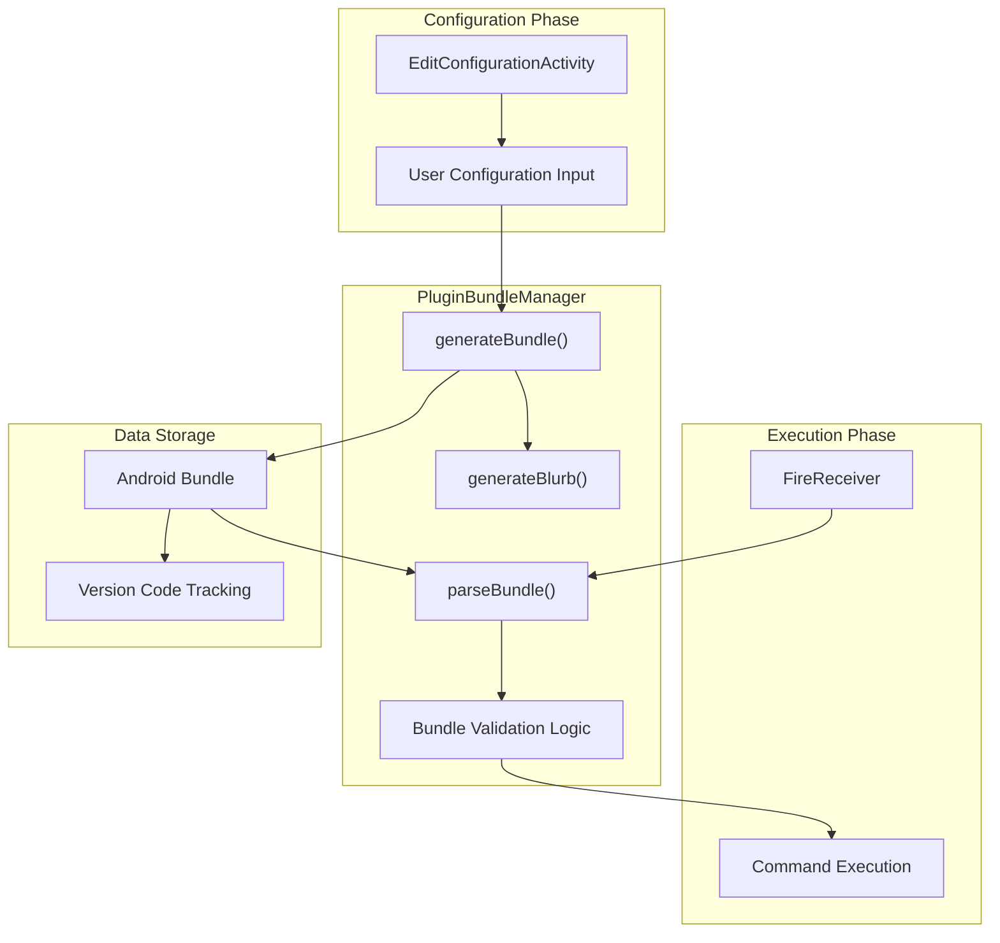
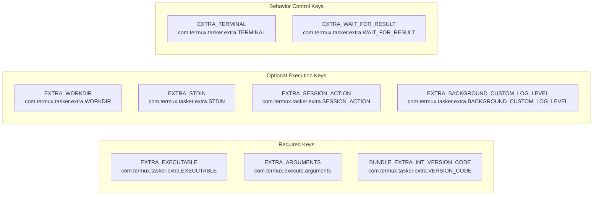
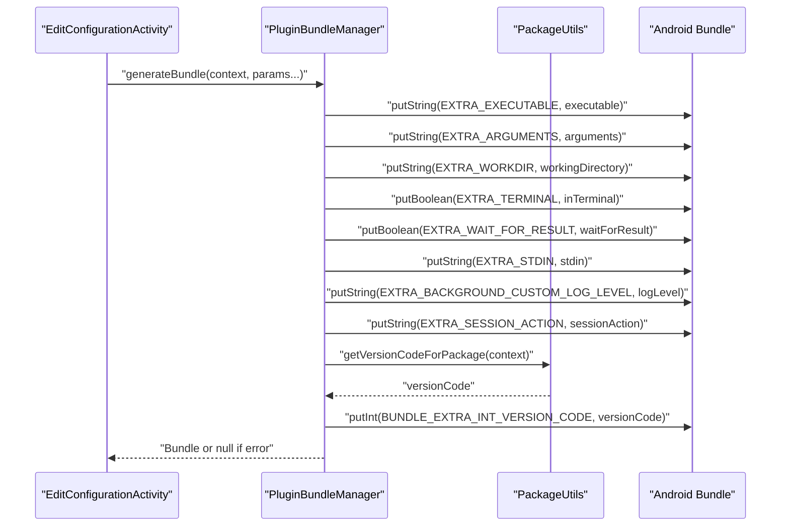
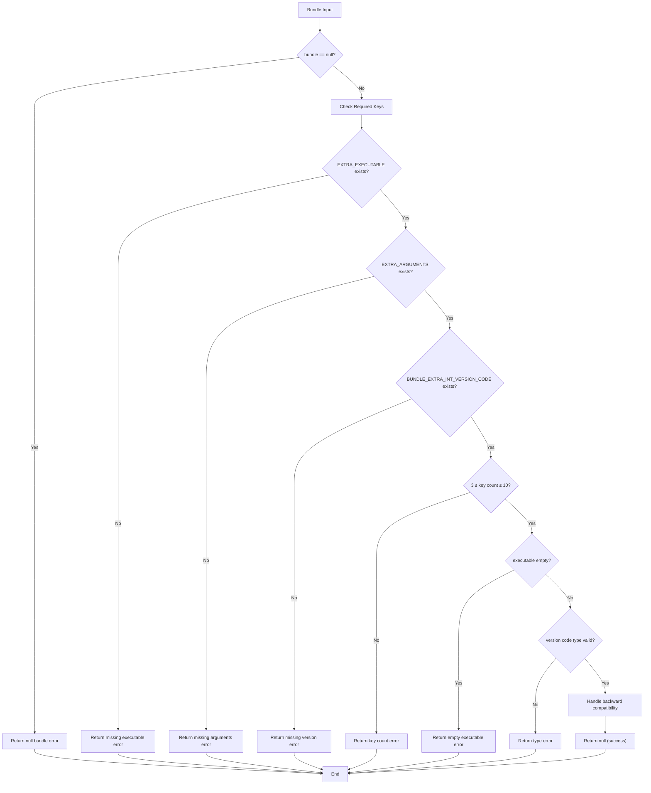
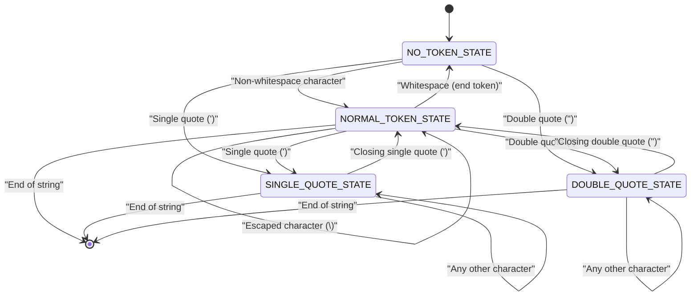
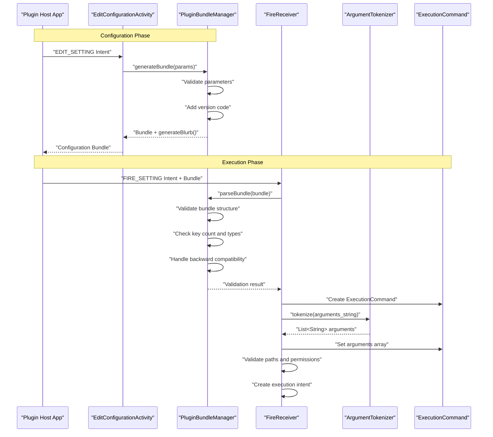
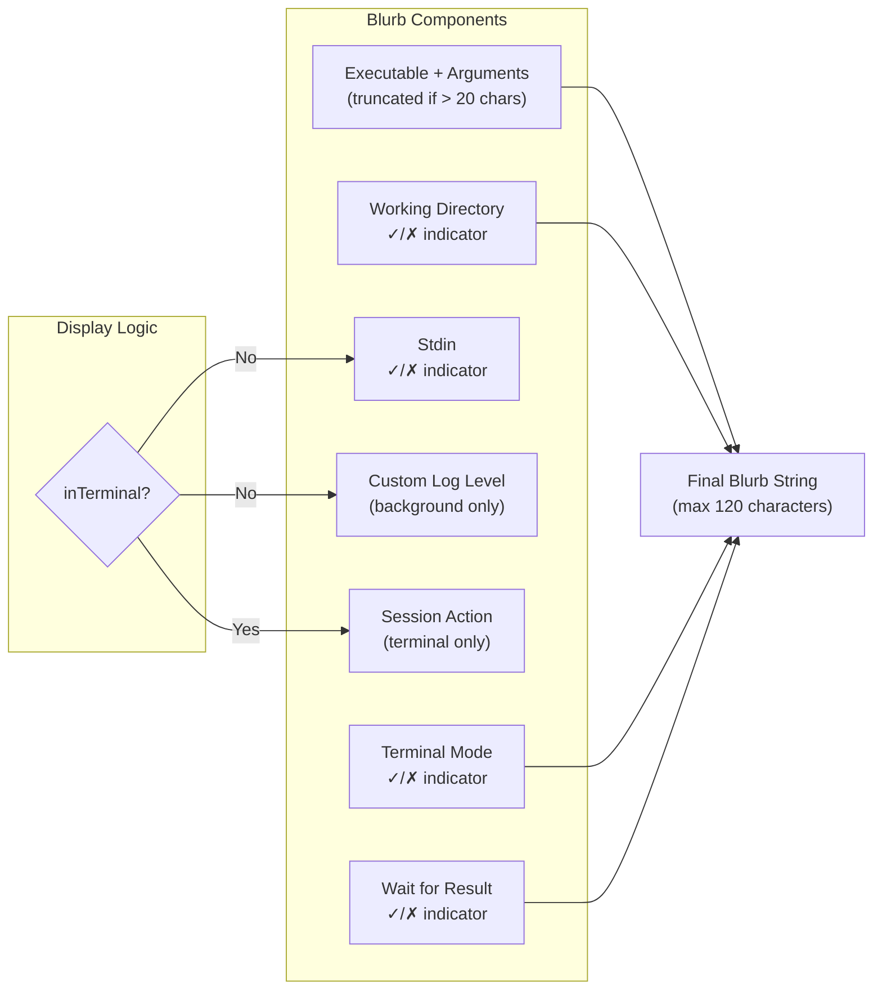

<!-- source: DeepWiki mcp.deepwiki.com · repo termux/termux-tasker · page 5.1 Data Management and Serialization · fetched 2026-10-26 -->

# Data Management and Serialization

Relevant source files

The following files were used as context for generating this wiki page:

- [app/src/main/java/com/termux/tasker/ArgumentTokenizer.java](app/src/main/java/com/termux/tasker/ArgumentTokenizer.java)
- [app/src/main/java/com/termux/tasker/FireReceiver.java](app/src/main/java/com/termux/tasker/FireReceiver.java)
- [app/src/main/java/com/termux/tasker/PluginBundleManager.java](app/src/main/java/com/termux/tasker/PluginBundleManager.java)

This document covers how the Termux:Tasker plugin manages configuration data, serializes it for storage and transmission, and validates it during execution. The primary focus is on the bundle-based data exchange mechanism used for communication between plugin host apps (Tasker/Locale) and the Termux:Tasker plugin.

For information about the overall plugin architecture and command execution flow, see [Architecture](#2). For security validation and policy enforcement details, see [Security Model](#5.2).

## Core Data Management Architecture

The plugin uses Android's `Bundle` mechanism as the primary data container for configuration parameters. The `PluginBundleManager` class serves as the central hub for all data serialization, validation, and human-readable representation generation.

### Bundle Manager Overview

Sources: [app/src/main/java/com/termux/tasker/PluginBundleManager.java:1-204]()

## Bundle Structure and Constants

The plugin defines specific bundle keys for each configuration parameter, following a consistent naming convention using the Termux package namespace.

### Bundle Extra Constants

| Constant | Purpose | Type | Required |
|----------|---------|------|----------|
| `EXTRA_EXECUTABLE` | Path to executable | String | Yes |
| `EXTRA_ARGUMENTS` | Command arguments | String | Yes |
| `EXTRA_WORKDIR` | Working directory | String | Optional |
| `EXTRA_STDIN` | Standard input | String | Optional |
| `EXTRA_SESSION_ACTION` | Terminal session action | String | Optional |
| `EXTRA_BACKGROUND_CUSTOM_LOG_LEVEL` | Custom log level | String | Optional |
| `EXTRA_TERMINAL` | Run in terminal flag | Boolean | Optional |
| `EXTRA_WAIT_FOR_RESULT` | Wait for result flag | Boolean | Optional |
| `BUNDLE_EXTRA_INT_VERSION_CODE` | Plugin version | Integer | Yes |

### Bundle Key Definitions

Sources: [app/src/main/java/com/termux/tasker/PluginBundleManager.java:22-51]()

## Bundle Generation and Validation

### Bundle Generation Process

The `generateBundle()` method creates a properly structured bundle from configuration parameters, automatically including version information for compatibility tracking.

Sources: [app/src/main/java/com/termux/tasker/PluginBundleManager.java:138-162]()

### Bundle Validation Logic

The `parseBundle()` method performs comprehensive validation to ensure bundle integrity and compatibility.

#### Validation Steps

Sources: [app/src/main/java/com/termux/tasker/PluginBundleManager.java:76-135]()

### Backward Compatibility Handling

The validation process includes special handling for older plugin versions that may not include all current bundle keys.

Sources: [app/src/main/java/com/termux/tasker/PluginBundleManager.java:125-132]()

## Argument Processing

### ArgumentTokenizer Integration

The plugin uses a specialized `ArgumentTokenizer` class to parse command arguments with shell-like behavior, supporting quoted strings and escape sequences.

#### Tokenization Process

Sources: [app/src/main/java/com/termux/tasker/ArgumentTokenizer.java:51-187](), [app/src/main/java/com/termux/tasker/FireReceiver.java:174-177]()

## Data Flow from Configuration to Execution

### Complete Data Lifecycle

Sources: [app/src/main/java/com/termux/tasker/FireReceiver.java:58-198](), [app/src/main/java/com/termux/tasker/PluginBundleManager.java:138-162]()

### Bundle Size Management

The plugin includes utilities for monitoring bundle size to ensure compatibility with Android's IPC limitations.

Sources: [app/src/main/java/com/termux/tasker/PluginBundleManager.java:195-202]()

### Human-Readable Blurb Generation

The `generateBlurb()` method creates user-friendly summaries of configuration settings for display in plugin host apps, with Unicode checkmarks to indicate enabled features.

Sources: [app/src/main/java/com/termux/tasker/PluginBundleManager.java:169-193]()

---

