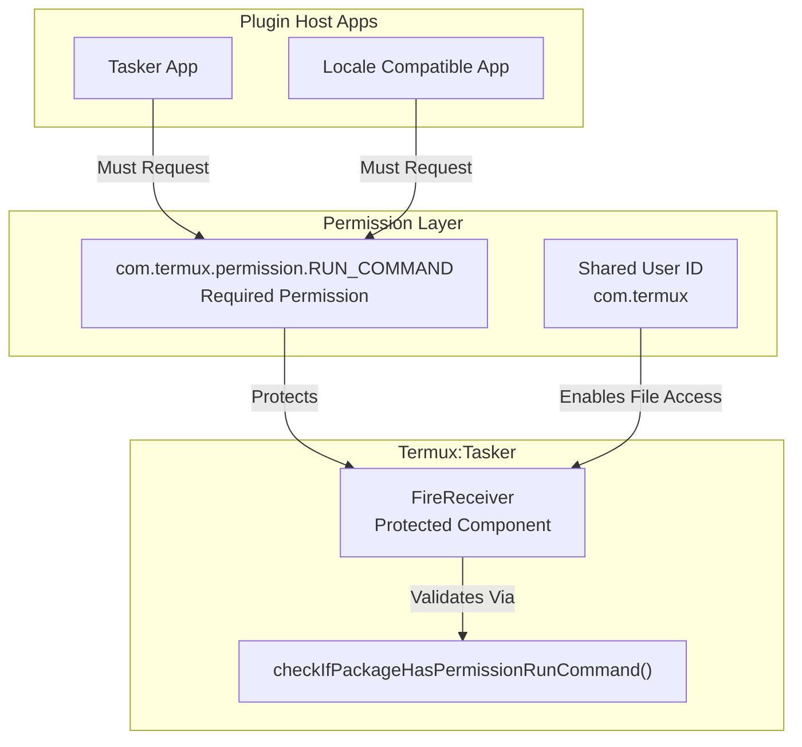
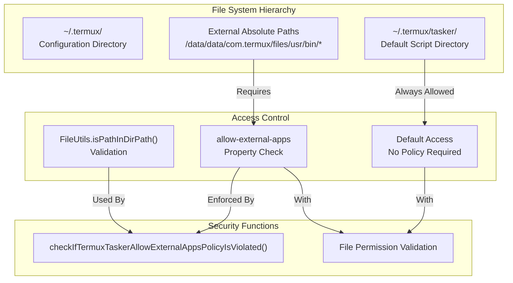
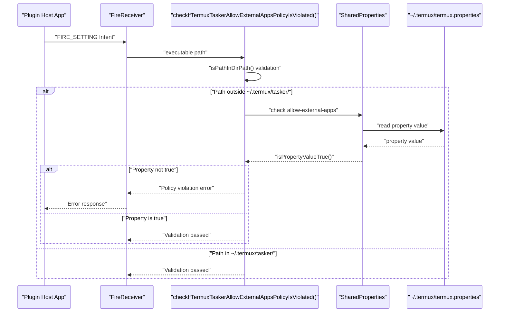
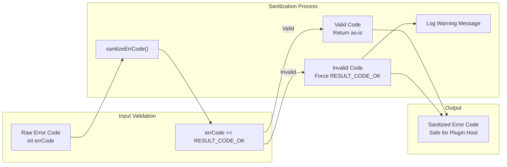
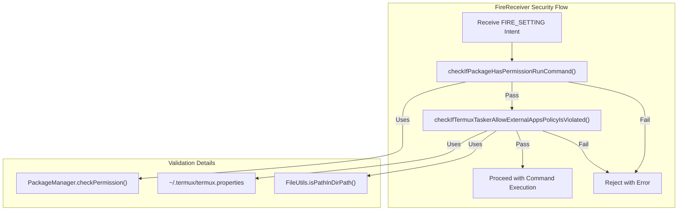

<!-- source: DeepWiki mcp.deepwiki.com · repo termux/termux-tasker · page 5.2 Security Model · fetched 2026-10-26 -->

# Security Model

Relevant source files

The following files were used as context for generating this wiki page:

- [LICENSE.md](LICENSE.md)
- [README.md](README.md)
- [app/src/main/AndroidManifest.xml](app/src/main/AndroidManifest.xml)
- [app/src/main/java/com/termux/tasker/utils/PluginUtils.java](app/src/main/java/com/termux/tasker/utils/PluginUtils.java)
- [fastlane/metadata/android/en-US/changelogs/6.txt](fastlane/metadata/android/en-US/changelogs/6.txt)
- [fastlane/metadata/android/en-US/changelogs/7.txt](fastlane/metadata/android/en-US/changelogs/7.txt)

This document describes the comprehensive security framework implemented by Termux:Tasker to control command execution and protect against unauthorized access. The security model operates through multiple layers including Android permissions, file system restrictions, policy enforcement, and command validation. For information about data serialization and validation, see [Data Management and Serialization](#5.1).

## Permission Framework

Termux:Tasker implements a multi-layered permission system built on Android's security model. The primary security boundary is enforced through the `com.termux.permission.RUN_COMMAND` permission, which must be explicitly granted to plugin host applications.

### Android Permission Requirements

The shared user ID configuration enables file system access between Termux components while maintaining isolation from other applications. This is defined in [app/src/main/AndroidManifest.xml:4]() as `android:sharedUserId="${TERMUX_PACKAGE_NAME}"`.

**Sources:** [app/src/main/AndroidManifest.xml:1-85](), [README.md:66-72](), [app/src/main/java/com/termux/tasker/utils/PluginUtils.java:471-497]()

## File System Security Model

The file system security model restricts command execution to specific directories and enforces access controls through path validation and permission checking.

### Directory Access Control

The security model automatically sets execute permissions for files within `~/.termux/tasker/` directory but requires manual permission management for external paths. Path validation is performed using `FileUtils.isPathInDirPath()` to determine if a path falls within the allowed directory structure.

**Sources:** [app/src/main/java/com/termux/tasker/utils/PluginUtils.java:507-520](), [README.md:75-81](), [README.md:138-143]()

## External Apps Policy Enforcement

The `allow-external-apps` property provides an additional security layer for executing commands outside the default script directory. This policy is enforced through property file validation and path checking.

### Policy Validation Flow

The policy check uses `SharedProperties.isPropertyValueTrue()` to validate the `allow-external-apps` setting against the Termux properties file. If the property is not explicitly set to "true", external path execution is denied with an appropriate error message.

**Sources:** [app/src/main/java/com/termux/tasker/utils/PluginUtils.java:507-520](), [README.md:84-111]()

## Command Validation and Sanitization

The security model includes comprehensive command validation and result sanitization to prevent malicious command execution and ensure safe data exchange.

### Security Validation Components

| Component | Function | Purpose |
|-----------|----------|---------|
| `ArgumentTokenizer` | Argument parsing | Safely tokenize command arguments |
| `sanitizeErrCode()` | Result validation | Sanitize error codes for plugin host |
| `isPluginHostAppVariableNameValid()` | Variable validation | Validate plugin variable names |
| Path validation | File system checks | Ensure executable file exists and is accessible |

### Error Code Sanitization

The `sanitizeErrCode()` function ensures that only valid error codes are returned to plugin host applications. Invalid codes are forced to `RESULT_CODE_OK` to prevent undefined behavior in the plugin host.

**Sources:** [app/src/main/java/com/termux/tasker/utils/PluginUtils.java:417-427](), [app/src/main/java/com/termux/tasker/utils/PluginUtils.java:437-444]()

## Permission and Policy Enforcement Implementation

The security model enforcement is implemented through specific validation functions that are called during command execution setup.

### Security Check Implementation

The security enforcement occurs early in the command execution pipeline, ensuring that unauthorized commands are rejected before any system resources are consumed.

**Sources:** [app/src/main/java/com/termux/tasker/utils/PluginUtils.java:478-497](), [app/src/main/java/com/termux/tasker/utils/PluginUtils.java:507-520]()

## Security Configuration Requirements

The security model requires specific configuration steps to function properly. These requirements are enforced through validation checks and clear error messaging.

### Configuration Dependencies

| Requirement | Type | Validation Function | Error Message Source |
|-------------|------|---------------------|---------------------|
| RUN_COMMAND Permission | Android Permission | `checkIfPackageHasPermissionRunCommand()` | `R.string.error_plugin_permission_ungranted_warning` |
| ~/.termux/tasker/ Directory | File System | Path validation | Directory creation instructions |
| allow-external-apps Property | Termux Property | `checkIfTermuxTaskerAllowExternalAppsPolicyIsViolated()` | `R.string.error_allow_external_apps_ungranted_warning` |
| File Permissions | Unix Permissions | File system checks | Permission denied errors |

The security model provides specific error messages for each type of security violation, enabling users to understand and resolve configuration issues. The error messages reference exact permission names and file paths to facilitate troubleshooting.

**Sources:** [app/src/main/java/com/termux/tasker/utils/PluginUtils.java:478-520](), [README.md:66-115]()

---

