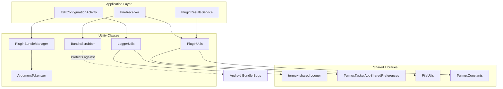
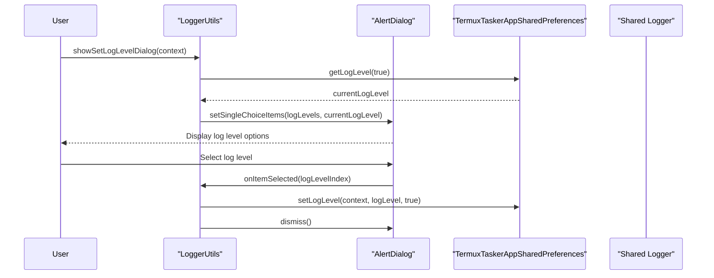
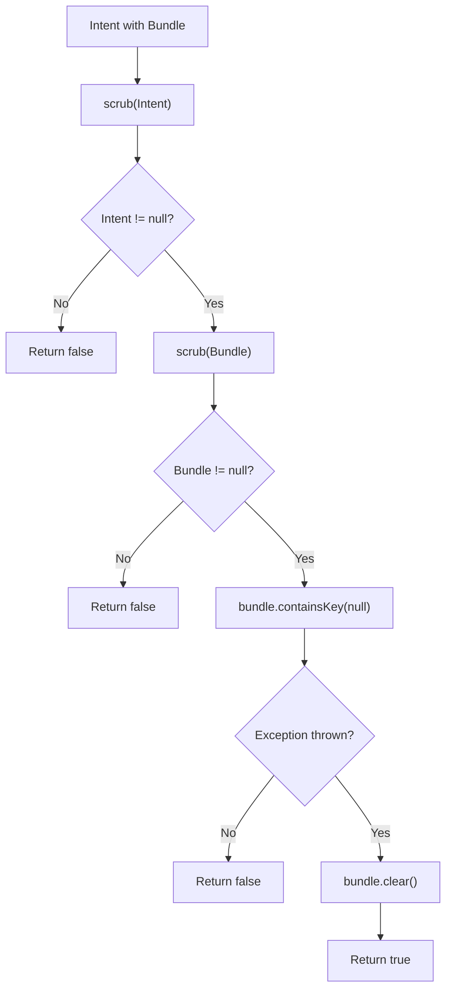
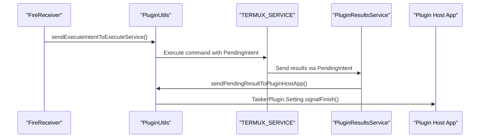
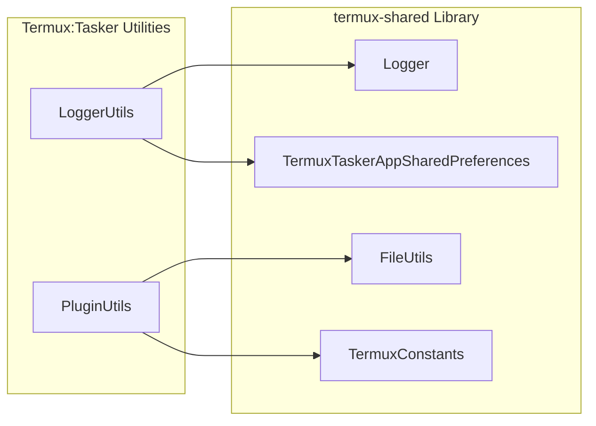

<!-- source: DeepWiki mcp.deepwiki.com · repo termux/termux-tasker · page 5.3 Utility Classes and Helpers · fetched 2026-10-26 -->

# Utility Classes and Helpers

Relevant source files

The following files were used as context for generating this wiki page:

- [app/src/androidTest/java/com/termux/tasker/ExampleInstrumentedTest.java](app/src/androidTest/java/com/termux/tasker/ExampleInstrumentedTest.java)
- [app/src/main/java/com/termux/tasker/BundleScrubber.java](app/src/main/java/com/termux/tasker/BundleScrubber.java)
- [app/src/main/java/com/termux/tasker/PluginResultsService.java](app/src/main/java/com/termux/tasker/PluginResultsService.java)
- [app/src/main/java/com/termux/tasker/utils/LoggerUtils.java](app/src/main/java/com/termux/tasker/utils/LoggerUtils.java)

This document covers the various utility classes and helper functions used throughout the Termux:Tasker plugin application. These utilities provide essential functionality for logging, data serialization, bundle management, plugin communication, and security operations that support the core plugin functionality.

For information about data serialization specifically, see [Data Management and Serialization](#5.1). For security-related utilities, see [Security Model](#5.2).

## Overview

The Termux:Tasker plugin relies on several utility classes to handle common operations across the application. These utilities are designed to provide reusable functionality for:

- Logging and debugging operations
- Bundle validation and scrubbing
- Plugin host communication
- Data serialization and validation
- Argument parsing and tokenization
- Security policy enforcement

## Utility Class Architecture

**Sources:** [app/src/main/java/com/termux/tasker/utils/LoggerUtils.java:1-62](), [app/src/main/java/com/termux/tasker/BundleScrubber.java:1-50](), [app/src/main/java/com/termux/tasker/PluginResultsService.java:1-35]()

## Logging Utilities

### LoggerUtils Class

The `LoggerUtils` class provides functionality for managing application logging levels through a user-friendly dialog interface.

| Method | Purpose | Implementation |
|--------|---------|----------------|
| `showSetLogLevelDialog()` | Display log level selection dialog | Creates AlertDialog with log level options |

#### Log Level Management

The logging utility supports four log levels:
- `LOG_LEVEL_OFF` - No logging
- `LOG_LEVEL_NORMAL` - Standard logging
- `LOG_LEVEL_DEBUG` - Debug information
- `LOG_LEVEL_VERBOSE` - Detailed verbose logging

**Sources:** [app/src/main/java/com/termux/tasker/utils/LoggerUtils.java:15-60]()

## Bundle Validation and Scrubbing

### BundleScrubber Class

The `BundleScrubber` class provides protection against Android framework bugs related to private serializable classes in Bundle objects.

#### Bundle Scrubbing Process

The scrubbing mechanism works by:
1. Testing the bundle with `containsKey(null)` 
2. If a private serializable class exists, an exception is thrown
3. The bundle is cleared to prevent the attack
4. Returns `true` if scrubbing occurred, `false` otherwise

**Sources:** [app/src/main/java/com/termux/tasker/BundleScrubber.java:22-49]()

## Plugin Communication Utilities

### PluginUtils Class

The `PluginUtils` class handles communication between the plugin and host applications, managing command execution and result delivery.

#### Key Responsibilities

| Function | Purpose | Usage Context |
|----------|---------|---------------|
| `sendExecuteIntentToExecuteService()` | Send command to Termux for execution | Called by FireReceiver |
| `sendPendingResultToPluginHostApp()` | Return results to plugin host | Called by PluginResultsService |
| Plugin host communication | Handle TaskerPlugin API calls | Integration with Tasker/Locale |

#### Plugin Communication Flow

**Sources:** [app/src/main/java/com/termux/tasker/PluginResultsService.java:31]()

## Data Serialization Utilities

### PluginBundleManager

The `PluginBundleManager` class handles serialization and validation of plugin configuration data. This utility manages the conversion between user interface parameters and Bundle objects used for plugin communication.

#### Bundle Management Operations

| Operation | Purpose | Validation |
|-----------|---------|------------|
| `generateBundle()` | Serialize UI parameters to Bundle | Input validation and sanitization |
| `parseBundle()` | Deserialize Bundle to parameters | Bundle integrity and format validation |
| `generateBlurb()` | Create human-readable summary | Configuration description for host apps |

### ArgumentTokenizer

The `ArgumentTokenizer` utility handles parsing and validation of command-line arguments, ensuring proper tokenization and security compliance.

**Sources:** Referenced in architecture diagrams from system analysis

## Shared Library Integration

### Termux Shared Utilities

The plugin integrates with several utilities from the `termux-shared` library:

| Utility | Purpose | Usage |
|---------|---------|-------|
| `Logger` | Centralized logging framework | Used by LoggerUtils for log level management |
| `FileUtils` | File system operations | Path validation and file operations |
| `TermuxConstants` | Application constants | Package names, intent actions, file paths |
| `TermuxTaskerAppSharedPreferences` | Preference management | Log level and configuration storage |

#### Shared Library Dependencies

**Sources:** [app/src/main/java/com/termux/tasker/utils/LoggerUtils.java:7-11](), [app/src/androidTest/java/com/termux/tasker/ExampleInstrumentedTest.java:7-27]()

## Error Handling Utilities

### Exception Management

The utility classes implement consistent error handling patterns:

- **Bundle Scrubbing**: Catches and handles serialization exceptions
- **Logging Utilities**: Graceful handling of null contexts and preference failures  
- **Plugin Communication**: Proper error propagation to host applications
- **Validation**: Input sanitization and bounds checking

### Security Utilities

Several utilities contribute to the security model:

- Path validation utilities ensure commands execute within permitted directories
- Bundle scrubbing prevents serialization attacks
- Permission checking utilities enforce the `allow-external-apps` policy
- Argument tokenization prevents command injection attacks

**Sources:** [app/src/main/java/com/termux/tasker/BundleScrubber.java:39-46]()

## Testing Utilities

### Test Infrastructure

The application includes testing utilities that validate core functionality:

- **Instrumented Tests**: Verify package name and context integrity
- **Constant Validation**: Ensure proper integration with Termux ecosystem
- **Context Testing**: Validate Android application context

**Sources:** [app/src/androidTest/java/com/termux/tasker/ExampleInstrumentedTest.java:23-28]()

---

