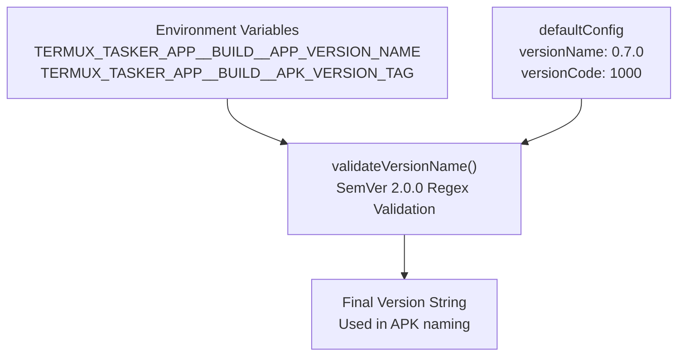
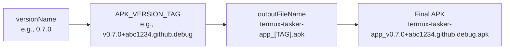
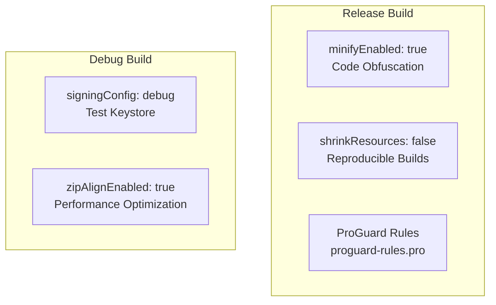
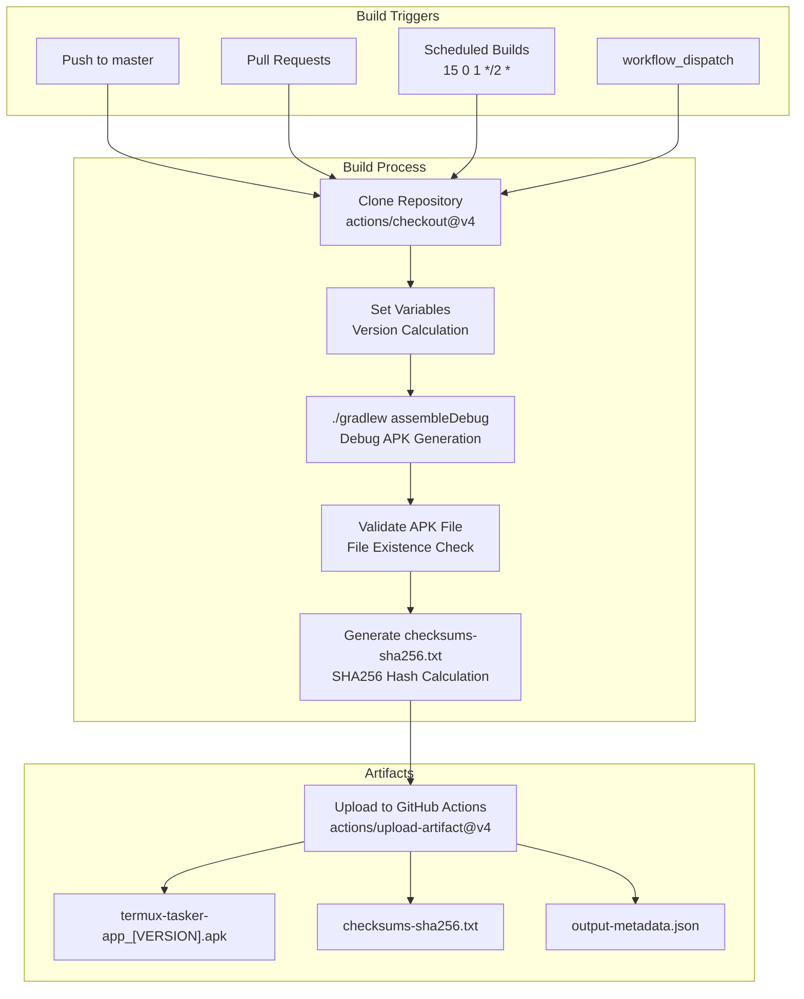
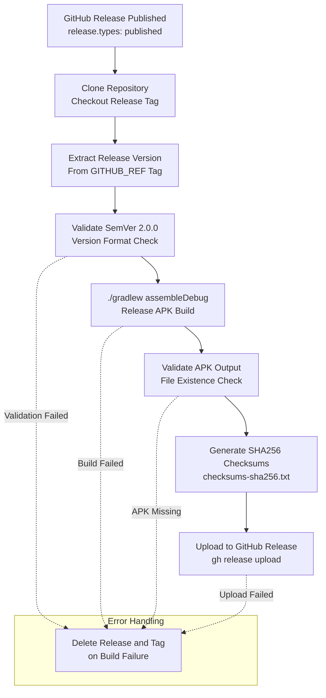
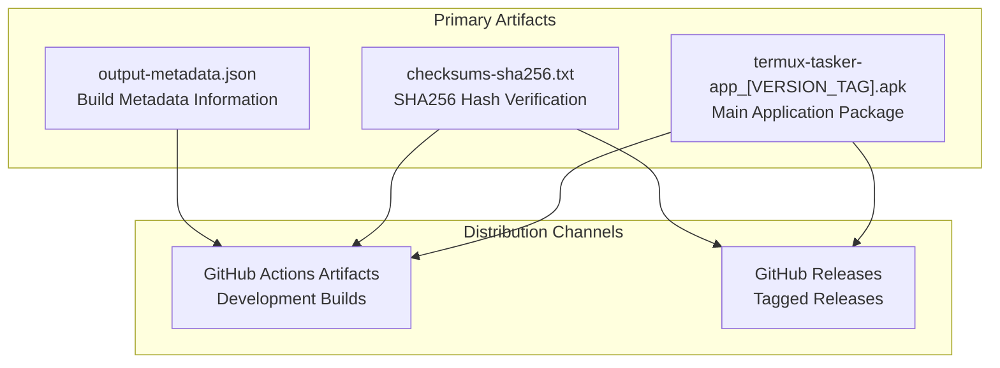

<!-- source: DeepWiki mcp.deepwiki.com · repo termux/termux-tasker · page 6 Deployment and Distribution · fetched 2026-10-26 -->

# Deployment and Distribution

Relevant source files

The following files were used as context for generating this wiki page:

- [.github/workflows/github_action_build.yml](.github/workflows/github_action_build.yml)
- [.github/workflows/github_release_build.yml](.github/workflows/github_release_build.yml)
- [app/build.gradle](app/build.gradle)
- [app/testkey_untrusted.jks](app/testkey_untrusted.jks)

This document covers how the Termux:Tasker plugin application is packaged, signed, and distributed to end users. It details the build system configuration, automated CI/CD pipelines, APK generation processes, and distribution mechanisms used to deliver the plugin to various channels.

For information about the development build setup and local development workflow, see [Build System](#4.1). For details about the CI/CD implementation specifics, see [CI/CD Pipeline](#4.2).

## Build Configuration

The application uses a Gradle-based Android build system with specific configurations for versioning, signing, and output generation. The build process supports both debug and release variants with different characteristics for development and production use.

### Version Management

The build system implements semantic versioning (SemVer 2.0.0) with validation to ensure version strings follow the proper format. Version information can be provided through environment variables or defaults to the version specified in the build configuration:

The version validation function ensures all version strings conform to semantic versioning specifications using a comprehensive regular expression pattern.

**Sources:** [app/build.gradle:7-18](), [app/build.gradle:106-111]()

### APK Output Configuration

The build system customizes APK file naming to include version information and build type identifiers. Output files follow a consistent naming pattern that incorporates version tags and build metadata:

**Sources:** [app/build.gradle:55-60]()

## Signing and Security

The application uses different signing configurations for debug and release builds. Debug builds use a test keystore for development purposes, while release builds would use production signing credentials.

### Debug Signing Configuration

Debug builds are signed using a test keystore included in the repository for development and testing purposes:

| Configuration | Value |
|---------------|--------|
| Keystore File | `testkey_untrusted.jks` |
| Key Alias | `alias` |
| Store Password | `xrj45yWGLbsO7W0v` |
| Key Password | `xrj45yWGLbsO7W0v` |

The debug configuration also enables ZIP alignment optimization for better runtime performance.

**Sources:** [app/build.gradle:25-32](), [app/build.gradle:41-44]()

### Build Type Characteristics

The build system defines specific characteristics for different build types:

**Sources:** [app/build.gradle:34-45]()

## Automated Build Pipeline

The application uses GitHub Actions for automated building and distribution. Two primary workflows handle different build scenarios: continuous integration builds and release builds.

### Development Build Workflow

The `github_action_build.yml` workflow triggers on multiple events and generates debug APKs for development and testing:

The development build process generates version tags that include commit hashes for traceability: `v<VERSION>+<COMMIT_HASH>.github.debug`.

**Sources:** [.github/workflows/github_action_build.yml:1-76]()

### Release Build Workflow

The `github_release_build.yml` workflow executes when GitHub releases are published and automatically builds and uploads release artifacts:

The release workflow includes comprehensive error handling that automatically cleans up failed releases by deleting both the GitHub release and associated git tag.

**Sources:** [.github/workflows/github_release_build.yml:1-65]()

## Build Environment and Dependencies

The build process relies on specific environment configurations and dependency management to ensure consistent and reproducible builds.

### Environment Variables

The build system uses environment variables to control version information and build metadata:

| Variable | Purpose | Usage |
|----------|---------|--------|
| `TERMUX_TASKER_APP__BUILD__APP_VERSION_NAME` | Override default version name | Used in `app/build.gradle` |
| `TERMUX_TASKER_APP__BUILD__APK_VERSION_TAG` | Specify APK version tag | Used for output file naming |
| `GITHUB_TOKEN` | GitHub API authentication | Required for release uploads |

### Dependency Management

The application includes several key dependencies that affect the build and distribution process:

- **Core Library Desugaring**: Enables Java 8+ language features on older Android versions
- **Termux Shared Library**: Provides integration with the Termux ecosystem
- **Build Tools**: Android Gradle Plugin and associated build dependencies

**Sources:** [app/build.gradle:69-98]()

## Distribution Artifacts

The build process generates multiple artifacts for different distribution channels and use cases.

### Generated Files

Each build produces a standardized set of files for distribution:

### File Naming Convention

APK files follow a consistent naming pattern that incorporates version and build information:

- **Development Builds**: `termux-tasker-app_v{version}+{commit}.github.debug.apk`
- **Release Builds**: `termux-tasker-app_v{version}+github.debug.apk`

The naming scheme ensures that each build produces uniquely identifiable artifacts while maintaining consistency across different build types.

**Sources:** [.github/workflows/github_action_build.yml:40-47](), [.github/workflows/github_release_build.yml:36-38]()

## Security Considerations

The deployment process includes several security measures to ensure the integrity and authenticity of distributed applications:

### Checksum Verification

All distributed APK files include SHA256 checksums for integrity verification. Users can verify downloaded files against these checksums to ensure they have not been tampered with during distribution.

### Build Reproducibility

Release builds disable resource shrinking to maintain build reproducibility, allowing independent verification of build outputs.

### Keystore Management

The debug keystore is included in the repository for development convenience, but production releases would require secure keystore management practices with protected signing credentials.

**Sources:** [app/build.gradle:37](), [.github/workflows/github_action_build.yml:62-66](), [.github/workflows/github_release_build.yml:52-56]()

---

