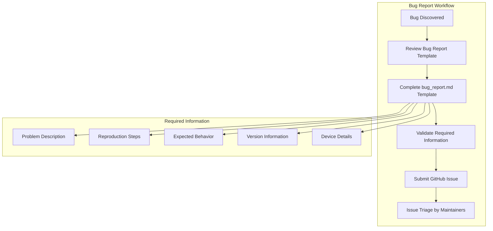
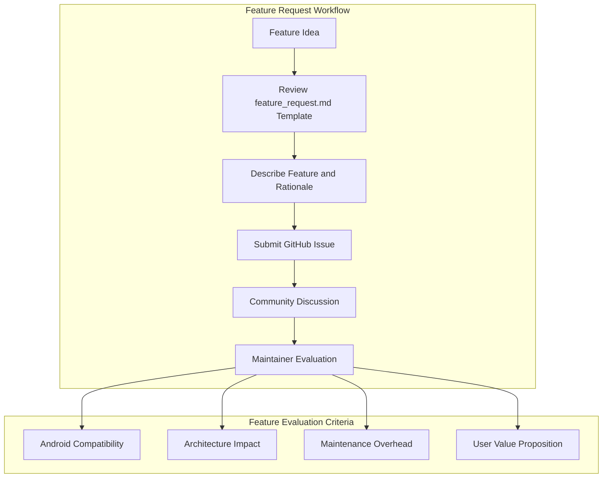
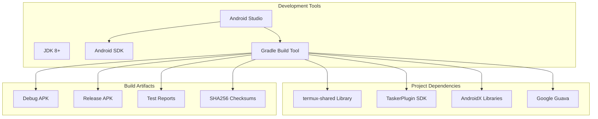
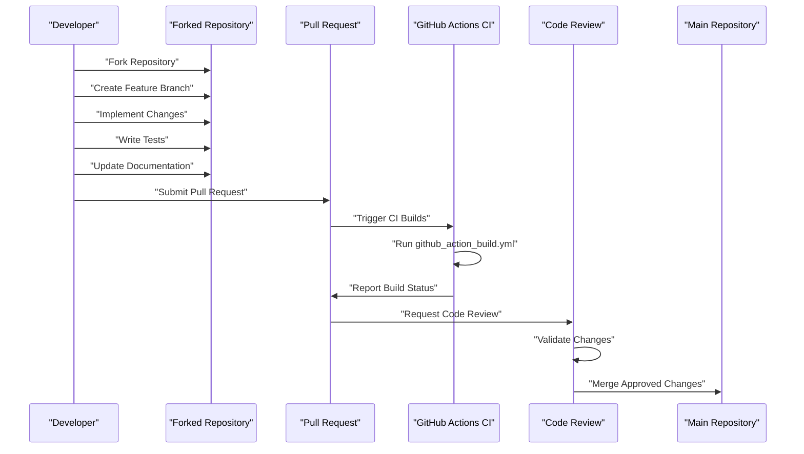
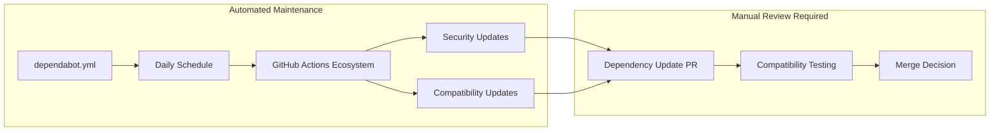

<!-- source: DeepWiki mcp.deepwiki.com · repo termux/termux-tasker · page 7 Contributing · fetched 2026-10-26 -->

# Contributing

Relevant source files

The following files were used as context for generating this wiki page:

- [.github/ISSUE_TEMPLATE/bug_report.md](.github/ISSUE_TEMPLATE/bug_report.md)
- [.github/ISSUE_TEMPLATE/feature_request.md](.github/ISSUE_TEMPLATE/feature_request.md)
- [.github/dependabot.yml](.github/dependabot.yml)
- [.gitignore](.gitignore)

This document provides guidance for contributors to the Termux:Tasker plugin project, covering issue reporting, development setup, and contribution workflow. For information about the build system configuration, see [Build System](#4.1). For details about the CI/CD pipeline, see [CI/CD Pipeline](#4.2).

## Issue Reporting and Feature Requests

The project uses structured GitHub issue templates to streamline bug reports and feature requests.

### Bug Reporting Process

The bug report template requires specific information including Termux application version, Android OS version, and device model. The template explicitly states that Android 5.x - 6.x support has ended.

**Sources:** [.github/ISSUE_TEMPLATE/bug_report.md:1-36]()

### Feature Request Process

**Sources:** [.github/ISSUE_TEMPLATE/feature_request.md:1-18]()

## Development Environment Setup

### Repository Structure

The project follows standard Android application structure with specific tooling for automated maintenance:

| Component | Purpose | Location |
|-----------|---------|----------|
| Build Configuration | Gradle build scripts and dependency management | `app/build.gradle` |
| Source Code | Java/Kotlin application code | `app/src/main/java/` |
| Resources | Android resources (layouts, strings, etc.) | `app/src/main/res/` |
| CI/CD | GitHub Actions workflows | `.github/workflows/` |
| Issue Templates | Structured bug reports and feature requests | `.github/ISSUE_TEMPLATE/` |
| Dependency Management | Automated dependency updates | `.github/dependabot.yml` |

### Development Dependencies

**Sources:** [.gitignore:1-9]()

### Git Workflow

The repository uses standard Git practices with automated tooling:

- **Ignored Files**: Build artifacts, IDE files, and sensitive configuration are excluded via `.gitignore`
- **Dependency Updates**: Automated daily dependency updates via Dependabot for GitHub Actions
- **Branch Protection**: Main branch likely protected (standard practice for maintained projects)

**Sources:** [.gitignore:1-9](), [.github/dependabot.yml:1-7]()

## Contribution Workflow

### Code Contribution Process

### Automated Quality Assurance

The project includes automated dependency management to maintain security and compatibility:

**Sources:** [.github/dependabot.yml:1-7]()

## Development Guidelines

### Android Compatibility Requirements

Based on the issue templates, the project has specific Android version support policies:

- **Minimum Support**: Android 7.0+ (API level 24+)
- **Deprecated Support**: Android 5.x - 6.x support has ended
- **Target Support**: Current Android versions with backward compatibility

### Code Quality Standards

Contributors should adhere to established patterns found in the existing codebase:

| Aspect | Requirement |
|--------|-------------|
| **Architecture** | Follow Android plugin architecture patterns as shown in `EditConfigurationActivity`, `FireReceiver`, and `PluginResultsService` |
| **Security** | Implement proper permission checks and policy validation similar to existing security model |
| **Error Handling** | Use consistent error reporting mechanisms compatible with Tasker/Locale plugin APIs |
| **Testing** | Include appropriate unit and integration tests for new functionality |
| **Documentation** | Update relevant documentation and code comments |

### Build and Testing

Before submitting contributions:

1. **Local Build**: Ensure clean local build using Gradle
2. **Test Execution**: Run existing test suites
3. **Integration Testing**: Test with actual Tasker/Locale apps
4. **Documentation**: Update relevant documentation files

**Sources:** [.github/ISSUE_TEMPLATE/bug_report.md:10-11](), [.github/ISSUE_TEMPLATE/feature_request.md:10-11]()

## Community Guidelines

### Communication

- Use GitHub issues for bug reports and feature requests
- Follow the provided templates for structured communication
- Provide complete information including device and version details
- Search existing issues before creating new ones

### Contribution Standards

- Maintain compatibility with the existing plugin architecture
- Follow Android development best practices
- Ensure contributions don't break existing functionality
- Consider security implications of changes, especially for command execution features

The project maintains automated tooling to reduce maintenance burden while ensuring code quality and security through systematic dependency management and CI/CD processes.