# Page: Overview

# Overview

<details>
<summary>Relevant source files</summary>

The following files were used as context for generating this wiki page:

- [LICENSE.md](LICENSE.md)
- [README.md](README.md)
- [app/src/main/res/values/strings.xml](app/src/main/res/values/strings.xml)
- [fastlane/metadata/android/en-US/changelogs/6.txt](fastlane/metadata/android/en-US/changelogs/6.txt)
- [fastlane/metadata/android/en-US/changelogs/7.txt](fastlane/metadata/android/en-US/changelogs/7.txt)

</details>


This document provides a comprehensive overview of the Termux:Tasker plugin system, which enables Tasker and other automation apps to execute commands within the Termux environment. The plugin acts as a bridge between external automation applications and the Termux terminal emulator, providing a secure and configurable interface for command execution.

The scope of this document covers the plugin's architecture, core components, integration mechanisms, and security model. For detailed implementation specifics of individual components, see [Implementation Details](#5). For build system and deployment information, see [Development Guide](#4).

## System Purpose and Architecture

Termux:Tasker is an Android plugin application that implements the Locale Plugin API to allow external automation apps like Tasker to execute commands in the Termux environment. The plugin provides both foreground terminal session execution and background command execution capabilities.

### High-Level System Architecture

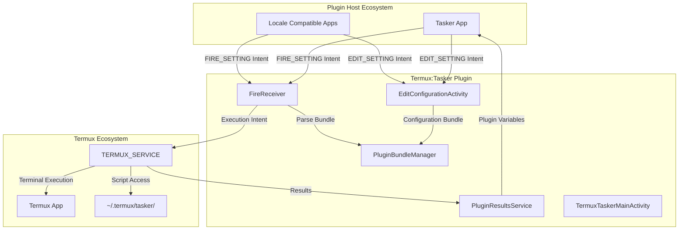

**Sources:** [README.md:1-394](), [app/src/main/res/values/strings.xml:1-76]()

### Plugin Execution Lifecycle

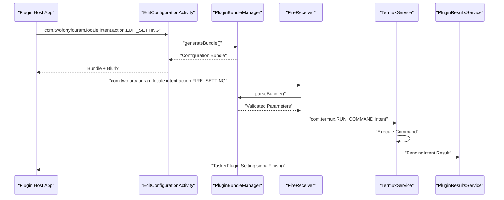

**Sources:** [README.md:120-128](), [app/src/main/res/values/strings.xml:36-45]()

## Core Components

The plugin implements the standard Android plugin architecture with several key components that handle configuration, execution, and result processing.

### Application Components

| Component | Type | Purpose |
|-----------|------|---------|
| `EditConfigurationActivity` | Activity | User interface for configuring plugin actions |
| `TermuxTaskerMainActivity` | Activity | Main launcher activity for the plugin app |
| `FireReceiver` | BroadcastReceiver | Entry point for executing configured commands |
| `PluginResultsService` | Service | Handles command execution results and variable setting |
| `TermuxTaskerApplication` | Application | Application context and initialization |

### Configuration Parameters

The plugin supports the following configuration options through `EditConfigurationActivity`:

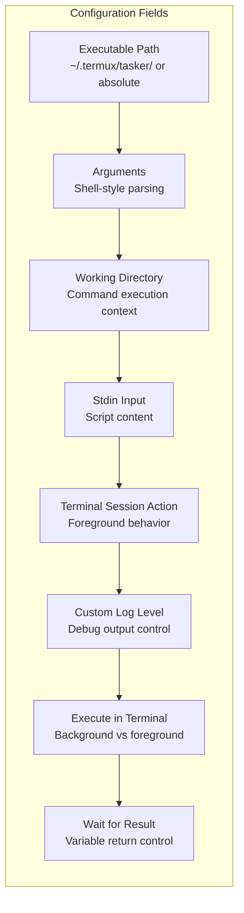

**Sources:** [app/src/main/res/values/strings.xml:38-45](), [README.md:132-217]()

### Data Serialization and Validation

The `PluginBundleManager` handles serialization of configuration data and validation of parameters:

- **Bundle Generation**: Converts UI configuration to Android Bundle format
- **Bundle Parsing**: Extracts and validates parameters from stored bundles  
- **Parameter Validation**: Ensures executable paths, permissions, and arguments are valid
- **Blurb Generation**: Creates human-readable summaries for plugin host apps

**Sources:** [README.md:132-217](), [app/src/main/res/values/strings.xml:63-69]()

## Security Model

The plugin implements multiple layers of security to prevent unauthorized command execution:

### Permission Requirements

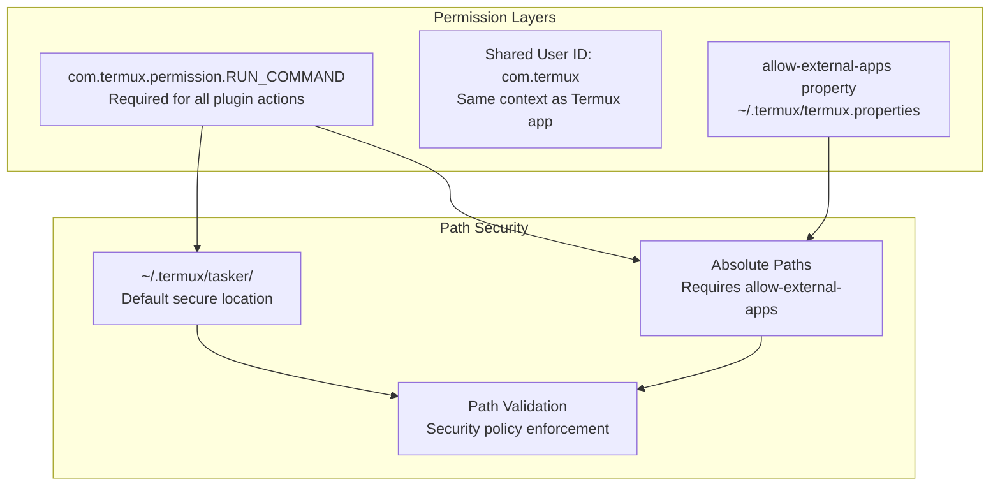

**Sources:** [README.md:66-111](), [app/src/main/res/values/strings.xml:58-59]()

### File System Security

- Scripts in `~/.termux/tasker/` directory execute with automatic permissions
- Absolute paths require `allow-external-apps=true` in `termux.properties`
- Path validation prevents directory traversal and unauthorized access
- Execute permissions are automatically set for scripts in the tasker directory

**Sources:** [README.md:75-111](), [app/src/main/res/values/strings.xml:8-9]()

## Plugin Variables and Results

The plugin returns execution results through standardized variables:

| Variable | Content | Conditions |
|----------|---------|------------|
| `%stdout` | Command standard output | Background execution or terminal transcript |
| `%stderr` | Command standard error | Background execution only |
| `%result` | Command exit code | When waiting for results |
| `%err` | Plugin error code | Plugin execution failures |
| `%errmsg` | Plugin error message | Plugin execution failures |
| `%stdout_original_length` | Original stdout length | When output is truncated |
| `%stderr_original_length` | Original stderr length | When output is truncated |

**Sources:** [README.md:222-255](), [app/src/main/res/values/strings.xml:63-69]()

## Integration Points

### Termux Ecosystem Integration

The plugin integrates with the Termux ecosystem through:

- **Command Execution**: Uses `com.termux.RUN_COMMAND` intent for execution
- **File System Access**: Leverages Termux home directory and prefix paths
- **Terminal Sessions**: Supports both background and foreground terminal execution
- **Environment Variables**: Accesses Termux `$PREFIX` and `$HOME` variables

### Plugin Host Integration

The plugin implements the Locale Plugin API standard:

- **Configuration Intent**: `com.twofortyfouram.locale.intent.action.EDIT_SETTING`
- **Execution Intent**: `com.twofortyfouram.locale.intent.action.FIRE_SETTING`
- **Result Callbacks**: `TaskerPlugin.Setting.signalFinish()` for result delivery
- **Variable Setting**: Plugin host variable population through result bundles

**Sources:** [README.md:6-7](), [README.md:120-128](), [app/src/main/res/values/strings.xml:17-19]()

---

# Page: Architecture

# Architecture

<details>
<summary>Relevant source files</summary>

The following files were used as context for generating this wiki page:

- [LICENSE.md](LICENSE.md)
- [README.md](README.md)
- [app/src/main/AndroidManifest.xml](app/src/main/AndroidManifest.xml)
- [fastlane/metadata/android/en-US/changelogs/6.txt](fastlane/metadata/android/en-US/changelogs/6.txt)
- [fastlane/metadata/android/en-US/changelogs/7.txt](fastlane/metadata/android/en-US/changelogs/7.txt)

</details>


This document describes the high-level system architecture of the Termux:Tasker plugin, including how it integrates with plugin host applications (Tasker, Locale) and the Termux ecosystem to enable command execution capabilities. For details on specific user interface components, see [User Interface](#3). For implementation details of security mechanisms, see [Security Model](#5.2).

## System Overview

Termux:Tasker is an Android plugin application that acts as a bridge between automation apps (plugin hosts) and the Termux terminal environment. The architecture follows the standard Android plugin model using intent-based communication while implementing additional security layers and command execution orchestration.

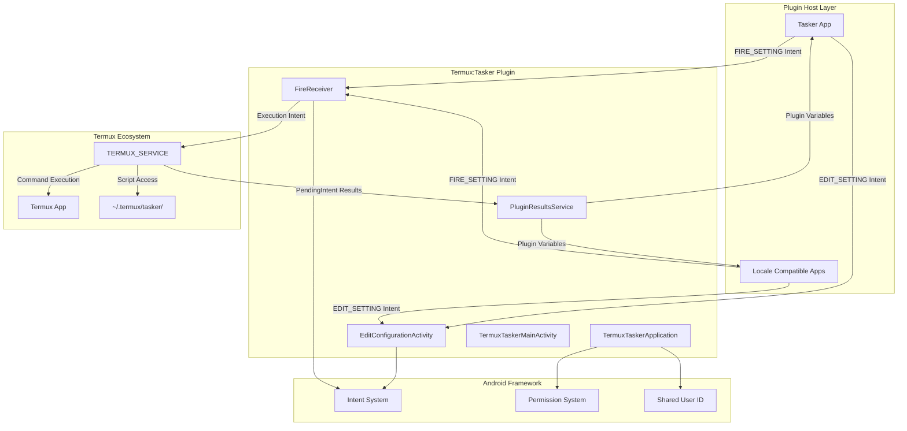

**Architecture Overview**
Sources: [app/src/main/AndroidManifest.xml:1-85](), [README.md:1-394]()

## Plugin Integration Model

The plugin implements the standard Locale/Tasker plugin API using two primary intent actions for configuration and execution phases.

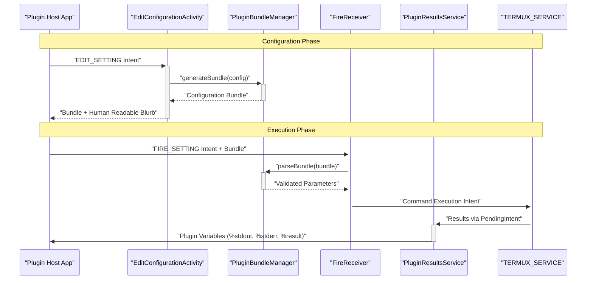

**Plugin Integration Sequence**
Sources: [app/src/main/AndroidManifest.xml:39-51](), [app/src/main/AndroidManifest.xml:69-78]()

### Intent Actions and Permissions

The plugin registers for two standard intent actions defined by the Locale plugin specification:

- **EDIT_SETTING**: `com.twofortyfouram.locale.intent.action.EDIT_SETTING` handled by `EditConfigurationActivity`
- **FIRE_SETTING**: `com.twofortyfouram.locale.intent.action.FIRE_SETTING` handled by `FireReceiver`

The `FireReceiver` requires the `com.termux.permission.RUN_COMMAND` permission to prevent unauthorized command execution.

Sources: [app/src/main/AndroidManifest.xml:49](), [app/src/main/AndroidManifest.xml:76](), [app/src/main/AndroidManifest.xml:73]()

## Core Application Components

The plugin application consists of standard Android components organized around the plugin lifecycle and command execution flow.

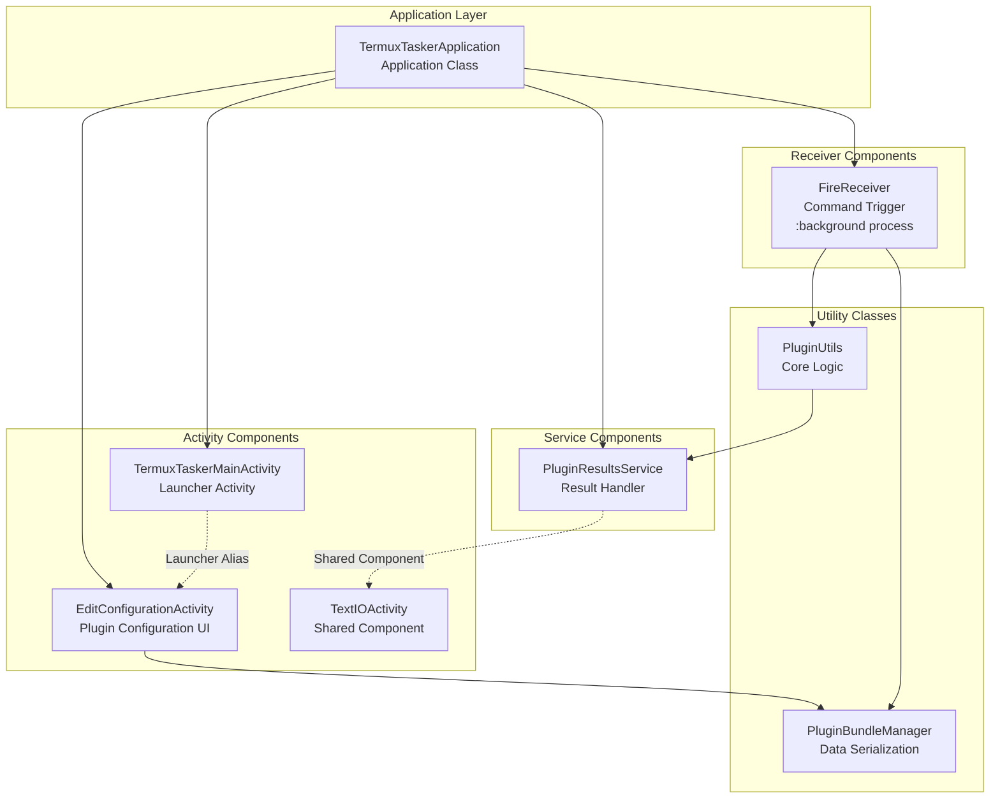

**Core Component Architecture**
Sources: [app/src/main/AndroidManifest.xml:8](), [app/src/main/AndroidManifest.xml:40](), [app/src/main/AndroidManifest.xml:16](), [app/src/main/AndroidManifest.xml:70](), [app/src/main/AndroidManifest.xml:82]()

### Component Responsibilities

| Component | Process | Exported | Purpose |
|-----------|---------|----------|---------|
| `TermuxTaskerApplication` | Main | N/A | Application lifecycle management |
| `EditConfigurationActivity` | Main | Yes | Plugin configuration interface |
| `TermuxTaskerMainActivity` | Main | Yes | Main launcher activity |
| `FireReceiver` | `:background` | Yes | Command execution trigger |
| `PluginResultsService` | Main | No | Result processing and delivery |

The `FireReceiver` runs in a separate `:background` process to handle command execution without blocking the main UI thread.

Sources: [app/src/main/AndroidManifest.xml:72](), [app/src/main/AndroidManifest.xml:41](), [app/src/main/AndroidManifest.xml:17](), [app/src/main/AndroidManifest.xml:83]()

## Security and Permission Model

The plugin implements a multi-layered security model to control command execution and file system access.

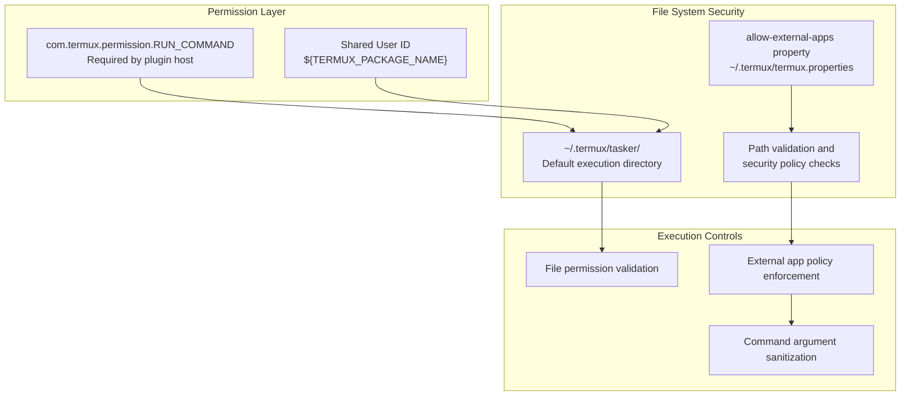

**Security Architecture**
Sources: [app/src/main/AndroidManifest.xml:4](), [app/src/main/AndroidManifest.xml:73](), [README.md:66-87]()

### Permission Requirements

1. **RUN_COMMAND Permission**: Plugin host apps must be granted `com.termux.permission.RUN_COMMAND` to execute any commands
2. **Shared User ID**: Both Termux and Termux:Tasker share the same user ID (`${TERMUX_PACKAGE_NAME}`) for file system access
3. **External Apps Policy**: Commands outside `~/.termux/tasker/` require `allow-external-apps=true` in termux properties

Sources: [README.md:67-72](), [README.md:84-87]()

## Data Flow and Bundle Management

Plugin configuration and execution data flows through a centralized bundle management system that handles serialization, validation, and security policy enforcement.

```mermaid
graph LR
    subgraph "Configuration Input"
        UserInput["User Configuration<br/>EditConfigurationActivity"]
        ConfigFields["Executable, Arguments<br/>Working Directory, Stdin<br/>Session Action, Log Level"]
    end
    
    subgraph "Bundle Processing"
        BundleGen["generateBundle()<br/>PluginBundleManager"]
        BundleValidation["parseBundle()<br/>Validation & Security"]
        BlurbGen["generateBlurb()<br/>Human-readable summary"]
    end
    
    subgraph "Command Execution"
        ArgTokenizer["ArgumentTokenizer<br/>Argument parsing"]
        PathResolver["Path resolution<br/>$PREFIX, ~/ expansion"]
        SecurityCheck["Security policy<br/>validation"]
    end
    
    subgraph "Result Processing"
        PluginVars["Plugin Variables<br/>%stdout, %stderr, %result<br/>%err, %errmsg"]
        HostResponse["Host app response<br/>TaskerPlugin API"]
    end
    
    UserInput --> ConfigFields
    ConfigFields --> BundleGen
    BundleGen --> BundleValidation
    BundleGen --> BlurbGen
    BundleValidation --> ArgTokenizer
    ArgTokenizer --> PathResolver
    PathResolver --> SecurityCheck
    SecurityCheck --> PluginVars
    PluginVars --> HostResponse
```

**Data Flow Architecture**
Sources: [README.md:132-217](), [README.md:222-255]()

### Bundle Structure and Variables

The plugin uses Android Bundle objects to serialize configuration data between the host app and plugin components. Key configuration parameters include:

- **Executable**: Script path or command (supports `$PREFIX/`, `~/` prefixes)
- **Arguments**: Command arguments processed by `ArgumentTokenizer`
- **Working Directory**: Command execution directory
- **Stdin**: Script content for dynamic execution
- **Session Action**: Terminal session behavior control
- **Log Level**: Custom logging configuration

Result data is returned to the host app through plugin variables with automatic truncation handling for large outputs.

Sources: [README.md:138-217](), [README.md:226-255]()

---

# Page: Plugin Integration Model

# Plugin Integration Model

<details>
<summary>Relevant source files</summary>

The following files were used as context for generating this wiki page:

- [app/src/main/AndroidManifest.xml](app/src/main/AndroidManifest.xml)
- [app/src/main/java/com/termux/tasker/ArgumentTokenizer.java](app/src/main/java/com/termux/tasker/ArgumentTokenizer.java)
- [app/src/main/java/com/termux/tasker/FireReceiver.java](app/src/main/java/com/termux/tasker/FireReceiver.java)
- [app/src/main/res/values/strings.xml](app/src/main/res/values/strings.xml)

</details>


This document explains how the Termux:Tasker plugin integrates with plugin host applications such as Tasker and other Locale-compatible automation apps. It covers the standard plugin API implementation, intent-based communication flow, data serialization mechanisms, and result handling patterns.

For detailed information about the plugin's core components and their specific responsibilities, see [Core Components](#2.2). For security aspects of the integration model, see [Security Model](#5.2).

## Plugin API Overview

The Termux:Tasker plugin implements the standard Locale plugin API, which defines a two-phase integration model for automation apps. This API uses Android's intent system to facilitate communication between plugin host applications and plugin implementations.

The integration is built around two primary intent actions that define the plugin lifecycle:

| Intent Action | Purpose | Handled By |
|---------------|---------|------------|
| `com.twofortyfouram.locale.intent.action.EDIT_SETTING` | Configuration phase | `EditConfigurationActivity` |
| `com.twofortyfouram.locale.intent.action.FIRE_SETTING` | Execution phase | `FireReceiver` |

### Plugin Discovery and Registration

Plugin host applications discover available plugins by querying the Android system for activities and broadcast receivers that declare intent filters for the Locale API actions. The plugin registers itself through manifest declarations that make it discoverable by automation apps.

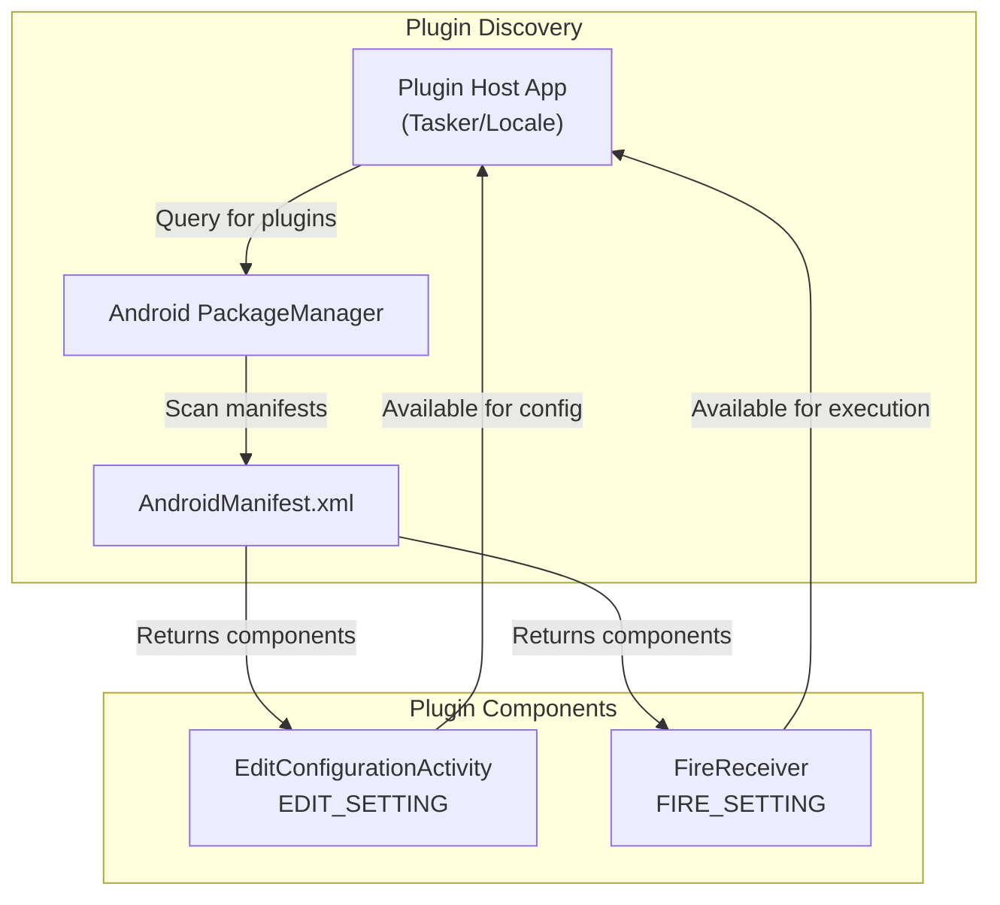

Sources: [app/src/main/AndroidManifest.xml:39-51](), [app/src/main/AndroidManifest.xml:69-78]()

## Intent-Based Communication Flow

The plugin integration follows a structured communication pattern using Android intents to exchange data and trigger actions between the plugin host and the Termux:Tasker plugin.

### Configuration Phase Flow

During configuration, the plugin host application launches the `EditConfigurationActivity` to allow users to configure plugin parameters. The activity returns a serialized configuration bundle and a human-readable description.

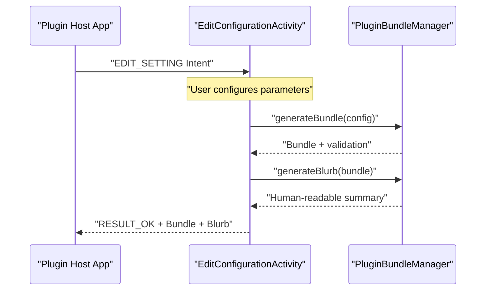

### Execution Phase Flow

When the plugin host determines that a configured action should execute, it sends a `FIRE_SETTING` intent to the `FireReceiver` with the previously configured bundle data.

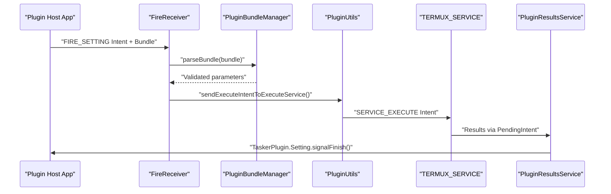

Sources: [app/src/main/java/com/termux/tasker/FireReceiver.java:35-198]()

## Data Serialization and Bundle Management

The plugin uses Android's `Bundle` mechanism to serialize configuration data for transmission between the plugin host and the plugin implementation. The `PluginBundleManager` class handles all aspects of bundle creation, validation, and parsing.

### Bundle Structure

The plugin defines specific bundle keys for different configuration parameters:

| Bundle Key | Purpose | Data Type |
|------------|---------|-----------|
| `EXTRA_EXECUTABLE` | Path to executable file | String |
| `EXTRA_ARGUMENTS` | Command line arguments | String |
| `EXTRA_WORKDIR` | Working directory path | String |
| `EXTRA_STDIN` | Standard input data | String |
| `EXTRA_TERMINAL` | Execute in terminal flag | Boolean |
| `EXTRA_WAIT_FOR_RESULT` | Wait for completion flag | Boolean |
| `EXTRA_SESSION_ACTION` | Terminal session action | String |
| `EXTRA_BACKGROUND_CUSTOM_LOG_LEVEL` | Custom log level | Integer |

### Bundle Processing Pipeline

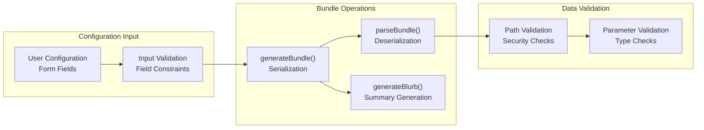

Sources: [app/src/main/java/com/termux/tasker/FireReceiver.java:63-68](), [app/src/main/java/com/termux/tasker/FireReceiver.java:72-84]()

## Argument Processing and Tokenization

The plugin implements sophisticated argument parsing to handle command-line style arguments with proper quoting and escaping support. The `ArgumentTokenizer` class provides shell-like argument parsing capabilities.

### Tokenization Features

The argument tokenizer supports:
- Single and double quote handling
- Backslash escaping within double quotes
- Whitespace separation with quote preservation
- State machine-based parsing for robust handling

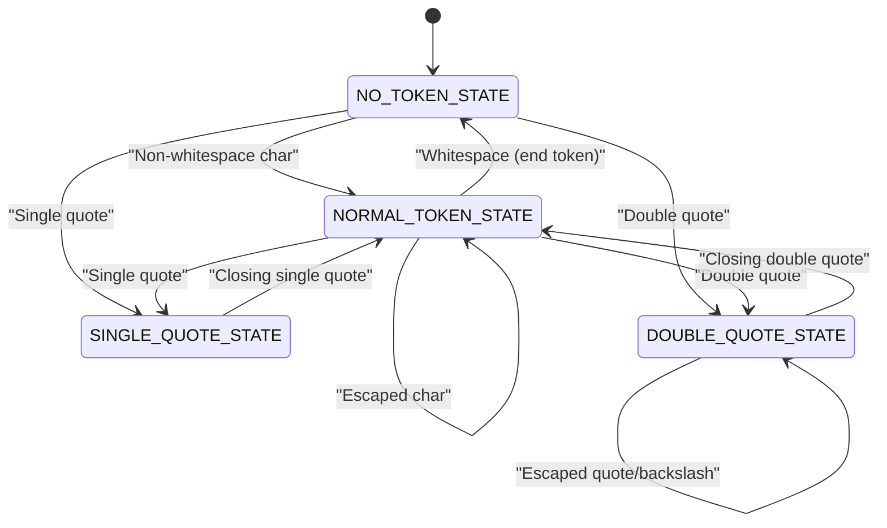

Sources: [app/src/main/java/com/termux/tasker/ArgumentTokenizer.java:61-187](), [app/src/main/java/com/termux/tasker/FireReceiver.java:170-177]()

## Result Handling and Callbacks

The plugin implements asynchronous result handling to support long-running commands and provide feedback to plugin host applications. Results are delivered through a `PendingIntent` mechanism that allows the Termux service to callback to the plugin.

### Result Processing Flow

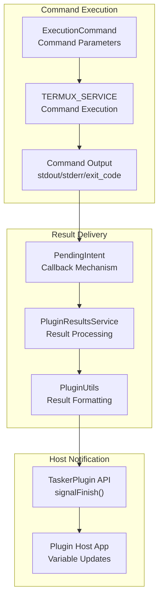

### Plugin Variables

The plugin exposes command execution results through standardized variable names that plugin host applications can access:

| Variable Name | Content | Description |
|---------------|---------|-------------|
| `%stdout` | Command standard output | Text written to stdout |
| `%stderr` | Command standard error | Text written to stderr |
| `%result` | Exit code | Numeric exit status |
| `%err` | Error flag | Boolean success/failure |
| `%errmsg` | Error message | Human-readable error description |

Sources: [app/src/main/java/com/termux/tasker/FireReceiver.java:183-197]()

## Security and Permission Integration

The plugin integration model incorporates multiple security layers to ensure safe execution of commands and proper permission handling.

### Permission Model

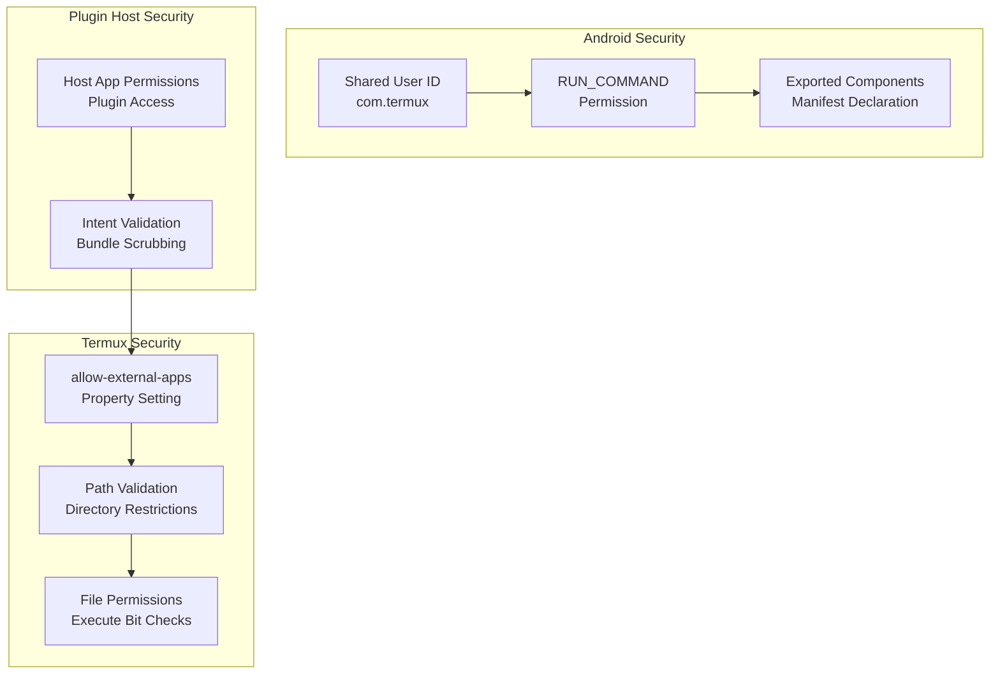

The plugin implements the `BundleScrubber` pattern to sanitize incoming intent data and prevent malicious bundle manipulation. Additionally, path validation ensures that executables are either in the designated Termux tasker directory or explicitly allowed through the `allow-external-apps` property.

Sources: [app/src/main/AndroidManifest.xml:73](), [app/src/main/java/com/termux/tasker/FireReceiver.java:58-60](), [app/src/main/java/com/termux/tasker/FireReceiver.java:111-118]()

---

# Page: Core Components

# Core Components

<details>
<summary>Relevant source files</summary>

The following files were used as context for generating this wiki page:

- [app/src/main/AndroidManifest.xml](app/src/main/AndroidManifest.xml)
- [app/src/main/java/com/termux/tasker/TermuxTaskerApplication.java](app/src/main/java/com/termux/tasker/TermuxTaskerApplication.java)
- [app/src/main/java/com/termux/tasker/activities/TermuxTaskerMainActivity.java](app/src/main/java/com/termux/tasker/activities/TermuxTaskerMainActivity.java)
- [app/src/main/res/layout/activity_termux_tasker_main.xml](app/src/main/res/layout/activity_termux_tasker_main.xml)

</details>


This document provides an overview of the main Android application components that comprise the Termux:Tasker plugin architecture. It covers the fundamental Activities, Services, Broadcast Receivers, and Application class that enable the plugin's functionality. For detailed information about the plugin's integration with external apps, see [Plugin Integration Model](#2.1). For the complete command execution lifecycle, see [Command Execution Flow](#2.3).

## Application Class

The `TermuxTaskerApplication` class serves as the central application entry point and handles global initialization tasks for the plugin.

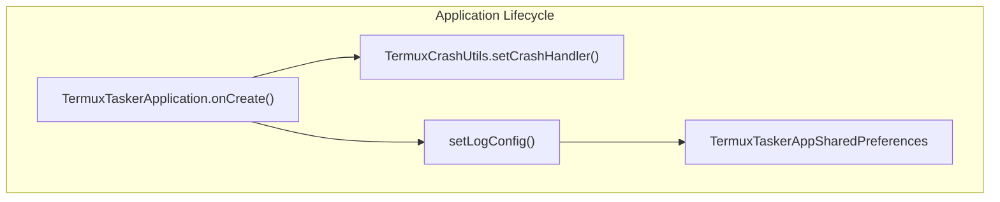

**Application Initialization**

The application class performs several critical initialization tasks:

- **Crash Handling**: Sets up crash reporting via `TermuxCrashUtils.setCrashHandler()` to capture and log application crashes
- **Logging Configuration**: Configures the global logging system with appropriate log levels and tags based on user preferences
- **Shared Preferences**: Initializes access to application-wide settings and preferences

**Sources:** [app/src/main/java/com/termux/tasker/TermuxTaskerApplication.java:12-39](), [app/src/main/AndroidManifest.xml:7-13]()

## Activities

The plugin contains several Activity components that handle different aspects of the user interface and plugin integration.

### Main Activity Components

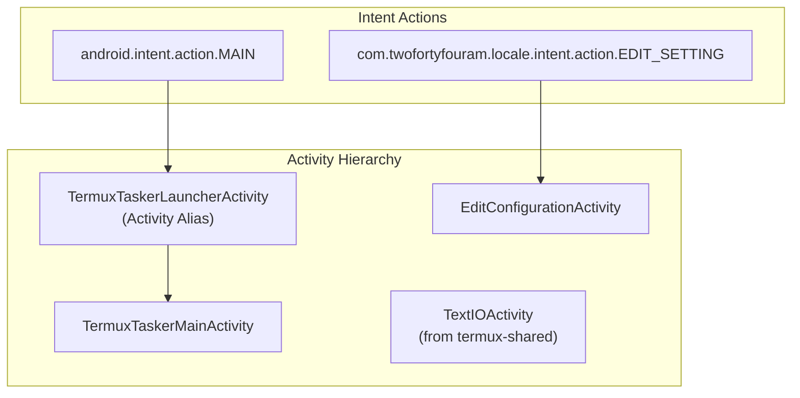

**TermuxTaskerMainActivity**

The primary user interface activity that provides:

- Application information display with links to GitHub repositories
- Launcher icon management functionality (enable/disable launcher visibility)
- Theme configuration and night mode support
- Integration with the termux-shared toolbar and styling system

**EditConfigurationActivity**

The plugin configuration interface that integrates with Tasker/Locale apps:

- Receives `EDIT_SETTING` intents from plugin host applications
- Provides user interface for configuring plugin execution parameters
- Exports plugin configuration data back to host applications
- Must meet specific Locale plugin requirements (exported, labeled, icon)

**Activity Aliases and Launcher Integration**

The `TermuxTaskerLauncherActivity` is an activity-alias that allows users to hide/show the application launcher icon while maintaining the same target activity.

**Sources:** [app/src/main/AndroidManifest.xml:15-59](), [app/src/main/java/com/termux/tasker/activities/TermuxTaskerMainActivity.java:19-100]()

## Services

### PluginResultsService

The `PluginResultsService` handles asynchronous communication between the Termux execution environment and the plugin host applications.

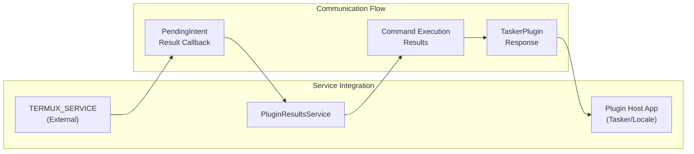

**Key Characteristics:**

- **Non-exported Service**: Configured with `android:exported="false"` for internal use only
- **Result Processing**: Receives execution results from Termux services via PendingIntent callbacks
- **Host Communication**: Formats and delivers results back to plugin host applications
- **Asynchronous Operation**: Enables non-blocking command execution with result delivery

**Sources:** [app/src/main/AndroidManifest.xml:80-83]()

## Broadcast Receivers

### FireReceiver

The `FireReceiver` is the primary execution trigger component that receives and processes plugin activation requests from host applications.

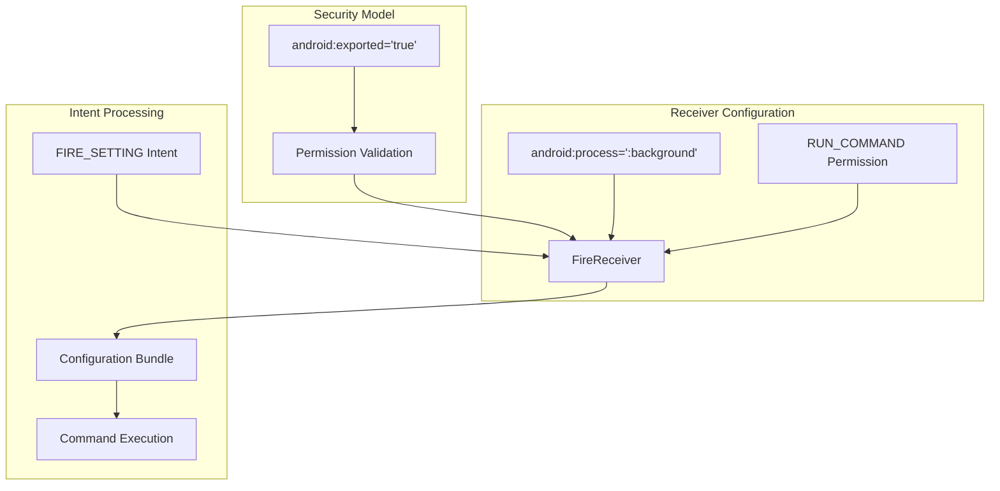

**Process Isolation**

The receiver runs in a separate background process (`:background`) to isolate plugin execution from the main application process.

**Permission Model**

- **Required Permission**: `${TERMUX_PACKAGE_NAME}.permission.RUN_COMMAND` 
- **Exported Component**: Must be publicly accessible to plugin host applications
- **Security Validation**: Ensures only authorized applications can trigger plugin execution

**Intent Handling**

Processes `FIRE_SETTING` intents containing:
- Plugin configuration bundles
- Execution parameters
- Host application context information

**Sources:** [app/src/main/AndroidManifest.xml:69-78]()

## Component Integration Architecture

```mermaid
graph TB
    subgraph "Android Framework Layer"
        AppClass["TermuxTaskerApplication"]
    end
    
    subgraph "User Interface Layer"
        MainUI["TermuxTaskerMainActivity"]
        ConfigUI["EditConfigurationActivity"]
        TextIO["TextIOActivity"]
    end
    
    subgraph "Plugin Integration Layer"
        FireRec["FireReceiver<br/>(:background process)"]
        ResultsSvc["PluginResultsService"]
    end
    
    subgraph "External Integration"
        PluginHost["Plugin Host Apps<br/>(Tasker/Locale)"]
        TermuxCore["Termux Execution<br/>Environment"]
    end
    
    AppClass --> MainUI
    AppClass --> ConfigUI
    
    PluginHost -->|"EDIT_SETTING"| ConfigUI
    PluginHost -->|"FIRE_SETTING"| FireRec
    
    FireRec -->|"Execute Command"| TermuxCore
    TermuxCore -->|"Results via PendingIntent"| ResultsSvc
    ResultsSvc -->|"Plugin Response"| PluginHost
    
    ConfigUI -->|"Configuration Bundle"| PluginHost
```

**Process Architecture**

The plugin utilizes multiple processes for isolation and security:

- **Main Process**: Hosts the Application class and user interface activities
- **Background Process**: Runs the FireReceiver for command execution isolation
- **Service Process**: Handles result processing and communication with host apps

**Component Communication**

- **Inter-Process Communication**: Uses Android's Intent system and PendingIntent callbacks
- **Data Serialization**: Configuration data flows through Bundle objects between components
- **Permission Boundaries**: Each component enforces appropriate permission requirements

**Sources:** [app/src/main/AndroidManifest.xml:1-86]()

## Manifest Structure and Component Declaration

```mermaid
graph TB
    subgraph "Application Declaration"
        AppRoot["<application>"]
        SharedUserID["android:sharedUserId='${TERMUX_PACKAGE_NAME}'"]
    end
    
    subgraph "Activity Components"
        MainActDecl["TermuxTaskerMainActivity<br/>Theme: NoActionBar"]
        LauncherDecl["TermuxTaskerLauncherActivity<br/>MAIN/LAUNCHER"]
        EditActDecl["EditConfigurationActivity<br/>EDIT_SETTING Intent Filter"]
        TextIODecl["TextIOActivity<br/>Internal Use"]
    end
    
    subgraph "Service Components"
        ResultsSvcDecl["PluginResultsService<br/>Not Exported"]
    end
    
    subgraph "Receiver Components"
        FireRecDecl["FireReceiver<br/>Background Process<br/>RUN_COMMAND Permission<br/>FIRE_SETTING Intent Filter"]
    end
    
    AppRoot --> SharedUserID
    AppRoot --> MainActDecl
    AppRoot --> LauncherDecl
    AppRoot --> EditActDecl
    AppRoot --> TextIODecl
    AppRoot --> ResultsSvcDecl
    AppRoot --> FireRecDecl
```

**Shared User Configuration**

The application runs under the same user ID as the main Termux application (`${TERMUX_PACKAGE_NAME}`) enabling:
- Shared file system access
- Inter-process communication with Termux services
- Consistent permission model across the Termux ecosystem

**Component Export Rules**

- **Exported Activities**: `TermuxTaskerMainActivity`, `EditConfigurationActivity`, and launcher alias for external access
- **Exported Receiver**: `FireReceiver` for plugin host integration
- **Non-exported Service**: `PluginResultsService` for internal result processing only
- **Non-exported Activity**: `TextIOActivity` for internal text I/O operations

**Sources:** [app/src/main/AndroidManifest.xml:1-86]()

---

# Page: Command Execution Flow

# Command Execution Flow

<details>
<summary>Relevant source files</summary>

The following files were used as context for generating this wiki page:

- [LICENSE.md](LICENSE.md)
- [README.md](README.md)
- [app/src/main/java/com/termux/tasker/ArgumentTokenizer.java](app/src/main/java/com/termux/tasker/ArgumentTokenizer.java)
- [app/src/main/java/com/termux/tasker/FireReceiver.java](app/src/main/java/com/termux/tasker/FireReceiver.java)
- [app/src/main/java/com/termux/tasker/utils/PluginUtils.java](app/src/main/java/com/termux/tasker/utils/PluginUtils.java)
- [fastlane/metadata/android/en-US/changelogs/6.txt](fastlane/metadata/android/en-US/changelogs/6.txt)
- [fastlane/metadata/android/en-US/changelogs/7.txt](fastlane/metadata/android/en-US/changelogs/7.txt)

</details>


This document describes the complete lifecycle of command execution in the Termux:Tasker plugin, from the initial trigger by a plugin host app through to the delivery of execution results. This covers the technical flow through the plugin's core components and their interactions with the Termux execution service.

For information about the plugin's integration model with host apps, see [Plugin Integration Model](#2.1). For details about the individual components mentioned here, see [Core Components](#2.2).

## Overview

The command execution flow follows a multi-stage process involving intent-based communication between the plugin components and the Termux execution service. The flow varies depending on whether results are expected to be returned synchronously and whether commands execute in background or terminal session mode.

## Execution Flow Sequence

The complete execution sequence involves several key phases: intent reception, configuration parsing, command preparation, execution service interaction, and result delivery.

```mermaid
sequenceDiagram
    participant Host as "Plugin Host App<br/>(Tasker/Locale)"
    participant Fire as "FireReceiver"
    participant Bundle as "PluginBundleManager"
    participant Utils as "PluginUtils"
    participant Service as "TERMUX_SERVICE"
    participant Results as "PluginResultsService"
    
    Host->>Fire: "FIRE_SETTING Intent<br/>+ Bundle extras"
    Fire->>Bundle: "parseBundle(context, bundle)"
    Bundle-->>Fire: "validation result"
    
    alt Configuration Invalid
        Fire->>Utils: "sendImmediateResultToPluginHostApp()<br/>RESULT_CODE_FAILED"
        Utils-->>Host: "Immediate failure result"
    else Configuration Valid
        Fire->>Fire: "Create ExecutionCommand<br/>Parse arguments with ArgumentTokenizer"
        Fire->>Fire: "Validate executable path<br/>Check allow-external-apps policy"
        Fire->>Utils: "sendExecuteIntentToExecuteService()<br/>with ExecutionCommand"
        
        alt Wait For Result = true
            Utils->>Utils: "Create PendingIntent for PluginResultsService"
            Utils->>Service: "Start service with execution intent<br/>+ PendingIntent"
            Utils-->>Host: "RESULT_CODE_PENDING"
            
            Service->>Service: "Execute command<br/>(background or terminal)"
            Service->>Results: "Send result via PendingIntent"
            Results->>Utils: "sendPendingResultToPluginHostApp()"
            Utils->>Host: "TaskerPlugin.Setting.signalFinish()<br/>with variables bundle"
        else Wait For Result = false
            Utils->>Service: "Start service with execution intent"
            Utils-->>Host: "RESULT_CODE_OK (immediate)"
        end
    end
```

Sources: [app/src/main/java/com/termux/tasker/FireReceiver.java:35-199](), [app/src/main/java/com/termux/tasker/utils/PluginUtils.java:153-208]()

## Intent Reception and Processing

The `FireReceiver` class serves as the entry point for all plugin execution requests. It receives `ACTION_FIRE_SETTING` intents from plugin host apps and performs initial processing.

### Initial Validation and Setup

The receiver performs several critical setup and validation steps:

```mermaid
flowchart TD
    Start["FireReceiver.onReceive()"] --> CrashHandler["TermuxCrashUtils.setCrashHandler()"]
    CrashHandler --> LogConfig["TermuxTaskerApplication.setLogConfig()"]
    LogConfig --> ActionCheck{"Intent action ==<br/>ACTION_FIRE_SETTING?"}
    
    ActionCheck -->|No| Return["Log error and return"]
    ActionCheck -->|Yes| Scrub["BundleScrubber.scrub()<br/>Clean intent + bundle"]
    
    Scrub --> ParseBundle["PluginBundleManager.parseBundle()"]
    ParseBundle --> BundleValid{"Bundle valid?"}
    
    BundleValid -->|No| SendError["PluginUtils.sendImmediateResultToPluginHostApp()<br/>RESULT_CODE_FAILED"]
    BundleValid -->|Yes| CreateExecCmd["Create ExecutionCommand object<br/>Extract configuration parameters"]
```

Sources: [app/src/main/java/com/termux/tasker/FireReceiver.java:35-68]()

### ExecutionCommand Creation

The receiver extracts configuration parameters from the intent bundle and populates an `ExecutionCommand` object:

| Parameter | Bundle Key | ExecutionCommand Field | Notes |
|-----------|------------|----------------------|-------|
| Executable path | `EXTRA_EXECUTABLE` | `executable` | Required field |
| Arguments string | `EXTRA_ARGUMENTS` | Arguments processed via `ArgumentTokenizer` | Optional |
| Working directory | `EXTRA_WORKDIR` | `workingDirectory` | Optional |
| Terminal mode | `EXTRA_TERMINAL` | `runner` | Boolean: APP_SHELL vs TERMINAL_SESSION |
| Wait for result | `EXTRA_WAIT_FOR_RESULT` | Used by `PluginUtils` | Controls result handling |
| Stdin data | `EXTRA_STDIN` | `stdin` | Background mode only |
| Custom log level | `EXTRA_BACKGROUND_CUSTOM_LOG_LEVEL` | `backgroundCustomLogLevel` | Background mode only |
| Session action | `EXTRA_SESSION_ACTION` | `sessionAction` | Terminal mode only |

Sources: [app/src/main/java/com/termux/tasker/FireReceiver.java:70-84]()

## Command Preparation and Validation

### Path Resolution and Security Validation

Before execution, the plugin performs comprehensive validation of the executable path and enforces security policies:

```mermaid
flowchart TD
    ExtractExec["Extract executable from bundle"] --> NullCheck{"Executable null<br/>or empty?"}
    NullCheck -->|Yes| ErrorNull["Send RESULT_CODE_FAILED<br/>'null or empty executable'"]
    NullCheck -->|No| Canonical["TermuxFileUtils.getCanonicalPath()<br/>Resolve relative to ~/.termux/tasker/"]
    
    Canonical --> PolicyCheck["PluginUtils.checkIfTermuxTaskerAllowExternalAppsPolicyIsViolated()"]
    PolicyCheck --> PolicyValid{"Policy compliant?"}
    
    PolicyValid -->|No| ErrorPolicy["Send RESULT_CODE_FAILED<br/>'allow-external-apps required'"]
    PolicyValid -->|Yes| FileValidation["FileUtils.validateRegularFileExistenceAndPermissions()"]
    
    FileValidation --> FileValid{"File valid and<br/>executable?"}
    FileValid -->|No| ErrorFile["Send RESULT_CODE_FAILED<br/>File validation error"]
    FileValid -->|Yes| WorkdirCheck{"Working directory<br/>specified?"}
    
    WorkdirCheck -->|Yes| ValidateWorkdir["TermuxFileUtils.validateDirectoryFileExistenceAndPermissions()"]
    WorkdirCheck -->|No| SymlinkCheck
    ValidateWorkdir --> WorkdirValid{"Workdir valid?"}
    WorkdirValid -->|No| ErrorWorkdir["Send RESULT_CODE_FAILED<br/>Workdir validation error"]
    WorkdirValid -->|Yes| SymlinkCheck
    
    SymlinkCheck["Check if executable is symlink<br/>Use original path if symlink"] --> ArgTokenize["ArgumentTokenizer.tokenize()<br/>Parse arguments string"]
```

Sources: [app/src/main/java/com/termux/tasker/FireReceiver.java:97-177](), [app/src/main/java/com/termux/tasker/utils/PluginUtils.java:507-520]()

### Argument Tokenization

The `ArgumentTokenizer` class processes the arguments string using shell-like parsing rules:

- Arguments split on whitespace unless quoted
- Single quotes preserve literal strings
- Double quotes allow escaping with backslashes
- Backslashes escape special characters in double-quoted strings

Sources: [app/src/main/java/com/termux/tasker/ArgumentTokenizer.java:61-187](), [app/src/main/java/com/termux/tasker/FireReceiver.java:174-177]()

## Execution Service Integration

### Intent Construction and Dispatch

Once validation completes, the plugin constructs an execution intent for the `TERMUX_SERVICE`:

```mermaid
flowchart TD
    BuildIntent["Create Intent with:<br/>ACTION_SERVICE_EXECUTE<br/>executable URI<br/>TERMUX_SERVICE component"] --> AddExtras["Add extras:<br/>EXTRA_ARGUMENTS<br/>EXTRA_WORKDIR<br/>EXTRA_STDIN<br/>EXTRA_SESSION_ACTION<br/>EXTRA_BACKGROUND_CUSTOM_LOG_LEVEL<br/>EXTRA_RUNNER<br/>EXTRA_PLUGIN_API_HELP"]
    
    AddExtras --> WaitForResult{"waitForResult<br/>== true?"}
    
    WaitForResult -->|Yes| CreatePending["Create PendingIntent for<br/>PluginResultsService"]
    CreatePending --> AddPending["Add EXTRA_PENDING_INTENT<br/>to execution intent"]
    AddPending --> SetPending["Set receiver result code to<br/>RESULT_CODE_PENDING"]
    SetPending --> StartService
    
    WaitForResult -->|No| SendImmediate["PluginUtils.sendImmediateResultToPluginHostApp()<br/>RESULT_CODE_OK"]
    SendImmediate --> StartService["context.startForegroundService()<br/>or context.startService()"]
    
    StartService --> ServiceRunning["TERMUX_SERVICE receives<br/>execution intent"]
```

Sources: [app/src/main/java/com/termux/tasker/FireReceiver.java:183-198](), [app/src/main/java/com/termux/tasker/utils/PluginUtils.java:153-208]()

### Execution Modes

The `TERMUX_SERVICE` executes commands in one of two modes based on the `runner` field:

| Mode | Runner Value | Execution Context | Result Handling |
|------|-------------|------------------|----------------|
| Background | `APP_SHELL` | Background shell process | Full stdout/stderr capture |
| Terminal | `TERMINAL_SESSION` | Foreground terminal session | Terminal transcript only |

## Result Processing and Delivery

### Result Flow Architecture

The plugin implements two distinct paths for handling execution results:

```mermaid
flowchart TD
    ServiceComplete["TERMUX_SERVICE completes<br/>command execution"] --> HasPending{"PendingIntent<br/>provided?"}
    
    HasPending -->|No| NoResult["No result returned<br/>Plugin action completed"]
    HasPending -->|Yes| CreateBundle["Create result Bundle with:<br/>EXTRA_PLUGIN_RESULT_BUNDLE_STDOUT<br/>EXTRA_PLUGIN_RESULT_BUNDLE_STDERR<br/>EXTRA_PLUGIN_RESULT_BUNDLE_EXIT_CODE<br/>EXTRA_PLUGIN_RESULT_BUNDLE_ERR<br/>EXTRA_PLUGIN_RESULT_BUNDLE_ERRMSG"]
    
    CreateBundle --> SendPending["Send result intent via<br/>PendingIntent.send()"]
    SendPending --> PluginResults["PluginResultsService<br/>onHandleIntent()"]
    
    PluginResults --> ExtractResults["Extract original intent and<br/>result bundle from intent"]
    ExtractResults --> CreateVars["PluginUtils.createVariablesBundle()<br/>Transform to plugin variables"]
    CreateVars --> SignalFinish["TaskerPlugin.Setting.signalFinish()<br/>Send variables to plugin host"]
```

Sources: [app/src/main/java/com/termux/tasker/utils/PluginUtils.java:267-307]()

### Variable Bundle Creation

The plugin transforms execution results into standardized variables for the plugin host app:

| Plugin Variable | Source | Description |
|----------------|--------|-------------|
| `%stdout` | `EXTRA_PLUGIN_RESULT_BUNDLE_STDOUT` | Command standard output |
| `%stdout_original_length` | `EXTRA_PLUGIN_RESULT_BUNDLE_STDOUT_ORIGINAL_LENGTH` | Original stdout length before truncation |
| `%stderr` | `EXTRA_PLUGIN_RESULT_BUNDLE_STDERR` | Command standard error |
| `%stderr_original_length` | `EXTRA_PLUGIN_RESULT_BUNDLE_STDERR_ORIGINAL_LENGTH` | Original stderr length before truncation |
| `%result` | `EXTRA_PLUGIN_RESULT_BUNDLE_EXIT_CODE` | Command exit code |
| `%err` | Sanitized error code | Plugin execution status |
| `%errmsg` | `EXTRA_PLUGIN_RESULT_BUNDLE_ERRMSG` | Error message (if %err != OK) |

Sources: [app/src/main/java/com/termux/tasker/utils/PluginUtils.java:360-405](), [app/src/main/java/com/termux/tasker/utils/PluginUtils.java:115-128]()

## Error Handling Flow

The plugin implements comprehensive error handling at multiple stages:

```mermaid
flowchart TD
    ErrorDetected["Error detected at any stage"] --> ErrorType{"Error type?"}
    
    ErrorType -->|Configuration| ConfigError["Bundle parsing failed<br/>Invalid parameters"]
    ErrorType -->|Validation| ValidationError["File validation failed<br/>Permission denied<br/>Policy violation"]
    ErrorType -->|Execution| ExecutionError["Service start failed<br/>Command execution failed"]
    
    ConfigError --> ImmediateError
    ValidationError --> ProcessError["PluginUtils.processPluginExecutionCommandError()"]
    ExecutionError --> ProcessError
    
    ProcessError --> LogError["Log detailed error information"]
    LogError --> ImmediateError["PluginUtils.sendImmediateResultToPluginHostApp()<br/>RESULT_CODE_FAILED + error message"]
    
    ImmediateError --> OrderedCheck{"Ordered broadcast<br/>(timeout > 0)?"}
    OrderedCheck -->|No| SilentFail["No result sent<br/>Silent failure"]
    OrderedCheck -->|Yes| SetErrorVars["Set %err and %errmsg variables<br/>Send to plugin host app"]
```

Sources: [app/src/main/java/com/termux/tasker/utils/PluginUtils.java:324-342](), [app/src/main/java/com/termux/tasker/utils/PluginUtils.java:218-259]()

### Error Code Sanitization

The plugin sanitizes error codes to ensure compatibility with plugin host apps:

- Codes >= `RESULT_CODE_OK` (-1) are passed through unchanged
- Invalid codes are forced to `RESULT_CODE_OK` with warning logs
- Custom plugin error codes start from `RESULT_CODE_FAILED_PLUGIN_FIRST`

Sources: [app/src/main/java/com/termux/tasker/utils/PluginUtils.java:417-427]()

---

# Page: User Interface

# User Interface

<details>
<summary>Relevant source files</summary>

The following files were used as context for generating this wiki page:

- [app/src/main/java/com/termux/tasker/EditConfigurationActivity.java](app/src/main/java/com/termux/tasker/EditConfigurationActivity.java)
- [app/src/main/res/layout/activity_edit_configuration.xml](app/src/main/res/layout/activity_edit_configuration.xml)
- [app/src/main/res/menu/activity_edit_configuration.xml](app/src/main/res/menu/activity_edit_configuration.xml)
- [app/src/main/res/values/styles.xml](app/src/main/res/values/styles.xml)

</details>


## Purpose and Scope

The user interface system provides the configuration interface for Termux:Tasker plugin actions. This document covers the user-facing components that allow users to set up and configure plugin actions within Tasker or other Locale-compatible apps. For details about the underlying plugin architecture, see [Architecture](#2). For specific implementation details of the configuration activity, see [Configuration Activity](#3.1).

## Overview

The UI system is centered around a single main activity - `EditConfigurationActivity` - which presents a comprehensive configuration form. This activity handles both creating new plugin configurations and editing existing ones, providing real-time validation, auto-completion, and contextual warnings to guide users through the configuration process.

The interface follows Material Design principles and integrates with the Termux theming system to provide a consistent user experience across different Android versions and night mode settings.

## Configuration Interface Structure

The main configuration interface consists of several input sections organized in card views within a scrollable layout:

```mermaid
graph TB
    subgraph "EditConfigurationActivity"
        Toolbar["Primary Toolbar<br/>Termux:Tasker"]
        ScrollView["ScrollView Container"]
        
        subgraph "Warning Section"
            TermuxWarning["Termux App Files Path<br/>Inaccessible Warning"]
            PermissionWarning["Plugin Permission<br/>Ungranted Warning"]
            ExternalWarning["Allow External Apps<br/>Ungranted Warning"]
        end
        
        subgraph "Configuration Cards"
            ExecutableCard["Executable Path Card<br/>AutoCompleteTextView + Validation"]
            ArgumentsCard["Arguments Card<br/>TextInputEditText (Multiline)"]
            WorkingDirCard["Working Directory Card<br/>AutoCompleteTextView + Validation"]
            StdinCard["Stdin Card<br/>TextView (Click to Edit)"]
            SessionCard["Session Action Card<br/>TextInputEditText (Terminal Only)"]
            LogLevelCard["Background Log Level Card<br/>TextInputEditText (Background Only)"]
        end
        
        subgraph "Execution Options"
            InTerminalCheck["In Terminal Checkbox"]
            WaitResultCheck["Wait for Result Checkbox"]
        end
        
        HelpText["Help Text with GitHub Link"]
    end
    
    Toolbar --> ScrollView
    ScrollView --> TermuxWarning
    ScrollView --> PermissionWarning
    ScrollView --> ExternalWarning
    ScrollView --> ExecutableCard
    ScrollView --> ArgumentsCard
    ScrollView --> WorkingDirCard
    ScrollView --> StdinCard
    ScrollView --> SessionCard
    ScrollView --> LogLevelCard
    ScrollView --> InTerminalCheck
    ScrollView --> WaitResultCheck
    ScrollView --> HelpText
```

Sources: [app/src/main/res/layout/activity_edit_configuration.xml:1-376](), [app/src/main/java/com/termux/tasker/EditConfigurationActivity.java:59-135]()

## Configuration Workflow

The configuration workflow follows a standard plugin lifecycle with real-time validation and dynamic UI updates:

```mermaid
sequenceDiagram
    participant User
    participant EditConfigurationActivity
    participant PluginBundleManager
    participant ValidationSystem
    participant AutoComplete
    
    User->>EditConfigurationActivity: Launch configuration
    EditConfigurationActivity->>EditConfigurationActivity: onCreate()
    EditConfigurationActivity->>EditConfigurationActivity: setNightMode()
    EditConfigurationActivity->>EditConfigurationActivity: checkPermissions()
    
    alt Editing Existing Configuration
        EditConfigurationActivity->>PluginBundleManager: parseBundle()
        PluginBundleManager-->>EditConfigurationActivity: Configuration values
        EditConfigurationActivity->>EditConfigurationActivity: populateFields()
    end
    
    loop User Input
        User->>EditConfigurationActivity: Enter/modify field
        EditConfigurationActivity->>ValidationSystem: validateField()
        ValidationSystem-->>EditConfigurationActivity: Validation result
        EditConfigurationActivity->>AutoComplete: updateDropdownList()
        AutoComplete-->>EditConfigurationActivity: Suggestions
        EditConfigurationActivity->>User: Show validation errors/suggestions
    end
    
    User->>EditConfigurationActivity: Save configuration
    EditConfigurationActivity->>ValidationSystem: validateAllFields()
    alt Valid Configuration
        EditConfigurationActivity->>PluginBundleManager: generateBundle()
        PluginBundleManager-->>EditConfigurationActivity: Configuration bundle
        EditConfigurationActivity->>EditConfigurationActivity: finish() with RESULT_OK
    else Invalid Configuration
        EditConfigurationActivity->>User: Show error message
    end
```

Sources: [app/src/main/java/com/termux/tasker/EditConfigurationActivity.java:92-195](), [app/src/main/java/com/termux/tasker/EditConfigurationActivity.java:657-750]()

## Input Field Types and Behaviors

### Path Input Fields

The executable path and working directory fields use `AutoCompleteTextView` with dynamic file system completion:

- **Executable Path**: Required field with dropdown showing available scripts from `~/.termux/tasker/` or current directory
- **Working Directory**: Optional field with directory-only completion
- **Real-time validation**: Path existence, permissions, and security policy checks
- **Absolute path display**: Shows resolved canonical path below input field

### Text Input Fields

- **Arguments**: Multi-line `TextInputEditText` supporting command line arguments
- **Session Action**: Integer input for terminal session actions (visible only in terminal mode)
- **Background Log Level**: Integer input for logging level (visible only in background mode)

### Special Input Fields

- **Stdin**: Read-only `TextView` that launches `TextIOActivity` for multi-line text editing with character count limits
- **Checkboxes**: Control execution mode and result handling behavior

Sources: [app/src/main/java/com/termux/tasker/EditConfigurationActivity.java:230-253](), [app/src/main/java/com/termux/tasker/EditConfigurationActivity.java:256-291]()

## Validation and Warning System

The UI implements a comprehensive validation system with real-time feedback:

```mermaid
graph TD
    subgraph "Validation Triggers"
        TextChange["Text Field Changes<br/>AfterTextChangedWatcher"]
        FocusChange["Field Focus Changes"]
        ActivityResume["Activity onResume()"]
    end
    
    subgraph "Validation Types"
        PathValidation["File Path Validation<br/>FileUtils.validateRegularFileExistenceAndPermissions()"]
        PermissionValidation["Permission Checks<br/>PluginUtils.checkIfPackageHasPermissionRunCommand()"]
        PolicyValidation["External Apps Policy<br/>PluginUtils.checkIfTermuxTaskerAllowExternalAppsPolicyIsViolated()"]
        IntegerValidation["Integer Range Validation<br/>processIntFieldValue()"]
        VariableValidation["Plugin Variable Detection<br/>isPluginHostAppVariableContainingString()"]
    end
    
    subgraph "Warning Display"
        FieldErrors["TextInputLayout Error Messages"]
        WarningBanners["Top-level Warning TextViews"]
        PathDisplay["Resolved Path Display"]
    end
    
    TextChange --> PathValidation
    TextChange --> IntegerValidation
    TextChange --> VariableValidation
    FocusChange --> PathValidation
    ActivityResume --> PermissionValidation
    ActivityResume --> PolicyValidation
    
    PathValidation --> FieldErrors
    PermissionValidation --> WarningBanners
    PolicyValidation --> WarningBanners
    IntegerValidation --> FieldErrors
    VariableValidation --> PathDisplay
```

Sources: [app/src/main/java/com/termux/tasker/EditConfigurationActivity.java:372-424](), [app/src/main/java/com/termux/tasker/EditConfigurationActivity.java:337-370](), [app/src/main/java/com/termux/tasker/EditConfigurationActivity.java:632-651]()

## Dynamic UI Behavior

The interface adapts based on user selections and system state:

### Execution Mode Dependencies

The "In Terminal" checkbox controls visibility of execution-specific options:

- **Terminal Mode** (`inTerminal = true`):
  - Stdin input field becomes hidden
  - Session Action field becomes visible
  - Background Log Level field becomes hidden

- **Background Mode** (`inTerminal = false`):
  - Stdin input field becomes visible
  - Session Action field becomes hidden
  - Background Log Level field becomes visible

### Auto-completion System

Both path input fields implement intelligent auto-completion:

- **Context-aware suggestions**: Based on current input and directory structure
- **Path expansion**: Supports `$PREFIX/` and `~/` shortcuts with proper expansion
- **Filtering**: Shows only relevant files (executables) or directories based on field type

Sources: [app/src/main/java/com/termux/tasker/EditConfigurationActivity.java:324-333](), [app/src/main/java/com/termux/tasker/EditConfigurationActivity.java:426-500]()

## Integration with Plugin System

The UI integrates tightly with the plugin bundle management system:

### Configuration Persistence

- **Bundle Generation**: User input is serialized into plugin bundle format via `PluginBundleManager.generateBundle()`
- **Bundle Parsing**: Existing configurations are loaded via `PluginBundleManager.parseBundle()`
- **Variable Support**: Fields marked for variable replacement by host apps are handled transparently

### Result Configuration

For actions configured to wait for results, the UI automatically configures Tasker variables:

- `%stdout` - Command standard output
- `%stderr` - Command standard error (background mode only)
- `%result` - Command exit code
- Additional metadata variables for output lengths

Sources: [app/src/main/java/com/termux/tasker/EditConfigurationActivity.java:687-713](), [app/src/main/java/com/termux/tasker/EditConfigurationActivity.java:719-738]()

---

# Page: Configuration Activity

# Configuration Activity

<details>
<summary>Relevant source files</summary>

The following files were used as context for generating this wiki page:

- [LICENSE.md](LICENSE.md)
- [README.md](README.md)
- [app/src/main/java/com/termux/tasker/EditConfigurationActivity.java](app/src/main/java/com/termux/tasker/EditConfigurationActivity.java)
- [app/src/main/res/layout/activity_edit_configuration.xml](app/src/main/res/layout/activity_edit_configuration.xml)
- [app/src/main/res/menu/activity_edit_configuration.xml](app/src/main/res/menu/activity_edit_configuration.xml)
- [app/src/main/res/values/styles.xml](app/src/main/res/values/styles.xml)
- [fastlane/metadata/android/en-US/changelogs/6.txt](fastlane/metadata/android/en-US/changelogs/6.txt)
- [fastlane/metadata/android/en-US/changelogs/7.txt](fastlane/metadata/android/en-US/changelogs/7.txt)

</details>


## Purpose and Scope

This document covers the `EditConfigurationActivity` class and its associated UI components, which provide the primary user interface for configuring Termux:Tasker plugin actions. This activity allows users to specify executable paths, arguments, working directories, and other execution parameters when setting up plugin actions in host applications like Tasker or Locale.

For information about how the configured data is processed and executed, see [Command Execution Flow](#2.3). For details about the underlying data serialization mechanisms, see [Data Management and Serialization](#5.1).

## Activity Overview

The `EditConfigurationActivity` serves as the configuration interface between plugin host applications and the Termux:Tasker plugin. When users create or edit a Termux:Tasker action in Tasker, this activity is launched to gather the necessary configuration parameters.

```mermaid
graph TB
    subgraph "Plugin Host Apps"
        Tasker["Tasker"]
        Locale["Locale Compatible Apps"]
    end
    
    subgraph "EditConfigurationActivity"
        Activity["EditConfigurationActivity"]
        UI["Configuration UI"]
        Validation["Input Validation"]
        BundleGen["Bundle Generation"]
    end
    
    subgraph "Supporting Components"
        TextIOActivity["TextIOActivity<br/>(Stdin Editor)"]
        PluginBundleManager["PluginBundleManager"]
        PluginUtils["PluginUtils"]
    end
    
    Tasker -->|"EDIT_SETTING Intent"| Activity
    Locale -->|"EDIT_SETTING Intent"| Activity
    Activity --> UI
    UI --> Validation
    Validation --> BundleGen
    BundleGen --> PluginBundleManager
    Activity -->|"Launch for Stdin"| TextIOActivity
    Activity -->|"Permission Checks"| PluginUtils
    Activity -->|"Return Configuration"| Tasker
    Activity -->|"Return Configuration"| Locale
```

Sources: [app/src/main/java/com/termux/tasker/EditConfigurationActivity.java:49-58](), [app/src/main/java/com/termux/tasker/EditConfigurationActivity.java:92-96]()

## UI Components and Configuration Fields

The configuration interface is organized into several card-based sections, each handling specific aspects of command execution configuration.

### Core UI Component Structure

```mermaid
graph TB
    subgraph "EditConfigurationActivity UI Components"
        ExecutableCard["Executable Path Card"]
        ArgumentsCard["Arguments Card"] 
        WorkingDirCard["Working Directory Card"]
        StdinCard["Stdin Card"]
        SessionCard["Session Action Card"]
        LogLevelCard["Log Level Card"]
        Checkboxes["Execution Options"]
        Warnings["Warning Messages"]
    end
    
    subgraph "UI Component Mappings"
        ExecutableCard --> mExecutablePathText["mExecutablePathText<br/>AutoCompleteTextView"]
        ExecutableCard --> mExecutablePathTextLayout["mExecutablePathTextLayout<br/>TextInputLayout"]
        ArgumentsCard --> mArgumentsText["mArgumentsText<br/>TextInputEditText"]
        WorkingDirCard --> mWorkingDirectoryPathText["mWorkingDirectoryPathText<br/>AutoCompleteTextView"]
        StdinCard --> mStdinView["mStdinView<br/>TextView (clickable)"]
        SessionCard --> mSessionAction["mSessionAction<br/>TextInputEditText"]
        LogLevelCard --> mBackgroundCustomLogLevel["mBackgroundCustomLogLevel<br/>TextInputEditText"]
        Checkboxes --> mInTerminalCheckbox["mInTerminalCheckbox<br/>CheckBox"]
        Checkboxes --> mWaitForResult["mWaitForResult<br/>CheckBox"]
    end
    
    subgraph "Warning Components"
        Warnings --> mTermuxAppFilesPathInaccessibleWarning["mTermuxAppFilesPathInaccessibleWarning"]
        Warnings --> mPluginPermissionUngrantedWarning["mPluginPermissionUngrantedWarning"] 
        Warnings --> mAllowExternalAppsUngrantedWarning["mAllowExternalAppsUngrantedWarning"]
    end
```

Sources: [app/src/main/java/com/termux/tasker/EditConfigurationActivity.java:61-77](), [app/src/main/res/layout/activity_edit_configuration.xml:60-370]()

### Configuration Fields

| Field | Component | Purpose | Validation |
|-------|-----------|---------|------------|
| **Executable Path** | `mExecutablePathText` | Specifies the command/script to execute | File existence, permissions, security policy |
| **Arguments** | `mArgumentsText` | Command line arguments | No validation (handled at execution) |
| **Working Directory** | `mWorkingDirectoryPathText` | Working directory for command execution | Directory existence and permissions |
| **Stdin** | `mStdinView` | Script content passed via stdin | Length limits (45K characters) |
| **Session Action** | `mSessionAction` | Terminal session behavior (0-3) | Integer range validation |
| **Log Level** | `mBackgroundCustomLogLevel` | Custom logging level (0-3) | Integer range validation |
| **Execute in Terminal** | `mInTerminalCheckbox` | Foreground vs background execution | Controls field visibility |
| **Wait for Result** | `mWaitForResult` | Whether to wait for command completion | Affects variable return behavior |

Sources: [app/src/main/java/com/termux/tasker/EditConfigurationActivity.java:118-134](), [app/src/main/res/layout/activity_edit_configuration.xml:74-357]()

## Input Validation and Error Handling

The activity implements comprehensive validation for user inputs, with different validation rules applied based on execution context and security policies.

### Validation Flow

```mermaid
graph TB
    subgraph "Input Processing"
        UserInput["User Input"]
        TextWatcher["AfterTextChangedWatcher"]
        ValidationTrigger["Validation Trigger"]
    end
    
    subgraph "Validation Logic"
        ExecutableValidation["processExecutablePath()"]
        WorkingDirValidation["processWorkingDirectoryPath()"] 
        IntFieldValidation["processIntFieldValue()"]
        VariableCheck["isPluginHostAppVariableContainingString()"]
    end
    
    subgraph "Security Checks"
        FileExistence["File Existence Check"]
        PermissionCheck["Permission Validation"]
        PolicyCheck["Allow External Apps Policy"]
        PathSecurity["Path Security Validation"]
    end
    
    subgraph "Error Display"
        FieldErrors["Field Error Messages"]
        WarningMessages["Warning Text Views"]
        ValidationResults["UI Error State"]
    end
    
    UserInput --> TextWatcher
    TextWatcher --> ValidationTrigger
    ValidationTrigger --> ExecutableValidation
    ValidationTrigger --> WorkingDirValidation
    ValidationTrigger --> IntFieldValidation
    
    ExecutableValidation --> VariableCheck
    ExecutableValidation --> FileExistence
    ExecutableValidation --> PermissionCheck
    ExecutableValidation --> PolicyCheck
    
    FileExistence --> FieldErrors
    PermissionCheck --> FieldErrors
    PolicyCheck --> WarningMessages
    
    FieldErrors --> ValidationResults
    WarningMessages --> ValidationResults
```

Sources: [app/src/main/java/com/termux/tasker/EditConfigurationActivity.java:231-236](), [app/src/main/java/com/termux/tasker/EditConfigurationActivity.java:372-424](), [app/src/main/java/com/termux/tasker/EditConfigurationActivity.java:632-651]()

### Key Validation Methods

#### Executable Path Validation
The `processExecutablePath()` method performs multiple validation steps:

1. **Variable Detection**: Checks if input contains plugin host variables using `PluginUtils.isPluginHostAppVariableContainingString()`
2. **Path Canonicalization**: Converts relative paths to absolute paths using `TermuxFileUtils.getCanonicalPath()`
3. **File Validation**: Uses `FileUtils.validateRegularFileExistenceAndPermissions()` to check file properties
4. **Security Policy**: Validates external app access policy via `PluginUtils.checkIfTermuxTaskerAllowExternalAppsPolicyIsViolated()`

Sources: [app/src/main/java/com/termux/tasker/EditConfigurationActivity.java:372-424]()

#### Working Directory Validation
The `processWorkingDirectoryPath()` method validates directory paths:

1. **Path Processing**: Similar variable detection and canonicalization as executable paths
2. **Directory Validation**: Uses `TermuxFileUtils.validateDirectoryFileExistenceAndPermissions()`
3. **Permission Checks**: Validates read/write access to directories

Sources: [app/src/main/java/com/termux/tasker/EditConfigurationActivity.java:502-545]()

## Auto-Complete and Dropdown Functionality

The activity provides intelligent auto-complete functionality for file and directory paths through dynamic dropdown lists.

### Dropdown List Generation

```mermaid
graph TB
    subgraph "Path Input Processing"
        UserTyping["User Types Path"]
        PathAnalysis["Analyze Current Path"]
        DirectoryDetection["Detect Target Directory"]
    end
    
    subgraph "File System Scanning"
        TaskerScriptsDir["~/.termux/tasker/ default"]
        TermuxFilesDir["Termux files directory"]
        ParentDirectory["Parent directory scan"]
        CurrentDirectory["Current directory scan"]
    end
    
    subgraph "Dropdown Generation"
        FileListScan["listFiles() operation"]
        PathPrefixGeneration["Generate path prefixes"]
        AdapterUpdate["Update ArrayAdapter"]
        DropdownDisplay["Show dropdown list"]
    end
    
    UserTyping --> PathAnalysis
    PathAnalysis --> DirectoryDetection
    
    DirectoryDetection --> TaskerScriptsDir
    DirectoryDetection --> TermuxFilesDir
    DirectoryDetection --> ParentDirectory
    DirectoryDetection --> CurrentDirectory
    
    TaskerScriptsDir --> FileListScan
    TermuxFilesDir --> FileListScan
    ParentDirectory --> FileListScan
    CurrentDirectory --> FileListScan
    
    FileListScan --> PathPrefixGeneration
    PathPrefixGeneration --> AdapterUpdate
    AdapterUpdate --> DropdownDisplay
```

Sources: [app/src/main/java/com/termux/tasker/EditConfigurationActivity.java:426-500](), [app/src/main/java/com/termux/tasker/EditConfigurationActivity.java:547-620]()

## Stdin Integration

The activity integrates with `TextIOActivity` to provide a dedicated interface for editing stdin content, particularly useful for defining scripts inline rather than as separate files.

### Stdin Configuration Process

The stdin functionality allows users to define scripts directly within the plugin configuration:

1. **Click Handler**: `mStdinView.setOnClickListener()` launches the text editor
2. **TextIOInfo Configuration**: Sets up editor parameters including character limits and styling
3. **Activity Result**: Handles returned text content via `ActivityResultLauncher`
4. **Bundle Limits**: Enforces Tasker's 100KB bundle size limit with 45K character stdin limit

Sources: [app/src/main/java/com/termux/tasker/EditConfigurationActivity.java:256-281](), [app/src/main/java/com/termux/tasker/EditConfigurationActivity.java:88-89]()

## Dynamic UI Visibility

The interface adapts based on execution mode selection, showing or hiding relevant configuration options.

### Visibility Control Logic

| Execution Mode | Stdin | Session Action | Background Log Level |
|----------------|-------|----------------|---------------------|
| **Background** (`!inTerminal`) | Visible | Hidden | Visible |
| **Terminal** (`inTerminal`) | Hidden | Visible | Hidden |

The `setInTerminalView()` method establishes a listener that dynamically updates field visibility:

```mermaid
graph LR
    InTerminalCheckbox["mInTerminalCheckbox state"] 
    VisibilityControl["onCheckedChanged listener"]
    StdinVisibility["updateStdinViewVisibility()"]
    SessionVisibility["updateSessionActionViewVisibility()"]  
    LogLevelVisibility["updateBackgroundCustomLogLevelViewVisibility()"]
    
    InTerminalCheckbox --> VisibilityControl
    VisibilityControl --> StdinVisibility
    VisibilityControl --> SessionVisibility
    VisibilityControl --> LogLevelVisibility
```

Sources: [app/src/main/java/com/termux/tasker/EditConfigurationActivity.java:324-333](), [app/src/main/java/com/termux/tasker/EditConfigurationActivity.java:288-321]()

## Configuration Data Flow

The activity manages the complete lifecycle of configuration data from initial load to final bundle generation.

### Data Processing Pipeline

```mermaid
graph TB
    subgraph "Input Sources"
        NewConfig["New Configuration"]
        ExistingBundle["Existing Bundle<br/>(EXTRA_BUNDLE)"]
    end
    
    subgraph "Data Loading"
        BundleParser["PluginBundleManager.parseBundle()"]
        FieldPopulation["Populate UI Fields"]
        ValidationRun["Initial Validation"]
    end
    
    subgraph "User Interaction"
        UserEdits["User Modifications"]
        RealTimeValidation["Real-time Validation"]
        PermissionChecks["Permission Status Updates"]
    end
    
    subgraph "Data Output"
        BundleGeneration["PluginBundleManager.generateBundle()"]
        BlurbGeneration["generateBlurb()"]
        ResultIntent["Return Intent to Host"]
    end
    
    NewConfig --> FieldPopulation
    ExistingBundle --> BundleParser
    BundleParser --> FieldPopulation
    FieldPopulation --> ValidationRun
    
    UserEdits --> RealTimeValidation
    RealTimeValidation --> PermissionChecks
    
    FieldPopulation --> BundleGeneration
    UserEdits --> BundleGeneration
    BundleGeneration --> BlurbGeneration
    BlurbGeneration --> ResultIntent
```

Sources: [app/src/main/java/com/termux/tasker/EditConfigurationActivity.java:145-195](), [app/src/main/java/com/termux/tasker/EditConfigurationActivity.java:657-701]()

## Permission and System Status Monitoring

The activity continuously monitors system state and permission requirements, displaying appropriate warnings to users.

### System Status Checks

The `onResume()` method triggers comprehensive system validation:

1. **Termux App Accessibility**: `checkIfPluginCanAccessTermuxApp()` verifies Termux installation and file system access
2. **Plugin Permissions**: `checkIfPluginHostHasPermissionRunCommand()` validates `RUN_COMMAND` permission
3. **Path Re-validation**: Re-processes executable and working directory paths for current system state

These checks ensure users receive immediate feedback about configuration issues that might prevent successful execution.

Sources: [app/src/main/java/com/termux/tasker/EditConfigurationActivity.java:197-205](), [app/src/main/java/com/termux/tasker/EditConfigurationActivity.java:337-370]()

---

# Page: Resources and Styling

# Resources and Styling

<details>
<summary>Relevant source files</summary>

The following files were used as context for generating this wiki page:

- [app/src/main/java/com/termux/tasker/AbstractPluginActivity.java](app/src/main/java/com/termux/tasker/AbstractPluginActivity.java)
- [app/src/main/res/values/colors.xml](app/src/main/res/values/colors.xml)
- [app/src/main/res/values/dimens.xml](app/src/main/res/values/dimens.xml)
- [app/src/main/res/values/strings.xml](app/src/main/res/values/strings.xml)

</details>


This document covers the UI resources, styling elements, and visual design components that support the Termux:Tasker plugin's user interface. It details the resource file organization, string management, visual styling, and how these elements integrate with the application's activities and components.

For information about the UI components themselves and their behavior, see [Configuration Activity](#3.1). For details about the overall application architecture, see [Architecture](#2).

## Resource File Organization

The plugin's resources are organized following Android's standard resource directory structure, with specialized files for different types of UI elements and configuration data.

```mermaid
graph TB
    subgraph "Resource Directory Structure"
        ResRoot["app/src/main/res/"]
        ValuesDir["values/"]
        MenuDir["menu/"]
        LayoutDir["layout/"]
    end
    
    subgraph "Resource Files"
        StringsXML["strings.xml<br/>String Resources"]
        ColorsXML["colors.xml<br/>Color Definitions"]
        DimensXML["dimens.xml<br/>Dimension Values"]
        MenuXML["twofortyfouram_locale_save_dontsave.xml<br/>Action Menu"]
    end
    
    subgraph "Resource Categories"
        AppStrings["Application Strings<br/>Labels & Messages"]
        EntityDefs["Entity Definitions<br/>Package Names & Paths"]
        PluginStrings["Plugin API Strings<br/>Locale Integration"]
        UIElements["UI Style Elements<br/>Colors & Spacing"]
    end
    
    ResRoot --> ValuesDir
    ResRoot --> MenuDir  
    ResRoot --> LayoutDir
    
    ValuesDir --> StringsXML
    ValuesDir --> ColorsXML
    ValuesDir --> DimensXML
    MenuDir --> MenuXML
    
    StringsXML --> AppStrings
    StringsXML --> EntityDefs
    StringsXML --> PluginStrings
    ColorsXML --> UIElements
    DimensXML --> UIElements
```

Sources: [app/src/main/res/values/strings.xml:1-76](), [app/src/main/res/values/colors.xml:1-6](), [app/src/main/res/values/dimens.xml:1-10]()

## String Resources and Entity Management

The string resources system uses XML entity definitions to centralize key values and maintain consistency across the application. This approach enables efficient management of package names, paths, and application identifiers.

### Entity Definition System

```mermaid
graph LR
    subgraph "Entity Declarations"
        TermuxPkg["TERMUX_PACKAGE_NAME<br/>com.termux"]
        TermuxApp["TERMUX_APP_NAME<br/>Termux"]
        TaskerApp["TERMUX_TASKER_APP_NAME<br/>Termux:Tasker"]
        PrefixPath["TERMUX_PREFIX_DIR_PATH<br/>/data/data/com.termux/files/usr"]
        ScriptsPath["TERMUX_TASKER_SCRIPTS_DIR_PATH_SHORT<br/>~/.termux/tasker"]
        PropsPath["TERMUX_PROPERTIES_PRIMARY_PATH_SHORT<br/>~/.termux/termux.properties"]
    end
    
    subgraph "String Resource Usage"
        AppName["application_name"]
        SharedUser["shared_user_label"]
        PluginInfo["plugin_info"]
        ExecutablePath["title_executable_path"]
        ErrorMessages["error_allow_external_apps_ungranted_warning"]
    end
    
    subgraph "Runtime Resolution"
        UILabels["UI Field Labels"]
        ErrorText["Error Messages"]
        InfoDialogs["Information Dialogs"]
    end
    
    TermuxApp --> AppName
    TaskerApp --> AppName
    TermuxApp --> SharedUser
    TermuxApp --> PluginInfo
    TaskerApp --> PluginInfo
    ScriptsPath --> ExecutablePath
    PropsPath --> ErrorMessages
    
    AppName --> UILabels
    ErrorMessages --> ErrorText
    PluginInfo --> InfoDialogs
```

The entity system centralizes critical identifiers at [app/src/main/res/values/strings.xml:3-10](), allowing consistent reference throughout the application without hardcoded strings.

### String Resource Categories

| Category | Purpose | Key Resources |
|----------|---------|---------------|
| Application Identity | App names and labels | `application_name`, `shared_user_label`, `plugin_name` |
| Configuration Fields | UI field labels and hints | `title_executable_path`, `title_arguments`, `title_working_directory_path` |
| Error Messages | Validation and runtime errors | `error_executable_required`, `error_allow_external_apps_ungranted_warning` |
| Plugin Integration | Locale API compatibility | `twofortyfouram_locale_breadcrumb_format`, `twofortyfouram_locale_menu_save` |
| User Guidance | Help text and descriptions | `plugin_info`, `msg_change_launcher_activity_state_info` |

Sources: [app/src/main/res/values/strings.xml:15-19](), [app/src/main/res/values/strings.xml:38-45](), [app/src/main/res/values/strings.xml:50-61](), [app/src/main/res/values/strings.xml:71-75]()

## Visual Styling Resources

The application uses a minimal color scheme and consistent spacing to maintain visual coherence while integrating with the host application's UI.

### Color Definitions

```mermaid
graph TB
    subgraph "Color Resources"
        Primary["colorPrimary<br/>#000"]
        PrimaryDark["colorPrimaryDark<br/>#000"]
        Accent["colorAccent<br/>#616161"]
    end
    
    subgraph "Material Design Theme"
        ActionBar["Action Bar"]
        StatusBar["Status Bar"]
        AccentElements["UI Accents"]
    end
    
    subgraph "Plugin Integration"
        HostTheme["Host App Theme"]
        ConsistentUI["Consistent Appearance"]
    end
    
    Primary --> ActionBar
    PrimaryDark --> StatusBar
    Accent --> AccentElements
    
    ActionBar --> HostTheme
    AccentElements --> ConsistentUI
```

The color scheme at [app/src/main/res/values/colors.xml:3-5]() uses black primary colors with a gray accent to maintain a neutral appearance that integrates well with plugin host applications.

### Dimension Standards

```mermaid
graph LR
    subgraph "Spacing Hierarchy"
        StandardMargin["activity_horizontal_margin<br/>16dp"]
        VerticalMargin["activity_vertical_margin<br/>16dp"]
        MiniVertical["activity_vertical_margin_mini<br/>8dp"]
        ViewPadding["activity_view_padding<br/>16dp"]
        MiniPadding["activity_view_padding_mini<br/>8dp"]
    end
    
    subgraph "Layout Application"
        ActivityMargins["Activity Margins"]
        ViewSpacing["View Padding"]
        CompactSpacing["Compact Elements"]
    end
    
    StandardMargin --> ActivityMargins
    VerticalMargin --> ActivityMargins
    ViewPadding --> ViewSpacing
    MiniVertical --> CompactSpacing
    MiniPadding --> CompactSpacing
```

Sources: [app/src/main/res/values/dimens.xml:4-8]()

## Menu Resource Integration

The plugin integrates with the Locale plugin API's standard menu structure, providing consistent save/cancel functionality across plugin host applications.

### Menu Resource Usage

```mermaid
sequenceDiagram
    participant Activity as "AbstractPluginActivity"
    participant MenuInflater as "MenuInflater"
    participant Menu as "Menu Resource"
    participant MenuItems as "MenuItem Actions"
    
    Activity->>MenuInflater: "onCreateOptionsMenu()"
    MenuInflater->>Menu: "inflate(R.menu.twofortyfouram_locale_save_dontsave)"
    Menu-->>Activity: "Menu with Save/Cancel"
    
    Note over Activity,MenuItems: User Interaction
    
    Activity->>MenuItems: "onOptionsItemSelected()"
    MenuItems->>Activity: "R.id.twofortyfouram_locale_menu_save"
    MenuItems->>Activity: "R.id.twofortyfouram_locale_menu_dontsave"
    Activity->>Activity: "finish() / mIsCancelled = true"
```

The menu integration occurs in [app/src/main/java/com/termux/tasker/AbstractPluginActivity.java:25]() where the `twofortyfouram_locale_save_dontsave` menu resource is inflated, providing the standard "Done" and "Cancel" options expected by plugin host applications.

### Locale API String Integration

The plugin includes specific string resources for Locale API compatibility:

| Resource ID | Purpose | Value |
|-------------|---------|--------|
| `twofortyfouram_locale_breadcrumb_format` | Navigation breadcrumb formatting | `%1$s%2$s%3$s` |
| `twofortyfouram_locale_breadcrumb_separator` | Breadcrumb separator character | `\u0020>\u0020` |
| `twofortyfouram_locale_menu_dontsave` | Cancel action label | "Cancel" |
| `twofortyfouram_locale_menu_save` | Save action label | "Done" |

Sources: [app/src/main/res/values/strings.xml:72-75](), [app/src/main/java/com/termux/tasker/AbstractPluginActivity.java:36-42]()

## Blurb Generation Resources

The plugin provides specialized string resources for generating human-readable summaries of plugin configurations, displayed in the host application's task list.

```mermaid
graph TB
    subgraph "Blurb String Resources"
        ExecArgs["blurb_executable_and_arguments<br/>%1$s%2$s"]
        WorkDir["blurb_working_directory<br/>Working Directory %1$s"]
        StdinBlurb["blurb_stdin<br/>Stdin %1$s"]
        LogLevel["blurb_custom_log_level<br/>Custom Log Level %1$s"]
        SessionAction["blurb_session_action<br/>Session Action %1$s"]
        Terminal["blurb_in_terminal<br/>Terminal Session %1$s"]
        WaitResult["blurb_wait_for_result<br/>Wait For Result %1$s"]
    end
    
    subgraph "Configuration Summary"
        PluginBlurb["Generated Plugin Blurb"]
        HostDisplay["Host App Task Display"]
    end
    
    ExecArgs --> PluginBlurb
    WorkDir --> PluginBlurb
    StdinBlurb --> PluginBlurb
    LogLevel --> PluginBlurb
    SessionAction --> PluginBlurb
    Terminal --> PluginBlurb
    WaitResult --> PluginBlurb
    
    PluginBlurb --> HostDisplay
```

These blurb resources at [app/src/main/res/values/strings.xml:63-69]() are used by the `PluginBundleManager` to create concise, readable descriptions of plugin configurations that appear in the host application's interface.

Sources: [app/src/main/res/values/strings.xml:63-69]()

## Resource Localization Support

The string resource structure supports Android's localization framework, allowing for future internationalization while maintaining the entity-based architecture for consistent identifiers across locales.

The current implementation provides a foundation for localization through:
- Externalized string resources in `strings.xml`
- Entity-based system for locale-independent identifiers
- Locale API compatibility strings for international plugin hosts
- Separation of user-visible text from code logic

Sources: [app/src/main/res/values/strings.xml:1-76]()

---

# Page: Development Guide

# Development Guide

<details>
<summary>Relevant source files</summary>

The following files were used as context for generating this wiki page:

- [app/build.gradle](app/build.gradle)
- [build.gradle](build.gradle)
- [gradle.properties](gradle.properties)

</details>


This guide provides essential information for developers working on the Termux:Tasker project, including development environment setup, build system overview, and development workflow. It covers the foundational aspects needed to contribute to the project effectively.

For detailed build system configuration, see [Build System](#4.1). For information about automated builds and releases, see [CI/CD Pipeline](#4.2). For testing procedures and quality assurance, see [Testing and Quality Assurance](#4.3).

## Prerequisites

### Development Environment

The project requires specific tools and configurations for Android development:

| Component | Requirement | Notes |
|-----------|-------------|-------|
| **Android Studio** | Latest stable version | Recommended IDE with full Android support |
| **JDK** | Java 11 or higher | Required for compilation and core library desugaring |
| **Android SDK** | API 21+ (minimum), API 35 (compile) | Configured via SDK Manager |
| **Git** | Any recent version | Version control and repository management |

### System Requirements

The build system is configured with the following specifications:

```mermaid
graph LR
    subgraph "SDK Configuration"
        MinSDK["minSdkVersion: 21"]
        TargetSDK["targetSdkVersion: 28"] 
        CompileSDK["compileSdkVersion: 35"]
    end
    
    subgraph "Java Configuration"
        JavaVer["sourceCompatibility: Java 11"]
        CoreDesugar["coreLibraryDesugaring: enabled"]
        JVMArgs["jvmargs: -Xmx1536m"]
    end
    
    subgraph "Build Features"
        AndroidX["android.useAndroidX: true"]
        Namespace["namespace: com.termux.tasker"]
        AppId["applicationId: com.termux.tasker"]
    end
    
    MinSDK --> JavaVer
    TargetSDK --> CoreDesugar
    CompileSDK --> JVMArgs
    JavaVer --> AndroidX
    CoreDesugar --> Namespace
    JVMArgs --> AppId
```

Sources: [gradle.properties:20-22](), [app/build.gradle:47-53](), [app/build.gradle:4](), [app/build.gradle:11]()

## Project Structure

### Build Configuration Hierarchy

The project uses a standard Android Gradle build structure with custom configurations:

```mermaid
graph TB
    subgraph "Root Level"
        RootBuild["build.gradle<br/>Project Configuration"]
        GradleProps["gradle.properties<br/>Global Properties"]
        SettingsGradle["settings.gradle<br/>Module Configuration"]
    end
    
    subgraph "App Module"
        AppBuild["app/build.gradle<br/>Application Configuration"]
        ProguardRules["app/proguard-rules.pro<br/>Code Obfuscation"]
        TestKey["app/testkey_untrusted.jks<br/>Debug Signing"]
    end
    
    subgraph "Key Configurations"
        Namespace["namespace: com.termux.tasker"]
        VersionCode["versionCode: 1000"]
        VersionName["versionName: 0.7.0"] 
        AppId["applicationId: com.termux.tasker"]
        ValidateVersion["validateVersionName()<br/>SemVer 2.0.0 validation"]
    end
    
    RootBuild --> AppBuild
    GradleProps --> AppBuild
    AppBuild --> Namespace
    AppBuild --> VersionCode
    AppBuild --> VersionName
    AppBuild --> AppId
    VersionName --> ValidateVersion
```

Sources: [build.gradle:1-24](), [app/build.gradle:3-23](), [app/build.gradle:106-111]()

## Development Workflow

### Environment Setup Process

Setting up the development environment involves several interconnected steps:

```mermaid
flowchart TD
    Start["Start Development Setup"]
    
    subgraph "Repository Setup"
        Clone["git clone termux-tasker"]
        OpenProject["Open project in Android Studio"]
    end
    
    subgraph "Dependency Resolution"
        SyncGradle["Gradle sync"]
        ResolveDeps["Resolve dependencies"]
        TermuxShared["termux-shared dependency<br/>via JitPack"]
    end
    
    subgraph "Build Configuration"
        ConfigSDK["Configure Android SDK"]
        SetupJava["Setup Java 11+"]
        ValidateConfig["Validate build configuration"]
    end
    
    subgraph "Development Ready"
        BuildDebug["Build debug APK"]
        RunTests["Run unit tests"]
        DevReady["Development environment ready"]
    end
    
    Start --> Clone
    Clone --> OpenProject
    OpenProject --> SyncGradle
    SyncGradle --> ResolveDeps
    ResolveDeps --> TermuxShared
    TermuxShared --> ConfigSDK
    ConfigSDK --> SetupJava
    SetupJava --> ValidateConfig
    ValidateConfig --> BuildDebug
    BuildDebug --> RunTests
    RunTests --> DevReady
```

Sources: [app/build.gradle:82](), [app/build.gradle:69-98](), [gradle.properties:20-22]()

### Version Management

The project implements strict semantic versioning with automated validation:

| Configuration | Value | Purpose |
|---------------|-------|---------|
| `versionCode` | 1000 | Internal Android version identifier |
| `versionName` | "0.7.0" | Public-facing semantic version |
| Environment Override | `TERMUX_TASKER_APP__BUILD__APP_VERSION_NAME` | CI/CD version injection |
| Validation | SemVer 2.0.0 regex | Ensures proper version format |

The version validation function at [app/build.gradle:106-111]() enforces strict SemVer compliance using the official regex pattern from semver.org.

## Key Development Dependencies

### Core Libraries

The project depends on several key libraries that developers should understand:

| Library | Purpose | Version/Source |
|---------|---------|----------------|
| **termux-shared** | Core Termux functionality and utilities | `da3a0ac4e2` via JitPack |
| **AndroidX AppCompat** | Android compatibility support | 1.7.0 |
| **Material Components** | Material Design UI components | 1.12.0 |
| **Google Guava** | Utility library for Java | 24.1-jre |
| **Core Library Desugaring** | Java 8+ API support on older Android | 1.1.5 |

### Testing Dependencies

| Library | Purpose | Scope |
|---------|---------|-------|
| **JUnit** | Unit testing framework | Test implementation |
| **AndroidX Test Ext** | Android testing extensions | Android test |
| **AndroidX Test Runner** | Test execution framework | Android test |

Sources: [app/build.gradle:69-98]()

## Build Variants and Signing

### Build Types

The project supports two build types with distinct configurations:

```mermaid
graph LR
    subgraph "Debug Build"
        DebugConfig["signingConfig: debug<br/>zipAlignEnabled: true"]
        DebugKey["testkey_untrusted.jks<br/>Development signing"]
        DebugFeatures["Debug features enabled<br/>No minification"]
    end
    
    subgraph "Release Build"
        ReleaseConfig["minifyEnabled: true<br/>shrinkResources: false"]
        ProguardConfig["proguard-android.txt<br/>proguard-rules.pro"]
        ReleaseFeatures["Optimized for distribution<br/>Reproducible builds"]
    end
    
    DebugConfig --> DebugKey
    DebugKey --> DebugFeatures
    ReleaseConfig --> ProguardConfig
    ProguardConfig --> ReleaseFeatures
```

Sources: [app/build.gradle:25-45]()

### APK Naming Convention

APK files follow a standardized naming pattern: `termux-tasker-app_[version-tag].apk`, where version-tag is either:
- Environment variable `TERMUX_TASKER_APP__BUILD__APK_VERSION_TAG` (for CI builds)
- Fallback format: `v[versionName]+[buildType]` (for local builds)

This is configured at [app/build.gradle:55-60]().

## Common Development Tasks

### Building the Project

```bash
# Build debug APK
./gradlew assembleDebug

# Build release APK  
./gradlew assembleRelease

# Clean and rebuild
./gradlew clean build

# Get version name
./gradlew versionName
```

### Running Tests

```bash
# Run unit tests
./gradlew test

# Run Android instrumentation tests
./gradlew connectedAndroidTest

# Run all tests
./gradlew check
```

## Next Steps

This overview provides the foundation for Termux:Tasker development. For detailed information about specific aspects of the development process:

- **Build System Configuration**: See [Build System](#4.1) for comprehensive Gradle configuration details
- **Automated Builds and Releases**: See [CI/CD Pipeline](#4.2) for GitHub Actions workflows and artifact distribution  
- **Testing and Quality Assurance**: See [Testing and Quality Assurance](#4.3) for testing strategies and quality processes

Sources: [app/build.gradle:100-104](), [app/build.gradle:1-112](), [build.gradle:1-24](), [gradle.properties:1-23]()

---

# Page: Build System

# Build System

<details>
<summary>Relevant source files</summary>

The following files were used as context for generating this wiki page:

- [app/build.gradle](app/build.gradle)
- [build.gradle](build.gradle)
- [gradle.properties](gradle.properties)
- [gradle/wrapper/gradle-wrapper.properties](gradle/wrapper/gradle-wrapper.properties)

</details>


This document covers the Gradle build system configuration for the Termux:Tasker plugin, including dependency management, build variants, version control, and customization options. For information about automated builds and releases, see [CI/CD Pipeline](#4.2). For details about packaging and distribution, see [Deployment and Distribution](#6).

## Build Configuration Overview

The Termux:Tasker plugin uses a standard Android Gradle build system with custom configurations for integration with the Termux ecosystem. The build is structured as a single-module Android application with specific requirements for plugin compatibility and security.

### Project Structure

```mermaid
graph TB
    subgraph "Root Project"
        RootBuild["build.gradle<br/>Root Configuration"]
        GradleProps["gradle.properties<br/>Project Properties"]
        GradleWrapper["gradle/wrapper/<br/>gradle-wrapper.properties"]
    end
    
    subgraph "App Module"
        AppBuild["app/build.gradle<br/>Application Configuration"]
        ProguardRules["app/proguard-rules.pro<br/>Code Shrinking Rules"]
        SigningKey["app/testkey_untrusted.jks<br/>Debug Signing Key"]
    end
    
    subgraph "Build Outputs"
        DebugAPK["Debug APK<br/>termux-tasker-app_*.apk"]
        ReleaseAPK["Release APK<br/>termux-tasker-app_*.apk"]
    end
    
    RootBuild --> AppBuild
    GradleProps --> AppBuild
    GradleWrapper --> RootBuild
    
    AppBuild --> ProguardRules
    AppBuild --> SigningKey
    
    AppBuild --> DebugAPK
    AppBuild --> ReleaseAPK
```

Sources: [build.gradle:1-24](), [app/build.gradle:1-112](), [gradle.properties:1-23](), [gradle/wrapper/gradle-wrapper.properties:1-6]()

### Core Build Configuration

The application uses Android Gradle Plugin with the following key configurations:

| Configuration | Value | Source |
|---------------|-------|---------|
| Namespace | `com.termux.tasker` | [app/build.gradle:4]() |
| Application ID | `com.termux.tasker` | [app/build.gradle:11]() |
| Minimum SDK | 21 | [gradle.properties:20]() |
| Target SDK | 28 | [gradle.properties:21]() |
| Compile SDK | 35 | [gradle.properties:22]() |
| Version Code | 1000 | [app/build.gradle:14]() |
| Version Name | 0.7.0 (default) | [app/build.gradle:15]() |

Sources: [app/build.gradle:3-23](), [gradle.properties:20-22]()

## Dependencies and Libraries

### Dependency Management

```mermaid
graph TD
    subgraph "Core Android"
        AndroidX["androidx.appcompat:appcompat:1.7.0<br/>androidx.annotation:annotation:1.9.1<br/>material:1.12.0"]
        Desugaring["desugar_jdk_libs:1.1.5<br/>Java 8+ Language Support"]
    end
    
    subgraph "Termux Integration"
        TermuxShared["termux-shared:da3a0ac4e2<br/>Core Termux Libraries"]
        SharedUser["Shared User ID<br/>com.termux"]
    end
    
    subgraph "Utility Libraries"
        Guava["guava:24.1-jre<br/>Core Utilities"]
        ListenableFuture["listenablefuture:9999.0<br/>Conflict Resolution"]
    end
    
    subgraph "Testing Framework"
        JUnit["junit:4.13.2<br/>Unit Testing"]
        AndroidTest["androidx.test.ext:junit:1.2.1<br/>androidx.test:runner:1.6.2<br/>androidx.test:rules:1.6.1"]
    end
    
    subgraph "Repositories"
        Google["google()<br/>Android Libraries"]
        MavenCentral["mavenCentral()<br/>Public Libraries"]
        JitPack["jitpack.io<br/>termux-shared Source"]
    end
    
    Google --> AndroidX
    MavenCentral --> Guava
    MavenCentral --> JUnit
    JitPack --> TermuxShared
    
    AndroidX --> Desugaring
    TermuxShared --> SharedUser
    Guava --> ListenableFuture
```

Sources: [app/build.gradle:69-98](), [build.gradle:12-19]()

### Key Dependencies

**Termux Integration**
- `termux-shared:da3a0ac4e2`: Core shared library providing file utilities, logging, and constants from the main Termux application [app/build.gradle:82]()

**Android Support**
- AndroidX AppCompat and Material Design libraries for modern Android UI components [app/build.gradle:77-79]()
- Core library desugaring for Java 8+ language feature support on older Android versions [app/build.gradle:70]()

**Utilities**
- Google Guava for enhanced collections and utilities [app/build.gradle:80]()
- Conflict resolution for ListenableFuture to prevent dependency conflicts [app/build.gradle:88]()

Sources: [app/build.gradle:69-88]()

## Build Variants and Signing

### Build Types Configuration

```mermaid
graph LR
    subgraph "Build Types"
        Debug["debug<br/>Development Build"]
        Release["release<br/>Production Build"]
    end
    
    subgraph "Debug Configuration" 
        DebugSigning["signingConfig.debug<br/>testkey_untrusted.jks"]
        ZipAlign["zipAlignEnabled: true<br/>APK Optimization"]
    end
    
    subgraph "Release Configuration"
        Minification["minifyEnabled: true<br/>Code Shrinking"]
        Proguard["proguard-android.txt<br/>proguard-rules.pro"]
        NoShrinkRes["shrinkResources: false<br/>Reproducible Builds"]
    end
    
    Debug --> DebugSigning
    Debug --> ZipAlign
    Release --> Minification  
    Release --> Proguard
    Release --> NoShrinkRes
```

Sources: [app/build.gradle:25-45]()

### Signing Configuration

The debug build uses a test signing key for development purposes:

| Property | Value |
|----------|-------|
| Store File | `testkey_untrusted.jks` |
| Key Alias | `alias` |
| Store Password | `xrj45yWGLbsO7W0v` |
| Key Password | `xrj45yWGLbsO7W0v` |

**Security Note**: This is an untrusted test key for development only. Production releases require proper signing configuration.

Sources: [app/build.gradle:25-32]()

### Build Output Customization

APK files are generated with custom naming using the pattern:
```
termux-tasker-app_<version_tag>.apk
```

The version tag is determined by environment variables or defaults to `v<versionName>+<buildType>`.

Sources: [app/build.gradle:55-60]()

## Version Management

### Semantic Versioning

The build system enforces Semantic Version 2.0.0 specification through the `validateVersionName` function:

```mermaid
flowchart TD
    EnvVar["Environment Variable<br/>TERMUX_TASKER_APP__BUILD__APP_VERSION_NAME"]
    DefaultVer["Default Version<br/>0.7.0"]
    Validation["validateVersionName()<br/>SemVer 2.0.0 Regex"]
    Valid["Valid Version<br/>major.minor.patch(-prerelease)(+buildmetadata)"]
    Invalid["GradleException<br/>Build Failure"]
    
    EnvVar --> |"if set"| Validation
    DefaultVer --> |"if env not set"| Validation
    Validation --> |"matches pattern"| Valid
    Validation --> |"invalid format"| Invalid
```

Sources: [app/build.gradle:7](), [app/build.gradle:15-18](), [app/build.gradle:106-111]()

### Version Configuration

| Component | Source | Default Value |
|-----------|--------|---------------|
| Version Name | Environment or default | `0.7.0` |
| Version Code | Static | `1000` |
| APK Version Tag | `TERMUX_TASKER_APP__BUILD__APK_VERSION_TAG` | Generated from version name |

Sources: [app/build.gradle:7-8](), [app/build.gradle:14-18]()

## Build Process and Tasks

### Compilation Configuration

```mermaid
graph TB
    subgraph "Java Configuration"
        JavaVersion["Java 11<br/>Source & Target Compatibility"]
        Desugaring["Core Library Desugaring<br/>Modern API Support"]
    end
    
    subgraph "Android Configuration"
        CompileSDK["Compile SDK: 35<br/>Latest Android APIs"]
        MinSDK["Min SDK: 21<br/>Android 5.0+ Support"]
        TargetSDK["Target SDK: 28<br/>Android 9 Compatibility"]
    end
    
    subgraph "Build Features"
        Namespace["Namespace: com.termux.tasker<br/>R8 Compatibility"] 
        Manifests["Manifest Placeholders<br/>TERMUX_PACKAGE_NAME<br/>TERMUX_APP_NAME"]
    end
    
    JavaVersion --> Desugaring
    CompileSDK --> MinSDK
    MinSDK --> TargetSDK
    Namespace --> Manifests
```

Sources: [app/build.gradle:47-53](), [app/build.gradle:3-6](), [app/build.gradle:20-22]()

### Custom Tasks

**Version Name Task**: Utility task to output the current version name for scripts and CI/CD systems.

```gradle
task versionName {
    doLast {
        print android.defaultConfig.versionName
    }
}
```

Sources: [app/build.gradle:100-104]()

### Packaging Configuration

The build excludes specific native libraries from the termux-shared dependency to prevent conflicts:

| Excluded Library | Reason |
|------------------|--------|
| `lib/*/libtermux.so` | Terminal emulator native library |
| `lib/*/liblocal-socket.so` | Local socket communication library |

Sources: [app/build.gradle:62-66]()

## Environment Variables and Customization

### Build Customization Variables

```mermaid
graph LR
    subgraph "Environment Variables"
        AppVersion["TERMUX_TASKER_APP__BUILD__APP_VERSION_NAME<br/>Override Default Version"]
        ApkTag["TERMUX_TASKER_APP__BUILD__APK_VERSION_TAG<br/>Custom APK Naming"]
    end
    
    subgraph "Build Process"
        VersionCheck["Version Name Validation<br/>SemVer 2.0.0"]
        ApkNaming["APK Output Naming<br/>termux-tasker-app_*.apk"]
    end
    
    subgraph "Manifest Placeholders"
        TermuxPkg["TERMUX_PACKAGE_NAME<br/>com.termux"]
        TermuxApp["TERMUX_APP_NAME<br/>Termux"]
        TaskerApp["TERMUX_TASKER_APP_NAME<br/>Termux:Tasker"]
    end
    
    AppVersion --> VersionCheck
    ApkTag --> ApkNaming
    VersionCheck --> TermuxPkg
    ApkNaming --> TermuxApp
    TermuxPkg --> TaskerApp
```

Sources: [app/build.gradle:7-8](), [app/build.gradle:20-22](), [app/build.gradle:55-60]()

### Repository Configuration

The build system uses multiple Maven repositories for dependency resolution:

1. **Google**: Android SDK and AndroidX libraries
2. **Maven Central**: Standard Java libraries  
3. **JitPack**: Source-based dependencies (termux-shared)
4. **Maven Local**: Optional local development dependencies (commented out)

Sources: [build.gradle:12-19]()

---

# Page: CI/CD Pipeline

# CI/CD Pipeline

<details>
<summary>Relevant source files</summary>

The following files were used as context for generating this wiki page:

- [.github/workflows/github_action_build.yml](.github/workflows/github_action_build.yml)
- [.github/workflows/github_release_build.yml](.github/workflows/github_release_build.yml)
- [app/build.gradle](app/build.gradle)

</details>


This document covers the automated build and release processes for the Termux:Tasker plugin, including GitHub Actions workflows, version management, and artifact distribution. The CI/CD pipeline handles both development builds and official releases through automated processes.

For information about the Gradle build configuration details, see [Build System](#4.1). For deployment and distribution mechanisms, see [Deployment and Distribution](#6).

## Build System Integration

The CI/CD pipeline integrates with the Gradle build system through environment variables and automated triggers. The pipeline supports both debug and release builds with different configurations and distribution channels.

```mermaid
graph TB
    subgraph "GitHub Repository"
        MainBranch["master branch"]
        PRBranch["Pull Request branches"]
        ReleaseTags["Release tags (v*.*)"]
    end
    
    subgraph "GitHub Actions Workflows"
        ActionBuild["github_action_build.yml"]
        ReleaseBuild["github_release_build.yml"]
    end
    
    subgraph "Build Configuration"
        BuildGradle["app/build.gradle"]
        EnvVars["Environment Variables<br/>TERMUX_TASKER_APP__BUILD__*"]
        VersionValidation["validateVersionName()"]
    end
    
    subgraph "Build Outputs"
        DebugAPK["Debug APK<br/>assembleDebug task"]
        Checksums["checksums-sha256.txt"]
        Metadata["output-metadata.json"]
    end
    
    MainBranch --> ActionBuild
    PRBranch --> ActionBuild
    ReleaseTags --> ReleaseBuild
    
    ActionBuild --> EnvVars
    ReleaseBuild --> EnvVars
    EnvVars --> BuildGradle
    BuildGradle --> VersionValidation
    
    BuildGradle --> DebugAPK
    DebugAPK --> Checksums
    DebugAPK --> Metadata
```

**Sources:** [app/build.gradle:1-112](), [.github/workflows/github_action_build.yml:1-76](), [.github/workflows/github_release_build.yml:1-65]()

## Workflow Triggers

The CI/CD system uses two primary GitHub Actions workflows with different trigger conditions and purposes.

| Workflow | File | Triggers | Purpose |
|----------|------|----------|---------|
| GitHub Action Build | `github_action_build.yml` | Push to master, Pull requests, Schedule (bi-monthly), Manual dispatch | Development builds and testing |
| GitHub Release Build | `github_release_build.yml` | Published releases | Official release builds |

### Development Workflow Triggers

```mermaid
graph LR
    subgraph "Trigger Events"
        PushMaster["push: branches: master"]
        PullRequest["pull_request: branches: master"]
        Schedule["schedule: '15 0 1 */2 *'"]
        Manual["workflow_dispatch"]
    end
    
    subgraph "Build Process"
        CloneRepo["Clone repository<br/>actions/checkout@v4"]
        BuildScript["Build shell script"]
        GradleBuild["./gradlew assembleDebug"]
        UploadArtifacts["actions/upload-artifact@v4"]
    end
    
    PushMaster --> CloneRepo
    PullRequest --> CloneRepo
    Schedule --> CloneRepo
    Manual --> CloneRepo
    
    CloneRepo --> BuildScript
    BuildScript --> GradleBuild
    GradleBuild --> UploadArtifacts
```

**Sources:** [.github/workflows/github_action_build.yml:3-13](), [.github/workflows/github_action_build.yml:17-76]()

## Version Management

The CI/CD pipeline implements semantic versioning with automatic version generation based on commit information and build context.

### Version Generation Logic

```mermaid
graph TD
    subgraph "Version Sources"
        BaseVersion["app/build.gradle<br/>versionName '0.7.0'"]
        CommitHash["GITHUB_SHA"]
        BuildContext["Build Context<br/>(CI/Release)"]
    end
    
    subgraph "Version Processing"
        ExtractVersion["Extract CURRENT_VERSION_NAME<br/>grep -E versionName"]
        GenerateRelease["RELEASE_VERSION_NAME<br/>v{version}+{commit_hash}"]
        ValidateRegex["Semantic Version Validation<br/>validateVersionName()"]
    end
    
    subgraph "Environment Variables"
        AppVersionName["TERMUX_TASKER_APP__BUILD__APP_VERSION_NAME"]
        ApkVersionTag["TERMUX_TASKER_APP__BUILD__APK_VERSION_TAG"]
    end
    
    subgraph "APK Naming"
        ApkBasename["termux-tasker-app_{version_tag}.apk"]
    end
    
    BaseVersion --> ExtractVersion
    CommitHash --> GenerateRelease
    ExtractVersion --> GenerateRelease
    GenerateRelease --> ValidateRegex
    ValidateRegex --> AppVersionName
    ValidateRegex --> ApkVersionTag
    ApkVersionTag --> ApkBasename
```

The version validation follows semantic versioning 2.0.0 specification with regex pattern matching:

```
^(0|[1-9]\d*)\.(0|[1-9]\d*)\.(0|[1-9]\d*)(?:-((?:0|[1-9]\d*|\d*[a-zA-Z-][0-9a-zA-Z-]*)(?:\.(?:0|[1-9]\d*|\d*[a-zA-Z-][0-9a-zA-Z-]*))*))?(?:\+([0-9a-zA-Z-]+(?:\.[0-9a-zA-Z-]+)*))?$
```

**Sources:** [app/build.gradle:7-8](), [app/build.gradle:106-111](), [.github/workflows/github_action_build.yml:32-38](), [.github/workflows/github_release_build.yml:31-34]()

## Build Process

The build process executes through coordinated steps involving environment variable setup, Gradle execution, and artifact validation.

### Development Build Process

```mermaid
sequenceDiagram
    participant GHA as "GitHub Actions"
    participant Env as "Environment Setup"
    participant Gradle as "Gradle Build"
    participant Validation as "APK Validation"
    participant Artifacts as "Artifact Upload"
    
    GHA->>Env: "Set GITHUB_SHA, CURRENT_VERSION_NAME"
    Env->>Env: "Generate RELEASE_VERSION_NAME"
    Env->>Env: "Validate semantic version"
    Env->>Env: "Set APK_VERSION_TAG, APK_BASENAME_PREFIX"
    Env->>Gradle: "Export TERMUX_TASKER_APP__BUILD__* vars"
    
    Gradle->>Gradle: "./gradlew assembleDebug"
    Gradle->>Gradle: "Apply environment variables to build.gradle"
    Gradle->>Gradle: "Generate APK with custom filename"
    
    Validation->>Validation: "Check APK exists at expected path"
    Validation->>Validation: "Generate checksums-sha256.txt"
    
    Artifacts->>Artifacts: "Upload APK, checksums, metadata"
```

### Release Build Process

The release build process differs by using the release tag directly instead of generating a version name:

```mermaid
sequenceDiagram
    participant Release as "GitHub Release"
    participant Build as "Release Build"
    participant Upload as "Release Upload"
    participant Cleanup as "Error Cleanup"
    
    Release->>Build: "Trigger on release published"
    Build->>Build: "Extract RELEASE_VERSION_NAME from GITHUB_REF"
    Build->>Build: "Validate semantic version"
    Build->>Build: "Set APK_VERSION_TAG = tag+github.debug"
    Build->>Build: "./gradlew assembleDebug"
    Build->>Build: "Validate APK file exists"
    Build->>Build: "Generate checksums"
    
    Build->>Upload: "gh release upload files"
    
    alt "Build or upload fails"
        Build->>Cleanup: "hub release delete + git push --delete"
    end
```

**Sources:** [.github/workflows/github_action_build.yml:21-67](), [.github/workflows/github_release_build.yml:19-64]()

## Artifact Generation and Distribution

The CI/CD pipeline generates multiple types of artifacts for different distribution channels.

### Artifact Types

| Artifact Type | Development Builds | Release Builds | Location |
|---------------|-------------------|----------------|----------|
| APK File | `termux-tasker-app_v{version}+{hash}.github.debug.apk` | `termux-tasker-app_v{version}+github.debug.apk` | `app/build/outputs/apk/debug/` |
| Checksums | `checksums-sha256.txt` | `checksums-sha256.txt` | Same directory as APK |
| Metadata | `output-metadata.json` | Not uploaded | Same directory as APK |

### Distribution Channels

```mermaid
graph TB
    subgraph "Build Artifacts"
        APK["APK File<br/>termux-tasker-app_*.apk"]
        Checksums["SHA256 Checksums<br/>checksums-sha256.txt"]
        Metadata["Build Metadata<br/>output-metadata.json"]
    end
    
    subgraph "Development Distribution"
        ActionsArtifacts["GitHub Actions Artifacts<br/>actions/upload-artifact@v4"]
        ArtifactDownload["Downloadable by developers<br/>90-day retention"]
    end
    
    subgraph "Release Distribution"
        GitHubReleases["GitHub Releases<br/>gh release upload"]
        PublicDownload["Public download<br/>Permanent retention"]
    end
    
    APK --> ActionsArtifacts
    Checksums --> ActionsArtifacts
    Metadata --> ActionsArtifacts
    ActionsArtifacts --> ArtifactDownload
    
    APK --> GitHubReleases
    Checksums --> GitHubReleases
    GitHubReleases --> PublicDownload
```

### APK Naming Convention

The APK naming follows a structured pattern defined in the Gradle build configuration:

```
termux-tasker-app_{APK_VERSION_TAG}.apk
```

Where `APK_VERSION_TAG` varies by build type:
- Development: `v{version}+{commit_hash}.github.debug`
- Release: `v{version}+github.debug`

**Sources:** [app/build.gradle:55-60](), [.github/workflows/github_action_build.yml:40-47](), [.github/workflows/github_release_build.yml:36-38]()

## Quality Assurance

The CI/CD pipeline incorporates several quality assurance mechanisms to ensure build integrity and proper versioning.

### Validation Steps

```mermaid
graph TD
    subgraph "Pre-build Validation"
        VersionRegex["Semantic Version Regex<br/>validateVersionName()"]
        EnvVarCheck["Environment Variable Validation"]
    end
    
    subgraph "Build Validation"
        GradleBuild["Gradle Build Success<br/>./gradlew assembleDebug"]
        APKExists["APK File Existence Check<br/>test -f {apk_path}"]
    end
    
    subgraph "Post-build Validation"
        ChecksumGen["Checksum Generation<br/>sha256sum {apk_file}"]
        ArtifactUpload["Upload Success Verification"]
    end
    
    subgraph "Error Handling"
        BuildFailure["Build Failure<br/>exit_on_error()"]
        ReleaseCleanup["Release Cleanup<br/>hub release delete"]
    end
    
    VersionRegex --> GradleBuild
    EnvVarCheck --> GradleBuild
    GradleBuild --> APKExists
    APKExists --> ChecksumGen
    ChecksumGen --> ArtifactUpload
    
    GradleBuild -->|Failure| BuildFailure
    APKExists -->|Failure| BuildFailure
    ChecksumGen -->|Failure| BuildFailure
    BuildFailure -->|Release builds| ReleaseCleanup
```

### Error Recovery Mechanisms

The release build workflow implements automatic cleanup on failure to maintain repository integrity:

1. **Release Deletion**: Failed releases are automatically deleted using `hub release delete`
2. **Tag Cleanup**: Associated Git tags are removed with `git push --delete origin`
3. **Error Propagation**: Build failures exit with non-zero status codes

**Sources:** [app/build.gradle:106-111](), [.github/workflows/github_action_build.yml:56-66](), [.github/workflows/github_release_build.yml:22-28]()

---

# Page: Testing and Quality Assurance

# Testing and Quality Assurance

<details>
<summary>Relevant source files</summary>

The following files were used as context for generating this wiki page:

- [app/build.gradle](app/build.gradle)
- [app/src/androidTest/java/com/termux/tasker/ExampleInstrumentedTest.java](app/src/androidTest/java/com/termux/tasker/ExampleInstrumentedTest.java)
- [app/src/main/java/com/termux/tasker/BundleScrubber.java](app/src/main/java/com/termux/tasker/BundleScrubber.java)

</details>


This document covers the testing approaches, test utilities, and quality assurance processes for the Termux:Tasker plugin. It provides technical guidance for developers on how to write, run, and maintain tests, as well as the quality assurance procedures that ensure the plugin's reliability and compatibility across different Android versions and plugin host applications.

For information about the build system configuration that supports testing, see [Build System](#4.1). For details about the CI/CD pipeline that runs automated tests, see [CI/CD Pipeline](#4.2).

## Testing Framework Setup

The project uses a multi-tiered testing approach with both unit tests and Android instrumented tests. The testing framework is configured in the Gradle build system with specific dependencies for different testing scenarios.

### Test Dependencies Configuration

The testing framework includes several key components configured in the build system:

| Test Type | Framework | Version | Purpose |
|-----------|-----------|---------|----------|
| Unit Tests | JUnit | 4.13.2 | Local JVM tests |
| Android Tests | AndroidX Test | 1.2.1+ | On-device integration tests |
| Test Runner | AndroidX Test Runner | 1.6.2 | Test execution framework |
| Test Rules | AndroidX Test Rules | 1.6.1 | Test lifecycle management |

```mermaid
graph TB
    subgraph "Test Framework Architecture"
        BuildGradle["app/build.gradle<br/>Test Dependencies"]
        JUnit["JUnit 4.13.2<br/>Unit Testing"]
        AndroidXTest["AndroidX Test<br/>Instrumentation Framework"]
        TestRunner["Test Runner<br/>Execution Engine"]
        TestRules["Test Rules<br/>Lifecycle Management"]
    end
    
    subgraph "Test Execution Environment"
        LocalJVM["Local JVM<br/>Unit Tests"]
        AndroidDevice["Android Device/Emulator<br/>Instrumented Tests"]
        CI["CI/CD Pipeline<br/>Automated Testing"]
    end
    
    BuildGradle --> JUnit
    BuildGradle --> AndroidXTest
    BuildGradle --> TestRunner
    BuildGradle --> TestRules
    
    JUnit --> LocalJVM
    AndroidXTest --> AndroidDevice
    TestRunner --> AndroidDevice
    TestRules --> AndroidDevice
    
    LocalJVM --> CI
    AndroidDevice --> CI
```

**Sources:** [app/build.gradle:72-75]()

## Test Categories and Types

The testing strategy encompasses multiple categories of tests designed to validate different aspects of the plugin's functionality and integration points.

### Instrumented Tests

The primary instrumented test validates the application context and package configuration:

```mermaid
graph LR
    subgraph "ExampleInstrumentedTest"
        TestClass["ExampleInstrumentedTest"]
        UseAppContext["useAppContext()"]
        InstrumentationRegistry["InstrumentationRegistry"]
        TermuxConstants["TermuxConstants.TERMUX_TASKER_PACKAGE_NAME"]
    end
    
    subgraph "Test Execution Flow"
        GetContext["getTargetContext()"]
        PackageValidation["assertEquals(expected, actual)"]
        ContextVerification["Context Verification"]
    end
    
    TestClass --> UseAppContext
    UseAppContext --> InstrumentationRegistry
    InstrumentationRegistry --> GetContext
    GetContext --> PackageValidation
    PackageValidation --> ContextVerification
    TermuxConstants --> PackageValidation
```

The `ExampleInstrumentedTest` class demonstrates the basic instrumented testing pattern:
- Uses `AndroidJUnit4ClassRunner` for test execution
- Validates application context through `InstrumentationRegistry`
- Verifies package name matches `TermuxConstants.TERMUX_TASKER_PACKAGE_NAME`

**Sources:** [app/src/androidTest/java/com/termux/tasker/ExampleInstrumentedTest.java:1-29]()

### Test Categories by Functionality

| Category | Focus Area | Test Types | Key Validations |
|----------|------------|------------|-----------------|
| Context Tests | Application Setup | Instrumented | Package name, permissions |
| Bundle Tests | Data Serialization | Unit/Instrumented | Bundle scrubbing, validation |
| Integration Tests | Plugin Host Communication | Instrumented | Intent handling, result delivery |
| Security Tests | Permission Model | Unit/Integration | Policy enforcement, path validation |
| UI Tests | Configuration Activity | Instrumented | User input, form validation |

## Test Utilities and Helpers

The project includes specialized utility classes that support both testing and quality assurance during runtime execution.

### BundleScrubber Utility

The `BundleScrubber` class provides critical functionality for handling Android Bundle security issues and serves as both a runtime protection mechanism and a testing utility:

```mermaid
graph TB
    subgraph "BundleScrubber Functionality"
        ScrubIntent["scrub(Intent)"]
        ScrubBundle["scrub(Bundle)"]
        SecurityCheck["containsKey(null)"]
        BundleClear["bundle.clear()"]
    end
    
    subgraph "Android Bug Workaround"
        AndroidBug["Android Bug #16006<br/>Private Serializable Attack"]
        SecurityVulnerability["Private Serializable Subclasses<br/>Potential Security Risk"]
        BundleProtection["Bundle Protection<br/>Clear on Detection"]
    end
    
    subgraph "Quality Assurance Usage"
        TestValidation["Test Bundle Validation"]
        RuntimeProtection["Runtime Security"]
        IntentScrubbing["Intent Extra Scrubbing"]
    end
    
    ScrubIntent --> ScrubBundle
    ScrubBundle --> SecurityCheck
    SecurityCheck --> BundleClear
    
    AndroidBug --> SecurityVulnerability
    SecurityVulnerability --> BundleProtection
    BundleProtection --> ScrubBundle
    
    ScrubBundle --> TestValidation
    ScrubBundle --> RuntimeProtection
    ScrubIntent --> IntentScrubbing
```

The `BundleScrubber` implements a security workaround that:
- Detects private serializable subclasses in Bundle extras
- Clears potentially malicious bundles automatically
- Returns boolean indicators for test validation
- Protects against Android framework vulnerability #16006

**Sources:** [app/src/main/java/com/termux/tasker/BundleScrubber.java:1-50]()

## Quality Assurance Processes

### Version Validation

The build system includes automated version validation to ensure compliance with semantic versioning standards:

```mermaid
graph LR
    subgraph "Version Validation Process"
        VersionInput["Version Input<br/>Environment/Default"]
        ValidateFunction["validateVersionName()"]
        SemVerRegex["SemVer 2.0.0 Regex<br/>Pattern Matching"]
        ValidationResult["Validation Result"]
    end
    
    subgraph "Version Sources"
        EnvVar["TERMUX_TASKER_APP__BUILD__APP_VERSION_NAME"]
        DefaultVersion["Default: 0.7.0"]
        BuildConfig["Build Configuration"]
    end
    
    subgraph "Validation Outcomes"
        Success["Valid Version<br/>Build Continues"]
        Failure["Invalid Version<br/>GradleException"]
        ErrorMessage["Semantic Version Error<br/>Format Specification"]
    end
    
    EnvVar --> VersionInput
    DefaultVersion --> VersionInput
    VersionInput --> ValidateFunction
    ValidateFunction --> SemVerRegex
    SemVerRegex --> ValidationResult
    
    ValidationResult --> Success
    ValidationResult --> Failure
    Failure --> ErrorMessage
    BuildConfig --> ValidateFunction
```

The validation process enforces semantic versioning 2.0.0 specification with:
- Regex pattern validation for version format
- Environment variable override capability
- Build failure on invalid version strings
- Clear error messaging with specification reference

**Sources:** [app/build.gradle:106-111]()

## Integration Testing Strategy

### Plugin Host Integration Testing

The plugin must be tested against multiple plugin host applications to ensure compatibility:

```mermaid
graph TB
    subgraph "Plugin Host Testing Matrix"
        Tasker["Tasker App<br/>Primary Integration"]
        Locale["Locale App<br/>Secondary Integration"]
        OtherHosts["Other Compatible Apps<br/>Generic Plugin API"]
    end
    
    subgraph "Intent Action Testing"
        EditSetting["EDIT_SETTING Intent<br/>Configuration Flow"]
        FireSetting["FIRE_SETTING Intent<br/>Execution Flow"]
        ResultDelivery["Result Delivery<br/>Response Validation"]
    end
    
    subgraph "Data Flow Validation"
        BundleGeneration["Bundle Generation<br/>Configuration Serialization"]
        BundleParsing["Bundle Parsing<br/>Execution Parameters"]
        ResultProcessing["Result Processing<br/>Variable Population"]
    end
    
    Tasker --> EditSetting
    Locale --> EditSetting
    OtherHosts --> EditSetting
    
    EditSetting --> BundleGeneration
    FireSetting --> BundleParsing
    ResultDelivery --> ResultProcessing
    
    BundleGeneration --> FireSetting
    BundleParsing --> ResultDelivery
```

### Termux Ecosystem Integration

Integration testing must validate communication with the Termux ecosystem:

| Integration Point | Test Requirements | Validation Methods |
|-------------------|-------------------|-------------------|
| TERMUX_SERVICE | Command execution, result handling | Intent delivery, response verification |
| File System | Script access, permission validation | Path resolution, security policy checks |
| Shared User ID | Cross-application communication | Permission verification, IPC testing |
| External Apps Policy | Security policy enforcement | Policy violation detection, error handling |

**Sources:** [app/src/androidTest/java/com/termux/tasker/ExampleInstrumentedTest.java:7]()

## Build and Release Validation

### Automated Build Testing

The build system includes validation mechanisms that run during compilation:

```mermaid
graph TB
    subgraph "Build Validation Pipeline"
        CompileCheck["Compilation Validation<br/>Source Code Syntax"]
        DependencyResolution["Dependency Resolution<br/>Library Compatibility"]
        VersionValidation["Version Validation<br/>SemVer Compliance"]
        PackagingValidation["APK Packaging<br/>Resource Inclusion"]
    end
    
    subgraph "Quality Gates"
        ProGuard["ProGuard Minification<br/>Release Build Optimization"]
        ResourceShrinking["Resource Shrinking<br/>Disabled for Reproducible Builds"]
        SigningValidation["APK Signing<br/>Debug/Release Configurations"]
        OutputNaming["Output File Naming<br/>Version Tag Integration"]
    end
    
    subgraph "Build Artifacts"
        DebugAPK["Debug APK<br/>Development Testing"]
        ReleaseAPK["Release APK<br/>Production Distribution"]
        ChecksumGeneration["SHA256 Checksums<br/>Integrity Verification"]
    end
    
    CompileCheck --> DependencyResolution
    DependencyResolution --> VersionValidation
    VersionValidation --> PackagingValidation
    
    PackagingValidation --> ProGuard
    ProGuard --> ResourceShrinking
    ResourceShrinking --> SigningValidation
    SigningValidation --> OutputNaming
    
    OutputNaming --> DebugAPK
    OutputNaming --> ReleaseAPK
    DebugAPK --> ChecksumGeneration
    ReleaseAPK --> ChecksumGeneration
```

### Reproducible Build Quality Assurance

The build configuration emphasizes reproducible builds through:
- Disabled resource shrinking to ensure consistent output
- Deterministic APK naming with version tags
- Controlled dependency versions with constraint management
- Consistent signing configurations across build types

**Sources:** [app/build.gradle:34-67]()

---

# Page: Implementation Details

# Implementation Details

<details>
<summary>Relevant source files</summary>

The following files were used as context for generating this wiki page:

- [app/src/main/java/com/termux/tasker/PluginBundleManager.java](app/src/main/java/com/termux/tasker/PluginBundleManager.java)
- [app/src/main/java/com/termux/tasker/utils/PluginUtils.java](app/src/main/java/com/termux/tasker/utils/PluginUtils.java)

</details>


This document provides deep technical documentation of the Termux:Tasker plugin's internal implementation, focusing on core algorithms, data structures, and execution flows. This material is intended for advanced users and contributors who need to understand the plugin's internals for debugging, extending, or maintaining the codebase.

For higher-level architectural concepts, see [Architecture](#2). For security-specific implementation details, see [Security Model](#5.2). For information about utility classes, see [Utility Classes and Helpers](#5.3).

## Core Data Structures and Bundle Management

The plugin's configuration system centers around Android `Bundle` objects that are serialized and passed between the plugin host (Tasker/Locale) and the Termux execution environment. The `PluginBundleManager` class handles all bundle operations with strict validation and versioning.

### Bundle Structure and Validation

The plugin uses a well-defined bundle format with required and optional keys:

| Bundle Key | Type | Required | Purpose |
|------------|------|----------|---------|
| `EXTRA_EXECUTABLE` | String | Yes | Path to executable to run |
| `EXTRA_ARGUMENTS` | String | Yes | Command arguments |
| `BUNDLE_EXTRA_INT_VERSION_CODE` | Integer | Yes | Plugin version for compatibility |
| `EXTRA_WORKDIR` | String | No | Working directory |
| `EXTRA_STDIN` | String | No | Input for background commands |
| `EXTRA_SESSION_ACTION` | String | No | Terminal session behavior |
| `EXTRA_BACKGROUND_CUSTOM_LOG_LEVEL` | String | No | Logging level |
| `EXTRA_TERMINAL` | Boolean | No | Terminal vs background execution |
| `EXTRA_WAIT_FOR_RESULT` | Boolean | No | Result handling behavior |

The validation logic in `parseBundle()` enforces bundle size limits (3-10 keys) and type safety:

```mermaid
flowchart TD
    BundleValidation["PluginBundleManager.parseBundle()"]
    NullCheck["Check bundle != null"]
    RequiredKeys["Validate EXTRA_EXECUTABLE,<br/>EXTRA_ARGUMENTS,<br/>BUNDLE_EXTRA_INT_VERSION_CODE"]
    KeyCount["Validate 3-10 keys total"]
    TypeCheck["Validate String/Integer types"]
    BackwardCompat["Handle EXTRA_WAIT_FOR_RESULT<br/>backward compatibility"]
    Success["Return null (valid)"]
    Error["Return error message"]
    
    BundleValidation --> NullCheck
    NullCheck -->|Null| Error
    NullCheck -->|Valid| RequiredKeys
    RequiredKeys -->|Missing| Error
    RequiredKeys -->|Present| KeyCount
    KeyCount -->|Invalid count| Error
    KeyCount -->|Valid count| TypeCheck
    TypeCheck -->|Invalid type| Error
    TypeCheck -->|Valid| BackwardCompat
    BackwardCompat --> Success
```

**Bundle Generation and Blurb Creation**

The `generateBundle()` method creates validated bundles with version tracking, while `generateBlurb()` produces human-readable summaries for the plugin host UI using Unicode check marks (✓/✗) for visual feedback.

Sources: [app/src/main/java/com/termux/tasker/PluginBundleManager.java:76-135](), [app/src/main/java/com/termux/tasker/PluginBundleManager.java:138-162](), [app/src/main/java/com/termux/tasker/PluginBundleManager.java:169-193]()

## Command Execution Orchestration

The `PluginUtils` class implements the core execution flow, managing the complete lifecycle from command receipt to result delivery. The system supports both synchronous (immediate) and asynchronous (pending) result handling.

### Execution Flow Architecture

```mermaid
sequenceDiagram
    participant FR as "FireReceiver"
    participant PU as "PluginUtils"
    participant TS as "TERMUX_SERVICE"
    participant PRS as "PluginResultsService"
    participant Host as "Plugin Host App"
    
    FR->>PU: "sendExecuteIntentToExecuteService()"
    PU->>PU: "Check waitForResult flag"
    
    alt waitForResult == true
        PU->>PRS: "Create PendingIntent for<br/>PluginResultsService"
        PU->>Host: "setResultCode(RESULT_CODE_PENDING)"
        PU->>TS: "startService() with<br/>EXTRA_PENDING_INTENT"
        TS->>TS: "Execute command"
        TS->>PRS: "Send result via PendingIntent"
        PRS->>PU: "sendPendingResultToPluginHostApp()"
        PU->>Host: "TaskerPlugin.Setting.signalFinish()"
    else waitForResult == false
        PU->>Host: "sendImmediateResultToPluginHostApp()"
        PU->>TS: "startService() without PendingIntent"
    end
```

**PendingIntent Management**

The system uses a sophisticated PendingIntent mechanism for asynchronous result handling. Each execution request gets a unique request code via `getLastPendingIntentRequestCode()`, which implements atomic counter management to prevent PendingIntent collisions.

Sources: [app/src/main/java/com/termux/tasker/utils/PluginUtils.java:153-208](), [app/src/main/java/com/termux/tasker/utils/PluginUtils.java:530-546]()

## Plugin Variable System

The plugin returns execution results to the host app through a standardized variable system. The `createVariablesBundle()` method constructs result bundles with predefined variable names.

### Result Variables

| Variable Name | Purpose | Data Source |
|---------------|---------|-------------|
| `%stdout` | Command standard output | `EXTRA_PLUGIN_RESULT_BUNDLE_STDOUT` |
| `%stdout_original_length` | Original stdout length | `EXTRA_PLUGIN_RESULT_BUNDLE_STDOUT_ORIGINAL_LENGTH` |  
| `%stderr` | Command standard error | `EXTRA_PLUGIN_RESULT_BUNDLE_STDERR` |
| `%stderr_original_length` | Original stderr length | `EXTRA_PLUGIN_RESULT_BUNDLE_STDERR_ORIGINAL_LENGTH` |
| `%result` | Command exit code | `EXTRA_PLUGIN_RESULT_BUNDLE_EXIT_CODE` |
| `%err` | Plugin error code | `EXTRA_PLUGIN_RESULT_BUNDLE_ERR` |
| `%errmsg` | Error message | `EXTRA_PLUGIN_RESULT_BUNDLE_ERRMSG` |

The variable validation system uses regex pattern matching to ensure variable names conform to plugin host requirements:

```
PLUGIN_HOST_VARIABLE_NAME_MATCH_EXPRESSION = "%[a-zA-Z0-9][a-zA-Z0-9_]{2,}(?<!_)"
```

**Error Code Sanitization**

The `sanitizeErrCode()` method ensures error codes are compatible with plugin host expectations, converting invalid codes to `RESULT_CODE_OK` and logging warnings for debugging.

Sources: [app/src/main/java/com/termux/tasker/utils/PluginUtils.java:360-405](), [app/src/main/java/com/termux/tasker/utils/PluginUtils.java:417-427](), [app/src/main/java/com/termux/tasker/utils/PluginUtils.java:437-455]()

## Security Implementation

The plugin implements a multi-layered security model with permission validation and policy enforcement.

### Permission and Policy Validation Flow

```mermaid
flowchart TD
    ExecRequest["Command Execution Request"]
    PermCheck["checkIfPackageHasPermissionRunCommand()"]
    PolicyCheck["checkIfTermuxTaskerAllowExternalAppsPolicyIsViolated()"]
    PathValidation["FileUtils.isPathInDirPath() check"]
    PropCheck["SharedProperties.isPropertyValueTrue()<br/>for PROP_ALLOW_EXTERNAL_APPS"]
    AllowExec["Allow Execution"]
    DenyExec["Deny with Error Message"]
    
    ExecRequest --> PermCheck
    PermCheck -->|"Missing RUN_COMMAND<br/>Permission"| DenyExec
    PermCheck -->|"Permission Granted"| PolicyCheck
    PolicyCheck --> PathValidation
    PathValidation -->|"Inside TERMUX_TASKER_SCRIPTS_DIR"| AllowExec
    PathValidation -->|"Outside Directory"| PropCheck
    PropCheck -->|"allow-external-apps=true"| AllowExec
    PropCheck -->|"Property not set"| DenyExec
```

**Permission Validation**

The `checkIfPackageHasPermissionRunCommand()` method verifies that the requesting package has the `PERMISSION_RUN_COMMAND` permission, providing detailed error messages including app names for better user experience.

**Path Policy Enforcement**

The `checkIfTermuxTaskerAllowExternalAppsPolicyIsViolated()` method implements the core security policy:
- Scripts under `~/.termux/tasker/` are always allowed
- Scripts outside this directory require `allow-external-apps=true` in termux.properties
- Empty or null executables are rejected immediately

Sources: [app/src/main/java/com/termux/tasker/utils/PluginUtils.java:478-497](), [app/src/main/java/com/termux/tasker/utils/PluginUtils.java:507-520]()

## Result Processing Implementation

The plugin supports both immediate and pending result delivery mechanisms, with sophisticated error handling and variable bundle construction.

### Result Processing States

```mermaid
stateDiagram-v2
    [*] --> CommandReceived
    CommandReceived --> CheckWaitFlag
    CheckWaitFlag --> ImmediateMode : waitForResult = false
    CheckWaitFlag --> PendingMode : waitForResult = true
    
    ImmediateMode --> CreateVarsBundle
    CreateVarsBundle --> SetResultCode
    SetResultCode --> [*]
    
    PendingMode --> CreatePendingIntent
    CreatePendingIntent --> SetPending
    SetPending --> WaitForCallback
    WaitForCallback --> ProcessPendingResult
    ProcessPendingResult --> ExtractResultBundle
    ExtractResultBundle --> CreateVarsBundle
    CreateVarsBundle --> SignalFinish
    SignalFinish --> [*]
```

**Immediate Result Processing**

The `sendImmediateResultToPluginHostApp()` method handles synchronous result delivery, supporting both simple error reporting and full result variable bundles.

**Pending Result Processing**

The `sendPendingResultToPluginHostApp()` method processes asynchronous results received via PendingIntent callbacks, extracting result bundles and constructing variable bundles for the host app.

The system handles missing or invalid result bundle keys gracefully, using default values and logging warnings for debugging purposes.

Sources: [app/src/main/java/com/termux/tasker/utils/PluginUtils.java:218-259](), [app/src/main/java/com/termux/tasker/utils/PluginUtils.java:267-307](), [app/src/main/java/com/termux/tasker/utils/PluginUtils.java:324-342]()

## Bundle Size Management

The plugin implements bundle size monitoring to prevent Android IPC limitations from causing failures. The `getBundleSize()` method uses `Parcel` serialization to measure actual bundle sizes in bytes.

```mermaid
flowchart LR
    Bundle["Android Bundle"]
    Parcel["Parcel.obtain()"]
    Serialize["bundle.writeToParcel()"]
    Measure["parcel.dataSize()"]
    Cleanup["parcel.recycle()"]
    Size["Return size in bytes"]
    
    Bundle --> Parcel
    Parcel --> Serialize
    Serialize --> Measure
    Measure --> Cleanup
    Cleanup --> Size
```

This measurement is crucial for debugging bundle-related failures and ensuring compatibility across different Android versions and plugin host implementations.

Sources: [app/src/main/java/com/termux/tasker/PluginBundleManager.java:195-202]()

---

# Page: Data Management and Serialization

# Data Management and Serialization

<details>
<summary>Relevant source files</summary>

The following files were used as context for generating this wiki page:

- [app/src/main/java/com/termux/tasker/ArgumentTokenizer.java](app/src/main/java/com/termux/tasker/ArgumentTokenizer.java)
- [app/src/main/java/com/termux/tasker/FireReceiver.java](app/src/main/java/com/termux/tasker/FireReceiver.java)
- [app/src/main/java/com/termux/tasker/PluginBundleManager.java](app/src/main/java/com/termux/tasker/PluginBundleManager.java)

</details>


This document covers how the Termux:Tasker plugin manages configuration data, serializes it for storage and transmission, and validates it during execution. The primary focus is on the bundle-based data exchange mechanism used for communication between plugin host apps (Tasker/Locale) and the Termux:Tasker plugin.

For information about the overall plugin architecture and command execution flow, see [Architecture](#2). For security validation and policy enforcement details, see [Security Model](#5.2).

## Core Data Management Architecture

The plugin uses Android's `Bundle` mechanism as the primary data container for configuration parameters. The `PluginBundleManager` class serves as the central hub for all data serialization, validation, and human-readable representation generation.

### Bundle Manager Overview

```mermaid
graph TB
    subgraph "Configuration Phase"
        EditActivity["EditConfigurationActivity"]
        UserInput["User Configuration Input"]
    end
    
    subgraph "PluginBundleManager"
        GenerateBundle["generateBundle()"]
        ParseBundle["parseBundle()"]
        GenerateBlurb["generateBlurb()"]
        BundleValidation["Bundle Validation Logic"]
    end
    
    subgraph "Execution Phase"
        FireReceiver["FireReceiver"]
        CommandExecution["Command Execution"]
    end
    
    subgraph "Data Storage"
        AndroidBundle["Android Bundle"]
        VersionControl["Version Code Tracking"]
    end
    
    EditActivity --> UserInput
    UserInput --> GenerateBundle
    GenerateBundle --> AndroidBundle
    GenerateBundle --> GenerateBlurb
    AndroidBundle --> VersionControl
    
    FireReceiver --> ParseBundle
    ParseBundle --> BundleValidation
    BundleValidation --> CommandExecution
    
    AndroidBundle --> ParseBundle
```

Sources: [app/src/main/java/com/termux/tasker/PluginBundleManager.java:1-204]()

## Bundle Structure and Constants

The plugin defines specific bundle keys for each configuration parameter, following a consistent naming convention using the Termux package namespace.

### Bundle Extra Constants

| Constant | Purpose | Type | Required |
|----------|---------|------|----------|
| `EXTRA_EXECUTABLE` | Path to executable | String | Yes |
| `EXTRA_ARGUMENTS` | Command arguments | String | Yes |
| `EXTRA_WORKDIR` | Working directory | String | Optional |
| `EXTRA_STDIN` | Standard input | String | Optional |
| `EXTRA_SESSION_ACTION` | Terminal session action | String | Optional |
| `EXTRA_BACKGROUND_CUSTOM_LOG_LEVEL` | Custom log level | String | Optional |
| `EXTRA_TERMINAL` | Run in terminal flag | Boolean | Optional |
| `EXTRA_WAIT_FOR_RESULT` | Wait for result flag | Boolean | Optional |
| `BUNDLE_EXTRA_INT_VERSION_CODE` | Plugin version | Integer | Yes |

### Bundle Key Definitions

```mermaid
graph LR
    subgraph "Required Keys"
        EXECUTABLE["EXTRA_EXECUTABLE<br/>com.termux.tasker.extra.EXECUTABLE"]
        ARGUMENTS["EXTRA_ARGUMENTS<br/>com.termux.execute.arguments"]
        VERSION["BUNDLE_EXTRA_INT_VERSION_CODE<br/>com.termux.tasker.extra.VERSION_CODE"]
    end
    
    subgraph "Optional Execution Keys"
        WORKDIR["EXTRA_WORKDIR<br/>com.termux.tasker.extra.WORKDIR"]
        STDIN["EXTRA_STDIN<br/>com.termux.tasker.extra.STDIN"]
        SESSION["EXTRA_SESSION_ACTION<br/>com.termux.tasker.extra.SESSION_ACTION"]
        LOGLEVEL["EXTRA_BACKGROUND_CUSTOM_LOG_LEVEL<br/>com.termux.tasker.extra.BACKGROUND_CUSTOM_LOG_LEVEL"]
    end
    
    subgraph "Behavior Control Keys"
        TERMINAL["EXTRA_TERMINAL<br/>com.termux.tasker.extra.TERMINAL"]
        WAITRESULT["EXTRA_WAIT_FOR_RESULT<br/>com.termux.tasker.extra.WAIT_FOR_RESULT"]
    end
```

Sources: [app/src/main/java/com/termux/tasker/PluginBundleManager.java:22-51]()

## Bundle Generation and Validation

### Bundle Generation Process

The `generateBundle()` method creates a properly structured bundle from configuration parameters, automatically including version information for compatibility tracking.

```mermaid
sequenceDiagram
    participant UI as "EditConfigurationActivity"
    participant BundleManager as "PluginBundleManager"
    participant PackageUtils as "PackageUtils"
    participant Bundle as "Android Bundle"
    
    UI->>BundleManager: "generateBundle(context, params...)"
    BundleManager->>Bundle: "putString(EXTRA_EXECUTABLE, executable)"
    BundleManager->>Bundle: "putString(EXTRA_ARGUMENTS, arguments)"
    BundleManager->>Bundle: "putString(EXTRA_WORKDIR, workingDirectory)"
    BundleManager->>Bundle: "putBoolean(EXTRA_TERMINAL, inTerminal)"
    BundleManager->>Bundle: "putBoolean(EXTRA_WAIT_FOR_RESULT, waitForResult)"
    BundleManager->>Bundle: "putString(EXTRA_STDIN, stdin)"
    BundleManager->>Bundle: "putString(EXTRA_BACKGROUND_CUSTOM_LOG_LEVEL, logLevel)"
    BundleManager->>Bundle: "putString(EXTRA_SESSION_ACTION, sessionAction)"
    
    BundleManager->>PackageUtils: "getVersionCodeForPackage(context)"
    PackageUtils-->>BundleManager: "versionCode"
    BundleManager->>Bundle: "putInt(BUNDLE_EXTRA_INT_VERSION_CODE, versionCode)"
    
    BundleManager-->>UI: "Bundle or null if error"
```

Sources: [app/src/main/java/com/termux/tasker/PluginBundleManager.java:138-162]()

### Bundle Validation Logic

The `parseBundle()` method performs comprehensive validation to ensure bundle integrity and compatibility.

#### Validation Steps

```mermaid
flowchart TD
    Start["Bundle Input"] --> NullCheck{"bundle == null?"}
    NullCheck -->|Yes| NullError["Return null bundle error"]
    NullCheck -->|No| RequiredCheck["Check Required Keys"]
    
    RequiredCheck --> ExecutableCheck{"EXTRA_EXECUTABLE exists?"}
    ExecutableCheck -->|No| ExecutableError["Return missing executable error"]
    ExecutableCheck -->|Yes| ArgumentsCheck{"EXTRA_ARGUMENTS exists?"}
    
    ArgumentsCheck -->|No| ArgumentsError["Return missing arguments error"]
    ArgumentsCheck -->|Yes| VersionCheck{"BUNDLE_EXTRA_INT_VERSION_CODE exists?"}
    
    VersionCheck -->|No| VersionError["Return missing version error"]
    VersionCheck -->|Yes| KeyCountCheck{"3 ≤ key count ≤ 10?"}
    
    KeyCountCheck -->|No| CountError["Return key count error"]
    KeyCountCheck -->|Yes| ExecutableEmptyCheck{"executable empty?"}
    
    ExecutableEmptyCheck -->|Yes| EmptyError["Return empty executable error"]
    ExecutableEmptyCheck -->|No| VersionTypeCheck{"version code type valid?"}
    
    VersionTypeCheck -->|No| TypeError["Return type error"]
    VersionTypeCheck -->|Yes| BackwardCompatCheck["Handle backward compatibility"]
    
    BackwardCompatCheck --> Success["Return null (success)"]
    
    NullError --> End
    ExecutableError --> End
    ArgumentsError --> End
    VersionError --> End
    CountError --> End
    EmptyError --> End
    TypeError --> End
    Success --> End
```

Sources: [app/src/main/java/com/termux/tasker/PluginBundleManager.java:76-135]()

### Backward Compatibility Handling

The validation process includes special handling for older plugin versions that may not include all current bundle keys.

Sources: [app/src/main/java/com/termux/tasker/PluginBundleManager.java:125-132]()

## Argument Processing

### ArgumentTokenizer Integration

The plugin uses a specialized `ArgumentTokenizer` class to parse command arguments with shell-like behavior, supporting quoted strings and escape sequences.

#### Tokenization Process

```mermaid
stateDiagram-v2
    [*] --> NO_TOKEN_STATE
    
    NO_TOKEN_STATE --> NORMAL_TOKEN_STATE: "Non-whitespace character"
    NO_TOKEN_STATE --> SINGLE_QUOTE_STATE: "Single quote (')"
    NO_TOKEN_STATE --> DOUBLE_QUOTE_STATE: "Double quote (\")"
    
    NORMAL_TOKEN_STATE --> NO_TOKEN_STATE: "Whitespace (end token)"
    NORMAL_TOKEN_STATE --> SINGLE_QUOTE_STATE: "Single quote (')"
    NORMAL_TOKEN_STATE --> DOUBLE_QUOTE_STATE: "Double quote (\")"
    NORMAL_TOKEN_STATE --> NORMAL_TOKEN_STATE: "Escaped character (\\)"
    
    SINGLE_QUOTE_STATE --> NORMAL_TOKEN_STATE: "Closing single quote (')"
    SINGLE_QUOTE_STATE --> SINGLE_QUOTE_STATE: "Any other character"
    
    DOUBLE_QUOTE_STATE --> NORMAL_TOKEN_STATE: "Closing double quote (\")"
    DOUBLE_QUOTE_STATE --> DOUBLE_QUOTE_STATE: "Escaped quote/backslash"
    DOUBLE_QUOTE_STATE --> DOUBLE_QUOTE_STATE: "Any other character"
    
    NORMAL_TOKEN_STATE --> [*]: "End of string"
    SINGLE_QUOTE_STATE --> [*]: "End of string"
    DOUBLE_QUOTE_STATE --> [*]: "End of string"
```

Sources: [app/src/main/java/com/termux/tasker/ArgumentTokenizer.java:51-187](), [app/src/main/java/com/termux/tasker/FireReceiver.java:174-177]()

## Data Flow from Configuration to Execution

### Complete Data Lifecycle

```mermaid
sequenceDiagram
    participant Host as "Plugin Host App"
    participant EditActivity as "EditConfigurationActivity" 
    participant BundleManager as "PluginBundleManager"
    participant FireReceiver as "FireReceiver"
    participant Tokenizer as "ArgumentTokenizer"
    participant ExecutionCommand as "ExecutionCommand"
    
    Note over Host,BundleManager: Configuration Phase
    Host->>EditActivity: "EDIT_SETTING Intent"
    EditActivity->>BundleManager: "generateBundle(params)"
    BundleManager->>BundleManager: "Validate parameters"
    BundleManager->>BundleManager: "Add version code"
    BundleManager-->>EditActivity: "Bundle + generateBlurb()"
    EditActivity-->>Host: "Configuration Bundle"
    
    Note over Host,ExecutionCommand: Execution Phase
    Host->>FireReceiver: "FIRE_SETTING Intent + Bundle"
    FireReceiver->>BundleManager: "parseBundle(bundle)"
    BundleManager->>BundleManager: "Validate bundle structure"
    BundleManager->>BundleManager: "Check key count and types"
    BundleManager->>BundleManager: "Handle backward compatibility"
    BundleManager-->>FireReceiver: "Validation result"
    
    FireReceiver->>ExecutionCommand: "Create ExecutionCommand"
    FireReceiver->>Tokenizer: "tokenize(arguments_string)"
    Tokenizer-->>FireReceiver: "List<String> arguments"
    FireReceiver->>ExecutionCommand: "Set arguments array"
    
    FireReceiver->>FireReceiver: "Validate paths and permissions"
    FireReceiver->>FireReceiver: "Create execution intent"
```

Sources: [app/src/main/java/com/termux/tasker/FireReceiver.java:58-198](), [app/src/main/java/com/termux/tasker/PluginBundleManager.java:138-162]()

### Bundle Size Management

The plugin includes utilities for monitoring bundle size to ensure compatibility with Android's IPC limitations.

Sources: [app/src/main/java/com/termux/tasker/PluginBundleManager.java:195-202]()

### Human-Readable Blurb Generation

The `generateBlurb()` method creates user-friendly summaries of configuration settings for display in plugin host apps, with Unicode checkmarks to indicate enabled features.

```mermaid
graph LR
    subgraph "Blurb Components"
        ExecutableArgs["Executable + Arguments<br/>(truncated if > 20 chars)"]
        WorkDir["Working Directory<br/>✓/✗ indicator"]
        StdinInfo["Stdin<br/>✓/✗ indicator"]
        LogLevel["Custom Log Level<br/>(background only)"]
        SessionAction["Session Action<br/>(terminal only)"]
        TerminalMode["Terminal Mode<br/>✓/✗ indicator"]
        WaitResult["Wait for Result<br/>✓/✗ indicator"]
    end
    
    subgraph "Display Logic"
        InTerminal{"inTerminal?"}
        InTerminal -->|Yes| SessionAction
        InTerminal -->|No| StdinInfo
        InTerminal -->|No| LogLevel
    end
    
    ExecutableArgs --> BlurbOutput["Final Blurb String<br/>(max 120 characters)"]
    WorkDir --> BlurbOutput
    TerminalMode --> BlurbOutput
    WaitResult --> BlurbOutput
```

Sources: [app/src/main/java/com/termux/tasker/PluginBundleManager.java:169-193]()

---

# Page: Security Model

# Security Model

<details>
<summary>Relevant source files</summary>

The following files were used as context for generating this wiki page:

- [LICENSE.md](LICENSE.md)
- [README.md](README.md)
- [app/src/main/AndroidManifest.xml](app/src/main/AndroidManifest.xml)
- [app/src/main/java/com/termux/tasker/utils/PluginUtils.java](app/src/main/java/com/termux/tasker/utils/PluginUtils.java)
- [fastlane/metadata/android/en-US/changelogs/6.txt](fastlane/metadata/android/en-US/changelogs/6.txt)
- [fastlane/metadata/android/en-US/changelogs/7.txt](fastlane/metadata/android/en-US/changelogs/7.txt)

</details>


This document describes the comprehensive security framework implemented by Termux:Tasker to control command execution and protect against unauthorized access. The security model operates through multiple layers including Android permissions, file system restrictions, policy enforcement, and command validation. For information about data serialization and validation, see [Data Management and Serialization](#5.1).

## Permission Framework

Termux:Tasker implements a multi-layered permission system built on Android's security model. The primary security boundary is enforced through the `com.termux.permission.RUN_COMMAND` permission, which must be explicitly granted to plugin host applications.

### Android Permission Requirements

```mermaid
graph TB
    subgraph "Plugin Host Apps"
        TaskerApp["Tasker App"]
        LocaleApp["Locale Compatible App"]
    end
    
    subgraph "Permission Layer"
        RunCommandPerm["com.termux.permission.RUN_COMMAND<br/>Required Permission"]
        SharedUserID["Shared User ID<br/>com.termux"]
    end
    
    subgraph "Termux:Tasker"
        FireReceiver["FireReceiver<br/>Protected Component"]
        PermissionCheck["checkIfPackageHasPermissionRunCommand()"]
    end
    
    TaskerApp -->|"Must Request"| RunCommandPerm
    LocaleApp -->|"Must Request"| RunCommandPerm
    RunCommandPerm -->|"Protects"| FireReceiver
    FireReceiver -->|"Validates Via"| PermissionCheck
    SharedUserID -->|"Enables File Access"| FireReceiver
```

The shared user ID configuration enables file system access between Termux components while maintaining isolation from other applications. This is defined in [app/src/main/AndroidManifest.xml:4]() as `android:sharedUserId="${TERMUX_PACKAGE_NAME}"`.

**Sources:** [app/src/main/AndroidManifest.xml:1-85](), [README.md:66-72](), [app/src/main/java/com/termux/tasker/utils/PluginUtils.java:471-497]()

## File System Security Model

The file system security model restricts command execution to specific directories and enforces access controls through path validation and permission checking.

### Directory Access Control

```mermaid
graph TD
    subgraph "File System Hierarchy"
        TermuxHome["~/.termux/<br/>Configuration Directory"]
        TaskerScripts["~/.termux/tasker/<br/>Default Script Directory"]
        ExternalPaths["External Absolute Paths<br/>/data/data/com.termux/files/usr/bin/*"]
    end
    
    subgraph "Access Control"
        DefaultAccess["Default Access<br/>No Policy Required"]
        PolicyCheck["allow-external-apps<br/>Property Check"]
        PathValidation["FileUtils.isPathInDirPath()<br/>Validation"]
    end
    
    subgraph "Security Functions"
        PolicyViolationCheck["checkIfTermuxTaskerAllowExternalAppsPolicyIsViolated()"]
        PermissionValidation["File Permission Validation"]
    end
    
    TaskerScripts -->|"Always Allowed"| DefaultAccess
    ExternalPaths -->|"Requires"| PolicyCheck
    PolicyCheck -->|"Enforced By"| PolicyViolationCheck
    PathValidation -->|"Used By"| PolicyViolationCheck
    DefaultAccess -->|"With"| PermissionValidation
    PolicyCheck -->|"With"| PermissionValidation
```

The security model automatically sets execute permissions for files within `~/.termux/tasker/` directory but requires manual permission management for external paths. Path validation is performed using `FileUtils.isPathInDirPath()` to determine if a path falls within the allowed directory structure.

**Sources:** [app/src/main/java/com/termux/tasker/utils/PluginUtils.java:507-520](), [README.md:75-81](), [README.md:138-143]()

## External Apps Policy Enforcement

The `allow-external-apps` property provides an additional security layer for executing commands outside the default script directory. This policy is enforced through property file validation and path checking.

### Policy Validation Flow

```mermaid
sequenceDiagram
    participant Host as "Plugin Host App"
    participant FireReceiver as "FireReceiver"
    participant PolicyCheck as "checkIfTermuxTaskerAllowExternalAppsPolicyIsViolated()"
    participant SharedProps as "SharedProperties"
    participant FileSystem as "~/.termux/termux.properties"
    
    Host->>FireReceiver: "FIRE_SETTING Intent"
    FireReceiver->>PolicyCheck: "executable path"
    PolicyCheck->>PolicyCheck: "isPathInDirPath() validation"
    
    alt "Path outside ~/.termux/tasker/"
        PolicyCheck->>SharedProps: "check allow-external-apps"
        SharedProps->>FileSystem: "read property value"
        FileSystem-->>SharedProps: "property value"
        SharedProps-->>PolicyCheck: "isPropertyValueTrue()"
        
        alt "Property not true"
            PolicyCheck-->>FireReceiver: "Policy violation error"
            FireReceiver-->>Host: "Error response"
        else "Property is true"
            PolicyCheck-->>FireReceiver: "Validation passed"
        end
    else "Path in ~/.termux/tasker/"
        PolicyCheck-->>FireReceiver: "Validation passed"
    end
```

The policy check uses `SharedProperties.isPropertyValueTrue()` to validate the `allow-external-apps` setting against the Termux properties file. If the property is not explicitly set to "true", external path execution is denied with an appropriate error message.

**Sources:** [app/src/main/java/com/termux/tasker/utils/PluginUtils.java:507-520](), [README.md:84-111]()

## Command Validation and Sanitization

The security model includes comprehensive command validation and result sanitization to prevent malicious command execution and ensure safe data exchange.

### Security Validation Components

| Component | Function | Purpose |
|-----------|----------|---------|
| `ArgumentTokenizer` | Argument parsing | Safely tokenize command arguments |
| `sanitizeErrCode()` | Result validation | Sanitize error codes for plugin host |
| `isPluginHostAppVariableNameValid()` | Variable validation | Validate plugin variable names |
| Path validation | File system checks | Ensure executable file exists and is accessible |

### Error Code Sanitization

```mermaid
graph LR
    subgraph "Input Validation"
        RawErrCode["Raw Error Code<br/>int errCode"]
        ValidationCheck["errCode >= RESULT_CODE_OK"]
    end
    
    subgraph "Sanitization Process"
        SanitizeFunction["sanitizeErrCode()"]
        ValidCode["Valid Code<br/>Return as-is"]
        InvalidCode["Invalid Code<br/>Force RESULT_CODE_OK"]
        LogWarning["Log Warning Message"]
    end
    
    subgraph "Output"
        CleanErrCode["Sanitized Error Code<br/>Safe for Plugin Host"]
    end
    
    RawErrCode --> SanitizeFunction
    SanitizeFunction --> ValidationCheck
    ValidationCheck -->|"Valid"| ValidCode
    ValidationCheck -->|"Invalid"| InvalidCode
    InvalidCode --> LogWarning
    ValidCode --> CleanErrCode
    InvalidCode --> CleanErrCode
```

The `sanitizeErrCode()` function ensures that only valid error codes are returned to plugin host applications. Invalid codes are forced to `RESULT_CODE_OK` to prevent undefined behavior in the plugin host.

**Sources:** [app/src/main/java/com/termux/tasker/utils/PluginUtils.java:417-427](), [app/src/main/java/com/termux/tasker/utils/PluginUtils.java:437-444]()

## Permission and Policy Enforcement Implementation

The security model enforcement is implemented through specific validation functions that are called during command execution setup.

### Security Check Implementation

```mermaid
graph TB
    subgraph "FireReceiver Security Flow"
        ReceiveIntent["Receive FIRE_SETTING Intent"]
        PackagePermCheck["checkIfPackageHasPermissionRunCommand()"]
        PolicyViolationCheck["checkIfTermuxTaskerAllowExternalAppsPolicyIsViolated()"]
        ExecuteCommand["Proceed with Command Execution"]
        RejectExecution["Reject with Error"]
    end
    
    subgraph "Validation Details"
        PermissionManager["PackageManager.checkPermission()"]
        PropertyFile["~/.termux/termux.properties"]
        FilePathCheck["FileUtils.isPathInDirPath()"]
    end
    
    ReceiveIntent --> PackagePermCheck
    PackagePermCheck -->|"Uses"| PermissionManager
    PackagePermCheck -->|"Pass"| PolicyViolationCheck
    PackagePermCheck -->|"Fail"| RejectExecution
    
    PolicyViolationCheck -->|"Uses"| PropertyFile
    PolicyViolationCheck -->|"Uses"| FilePathCheck
    PolicyViolationCheck -->|"Pass"| ExecuteCommand
    PolicyViolationCheck -->|"Fail"| RejectExecution
```

The security enforcement occurs early in the command execution pipeline, ensuring that unauthorized commands are rejected before any system resources are consumed.

**Sources:** [app/src/main/java/com/termux/tasker/utils/PluginUtils.java:478-497](), [app/src/main/java/com/termux/tasker/utils/PluginUtils.java:507-520]()

## Security Configuration Requirements

The security model requires specific configuration steps to function properly. These requirements are enforced through validation checks and clear error messaging.

### Configuration Dependencies

| Requirement | Type | Validation Function | Error Message Source |
|-------------|------|---------------------|---------------------|
| RUN_COMMAND Permission | Android Permission | `checkIfPackageHasPermissionRunCommand()` | `R.string.error_plugin_permission_ungranted_warning` |
| ~/.termux/tasker/ Directory | File System | Path validation | Directory creation instructions |
| allow-external-apps Property | Termux Property | `checkIfTermuxTaskerAllowExternalAppsPolicyIsViolated()` | `R.string.error_allow_external_apps_ungranted_warning` |
| File Permissions | Unix Permissions | File system checks | Permission denied errors |

The security model provides specific error messages for each type of security violation, enabling users to understand and resolve configuration issues. The error messages reference exact permission names and file paths to facilitate troubleshooting.

**Sources:** [app/src/main/java/com/termux/tasker/utils/PluginUtils.java:478-520](), [README.md:66-115]()

---

# Page: Utility Classes and Helpers

# Utility Classes and Helpers

<details>
<summary>Relevant source files</summary>

The following files were used as context for generating this wiki page:

- [app/src/androidTest/java/com/termux/tasker/ExampleInstrumentedTest.java](app/src/androidTest/java/com/termux/tasker/ExampleInstrumentedTest.java)
- [app/src/main/java/com/termux/tasker/BundleScrubber.java](app/src/main/java/com/termux/tasker/BundleScrubber.java)
- [app/src/main/java/com/termux/tasker/PluginResultsService.java](app/src/main/java/com/termux/tasker/PluginResultsService.java)
- [app/src/main/java/com/termux/tasker/utils/LoggerUtils.java](app/src/main/java/com/termux/tasker/utils/LoggerUtils.java)

</details>


This document covers the various utility classes and helper functions used throughout the Termux:Tasker plugin application. These utilities provide essential functionality for logging, data serialization, bundle management, plugin communication, and security operations that support the core plugin functionality.

For information about data serialization specifically, see [Data Management and Serialization](#5.1). For security-related utilities, see [Security Model](#5.2).

## Overview

The Termux:Tasker plugin relies on several utility classes to handle common operations across the application. These utilities are designed to provide reusable functionality for:

- Logging and debugging operations
- Bundle validation and scrubbing
- Plugin host communication
- Data serialization and validation
- Argument parsing and tokenization
- Security policy enforcement

## Utility Class Architecture

```mermaid
graph TB
    subgraph "Application Layer"
        EditConfig["EditConfigurationActivity"]
        FireReceiver["FireReceiver"]
        PluginResults["PluginResultsService"]
    end
    
    subgraph "Utility Classes"
        LoggerUtils["LoggerUtils"]
        BundleScrubber["BundleScrubber"]
        PluginUtils["PluginUtils"]
        PluginBundleManager["PluginBundleManager"]
        ArgumentTokenizer["ArgumentTokenizer"]
    end
    
    subgraph "Shared Libraries"
        SharedLogger["termux-shared Logger"]
        SharedPreferences["TermuxTaskerAppSharedPreferences"]
        SharedFileUtils["FileUtils"]
        SharedConstants["TermuxConstants"]
    end
    
    EditConfig --> LoggerUtils
    EditConfig --> PluginBundleManager
    FireReceiver --> BundleScrubber
    FireReceiver --> PluginUtils
    PluginResults --> PluginUtils
    
    LoggerUtils --> SharedLogger
    LoggerUtils --> SharedPreferences
    PluginUtils --> SharedFileUtils
    PluginUtils --> SharedConstants
    PluginBundleManager --> ArgumentTokenizer
    
    BundleScrubber -.->|"Protects against"| AndroidBugs["Android Bundle Bugs"]
```

**Sources:** [app/src/main/java/com/termux/tasker/utils/LoggerUtils.java:1-62](), [app/src/main/java/com/termux/tasker/BundleScrubber.java:1-50](), [app/src/main/java/com/termux/tasker/PluginResultsService.java:1-35]()

## Logging Utilities

### LoggerUtils Class

The `LoggerUtils` class provides functionality for managing application logging levels through a user-friendly dialog interface.

| Method | Purpose | Implementation |
|--------|---------|----------------|
| `showSetLogLevelDialog()` | Display log level selection dialog | Creates AlertDialog with log level options |

#### Log Level Management

```mermaid
sequenceDiagram
    participant User
    participant LoggerUtils as "LoggerUtils"
    participant Dialog as "AlertDialog"
    participant Preferences as "TermuxTaskerAppSharedPreferences"
    participant Logger as "Shared Logger"
    
    User->>LoggerUtils: showSetLogLevelDialog(context)
    LoggerUtils->>Preferences: getLogLevel(true)
    Preferences-->>LoggerUtils: currentLogLevel
    LoggerUtils->>Dialog: setSingleChoiceItems(logLevels, currentLogLevel)
    Dialog-->>User: Display log level options
    User->>Dialog: Select log level
    Dialog->>LoggerUtils: onItemSelected(logLevelIndex)
    LoggerUtils->>Preferences: setLogLevel(context, logLevel, true)
    LoggerUtils->>Dialog: dismiss()
```

The logging utility supports four log levels:
- `LOG_LEVEL_OFF` - No logging
- `LOG_LEVEL_NORMAL` - Standard logging
- `LOG_LEVEL_DEBUG` - Debug information
- `LOG_LEVEL_VERBOSE` - Detailed verbose logging

**Sources:** [app/src/main/java/com/termux/tasker/utils/LoggerUtils.java:15-60]()

## Bundle Validation and Scrubbing

### BundleScrubber Class

The `BundleScrubber` class provides protection against Android framework bugs related to private serializable classes in Bundle objects.

#### Bundle Scrubbing Process

```mermaid
flowchart TD
    Intent["Intent with Bundle"] --> ScrubIntent["scrub(Intent)"]
    ScrubIntent --> CheckIntent{"Intent != null?"}
    CheckIntent -->|"No"| ReturnFalse1["Return false"]
    CheckIntent -->|"Yes"| ScrubBundle["scrub(Bundle)"]
    
    ScrubBundle --> CheckBundle{"Bundle != null?"}
    CheckBundle -->|"No"| ReturnFalse2["Return false"]
    CheckBundle -->|"Yes"| TestBundle["bundle.containsKey(null)"]
    
    TestBundle --> CatchException{"Exception thrown?"}
    CatchException -->|"No"| ReturnFalse3["Return false"]
    CatchException -->|"Yes"| ClearBundle["bundle.clear()"]
    ClearBundle --> ReturnTrue["Return true"]
```

The scrubbing mechanism works by:
1. Testing the bundle with `containsKey(null)` 
2. If a private serializable class exists, an exception is thrown
3. The bundle is cleared to prevent the attack
4. Returns `true` if scrubbing occurred, `false` otherwise

**Sources:** [app/src/main/java/com/termux/tasker/BundleScrubber.java:22-49]()

## Plugin Communication Utilities

### PluginUtils Class

The `PluginUtils` class handles communication between the plugin and host applications, managing command execution and result delivery.

#### Key Responsibilities

| Function | Purpose | Usage Context |
|----------|---------|---------------|
| `sendExecuteIntentToExecuteService()` | Send command to Termux for execution | Called by FireReceiver |
| `sendPendingResultToPluginHostApp()` | Return results to plugin host | Called by PluginResultsService |
| Plugin host communication | Handle TaskerPlugin API calls | Integration with Tasker/Locale |

#### Plugin Communication Flow

```mermaid
sequenceDiagram
    participant FireReceiver as "FireReceiver"
    participant PluginUtils as "PluginUtils"
    participant TermuxService as "TERMUX_SERVICE"
    participant PluginResults as "PluginResultsService"
    participant HostApp as "Plugin Host App"
    
    FireReceiver->>PluginUtils: sendExecuteIntentToExecuteService()
    PluginUtils->>TermuxService: Execute command with PendingIntent
    TermuxService->>PluginResults: Send results via PendingIntent
    PluginResults->>PluginUtils: sendPendingResultToPluginHostApp()
    PluginUtils->>HostApp: TaskerPlugin.Setting.signalFinish()
```

**Sources:** [app/src/main/java/com/termux/tasker/PluginResultsService.java:31]()

## Data Serialization Utilities

### PluginBundleManager

The `PluginBundleManager` class handles serialization and validation of plugin configuration data. This utility manages the conversion between user interface parameters and Bundle objects used for plugin communication.

#### Bundle Management Operations

| Operation | Purpose | Validation |
|-----------|---------|------------|
| `generateBundle()` | Serialize UI parameters to Bundle | Input validation and sanitization |
| `parseBundle()` | Deserialize Bundle to parameters | Bundle integrity and format validation |
| `generateBlurb()` | Create human-readable summary | Configuration description for host apps |

### ArgumentTokenizer

The `ArgumentTokenizer` utility handles parsing and validation of command-line arguments, ensuring proper tokenization and security compliance.

**Sources:** Referenced in architecture diagrams from system analysis

## Shared Library Integration

### Termux Shared Utilities

The plugin integrates with several utilities from the `termux-shared` library:

| Utility | Purpose | Usage |
|---------|---------|-------|
| `Logger` | Centralized logging framework | Used by LoggerUtils for log level management |
| `FileUtils` | File system operations | Path validation and file operations |
| `TermuxConstants` | Application constants | Package names, intent actions, file paths |
| `TermuxTaskerAppSharedPreferences` | Preference management | Log level and configuration storage |

#### Shared Library Dependencies

```mermaid
graph LR
    subgraph "Termux:Tasker Utilities"
        LoggerUtils["LoggerUtils"]
        PluginUtils["PluginUtils"]
    end
    
    subgraph "termux-shared Library"
        Logger["Logger"]
        FileUtils["FileUtils"]
        Constants["TermuxConstants"]
        Preferences["TermuxTaskerAppSharedPreferences"]
    end
    
    LoggerUtils --> Logger
    LoggerUtils --> Preferences
    PluginUtils --> FileUtils
    PluginUtils --> Constants
```

**Sources:** [app/src/main/java/com/termux/tasker/utils/LoggerUtils.java:7-11](), [app/src/androidTest/java/com/termux/tasker/ExampleInstrumentedTest.java:7-27]()

## Error Handling Utilities

### Exception Management

The utility classes implement consistent error handling patterns:

- **Bundle Scrubbing**: Catches and handles serialization exceptions
- **Logging Utilities**: Graceful handling of null contexts and preference failures  
- **Plugin Communication**: Proper error propagation to host applications
- **Validation**: Input sanitization and bounds checking

### Security Utilities

Several utilities contribute to the security model:

- Path validation utilities ensure commands execute within permitted directories
- Bundle scrubbing prevents serialization attacks
- Permission checking utilities enforce the `allow-external-apps` policy
- Argument tokenization prevents command injection attacks

**Sources:** [app/src/main/java/com/termux/tasker/BundleScrubber.java:39-46]()

## Testing Utilities

### Test Infrastructure

The application includes testing utilities that validate core functionality:

- **Instrumented Tests**: Verify package name and context integrity
- **Constant Validation**: Ensure proper integration with Termux ecosystem
- **Context Testing**: Validate Android application context

**Sources:** [app/src/androidTest/java/com/termux/tasker/ExampleInstrumentedTest.java:23-28]()

---

# Page: Deployment and Distribution

# Deployment and Distribution

<details>
<summary>Relevant source files</summary>

The following files were used as context for generating this wiki page:

- [.github/workflows/github_action_build.yml](.github/workflows/github_action_build.yml)
- [.github/workflows/github_release_build.yml](.github/workflows/github_release_build.yml)
- [app/build.gradle](app/build.gradle)
- [app/testkey_untrusted.jks](app/testkey_untrusted.jks)

</details>


This document covers how the Termux:Tasker plugin application is packaged, signed, and distributed to end users. It details the build system configuration, automated CI/CD pipelines, APK generation processes, and distribution mechanisms used to deliver the plugin to various channels.

For information about the development build setup and local development workflow, see [Build System](#4.1). For details about the CI/CD implementation specifics, see [CI/CD Pipeline](#4.2).

## Build Configuration

The application uses a Gradle-based Android build system with specific configurations for versioning, signing, and output generation. The build process supports both debug and release variants with different characteristics for development and production use.

### Version Management

The build system implements semantic versioning (SemVer 2.0.0) with validation to ensure version strings follow the proper format. Version information can be provided through environment variables or defaults to the version specified in the build configuration:

```mermaid
graph TD
    EnvVars["Environment Variables<br/>TERMUX_TASKER_APP__BUILD__APP_VERSION_NAME<br/>TERMUX_TASKER_APP__BUILD__APK_VERSION_TAG"]
    DefaultConfig["defaultConfig<br/>versionName: 0.7.0<br/>versionCode: 1000"]
    Validation["validateVersionName()<br/>SemVer 2.0.0 Regex Validation"]
    FinalVersion["Final Version String<br/>Used in APK naming"]
    
    EnvVars --> Validation
    DefaultConfig --> Validation
    Validation --> FinalVersion
```

The version validation function ensures all version strings conform to semantic versioning specifications using a comprehensive regular expression pattern.

**Sources:** [app/build.gradle:7-18](), [app/build.gradle:106-111]()

### APK Output Configuration

The build system customizes APK file naming to include version information and build type identifiers. Output files follow a consistent naming pattern that incorporates version tags and build metadata:

```mermaid
graph LR
    VersionName["versionName<br/>e.g., 0.7.0"]
    ApkVersionTag["APK_VERSION_TAG<br/>e.g., v0.7.0+abc1234.github.debug"]
    OutputNaming["outputFileName<br/>termux-tasker-app_[TAG].apk"]
    FinalAPK["Final APK<br/>termux-tasker-app_v0.7.0+abc1234.github.debug.apk"]
    
    VersionName --> ApkVersionTag
    ApkVersionTag --> OutputNaming
    OutputNaming --> FinalAPK
```

**Sources:** [app/build.gradle:55-60]()

## Signing and Security

The application uses different signing configurations for debug and release builds. Debug builds use a test keystore for development purposes, while release builds would use production signing credentials.

### Debug Signing Configuration

Debug builds are signed using a test keystore included in the repository for development and testing purposes:

| Configuration | Value |
|---------------|--------|
| Keystore File | `testkey_untrusted.jks` |
| Key Alias | `alias` |
| Store Password | `xrj45yWGLbsO7W0v` |
| Key Password | `xrj45yWGLbsO7W0v` |

The debug configuration also enables ZIP alignment optimization for better runtime performance.

**Sources:** [app/build.gradle:25-32](), [app/build.gradle:41-44]()

### Build Type Characteristics

The build system defines specific characteristics for different build types:

```mermaid
graph TB
    subgraph "Release Build"
        ReleaseMinify["minifyEnabled: true<br/>Code Obfuscation"]
        ReleaseShrink["shrinkResources: false<br/>Reproducible Builds"]
        ReleaseProguard["ProGuard Rules<br/>proguard-rules.pro"]
    end
    
    subgraph "Debug Build"
        DebugSigning["signingConfig: debug<br/>Test Keystore"]
        DebugZip["zipAlignEnabled: true<br/>Performance Optimization"]
    end
```

**Sources:** [app/build.gradle:34-45]()

## Automated Build Pipeline

The application uses GitHub Actions for automated building and distribution. Two primary workflows handle different build scenarios: continuous integration builds and release builds.

### Development Build Workflow

The `github_action_build.yml` workflow triggers on multiple events and generates debug APKs for development and testing:

```mermaid
graph TD
    subgraph "Build Triggers"
        PushMaster["Push to master"]
        PullRequest["Pull Requests"]
        Schedule["Scheduled Builds<br/>15 0 1 */2 *"]
        Manual["workflow_dispatch"]
    end
    
    subgraph "Build Process"
        CloneRepo["Clone Repository<br/>actions/checkout@v4"]
        SetVars["Set Variables<br/>Version Calculation"]
        RunBuild["./gradlew assembleDebug<br/>Debug APK Generation"]
        ValidateAPK["Validate APK File<br/>File Existence Check"]
        GenerateChecksums["Generate checksums-sha256.txt<br/>SHA256 Hash Calculation"]
    end
    
    subgraph "Artifacts"
        UploadArtifacts["Upload to GitHub Actions<br/>actions/upload-artifact@v4"]
        APKFile["termux-tasker-app_[VERSION].apk"]
        ChecksumFile["checksums-sha256.txt"]
        MetadataFile["output-metadata.json"]
    end
    
    PushMaster --> CloneRepo
    PullRequest --> CloneRepo
    Schedule --> CloneRepo
    Manual --> CloneRepo
    
    CloneRepo --> SetVars
    SetVars --> RunBuild
    RunBuild --> ValidateAPK
    ValidateAPK --> GenerateChecksums
    GenerateChecksums --> UploadArtifacts
    
    UploadArtifacts --> APKFile
    UploadArtifacts --> ChecksumFile
    UploadArtifacts --> MetadataFile
```

The development build process generates version tags that include commit hashes for traceability: `v<VERSION>+<COMMIT_HASH>.github.debug`.

**Sources:** [.github/workflows/github_action_build.yml:1-76]()

### Release Build Workflow

The `github_release_build.yml` workflow executes when GitHub releases are published and automatically builds and uploads release artifacts:

```mermaid
graph TD
    ReleaseTrigger["GitHub Release Published<br/>release.types: published"]
    CloneRepo["Clone Repository<br/>Checkout Release Tag"]
    SetVars["Extract Release Version<br/>From GITHUB_REF Tag"]
    ValidateVersion["Validate SemVer 2.0.0<br/>Version Format Check"]
    BuildAPK["./gradlew assembleDebug<br/>Release APK Build"]
    ValidateOutput["Validate APK Output<br/>File Existence Check"]
    GenerateChecksums["Generate SHA256 Checksums<br/>checksums-sha256.txt"]
    UploadRelease["Upload to GitHub Release<br/>gh release upload"]
    
    ReleaseTrigger --> CloneRepo
    CloneRepo --> SetVars
    SetVars --> ValidateVersion
    ValidateVersion --> BuildAPK
    BuildAPK --> ValidateOutput
    ValidateOutput --> GenerateChecksums
    GenerateChecksums --> UploadRelease
    
    subgraph "Error Handling"
        DeleteRelease["Delete Release and Tag<br/>on Build Failure"]
    end
    
    ValidateVersion -.->|"Validation Failed"| DeleteRelease
    BuildAPK -.->|"Build Failed"| DeleteRelease
    ValidateOutput -.->|"APK Missing"| DeleteRelease
    UploadRelease -.->|"Upload Failed"| DeleteRelease
```

The release workflow includes comprehensive error handling that automatically cleans up failed releases by deleting both the GitHub release and associated git tag.

**Sources:** [.github/workflows/github_release_build.yml:1-65]()

## Build Environment and Dependencies

The build process relies on specific environment configurations and dependency management to ensure consistent and reproducible builds.

### Environment Variables

The build system uses environment variables to control version information and build metadata:

| Variable | Purpose | Usage |
|----------|---------|--------|
| `TERMUX_TASKER_APP__BUILD__APP_VERSION_NAME` | Override default version name | Used in `app/build.gradle` |
| `TERMUX_TASKER_APP__BUILD__APK_VERSION_TAG` | Specify APK version tag | Used for output file naming |
| `GITHUB_TOKEN` | GitHub API authentication | Required for release uploads |

### Dependency Management

The application includes several key dependencies that affect the build and distribution process:

- **Core Library Desugaring**: Enables Java 8+ language features on older Android versions
- **Termux Shared Library**: Provides integration with the Termux ecosystem
- **Build Tools**: Android Gradle Plugin and associated build dependencies

**Sources:** [app/build.gradle:69-98]()

## Distribution Artifacts

The build process generates multiple artifacts for different distribution channels and use cases.

### Generated Files

Each build produces a standardized set of files for distribution:

```mermaid
graph TB
    subgraph "Primary Artifacts"
        APK["termux-tasker-app_[VERSION_TAG].apk<br/>Main Application Package"]
        Checksums["checksums-sha256.txt<br/>SHA256 Hash Verification"]
        Metadata["output-metadata.json<br/>Build Metadata Information"]
    end
    
    subgraph "Distribution Channels"
        GitHubActions["GitHub Actions Artifacts<br/>Development Builds"]
        GitHubReleases["GitHub Releases<br/>Tagged Releases"]
    end
    
    APK --> GitHubActions
    Checksums --> GitHubActions
    Metadata --> GitHubActions
    
    APK --> GitHubReleases
    Checksums --> GitHubReleases
```

### File Naming Convention

APK files follow a consistent naming pattern that incorporates version and build information:

- **Development Builds**: `termux-tasker-app_v{version}+{commit}.github.debug.apk`
- **Release Builds**: `termux-tasker-app_v{version}+github.debug.apk`

The naming scheme ensures that each build produces uniquely identifiable artifacts while maintaining consistency across different build types.

**Sources:** [.github/workflows/github_action_build.yml:40-47](), [.github/workflows/github_release_build.yml:36-38]()

## Security Considerations

The deployment process includes several security measures to ensure the integrity and authenticity of distributed applications:

### Checksum Verification

All distributed APK files include SHA256 checksums for integrity verification. Users can verify downloaded files against these checksums to ensure they have not been tampered with during distribution.

### Build Reproducibility

Release builds disable resource shrinking to maintain build reproducibility, allowing independent verification of build outputs.

### Keystore Management

The debug keystore is included in the repository for development convenience, but production releases would require secure keystore management practices with protected signing credentials.

**Sources:** [app/build.gradle:37](), [.github/workflows/github_action_build.yml:62-66](), [.github/workflows/github_release_build.yml:52-56]()

---

# Page: Contributing

# Contributing

<details>
<summary>Relevant source files</summary>

The following files were used as context for generating this wiki page:

- [.github/ISSUE_TEMPLATE/bug_report.md](.github/ISSUE_TEMPLATE/bug_report.md)
- [.github/ISSUE_TEMPLATE/feature_request.md](.github/ISSUE_TEMPLATE/feature_request.md)
- [.github/dependabot.yml](.github/dependabot.yml)
- [.gitignore](.gitignore)

</details>


This document provides guidance for contributors to the Termux:Tasker plugin project, covering issue reporting, development setup, and contribution workflow. For information about the build system configuration, see [Build System](#4.1). For details about the CI/CD pipeline, see [CI/CD Pipeline](#4.2).

## Issue Reporting and Feature Requests

The project uses structured GitHub issue templates to streamline bug reports and feature requests.

### Bug Reporting Process

```mermaid
flowchart TD
    subgraph "Bug Report Workflow"
        BugFound["Bug Discovered"]
        CheckTemplate["Review Bug Report Template"]
        FillTemplate["Complete bug_report.md Template"]
        ValidateInfo["Validate Required Information"]
        SubmitIssue["Submit GitHub Issue"]
        Triage["Issue Triage by Maintainers"]
    end
    
    subgraph "Required Information"
        ProblemDesc["Problem Description"]
        ReproSteps["Reproduction Steps"]
        ExpectedBehavior["Expected Behavior"]
        VersionInfo["Version Information"]
        DeviceInfo["Device Details"]
    end
    
    BugFound --> CheckTemplate
    CheckTemplate --> FillTemplate
    FillTemplate --> ValidateInfo
    ValidateInfo --> SubmitIssue
    SubmitIssue --> Triage
    
    FillTemplate --> ProblemDesc
    FillTemplate --> ReproSteps
    FillTemplate --> ExpectedBehavior
    FillTemplate --> VersionInfo
    FillTemplate --> DeviceInfo
```

The bug report template requires specific information including Termux application version, Android OS version, and device model. The template explicitly states that Android 5.x - 6.x support has ended.

**Sources:** [.github/ISSUE_TEMPLATE/bug_report.md:1-36]()

### Feature Request Process

```mermaid
flowchart TD
    subgraph "Feature Request Workflow"
        FeatureIdea["Feature Idea"]
        ReviewTemplate["Review feature_request.md Template"]
        DescribeFeature["Describe Feature and Rationale"]
        SubmitRequest["Submit GitHub Issue"]
        CommunityDiscussion["Community Discussion"]
        MaintainerReview["Maintainer Evaluation"]
    end
    
    subgraph "Feature Evaluation Criteria"
        Compatibility["Android Compatibility"]
        ArchitectureImpact["Architecture Impact"]
        MaintenanceBurden["Maintenance Overhead"]
        UserBenefit["User Value Proposition"]
    end
    
    FeatureIdea --> ReviewTemplate
    ReviewTemplate --> DescribeFeature
    DescribeFeature --> SubmitRequest
    SubmitRequest --> CommunityDiscussion
    CommunityDiscussion --> MaintainerReview
    
    MaintainerReview --> Compatibility
    MaintainerReview --> ArchitectureImpact
    MaintainerReview --> MaintenanceBurden
    MaintainerReview --> UserBenefit
```

**Sources:** [.github/ISSUE_TEMPLATE/feature_request.md:1-18]()

## Development Environment Setup

### Repository Structure

The project follows standard Android application structure with specific tooling for automated maintenance:

| Component | Purpose | Location |
|-----------|---------|----------|
| Build Configuration | Gradle build scripts and dependency management | `app/build.gradle` |
| Source Code | Java/Kotlin application code | `app/src/main/java/` |
| Resources | Android resources (layouts, strings, etc.) | `app/src/main/res/` |
| CI/CD | GitHub Actions workflows | `.github/workflows/` |
| Issue Templates | Structured bug reports and feature requests | `.github/ISSUE_TEMPLATE/` |
| Dependency Management | Automated dependency updates | `.github/dependabot.yml` |

### Development Dependencies

```mermaid
graph TB
    subgraph "Development Tools"
        AndroidStudio["Android Studio"]
        JDK["JDK 8+"]
        AndroidSDK["Android SDK"]
        Gradle["Gradle Build Tool"]
    end
    
    subgraph "Project Dependencies"
        TermuxShared["termux-shared Library"]
        TaskerPlugin["TaskerPlugin SDK"]
        AndroidX["AndroidX Libraries"]
        Guava["Google Guava"]
    end
    
    subgraph "Build Artifacts"
        DebugAPK["Debug APK"]
        ReleaseAPK["Release APK"]
        TestReports["Test Reports"]
        Checksums["SHA256 Checksums"]
    end
    
    AndroidStudio --> AndroidSDK
    AndroidStudio --> Gradle
    Gradle --> TermuxShared
    Gradle --> TaskerPlugin
    Gradle --> AndroidX
    Gradle --> Guava
    
    Gradle --> DebugAPK
    Gradle --> ReleaseAPK
    Gradle --> TestReports
    Gradle --> Checksums
```

**Sources:** [.gitignore:1-9]()

### Git Workflow

The repository uses standard Git practices with automated tooling:

- **Ignored Files**: Build artifacts, IDE files, and sensitive configuration are excluded via `.gitignore`
- **Dependency Updates**: Automated daily dependency updates via Dependabot for GitHub Actions
- **Branch Protection**: Main branch likely protected (standard practice for maintained projects)

**Sources:** [.gitignore:1-9](), [.github/dependabot.yml:1-7]()

## Contribution Workflow

### Code Contribution Process

```mermaid
sequenceDiagram
    participant Dev as "Developer"
    participant Fork as "Forked Repository"
    participant PR as "Pull Request"
    participant CI as "GitHub Actions CI"
    participant Review as "Code Review"
    participant Main as "Main Repository"
    
    Dev->>Fork: "Fork Repository"
    Dev->>Fork: "Create Feature Branch"
    Dev->>Fork: "Implement Changes"
    Dev->>Fork: "Write Tests"
    Dev->>Fork: "Update Documentation"
    Dev->>PR: "Submit Pull Request"
    PR->>CI: "Trigger CI Builds"
    CI->>CI: "Run github_action_build.yml"
    CI->>PR: "Report Build Status"
    PR->>Review: "Request Code Review"
    Review->>Review: "Validate Changes"
    Review->>Main: "Merge Approved Changes"
```

### Automated Quality Assurance

The project includes automated dependency management to maintain security and compatibility:

```mermaid
graph LR
    subgraph "Automated Maintenance"
        Dependabot["dependabot.yml"]
        DailyCheck["Daily Schedule"]
        GitHubActions["GitHub Actions Ecosystem"]
        SecurityUpdates["Security Updates"]
        CompatibilityUpdates["Compatibility Updates"]
    end
    
    subgraph "Manual Review Required"
        DependencyPR["Dependency Update PR"]
        CompatibilityTesting["Compatibility Testing"]
        MergeDecision["Merge Decision"]
    end
    
    Dependabot --> DailyCheck
    DailyCheck --> GitHubActions
    GitHubActions --> SecurityUpdates
    GitHubActions --> CompatibilityUpdates
    
    SecurityUpdates --> DependencyPR
    CompatibilityUpdates --> DependencyPR
    DependencyPR --> CompatibilityTesting
    CompatibilityTesting --> MergeDecision
```

**Sources:** [.github/dependabot.yml:1-7]()

## Development Guidelines

### Android Compatibility Requirements

Based on the issue templates, the project has specific Android version support policies:

- **Minimum Support**: Android 7.0+ (API level 24+)
- **Deprecated Support**: Android 5.x - 6.x support has ended
- **Target Support**: Current Android versions with backward compatibility

### Code Quality Standards

Contributors should adhere to established patterns found in the existing codebase:

| Aspect | Requirement |
|--------|-------------|
| **Architecture** | Follow Android plugin architecture patterns as shown in `EditConfigurationActivity`, `FireReceiver`, and `PluginResultsService` |
| **Security** | Implement proper permission checks and policy validation similar to existing security model |
| **Error Handling** | Use consistent error reporting mechanisms compatible with Tasker/Locale plugin APIs |
| **Testing** | Include appropriate unit and integration tests for new functionality |
| **Documentation** | Update relevant documentation and code comments |

### Build and Testing

Before submitting contributions:

1. **Local Build**: Ensure clean local build using Gradle
2. **Test Execution**: Run existing test suites
3. **Integration Testing**: Test with actual Tasker/Locale apps
4. **Documentation**: Update relevant documentation files

**Sources:** [.github/ISSUE_TEMPLATE/bug_report.md:10-11](), [.github/ISSUE_TEMPLATE/feature_request.md:10-11]()

## Community Guidelines

### Communication

- Use GitHub issues for bug reports and feature requests
- Follow the provided templates for structured communication
- Provide complete information including device and version details
- Search existing issues before creating new ones

### Contribution Standards

- Maintain compatibility with the existing plugin architecture
- Follow Android development best practices
- Ensure contributions don't break existing functionality
- Consider security implications of changes, especially for command execution features

The project maintains automated tooling to reduce maintenance burden while ensuring code quality and security through systematic dependency management and CI/CD processes.