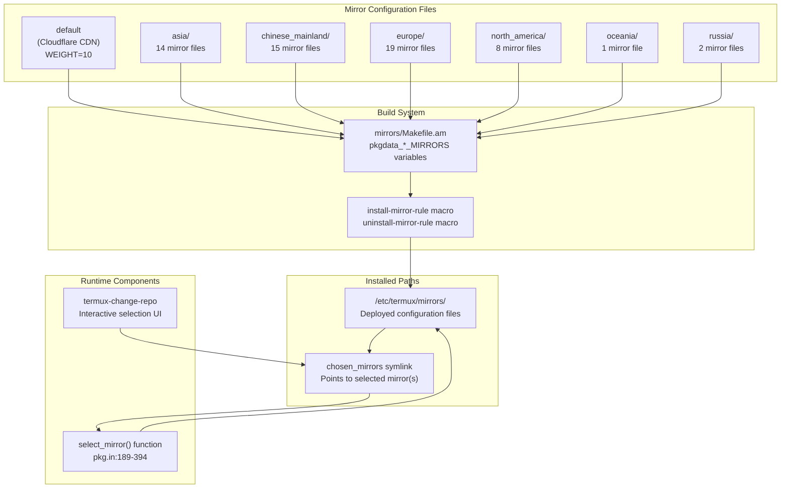
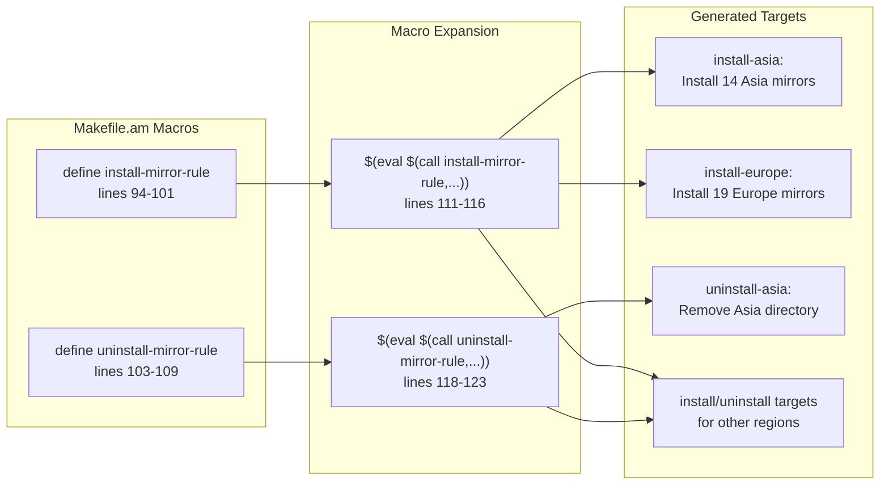
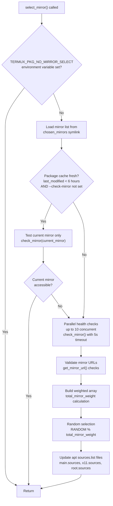

<!-- source: DeepWiki mcp.deepwiki.com · repo termux/termux-tools · page 2 Mirror Infrastructure · fetched 2026-10-26 -->

# Mirror Infrastructure

<details>
<summary>Relevant source files</summary>

The following files were used as context for generating this wiki page:

- [mirrors/Makefile.am](mirrors/Makefile.am)
- [mirrors/europe/packages.termux.dev](mirrors/europe/packages.termux.dev)
- [scripts/pkg.in](scripts/pkg.in)
- [scripts/termux-change-repo.in](scripts/termux-change-repo.in)

</details>


## Purpose and Scope

This document covers the mirror distribution system in termux-tools, which manages a global network of package repository mirrors for the Termux environment. This infrastructure enables reliable package distribution through geographically distributed servers and automatic failover mechanisms.

For information about the `pkg` command that consumes these mirrors, see [Package Management](#3). For details on the interactive mirror selection UI, see [termux-change-repo](#3.3). For the build system that deploys mirror configurations, see [Build System](#4).

---

## Mirror System Overview

The mirror infrastructure is the highest-priority subsystem in termux-tools (importance score: 137.98). It provides a distributed network of 59 package repository mirrors organized across 6 geographic regions, plus 1 default Cloudflare CDN mirror. Mirrors distribute three repository channels:

| Channel | Purpose | Variable |
|---------|---------|----------|
| `termux-main` | Core packages | `MAIN` |
| `termux-root` | Root-only packages | `ROOT` |
| `termux-x11` | X11 graphical packages | `X11` |

Each mirror is defined in a configuration file that specifies its URLs and selection weight. At runtime, the `pkg` command performs health checks on available mirrors and selects one using weighted random selection. Users can choose specific mirrors or mirror groups via `termux-change-repo`.

The system handles mirror deprecation by maintaining a cleanup list of 40+ removed mirrors that are deleted during package upgrades to prevent stale configurations from being used.

**Sources:** [mirrors/Makefile.am:1-162](), [scripts/pkg.in:14-14](), [scripts/pkg.in:189-394]()

---

## Mirror Network Architecture



**Diagram: Mirror System Data Flow**

This diagram maps the mirror infrastructure from source files to runtime usage. Mirror definitions in `mirrors/Makefile.am` are installed to `/etc/termux/mirrors/` during build. The `chosen_mirrors` symlink mechanism allows users to select specific mirrors or regions, which `select_mirror()` reads to determine which mirrors to test.

**Sources:** [mirrors/Makefile.am:1-162](), [scripts/pkg.in:189-394](), [scripts/termux-change-repo.in:1-206]()

---

## Geographic Distribution

Mirrors are organized into 6 regional directories plus a default CDN. The geographic organization reduces latency by allowing users to select mirrors close to their location.

| Region | Directory | Mirror Count | Variable Name |
|--------|-----------|--------------|---------------|
| Default (CDN) | `default` | 1 | `pkgdata_MIRRORS` |
| Asia | `asia/` | 14 | `pkgdata_ASIA_MIRRORS` |
| Chinese Mainland | `chinese_mainland/` | 15 | `pkgdata_CHINESE_MAINLAND_MIRRORS` |
| Europe | `europe/` | 19 | `pkgdata_EUROPE_MIRRORS` |
| North America | `north_america/` | 8 | `pkgdata_NORTH_AMERICA_MIRRORS` |
| Oceania | `oceania/` | 1 | `pkgdata_OCEANIA_MIRRORS` |
| Russia | `russia/` | 2 | `pkgdata_RUSSIA_MIRRORS` |
| **Total** | | **60** | |

### Default Mirror

The default mirror uses Cloudflare's CDN with `WEIGHT=10`, giving it a 10x selection probability compared to standard mirrors. This ensures reliable global availability.

**Sources:** [mirrors/Makefile.am:1-2]()

### Regional Mirror Lists

Each region is defined by a Makefile variable listing mirror hostnames:

```makefile
pkgdata_ASIA_MIRRORS = mirror.nag.albony.in \
mirrors.cbrx.io linux.domainesia.com mirror.nevacloud.com \
tmx.xvx.my.id mirrors.nguyenhoang.cloud \
...
```

The build system generates install and uninstall targets for each region using macros.

**Sources:** [mirrors/Makefile.am:4-42]()

---

## Mirror Configuration File Format

Each mirror is defined in a shell script file that sets four variables. The `pkg` command sources these files to extract configuration.

### Standard Format

```bash
# This file is sourced by pkg
# <Description>. Hosted in <Location>.
WEIGHT=<selection_weight>
MAIN="<url_to_termux-main>"
ROOT="<url_to_termux-root>"
X11="<url_to_termux-x11>"
```

### Variable Descriptions

| Variable | Type | Purpose | Validation |
|----------|------|---------|------------|
| `WEIGHT` | Integer | Selection probability multiplier | Must match `^[0-9]+$` |
| `MAIN` | URL | Main repository (required) | Must match `^https?://[^[:space:]]+$` |
| `ROOT` | URL | Root repository (optional) | Must match `^https?://[^[:space:]]+$` |
| `X11` | URL | X11 repository (optional) | Must match `^https?://[^[:space:]]+$` |

### Example: packages.termux.dev

```bash
# This file is sourced by pkg
# Termux origin repo. Hosted in Falkenstein, Germany.
WEIGHT=1
MAIN="https://packages.termux.dev/apt/termux-main"
ROOT="https://packages.termux.dev/apt/termux-root"
X11="https://packages.termux.dev/apt/termux-x11"
```

### Validation Logic

The `get_mirror_url()` function validates mirror files:

1. **Required MAIN URL**: Mirrors without `MAIN` are rejected with warning
2. **URL Format**: All URLs must start with `http://` or `https://`
3. **Repository Requirements**: If `root-repo` or `x11-repo` packages are installed, mirrors must provide corresponding `ROOT` or `X11` URLs
4. **Weight Validation**: `WEIGHT` must be a positive integer

Invalid mirrors are silently skipped during selection with warnings printed to stderr.

**Sources:** [mirrors/europe/packages.termux.dev:1-7](), [scripts/pkg.in:138-181]()

---

## Build-Time Deployment System

The `mirrors/Makefile.am` build file orchestrates mirror deployment through Automake macros. The system generates install and uninstall targets for each geographic region, plus special handling for deprecated mirrors.

### Macro-Based Installation



**Diagram: Build-Time Macro Expansion**

The `install-mirror-rule` and `uninstall-mirror-rule` macros are invoked for each region, generating specific targets like `install-asia` and `uninstall-asia`.

### Install Target Generation

The `install-mirror-rule` macro creates region-specific installation targets:

```makefile
define install-mirror-rule
install-$1:
	$$(MKDIR_P) $$(DESTDIR)$$(sysconfdir)/termux/mirrors/$1
	for f in $$(pkgdata_$2_MIRRORS); do \
		$(INSTALL) -m 644 $(srcdir)/$1/$$$$f \
		$(DESTDIR)$(sysconfdir)/termux/mirrors/$1; \
	done
endef
```

**Parameters:**
- `$1`: Region directory name (e.g., `asia`, `europe`)
- `$2`: Variable suffix (e.g., `ASIA`, `EUROPE`)

The macro expands to create directories and install all mirror files for a region with mode `644` (readable by all, writable by owner only).

**Sources:** [mirrors/Makefile.am:94-101](), [mirrors/Makefile.am:111-116]()

### Deprecated Mirror Cleanup

The system maintains a list of 40+ removed mirrors in `pkgdata_MIRRORS_REMOVED`:

```makefile
pkgdata_MIRRORS_REMOVED = \
asia/mirror.bardia.tech \
asia/mirrors.omsinchan.ac.th \
china/mirror.iscas.ac.cn \
europe/cdn.lumito.net \
...
```

These are deleted in two ways:

1. **During Package Upgrade**: The `uninstall-removed-mirrors` target removes deprecated mirror files
2. **Via preinst Script**: A Debian pre-installation script is generated that deletes removed mirrors before the new package is installed

The cleanup is necessary because Debian `conffiles` are not automatically deleted during upgrades unless the package is purged.

**Sources:** [mirrors/Makefile.am:45-91](), [mirrors/Makefile.am:142-145]()

### Debian Package Integration

The `create-deb-control-files` target generates two Debian package control artifacts:

1. **conffiles**: Lists all mirror files as configuration files
   ```bash
   find etc/termux/mirrors -type f >> ../conffiles
   ```

2. **preinst**: Shell script that deletes removed mirrors before installation
   ```bash
   printf "# Delete removed mirrors\nfor f in %s; do\n..." \
       "$(pkgdata_MIRRORS_REMOVED)" >> ../preinst
   ```

This ensures proper Debian package behavior during upgrades and downgrades.

**Sources:** [mirrors/Makefile.am:149-151]()

### Installation Orchestration

The `install-data-local` target orchestrates the complete installation sequence:

```makefile
install-data-local: uninstall-removed-mirrors \
    install-default install-asia install-chinese_mainland \
    install-europe install-north_america install-oceania \
    install-russia create-deb-control-files
```

This ensures:
1. Deprecated mirrors are removed first
2. All regional mirrors are installed
3. Debian control files are generated last

**Sources:** [mirrors/Makefile.am:155-157]()

---

## Runtime Mirror Selection

The `select_mirror()` function in `pkg.in` implements intelligent mirror selection with health checking, caching, and weighted random selection.



**Diagram: Mirror Selection Algorithm Flow**

The selection algorithm optimizes for speed by caching the current mirror when the package cache is fresh (less than 6 hours old). Only when the cache is stale or `--check-mirror` is specified does it perform full parallel health checks.

**Sources:** [scripts/pkg.in:189-394]()

### Mirror Discovery

The function discovers available mirrors based on the `chosen_mirrors` symlink state:

| Symlink State | Behavior | Code Reference |
|---------------|----------|----------------|
| Directory | All files in directory are tested | [pkg.in:204-206]() |
| File | Single mirror file is used | [pkg.in:207-209]() |
| Broken/Missing | All mirrors from all regions are tested | [pkg.in:210-218]() |

The search explicitly excludes backup files created by package managers: `*\.dpkg-old`, `*\.dpkg-new`, `*~`.

**Sources:** [scripts/pkg.in:204-218]()

### Intelligent Caching

The caching logic uses `last_modified()` to check package cache age:

```bash
local pkgcache="@TERMUX_CACHE_DIR@/apt/pkgcache.bin"
if [ -e "$pkgcache" ] && (( $(last_modified "$pkgcache") <= 6 * 3600 )) && \
   [ "$force_check_mirror" = "false" ]; then
```

If the cache is fresh and `--check-mirror` was not specified, only the current mirror is tested. This reduces latency for routine operations like `pkg search` or `pkg install`.

**Sources:** [scripts/pkg.in:224-236]()

### Parallel Health Checking

The mirror testing logic uses background jobs to check up to 10 mirrors concurrently:

```bash
local parallel_jobs_max_count=10
...
check_mirror "$url" &
job_pid=$!
```

Each `check_mirror()` call:
1. Uses `curl --head --fail --connect-timeout 5`
2. Checks for `/dists/stable/Release` file existence
3. Has a 6-second timeout (5s connect + 1s buffer)
4. Includes a custom User-Agent identifying the Termux version

Failed mirrors are removed from the candidate list by unsetting their array indices.

**Sources:** [scripts/pkg.in:238-327](), [scripts/pkg.in:68-79]()

### Weighted Random Selection

After validation, mirrors are added to a weighted array based on their `WEIGHT` value:

```bash
weight="$(get_mirror_weight ${mirrors[$mirror]})"
total_mirror_weight=$((total_mirror_weight + weight))
j=0
while [ "$j" -lt "$weight" ]; do
    weighted_mirrors+=(${mirrors[$mirror]})
    j=$((j + 1))
done
```

A mirror with `WEIGHT=10` appears 10 times in the array, making it 10x more likely to be selected than a mirror with `WEIGHT=1`.

**Sources:** [scripts/pkg.in:329-345]()

### APT Sources Update

Once a mirror is selected, the function updates APT's sources files based on the format detected:

| Repository | DEB822 Format | Legacy Format |
|------------|---------------|---------------|
| Main | Update `URIs:` in `main.sources` | Write `sources.list` |
| X11 | Update `URIs:` in `x11.sources` | Write `x11.list` |
| Root | Update `URIs:` in `root.sources` | Write `root.list` |

The `sed_escape_replacement()` function escapes special characters (`\`, `/`, `&`) in URLs to prevent sed substitution errors.

**Sources:** [scripts/pkg.in:363-393](), [scripts/pkg.in:112-118]()

---

## Integration with Package Management

The mirror infrastructure integrates with the `pkg` command at two main points: during repository updates and when users explicitly request mirror changes.

### Automatic Mirror Selection

Mirror selection occurs automatically before these operations:

| Command | Triggers `select_mirror()` | Updates Cache |
|---------|---------------------------|---------------|
| `pkg install` | Yes | Yes (via `update_apt_cache()`) |
| `pkg update` | Yes | No (runs `apt update` directly) |
| `pkg upgrade` | Yes | Yes (runs `apt update` first) |
| `pkg search` | Yes | Yes (via `update_apt_cache()`) |
| `pkg reinstall` | No | No |
| `pkg show` | No | No |

The `update_apt_cache()` function implements smart caching to avoid unnecessary `apt update` calls when the package cache is fresh.

**Sources:** [scripts/pkg.in:456-466](), [scripts/pkg.in:396-435]()

### Manual Mirror Selection

Users can manually select mirrors via `termux-change-repo`, which:

1. Displays a dialog menu with two options: "Mirror group" or "Single mirror"
2. For groups: Creates symlink to regional directory (e.g., `/etc/termux/mirrors/asia`)
3. For single mirrors: Creates symlink to specific mirror file
4. Automatically runs `pkg --check-mirror update` to apply changes

The `--check-mirror` flag forces full mirror health checks, bypassing the cache.

**Sources:** [scripts/termux-change-repo.in:15-206](), [scripts/pkg.in:437-441]()

### Mirror Selection Bypass

Setting `TERMUX_PKG_NO_MIRROR_SELECT` environment variable disables automatic mirror selection:

```bash
if [ -n "${TERMUX_PKG_NO_MIRROR_SELECT-}" ] && [ -n "$current_mirror" ]; then
    return
fi
```

This is useful for CI/CD environments or when troubleshooting specific mirror issues.

**Sources:** [scripts/pkg.in:197-200]()

---

## Summary

The mirror infrastructure provides:

- **Global Distribution**: 59 mirrors across 6 regions plus Cloudflare CDN
- **Automated Failover**: Health checks with 5-second timeouts detect unavailable mirrors
- **Performance Optimization**: 6-hour caching reduces latency; parallel checks (up to 10 concurrent) minimize wait time
- **Geographic Selection**: Users can choose regional mirror groups or specific mirrors
- **Weighted Distribution**: Configurable `WEIGHT` values enable load balancing
- **Robust Maintenance**: Automated cleanup of 40+ deprecated mirrors during upgrades

The system balances reliability (multiple mirrors with automatic failover), performance (intelligent caching and parallel testing), and user control (manual selection via `termux-change-repo`).

**Sources:** [mirrors/Makefile.am:1-162](), [scripts/pkg.in:14-489](), [scripts/termux-change-repo.in:1-206]()

---

