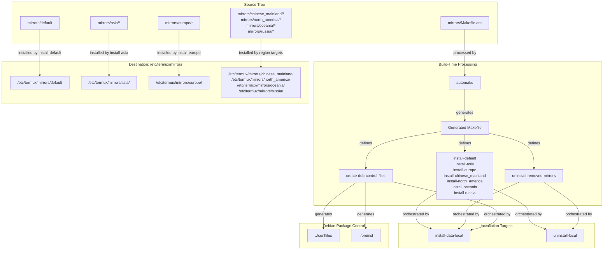
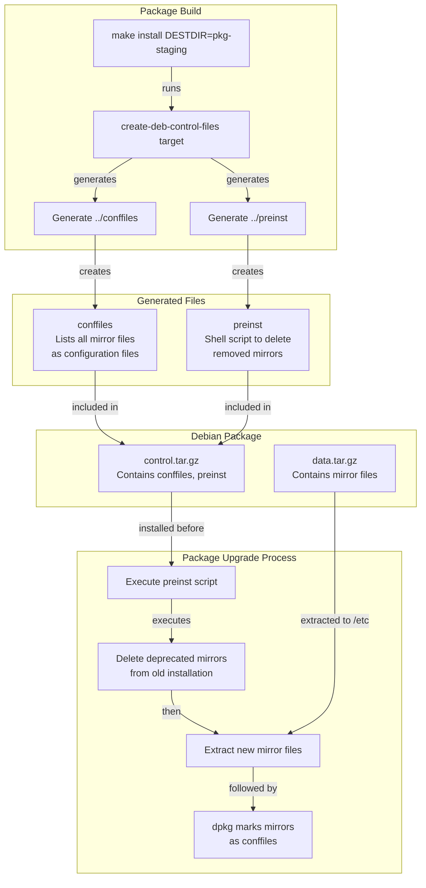

<!-- source: DeepWiki mcp.deepwiki.com · repo termux/termux-tools · page 2.1 Mirror Organization and Deployment · fetched 2026-10-26 -->

# Mirror Organization and Deployment

<details>
<summary>Relevant source files</summary>

The following files were used as context for generating this wiki page:

- [mirrors/Makefile.am](mirrors/Makefile.am)

</details>


## Purpose and Scope

This document details the build-time deployment infrastructure for Termux's mirror system. It explains how 59 mirrors are organized into 6 geographic regions, how the Automake-based build system installs them into `/etc/termux/mirrors`, and how deprecated mirrors are cleanly removed during package upgrades.

For information about the mirror file format and configuration variables, see [Mirror Configuration Format](#2.2). For runtime mirror selection and health checking, see [Mirror Selection Algorithm](#3.2).

**Sources:** [mirrors/Makefile.am:1-162]()

---

## Geographic Organization

Termux's 59 mirrors are organized into 6 geographic regions plus a default Cloudflare CDN mirror. This organization enables users to select mirrors by proximity through the `termux-change-repo` tool.

### Regional Distribution

| Region | Variable Name | Mirror Count | Directory |
|--------|---------------|--------------|-----------|
| Default | `pkgdata_MIRRORS` | 1 | `default` |
| Asia | `pkgdata_ASIA_MIRRORS` | 14 | `asia/` |
| Chinese Mainland | `pkgdata_CHINESE_MAINLAND_MIRRORS` | 15 | `chinese_mainland/` |
| Europe | `pkgdata_EUROPE_MIRRORS` | 19 | `europe/` |
| North America | `pkgdata_NORTH_AMERICA_MIRRORS` | 8 | `north_america/` |
| Oceania | `pkgdata_OCEANIA_MIRRORS` | 1 | `oceania/` |
| Russia | `pkgdata_RUSSIA_MIRRORS` | 2 | `russia/` |

The default mirror (`default`) is stored at the root level without a subdirectory, while regional mirrors are organized in subdirectories. This structure allows the `chosen_mirrors` symlink to point to either a single file (default) or a directory (regional group).

**Sources:** [mirrors/Makefile.am:1-42]()

---

## Makefile Variables and Structure

The `mirrors/Makefile.am` file defines seven Automake variables that list mirrors for each region. These variables follow the naming convention `pkgdata_<REGION>_MIRRORS`.

### Example: Asia Region Definition

```makefile
pkgdata_ASIA_MIRRORS = mirror.nag.albony.in \
mirrors.cbrx.io linux.domainesia.com mirror.nevacloud.com \
tmx.xvx.my.id mirrors.nguyenhoang.cloud \
mirror.freedif.org mirror.twds.com.tw mirrors.in.sahilister.net \
...
```

Each mirror is identified by its hostname (without protocol or path). The actual mirror configuration files in the source tree match these hostnames exactly. For example, the variable entry `mirror.nag.albony.in` corresponds to the source file `mirrors/asia/mirror.nag.albony.in`.

**Sources:** [mirrors/Makefile.am:5-42]()

---

## Installation Macro System

The build system uses GNU Make macros to generate install and uninstall targets for each region. This avoids code duplication while maintaining consistent behavior across all regions.

### install-mirror-rule Macro

The `install-mirror-rule` macro generates installation targets that:
1. Create the destination directory structure
2. Install all mirror files with mode 644 (read-only)
3. Preserve the regional organization

```makefile
define install-mirror-rule
install-$1:
	$$(MKDIR_P) $$(DESTDIR)$$(sysconfdir)/termux/mirrors/$1
	for f in $$(pkgdata_$2_MIRRORS); do \
		$(INSTALL) -m 644 $(srcdir)/$1/$$$$f \
		$(DESTDIR)$(sysconfdir)/termux/mirrors/$1; \
	done
endef
```

**Parameters:**
- `$1`: Directory name (e.g., `asia`, `europe`)
- `$2`: Variable name suffix (e.g., `ASIA`, `EUROPE`)

**Sources:** [mirrors/Makefile.am:94-101]()

### uninstall-mirror-rule Macro

The `uninstall-mirror-rule` macro removes installed mirrors and attempts to remove the directory:

```makefile
define uninstall-mirror-rule
uninstall-$1:
	for f in $$(pkgdata_$2_MIRRORS); do \
		rm -f $(DESTDIR)$(sysconfdir)/termux/mirrors/$1/$$$$f; \
	done
	-rmdir $(DESTDIR)$(sysconfdir)/termux/mirrors/$1
endef
```

The `-rmdir` command uses a leading dash (`-`) to ignore errors if the directory is not empty or doesn't exist.

**Sources:** [mirrors/Makefile.am:103-109]()

### Macro Evaluation

The macros are evaluated for each region using GNU Make's `eval` function:

```makefile
$(eval $(call install-mirror-rule,asia,ASIA))
$(eval $(call install-mirror-rule,chinese_mainland,CHINESE_MAINLAND))
$(eval $(call install-mirror-rule,europe,EUROPE))
...
```

This generates concrete targets like `install-asia`, `install-europe`, etc.

**Sources:** [mirrors/Makefile.am:111-123]()

---

## Deployment Flow Diagram



**Sources:** [mirrors/Makefile.am:94-157]()

---

## Default Mirror Installation

The default mirror receives special handling because it's stored at the root level rather than in a subdirectory.

### install-default Target

```makefile
install-default: $(pkgdata_MIRRORS)
	$(MKDIR_P) $(DESTDIR)$(sysconfdir)/termux/mirrors
	for f in $(pkgdata_MIRRORS); do \
		$(INSTALL) -m 644 $(srcdir)/$$f \
		$(DESTDIR)$(sysconfdir)/termux/mirrors; \
	done
```

This creates the root `/etc/termux/mirrors` directory and installs the `default` file directly into it. The default mirror is Cloudflare's CDN and has a `WEIGHT=10` to make it preferred during selection.

**Sources:** [mirrors/Makefile.am:127-132]()

---

## Deprecated Mirror Cleanup

Over time, mirrors may be renamed, moved, or taken offline. The `pkgdata_MIRRORS_REMOVED` variable maintains a list of 40+ deprecated mirrors that must be cleaned up during package upgrades.

### Why Manual Cleanup Is Required

Mirror files are marked as `conffiles` in the Debian package control system. According to Debian policy, when a conffile is removed in a newer version of a package:
- It is **not automatically deleted** during upgrade
- It is only deleted if the package is **purged** (not just removed)
- Without explicit cleanup, old mirror files would remain and still be used during mirror selection

**Sources:** [mirrors/Makefile.am:45-50]()

### Removed Mirrors List

The `pkgdata_MIRRORS_REMOVED` variable contains entries in the format `<region>/<hostname>`:

```makefile
pkgdata_MIRRORS_REMOVED = \
asia/mirror.bardia.tech \
asia/mirrors.omsinchan.ac.th \
china/mirror.iscas.ac.cn \
china/mirrors.aliyun.com \
europe/cdn.lumito.net \
europe/mirror.polido.pt \
north_america/dl.kcubeterm.com \
...
```

Note the historical inconsistency: some entries use `china/` while the current directory is `chinese_mainland/`. This list must include all historical paths.

**Sources:** [mirrors/Makefile.am:51-91]()

### uninstall-removed-mirrors Target

```makefile
uninstall-removed-mirrors:
	for f in $(pkgdata_MIRRORS_REMOVED); do \
		rm -f $(DESTDIR)$(sysconfdir)/termux/mirrors/$$f; \
	done
```

This target is invoked during both installation and uninstallation to ensure deprecated mirrors are cleaned up regardless of the operation type.

**Sources:** [mirrors/Makefile.am:142-145]()

---

## Debian Package Integration

To properly integrate with Debian's package management, the build system generates two control files during installation: `conffiles` and `preinst`.

### conffiles Generation

The `conffiles` file lists all configuration files that should be preserved during package upgrades:

```makefile
create-deb-control-files:
	sh -c "cd $$(dirname $(DESTDIR)$(sysconfdir)); \
	       find $$(basename $(DESTDIR)$(sysconfdir))/termux/mirrors -type f" \
	       >> ../conffiles;
```

This command:
1. Changes to the parent directory of `/etc`
2. Uses `find` to locate all files under `etc/termux/mirrors`
3. Appends the paths to `../conffiles`

The resulting `conffiles` contains entries like:
```
etc/termux/mirrors/default
etc/termux/mirrors/asia/mirror.nag.albony.in
etc/termux/mirrors/asia/mirrors.cbrx.io
...
```

**Sources:** [mirrors/Makefile.am:149-150]()

### preinst Script Generation

The `preinst` script executes before package installation and handles cleanup of deprecated mirrors:

```makefile
printf "# Delete removed mirrors\nfor f in %s; do\n    if test -f \"%s/etc/termux/mirrors/\$$f\"; then\n        echo \"Deleting removed mirror: \$$f\"; rm -f \"%s/etc/termux/mirrors/\$$f\";\n    fi\ndone" "$(pkgdata_MIRRORS_REMOVED)" "$(termux_prefix)" "$(termux_prefix)" >> ../preinst;
```

This generates a shell script snippet that:
1. Iterates through all removed mirrors
2. Checks if each file exists
3. Prints a deletion message
4. Removes the file

The generated script looks like:
```bash
# Delete removed mirrors
for f in asia/mirror.bardia.tech asia/mirrors.omsinchan.ac.th ...; do
    if test -f "/data/data/com.termux/files/usr/etc/termux/mirrors/$f"; then
        echo "Deleting removed mirror: $f"
        rm -f "/data/data/com.termux/files/usr/etc/termux/mirrors/$f"
    fi
done
```

**Sources:** [mirrors/Makefile.am:151]()

---

## Package Integration Flow



**Sources:** [mirrors/Makefile.am:149-151]()

---

## Top-Level Installation Targets

The `install-data-local` and `uninstall-local` targets orchestrate the entire deployment process.

### install-data-local Target

```makefile
install-data-local: uninstall-removed-mirrors install-default install-asia \
                    install-chinese_mainland install-europe \
                    install-north_america install-oceania install-russia \
                    create-deb-control-files
```

This target ensures that:
1. Deprecated mirrors are removed first
2. All regional mirrors are installed
3. Debian control files are generated

The order is important: removing deprecated mirrors before installing new ones prevents conflicts.

**Sources:** [mirrors/Makefile.am:155]()

### uninstall-local Target

```makefile
uninstall-local: uninstall-removed-mirrors uninstall-default uninstall-asia \
                 uninstall-chinese_mainland uninstall-europe \
                 uninstall-north_america uninstall-oceania uninstall-russia
```

This target removes all mirrors in reverse order of installation.

**Sources:** [mirrors/Makefile.am:157]()

---

## Installed Directory Structure

After installation, the following directory structure is created:

```
/etc/termux/mirrors/
├── default                                    (Cloudflare CDN)
├── asia/
│   ├── mirror.nag.albony.in
│   ├── mirrors.cbrx.io
│   ├── linux.domainesia.com
│   └── ... (14 total)
├── chinese_mainland/
│   ├── mirrors.tuna.tsinghua.edu.cn
│   ├── mirror.iscas.ac.cn
│   └── ... (15 total)
├── europe/
│   ├── grimler.se
│   ├── packages.termux.dev
│   └── ... (19 total)
├── north_america/
│   ├── plug-mirror.rcac.purdue.edu
│   └── ... (8 total)
├── oceania/
│   └── mirrors.middlendian.com            (1 total)
└── russia/
    ├── mirror.mephi.ru
    └── repository.su                       (2 total)
```

The `chosen_mirrors` symlink (created by `termux-change-repo`) will point to either:
- A single file: `/etc/termux/mirrors/default`
- A directory: `/etc/termux/mirrors/asia/`

**Sources:** [mirrors/Makefile.am:1-162]()

---

## Distribution Tarball

The `EXTRA_DIST` variable specifies which files are included in the source distribution tarball:

```makefile
EXTRA_DIST = $(pkgdata_MIRRORS) $(pkgdata_ASIA_MIRRORS) \
$(pkgdata_CHINESE_MAINLAND_MIRRORS) $(pkgdata_EUROPE_MIRRORS) \
$(pkgdata_NORTH_AMERICA_MIRRORS) $(pkgdata_OCEANIA_MIRRORS)
```

This ensures that all mirror configuration files are distributed with the source code, allowing them to be installed on the target system.

**Sources:** [mirrors/Makefile.am:159-161]()

---

## Summary

The mirror deployment system is a sophisticated build-time infrastructure that:

1. **Organizes 59 mirrors** into 6 geographic regions plus a default
2. **Uses Automake macros** to generate install/uninstall targets without code duplication
3. **Handles deprecated mirrors** through explicit cleanup in both `uninstall-removed-mirrors` and `preinst`
4. **Integrates with Debian packaging** by generating `conffiles` and `preinst` control files
5. **Creates a hierarchical directory structure** at `/etc/termux/mirrors` that supports both single-mirror and regional-group selection

The system balances maintainability (macro-based generation), correctness (conffile handling), and flexibility (geographic organization) to provide a robust foundation for Termux's mirror infrastructure.

---

