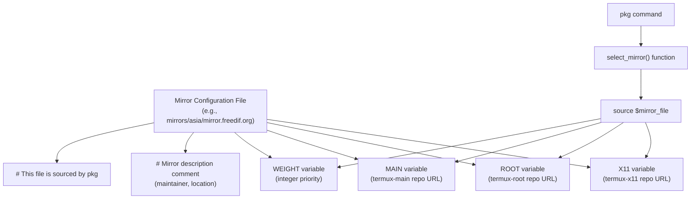
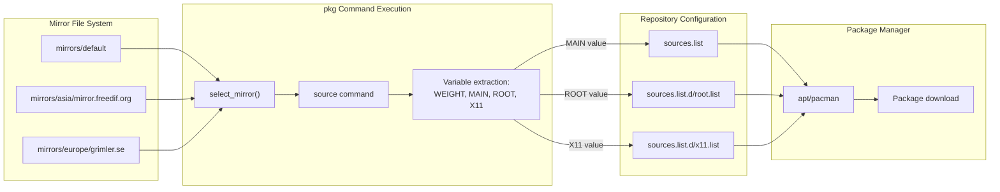

<!-- source: DeepWiki mcp.deepwiki.com · repo termux/termux-tools · page 2.2 Mirror Configuration Format · fetched 2026-10-26 -->

# Mirror Configuration Format

<details>
<summary>Relevant source files</summary>

The following files were used as context for generating this wiki page:

- [mirrors/asia/linux.domainesia.com](mirrors/asia/linux.domainesia.com)
- [mirrors/asia/mirror.freedif.org](mirrors/asia/mirror.freedif.org)
- [mirrors/asia/mirror.jeonnam.school](mirrors/asia/mirror.jeonnam.school)
- [mirrors/asia/mirror.meowsmp.net](mirrors/asia/mirror.meowsmp.net)
- [mirrors/asia/mirror.nevacloud.com](mirrors/asia/mirror.nevacloud.com)
- [mirrors/asia/mirror.rinarin.dev](mirrors/asia/mirror.rinarin.dev)
- [mirrors/asia/mirror.twds.com.tw](mirrors/asia/mirror.twds.com.tw)
- [mirrors/default](mirrors/default)
- [mirrors/europe/grimler.se](mirrors/europe/grimler.se)

</details>


## Purpose and Scope

This document describes the standardized format used by all mirror configuration files in the termux-tools repository. Mirror configuration files define the URLs and priority weighting for package repository mirrors distributed globally across 59 locations.

For information about how mirrors are organized geographically and deployed via the build system, see [Mirror Organization and Deployment](#2.1). For the complete list of available mirrors, see [Geographic Distribution and Mirror List](#2.3). For details on how `pkg` uses these configuration files during mirror selection, see [Mirror Selection Algorithm](#3.2).

## Configuration File Structure

Each mirror configuration file is a shell script fragment that defines four environment variables. The files are designed to be sourced by the `pkg` command during mirror selection operations.

**Diagram: Mirror Configuration File Anatomy**



Sources: [mirrors/asia/mirror.freedif.org:1-7](), [mirrors/europe/grimler.se:1-7](), [mirrors/default:1-7]()

### Standard Format Template

All mirror configuration files follow this exact structure:

```bash
# This file is sourced by pkg
# Mirror by <Maintainer>. Hosted in <Location>.
WEIGHT=<integer>
MAIN="<url>/termux-main"
ROOT="<url>/termux-root"
X11="<url>/termux-x11"
```

The first line is always the fixed comment `# This file is sourced by pkg`, which documents the sourcing mechanism. The second line provides human-readable metadata about the mirror's maintainer and hosting location. Lines 3-6 define the four required shell variables.

Sources: [mirrors/asia/mirror.freedif.org:1-7](), [mirrors/asia/mirror.rinarin.dev:1-7]()

## Variable Reference

### WEIGHT

**Type:** Integer  
**Range:** Typically 1-10  
**Purpose:** Defines the relative priority of the mirror during weighted random selection

The `WEIGHT` variable controls how frequently a mirror is selected during the weighted random selection process. Higher weights increase the probability of selection. The default Cloudflare mirror uses `WEIGHT=10`, while most regional mirrors use `WEIGHT=1`. Mirrors with weight 4 (such as grimler.se) represent intermediate priority.

**Example weight distribution:**

| Weight Value | Usage | Example |
|--------------|-------|---------|
| 10 | Primary/default mirrors with highest reliability | [mirrors/default:3]() |
| 4 | High-quality regional mirrors | [mirrors/europe/grimler.se:3]() |
| 1 | Standard regional mirrors | [mirrors/asia/mirror.freedif.org:3]() |

The `pkg` command's `select_mirror()` function builds a weighted array where each mirror appears `WEIGHT` times, enabling proportional random selection.

Sources: [mirrors/default:3](), [mirrors/europe/grimler.se:3](), [mirrors/asia/mirror.freedif.org:3]()

### MAIN

**Type:** String (HTTPS URL)  
**Format:** `https://<hostname>/<path>/termux-main`  
**Purpose:** Base URL for the main Termux package repository

The `MAIN` variable specifies the URL to the primary package repository containing the core Termux packages. This repository includes all standard packages available through `pkg install`. The URL must end with the path component `termux-main` to maintain consistency with Termux's repository structure.

**Example values:**

```bash
MAIN="https://packages-cf.termux.dev/apt/termux-main"        # Default
MAIN="https://grimler.se/termux/termux-main"                  # Europe
MAIN="https://mirror.freedif.org/termux/termux-main"          # Asia
MAIN="https://linux.domainesia.com/applications/termux/termux-main"  # Indonesia
```

The `pkg` command writes this URL to `/data/data/com.termux/files/usr/etc/apt/sources.list` (or the pacman equivalent) after mirror selection.

Sources: [mirrors/default:4](), [mirrors/europe/grimler.se:4](), [mirrors/asia/mirror.freedif.org:4](), [mirrors/asia/linux.domainesia.com:4]()

### ROOT

**Type:** String (HTTPS URL)  
**Format:** `https://<hostname>/<path>/termux-root`  
**Purpose:** Base URL for the root package repository

The `ROOT` variable specifies the URL to the repository containing packages that require root access. These packages are only accessible on rooted Android devices. The URL must end with `termux-root`.

**Example values:**

```bash
ROOT="https://packages-cf.termux.dev/apt/termux-root"        # Default
ROOT="https://grimler.se/termux/termux-root"                  # Europe
ROOT="https://mirror.freedif.org/termux/termux-root"          # Asia
```

This URL is written to `/data/data/com.termux/files/usr/etc/apt/sources.list.d/root.list` (for apt) when the termux-root repository is enabled.

Sources: [mirrors/default:5](), [mirrors/europe/grimler.se:5](), [mirrors/asia/mirror.freedif.org:5]()

### X11

**Type:** String (HTTPS URL)  
**Format:** `https://<hostname>/<path>/termux-x11`  
**Purpose:** Base URL for the X11 package repository

The `X11` variable specifies the URL to the repository containing X Window System packages. These packages provide graphical applications and X server functionality. The URL must end with `termux-x11`.

**Example values:**

```bash
X11="https://packages-cf.termux.dev/apt/termux-x11"         # Default
X11="https://grimler.se/termux/termux-x11"                   # Europe
X11="https://mirror.freedif.org/termux/termux-x11"           # Asia
```

This URL is written to `/data/data/com.termux/files/usr/etc/apt/sources.list.d/x11.list` (for apt) when the termux-x11 repository is enabled.

Sources: [mirrors/default:6](), [mirrors/europe/grimler.se:6](), [mirrors/asia/mirror.freedif.org:6]()

## Sourcing Mechanism

**Diagram: Variable Flow from Configuration to Package Manager**



Sources: [mirrors/default:1-7](), [mirrors/asia/mirror.freedif.org:1-7](), [mirrors/europe/grimler.se:1-7]()

Mirror configuration files are sourced using the shell's `source` (or `.`) command. This loads the variable definitions directly into the `pkg` command's execution environment, making the four variables available for immediate use.

The sourcing process occurs within the `select_mirror()` function when:
1. The package cache is older than 6 hours, or
2. The user explicitly requests mirror checking with `pkg --check-mirror`, or
3. The user changes mirrors via `termux-change-repo`

After sourcing, the `pkg` command uses the variable values to:
- Construct weighted arrays for random selection (using `WEIGHT`)
- Update apt/pacman repository configuration files (using `MAIN`, `ROOT`, `X11`)
- Perform mirror health checks by testing URL reachability

The sourcing mechanism allows mirrors to be added or modified without changing the `pkg` command itself, as the configuration is entirely data-driven.

Sources: [mirrors/default:1](), [mirrors/asia/mirror.freedif.org:1]()

## Format Consistency Across Mirrors

All 59 mirrors maintain strict format consistency. The table below shows examples demonstrating this uniformity:

| Mirror File | WEIGHT | MAIN Path Pattern | ROOT Path Pattern | X11 Path Pattern |
|-------------|--------|-------------------|-------------------|------------------|
| [mirrors/default:3-6]() | 10 | `/apt/termux-main` | `/apt/termux-root` | `/apt/termux-x11` |
| [mirrors/europe/grimler.se:3-6]() | 4 | `/termux/termux-main` | `/termux/termux-root` | `/termux/termux-x11` |
| [mirrors/asia/mirror.freedif.org:3-6]() | 1 | `/termux/termux-main` | `/termux/termux-root` | `/termux/termux-x11` |
| [mirrors/asia/linux.domainesia.com:3-6]() | 1 | `/applications/termux/termux-main` | `/applications/termux/termux-root` | `/applications/termux/termux-x11` |
| [mirrors/asia/mirror.nevacloud.com:3-6]() | 1 | `/applications/termux/termux-main` | `/applications/termux/termux-root` | `/applications/termux/termux-x11` |
| [mirrors/asia/mirror.meowsmp.net:3-6]() | 1 | `/termux/termux-main` | `/termux/termux-root` | `/termux/termux-x11` |
| [mirrors/asia/mirror.rinarin.dev:3-6]() | 1 | `/termux/termux-main` | `/termux/termux-root` | `/termux/termux-x11` |
| [mirrors/asia/mirror.twds.com.tw:3-6]() | 1 | `/termux/termux-main` | `/termux/termux-root` | `/termux/termux-x11` |
| [mirrors/asia/mirror.jeonnam.school:3-6]() | 1 | `/termux/termux-main` | `/termux/termux-root` | `/termux/termux-x11` |

**Key consistency requirements:**

1. **Line 1:** Always `# This file is sourced by pkg`
2. **Line 2:** Always `# Mirror by <maintainer>. Hosted in <location>.`
3. **Variable naming:** Exactly `WEIGHT`, `MAIN`, `ROOT`, `X11` (case-sensitive)
4. **Repository suffixes:** Must end with `termux-main`, `termux-root`, `termux-x11`
5. **URL scheme:** Always HTTPS (no HTTP mirrors)
6. **Trailing newline:** Files end with a blank line

This consistency allows the `pkg` command to reliably source any mirror file without special-case handling. The uniform structure also simplifies automated validation and testing during the build process.

Sources: [mirrors/default:1-7](), [mirrors/europe/grimler.se:1-7](), [mirrors/asia/mirror.freedif.org:1-7](), [mirrors/asia/linux.domainesia.com:1-7](), [mirrors/asia/mirror.nevacloud.com:1-7](), [mirrors/asia/mirror.meowsmp.net:1-7](), [mirrors/asia/mirror.rinarin.dev:1-7](), [mirrors/asia/mirror.twds.com.tw:1-7](), [mirrors/asia/mirror.jeonnam.school:1-7]()

## Path Patterns and Naming Conventions

Mirror hostnames and paths vary based on the host organization's infrastructure, but all follow consistent naming for the repository type suffixes:

**Common path patterns:**

- **Pattern 1 (Termux-specific):** `/<path>/termux/termux-{main,root,x11}`  
  Used by: grimler.se, mirror.freedif.org, mirror.meowsmp.net, mirror.rinarin.dev, mirror.twds.com.tw, mirror.jeonnam.school

- **Pattern 2 (Applications directory):** `/<path>/applications/termux/termux-{main,root,x11}`  
  Used by: linux.domainesia.com, mirror.nevacloud.com

- **Pattern 3 (APT directory):** `/<path>/apt/termux-{main,root,x11}`  
  Used by: packages-cf.termux.dev (default mirror)

Despite path variations, the mandatory suffix of `termux-main`, `termux-root`, and `termux-x11` ensures that the `pkg` command can correctly identify repository types when writing apt/pacman configuration files.

Sources: [mirrors/default:4-6](), [mirrors/europe/grimler.se:4-6](), [mirrors/asia/mirror.freedif.org:4-6](), [mirrors/asia/linux.domainesia.com:4-6](), [mirrors/asia/mirror.nevacloud.com:4-6]()

## Variable Validation

The `pkg` command does not perform explicit validation of variable values when sourcing mirror files. However, implicit validation occurs during:

1. **URL reachability testing:** Invalid URLs fail health checks and are excluded from selection
2. **WEIGHT usage:** Non-integer or negative weights cause arithmetic errors in bash, preventing mirror use
3. **Repository configuration:** Malformed URLs cause apt/pacman to fail with descriptive errors

Mirror files in the repository are validated during the build process by `mirrors/Makefile.am`, which ensures all files are syntactically correct shell scripts before installation.

Sources: [mirrors/default:1-7](), [mirrors/asia/mirror.freedif.org:1-7]()

---

