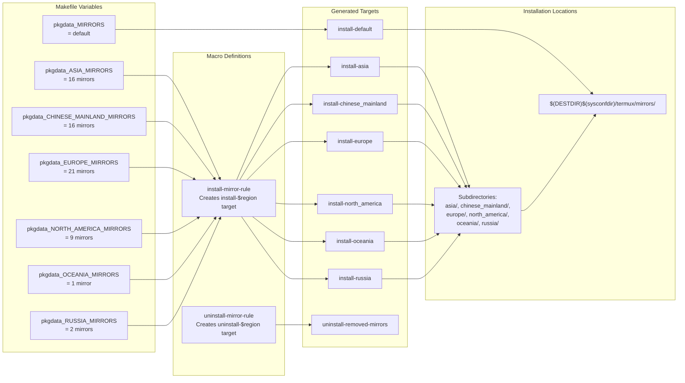

<!-- source: DeepWiki mcp.deepwiki.com · repo termux/termux-tools · page 2.3 Geographic Distribution and Mirror List · fetched 2026-10-26 -->

# Geographic Distribution and Mirror List

<details>
<summary>Relevant source files</summary>

The following files were used as context for generating this wiki page:

- [mirrors/Makefile.am](mirrors/Makefile.am)
- [mirrors/asia/linux.domainesia.com](mirrors/asia/linux.domainesia.com)
- [mirrors/asia/mirror.freedif.org](mirrors/asia/mirror.freedif.org)
- [mirrors/asia/mirror.jeonnam.school](mirrors/asia/mirror.jeonnam.school)
- [mirrors/asia/mirror.meowsmp.net](mirrors/asia/mirror.meowsmp.net)
- [mirrors/asia/mirror.nag.albony.in](mirrors/asia/mirror.nag.albony.in)
- [mirrors/asia/mirror.nevacloud.com](mirrors/asia/mirror.nevacloud.com)
- [mirrors/asia/mirror.rinarin.dev](mirrors/asia/mirror.rinarin.dev)
- [mirrors/asia/mirror.twds.com.tw](mirrors/asia/mirror.twds.com.tw)
- [mirrors/asia/mirrors.in.sahilister.net](mirrors/asia/mirrors.in.sahilister.net)
- [mirrors/asia/mirrors.krnk.org](mirrors/asia/mirrors.krnk.org)
- [mirrors/asia/mirrors.saswata.cc](mirrors/asia/mirrors.saswata.cc)
- [mirrors/default](mirrors/default)
- [mirrors/europe/ftp.icm.edu.pl](mirrors/europe/ftp.icm.edu.pl)
- [mirrors/europe/grimler.se](mirrors/europe/grimler.se)
- [mirrors/europe/md.mirrors.hacktegic.com](mirrors/europe/md.mirrors.hacktegic.com)
- [mirrors/europe/mirrors.de.sahilister.net](mirrors/europe/mirrors.de.sahilister.net)
- [mirrors/europe/termux.librehat.com](mirrors/europe/termux.librehat.com)
- [mirrors/europe/termux.mentality.rip](mirrors/europe/termux.mentality.rip)
- [mirrors/north_america/mirror.mwt.me](mirrors/north_america/mirror.mwt.me)
- [mirrors/north_america/mirrors.utermux.dev](mirrors/north_america/mirrors.utermux.dev)
- [mirrors/north_america/plug-mirror.rcac.purdue.edu](mirrors/north_america/plug-mirror.rcac.purdue.edu)
- [mirrors/oceania/mirrors.middlendian.com](mirrors/oceania/mirrors.middlendian.com)
- [mirrors/russia/mirror.mephi.ru](mirrors/russia/mirror.mephi.ru)

</details>


## Purpose and Scope

This page provides a comprehensive reference listing of all Termux package mirrors organized by geographic region. Each mirror entry includes its hostname, physical location, maintainer information, and configuration details. This information is maintained in [mirrors/Makefile.am:1-162]() and deployed as individual configuration files that the `pkg` command uses for mirror selection.

For information about how mirrors are configured and the file format, see [Mirror Configuration Format](#2.2). For details on the runtime mirror selection algorithm and health checking, see [Mirror Selection Algorithm](#3.2).

## Global Distribution Overview

The Termux mirror network consists of a default Cloudflare-cached mirror plus 65 geographically distributed regional mirrors spanning 6 continents. The distribution ensures users worldwide can access package repositories with optimal latency.

| Region | Mirror Count | Configuration Directory |
|--------|-------------|------------------------|
| **Default** | 1 | `/etc/termux/mirrors/` |
| **Asia** | 16 | `/etc/termux/mirrors/asia/` |
| **Chinese Mainland** | 16 | `/etc/termux/mirrors/chinese_mainland/` |
| **Europe** | 21 | `/etc/termux/mirrors/europe/` |
| **North America** | 9 | `/etc/termux/mirrors/north_america/` |
| **Oceania** | 1 | `/etc/termux/mirrors/oceania/` |
| **Russia** | 2 | `/etc/termux/mirrors/russia/` |
| **Total** | **66** | |

**Sources:** [mirrors/Makefile.am:1-42]()

### Geographic Distribution Diagram

```mermaid
graph TB
    subgraph "Default"
        Default["default<br/>Cloudflare CDN<br/>WEIGHT=10"]
    end
    
    subgraph "Asia (16 mirrors)"
        AsiaIndia["India: 4 mirrors<br/>mirror.nag.albony.in<br/>mirrors.in.sahilister.net<br/>mirrors.saswata.cc<br/>mirrors.ravidwivedi.in"]
        AsiaIndo["Indonesia: 2 mirrors<br/>linux.domainesia.com<br/>mirror.nevacloud.com"]
        AsiaKorea["Korea: 3 mirrors<br/>mirror.jeonnam.school<br/>mirror.rinarin.dev<br/>mirrors.krnk.org"]
        AsiaOther["Other: 7 mirrors<br/>Taiwan, Singapore,<br/>Vietnam, Malaysia,<br/>Thailand, Philippines"]
    end
    
    subgraph "Chinese Mainland (16 mirrors)"
        ChinaEdu["Educational: 16 mirrors<br/>Tsinghua, PKU, USTC, NJU,<br/>SJTU, HUST, ZJU, etc."]
    end
    
    subgraph "Europe (21 mirrors)"
        EuropeWest["Western: 8 mirrors<br/>Netherlands, UK, Germany,<br/>Finland, Portugal"]
        EuropeEast["Eastern: 7 mirrors<br/>Poland, Moldova, Romania,<br/>Iceland, Sweden"]
        EuropeOther["Other: 6 mirrors<br/>Various locations"]
    end
    
    subgraph "North America (9 mirrors)"
        NAmerica["USA & Canada: 9 mirrors<br/>California, New Jersey,<br/>Ontario, Quebec"]
    end
    
    subgraph "Oceania (1 mirror)"
        Oceania["Australia: 1 mirror<br/>mirrors.middlendian.com"]
    end
    
    subgraph "Russia (2 mirrors)"
        Russia["Russia: 2 mirrors<br/>mirror.mephi.ru<br/>repository.su"]
    end
```

**Sources:** [mirrors/Makefile.am:1-42]()

## Default Mirror

The default mirror uses Cloudflare's global CDN to cache `packages.termux.dev`, providing high availability and low latency worldwide. It has the highest weight (10) in the selection algorithm.

| Hostname | Type | Weight | Maintainer |
|----------|------|--------|------------|
| `packages-cf.termux.dev` | Cloudflare CDN | 10 | Termux Official |

**Configuration:**
- MAIN: `https://packages-cf.termux.dev/apt/termux-main`
- ROOT: `https://packages-cf.termux.dev/apt/termux-root`
- X11: `https://packages-cf.termux.dev/apt/termux-x11`

**Sources:** [mirrors/default:1-7](), [mirrors/Makefile.am:2]()

## Asia Region Mirrors

The Asia region contains 16 mirrors distributed across India, Indonesia, South Korea, Taiwan, Singapore, Vietnam, Malaysia, Thailand, and the Philippines. This is defined in `pkgdata_ASIA_MIRRORS` in the Makefile.

| Hostname | Location | Maintainer | Weight |
|----------|----------|------------|--------|
| `mirror.nag.albony.in` | India | Albonycal | 1 |
| `mirrors.cbrx.io` | India | cbrxorg | 1 |
| `linux.domainesia.com` | Indonesia | DomaiNesia | 1 |
| `mirror.nevacloud.com` | Indonesia | Nevacloud | 1 |
| `tmx.xvx.my.id` | Indonesia | xvxvx | 1 |
| `mirrors.nguyenhoang.cloud` | Vietnam | nguyenhoang | 1 |
| `mirror.freedif.org` | Singapore | karibu | 1 |
| `mirror.twds.com.tw` | Taiwan | Taiwan Digital Streaming Co | 1 |
| `mirrors.in.sahilister.net` | India | Sahil Dhiman | 1 |
| `mirrors.saswata.cc` | India | saswatasarkar13 | 1 |
| `termux.niranjan.co` | India | niranjan | 1 |
| `mirrors.ravidwivedi.in` | India | ravidwivedi | 1 |
| `mirror.jeonnam.school` | South Korea | Jeonnam HS Software Club | 1 |
| `mirror.rinarin.dev` | Daegu, South Korea | Bombyeol | 1 |
| `mirrors.krnk.org` | Tokyo, Japan | KuronekoServer | 1 |
| `mirror.meowsmp.net` | Ho Chi Minh, Vietnam | MeowIce | 1 |

**Configuration Path:** Each mirror is stored as `/etc/termux/mirrors/asia/<hostname>`

**Sources:** [mirrors/Makefile.am:5-11](), [mirrors/asia/mirrors.krnk.org:1-7](), [mirrors/asia/mirror.meowsmp.net:1-7](), [mirrors/asia/mirror.rinarin.dev:1-7](), [mirrors/asia/mirror.jeonnam.school:1-7](), [mirrors/asia/mirrors.saswata.cc:1-7](), [mirrors/asia/mirrors.in.sahilister.net:1-6](), [mirrors/asia/mirror.twds.com.tw:1-7](), [mirrors/asia/mirror.freedif.org:1-7](), [mirrors/asia/mirror.nag.albony.in:1-7](), [mirrors/asia/linux.domainesia.com:1-7](), [mirrors/asia/mirror.nevacloud.com:1-7]()

## Chinese Mainland Mirrors

The Chinese Mainland region contains 16 mirrors, primarily hosted by major universities and educational institutions. These mirrors are separated into their own region due to network connectivity characteristics within mainland China.

| Hostname | Institution | Type | Weight |
|----------|-------------|------|--------|
| `mirrors.tuna.tsinghua.edu.cn` | Tsinghua University | Educational | 1 |
| `mirror.iscas.ac.cn` | Institute of Software, CAS | Research | 1 |
| `mirrors.nju.edu.cn` | Nanjing University | Educational | 1 |
| `mirrors.pku.edu.cn` | Peking University | Educational | 1 |
| `mirrors.ustc.edu.cn` | USTC | Educational | 1 |
| `mirrors.bfsu.edu.cn` | Beijing Foreign Studies Univ | Educational | 1 |
| `mirrors.aliyun.com` | Alibaba Cloud | Commercial | 1 |
| `mirrors.cqupt.edu.cn` | Chongqing Univ of Posts | Educational | 1 |
| `mirror.nyist.edu.cn` | Nanyang Institute | Educational | 1 |
| `mirrors.sau.edu.cn` | Shenyang Agricultural Univ | Educational | 1 |
| `mirrors.sdu.edu.cn` | Shandong University | Educational | 1 |
| `mirrors.sustech.edu.cn` | SUSTech | Educational | 1 |
| `mirrors.zju.edu.cn` | Zhejiang University | Educational | 1 |
| `mirror.sjtu.edu.cn` | Shanghai Jiao Tong Univ | Educational | 1 |
| `mirrors.hust.edu.cn` | Huazhong Univ of Sci & Tech | Educational | 1 |
| `mirrors.cernet.edu.cn` | CERNET | Network | 1 |

**Configuration Path:** Each mirror is stored as `/etc/termux/mirrors/chinese_mainland/<hostname>`

**Sources:** [mirrors/Makefile.am:14-19]()

## Europe Region Mirrors

The Europe region contains 21 mirrors spanning Western, Eastern, and Northern Europe. This is the largest regional mirror collection, providing extensive coverage across the continent.

| Hostname | Location | Maintainer | Weight |
|----------|----------|------------|--------|
| `grimler.se` | Netherlands | grimler | 4 |
| `packages.termux.dev` | Europe | Termux Official | 1 |
| `termux.librehat.com` | United Kingdom | librehat | 1 |
| `termux.mentality.rip` | Finland | A1batross | 1 |
| `mirrors.de.sahilister.net` | Germany | Sahil Dhiman | 1 |
| `termux.cdn.lumito.net` | Europe | lumito | 1 |
| `termux.3san.dev` | Europe | 3san | 1 |
| `mirror.accum.se` | Sweden | accum | 1 |
| `md.mirrors.hacktegic.com` | Chisinau, Moldova | artiommocrenco | 1 |
| `ftp.fau.de` | Germany | FAU | 1 |
| `is.mirror.flokinet.net` | Iceland | Flokinet | 1 |
| `ro.mirror.flokinet.net` | Romania | Flokinet | 1 |
| `mirrors.medzik.dev` | Europe | medzik | 1 |
| `mirror.sunred.org` | Europe | sunred | 1 |
| `mirror.autkin.net` | Europe | autkin | 1 |
| `mirror.bouwhuis.network` | Europe | bouwhuis | 1 |
| `mirror.leitecastro.com` | Europe | leitecastro | 1 |
| `ftp.agdsn.de` | Germany | AGDSN | 1 |
| `ftp.icm.edu.pl` | Warsaw, Poland | Warsaw University / rzm1 | 1 |
| `nl.mirror.flokinet.net` | Netherlands | Flokinet | 1 |
| `mirror.cutie.dating` | Europe | cutie | 1 |

**Notable:** `grimler.se` has a weight of 4, making it preferentially selected over standard mirrors.

**Configuration Path:** Each mirror is stored as `/etc/termux/mirrors/europe/<hostname>`

**Sources:** [mirrors/Makefile.am:22-30](), [mirrors/europe/grimler.se:1-7](), [mirrors/europe/termux.librehat.com:1-7](), [mirrors/europe/termux.mentality.rip:1-7](), [mirrors/europe/mirrors.de.sahilister.net:1-7](), [mirrors/europe/md.mirrors.hacktegic.com:1-7](), [mirrors/europe/ftp.icm.edu.pl:1-7]()

## North America Region Mirrors

The North America region contains 9 mirrors distributed across the United States and Canada, primarily on the East Coast and West Coast.

| Hostname | Location | Maintainer | Weight |
|----------|----------|------------|--------|
| `plug-mirror.rcac.purdue.edu` | United States | Purdue Linux User Group | 1 |
| `mirrors.utermux.dev` | San Jose, California, US | Utermux | 1 |
| `mirror.fcix.net` | United States | FCIX | 1 |
| `mirror.mwt.me` | New Jersey, US | Mwt | 1 |
| `mirror.vern.cc` | United States | Vern | 1 |
| `mirror.csclub.uwaterloo.ca` | Ontario, Canada | UW Computer Science Club | 1 |
| `mirror.quantum5.ca` | Canada | quantum5 | 1 |
| `termux.danyael.xyz` | United States | danyael | 1 |
| `gnlug.org` | United States | GNLUG | 1 |

**Configuration Path:** Each mirror is stored as `/etc/termux/mirrors/north_america/<hostname>`

**Sources:** [mirrors/Makefile.am:33-36](), [mirrors/north_america/mirrors.utermux.dev:1-7](), [mirrors/north_america/plug-mirror.rcac.purdue.edu:1-7](), [mirrors/north_america/mirror.mwt.me:1-7]()

## Oceania Region Mirrors

The Oceania region currently contains 1 mirror serving Australia and the surrounding region.

| Hostname | Location | Maintainer | Weight |
|----------|----------|------------|--------|
| `mirrors.middlendian.com` | Australia | DiffieHellman | 1 |

**Configuration Path:** `/etc/termux/mirrors/oceania/mirrors.middlendian.com`

**Sources:** [mirrors/Makefile.am:39](), [mirrors/oceania/mirrors.middlendian.com:1-7]()

## Russia Region Mirrors

The Russia region contains 2 mirrors serving the Russian Federation.

| Hostname | Institution | Contact | Weight |
|----------|-------------|---------|--------|
| `mirror.mephi.ru` | National Research Nuclear University MEPhI | mirror-private@ut.mephi.ru | 1 |
| `repository.su` | Repository.su | - | 1 |

**Configuration Path:** Each mirror is stored as `/etc/termux/mirrors/russia/<hostname>`

**Sources:** [mirrors/Makefile.am:42](), [mirrors/russia/mirror.mephi.ru:1-8]()

## Build System Organization

The mirror configuration is maintained through Automake macros in `mirrors/Makefile.am`. The build system uses two key macros to generate install and uninstall rules for each region.



**Sources:** [mirrors/Makefile.am:94-157]()

### Macro Implementation

The `install-mirror-rule` macro generates installation targets that create regional subdirectories and install mirror configuration files with mode 644:

```
define install-mirror-rule
install-$1:
	$(MKDIR_P) $(DESTDIR)$(sysconfdir)/termux/mirrors/$1
	for f in $(pkgdata_$2_MIRRORS); do \
		$(INSTALL) -m 644 $(srcdir)/$1/$$f \
		$(DESTDIR)$(sysconfdir)/termux/mirrors/$1; \
	done
endef
```

The `uninstall-mirror-rule` macro generates corresponding uninstallation targets:

```
define uninstall-mirror-rule
uninstall-$1:
	for f in $(pkgdata_$2_MIRRORS); do \
		rm -f $(DESTDIR)$(sysconfdir)/termux/mirrors/$1/$$f; \
	done
	-rmdir $(DESTDIR)$(sysconfdir)/termux/mirrors/$1
endef
```

These macros are invoked for each region at lines 111-123, generating targets like `install-asia`, `uninstall-europe`, etc.

**Sources:** [mirrors/Makefile.am:94-123]()

### Debian Package Integration

The build system generates Debian control files to manage mirror configurations as conffiles:

1. **conffiles generation:** All mirror files are listed in the Debian conffiles list so they are preserved during package upgrades
2. **preinst script:** A pre-installation script is generated that removes deprecated mirrors before the new package is installed

This ensures that when mirrors are removed or renamed, they are properly cleaned up during package upgrades rather than being left orphaned.

**Sources:** [mirrors/Makefile.am:149-151]()

## Deprecated Mirrors

The Makefile maintains a list of 40+ deprecated mirrors in `pkgdata_MIRRORS_REMOVED`. These mirrors have been removed, renamed, or moved, and the build system generates a preinst script to delete them during package upgrades. This is necessary because Debian conffiles are only deleted on package purge, not on upgrades.

Examples of deprecated mirrors include:
- Former `china/` mirrors (renamed to `chinese_mainland/`)
- Mirrors that changed hostnames (e.g., `cdn.lumito.net` → `termux.cdn.lumito.net`)
- Discontinued mirrors (e.g., `south_america/mirrors.rda.run`)

**Sources:** [mirrors/Makefile.am:45-91](), [mirrors/Makefile.am:142-151]()

---

