<!-- source: DeepWiki mcp.deepwiki.com · repo termux/termux-tools · page 3.1 pkg Command Reference · fetched 2026-10-26 -->

# pkg Command Reference

<details>
<summary>Relevant source files</summary>

The following files were used as context for generating this wiki page:

- [mirrors/europe/packages.termux.dev](mirrors/europe/packages.termux.dev)
- [scripts/pkg.in](scripts/pkg.in)
- [scripts/termux-change-repo.in](scripts/termux-change-repo.in)

</details>


This document provides a complete reference for the `pkg` command, which serves as the primary package management interface in Termux. The `pkg` command is a wrapper that abstracts the underlying package manager (`apt` or `pacman`), provides intelligent mirror selection with health checking, and offers a simplified command-line interface for package operations.

For information about mirror infrastructure and organization, see [Mirror Infrastructure](#2). For the interactive mirror selection interface, see [termux-change-repo](#3.3). For details on the mirror selection algorithm internals, see [Mirror Selection Algorithm](#3.2).

## Command Syntax

The `pkg` command follows this syntax:

```bash
pkg [--check-mirror] <command> [arguments]
```

The optional `--check-mirror` flag forces immediate re-checking of mirror availability, bypassing the 6-hour cache timeout (see [Mirror Selection Behavior](#mirror-selection-behavior)).

Sources: [scripts/pkg.in:26-29](), [scripts/pkg.in:437-441]()

## Root User Prevention

The `pkg` command explicitly prevents execution as root to avoid file permission issues within the Termux environment:

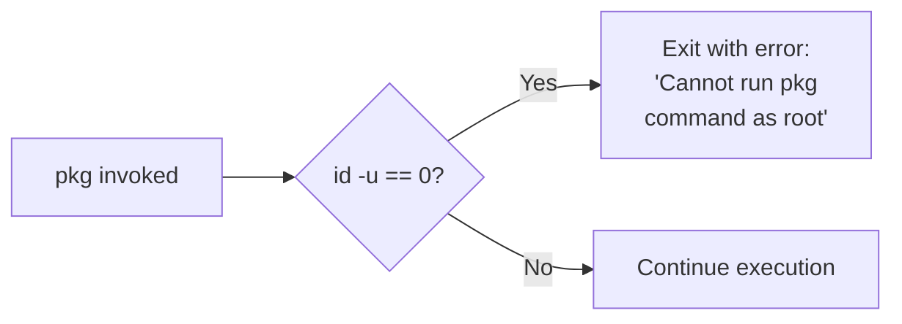

Sources: [scripts/pkg.in:4-8]()

## Package Manager Backend Detection

Before any operation, `pkg` determines the active package manager by sourcing `termux-setup-package-manager`, which sets the `TERMUX_APP_PACKAGE_MANAGER` environment variable to either `apt` or `pacman`:

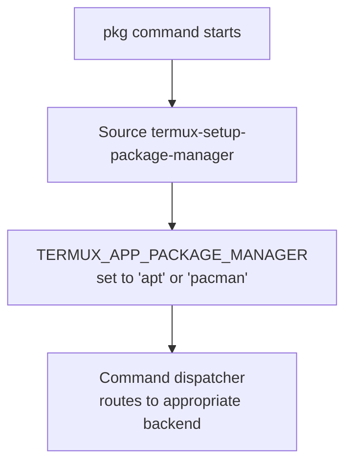

Sources: [scripts/pkg.in:10-12]()

## Available Commands

All commands support abbreviated forms (matching the first few characters). The table below shows command mappings for both backends:

| Command | Description | apt Backend | pacman Backend |
|---------|-------------|-------------|----------------|
| `files <packages>` | Show installed files | `dpkg -L` | `pacman -Ql` |
| `show <packages>` | Display package metadata | `apt show` | `pacman -Qi` |
| `install <packages>` | Install packages | `apt install` | `pacman -Sy --needed` |
| `autoclean` | Remove outdated cached packages | `apt autoclean` | `pacman -Sc` |
| `clean` | Remove all cached packages | `apt clean` | `pacman -Scc` |
| `list-all` | List available packages | `apt list` | `pacman -Sl` |
| `list-installed` | List installed packages | `apt list --installed` | `pacman -Q` |
| `reinstall <packages>` | Reinstall packages | `apt install --reinstall` | `pacman -S` |
| `search <query>` | Search for packages | `apt search` | `pacman -Sys` |
| `uninstall <packages>` | Remove packages | `apt remove` | `pacman -Rcns` |
| `update` | Update package databases | `apt update` | `pacman -Sy` |
| `upgrade` | Upgrade all packages | `apt update && apt full-upgrade` | `pacman -Syu` |

Sources: [scripts/pkg.in:31-65](), [scripts/pkg.in:451-484]()

### Command Abbreviation Matching

Commands are matched using prefix matching with wildcard patterns. For example:
- `pkg i` matches `install`
- `pkg up` matches `upgrade`
- `pkg upd` matches `update`
- `pkg se` matches `search`

The matching is implemented using case pattern matching in bash:

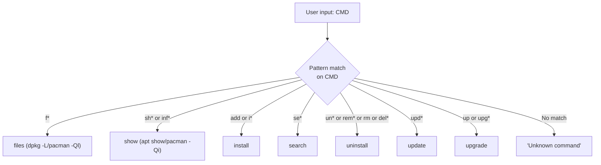

Sources: [scripts/pkg.in:453-466](), [scripts/pkg.in:469-482]()

## Mirror Integration Commands

Several commands automatically trigger mirror selection and cache updates:

| Command | Mirror Selection | Cache Update | Backend Operation |
|---------|------------------|--------------|-------------------|
| `install` | Yes (via `select_mirror()`) | Yes (via `update_apt_cache()`) | Package installation |
| `search` | Yes | Yes | Package search |
| `update` | Yes | No (runs `apt update` directly) | Database refresh |
| `upgrade` | Yes | No (runs `apt update` first) | Full system upgrade |
| `reinstall` | No | No | Package reinstallation |
| `show` | No | No | Metadata display |

Sources: [scripts/pkg.in:456](), [scripts/pkg.in:462](), [scripts/pkg.in:464-465]()

## Mirror Selection Behavior

The `select_mirror()` function implements intelligent caching to minimize latency:

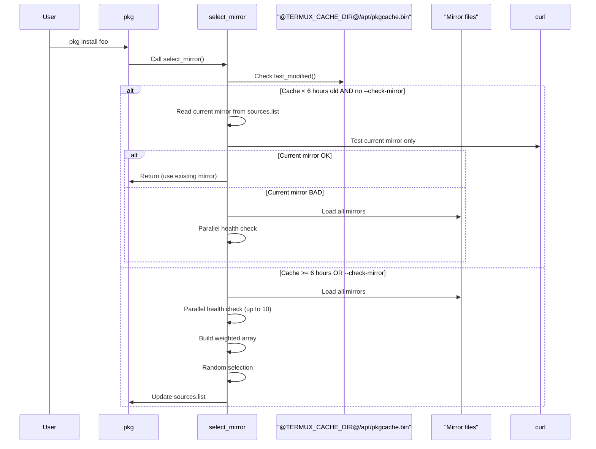

The caching logic is defined in [scripts/pkg.in:223-236]():
- If `pkgcache.bin` exists and was modified within 6 hours (21600 seconds)
- AND `--check-mirror` flag was NOT provided
- THEN only test the current mirror
- ELSE perform full mirror selection

Sources: [scripts/pkg.in:189-394](), [scripts/pkg.in:223-236]()

## Mirror Selection Algorithm Details

### Chosen Mirrors Resolution

The `select_mirror()` function resolves the active mirror set through a cascading logic:

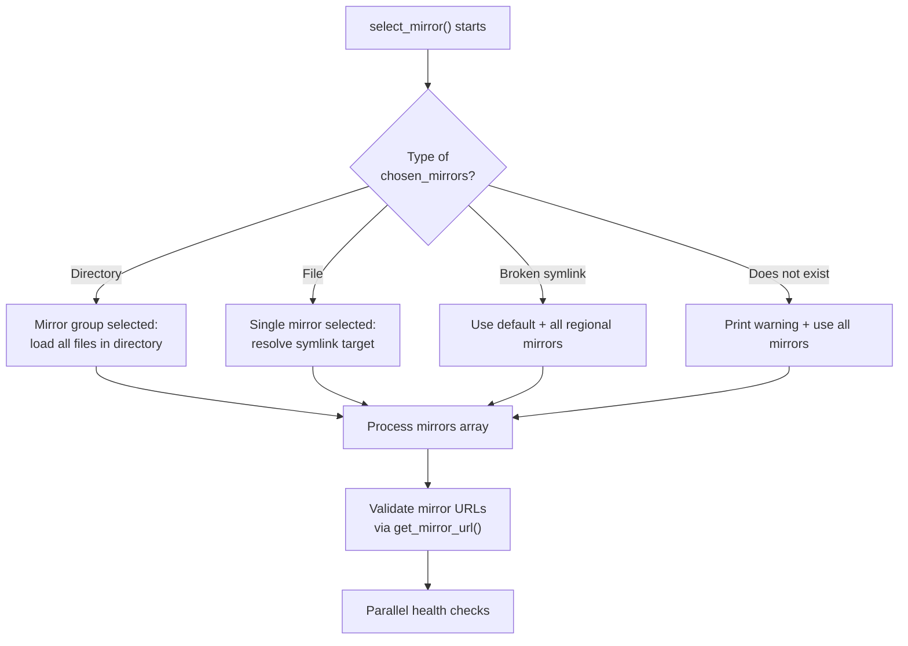

Sources: [scripts/pkg.in:204-218]()

The `chosen_mirrors` path (`@TERMUX_PREFIX@/etc/termux/chosen_mirrors`) is managed by `termux-change-repo` and can be:
- A directory (mirror group): all files within are tested
- A regular file symlink (single mirror): only that mirror is tested
- A broken symlink: fallback to all mirrors
- Non-existent: fallback with warning

### Mirror URL Validation

Before testing, each mirror file is validated via `get_mirror_url()`:

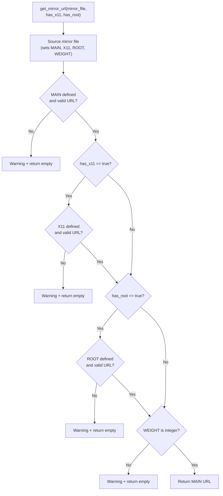

This ensures that mirrors with incomplete repository coverage (e.g., missing x11-repo URLs when x11-repo is installed) are automatically excluded from selection.

Sources: [scripts/pkg.in:138-181]()

### Parallel Health Checking

Mirror availability is tested using bounded parallelism:

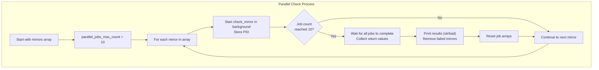

The health check is performed by `check_mirror()` [scripts/pkg.in:68-79]():
- Uses `curl --head --fail` to check HTTP response
- Tests URL: `$mirror/dists/stable/Release`
- Connection timeout: 5 seconds (plus 1 second for timeout command)
- Custom User-Agent identifying Termux version
- Returns exit code 0 on success, non-zero on failure

Sources: [scripts/pkg.in:238-327](), [scripts/pkg.in:68-79]()

### Weighted Random Selection

After parallel checking, valid mirrors are selected using weighted randomization:

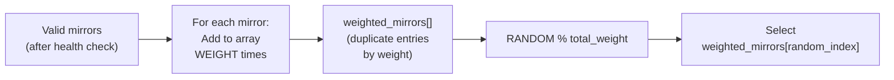

For example, if three mirrors have weights 10, 5, and 1:
- Mirror A appears 10 times in array (indices 0-9)
- Mirror B appears 5 times (indices 10-14)
- Mirror C appears 1 time (index 15)
- Random index 0-15 is selected
- Mirror A has 62.5% probability, B has 31.25%, C has 6.25%

Sources: [scripts/pkg.in:329-354]()

## Sources.list Update Mechanism

Once a mirror is selected, `pkg` updates the apt sources configuration files based on the detected format:

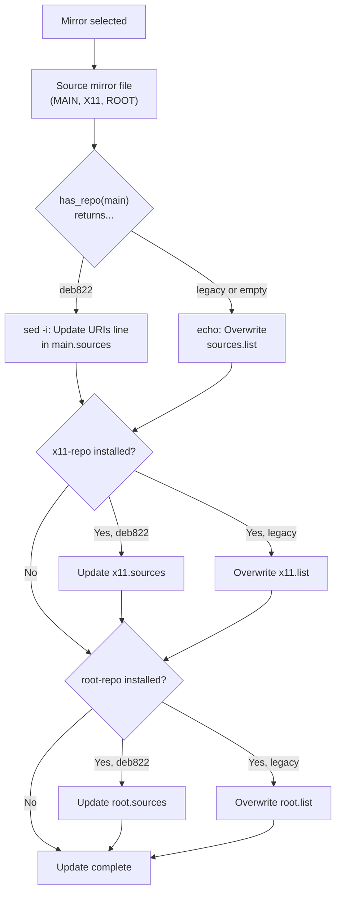

The `has_repo()` function [scripts/pkg.in:120-129]() detects the sources file format:
- Returns `"deb822"` if `.sources` file exists (new DEB822 format)
- Returns `"legacy"` if `.list` file exists (traditional one-line format)
- Returns empty if repository not installed

Sources: [scripts/pkg.in:363-393](), [scripts/pkg.in:120-129]()

### DEB822 Format Update

For DEB822 format, the `URIs:` line is updated in place using `sed`:

```
URIs: https://old.mirror.example/path
```
becomes:
```
URIs: https://new.mirror.example/path
```

The `sed_escape_replacement()` function [scripts/pkg.in:112-118]() escapes special characters in the replacement URL to prevent `sed` interpretation errors.

Sources: [scripts/pkg.in:370-371](), [scripts/pkg.in:380-381](), [scripts/pkg.in:388-389]()

### Legacy Format Generation

For legacy format, entire files are regenerated:

**main repository** (`sources.list`):
```
deb https://mirror.example/apt/termux-main stable main
```

**x11-repo** (`x11.list`):
```
deb https://mirror.example/apt/termux-x11 x11 main
```

**root-repo** (`root.list`):
```
deb https://mirror.example/apt/termux-root root stable
```

Sources: [scripts/pkg.in:375](), [scripts/pkg.in:383](), [scripts/pkg.in:391]()

## Conditional Cache Update

The `update_apt_cache()` function implements smart cache updating for apt:

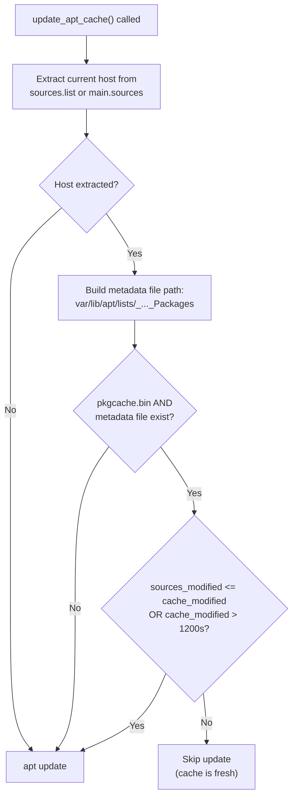

The 1200-second (20-minute) threshold [scripts/pkg.in:432]() ensures that even if sources are unchanged, the cache is refreshed periodically to catch repository updates.

Sources: [scripts/pkg.in:396-435]()

## Command Error Handling

The `check_command()` helper function validates that package manager commands can execute:

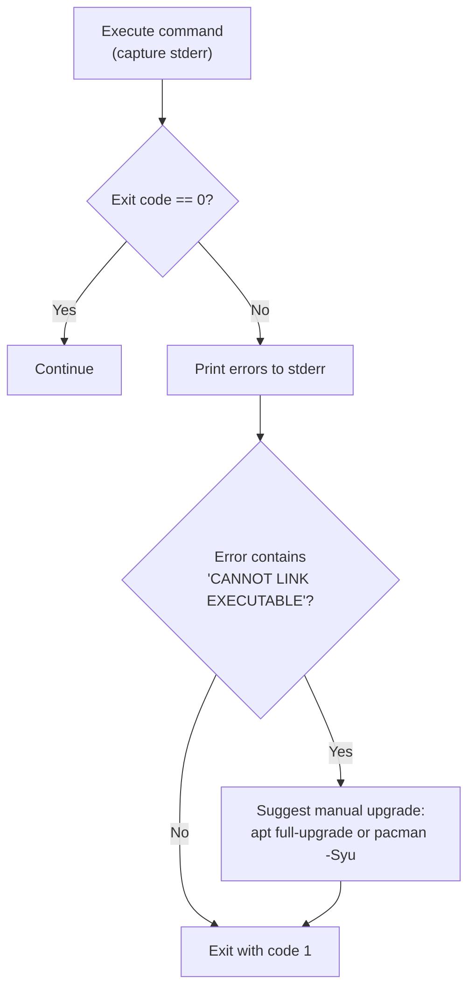

This specifically handles ABI compatibility issues where the package manager binary cannot load required libraries due to outdated packages.

Sources: [scripts/pkg.in:81-97]()

## Integration with termux-change-repo

The `termux-change-repo` command provides a dialog-based interface for mirror selection and immediately updates the package database:

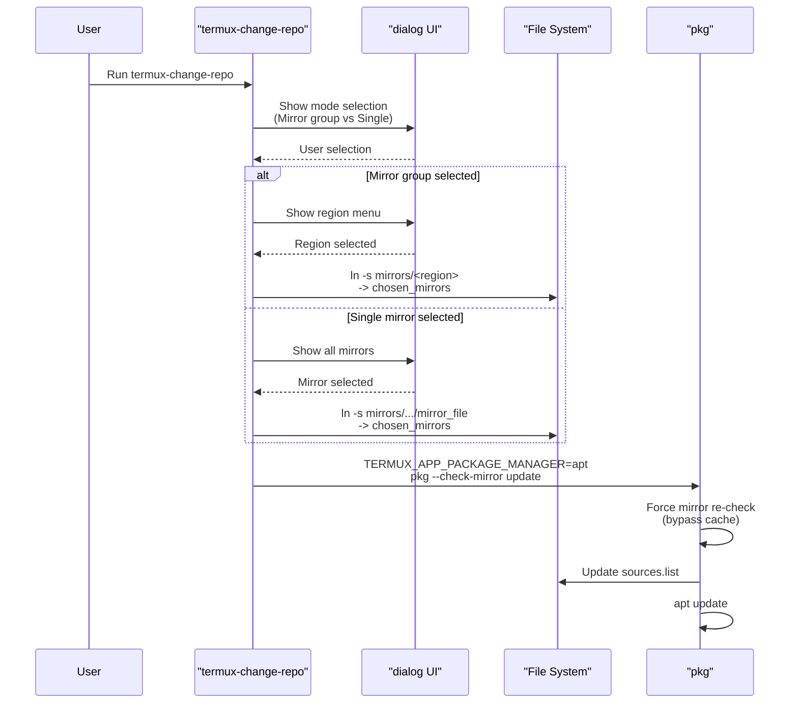

Key behaviors:
- Always forces apt backend via `TERMUX_APP_PACKAGE_MANAGER=apt` [scripts/termux-change-repo.in:205]()
- Always uses `--check-mirror` flag to bypass caching [scripts/termux-change-repo.in:205]()
- Updates `chosen_mirrors` symlink before calling `pkg` [scripts/termux-change-repo.in:15-21]()

Sources: [scripts/termux-change-repo.in:1-206](), [scripts/termux-change-repo.in:204-205]()

## Environment Variables

### TERMUX_APP_PACKAGE_MANAGER
Set by `termux-setup-package-manager` to either `"apt"` or `"pacman"`. Controls which backend commands are invoked.

**Usage**: [scripts/pkg.in:11-12](), [scripts/pkg.in:451-484]()

### TERMUX_PKG_NO_MIRROR_SELECT
If set (to any non-empty value), disables automatic mirror selection. The current mirror configuration is preserved.

**Usage**: [scripts/pkg.in:197-200]()

### TERMUX_PREFIX
Substituted at build time to the installation prefix (typically `/data/data/com.termux/files/usr`). Used to construct paths to:
- Mirror files: `$TERMUX_PREFIX/etc/termux/mirrors/`
- Sources lists: `$TERMUX_PREFIX/etc/apt/sources.list.d/`
- Cache: Referenced via `TERMUX_CACHE_DIR`

**Build-time substitution**: [scripts/pkg.in:14](), [scripts/pkg.in:124]()

### TERMUX_CACHE_DIR
Substituted at build time to the cache directory. Used for:
- apt package cache: `$TERMUX_CACHE_DIR/apt/archives`
- apt pkgcache.bin: `$TERMUX_CACHE_DIR/apt/pkgcache.bin`

**Usage**: [scripts/pkg.in:20](), [scripts/pkg.in:224]()

## Mirror File Format

Mirror configuration files (e.g., [mirrors/europe/packages.termux.dev]()) are sourced as bash scripts and must define:

| Variable | Required | Format | Description |
|----------|----------|--------|-------------|
| `MAIN` | Yes | URL | Main repository URL (stable channel) |
| `ROOT` | Conditional | URL | Root repository URL (required if root-repo installed) |
| `X11` | Conditional | URL | X11 repository URL (required if x11-repo installed) |
| `WEIGHT` | Yes | Integer | Selection weight (higher = more likely) |

Example:
```bash
# This file is sourced by pkg
# Termux origin repo. Hosted in Falkenstein, Germany.
WEIGHT=1
MAIN="https://packages.termux.dev/apt/termux-main"
ROOT="https://packages.termux.dev/apt/termux-root"
X11="https://packages.termux.dev/apt/termux-x11"
```

For complete mirror listings and geographic distribution, see [Geographic Distribution and Mirror List](#2.3).

Sources: [mirrors/europe/packages.termux.dev:1-7](), [scripts/pkg.in:138-181]()

## Usage Examples

### Basic Package Management
```bash
# Install a package
pkg install vim

# Search for packages
pkg search editor

# Update package lists
pkg update

# Upgrade all packages
pkg upgrade

# Show package information
pkg show vim

# List installed packages
pkg list-installed

# Remove a package
pkg uninstall vim
```

### Mirror Management
```bash
# Force mirror re-check before installing
pkg --check-mirror install neovim

# Force mirror re-check before update
pkg --check-mirror update

# Interactive mirror selection (opens dialog)
termux-change-repo
```

### Cache Management
```bash
# Remove outdated packages from cache
pkg autoclean

# Remove all cached packages
pkg clean
```

### Troubleshooting
```bash
# If package manager is broken, prevent mirror selection
TERMUX_PKG_NO_MIRROR_SELECT=1 apt update
TERMUX_PKG_NO_MIRROR_SELECT=1 apt full-upgrade

# After fixing, re-enable mirror selection
pkg --check-mirror update
```

Sources: [scripts/pkg.in:31-65](), [scripts/pkg.in:26-29]()

---

