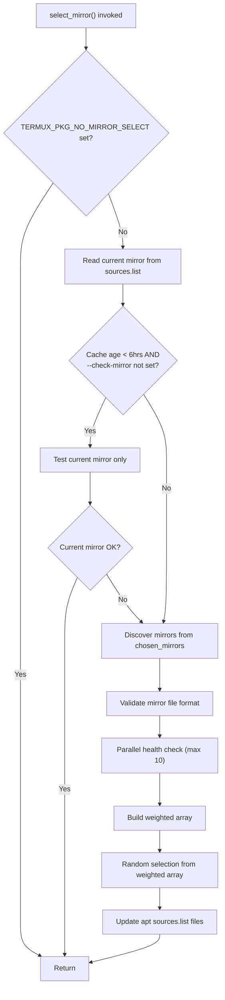
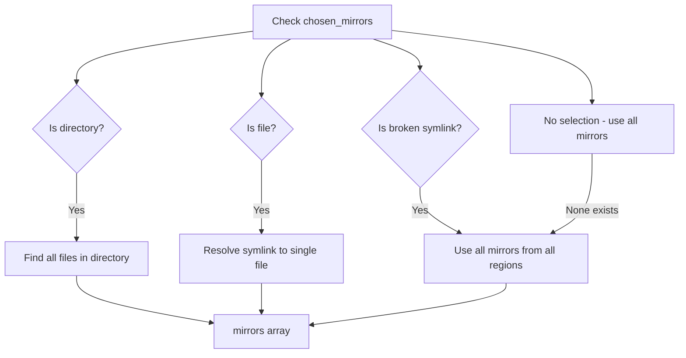
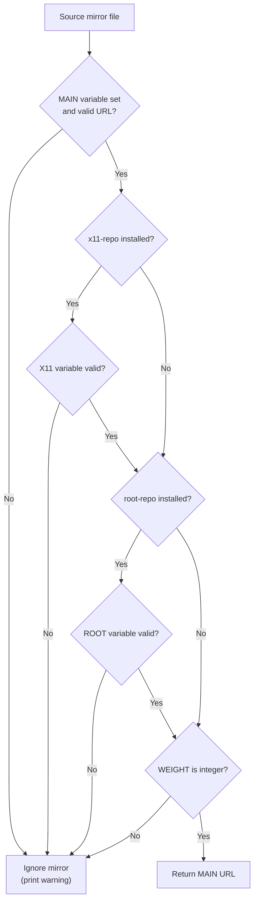
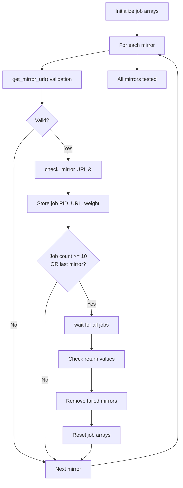
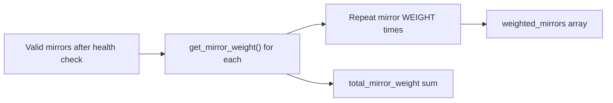
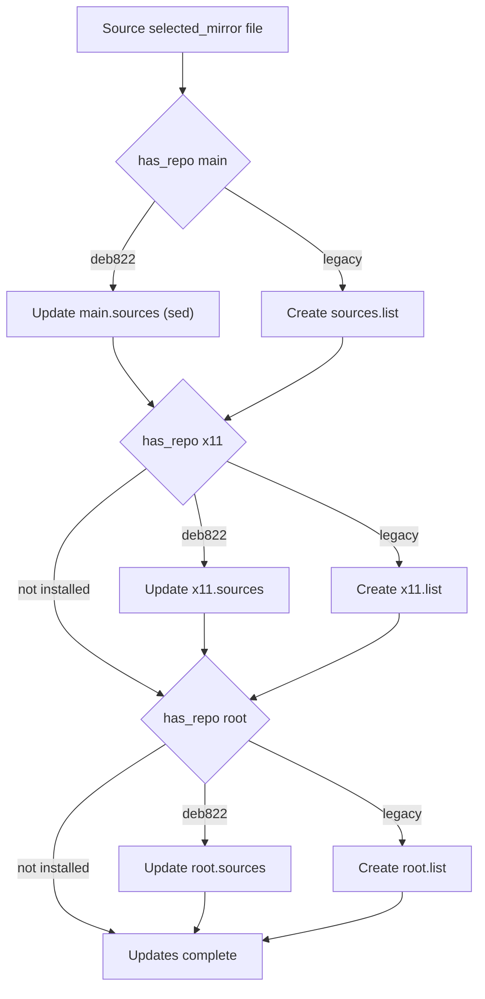

<!-- source: DeepWiki mcp.deepwiki.com · repo termux/termux-tools · page 3.2 Mirror Selection Algorithm · fetched 2026-10-26 -->

# Mirror Selection Algorithm

<details>
<summary>Relevant source files</summary>

The following files were used as context for generating this wiki page:

- [mirrors/Makefile.am](mirrors/Makefile.am)
- [mirrors/europe/packages.termux.dev](mirrors/europe/packages.termux.dev)
- [scripts/pkg.in](scripts/pkg.in)
- [scripts/termux-change-repo.in](scripts/termux-change-repo.in)

</details>


## Purpose and Scope

This document details the mirror selection algorithm implemented in the `pkg` command. The algorithm determines which mirror to use for package operations through intelligent caching, parallel health checks, and weighted random selection. This page focuses on the runtime selection logic that executes when users run package commands.

For information about the mirror configuration file format, see [Mirror Configuration Format](#2.2). For the interactive mirror selection UI, see [termux-change-repo](#3.3). For the complete `pkg` command reference, see [pkg Command Reference](#3.1).

## Algorithm Overview

The mirror selection algorithm is implemented in the `select_mirror()` function at [scripts/pkg.in:189-394](). It operates in multiple phases:



**Diagram: Mirror Selection Algorithm Flow**

Sources: [scripts/pkg.in:189-394]()

## Cache-Based Optimization

The algorithm optimizes performance by testing only the current mirror when the package cache is fresh. This avoids unnecessary network checks on every package operation.

### Cache Age Calculation

The `last_modified()` function calculates the age of the package cache:


**Diagram: Cache Age Calculation**

The function at [scripts/pkg.in:103-110]() computes the difference between the file's modification time and the current time:

| Step | Code Entity | Purpose |
|------|-------------|---------|
| 1 | `date -r "$1" '+%s'` | Get file modification time as Unix timestamp |
| 2 | `date '+%s'` | Get current time as Unix timestamp |
| 3 | `echo $((now - mtime))` | Calculate age in seconds |

Sources: [scripts/pkg.in:103-110]()

### Fast Path Conditions

The algorithm takes the fast path when both conditions are met at [scripts/pkg.in:225-236]():

1. Package cache age ≤ 21600 seconds (6 hours)
2. `force_check_mirror` is `false` (no `--check-mirror` flag)

When the fast path is taken:

```bash
echo "Checking availability of current mirror:"
echo -n "[*] $current_mirror: "
if check_mirror "$current_mirror"; then
    echo "ok"
    return
else
    echo "bad"
fi
```

If the current mirror passes the health check, the function returns immediately. Otherwise, it proceeds to full mirror selection.

Sources: [scripts/pkg.in:223-236]()

## Mirror Discovery

The algorithm discovers available mirrors by reading the `chosen_mirrors` symlink at `@TERMUX_PREFIX@/etc/termux/chosen_mirrors`.

### chosen_mirrors Resolution



**Diagram: chosen_mirrors Discovery Logic**

The discovery logic at [scripts/pkg.in:204-218]() handles three cases:

| Case | Test | Action | Code Line |
|------|------|--------|-----------|
| Mirror Group | `-d chosen_mirrors` | Find all files in directory | [204-206]() |
| Single Mirror | `-f chosen_mirrors` | Resolve symlink to single file | [208-209]() |
| Broken/Missing | `-L chosen_mirrors` or no file | Use all mirrors (default + all regions) | [211-218]() |

The `find` commands exclude backup files using patterns: `! -name "*\.dpkg-old" ! -name "*\.dpkg-new" ! -name "*~"`.

Sources: [scripts/pkg.in:204-218]()

## Mirror Validation

Before testing mirrors, the algorithm validates each mirror configuration file by sourcing it and checking required variables.

### Validation Function

The `get_mirror_url()` function at [scripts/pkg.in:138-181]() performs validation:



**Diagram: Mirror Validation Logic**

### Validation Rules

| Variable | Validation Pattern | Lines |
|----------|-------------------|-------|
| `MAIN` | `^https?://[^[:space:]]+$` | [147-153]() |
| `X11` (if x11-repo installed) | `^https?://[^[:space:]]+$` | [155-163]() |
| `ROOT` (if root-repo installed) | `^https?://[^[:space:]]+$` | [165-173]() |
| `WEIGHT` | `^[0-9]+$` | [175-178]() |

The function uses `unset_mirror_variables()` at [scripts/pkg.in:131-136]() before sourcing each mirror file to prevent variable carryover.

Sources: [scripts/pkg.in:131-181]()

## Parallel Health Checking

The algorithm tests mirror availability using parallel background jobs with bounded concurrency.

### Health Check Function

The `check_mirror()` function at [scripts/pkg.in:68-79]() tests a mirror URL:

```bash
timeout "$((timeout + 1))" curl \
    --head \
    --fail \
    --connect-timeout "$timeout" \
    --location \
    --user-agent "Termux-PKG/2.0 mirror-checker (termux-tools @PACKAGE_VERSION@) Termux (@TERMUX_APP_PACKAGE@; install-prefix:@TERMUX_PREFIX@)" \
    "$mirror/dists/stable/Release" >/dev/null 2>&1
```

| Parameter | Value | Purpose |
|-----------|-------|---------|
| Method | HEAD | Only fetch headers, not body |
| Timeout | 5 seconds (default) | Prevent hanging on slow mirrors |
| URL | `$mirror/dists/stable/Release` | Test main repository metadata |
| Exit Code | 0 = success, non-zero = failure | Indicates mirror availability |

Sources: [scripts/pkg.in:68-79]()

### Parallel Execution Logic

The parallel checking implementation at [scripts/pkg.in:239-327]() uses arrays to track concurrent jobs:



**Diagram: Parallel Job Management**

### Job Tracking Arrays

| Array Name | Purpose | Example Value |
|------------|---------|---------------|
| `parallel_jobs_mirrors` | Mirror array indices | `0 1 2` |
| `parallel_jobs_weights` | Mirror weights | `10 5 3` |
| `parallel_jobs_urls` | Mirror URLs | `https://...` |
| `parallel_jobs_numbers` | Job numbers (1-10) | `1 2 3` |
| `parallel_jobs_pids` | Background process IDs | `12345 12346 12347` |
| `parallel_jobs_return_values` | Exit codes from `wait` | `0 1 0` |

The `parallel_jobs_max_count` variable at [scripts/pkg.in:240]() is set to 10, limiting concurrent checks to prevent resource exhaustion.

Sources: [scripts/pkg.in:239-327]()

## Weighted Random Selection

After filtering out failed mirrors, the algorithm builds a weighted array for random selection.

### Weight Array Construction

The construction logic at [scripts/pkg.in:329-345]() works as follows:



**Diagram: Weighted Array Construction**

For example, given three mirrors:

| Mirror | Weight | Array Entries |
|--------|--------|---------------|
| `default` | 10 | 0, 1, 2, 3, 4, 5, 6, 7, 8, 9 |
| `grimler.se` | 5 | 10, 11, 12, 13, 14 |
| `packages.termux.dev` | 1 | 15 |

Total weight = 16. The array has 16 elements.

Sources: [scripts/pkg.in:329-345]()

### Random Selection

The selection at [scripts/pkg.in:347-354]() uses Bash's `$RANDOM` variable:

```bash
local random_weight
random_weight=$(( (RANDOM % total_mirror_weight + 1) - 1 ))
echo "Picking mirror: (${random_weight}) ${weighted_mirrors[${random_weight}]}"
selected_mirror="${weighted_mirrors[${random_weight}]}"
```

The formula `(RANDOM % total_mirror_weight + 1) - 1` generates a random index from 0 to `total_mirror_weight - 1`. This gives mirrors with higher weights a proportionally higher probability of selection.

Sources: [scripts/pkg.in:347-354]()

## APT Sources.list Updates

After selecting a mirror, the algorithm updates apt's sources.list files based on the installed repository format.

### Repository Format Detection

The `has_repo()` function at [scripts/pkg.in:120-129]() detects the repository format:

| Format | File | Return Value |
|--------|------|--------------|
| DEB822 | `@TERMUX_PREFIX@/etc/apt/sources.list.d/$repo.sources` | `deb822` |
| Legacy | `@TERMUX_PREFIX@/etc/apt/sources.list.d/$repo.list` | `legacy` |
| Not installed | No file exists | Empty string |

Sources: [scripts/pkg.in:120-129]()

### Update Logic

The update logic at [scripts/pkg.in:363-393]() sources the selected mirror file and updates configuration:



**Diagram: Sources.list Update Flow**

### DEB822 Format Updates

For DEB822 format at [scripts/pkg.in:369-391](), the algorithm uses `sed` to update the `URIs:` line:

```bash
sed -i -e "s|URIs:.*|$(sed_escape_replacement "URIs: $MAIN")|" \
    "@TERMUX_PREFIX@/etc/apt/sources.list.d/main.sources"
```

The `sed_escape_replacement()` function at [scripts/pkg.in:112-118]() escapes special characters:

| Character | Escaped As | Purpose |
|-----------|------------|---------|
| `\` | `\\` | Prevent interpretation as escape |
| `/` | `\/` | Escape sed delimiter |
| `&` | `\&` | Prevent replacement reference |

Sources: [scripts/pkg.in:112-118](), [scripts/pkg.in:363-393]()

### Legacy Format Updates

For legacy format, the algorithm writes complete lines:

```bash
echo "deb $MAIN stable main" > "@TERMUX_PREFIX@/etc/apt/sources.list"
echo "deb $X11 x11 main" > "@TERMUX_PREFIX@/etc/apt/sources.list.d/x11.list"
echo "deb $ROOT root stable" > "@TERMUX_PREFIX@/etc/apt/sources.list.d/root.list"
```

Sources: [scripts/pkg.in:375-391]()

## Integration Points

### Invocation Points

The `select_mirror()` function is called from three places in `pkg.in`:

| Command | Line | Additional Action |
|---------|------|-------------------|
| `pkg install` | [456]() | Calls `update_apt_cache()` after |
| `pkg search` | [462]() | Calls `update_apt_cache()` after |
| `pkg update` | [464]() | Calls `apt update` after |
| `pkg upgrade` | [465]() | Calls `apt update` and `apt full-upgrade` after |

Sources: [scripts/pkg.in:456](), [scripts/pkg.in:462](), [scripts/pkg.in:464-465]()

### termux-change-repo Integration

The `termux-change-repo` command at [scripts/termux-change-repo.in:1-206]() updates the `chosen_mirrors` symlink and then triggers mirror selection:

```bash
echo "[*] pkg --check-mirror update"
TERMUX_APP_PACKAGE_MANAGER=apt pkg --check-mirror update
```

The `--check-mirror` flag forces a full mirror check regardless of cache age at [scripts/pkg.in:438-441]().

Sources: [scripts/termux-change-repo.in:204-205](), [scripts/pkg.in:437-441]()

### Environment Variable Override

The environment variable `TERMUX_PKG_NO_MIRROR_SELECT` at [scripts/pkg.in:197-200]() disables mirror selection entirely:

```bash
if [ -n "${TERMUX_PKG_NO_MIRROR_SELECT-}" ] && [ -n "$current_mirror" ]; then
    return
fi
```

This allows advanced users or automated systems to pin a specific mirror.

Sources: [scripts/pkg.in:197-200]()

## Error Handling

### No Accessible Mirrors

If all mirrors fail health checks at [scripts/pkg.in:356-361](), the algorithm exits with an error:

```bash
if [ -z "$selected_mirror" ]; then
    echo "Error: None of the mirrors are accessible"
    exit 1
fi
```

Sources: [scripts/pkg.in:356-361]()

### curl Command Failure

The algorithm verifies that `curl` is executable at [scripts/pkg.in:220-221]() using `check_command()`:

```bash
check_command curl --version
```

The `check_command()` function at [scripts/pkg.in:81-97]() provides helpful error messages if `curl` fails, including detection of library linking issues and suggestions to run `apt update && apt full-upgrade`.

Sources: [scripts/pkg.in:81-97](), [scripts/pkg.in:220-221]()

---

