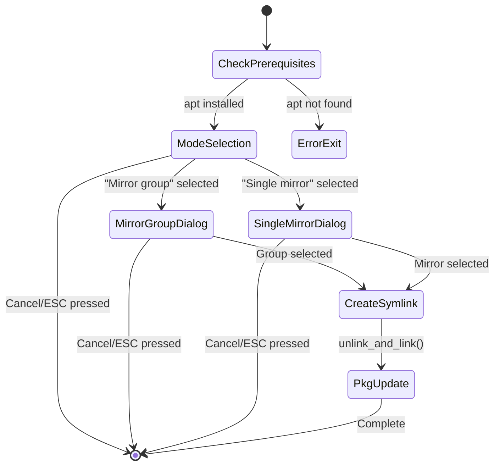
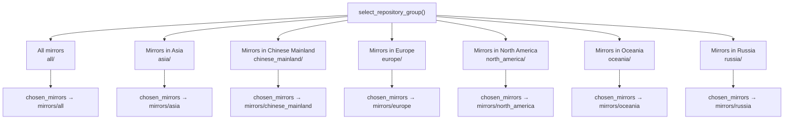
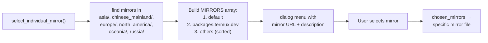
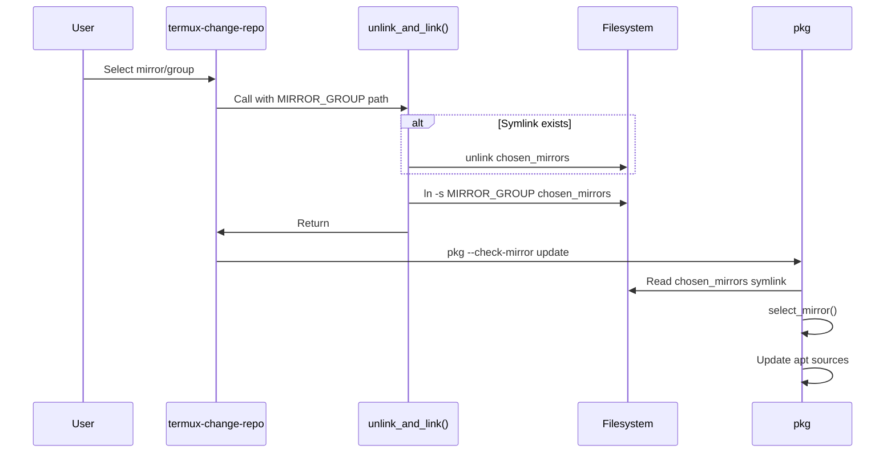
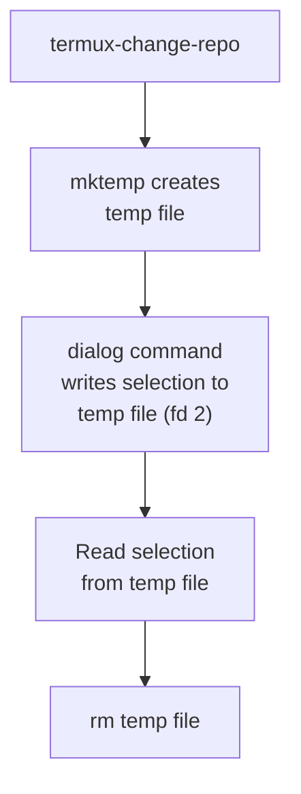
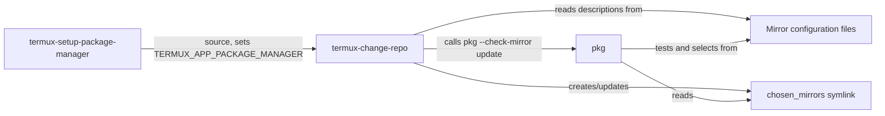

<!-- source: DeepWiki mcp.deepwiki.com · repo termux/termux-tools · page 3.3 termux-change-repo · fetched 2026-10-26 -->

# termux-change-repo

<details>
<summary>Relevant source files</summary>

The following files were used as context for generating this wiki page:

- [mirrors/europe/packages.termux.dev](mirrors/europe/packages.termux.dev)
- [scripts/pkg.in](scripts/pkg.in)
- [scripts/termux-change-repo.in](scripts/termux-change-repo.in)

</details>


`termux-change-repo` is an interactive command-line utility that provides a dialog-based interface for selecting which mirrors the `pkg` command should use for package downloads. It offers two selection modes: mirror groups (recommended for automatic rotation across multiple mirrors) and single mirrors (for users who prefer a specific mirror). After selection, it automatically updates the package repository metadata.

For information about the `pkg` command's mirror selection algorithm and automated mirror testing, see [Mirror Selection Algorithm](#3.2). For details about the mirror infrastructure and file format, see [Mirror Infrastructure](#2) and [Mirror Configuration Format](#2.2).

## Purpose and Functionality

The utility serves three primary functions:

1. **User-Friendly Mirror Selection** - Provides a `dialog`-based terminal UI that eliminates the need to manually edit configuration files or understand the mirror directory structure
2. **Geographic Optimization** - Allows users to select mirror groups by region to reduce latency and improve download speeds
3. **Automated Configuration** - Creates the appropriate symlinks and immediately triggers a package metadata update

## User Interface Flow

The utility presents a two-stage selection process using the `dialog` command for terminal-based menus.

### Dialog Flow Diagram



Sources: [scripts/termux-change-repo.in:151-206]()

### Mode Selection

The initial dialog presents two options:

| Mode | Description | Use Case |
|------|-------------|----------|
| **Mirror group** | Rotate between several mirrors (recommended) | Automatic failover and load distribution across regional mirrors |
| **Single mirror** | Choose a single mirror to use | Specific mirror preference or network requirements |

Sources: [scripts/termux-change-repo.in:170-200]()

## Selection Modes

### Mirror Group Selection

When "Mirror group" is selected, the utility displays seven geographic groupings:



Sources: [scripts/termux-change-repo.in:23-88]()

#### Geographic Groups

The dialog menu entries are defined in [scripts/termux-change-repo.in:24-31]():

| Menu Item | Description | Directory |
|-----------|-------------|-----------|
| All mirrors | All in the entire world | `${MIRROR_BASE_DIR}/all` |
| Mirrors in Asia | All in Asia (excl. Chinese Mainland and Russia) | `${MIRROR_BASE_DIR}/asia` |
| Mirrors in Chinese Mainland | All in Chinese Mainland | `${MIRROR_BASE_DIR}/chinese_mainland` |
| Mirrors in Europe | All in Europe | `${MIRROR_BASE_DIR}/europe` |
| Mirrors in North America | All in North America | `${MIRROR_BASE_DIR}/north_america` |
| Mirrors in Oceania | All in Oceania | `${MIRROR_BASE_DIR}/oceania` |
| Mirrors in Russia | All in Russia | `${MIRROR_BASE_DIR}/russia` |

### Single Mirror Selection

When "Single mirror" is selected, the utility displays all available mirrors with special handling:

1. **Default Mirror First** - Cloudflare CDN (`packages-cf.termux.dev`) is listed first
2. **Official Mirror Second** - The Termux origin repo (`packages.termux.dev`) is explicitly placed second
3. **Remaining Mirrors** - All other mirrors are listed in discovery order



Sources: [scripts/termux-change-repo.in:104-142]()

#### Mirror Description Parsing

Each mirror file's second line contains a comment with the mirror description. The utility extracts and formats this for display:

- **Input format** (from mirror file): `# Mirror by <provider>. Hosted in <location>.`
- **Output format** (in dialog): `M: <provider>. <location>`

The transformation is performed by `get_mirror_description()` at [scripts/termux-change-repo.in:94-102]():

```
# Mirror by Example Org. Hosted in Berlin, Germany.
    ↓
M: Example Org. Berlin, Germany
```

Sources: [scripts/termux-change-repo.in:94-102](), [mirrors/europe/packages.termux.dev:1-2]()

## Implementation Details

### Symlink Management

The core configuration mechanism is the `chosen_mirrors` symlink at `@TERMUX_PREFIX@/etc/termux/chosen_mirrors`. The `unlink_and_link()` function manages this:



Sources: [scripts/termux-change-repo.in:15-21](), [scripts/termux-change-repo.in:204-205]()

### Symlink Target Types

The `chosen_mirrors` symlink can point to two types of targets, which `pkg` handles differently:

| Target Type | Detection | pkg Behavior |
|-------------|-----------|--------------|
| **Directory** (mirror group) | `[ -d "@TERMUX_PREFIX@/etc/termux/chosen_mirrors" ]` | Loads all files in directory, tests all mirrors |
| **File** (single mirror) | `[ -f "@TERMUX_PREFIX@/etc/termux/chosen_mirrors" ]` | Uses only that mirror file |

The `pkg` command reads this symlink in its `select_mirror()` function at [scripts/pkg.in:204-218]().

Sources: [scripts/pkg.in:204-218]()

### Mirror Discovery

For single mirror selection, the utility discovers all available mirrors using `find`:

```bash
mirrors=($(find ${MIRROR_BASE_DIR}/{asia,chinese_mainland,europe,north_america,oceania,russia}/ -type f ! -name "*\.dpkg-old" ! -name "*\.dpkg-new" ! -name "*~"))
```

This excludes:
- `*.dpkg-old` - Backup files from package manager
- `*.dpkg-new` - New files from package upgrades
- `*~` - Editor backup files

Sources: [scripts/termux-change-repo.in:105]()

### Integration with pkg

After updating the symlink, `termux-change-repo` immediately triggers a mirror check and repository update:

```bash
TERMUX_APP_PACKAGE_MANAGER=apt pkg --check-mirror update
```

Key aspects:
- **Forces apt mode** - Sets `TERMUX_APP_PACKAGE_MANAGER=apt` to ensure apt is used even if pacman is configured
- **Forces mirror check** - Uses `--check-mirror` flag to bypass the 6-hour cache timeout in `pkg`
- **Updates metadata** - Runs `update` command to fetch new package lists

Sources: [scripts/termux-change-repo.in:205]()

### Dialog Command Integration

The utility uses the `dialog` command for terminal-based UI elements:



Dialog output is redirected to a temporary file (`2> "$TEMPFILE"`), then read back and cleaned up. This pattern appears at:
- Mode selection: [scripts/termux-change-repo.in:168-202]()
- Group selection: [scripts/termux-change-repo.in:33-54]()
- Single mirror selection: [scripts/termux-change-repo.in:117-141]()

Sources: [scripts/termux-change-repo.in:33-54](), [scripts/termux-change-repo.in:117-141](), [scripts/termux-change-repo.in:168-202]()

## Configuration Storage

### File System Layout

```
@TERMUX_PREFIX@/etc/termux/
├── mirrors/                    # MIRROR_BASE_DIR
│   ├── default                 # Cloudflare CDN (WEIGHT=10)
│   ├── all/                    # Special directory (not used directly)
│   ├── asia/
│   │   ├── mirror1
│   │   ├── mirror2
│   │   └── ...                 # 14 mirrors total
│   ├── chinese_mainland/       # 15 mirrors
│   ├── europe/                 # 19 mirrors
│   │   └── packages.termux.dev # Origin repo
│   ├── north_america/          # 8 mirrors
│   ├── oceania/                # 1 mirror
│   └── russia/                 # 2 mirrors
└── chosen_mirrors → mirrors/europe  # Symlink (example)
```

Sources: [scripts/termux-change-repo.in:6]()

### Mirror File Format

Each mirror file follows the format documented in [Mirror Configuration Format](#2.2):

```bash
# Comment line
# Description line (parsed by get_mirror_description)
WEIGHT=<integer>
MAIN="<https://url>"
ROOT="<https://url>"   # Optional
X11="<https://url>"    # Optional
```

Sources: [mirrors/europe/packages.termux.dev:1-7]()

## Limitations and Warnings

### Package Manager Compatibility

The utility only modifies apt repository configurations. When invoked with pacman as the active package manager, it displays a warning:

```bash
Warning: termux-change-repo can only change mirrors for apt, is that what you intended? [y|n]
```

Users must confirm before proceeding. This check occurs at [scripts/termux-change-repo.in:160-164]().

Sources: [scripts/termux-change-repo.in:160-164]()

### Prerequisites

The utility requires `apt` to be installed and will exit with an error if not found:

```bash
Error: Cannot change mirrors since apt is not installed.
```

This validation occurs at [scripts/termux-change-repo.in:155-158]().

Sources: [scripts/termux-change-repo.in:155-158]()

### Exit Conditions

The script exits without making changes if:

| Condition | Return Code | Trigger |
|-----------|-------------|---------|
| Cancel pressed | 1 | User presses Cancel button in any dialog |
| ESC pressed | 255 | User presses ESC key in any dialog |
| apt not installed | 1 | `command -v apt` fails |
| Arguments provided | 0 | Any command-line arguments passed |

Sources: [scripts/termux-change-repo.in:42-50](), [scripts/termux-change-repo.in:126-134](), [scripts/termux-change-repo.in:181-199]()

## Usage Examples

### Basic Invocation

```bash
$ termux-change-repo
```

Displays the mode selection dialog (mirror group vs single mirror).

### Help

```bash
$ termux-change-repo --help
```

Displays usage information and directs users to the official mirrors wiki page.

### Typical Workflow

1. **Run the command**: `termux-change-repo`
2. **Select mode**: Choose "Mirror group" (recommended) or "Single mirror"
3. **Select target**: Choose a geographic region or specific mirror
4. **Automatic update**: Script runs `pkg --check-mirror update` automatically
5. **Confirmation**: Output shows selected mirror/group and update progress

Sources: [scripts/termux-change-repo.in:8-12](), [scripts/termux-change-repo.in:144-149]()

## Code Entity Reference

### Key Functions

| Function | Location | Purpose |
|----------|----------|---------|
| `unlink_and_link()` | [scripts/termux-change-repo.in:15-21]() | Manages the `chosen_mirrors` symlink |
| `select_repository_group()` | [scripts/termux-change-repo.in:23-88]() | Displays dialog for regional mirror groups |
| `select_individual_mirror()` | [scripts/termux-change-repo.in:104-142]() | Displays dialog for individual mirror selection |
| `get_mirror_url()` | [scripts/termux-change-repo.in:90-92]() | Extracts filename from mirror path |
| `get_mirror_description()` | [scripts/termux-change-repo.in:94-102]() | Parses description from mirror file |
| `usage()` | [scripts/termux-change-repo.in:144-149]() | Displays help text |

### Key Variables

| Variable | Value | Purpose |
|----------|-------|---------|
| `MIRROR_BASE_DIR` | `@TERMUX_PREFIX@/etc/termux/mirrors` | Base directory for all mirror configurations |
| `TERMUX_APP_PACKAGE_MANAGER` | Set by `termux-setup-package-manager` | Current package manager (apt or pacman) |
| `TEMPFILE` | Result of `mktemp` | Temporary storage for dialog output |
| `MIRRORS` | Array | Dialog menu items (alternating: tag, description) |

Sources: [scripts/termux-change-repo.in:3-6](), [scripts/termux-change-repo.in:168]()

### Integration Points

The script integrates with other termux-tools components:



Sources: [scripts/termux-change-repo.in:4](), [scripts/termux-change-repo.in:205](), [scripts/pkg.in:204-218]()

---

