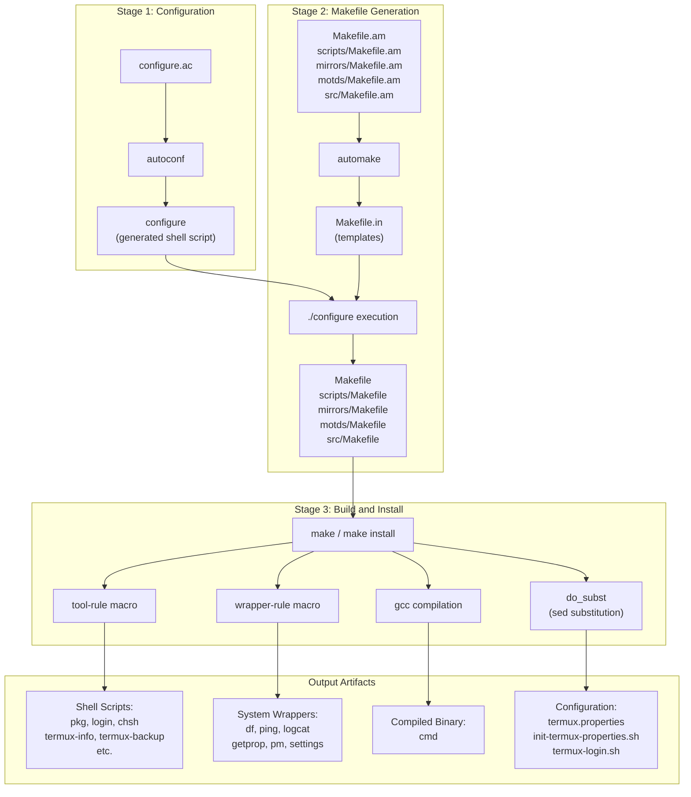
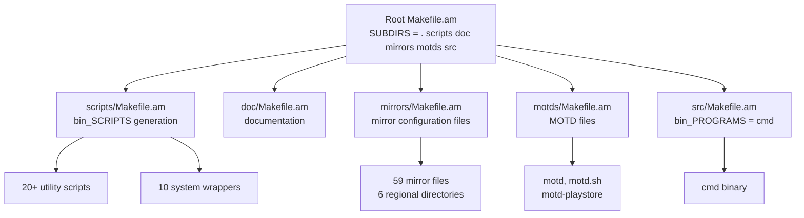
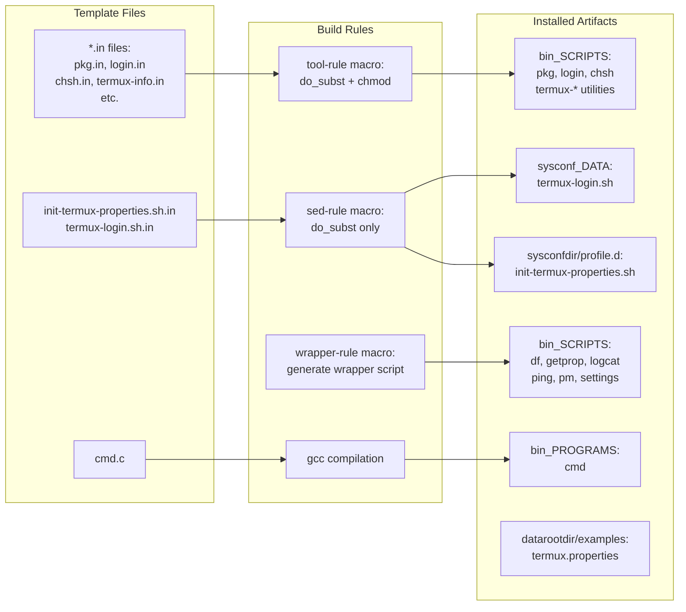

<!-- source: DeepWiki mcp.deepwiki.com · repo termux/termux-tools · page 4 Build System · fetched 2026-10-26 -->

# Build System

<details>
<summary>Relevant source files</summary>

The following files were used as context for generating this wiki page:

- [Makefile.am](Makefile.am)
- [configure.ac](configure.ac)
- [init-termux-properties.sh.in](init-termux-properties.sh.in)
- [mirrors/europe/termux.cdn.lumito.net](mirrors/europe/termux.cdn.lumito.net)
- [mirrors/north_america/mirror.quantum5.ca](mirrors/north_america/mirror.quantum5.ca)
- [scripts/Makefile.am](scripts/Makefile.am)
- [src/Makefile.am](src/Makefile.am)
- [src/cmd.c](src/cmd.c)
- [termux-login.sh.in](termux-login.sh.in)
- [termux.properties](termux.properties)

</details>


The build system in termux-tools uses GNU Autoconf and Automake to generate environment-specific configurations and install scripts, wrappers, and utilities. This page provides an overview of the build pipeline architecture, from template processing to artifact generation.

For detailed information about specific build configuration variables and macros, see [Build Configuration](#4.1). For the complete Makefile hierarchy and installation targets, see [Makefile Structure](#4.2). For script generation mechanics, see [Script Generation](#4.3).

## Build Pipeline Architecture

The termux-tools build system follows a three-stage pipeline: configuration generation, Makefile generation, and artifact creation. The system processes template files (`.in` and `.am` files) through variable substitution to produce environment-specific executables and configuration files.

**Build Pipeline Flow**



Sources: [configure.ac:1-101](), [Makefile.am:1-89](), [scripts/Makefile.am:1-93]()

## Core Build Components

### configure.ac

The `configure.ac` file is the root configuration script that defines all Termux-specific variables and generates the `configure` shell script via `autoconf`. It establishes seven core environment variables that are substituted throughout the codebase:

| Variable | Default Value | Purpose |
|----------|---------------|---------|
| `TERMUX_APP_PACKAGE` | `com.termux` | Android application package identifier |
| `TERMUX_BASE_DIR` | `/data/data/com.termux/files` | Application base directory |
| `TERMUX_CACHE_DIR` | `/data/data/com.termux/cache` | Package cache directory |
| `TERMUX_PREFIX` | `$TERMUX_BASE_DIR/usr` | Installation prefix (like `/usr`) |
| `TERMUX_ANDROID_HOME` | `$TERMUX_BASE_DIR/home` | User home directory |
| `TERMUX_PACKAGE_FORMAT` | `debian` | Package format (debian or pacman) |
| `TERMUX_PACKAGE_MANAGER` | `apt` | Package manager (apt or pacman) |

These variables can be overridden via environment variables during configuration, enabling custom installations (e.g., `TERMUX_PREFIX=/custom/path ./configure`).

Sources: [configure.ac:34-93]()

### Makefile Hierarchy

The build system uses a hierarchical Makefile structure coordinated by `SUBDIRS`:



Sources: [Makefile.am:19](), [scripts/Makefile.am:20-27](), [src/Makefile.am:21]()

### Variable Substitution Engine

The `do_subst` macro implements template processing via `sed`, replacing `@VARIABLE@` placeholders with configured values:

```makefile
do_subst = sed -e "s%[@]TERMUX_PREFIX[@]%$(termux_prefix)%g" \
               -e "s%[@]TERMUX_APP_PACKAGE[@]%${termux_app_package}%g" \
               -e "s%[@]TERMUX_BASE_DIR[@]%${termux_base_dir}%g" \
               -e "s%[@]TERMUX_CACHE_DIR[@]%${termux_cache_dir}%g" \
               -e "s%[@]TERMUX_HOME[@]%${termux_android_home}%g" \
               -e "s%[@]PACKAGE_VERSION[@]%${PACKAGE_VERSION}%g" \
               -e "s%[@]TERMUX_PACKAGE_FORMAT[@]%${TERMUX_PACKAGE_FORMAT}%g" \
               -e "s%[@]TERMUX_PACKAGE_MANAGER[@]%${TERMUX_PACKAGE_MANAGER}%g"
```

This substitution applies to all `.in` template files, enabling environment-specific script generation.

Sources: [Makefile.am:28-35](), [scripts/Makefile.am:31-38]()

## Output Artifact Categories

The build system produces four distinct categories of outputs:

**Artifact Generation Mapping**



Sources: [scripts/Makefile.am:20-93](), [Makefile.am:44-76](), [src/Makefile.am:21-23]()

### 1. User-Facing Shell Scripts

Scripts generated from `.in` templates via the `tool-rule` macro, which performs variable substitution and sets executable permissions:

```makefile
define tool-rule
$1: $1.in Makefile
	@echo "Creating $1"
	@$$(do_subst) < $(srcdir)/$1.in > $1
	@chmod u+x $1
endef
```

Examples: `pkg`, `login`, `chsh`, `termux-info`, `termux-backup`, `termux-change-repo`, `termux-reset`, and 13 other utilities.

Sources: [scripts/Makefile.am:40-45](), [scripts/Makefile.am:64-81]()

### 2. System Binary Wrappers

Auto-generated wrapper scripts that isolate Android system binaries from Termux's library environment:

```makefile
define wrapper-rule
$1: Makefile
	@echo "Creating $1 wrapper"
	@echo '#!/bin/sh' > $1
	@echo 'unset LD_LIBRARY_PATH LD_PRELOAD' >> $1
	@echo -n 'PATH=/system/bin ' >> $1
	@echo "exec /system/bin/$1 \"\$$$$@\"" >> $1
	@chmod u+x $1
endef
```

Examples: `df`, `getprop`, `logcat`, `ping`, `ping6`, `pm`, `settings`, `top`, `mount`, `umount`.

Sources: [scripts/Makefile.am:47-59](), [scripts/Makefile.am:83-92]()

### 3. Compiled C Programs

Binary programs built from C source files with standard compilation flags:

```makefile
AM_CFLAGS = -Wall -Wextra -pedantic
bin_PROGRAMS = cmd
cmd_SOURCES = cmd.c
```

The `cmd` utility provides isolated execution of Android's `/system/bin/cmd` with proper stdio redirection through pipes and threads.

Sources: [src/Makefile.am:19-23](), [src/cmd.c:1-124]()

### 4. Configuration Files

System and user configuration files generated from templates:

- **sysconf_DATA**: `termux-login.sh` (sourced by `/usr/bin/login`)
- **profile.d scripts**: `init-termux-properties.sh` (auto-creates user config)
- **examples**: `termux.properties` (template for user customization)

Sources: [Makefile.am:44-76](), [init-termux-properties.sh.in:1-5](), [termux-login.sh.in:1-4]()

## Build Process Execution

The typical build workflow involves three commands:

```bash
# 1. Generate configure script (maintainers only)
autoconf

# 2. Configure for environment
./configure

# 3. Build and install
make
make install
```

The `configure` script accepts environment variable overrides:

```bash
TERMUX_PREFIX=/custom/prefix ./configure
TERMUX_PACKAGE_MANAGER=pacman ./configure
```

### Debian Package Integration

The root Makefile generates Debian control files required for `.deb` packaging:

```makefile
create-deb-control-files:
	printf "" > conffiles
	for f in $(CONFFILES); do \
		printf "%s\n" "$$f" >> conffiles; \
	done
	printf "#!%s/bin/bash\n\n" "${termux_prefix}" > preinst
```

This produces:
- **conffiles**: List of configuration files to preserve during upgrades
- **preinst**: Pre-installation script (currently just a shebang)

Sources: [Makefile.am:57-62]()

## Installation Directory Structure

The build system installs files into a hierarchical directory structure under `$TERMUX_PREFIX`:

| Directory | Content | Source |
|-----------|---------|--------|
| `bin/` | Executable scripts and programs | `scripts/Makefile.am`, `src/Makefile.am` |
| `etc/` | System configuration files | `Makefile.am` (sysconf_DATA) |
| `etc/profile.d/` | Profile initialization scripts | `Makefile.am` (pkgdata_PROFILE) |
| `share/examples/termux/` | Example configuration files | `Makefile.am` (pkgdata_EXAMPLES) |
| `var/service/termux/mirrors/` | Mirror configuration files | `mirrors/Makefile.am` |

The installation respects `DESTDIR` for staged installations during package building:

```bash
make install DESTDIR=/tmp/build-root
```

Sources: [Makefile.am:66-76](), [scripts/Makefile.am:61-62]()

## Build-Time Code Generation

The build system demonstrates three distinct code generation patterns:

**Generation Pattern Comparison**

| Pattern | Macro | Input | Process | Output |
|---------|-------|-------|---------|--------|
| **Template Processing** | `tool-rule` | `.in` file | `do_subst` + `chmod` | Executable script |
| **Configuration Processing** | `sed-rule` | `.in` file | `do_subst` only | Non-executable config |
| **Wrapper Generation** | `wrapper-rule` | None | Echo commands | Isolation wrapper |
| **Native Compilation** | Standard make | `.c` file | `gcc` with `AM_CFLAGS` | Binary executable |

The `tool-rule` and `wrapper-rule` macros are invoked via `eval`:

```makefile
$(eval $(call tool-rule,pkg))
$(eval $(call wrapper-rule,df))
```

This expands to Make rules that are interpreted during Makefile processing.

Sources: [scripts/Makefile.am:40-59](), [scripts/Makefile.am:64-92]()

---

