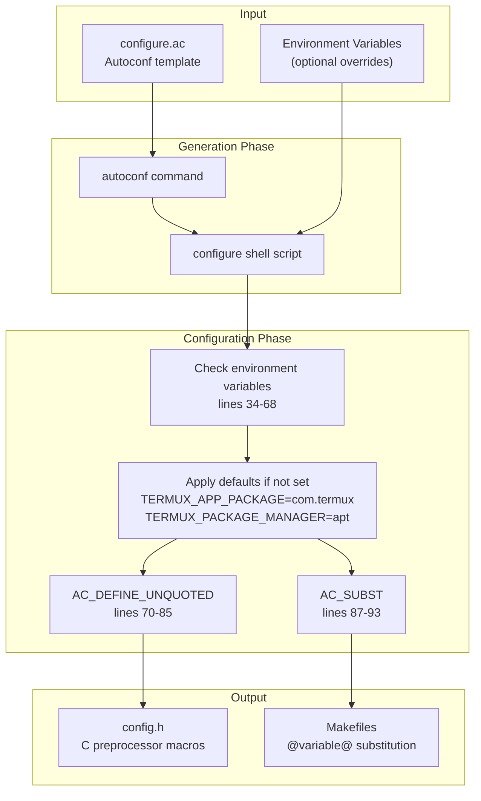
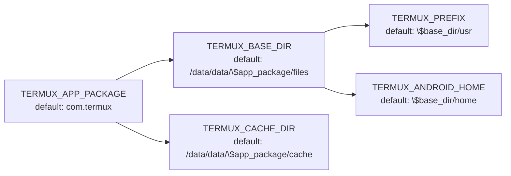
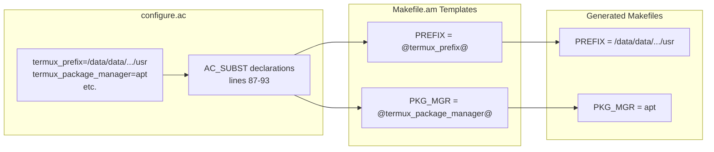
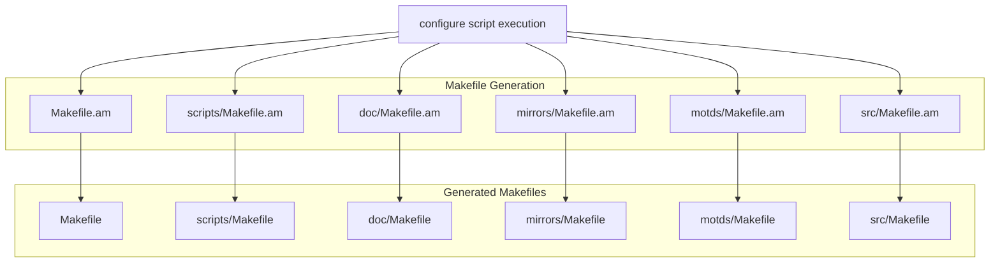

<!-- source: DeepWiki mcp.deepwiki.com · repo termux/termux-tools · page 4.1 Build Configuration · fetched 2026-10-26 -->

# Build Configuration

<details>
<summary>Relevant source files</summary>

The following files were used as context for generating this wiki page:

- [configure.ac](configure.ac)
- [mirrors/europe/termux.cdn.lumito.net](mirrors/europe/termux.cdn.lumito.net)
- [mirrors/north_america/mirror.quantum5.ca](mirrors/north_america/mirror.quantum5.ca)

</details>


## Purpose and Scope

This document explains the build-time configuration system for termux-tools, centered on the `configure.ac` Autoconf script. It covers how Termux-specific directory paths and package manager settings are determined, how environment variables can override defaults, and how these values are propagated to generated files through variable substitution and C preprocessor macros.

For information about the generated Makefiles and their structure, see [Makefile Structure](#4.2). For details on how configuration variables are substituted into shell scripts, see [Script Generation](#4.3).

**Sources:** [configure.ac:1-101]()

---

## Configuration Overview

The `configure.ac` file is an Autoconf template that generates the `configure` shell script during the build process. This script performs three primary functions:

1. **Variable Determination**: Establishes Termux-specific paths and settings, with support for environment variable overrides
2. **C Macro Generation**: Creates preprocessor definitions for compilation of C programs
3. **Makefile Substitution**: Exports variables for use in Automake templates

The configuration system allows flexibility for different Termux environments (official app vs. custom builds) while maintaining sensible defaults for standard installations.



**Diagram: Build Configuration Flow**

**Sources:** [configure.ac:24-100]()

---

## Configuration Variables

The configuration system manages seven core variables that define the Termux environment. Each variable follows a two-step process: first checking for an environment variable override, then applying a default value if not set.

### Variable Reference Table

| Variable | Default Value | Purpose | Defined At |
|----------|---------------|---------|------------|
| `termux_app_package` | `com.termux` | Android app package name, used for app-specific paths | [configure.ac:34-38]() |
| `termux_base_dir` | `/data/data/$termux_app_package/files` | Root directory of the Termux installation | [configure.ac:39-43]() |
| `termux_cache_dir` | `/data/data/$termux_app_package/cache` | Package cache directory | [configure.ac:44-48]() |
| `termux_prefix` | `$termux_base_dir/usr` | Installation prefix (equivalent to `/usr` on Linux) | [configure.ac:49-53]() |
| `termux_android_home` | `$termux_base_dir/home` | User home directory | [configure.ac:54-58]() |
| `termux_package_format` | `debian` | Package format: `debian` or `pacman` | [configure.ac:59-63]() |
| `termux_package_manager` | `apt` | Package manager: `apt` or `pacman` | [configure.ac:64-68]() |

### Variable Dependencies

Several variables depend on earlier variables in the configuration sequence:



**Diagram: Configuration Variable Dependencies**

**Sources:** [configure.ac:34-68]()

---

## Environment Variable Override Mechanism

All configuration variables can be overridden by setting corresponding environment variables before running `configure`. The override logic uses a consistent pattern implemented via shell conditional tests.

### Override Pattern

Each variable uses this pattern from [configure.ac:34-43]():

```bash
if test "${TERMUX_APP_PACKAGE+set}" = set; then
  termux_app_package="$TERMUX_APP_PACKAGE"
else
  termux_app_package="com.termux"
fi
```

The `${VAR+set}` expansion returns "set" if the variable is defined (even if empty), enabling detection of environment overrides.

### Common Override Scenarios

**Custom App Package**: For forked Termux variants:
```bash
TERMUX_APP_PACKAGE="com.custom.termux" ./configure
```

**Alternative Installation Location**: For non-standard paths:
```bash
TERMUX_BASE_DIR="/custom/path" ./configure
```

**Pacman-based Installation**: For Arch Linux-style package management:
```bash
TERMUX_PACKAGE_FORMAT="pacman" TERMUX_PACKAGE_MANAGER="pacman" ./configure
```

**Sources:** [configure.ac:34-68]()

---

## C Preprocessor Macro Generation

The `AC_DEFINE_UNQUOTED` macro generates C preprocessor definitions that are written to `config.h`. These macros allow compiled C programs (like `src/cmd.c`) to access configuration values at compile time.

### Generated Macros

```mermaid
graph TD
    subgraph "configure.ac Definitions"
        AC_DEF_COPYRIGHT["AC_DEFINE_UNQUOTED(COPYRIGHT)<br/>line 70"]
        AC_DEF_APP["AC_DEFINE_UNQUOTED(TERMUX_APP_PACKAGE)<br/>line 72"]
        AC_DEF_BASE["AC_DEFINE_UNQUOTED(TERMUX_BASE_DIR)<br/>line 74"]
        AC_DEF_CACHE["AC_DEFINE_UNQUOTED(TERMUX_CACHE_DIR)<br/>line 76"]
        AC_DEF_PREFIX["AC_DEFINE_UNQUOTED(TERMUX_PREFIX)<br/>line 78"]
        AC_DEF_HOME["AC_DEFINE_UNQUOTED(TERMUX_ANDROID_HOME)<br/>line 80"]
        AC_DEF_FORMAT["AC_DEFINE_UNQUOTED(TERMUX_PACKAGE_FORMAT)<br/>line 82"]
        AC_DEF_MANAGER["AC_DEFINE_UNQUOTED(TERMUX_PACKAGE_MANAGER)<br/>line 84"]
    end
    
    subgraph "Generated config.h"
        MACRO_COPYRIGHT["#define COPYRIGHT \"Copyright...\""]
        MACRO_APP["#define TERMUX_APP_PACKAGE \"com.termux\""]
        MACRO_BASE["#define TERMUX_BASE_DIR \"/data/data/...\""]
        MACRO_CACHE["#define TERMUX_CACHE_DIR \"/data/data/.../cache\""]
        MACRO_PREFIX["#define TERMUX_PREFIX \"/data/data/.../usr\""]
        MACRO_HOME["#define TERMUX_ANDROID_HOME \"/data/data/.../home\""]
        MACRO_FORMAT["#define TERMUX_PACKAGE_FORMAT \"debian\""]
        MACRO_MANAGER["#define TERMUX_PACKAGE_MANAGER \"apt\""]
    end
    
    AC_DEF_COPYRIGHT --> MACRO_COPYRIGHT
    AC_DEF_APP --> MACRO_APP
    AC_DEF_BASE --> MACRO_BASE
    AC_DEF_CACHE --> MACRO_CACHE
    AC_DEF_PREFIX --> MACRO_PREFIX
    AC_DEF_HOME --> MACRO_HOME
    AC_DEF_FORMAT --> MACRO_FORMAT
    AC_DEF_MANAGER --> MACRO_MANAGER
```



**Diagram: C Preprocessor Macro Generation**

The `AC_DEFINE_UNQUOTED` macro is used instead of `AC_DEFINE` because variable values need to be expanded at configure-time, not treated as literal strings. Each definition includes a descriptive comment (third parameter) that appears in `config.h`.

### Usage in C Programs

C source files include `config.h` to access these definitions:

```c
#include "config.h"

// Example usage from src/cmd.c
fprintf(stdout, "Termux prefix: %s\n", TERMUX_PREFIX);
fprintf(stdout, "Package manager: %s\n", TERMUX_PACKAGE_MANAGER);
```

**Sources:** [configure.ac:70-85]()

---

## Makefile Variable Substitution

The `AC_SUBST` macro marks variables for substitution into generated Makefiles. When Automake processes `.am` templates, it replaces `@variable@` placeholders with the configured values.

### Substitution Declaration

All configuration variables are registered for substitution at [configure.ac:87-93]():

```
AC_SUBST(termux_app_package)
AC_SUBST(termux_base_dir)
AC_SUBST(termux_cache_dir)
AC_SUBST(termux_prefix)
AC_SUBST(termux_android_home)
AC_SUBST(termux_package_format)
AC_SUBST(termux_package_manager)
```

### Substitution Flow



**Diagram: Variable Substitution Process**

### Usage in Makefiles

The substituted variables are then used in `Makefile.am` files to configure installation paths and script generation. For example, from `scripts/Makefile.am`:

```makefile
do_subst = sed -e 's![@]TERMUX_PREFIX@!$(termux_prefix)!g' \
               -e 's![@]TERMUX_ANDROID_HOME@!$(termux_android_home)!g' \
               -e 's![@]TERMUX_PACKAGE_MANAGER@!$(termux_package_manager)!g'
```

This `do_subst` command is used to transform `.in` template files into final executable scripts with environment-specific paths. See [Script Generation](#4.3) for details.

**Sources:** [configure.ac:87-93]()

---

## Output File Configuration

The final section of `configure.ac` specifies which Makefiles to generate from their `.am` templates using the `AC_CONFIG_FILES` macro at [configure.ac:97-98]():

```
AC_CONFIG_FILES([Makefile scripts/Makefile doc/Makefile
mirrors/Makefile motds/Makefile src/Makefile])
```

### Generated File Hierarchy

| Input Template | Generated File | Purpose |
|----------------|----------------|---------|
| `Makefile.am` | `Makefile` | Root build coordination |
| `scripts/Makefile.am` | `scripts/Makefile` | Script generation and installation |
| `doc/Makefile.am` | `doc/Makefile` | Documentation installation |
| `mirrors/Makefile.am` | `mirrors/Makefile` | Mirror file deployment |
| `motds/Makefile.am` | `motds/Makefile` | MOTD generation |
| `src/Makefile.am` | `src/Makefile` | C program compilation |

The `AC_OUTPUT` macro at [configure.ac:100]() triggers the actual generation of these files when `configure` is executed.



**Diagram: Makefile Generation from Templates**

Each generated Makefile contains the substituted configuration variables, allowing consistent path references throughout the build system.

**Sources:** [configure.ac:95-100]()

---

## Autoconf and Automake Integration

The build configuration uses standard GNU Autotools conventions with Termux-specific extensions.

### Initialization Macros

The configuration begins with standard Autoconf/Automake initialization at [configure.ac:24-31]():

| Macro | Purpose | Parameters |
|-------|---------|------------|
| `AC_PREREQ([2.69])` | Require Autoconf version 2.69 or later | Ensures compatibility |
| `AC_INIT` | Initialize package metadata | Name: `termux-tools`, Version: `1.47.1`, Bug report: `support@termux.dev` |
| `AM_INIT_AUTOMAKE([foreign])` | Initialize Automake with foreign option | `foreign` disables GNU-specific file requirements |
| `AC_PROG_MAKE_SET` | Detect make program | Ensures `$(MAKE)` works correctly |
| `AC_PROG_CC` | Detect C compiler | Required for compiling C programs |
| `AC_LANG(C)` | Set default language to C | Affects subsequent compiler tests |
| `AC_PROG_LN_S` | Detect symbolic link support | Used for creating symlinks during installation |

The `foreign` option for Automake is particularly important—it allows the project to omit GNU-mandated files like `NEWS`, `AUTHORS`, and `ChangeLog` which are not relevant for this codebase.

**Sources:** [configure.ac:24-31,95]()

---

## Configuration Summary

The build configuration system provides a flexible, environment-aware foundation for termux-tools:

1. **Default Values**: Sensible defaults for standard Termux installations (`com.termux` package, `apt` package manager, standard paths)
2. **Override Support**: All variables can be overridden via environment variables for custom builds
3. **Dual Output**: Configuration values are made available to both C programs (via `config.h` macros) and Makefiles (via `@variable@` substitution)
4. **Hierarchical Generation**: Variables with dependencies are resolved in the correct order

This configuration is executed once during the build preparation phase. The resulting Makefiles and compiled binaries embed these paths, ensuring runtime components can locate Termux directories without hardcoded paths.

For details on how these variables are used during the actual build process, see [Makefile Structure](#4.2). For information on script template substitution, see [Script Generation](#4.3).

**Sources:** [configure.ac:1-101]()

---

