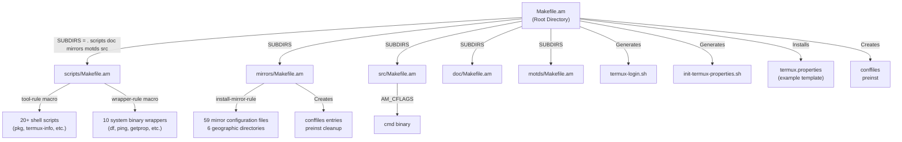
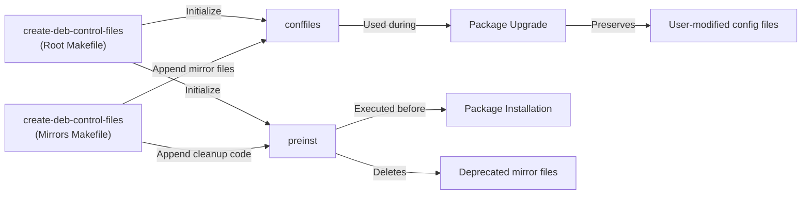
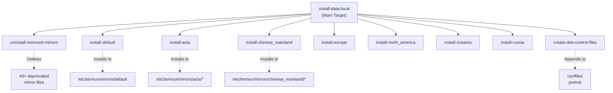
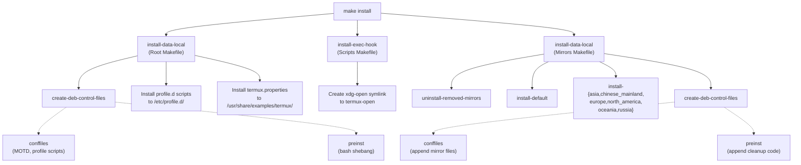

<!-- source: DeepWiki mcp.deepwiki.com · repo termux/termux-tools · page 4.2 Makefile Structure · fetched 2026-10-26 -->

# Makefile Structure

<details>
<summary>Relevant source files</summary>

The following files were used as context for generating this wiki page:

- [Makefile.am](Makefile.am)
- [init-termux-properties.sh.in](init-termux-properties.sh.in)
- [mirrors/Makefile.am](mirrors/Makefile.am)
- [scripts/Makefile.am](scripts/Makefile.am)
- [src/Makefile.am](src/Makefile.am)
- [src/cmd.c](src/cmd.c)
- [termux-login.sh.in](termux-login.sh.in)
- [termux.properties](termux.properties)

</details>


This document describes the Automake-based build system's Makefile hierarchy in termux-tools. It covers how the root [Makefile.am]() orchestrates subdirectory builds, the variable substitution mechanism (`do_subst`), macro definitions for script generation, mirror file installation, and Debian control file generation. For information about the build configuration process that generates these Makefiles, see [Build Configuration](#4.1). For details on how template files are processed, see [Script Generation](#4.3).

## Overview

The termux-tools build system uses a three-level Makefile hierarchy coordinated through Automake's `SUBDIRS` variable. The root [Makefile.am:19]() defines five subdirectories that are built in order: the current directory (`.`), `scripts`, `doc`, `mirrors`, `motds`, and `src`. Each subdirectory contains its own `Makefile.am` that defines targets specific to that component.



**Sources:** [Makefile.am:19](), [scripts/Makefile.am](), [mirrors/Makefile.am](), [src/Makefile.am]()

## Root Makefile Coordination

The root [Makefile.am]() serves as the build orchestrator and defines system-wide variable substitution rules. It declares the `SUBDIRS` variable at [Makefile.am:19]() to specify build order: the current directory builds first (generating `termux-login.sh` and `init-termux-properties.sh`), followed by subdirectories.

### Variable Substitution Mechanism

The `do_subst` variable at [Makefile.am:28-35]() defines a `sed` command that performs template substitution on `.in` files. It replaces placeholder tokens with configuration values:

| Placeholder | Replaced With | Usage |
|-------------|---------------|-------|
| `@TERMUX_PREFIX@` | `$(termux_prefix)` | Installation directory (typically `/data/data/com.termux/files/usr`) |
| `@TERMUX_APP_PACKAGE@` | `${termux_app_package}` | Android app package name |
| `@TERMUX_BASE_DIR@` | `${termux_base_dir}` | Base directory for Termux files |
| `@TERMUX_CACHE_DIR@` | `${termux_cache_dir}` | Package cache location |
| `@TERMUX_HOME@` | `${termux_android_home}` | User home directory |
| `@PACKAGE_VERSION@` | `${PACKAGE_VERSION}` | Version number from configure.ac |
| `@TERMUX_PACKAGE_FORMAT@` | `${TERMUX_PACKAGE_FORMAT}` | Package format (debian or pacman) |
| `@TERMUX_PACKAGE_MANAGER@` | `${TERMUX_PACKAGE_MANAGER}` | Package manager executable name |

The `sed-rule` macro at [Makefile.am:37-41]() applies this substitution to generate files from templates. For example, [Makefile.am:51]() uses it to generate `init-termux-properties.sh` from [init-termux-properties.sh.in]().

**Sources:** [Makefile.am:28-41](), [Makefile.am:51-53]()

### Configuration Files and Examples

The root Makefile declares two categories of data files:

- **Profile Scripts** (`pkgdata_PROFILE`): [Makefile.am:47]() lists `init-termux-properties.sh`, which is installed to `/etc/profile.d/` to initialize user configuration on shell startup
- **Example Templates** (`pkgdata_EXAMPLES`): [Makefile.am:49]() lists `termux.properties`, installed to `/usr/share/examples/termux/` as the template for user configuration

The `install-data-local` target at [Makefile.am:66-76]() creates necessary directories and installs these files with appropriate permissions (644 for read-only configuration).

**Sources:** [Makefile.am:47-49](), [Makefile.am:66-76]()

## Debian Package Integration

Both the root and mirrors Makefiles generate Debian control files required for proper package management behavior.

### Control File Generation

The `create-deb-control-files` target at [Makefile.am:57-62]() generates two files:

1. **conffiles**: Lists configuration files that should not be automatically overwritten during package upgrades. The root Makefile defines `CONFFILES` at [Makefile.am:21-26]() to include:
   - `/etc/motd`, `/etc/motd.sh`, `/etc/motd-playstore`
   - `/etc/profile.d/init-termux-properties.sh`
   - `/etc/termux-login.sh`

2. **preinst**: A pre-installation script that runs before package installation. The root Makefile initializes it with a bash shebang at [Makefile.am:62]().

The mirrors Makefile extends these files at [mirrors/Makefile.am:149-151]():
- Appends all mirror files to `conffiles` using a `find` command
- Appends cleanup code to `preinst` that removes deprecated mirrors listed in `pkgdata_MIRRORS_REMOVED` (40+ old mirrors at [mirrors/Makefile.am:51-90]())



**Sources:** [Makefile.am:21-26](), [Makefile.am:57-62](), [mirrors/Makefile.am:149-151]()

## Scripts Makefile

The [scripts/Makefile.am]() generates two types of executables: shell scripts from `.in` templates and wrapper scripts for Android system binaries.

### Generated Scripts List

The `bin_SCRIPTS` variable at [scripts/Makefile.am:20-27]() declares all scripts to be installed to `/usr/bin`:

**User Utilities** (20 scripts):
- Package management: `pkg`, `termux-change-repo`, `termux-setup-package-manager`
- System integration: `chsh`, `dalvikvm`, `login`, `su`
- Backup/restore: `termux-backup`, `termux-restore`
- Android integration: `termux-open`, `termux-open-url`, `termux-setup-storage`, `termux-wake-lock`, `termux-wake-unlock`
- System management: `termux-fix-shebang`, `termux-info`, `termux-reload-settings`, `termux-reset`

**System Binary Wrappers** (10 scripts):
- File system: `df`
- Android system: `getprop`, `logcat`, `pm`, `settings`, `top`
- Networking: `ping`, `ping6`

### Macro Definitions

Two key macros generate scripts:

1. **tool-rule** ([scripts/Makefile.am:40-45]()): Generates scripts from `.in` templates by applying `do_subst` substitution and making the output executable:
```makefile
define tool-rule
$1: $1.in Makefile
	@echo "Creating $1"
	@$$(do_subst) < $(srcdir)/$1.in > $1
	@chmod u+x $1
endef
```

2. **wrapper-rule** ([scripts/Makefile.am:47-59]()): Generates wrapper scripts that execute Android system binaries with cleaned environment:
```makefile
define wrapper-rule
$1: Makefile
	@echo "Creating $1 wrapper"
	@echo '#!/bin/sh' > $1
	@echo 'unset LD_LIBRARY_PATH LD_PRELOAD' >> $1
	@echo -n 'PATH=/system/bin ' >> $1
	@echo "exec /system/bin/$1 \"\$$$$@\"" >> $1
	@chmod u+x $1
endef
```

The wrappers unset `LD_LIBRARY_PATH` and `LD_PRELOAD` at [scripts/Makefile.am:53]() to prevent Termux libraries from interfering with Android system binaries.

### Macro Invocations

The Makefile invokes these macros using `$(eval $(call ...))` syntax. For example:
- [scripts/Makefile.am:64-81](): Invokes `tool-rule` for each user utility script
- [scripts/Makefile.am:83-92](): Invokes `wrapper-rule` for each system binary wrapper

Additionally, [scripts/Makefile.am:61-62]() defines an `install-exec-hook` that creates a symlink from `termux-open` to `xdg-open` for compatibility.

**Sources:** [scripts/Makefile.am:20-27](), [scripts/Makefile.am:40-59](), [scripts/Makefile.am:61-92]()

## Mirrors Makefile

The [mirrors/Makefile.am]() manages installation of 59 mirror configuration files organized into 6 geographic regions plus a default mirror.

### Mirror Organization Variables

The Makefile defines separate variables for each region at [mirrors/Makefile.am:2-42]():

| Variable | Region | Count | Line Reference |
|----------|--------|-------|----------------|
| `pkgdata_MIRRORS` | Default (Cloudflare CDN) | 1 | [mirrors/Makefile.am:2]() |
| `pkgdata_ASIA_MIRRORS` | Asia (excl. China/Russia) | 14 | [mirrors/Makefile.am:5-11]() |
| `pkgdata_CHINESE_MAINLAND_MIRRORS` | Chinese Mainland | 15 | [mirrors/Makefile.am:14-19]() |
| `pkgdata_EUROPE_MIRRORS` | Europe | 19 | [mirrors/Makefile.am:22-30]() |
| `pkgdata_NORTH_AMERICA_MIRRORS` | North America | 8 | [mirrors/Makefile.am:33-36]() |
| `pkgdata_OCEANIA_MIRRORS` | Oceania | 1 | [mirrors/Makefile.am:39]() |
| `pkgdata_RUSSIA_MIRRORS` | Russia | 2 | [mirrors/Makefile.am:42]() |

### Deprecated Mirror Cleanup

The `pkgdata_MIRRORS_REMOVED` variable at [mirrors/Makefile.am:51-90]() lists 40+ deprecated mirror paths. These are removed during package upgrades because Debian's conffile mechanism only deletes removed configuration files when a package is purged, not during upgrades. The comment at [mirrors/Makefile.am:46-50]() explains this behavior.

### Installation Macros

Two macros handle regional mirror installation:

1. **install-mirror-rule** ([mirrors/Makefile.am:94-101]()): Creates a regional directory under `/etc/termux/mirrors/` and installs all mirrors for that region:
```makefile
define install-mirror-rule
install-$1:
	$$(MKDIR_P) $$(DESTDIR)$$(sysconfdir)/termux/mirrors/$1
	for f in $$(pkgdata_$2_MIRRORS); do \
		$(INSTALL) -m 644 $(srcdir)/$1/$$$$f \
		$(DESTDIR)$(sysconfdir)/termux/mirrors/$1; \
	done
endef
```

2. **uninstall-mirror-rule** ([mirrors/Makefile.am:103-109]()): Removes mirror files and attempts to remove the directory:
```makefile
define uninstall-mirror-rule
uninstall-$1:
	for f in $$(pkgdata_$2_MIRRORS); do \
		rm -f $(DESTDIR)$(sysconfdir)/termux/mirrors/$1/$$$$f; \
	done
	-rmdir $(DESTDIR)$(sysconfdir)/termux/mirrors/$1
endef
```

These macros are invoked at [mirrors/Makefile.am:111-123]() for all six regions.

### Special Targets

The Makefile defines three special installation targets:

1. **install-default** ([mirrors/Makefile.am:127-132]()): Installs the default Cloudflare mirror directly to `/etc/termux/mirrors/` (not in a subdirectory)

2. **uninstall-removed-mirrors** ([mirrors/Makefile.am:142-145]()): Iterates through `pkgdata_MIRRORS_REMOVED` and deletes each deprecated mirror file

3. **create-deb-control-files** ([mirrors/Makefile.am:149-151]()): Appends mirror-specific content to Debian control files (as described in the Debian Package Integration section)

The main `install-data-local` target at [mirrors/Makefile.am:155]() chains these targets together: `uninstall-removed-mirrors install-default install-asia install-chinese_mainland install-europe install-north_america install-oceania install-russia create-deb-control-files`.



**Sources:** [mirrors/Makefile.am:2-42](), [mirrors/Makefile.am:51-90](), [mirrors/Makefile.am:94-123](), [mirrors/Makefile.am:127-157]()

## Source Compilation

The [src/Makefile.am]() compiles C programs using standard Automake variables.

### Compiler Flags

The `AM_CFLAGS` variable at [src/Makefile.am:19]() sets compilation flags for all C sources:
```makefile
AM_CFLAGS = -Wall -Wextra -pedantic
```

These flags enable comprehensive warnings and enforce strict C standard compliance.

### Binary Programs

The `bin_PROGRAMS` variable at [src/Makefile.am:21]() declares executables to be built and installed to `/usr/bin`:
```makefile
bin_PROGRAMS = cmd
```

Currently, only the `cmd` utility is compiled. The `cmd_SOURCES` variable at [src/Makefile.am:23]() specifies its source file: [src/cmd.c](). This utility (documented at [src/cmd.c:1-123]()) provides a wrapper around Android's `/system/bin/cmd` with proper stdio handling through pipes and threads.

**Sources:** [src/Makefile.am:19-23](), [src/cmd.c]()

## Installation Target Hierarchy

The build system uses Automake's `-local` target hooks to extend default behavior with custom installation logic.

### Install Data Flow



### Target Dependencies

Each Makefile defines local targets that are invoked by Automake at specific phases:

- **install-data-local**: Invoked during `make install` for installing data files (non-executables)
  - Root: [Makefile.am:66]()
  - Mirrors: [mirrors/Makefile.am:155]()

- **install-exec-hook**: Invoked after executables are installed, used for post-installation tasks
  - Scripts: [scripts/Makefile.am:61]()

- **uninstall-local**: Invoked during `make uninstall` to remove custom-installed files
  - Root: [Makefile.am:78]()
  - Mirrors: [mirrors/Makefile.am:157]()

The `EXTRA_DIST` variable (e.g., [Makefile.am:88](), [mirrors/Makefile.am:159-161]()) specifies additional files to include in distribution tarballs.

**Sources:** [Makefile.am:66-87](), [scripts/Makefile.am:61-62](), [mirrors/Makefile.am:155-161]()

## Build System Integration

The Makefiles work in concert with the broader build system defined in [configure.ac](#4.1):

1. **Configuration Phase**: Autoconf processes `configure.ac` to generate the `configure` script, which detects system properties and sets Termux-specific variables
2. **Generation Phase**: Automake processes `*.am` files with configured variables to generate `Makefile.in` templates
3. **Instantiation Phase**: The `configure` script processes `Makefile.in` templates to create final `Makefile` files with environment-specific paths
4. **Build Phase**: Make executes the generated Makefiles, invoking `do_subst` to process `.in` template files and generate final executables
5. **Installation Phase**: `make install` invokes `-local` targets to install files and generate Debian control files

This multi-stage pipeline ensures that all paths, package manager types, and environment-specific settings are correctly substituted into scripts and configuration files before installation.

**Sources:** [Makefile.am:19](), [Makefile.am:28-35](), [scripts/Makefile.am:31-38]()

---

