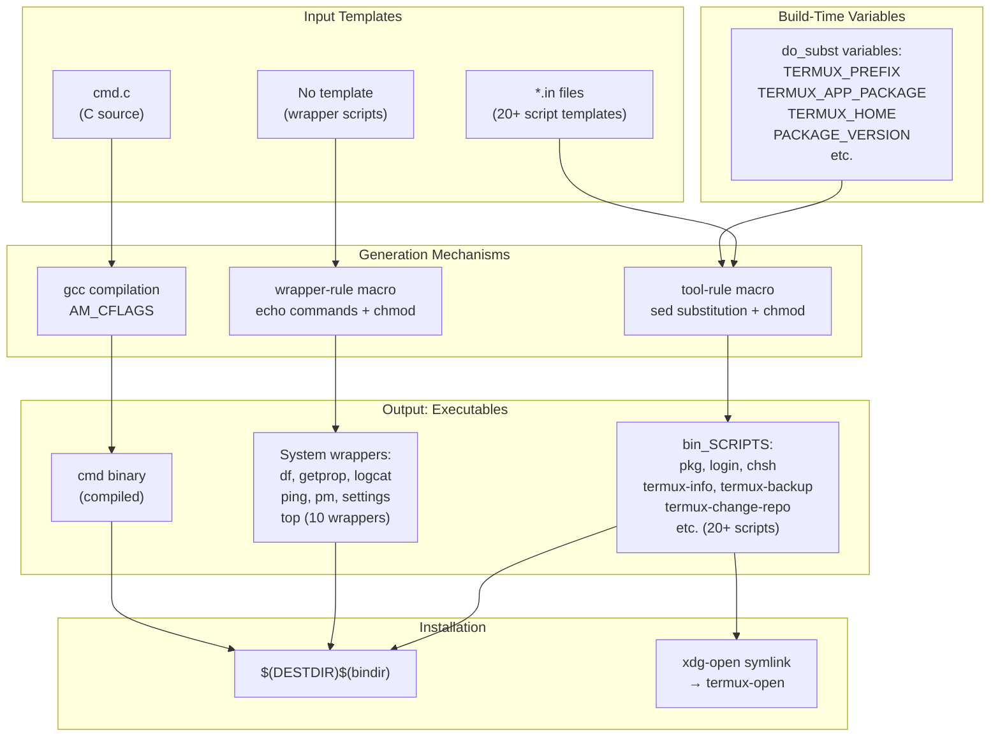
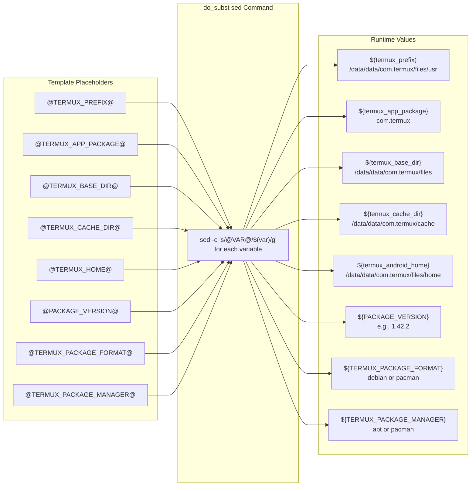
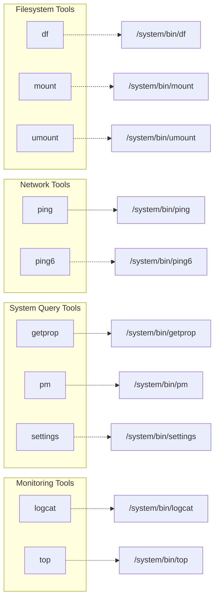
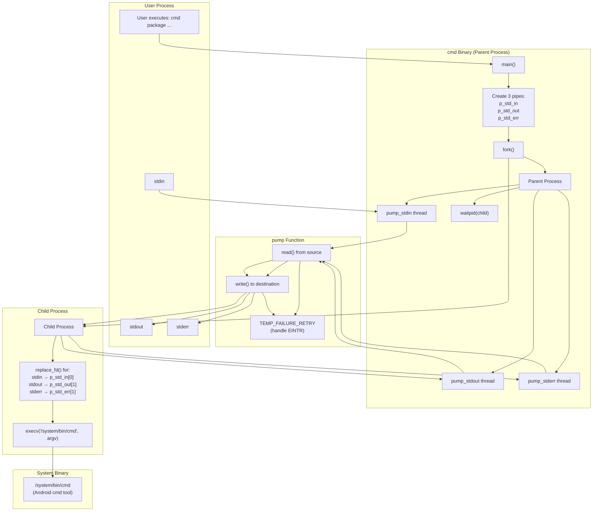

<!-- source: DeepWiki mcp.deepwiki.com · repo termux/termux-tools · page 4.3 Script Generation · fetched 2026-10-26 -->

# Script Generation

<details>
<summary>Relevant source files</summary>

The following files were used as context for generating this wiki page:

- [Makefile.am](Makefile.am)
- [init-termux-properties.sh.in](init-termux-properties.sh.in)
- [scripts/Makefile.am](scripts/Makefile.am)
- [src/Makefile.am](src/Makefile.am)
- [src/cmd.c](src/cmd.c)
- [termux-login.sh.in](termux-login.sh.in)
- [termux.properties](termux.properties)

</details>


This page documents the script generation subsystem of termux-tools, which transforms template files (`.in` files) into executable shell scripts with environment-specific configurations. The build system generates two categories of executables: (1) user-facing utility scripts with variable substitution, and (2) wrapper scripts that isolate Android system binaries from Termux's library environment. Additionally, a C-based utility provides process isolation for the Android `cmd` tool.

For information about how the build system is configured, see [Build Configuration](#4.1). For the overall Makefile organization, see [Makefile Structure](#4.2).

## Script Generation Pipeline

The script generation process occurs during the `make` build phase, after Autoconf has processed `configure.ac` and generated the `configure` script with environment-specific variables. The build system uses three distinct mechanisms to create executables:



**Sources:** [scripts/Makefile.am:1-93](), [src/Makefile.am:1-24]()

## Variable Substitution Mechanism

The `do_subst` variable defines a `sed` command that performs pattern replacement on template files. This mechanism allows scripts to reference installation-specific paths and configuration values determined during the `configure` phase.

### do_subst Definition

The substitution mechanism is defined identically in both `Makefile.am` and `scripts/Makefile.am`:



| Placeholder | Makefile Variable | Typical Value |
|------------|-------------------|---------------|
| `@TERMUX_PREFIX@` | `$(termux_prefix)` | `/data/data/com.termux/files/usr` |
| `@TERMUX_APP_PACKAGE@` | `${termux_app_package}` | `com.termux` |
| `@TERMUX_BASE_DIR@` | `${termux_base_dir}` | `/data/data/com.termux/files` |
| `@TERMUX_CACHE_DIR@` | `${termux_cache_dir}` | `/data/data/com.termux/cache` |
| `@TERMUX_HOME@` | `${termux_android_home}` | `/data/data/com.termux/files/home` |
| `@PACKAGE_VERSION@` | `${PACKAGE_VERSION}` | `1.42.2` (example) |
| `@TERMUX_PACKAGE_FORMAT@` | `${termux_package_format}` or `${TERMUX_PACKAGE_FORMAT}` | `debian` or `pacman` |
| `@TERMUX_PACKAGE_MANAGER@` | `${termux_package_manager}` or `${TERMUX_PACKAGE_MANAGER}` | `apt` or `pacman` |

**Sources:** [Makefile.am:28-35](), [scripts/Makefile.am:31-38]()

### sed-rule and tool-rule Macros

Two macros handle the actual generation process:

**sed-rule** (used in root `Makefile.am`):
```make
define sed-rule
$1: $1.in Makefile
	@echo "Creating $1"
	@$$(do_subst) < $(srcdir)/$1.in > $1
endef
```

**tool-rule** (used in `scripts/Makefile.am`):
```make
define tool-rule
$1: $1.in Makefile
	@echo "Creating $1"
	@$$(do_subst) < $(srcdir)/$1.in > $1
	@chmod u+x $1
endef
```

The only difference is that `tool-rule` adds `chmod u+x` to make the output executable. These macros are invoked with `$(eval $(call macro-name,script-name))`.

**Sources:** [Makefile.am:37-41](), [scripts/Makefile.am:40-45]()

## Tool Rule: Script Generation from Templates

The `tool-rule` macro generates executable scripts from `.in` template files. Each script listed in `bin_SCRIPTS` has a corresponding `.in` file in the `scripts/` directory.

### Generated Scripts


The complete list of `tool-rule` invocations in `scripts/Makefile.am`:

| Script | Purpose | Documented In |
|--------|---------|---------------|
| `chsh` | Change user shell | [Shell Configuration](#5.2) |
| `dalvikvm` | Dalvik VM wrapper | [System Binary Wrappers](#6.5) |
| `login` | Session initialization | [Login Process](#5.1) |
| `pkg` | Package manager wrapper | [pkg Command Reference](#3.1) |
| `su` | Superuser utility | [System Binary Wrappers](#6.5) |
| `termux-backup` | Backup PREFIX directory | [Backup and Restore](#6.2) |
| `termux-change-repo` | Mirror selection UI | [termux-change-repo](#3.3) |
| `termux-fix-shebang` | Shebang path fixer | [System Binary Wrappers](#6.5) |
| `termux-info` | System diagnostics | [System Information](#6.1) |
| `termux-open` | File/URL opener | [Android Integration Utilities](#6.3) |
| `termux-open-url` | URL opener wrapper | [Android Integration Utilities](#6.3) |
| `termux-reload-settings` | Reload app settings | [Settings and Reset](#6.4) |
| `termux-reset` | Full installation wipe | [Settings and Reset](#6.4) |
| `termux-restore` | Restore from backup | [Backup and Restore](#6.2) |
| `termux-setup-package-manager` | Package manager setup | [Package Management](#3) |
| `termux-setup-storage` | Storage permissions | [Android Integration Utilities](#6.3) |
| `termux-wake-lock` | Acquire wake lock | [Android Integration Utilities](#6.3) |
| `termux-wake-unlock` | Release wake lock | [Android Integration Utilities](#6.3) |

**Sources:** [scripts/Makefile.am:20-24](), [scripts/Makefile.am:64-81]()

### Template Example

The `init-termux-properties.sh.in` template demonstrates substitution:

```bash
if [ ! -f @TERMUX_HOME@/.config/termux/termux.properties ] && [ ! -e @TERMUX_HOME@/.termux/termux.properties ]; then
	mkdir -p @TERMUX_HOME@/.termux
	cp @TERMUX_PREFIX@/share/examples/termux/termux.properties @TERMUX_HOME@/.termux/
fi
```

After `do_subst` processing, this becomes (assuming default Termux installation):

```bash
if [ ! -f /data/data/com.termux/files/home/.config/termux/termux.properties ] && [ ! -e /data/data/com.termux/files/home/.termux/termux.properties ]; then
	mkdir -p /data/data/com.termux/files/home/.termux
	cp /data/data/com.termux/files/usr/share/examples/termux/termux.properties /data/data/com.termux/files/home/.termux/
fi
```

**Sources:** [init-termux-properties.sh.in:1-5]()

## Wrapper Rule: System Binary Isolation

The `wrapper-rule` macro generates shell scripts that wrap Android system binaries (located in `/system/bin`). These wrappers ensure that Termux's custom library paths do not interfere with Android's system tools.

### Wrapper Generation Mechanism

```mermaid
graph TB
    subgraph "wrapper-rule Macro"
        Input["Script name (e.g., 'df')"]
        Echo1["echo '#!/bin/sh' > script"]
        Echo2["echo 'unset LD_LIBRARY_PATH LD_PRELOAD' >> script"]
        Echo3["echo -n 'PATH=/system/bin ' >> script"]
        Echo4["echo 'exec /system/bin/script \"$$@\"' >> script"]
        ChmodX["chmod u+x script"]
    end
    
    subgraph "Generated Wrapper Example (df)"
        Line1["#!/bin/sh"]
        Line2["unset LD_LIBRARY_PATH LD_PRELOAD"]
        Line3["PATH=/system/bin exec /system/bin/df \"$@\""]
    end
    
    subgraph "Execution Behavior"
        UserCmd["User runs: df -h"]
        Unset["Environment vars unset:<br/>LD_LIBRARY_PATH<br/>LD_PRELOAD"]
        PathSet["PATH set to /system/bin"]
        Exec["exec /system/bin/df -h"]
    end
    
    Input --> Echo1
    Echo1 --> Echo2
    Echo2 --> Echo3
    Echo3 --> Echo4
    Echo4 --> ChmodX
    
    ChmodX --> Line1
    ChmodX --> Line2
    ChmodX --> Line3
    
    Line1 -.-> UserCmd
    Line2 -.-> Unset
    Line3 -.-> PathSet
    Line3 -.-> Exec
```

**Sources:** [scripts/Makefile.am:47-59]()

### Why Isolation Is Necessary

Termux sets `LD_LIBRARY_PATH` and `LD_PRELOAD` to use its own libraries (e.g., `termux-exec`). However, Android system binaries in `/system/bin` expect to link against Android's system libraries. If Termux's library paths are present, these binaries may:

1. Fail to load required dependencies
2. Link against incompatible library versions
3. Crash with dynamic linker errors

The wrappers prevent these issues by:
- **Unsetting** `LD_LIBRARY_PATH` and `LD_PRELOAD` to remove Termux libraries from the search path
- **Setting** `PATH=/system/bin` to ensure dependencies like `app_process` are available
- **Using** `exec` to replace the wrapper process with the actual system binary (avoiding unnecessary process overhead)

**Sources:** [scripts/Makefile.am:51-56]()

### Generated Wrappers

The following system binaries have wrappers generated:



| Wrapper | System Binary | Purpose |
|---------|--------------|---------|
| `df` | `/system/bin/df` | Disk space reporting |
| `getprop` | `/system/bin/getprop` | Android system property queries |
| `logcat` | `/system/bin/logcat` | Android log viewing |
| `mount` | `/system/bin/mount` | Filesystem mounting (not in bin_SCRIPTS but generated) |
| `ping` | `/system/bin/ping` | Network connectivity testing (IPv4) |
| `ping6` | `/system/bin/ping6` | Network connectivity testing (IPv6) |
| `pm` | `/system/bin/pm` | Android package manager queries |
| `settings` | `/system/bin/settings` | Android system settings management |
| `top` | `/system/bin/top` | Process monitoring |
| `umount` | `/system/bin/umount` | Filesystem unmounting (not in bin_SCRIPTS but generated) |

**Sources:** [scripts/Makefile.am:27](), [scripts/Makefile.am:83-92]()

## The cmd C Utility

The `cmd` utility is a compiled C program that provides process isolation for the Android `cmd` tool, which is used to interact with Android system services. Unlike the shell wrappers, `cmd` requires a more sophisticated isolation mechanism because it needs to handle stdin, stdout, and stderr streams correctly.

### cmd Architecture



**Sources:** [src/cmd.c:1-124]()

### Key Implementation Details

**Pipe-Based I/O Redirection:**
The parent process creates three bidirectional communication channels:
- `p_std_in[2]` - Parent writes to `[1]`, child reads from `[0]`
- `p_std_out[2]` - Child writes to `[1]`, parent reads from `[0]`
- `p_std_err[2]` - Child writes to `[1]`, parent reads from `[0]`

**Sources:** [src/cmd.c:52](), [src/cmd.c:80-82]()

**Threading Model:**
The parent process spawns three threads to handle asynchronous I/O:
1. `pump_stdin` (detached) - Copies data from user's stdin to child's stdin
2. `pump_stdout` (joined) - Copies data from child's stdout to user's stdout
3. `pump_stderr` (joined) - Copies data from child's stderr to user's stderr

The `pump()` function handles the actual data transfer with `TEMP_FAILURE_RETRY` to handle interrupted system calls:

**Sources:** [src/cmd.c:38-50](), [src/cmd.c:54-70](), [src/cmd.c:95-103]()

**Signal Handling:**
The parent ignores `SIGPIPE` to prevent crashes if the child process closes its stdin prematurely:

**Sources:** [src/cmd.c:93]()

**File Descriptor Replacement:**
The child process uses `replace_fd()` to atomically replace its standard file descriptors:

**Sources:** [src/cmd.c:72-77](), [src/cmd.c:116-118]()

**Execution:**
The child process calls `execv("/system/bin/cmd", argv)` to replace itself with the Android `cmd` binary, inheriting the redirected file descriptors:

**Sources:** [src/cmd.c:120]()

### Build Configuration

The `cmd` utility is compiled with strict compiler flags:

```make
AM_CFLAGS = -Wall -Wextra -pedantic

bin_PROGRAMS = cmd

cmd_SOURCES = cmd.c
```

**Sources:** [src/Makefile.am:19-23]()

## Installation Hooks

After script generation, additional installation steps occur:

### xdg-open Symlink

The `install-exec-hook` target creates a symlink from `xdg-open` to `termux-open`, providing compatibility with the XDG standard for opening files:

```make
install-exec-hook:
	@$(LN_S) -f termux-open $(DESTDIR)$(bindir)/xdg-open
```

This allows programs that use the `xdg-open` command to work correctly in Termux.

**Sources:** [scripts/Makefile.am:61-62]()

## Script Generation Summary Table

| Generation Method | Input | Output | Purpose | Count |
|------------------|-------|--------|---------|-------|
| `tool-rule` | `*.in` templates | Shell scripts | User utilities with environment substitution | 18 |
| `wrapper-rule` | None (generated) | Shell wrappers | System binary isolation | 10 |
| `sed-rule` | `*.in` templates | Config scripts | System initialization | 2 |
| Compilation | `cmd.c` | Binary executable | Process isolation for Android cmd | 1 |

**Total Generated Executables:** 31 scripts + 1 binary = 32 files

**Sources:** [scripts/Makefile.am:20-24](), [scripts/Makefile.am:27](), [Makefile.am:44-53](), [src/Makefile.am:21]()

---

